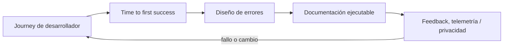
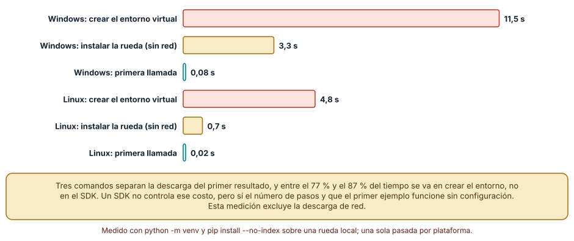
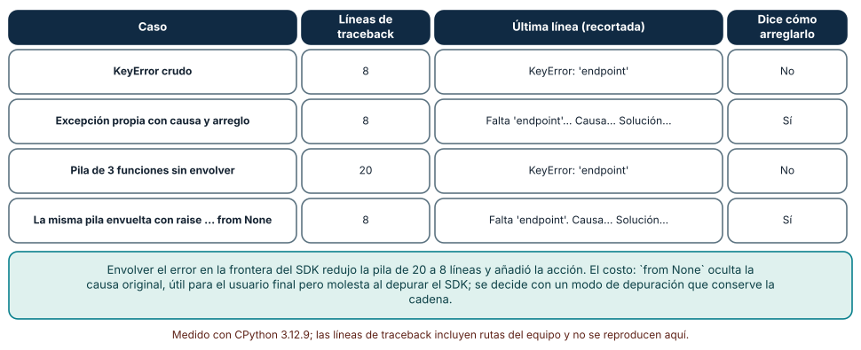
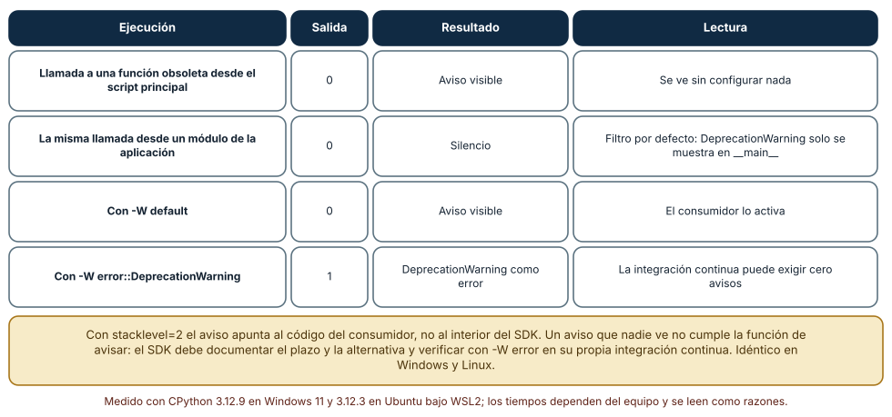

# SE-118 — Diseño de experiencia para desarrolladores

[← SE-117 — Licencias, procedencia y reutilización](https://github.com/vladimiracunadev-create/modern-software-engineering-program/blob/main/classes/part-09-bibliotecas-paquetes-sdk-y-automatizacion/se-117-licencias-procedencia-y-reutilizacion/README.md) · [↑ Parte 09](https://github.com/vladimiracunadev-create/modern-software-engineering-program/blob/main/classes/part-09-bibliotecas-paquetes-sdk-y-automatizacion/README.md) · [📚 Índice completo](https://github.com/vladimiracunadev-create/modern-software-engineering-program/blob/main/classes/README.md) · [🌐 Portal](https://vladimiracunadev-create.github.io/modern-software-engineering-program/classes/SE-118.html) · [SE-119 — Taller: empaquetar una capacidad reusable →](https://github.com/vladimiracunadev-create/modern-software-engineering-program/blob/main/classes/part-09-bibliotecas-paquetes-sdk-y-automatizacion/se-119-taller-empaquetar-una-capacidad-reusable/README.md)


## Punto profesional y fundamento pedagógico

**Punto profesional.** La clase existe para evaluar experiencia de desarrollador por tiempo de primera tarea, mensajes, recuperación y consistencia.

**Por qué aparece aquí.** Se sitúa después de **Licencias, procedencia y reutilización** y antes de **Taller: empaquetar una capacidad reusable**: convierte el conocimiento anterior en una decisión observable que la clase siguiente podrá reutilizar. La continuidad se comprueba en el artefacto, no por compartir vocabulario.

**Error conceptual que debe corregir.** Medir DX por apariencia o número de comandos.

**Secuencia de aprendizaje.** Antes de leer la solución, el estudiante predice el resultado del caso normal y del error conceptual anterior. Luego explica un caso resuelto paso a paso, construye un contraejemplo que cambie la decisión y, sin consultar el texto, reconstruye el mecanismo y lo aplica a una entrada nueva. La secuencia usa predicción, explicación propia, contraste y recuperación. [ICAP](https://icap.education.asu.edu/research) distingue participación de construcción de conocimiento; [How People Learn II](https://nap.nationalacademies.org/catalog/24783/how-people-learn-ii-learners-contexts-and-cultures) exige conectar conocimiento previo, contexto y transferencia; la [práctica de recuperación](https://pubmed.ncbi.nlm.nih.gov/16507066/) respalda producir de nuevo la explicación tras una demora; y [Education for Life and Work](https://nap.nationalacademies.org/resource/13398/dbasse_084153.pdf) exige devolución que explique la causa del error.

**Evidencia de aprendizaje.** Dx-study.md con tarea, tiempo, error inducido, mensaje y recuperación. Debe contener predicción previa, observación, explicación causal, contraejemplo, criterio de aceptación y una nota de qué dato haría cambiar la conclusión.

**Límite de la conclusión.** Una prueba interna pequeña no representa toda la población.

### Trazabilidad fuente → afirmación

| Fuente primaria u oficial | Afirmación que respalda | Lo que no prueba |
|---|---|---|
| [Python Standard Library](https://docs.python.org/3/library/index.html) | Argparse, importlib.metadata, subprocess y apis de automatización; autoridad: Python Software Foundation | No demuestra por sí sola que el artefacto del estudiante sea correcto. |
| [Python Packaging User Guide: Specifications](https://packaging.python.org/en/latest/specifications/) | Metadata, nombres, versiones, dependencias y artefactos de distribución; autoridad: Python Packaging Authority | No demuestra por sí sola que el artefacto del estudiante sea correcto. |
| [Semantic Versioning 2.0.0](https://semver.org/spec/v2.0.0.html) | Api pública, versiones, prereleases y compatibilidad declarada; autoridad: Semantic Versioning project | No demuestra por sí sola que el artefacto del estudiante sea correcto. |

## Antes de empezar

Esta clase continúa el **producto reutilizable con SDK y CLI de la Parte 09**. Recupera la evidencia de la clase anterior, añade una decisión propia de **Diseño de experiencia para desarrolladores** y deja un artefacto que la clase siguiente deberá consumir. La pregunta activa es: **¿Qué fricción encuentra una persona desde el primer contacto hasta diagnosticar y migrar?**

## Prerrequisitos

- Haber completado la clase anterior o reconstruir su contrato y evidencia.
- Python 3.11 o posterior, terminal, editor y Git; un segundo runtime es opcional y debe declararse.
- Trabajar con fixtures sintéticos: ninguna observación necesita datos de una persona o sistema real.

## Problema auténtico

La API del producto reutilizable con SDK y CLI es correcta, pero el quickstart omite autenticación, el ejemplo usa una versión antigua y los errores exponen stack traces sin acción sugerida.

## Objetivos observables

Al terminar podrás explicar los cinco mecanismos de esta clase, predecir su comportamiento antes de ejecutar, construir un caso normal y uno límite, diagnosticar el fallo controlado, comparar una alternativa y entregar evidencia que otra persona pueda reproducir.

## Mapa conceptual



El mapa se lee como una cadena de razonamiento, no como fases obligatorias del runtime. La flecha de retorno indica que un fallo o cambio de requisito obliga a revisar el modelo inicial; no autoriza a parchear solo la última salida.

## Temas y por qué importan

| Tema | Por qué cambia una decisión profesional | Evidencia mínima |
|---|---|---|
| Journey de desarrollador | La experiencia abarca descubrir, evaluar, instalar, lograr primer éxito, integrar, depurar, actualizar y abandonar. | Predicción, traza causal y contraejemplo de **Journey de desarrollador** en `dx-study.md` |
| Time to first success | Un camino mínimo debe producir resultado significativo con precondiciones explícitas. | Predicción, traza causal y contraejemplo de **Time to first success** en `dx-study.md` |
| Diseño de errores | Un error útil identifica qué falló, contexto seguro, acción y referencia estable. | Predicción, traza causal y contraejemplo de **Diseño de errores** en `dx-study.md` |
| Documentación ejecutable | Ejemplos se prueban contra versión publicada y usan datos sintéticos. | Predicción, traza causal y contraejemplo de **Documentación ejecutable** en `dx-study.md` |
| Feedback, telemetría y privacidad | Issues, soporte y telemetría pueden revelar fricción. | Predicción, traza causal y contraejemplo de **Feedback, telemetría y privacidad** en `dx-study.md` |
## Conceptos y decisiones

### 1. Journey de desarrollador

La experiencia abarca descubrir, evaluar, instalar, lograr primer éxito, integrar, depurar, actualizar y abandonar. Optimizar solo el quickstart oculta mantenimiento. Cada etapa tiene tarea, tiempo, error y evidencia.

### 2. Time to first success

Un camino mínimo debe producir resultado significativo con precondiciones explícitas. Reducir pasos mediante magia oculta puede empeorar diagnóstico. Se mide con usuario o entorno nuevo y se registra dónde solicita contexto no documentado.

### 3. Diseño de errores

Un error útil identifica qué falló, contexto seguro, acción y referencia estable. No filtra secretos ni exige buscar texto cambiante. Tipos de excepción, códigos y documentación deben contar la misma clasificación.

### 4. Documentación ejecutable

Ejemplos se prueban contra versión publicada y usan datos sintéticos. Tutorial, how-to, explicación y referencia resuelven necesidades distintas. Copiar snippets sin imports o cleanup convierte documentación en deuda.

### 5. Feedback, telemetría y privacidad

Issues, soporte y telemetría pueden revelar fricción. Telemetría debe tener propósito, minimización, consentimiento o base adecuada, retención y opt-out. No se usa vigilancia para suplir investigación con personas.

### Tiempo hasta el primer éxito

La experiencia de desarrollo empieza con cuánto tarda alguien en ver funcionar algo. Se midió el recorrido más corto de un SDK mínimo: crear un entorno virtual, instalar la rueda desde un directorio local (sin red) y hacer la primera llamada. Crear el entorno tardó 11,5 s en Windows y 4,8 s en Linux; instalar la rueda 3,3 s y 0,7 s; la primera llamada 0,08 s y 0,02 s. Son tres comandos y, además de la biblioteca, se instaló un script de consola. Entre el 77 % y el 87 % del tiempo total se fue en crear el entorno, algo que el SDK no controla.

Lo que sí controla es el número de pasos, que el primer ejemplo funcione sin configuración previa, que el mensaje cuando falta algo diga qué hacer, y que el resultado de la primera llamada demuestre algo (no un `None`). Medir tiempo-hasta-el-primer-éxito con una persona que no conoce el producto, cronometrando y anotando dónde se detiene, es la prueba de DX más barata y más reveladora. Esta medición excluye la descarga y no sustituye esa observación.



**Cómo leer la figura.** Compara las barras de un mismo sistema: la del entorno virtual domina. **Dónde deja de valer:** una sola pasada por plataforma, con ruedas locales y sin red; en un equipo con antivirus activo o disco lento el entorno tarda más, y una instalación real descarga el paquete y sus dependencias. No se midió tiempo de lectura de documentación.

### Calidad del error: qué dice la última línea

Un error es la parte de la interfaz que el usuario ve cuando algo salió mal. Se compararon cuatro. Un `KeyError: 'endpoint'` crudo dio 8 líneas de traceback y ninguna acción. Una excepción propia con causa y solución («Falta 'endpoint' en la configuración. Causa: … Solución: …») dio 8 líneas y la acción. Una pila de tres funciones sin envolver dio 20 líneas y el mismo `KeyError`. Envuelta en la frontera del SDK con `raise … from None`, volvió a 8 líneas con causa y solución.

La regla es que el error de la frontera diga qué ocurrió, por qué y cómo arreglarlo, en el vocabulario del usuario y no en el de la implementación. `from None` oculta la excepción original: bueno para quien usa el SDK, malo para quien lo depura, así que conviene conservar la cadena en un modo de depuración o en un registro. Un atributo estructurado en la excepción (qué clave faltó) permite al consumidor reaccionar sin analizar texto.



**Cómo leer la figura.** Observa la columna de líneas y la última: el error útil es corto y con acción. **Dónde deja de valer:** el conteo de líneas es del traceback de Python 3.12 con tres funciones; una pila real con bibliotecas es más profunda. La calidad de un mensaje también depende del idioma y del nivel del lector, algo que esta medición no evalúa.

### Avisos de obsolescencia: quién los ve

Una función obsoleta emite `DeprecationWarning`, y por defecto Python solo lo muestra si el código que llama está en `__main__`. Se comprobó con cuatro ejecuciones: llamada desde el script principal, aviso visible; la misma llamada desde un módulo de la aplicación, silencio; con `-W default`, aviso visible; con `-W error::DeprecationWarning`, salida 1. El resultado fue idéntico en Windows y Linux.

La consecuencia es que un SDK que deprecia con un `DeprecationWarning` y espera que los usuarios se enteren, probablemente esperará en vano: casi todo el código real llama desde módulos. La práctica es usar `stacklevel=2` para que el aviso apunte al llamador, documentar el plazo y la alternativa en el mensaje, ejecutar la propia integración continua con `-W error`, y recomendar a los consumidores hacer lo mismo en sus pruebas. Una política de depreciación escrita (cuántas versiones, qué aviso) forma parte del contrato.



**Cómo leer la figura.** La segunda fila es la importante: el aviso existe y nadie lo ve. Las otras dos muestran cómo hacerlo visible. **Dónde deja de valer:** el filtro por defecto cambió entre versiones de Python y marcos de prueba como `unittest` o pytest lo activan por su cuenta; lo medido es `python script.py` en 3.12. Una obsolescencia seria también se comunica en el registro de cambios y en la documentación.

## Definiciones de trabajo

- **journey de desarrollador:** la experiencia abarca descubrir, evaluar, instalar, lograr primer éxito, integrar, depurar, actualizar y abandonar.
- **time to first success:** un camino mínimo debe producir resultado significativo con precondiciones explícitas.
- **diseño de errores:** un error útil identifica qué falló, contexto seguro, acción y referencia estable.
- **documentación ejecutable:** ejemplos se prueban contra versión publicada y usan datos sintéticos.
- **feedback, telemetría y privacidad:** issues, soporte y telemetría pueden revelar fricción.

Las definiciones son operativas para el producto reutilizable con SDK y CLI. No convierten términos con historia más amplia en sinónimos y deben contrastarse con la documentación primaria enlazada al final.

## Ejemplo mínimo

```text
| Etapa | tarea | evidencia | guardrail |
|---|---|---|---|
| instalar | entorno limpio | comando y tiempo | sin globales |
| primer éxito | elegir caso | salida esperada | datos sintéticos |
| recuperar | plugin inválido | error accionable | sin secretos |
```

Antes de ejecutar, predice estado, resultado y error. Después registra versión, comando y salida. Si el fragmento es pseudocódigo o pertenece a otro lenguaje, etiquétalo como tal y no afirmes que fue ejecutado.

## Ejemplo profesional

En el producto reutilizable con SDK y CLI, un release contiene contrato público, artefactos inmutables, dependencias, procedencia, ejemplos, errores y ruta de migración. La implementación de esta clase debe conservar ese contrato aunque cambie la forma interna. El caso profesional no pregunta únicamente si produce una salida: pregunta quién puede producirla, qué estado observa, cómo falla y qué rastro permite disputar una decisión incorrecta.

Compara el caso normal con autorización falsa, evidencia incompleta, empate y repetición. Un mecanismo es apropiado cuando esas diferencias quedan visibles y localizadas; es peligroso cuando dependen de orden accidental, estado oculto o una convención que el consumidor no puede conocer.

## Práctica guiada

1. Copia el contrato de entrada y salida antes de escribir implementación.
2. Predice el caso normal y un límite; identifica la invariante que no puede romperse.
3. Implementa la versión mínima sin I/O dentro del núcleo.
4. Ejecuta el caso y conserva comando, versión y salida bajo `evidence/`.
5. Introduce el fallo controlado, reduce la reproducción y formula dos hipótesis rivales.
6. Corrige la causa, añade regresión y ejecuta el conjunto completo.
7. Compara con otro paradigma o lenguaje indicando qué semántica se preserva.

## Ejercicios

1. **Primer éxito:** cronometra crear un entorno, instalar tu paquete desde una rueda local y hacer la primera llamada; después pídele a otra persona que lo haga y anota dónde se detuvo.
2. **Cuatro errores:** provoca el mismo fallo de configuración de cuatro maneras (error crudo, excepción propia, pila profunda sin envolver y envuelta) y cuenta las líneas de traceback y si dicen cómo arreglarlo.
3. **Aviso invisible:** escribe una función obsoleta con y sin `stacklevel`, llámala desde `__main__` y desde un módulo, con `-W default` y `-W error`; registra qué se ve y la salida.
4. **Guía de migración:** redacta el aviso y la sección de migración para renombrar un parámetro con un plazo de dos versiones; incluye una prueba que falla cuando el plazo vence.

## Reto verificable

Entrega implementación, fixtures, pruebas y un informe corto. Se aprueba si otra persona ejecuta desde checkout limpio, obtiene los mismos resultados y puede relacionar cada rama o transformación con una regla del dominio. No se aprueba por cantidad de archivos ni por usar la sintaxis característica del paradigma.

## Caso conductor

El producto reutilizable con SDK y CLI empaqueta el motor de la biblioteca de estructuras y algoritmos como `engineering_sdk`, expone `choose_next`, una CLI y un punto de extensión. Ejecuta instalación limpia, entrada válida, configuración ausente, plugin incompatible y actualización entre dos versiones. Cambia después una sola regla o condición y revisa qué archivos, pruebas y trazas debieron modificarse. Esa superficie de cambio alimenta el proyecto final de la parte.

## Preguntas frecuentes

### ¿Cómo mido la experiencia de desarrollo si no tengo usuarios?

Con una persona que no conozca el producto, un cronómetro y una hoja: anota dónde se detiene, qué lee y qué intenta. Con la medición de comandos y tiempos obtienes el piso técnico; la observación te da el resto.

### ¿Debo envolver todas las excepciones del SDK?

Las que cruzan la frontera pública, sí, con un tipo propio y un mensaje con acción. Las internas pueden quedarse como están. Conserva la causa original en un modo de depuración para quien mantiene el SDK.

### ¿Por qué mi `DeprecationWarning` no aparece?

Porque el filtro por defecto lo oculta si la llamada no viene de `__main__`. Usa `stacklevel=2`, comprueba con `-W default` y exige `-W error::DeprecationWarning` en la integración continua de tu SDK.

### ¿Cuántos pasos debe tener un «inicio rápido»?

Los menos que sean ciertos. En el experimento fueron tres comandos hasta el primer resultado. Cada paso adicional (variables, cuentas, archivos) debe justificar por qué no puede ser un valor por defecto.

## Fallo controlado y diagnóstico

Prueba el quickstart en checkout del mantenedor y pasa por imports locales. Ejecútalo en proyecto consumidor vacío usando el artefacto construido.

Registra síntoma, entrada mínima, hipótesis, observación que descarta cada hipótesis, causa, corrección y prueba de regresión. No cambies simultáneamente implementación, fixture y expectativa.

Llama a una función obsoleta desde un módulo de la aplicación y ejecuta el script con la configuración por defecto. **Síntoma:** no hay aviso y la migración no ocurre. **Hipótesis rivales:** (a) la función no emite el aviso; (b) el filtro por defecto lo oculta. **Prueba:** con `-W default` el aviso aparece apuntando a la línea del llamador, y con `-W error::DeprecationWarning` la ejecución termina con salida 1. **Conclusión:** el aviso se emitía y estaba oculto por el filtro; corrección: `stacklevel=2`, texto con plazo y alternativa, y `-W error` en la integración continua del SDK; regresión: una prueba que exige el aviso con ese texto. No cambies a la vez el mensaje y el filtro.

## Errores comunes y cómo corregirlos

| Síntoma | Causa probable | Corrección |
|---|---|---|
| Los usuarios abandonan antes de la primera llamada | Demasiados pasos o requisitos previos ocultos | Medir el recorrido con alguien nuevo y eliminar pasos o dar valores por defecto |
| Los reportes de error son «no funciona» sin datos | El mensaje no dice qué faltó ni cómo arreglarlo | Excepción propia con causa, solución y atributos estructurados |
| El traceback de un error de configuración ocupa 20 líneas de código interno | No se envolvió en la frontera | `raise … from None` en la frontera y causa original en modo de depuración |
| Nadie migra tras una obsolescencia | El aviso no se ve en código fuera de `__main__` | `stacklevel=2`, plazo en el mensaje y `-W error` en CI |
| El quickstart de la documentación ya no funciona | El ejemplo no se ejecuta en CI | Ejecutar los ejemplos de la documentación en un entorno limpio en cada cambio |

## Entorno y archivos clave

```text
work/SE-118/
├── README.md
├── engineering_sdk/
│   ├── domain.py
│   └── se_118.py
├── fixtures/cases.json
├── tests/test_se_118.py
└── evidence/diagnosis.md
```

El `README` declara plataforma, runtimes, comandos, limpieza y límites. Evita dependencias externas cuando la biblioteca estándar permita observar el mecanismo; si agregas una, fija procedencia y versión.

## Seguridad, ética y accesibilidad

- la autorización forma parte del dominio y no se infiere por ausencia de rechazo;
- no uses `eval`, reglas descargadas ni serialización insegura;
- limita colas, recursión, tamaño de entrada y tiempo de evaluación;
- redacta trazas y conserva una explicación textual además de color o animación;
- una recomendación automatizada debe poder revisarse, impugnarse y corregirse;
- respeta licencias de ejemplos y atribuye adaptaciones.

## Puente hacia el trabajo con agentes

Un agente que escribe un SDK optimiza el código de la ruta feliz y deja mensajes genéricos («invalid input») y un README que nadie ejecuta. Exige que cada ejemplo del README se ejecute en CI desde un entorno limpio, que los errores de la frontera tengan causa y solución con una prueba por cada uno, y que toda depreciación venga con `stacklevel`, plazo, alternativa y una prueba. Pídele que cronometre el recorrido desde la instalación hasta el primer resultado y que reporte el número de pasos; si crece entre cambios, es una regresión de DX.

## Transferencia

Traslada un fixture al segundo modelo, herramienta, plataforma o lenguaje. Compara representación de ausencia, error, mutabilidad, orden y cancelación. La transferencia está lograda cuando el contrato se conserva y las diferencias están explicadas, no cuando la interfaz se parece.

## Evaluación y evidencia

| Criterio | Evidencia para aprobar |
|---|---|
| comprensión | explicación causal de los cinco mecanismos |
| corrección | normal, límite, inválido y contraejemplo |
| diseño | estado, efectos y contrato localizables |
| diagnóstico | reproducción mínima y regresión |
| transferencia | comparación semántica, no estética |
| reproducibilidad | versiones, comandos, salida y límites |


## Fuentes


- [Semantic Versioning 2.0.0](https://semver.org/spec/v2.0.0.html) — Api pública, versiones, prereleases y compatibilidad declarada; autoridad: Semantic Versioning project.
- [Python Packaging User Guide: Specifications](https://packaging.python.org/en/latest/specifications/) — Metadata, nombres, versiones, dependencias y artefactos de distribución; autoridad: Python Packaging Authority.
- [pylock.toml Specification](https://packaging.python.org/en/latest/specifications/pylock-toml/) — Lock files para instalaciones reproducibles y selección por entorno; autoridad: Python Packaging Authority.
- [Python Standard Library](https://docs.python.org/3/library/index.html) — Argparse, importlib.metadata, subprocess y apis de automatización; autoridad: Python Software Foundation.
- [SPDX Specification 3.0](https://spdx.dev/use/specifications/) — Identificadores, sbom y procedencia legible por máquinas; autoridad: Linux Foundation.
- [REUSE Specification](https://reuse.software/spec-3.3/) — Declaración inequívoca y verificable de copyright y licencias por archivo; autoridad: Free Software Foundation Europe.

Cada fuente respalda el mecanismo indicado; ninguna demuestra que la implementación del producto reutilizable con SDK y CLI sea correcta. Esa afirmación depende de fixtures, pruebas, trazas y revisión reproducible.

- [Python: `warnings`](https://docs.python.org/3/library/warnings.html) — filtros, `DeprecationWarning`, `stacklevel` y opciones `-W`.
- [PEP 387: Backwards Compatibility Policy](https://peps.python.org/pep-0387/) — política de depreciación de Python como ejemplo de plazos y avisos.
- [Python: excepciones integradas](https://docs.python.org/3/library/exceptions.html) — jerarquía y semántica de `raise … from`.
- [Python: `venv`](https://docs.python.org/3/library/venv.html) — creación de entornos virtuales usada para el recorrido medido.
- [Command Line Interface Guidelines](https://clig.dev/) — guía de práctica sobre mensajes de error y ayuda en la línea de comandos.

## Límites y siguiente paso

Una evaluación interna de DX no sustituye investigación diversa ni soporte real. El taller siguiente empaqueta una capacidad y obliga a consumirla fuera del repositorio.

## Glosario

- **journey de desarrollador:** la experiencia abarca descubrir, evaluar, instalar, lograr primer éxito, integrar, depurar, actualizar y abandonar.
- **time to first success:** un camino mínimo debe producir resultado significativo con precondiciones explícitas.
- **diseño de errores:** un error útil identifica qué falló, contexto seguro, acción y referencia estable.
- **documentación ejecutable:** ejemplos se prueban contra versión publicada y usan datos sintéticos.
- **feedback, telemetría y privacidad:** issues, soporte y telemetría pueden revelar fricción.

---

[← SE-117 — Licencias, procedencia y reutilización](https://github.com/vladimiracunadev-create/modern-software-engineering-program/blob/main/classes/part-09-bibliotecas-paquetes-sdk-y-automatizacion/se-117-licencias-procedencia-y-reutilizacion/README.md) · [↑ Parte 09](https://github.com/vladimiracunadev-create/modern-software-engineering-program/blob/main/classes/part-09-bibliotecas-paquetes-sdk-y-automatizacion/README.md) · [📚 Índice completo](https://github.com/vladimiracunadev-create/modern-software-engineering-program/blob/main/classes/README.md) · [🌐 Portal](https://vladimiracunadev-create.github.io/modern-software-engineering-program/classes/SE-118.html) · [SE-119 — Taller: empaquetar una capacidad reusable →](https://github.com/vladimiracunadev-create/modern-software-engineering-program/blob/main/classes/part-09-bibliotecas-paquetes-sdk-y-automatizacion/se-119-taller-empaquetar-una-capacidad-reusable/README.md)
