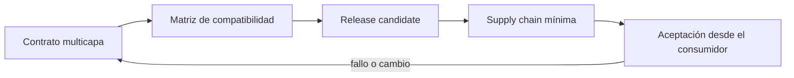
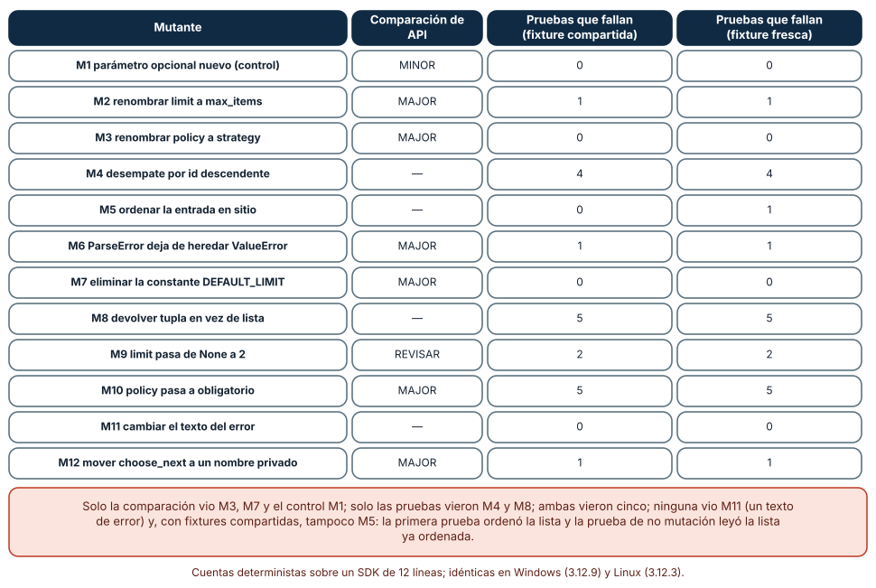
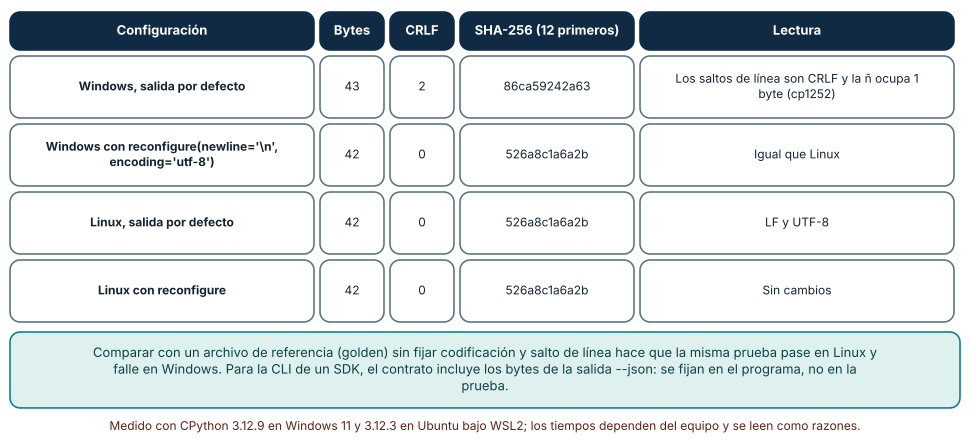
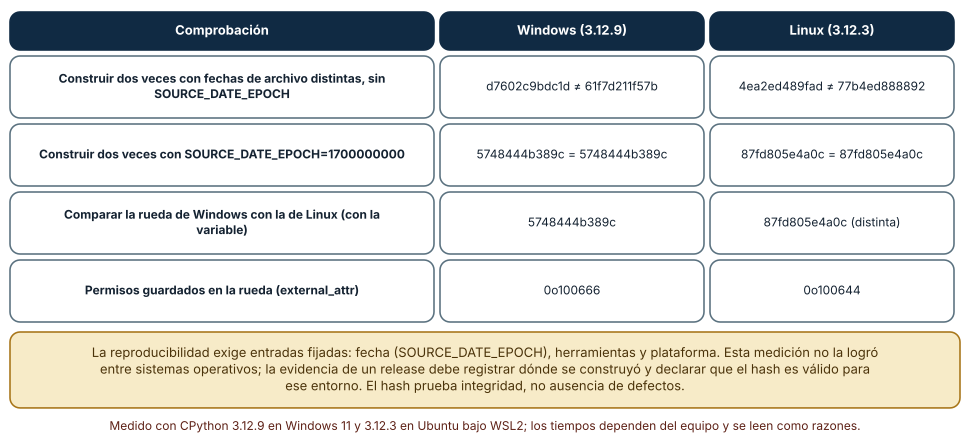

# SE-120 — Proyecto: SDK y CLI con compatibilidad verificada

[← SE-119 — Taller: empaquetar una capacidad reusable](https://github.com/vladimiracunadev-create/modern-software-engineering-program/blob/main/classes/part-09-bibliotecas-paquetes-sdk-y-automatizacion/se-119-taller-empaquetar-una-capacidad-reusable/README.md) · [↑ Parte 09](https://github.com/vladimiracunadev-create/modern-software-engineering-program/blob/main/classes/part-09-bibliotecas-paquetes-sdk-y-automatizacion/README.md) · [📚 Índice completo](https://github.com/vladimiracunadev-create/modern-software-engineering-program/blob/main/classes/README.md) · [🌐 Portal](https://vladimiracunadev-create.github.io/modern-software-engineering-program/classes/SE-120.html) · [SE-121 — Problemas, síntomas, necesidades y oportunidades →](https://github.com/vladimiracunadev-create/modern-software-engineering-program/blob/main/classes/part-10-descubrimiento-y-estrategia-de-producto/se-121-problemas-sintomas-necesidades-y-oportunidades/README.md)


## Punto profesional y fundamento pedagógico

**Punto profesional.** La clase existe para entregar SDK y CLI con contrato común y compatibilidad verificada entre versiones.

**Por qué aparece aquí.** Se sitúa después de **Taller: empaquetar una capacidad reusable** y antes de **la clase siguiente**: convierte el conocimiento anterior en una decisión observable que la clase siguiente podrá reutilizar. La continuidad se comprueba en el artefacto, no por compartir vocabulario.

**Error conceptual que debe corregir.** Duplicar lógica entre interfaces o declarar compatibilidad sin consumidor anterior.

**Secuencia de aprendizaje.** Antes de leer la solución, el estudiante predice el resultado del caso normal y del error conceptual anterior. Luego explica un caso resuelto paso a paso, construye un contraejemplo que cambie la decisión y, sin consultar el texto, reconstruye el mecanismo y lo aplica a una entrada nueva. La secuencia usa predicción, explicación propia, contraste y recuperación. [ICAP](https://icap.education.asu.edu/research) distingue participación de construcción de conocimiento; [How People Learn II](https://nap.nationalacademies.org/catalog/24783/how-people-learn-ii-learners-contexts-and-cultures) exige conectar conocimiento previo, contexto y transferencia; la [práctica de recuperación](https://pubmed.ncbi.nlm.nih.gov/16507066/) respalda producir de nuevo la explicación tras una demora; y [Education for Life and Work](https://nap.nationalacademies.org/resource/13398/dbasse_084153.pdf) exige devolución que explique la causa del error.

**Evidencia de aprendizaje.** Matriz de versiones, artefactos, consumidor de regresión, CLI, SDK y changelog. Debe contener predicción previa, observación, explicación causal, contraejemplo, criterio de aceptación y una nota de qué dato haría cambiar la conclusión.

**Límite de la conclusión.** La matriz cubre versiones y plataformas declaradas, no compatibilidad universal.

### Trazabilidad fuente → afirmación

| Fuente primaria u oficial | Afirmación que respalda | Lo que no prueba |
|---|---|---|
| [Semantic Versioning 2.0.0](https://semver.org/spec/v2.0.0.html) | Api pública, versiones, prereleases y compatibilidad declarada; autoridad: Semantic Versioning project | No demuestra por sí sola que el artefacto del estudiante sea correcto. |
| [Python Packaging User Guide: Specifications](https://packaging.python.org/en/latest/specifications/) | Metadata, nombres, versiones, dependencias y artefactos de distribución; autoridad: Python Packaging Authority | No demuestra por sí sola que el artefacto del estudiante sea correcto. |
| [pylock.toml Specification](https://packaging.python.org/en/latest/specifications/pylock-toml/) | Lock files para instalaciones reproducibles y selección por entorno; autoridad: Python Packaging Authority | No demuestra por sí sola que el artefacto del estudiante sea correcto. |
| [SPDX Specification 3.0](https://spdx.dev/use/specifications/) | Identificadores, sbom y procedencia legible por máquinas; autoridad: Linux Foundation | No demuestra por sí sola que el artefacto del estudiante sea correcto. |

## Antes de empezar

Esta clase continúa el **producto reutilizable con SDK y CLI de la Parte 09**. Recupera la evidencia de la clase anterior, añade una decisión propia de **Proyecto: SDK y CLI con compatibilidad verificada** y deja un artefacto que la clase siguiente deberá consumir. La pregunta activa es: **¿Qué conjunto mínimo de artefactos y pruebas sostiene un SDK y CLI listos para consumidores reales?**

## Prerrequisitos

- Haber completado la clase anterior o reconstruir su contrato y evidencia.
- Python 3.11 o posterior, terminal, editor y Git; un segundo runtime es opcional y debe declararse.
- Trabajar con fixtures sintéticos: ninguna observación necesita datos de una persona o sistema real.

## Problema auténtico

El producto reutilizable con SDK y CLI debe cerrar la etapa de programación con un release candidato: API, CLI, plugin de ejemplo, build reproducible dentro del alcance y compatibilidad entre versión anterior y nueva.

## Objetivos observables

Al terminar podrás explicar los cinco mecanismos de esta clase, predecir su comportamiento antes de ejecutar, construir un caso normal y uno límite, diagnosticar el fallo controlado, comparar una alternativa y entregar evidencia que otra persona pueda reproducir.

## Mapa conceptual



El mapa se lee como una cadena de razonamiento, no como fases obligatorias del runtime. La flecha de retorno indica que un fallo o cambio de requisito obliga a revisar el modelo inicial; no autoriza a parchear solo la última salida.

## Temas y por qué importan

| Tema | Por qué cambia una decisión profesional | Evidencia mínima |
|---|---|---|
| Contrato multicapa | El proyecto publica API Python, CLI y protocolo de plugin con versiones y errores alineados. | Predicción, traza causal y contraejemplo de **Contrato multicapa** en `matriz de versiones` |
| Matriz de compatibilidad | Se prueba runtime mínimo/máximo, instalación desde wheel/sdist, consumidor anterior con release nuevo y plugin compatible/incompatible. | Predicción, traza causal y contraejemplo de **Matriz de compatibilidad** en `matriz de versiones` |
| Release candidate | El RC usa artefactos inmutables, changelog, hashes y guía de migración. | Predicción, traza causal y contraejemplo de **Release candidate** en `matriz de versiones` |
| Supply chain mínima | Dependencias y licencias se inventarían, fuentes se fijan según política y se genera metadata de procedencia/SBOM disponible. | Predicción, traza causal y contraejemplo de **Supply chain mínima** en `matriz de versiones` |
| Aceptación desde el consumidor | Una persona nueva sigue quickstart, ejecuta caso, interpreta error, instala plugin y migra. | Predicción, traza causal y contraejemplo de **Aceptación desde el consumidor** en `matriz de versiones` |
## Conceptos y decisiones

### 1. Contrato multicapa

El proyecto publica API Python, CLI y protocolo de plugin con versiones y errores alineados. Cada capa tiene consumidores y compatibilidad propias. Un documento enumera superficie pública para impedir que el equipo clasifique cambios después de romper.

### 2. Matriz de compatibilidad

Se prueba runtime mínimo/máximo, instalación desde wheel/sdist, consumidor anterior con release nuevo y plugin compatible/incompatible. Una matriz verde respalda solo combinaciones ejecutadas; las demás se marcan no verificadas.

### 3. Release candidate

El RC usa artefactos inmutables, changelog, hashes y guía de migración. Se instala exactamente el artefacto que se pretende publicar. Si cambia un byte tras la prueba, se genera otro prerelease.

### 4. Supply chain mínima

Dependencias y licencias se inventarían, fuentes se fijan según política y se genera metadata de procedencia/SBOM disponible. Esto no equivale a una cadena de suministro completa, pero hace visibles componentes y decisiones.

### 5. Aceptación desde el consumidor

Una persona nueva sigue quickstart, ejecuta caso, interpreta error, instala plugin y migra. Tiempo y bloqueos se registran. El cierre incluye problemas conocidos y ruta de rollback, no solo una demo feliz.

### Doce cambios a un SDK: ¿los ve la comparación de API o las pruebas de contrato?

El proyecto necesita demostrar compatibilidad entre versiones con algo más que la intención. Se construyó un SDK de ejemplo (dos funciones, una constante y una excepción), un comparador de superficie de API basado en `ast` (nombres, parámetros posicionales y por nombre, valores por defecto, bases de clases, constantes) y ocho pruebas de contrato escritas desde el punto de vista del consumidor. Se aplicaron doce cambios: M1, un parámetro opcional nuevo, es el control compatible. El comparador detectó renombres (M2, M3), la eliminación de la constante (M7), el cambio de herencia de la excepción (M6), la obligatoriedad de un parámetro (M10), el paso a un nombre privado (M12) y señaló como «revisar» un cambio de valor por defecto (M9).

Las pruebas detectaron los cambios de comportamiento que la firma no ve: el desempate (M4), el tipo devuelto (M8), el valor por defecto de `limit` (M9) y, con fixtures frescas, la mutación de la entrada (M5). Cada detector falló donde el otro acertó: solo el comparador vio M3 (el renombre de un parámetro que las pruebas pasaban por posición), M7 y el control M1; solo las pruebas vieron M4 y M8; ambos vieron cinco; ninguno vio M11, el cambio del texto de un error. Con fixtures compartidas, tampoco M5: la primera prueba ordenó la lista en sitio y la prueba de no mutación leyó una lista ya ordenada.



**Cómo leer la figura.** Lee cada fila como un cambio que un colaborador, o un agente, podría hacer. Las filas con «—» y cero en las dos últimas columnas son las ciegas del sistema. **Dónde deja de valer:** son doce mutantes de un SDK de doce líneas; no cubren concurrencia, rendimiento ni dependencias. Que el conjunto detecte diez de once cambios no implica que detecte esa proporción de los cambios reales.

### Salida de la CLI como archivo de referencia: los bytes, no el texto

La CLI del proyecto es parte del contrato, y su salida con `--json` se prueba contra un archivo de referencia (golden). Se midió una salida de dos líneas, una de ellas JSON con una `ñ`. En Windows, por defecto, fueron 43 bytes con 2 saltos CRLF y SHA-256 `86ca59242a63…` (la `ñ` ocupó 1 byte en la página de códigos heredada). Fijando `sys.stdout.reconfigure(newline='\n', encoding='utf-8')` fueron 42 bytes, 0 CRLF y `526a8c1a6a2b…`, igual que Linux, con o sin esa configuración.

Un archivo de referencia comparado sin fijar codificación y salto de línea hace que la misma prueba pase en Linux y falle en Windows, y el fallo parece un defecto del SDK cuando es un detalle de plataforma. Dos decisiones lo evitan: el programa fija sus bytes de salida (UTF-8, LF, claves ordenadas), y la prueba compara bytes, no cadenas decodificadas. Además, el formato `--json` lleva una versión de esquema propia, para que cambiarlo sea un cambio de versión mayor documentado y no una sorpresa.



**Cómo leer la figura.** Mira la columna de bytes y la de CRLF: solo la primera fila difiere. La conclusión es que el contrato debe fijar los bytes. **Dónde deja de valer:** es una salida de dos líneas; una CLI real con tablas, colores o anchos de terminal necesita desactivarlos en modo máquina. No se midió macOS ni consolas con otra página de códigos.

### Compilaciones reproducibles: mismo código, mismo hash

El release del SDK necesita un hash estable. Se construyó dos veces la misma rueda con fechas de archivo distintas, sin `SOURCE_DATE_EPOCH`: los hashes difirieron en Windows (`d7602c9bdc1d` y `61f7d211f57b`) y en Linux (`4ea2ed489fad` y `77b4ed888892`). Con `SOURCE_DATE_EPOCH=1700000000`, cada plataforma dio el mismo hash en dos construcciones (`5748444b389c` en Windows, `87fd805e4a0c` en Linux).

Entre plataformas siguieron siendo distintos: los permisos guardados en la rueda (`external_attr`) eran `0o100666` en Windows y `0o100644` en Linux. La reproducibilidad exige fijar las entradas: fecha, versión de las herramientas y plataforma. Esta medición logró reproducibilidad dentro de cada plataforma, no entre ellas, y por eso la evidencia del release debe registrar dónde se construyó y declarar que el hash es válido para ese entorno. El hash prueba integridad, no ausencia de defectos.



**Cómo leer la figura.** Compara primero las filas 1 y 2 (misma plataforma, con y sin la variable), luego la 3 (entre plataformas). **Dónde deja de valer:** el proyecto era de un módulo, con setuptools y sin extensiones compiladas; una rueda con código compilado depende además del compilador y su versión. Los hashes cambian si cambia la versión de setuptools o de `wheel`.

## Definiciones de trabajo

- **contrato multicapa:** el proyecto publica api python, cli y protocolo de plugin con versiones y errores alineados.
- **matriz de compatibilidad:** se prueba runtime mínimo/máximo, instalación desde wheel/sdist, consumidor anterior con release nuevo y plugin compatible/incompatible.
- **release candidate:** el rc usa artefactos inmutables, changelog, hashes y guía de migración.
- **supply chain mínima:** dependencias y licencias se inventarían, fuentes se fijan según política y se genera metadata de procedencia/sbom disponible.
- **aceptación desde el consumidor:** una persona nueva sigue quickstart, ejecuta caso, interpreta error, instala plugin y migra.

Las definiciones son operativas para el producto reutilizable con SDK y CLI. No convierten términos con historia más amplia en sinónimos y deben contrastarse con la documentación primaria enlazada al final.

## Ejemplo mínimo

```shell
python -m unittest -v
python -m build
python tools/verify_artifacts.py dist/
python tools/compat.py --old 1.4.2 --candidate 1.5.0-rc.1
engineering_sdk self-check --redact
```

Antes de ejecutar, predice estado, resultado y error. Después registra versión, comando y salida. Si el fragmento es pseudocódigo o pertenece a otro lenguaje, etiquétalo como tal y no afirmes que fue ejecutado.

## Ejemplo profesional

En el producto reutilizable con SDK y CLI, un release contiene contrato público, artefactos inmutables, dependencias, procedencia, ejemplos, errores y ruta de migración. La implementación de esta clase debe conservar ese contrato aunque cambie la forma interna. El caso profesional no pregunta únicamente si produce una salida: pregunta quién puede producirla, qué estado observa, cómo falla y qué rastro permite disputar una decisión incorrecta.

Compara el caso normal con autorización falsa, evidencia incompleta, empate y repetición. Un mecanismo es apropiado cuando esas diferencias quedan visibles y localizadas; es peligroso cuando dependen de orden accidental, estado oculto o una convención que el consumidor no puede conocer.

## Práctica guiada

1. Copia el contrato de entrada y salida antes de escribir implementación.
2. Predice el caso normal y un límite; identifica la invariante que no puede romperse.
3. Implementa la versión mínima sin I/O dentro del núcleo.
4. Ejecuta el caso y conserva comando, versión y salida bajo `evidence/`.
5. Introduce el fallo controlado, reduce la reproducción y formula dos hipótesis rivales.
6. Corrige la causa, añade regresión y ejecuta el conjunto completo.
7. Compara con otro paradigma o lenguaje indicando qué semántica se preserva.

## Ejercicios

1. **Mutantes del SDK:** toma tu SDK y aplica diez cambios (renombrar, quitar, cambiar defecto, cambiar orden, cambiar excepción, mutar entrada); para cada uno registra si lo ve el comparador de API, las pruebas de contrato o ninguno.
2. **Fixtures frescas:** escribe una prueba de no mutación con una fixture compartida y comprueba que pasa con un SDK que ordena en sitio; corrígela con una copia por prueba y registra el cambio.
3. **Archivo de referencia:** guarda la salida `--json` de tu CLI, compárala en dos sistemas o con `PYTHONUTF8` activado y desactivado, y arregla las diferencias fijando bytes.
4. **Reproducibilidad:** construye dos veces tu rueda con y sin `SOURCE_DATE_EPOCH`, compara hashes y escribe qué insumos debes registrar en la evidencia del release.

## Reto verificable

Entrega implementación, fixtures, pruebas y un informe corto. Se aprueba si otra persona ejecuta desde checkout limpio, obtiene los mismos resultados y puede relacionar cada rama o transformación con una regla del dominio. No se aprueba por cantidad de archivos ni por usar la sintaxis característica del paradigma.

## Caso conductor

El producto reutilizable con SDK y CLI empaqueta el motor de la biblioteca de estructuras y algoritmos como `engineering_sdk`, expone `choose_next`, una CLI y un punto de extensión. Ejecuta instalación limpia, entrada válida, configuración ausente, plugin incompatible y actualización entre dos versiones. Cambia después una sola regla o condición y revisa qué archivos, pruebas y trazas debieron modificarse. Esa superficie de cambio alimenta el proyecto final de la parte.

## Preguntas frecuentes

### ¿Qué demuestra que una versión nueva no rompe a los consumidores?

Nada demuestra «no rompe» en general; se acumulan evidencias: comparación de superficie de API, pruebas de contrato escritas desde el consumidor, prueba de humo del artefacto y consumidores reales corriendo contra la versión candidata. En el experimento ni siquiera la unión de las dos primeras vio un cambio de mensaje.

### ¿Cuántas pruebas de contrato necesito?

Las que cubran lo que prometes: formas de llamar, orden, tipos, errores y formato de salida. Ocho pruebas y un comparador detectaron diez de los once cambios reales (nueve con fixtures compartidas); el valor está en que cada prueba nombre una promesa, no en la cantidad.

### ¿Por qué el archivo de referencia de la CLI falla solo en Windows?

Porque la salida por defecto usa CRLF y una página de códigos heredada en tuberías: en el experimento fueron 43 bytes frente a 42. Fija la codificación y el salto de línea en el programa y compara bytes.

### ¿Una compilación reproducible garantiza que el paquete es seguro?

No. Garantiza que los mismos insumos producen los mismos bytes, de modo que otra persona puede comprobar que no se alteró el artefacto. La seguridad depende de lo que contenía la fuente.

## Fallo controlado y diagnóstico

Las pruebas usan fuente local mientras el RC omite entry point. Ejecuta toda aceptación desde artefactos en un workspace consumidor vacío y compara hashes antes de publicar.

Registra síntoma, entrada mínima, hipótesis, observación que descarta cada hipótesis, causa, corrección y prueba de regresión. No cambies simultáneamente implementación, fixture y expectativa.

Cambia un SDK de ejemplo de modo que ordene en sitio la lista que recibe y ejecuta primero las ocho pruebas con una fixture compartida. **Síntoma:** todas pasan, incluida la de no mutación; el comparador de API no marca nada. **Hipótesis rivales:** (a) el cambio es inocuo; (b) la prueba lee una entrada que ya fue modificada. **Prueba:** repite las pruebas con una copia profunda por prueba: la de no mutación falla. **Conclusión:** la fixture compartida ocultaba el defecto; corrección: aislar fixtures; regresión: la prueba con copia. El cambio de texto de un error (M11) sigue sin detectarse: se declara el límite en lugar de fingir cobertura. No cambies a la vez la fixture y el SDK.

## Errores comunes y cómo corregirlos

| Síntoma | Causa probable | Corrección |
|---|---|---|
| Un cambio «interno» rompe a un consumidor sin que ninguna prueba falle | La promesa no estaba escrita como prueba de contrato | Escribir la prueba desde el consumidor y añadirla al conjunto |
| La comparación de API marca un cambio que no importa | Se compara toda la superficie sin distinguir lo público | Definir `__all__` o una lista pública y comparar solo eso |
| La prueba de no mutación pasa aunque el SDK ordena la entrada | Una fixture compartida ya fue ordenada por una prueba previa | Fixtures frescas por prueba (copia profunda) |
| El archivo de referencia de la CLI difiere por saltos de línea | No se fijaron codificación ni `newline` | Fijar `reconfigure(newline='\n', encoding='utf-8')` y comparar bytes |
| Dos construcciones de la misma versión tienen hashes distintos | Fechas de archivo y permisos en la rueda | `SOURCE_DATE_EPOCH`, herramientas fijadas y plataforma registrada |

## Entorno y archivos clave

```text
work/SE-120/
├── README.md
├── engineering_sdk/
│   ├── domain.py
│   └── se_120.py
├── fixtures/cases.json
├── tests/test_se_120.py
└── evidence/diagnosis.md
```

El `README` declara plataforma, runtimes, comandos, limpieza y límites. Evita dependencias externas cuando la biblioteca estándar permita observar el mecanismo; si agregas una, fija procedencia y versión.

## Seguridad, ética y accesibilidad

- la autorización forma parte del dominio y no se infiere por ausencia de rechazo;
- no uses `eval`, reglas descargadas ni serialización insegura;
- limita colas, recursión, tamaño de entrada y tiempo de evaluación;
- redacta trazas y conserva una explicación textual además de color o animación;
- una recomendación automatizada debe poder revisarse, impugnarse y corregirse;
- respeta licencias de ejemplos y atribuye adaptaciones.

## Puente hacia el trabajo con agentes

Un agente que modifica el SDK suele verificar con las pruebas existentes y declarar compatibilidad. Define un protocolo de candidato a release que el agente ejecute y reporte: diff de superficie de API con clasificación mayor, menor y parche, pruebas de contrato con fixtures aisladas, prueba de humo del artefacto en un entorno limpio, bytes de la salida `--json` contra el archivo de referencia y hash de la rueda con `SOURCE_DATE_EPOCH`. Pídele además una lista de lo que ese conjunto no cubre (mensajes, rendimiento, concurrencia), para que la persona que aprueba el release sepa qué está aceptando.

## Transferencia

Traslada un fixture al segundo modelo, herramienta, plataforma o lenguaje. Compara representación de ausencia, error, mutabilidad, orden y cancelación. La transferencia está lograda cuando el contrato se conserva y las diferencias están explicadas, no cuando la interfaz se parece.

## Evaluación y evidencia

| Criterio | Evidencia para aprobar |
|---|---|
| comprensión | explicación causal de los cinco mecanismos |
| corrección | normal, límite, inválido y contraejemplo |
| diseño | estado, efectos y contrato localizables |
| diagnóstico | reproducción mínima y regresión |
| transferencia | comparación semántica, no estética |
| reproducibilidad | versiones, comandos, salida y límites |


## Fuentes


- [Semantic Versioning 2.0.0](https://semver.org/spec/v2.0.0.html) — Api pública, versiones, prereleases y compatibilidad declarada; autoridad: Semantic Versioning project.
- [Python Packaging User Guide: Specifications](https://packaging.python.org/en/latest/specifications/) — Metadata, nombres, versiones, dependencias y artefactos de distribución; autoridad: Python Packaging Authority.
- [pylock.toml Specification](https://packaging.python.org/en/latest/specifications/pylock-toml/) — Lock files para instalaciones reproducibles y selección por entorno; autoridad: Python Packaging Authority.
- [Python Standard Library](https://docs.python.org/3/library/index.html) — Argparse, importlib.metadata, subprocess y apis de automatización; autoridad: Python Software Foundation.
- [SPDX Specification 3.0](https://spdx.dev/use/specifications/) — Identificadores, sbom y procedencia legible por máquinas; autoridad: Linux Foundation.
- [REUSE Specification](https://reuse.software/spec-3.3/) — Declaración inequívoca y verificable de copyright y licencias por archivo; autoridad: Free Software Foundation Europe.

Cada fuente respalda el mecanismo indicado; ninguna demuestra que la implementación del producto reutilizable con SDK y CLI sea correcta. Esa afirmación depende de fixtures, pruebas, trazas y revisión reproducible.

- [Semantic Versioning 2.0.0](https://semver.org/spec/v2.0.0.html) — API pública y reglas para cambios mayores, menores y de parche.
- [Reproducible Builds: SOURCE_DATE_EPOCH](https://reproducible-builds.org/docs/source-date-epoch/) — convención para fijar fechas en artefactos de construcción.
- [SLSA specification v1.0](https://slsa.dev/spec/v1.0/) — marco de integridad de la cadena de suministro y procedencia de artefactos.
- [Google AIP-180: Backwards compatibility](https://google.aip.dev/180) — qué cambios se consideran compatibles en una API publicada.
- [Rust API Guidelines](https://rust-lang.github.io/api-guidelines/) — recomendaciones de práctica sobre estabilidad y superficie pública de una biblioteca.
- [Python: `zipfile`](https://docs.python.org/3/library/zipfile.html) — lectura de `ZipInfo`, fechas y permisos guardados en la rueda.

## Límites y siguiente paso

El proyecto acredita un release candidato dentro de su matriz, no disponibilidad, seguridad o soporte productivo. La Parte 10 cambiará el foco desde construir correctamente hacia descubrir qué problema y resultado de producto justifican la siguiente inversión.

## Glosario

- **contrato multicapa:** el proyecto publica api python, cli y protocolo de plugin con versiones y errores alineados.
- **matriz de compatibilidad:** se prueba runtime mínimo/máximo, instalación desde wheel/sdist, consumidor anterior con release nuevo y plugin compatible/incompatible.
- **release candidate:** el rc usa artefactos inmutables, changelog, hashes y guía de migración.
- **supply chain mínima:** dependencias y licencias se inventarían, fuentes se fijan según política y se genera metadata de procedencia/sbom disponible.
- **aceptación desde el consumidor:** una persona nueva sigue quickstart, ejecuta caso, interpreta error, instala plugin y migra.

---

[← SE-119 — Taller: empaquetar una capacidad reusable](https://github.com/vladimiracunadev-create/modern-software-engineering-program/blob/main/classes/part-09-bibliotecas-paquetes-sdk-y-automatizacion/se-119-taller-empaquetar-una-capacidad-reusable/README.md) · [↑ Parte 09](https://github.com/vladimiracunadev-create/modern-software-engineering-program/blob/main/classes/part-09-bibliotecas-paquetes-sdk-y-automatizacion/README.md) · [📚 Índice completo](https://github.com/vladimiracunadev-create/modern-software-engineering-program/blob/main/classes/README.md) · [🌐 Portal](https://vladimiracunadev-create.github.io/modern-software-engineering-program/classes/SE-120.html) · [SE-121 — Problemas, síntomas, necesidades y oportunidades →](https://github.com/vladimiracunadev-create/modern-software-engineering-program/blob/main/classes/part-10-descubrimiento-y-estrategia-de-producto/se-121-problemas-sintomas-necesidades-y-oportunidades/README.md)
