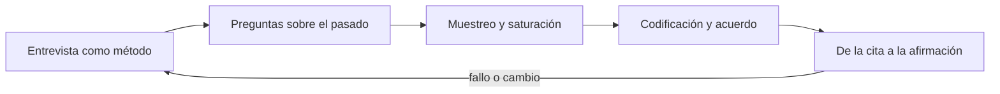
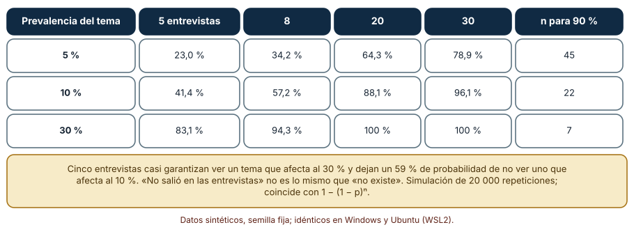
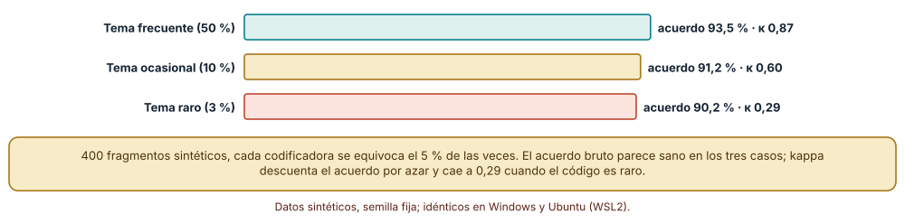
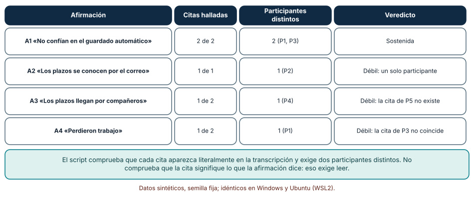

# SE-123 — Investigación, entrevistas y evidencia cualitativa

[← SE-122 — Usuarios, actores, trabajos y contextos](https://github.com/vladimiracunadev-create/modern-software-engineering-program/blob/main/classes/part-10-descubrimiento-y-estrategia-de-producto/se-122-usuarios-actores-trabajos-y-contextos/README.md) · [↑ Parte 10](https://github.com/vladimiracunadev-create/modern-software-engineering-program/blob/main/classes/part-10-descubrimiento-y-estrategia-de-producto/README.md) · [📚 Índice completo](https://github.com/vladimiracunadev-create/modern-software-engineering-program/blob/main/classes/README.md) · [🌐 Portal](https://vladimiracunadev-create.github.io/modern-software-engineering-program/classes/SE-123.html) · [SE-124 — Hipótesis, supuestos y preguntas críticas →](https://github.com/vladimiracunadev-create/modern-software-engineering-program/blob/main/classes/part-10-descubrimiento-y-estrategia-de-producto/se-124-hipotesis-supuestos-y-preguntas-criticas/README.md)

## Punto profesional y fundamento pedagógico

**Punto profesional.** La clase existe para obtener evidencia cualitativa que otra persona pueda revisar: qué preguntar, a cuántas personas, cómo codificar lo dicho y cómo enlazar cada afirmación del informe con citas reales.

**Por qué aparece aquí.** Se sitúa después de **Usuarios, actores, trabajos y contextos** y antes de **Hipótesis, supuestos y preguntas críticas**: `SE-122` produjo un mapa de actores y trabajos; ahora hay que preguntar a las personas correctas de forma que lo que digan sea evidencia y no eco de la pregunta. Esta clase deja citas verificadas y afirmaciones con trazabilidad, que `SE-124` convertirá en hipótesis contrastables.

**Error conceptual que debe corregir.** Tratar cinco entrevistas amables como prueba de que un tema no existe, o una cita llamativa como representativa de todas las personas.

**Secuencia de aprendizaje.** Antes de leer la solución, predices cuántas entrevistas hacen falta para oír un tema que afecta al 10 % de las personas; luego simulas, explicas por qué cinco no bastan, calculas el acuerdo entre dos codificadoras con y sin corrección por azar y compruebas automáticamente que cada afirmación tenga citas reales de personas distintas. Al final reconstruyes sin apoyo la ruta cita → código → afirmación. La secuencia usa predicción, explicación propia, contraste y recuperación. [ICAP](https://icap.education.asu.edu/research) distingue participación de construcción de conocimiento; [How People Learn II](https://nap.nationalacademies.org/catalog/24783/how-people-learn-ii-learners-contexts-and-cultures) exige conectar conocimiento previo, contexto y transferencia; la [práctica de recuperación](https://pubmed.ncbi.nlm.nih.gov/16507066/) respalda producir de nuevo la explicación tras una demora; y [Education for Life and Work](https://nap.nationalacademies.org/resource/13398/dbasse_084153.pdf) exige devolución que explique la causa del error.

**Evidencia de aprendizaje.** `interview-evidence.md` con la guía de preguntas, transcripciones sintéticas, el libro de códigos, el acuerdo entre codificadoras y una tabla afirmación → citas verificadas. Debe contener predicción previa, observación, explicación causal, contraejemplo, criterio de aceptación y una nota de qué dato haría cambiar la conclusión.

**Límite de la conclusión.** Las entrevistas y los participantes son sintéticos y las probabilidades de aparición de un tema son supuestos; con personas reales hay sesgos de memoria, cortesía y selección que ninguna simulación recoge.

### Trazabilidad fuente → afirmación

| Fuente primaria u oficial | Afirmación que respalda | Lo que no prueba |
|---|---|---|
| [Nielsen Norman Group: Why You Only Need to Test with 5 Users](https://www.nngroup.com/articles/why-you-only-need-to-test-with-5-users/) | Sostiene que cinco participantes encuentran cerca del 85 % de los problemas de usabilidad de una interfaz y que conviene repetir estudios pequeños tras corregir. | No se aplica sin más a temas poco frecuentes ni a entrevistas de descubrimiento, donde la prevalencia es desconocida. |
| [McHugh: Interrater reliability, the kappa statistic](https://pmc.ncbi.nlm.nih.gov/articles/PMC3900052/) | Kappa mide el acuerdo entre evaluadores descontando el que se esperaría por azar, por lo que difiere del porcentaje de acuerdo. | No dice si las categorías del libro de códigos son las correctas. |
| [The Mom Test (Rob Fitzpatrick)](https://www.momtestbook.com/) | Presenta un enfoque para conversar con clientes que evita preguntas que solo provocan cortesía y favorece preguntas sobre hechos pasados. | Es una guía práctica de un autor, no un estudio empírico de eficacia. |

## Antes de empezar

Esta clase continúa **el caso de la plataforma de entregas**. Recupera el mapa de actores y trabajos de `SE-122`, añade una decisión propia sobre **cómo obtener y registrar lo que dicen esas personas** y deja citas verificadas para `SE-124`. La pregunta activa es: **¿qué puede y qué no puede afirmarse con las entrevistas que se hicieron?**

## Prerrequisitos

- Haber completado `SE-122` o reconstruir su mapa de actores y al menos un trabajo.
- Python 3.11 o posterior y un editor de texto.
- Trabajar con transcripciones sintéticas: no uses grabaciones ni notas de personas reales.

## Problema auténtico

El equipo entrevista a cinco estudiantes: dos dicen que no confían en el guardado automático y tres no mencionan los plazos. Concluyen que «los plazos no son un problema» porque nadie los trajo a colación. No registraron las preguntas, no codificaron las respuestas con un criterio y el informe cita una frase que ninguna transcripción contiene literalmente.

## Objetivos observables

Al terminar podrás:

1. distinguir una pregunta sobre el pasado de una guiada, hipotética o cerrada, y reescribir las defectuosas;
2. calcular cuántas entrevistas se necesitan para oír un tema con una prevalencia supuesta y una confianza dada;
3. medir el acuerdo entre dos codificadoras con kappa y explicar por qué difiere del porcentaje bruto;
4. comprobar automáticamente que cada afirmación del informe tiene citas literales de al menos dos personas distintas;
5. declarar qué sesgos de selección, memoria y cortesía no controla el estudio.

## Mapa conceptual



El mapa se lee como una cadena de razonamiento, no como fases obligatorias. La flecha de retorno indica que una afirmación sin citas, un acuerdo bajo o un tema que aparece tarde obliga a revisar el método de entrevista; no autoriza a retocar solo el informe.

## Temas y por qué importan

| Tema | Por qué cambia una decisión profesional | Evidencia mínima |
|---|---|---|
| Entrevista como método | Una entrevista produce evidencia situada y declarada, no una medición representativa. | Predicción, traza causal y contraejemplo de **Entrevista como método** en `interview-evidence.md` |
| Preguntas sobre el pasado | Las preguntas sobre hechos pasados dan datos; las hipotéticas y guiadas dan cortesía. | Predicción, traza causal y contraejemplo de **Preguntas sobre el pasado** en `interview-evidence.md` |
| Muestreo y saturación | La probabilidad de oír un tema depende de su prevalencia y del número de entrevistas, no de la sensación de haber oído lo mismo. | Predicción, traza causal y contraejemplo de **Muestreo y saturación** en `interview-evidence.md` |
| Codificación y acuerdo | Si dos personas codifican distinto, el hallazgo depende de quién codificó. | Predicción, traza causal y contraejemplo de **Codificación y acuerdo** en `interview-evidence.md` |
| De la cita a la afirmación | Cada afirmación del informe debe poder rastrearse a citas literales de varias personas. | Predicción, traza causal y contraejemplo de **De la cita a la afirmación** en `interview-evidence.md` |

## Conceptos y decisiones

### 1. Entrevista como método

La entrevista recoge lo que una persona recuerda y decide contar a otra en un momento concreto. Es excelente para descubrir problemas, vocabulario y razones, y mala para estimar cuánta gente comparte una experiencia. Lo que dice depende de quién pregunta, cómo y para qué; por eso se registra la guía de preguntas, el contexto y lo que no se preguntó. Tratar un conjunto de entrevistas como encuesta (porcentajes, representatividad) mezcla métodos con garantías distintas. Un informe honesto separa lo que se escuchó de lo que se infiere.

### 2. Preguntas sobre el pasado

«¿Pagarías por un recordatorio?» invita a una respuesta amable y barata; «cuéntame la última vez que se te pasó un plazo y qué hiciste» pide un hecho verificable en la memoria. Las preguntas guiadas («¿no crees que sería mejor…?») instalan la respuesta, las hipotéticas piden predecir un comportamiento futuro que casi nadie predice bien y las cerradas ahorran el relato. Una guía de entrevista contiene pocas preguntas abiertas sobre episodios concretos, con sondeos («¿y entonces?»). Los errores no se corrigen después: se evitan antes y se registran cuando ocurren.

### 3. Muestreo y saturación

Si un tema afecta a una proporción p de las personas y se entrevistan n al azar, la probabilidad de oírlo al menos una vez es 1 − (1 − p)ⁿ. Con p = 10 % y n = 5 es 41 %: casi seis de cada diez estudios con cinco personas no lo oyen. La «saturación» (dejar de oír temas nuevos) es un criterio práctico, no una garantía: se alcanza antes con muestras homogéneas y se retrasa cuando hay subgrupos. Elegir a quién entrevistar —incluidos los casos extremos— importa tanto como cuántos son.

### 4. Codificación y acuerdo

Codificar es decidir qué fragmentos hablan de qué. Dos codificadoras pueden coincidir mucho solo porque el código es raro y ambas dicen «no» casi siempre. El estadístico kappa descuenta ese acuerdo esperado por azar; el porcentaje bruto no. Un libro de códigos define cada código con criterios de inclusión y ejemplos, se prueba con un subconjunto, se reconcilian los desacuerdos y se reporta el acuerdo antes y después. Un acuerdo bajo no obliga a descartar el código: obliga a precisarlo o a reconocer que es ambiguo.

### 5. De la cita a la afirmación

Una afirmación («las personas no confían en el guardado automático») es tan fuerte como las citas que la sostienen: cuántas, de cuántas personas distintas, si existen literalmente y si dicen eso. La trazabilidad se automatiza en lo mecánico —que la cita aparezca en la transcripción, que haya al menos dos participantes— y se revisa a mano en lo semántico —que la cita signifique lo que se afirma—. Una afirmación con una sola persona puede ser valiosa como hipótesis, pero se etiqueta como tal y no como hallazgo.

### Cuántas entrevistas hacen falta para oír un tema

Un tema aparece en una fracción p de las personas; cada entrevista lo menciona con probabilidad p. Simulamos 20 000 repeticiones por celda con semilla fija y comparamos con 1 − (1 − p)ⁿ. Predicción antes de ejecutar: cinco entrevistas bastan para un tema frecuente y quedan cortas para uno raro.

```python
def visto(p, n, rng):
    return any(rng.random() < p for _ in range(n))
```

Con p = 5 %, 5 entrevistas oyen el tema el 23,0 % de las veces, 20 entrevistas el 64,3 % y 30 el 78,9 %; hacen falta 45 para llegar al 90 %. Con p = 10 %: 41,4 % con 5, 71,9 % con 12, 88,1 % con 20, y 22 entrevistas para el 90 %. Con p = 30 %: 83,1 % con 5, 94,3 % con 8, y 7 entrevistas bastan para el 90 %. Los resultados simulados coinciden con la fórmula con diferencias de menos de un punto, y fueron idénticos en Windows y en Ubuntu (WSL2). Cinco entrevistas casi garantizan oír un tema compartido por el 30 % y fallan en seis de cada diez estudios cuando el tema afecta al 10 %.



**Cómo leer la figura.** Cada fila es una prevalencia y cada columna un número de entrevistas; la última dice cuántas hacen falta para el 90 %. **Dónde deja de valer:** el modelo supone entrevistas independientes y un tema con la misma probabilidad en todas las personas. En la práctica la muestra no es aleatoria, los subgrupos tienen prevalencias distintas y la persona entrevistada puede no mencionar un tema aunque le ocurra; la tabla es un límite optimista, no una receta.

### Acuerdo bruto y kappa: cuándo el 90 % engaña

Dos codificadoras sintéticas etiquetan 400 fragmentos buscando un código. Cada una se equivoca el 5 % de las veces. Variamos cuánto aparece el código en los datos: 50 %, 10 % y 3 %. Predicción antes de ejecutar: el acuerdo bruto será parecido en los tres casos, pero kappa no.

```python
def kappa(a, b):
    po = sum(x == y for x, y in zip(a, b)) / len(a)
    pa, pb = sum(a) / len(a), sum(b) / len(b)
    pe = pa * pb + (1 - pa) * (1 - pb)
    return po, (po - pe) / (1 - pe)
```

Resultados: con código del 50 %, acuerdo 93,5 % y kappa 0,87; con 10 %, acuerdo 91,2 % y kappa 0,60; con 3 %, acuerdo 90,2 % y kappa 0,29. El porcentaje apenas cambia (de 93,5 a 90,2) mientras kappa cae de 0,87 a 0,29: cuando el código es raro, casi todo el acuerdo es «ambas dicen que no». Un informe que reporte «90 % de acuerdo» sobre un código del 3 % está diciendo muy poco. Idéntico en Windows y Ubuntu.



**Cómo leer la figura.** Las tres barras tienen casi la misma longitud (acuerdo bruto) pero cada una lleva un kappa distinto en su etiqueta. **Dónde deja de valer:** kappa tampoco es perfecto: con prevalencias extremas puede dar valores bajos aunque el acuerdo sea alto (la «paradoja del kappa»), y depende de que las codificadoras sean independientes. Se complementa con la revisión de los desacuerdos, que es donde se aprende qué ambigüedad tiene el código.

### Comprobar que cada afirmación tiene citas reales de personas distintas

Para que el informe no cite frases que nadie dijo, se escribió una comprobación mecánica con cuatro transcripciones sintéticas (P1 a P4) y cuatro afirmaciones. Para cada afirmación el script verifica que cada cita aparezca **literalmente** en la transcripción de la persona indicada y cuenta cuántas personas distintas la respaldan; exige al menos dos.

```python
ok = [cita in transcripciones.get(persona, "") for persona, cita in citas]
distintas = {p for (p, c), v in zip(citas, ok) if v}
veredicto = "OK" if len(distintas) >= 2 else "DÉBIL"
```

Resultado: A1 («no confían en el guardado automático») tiene 2 citas verificadas de 2 personas y queda sostenida. A2 («los plazos se conocen por el correo») depende de un solo participante (P2). A3 cita a P5, que no existe en las transcripciones, y solo 1 de 2 citas se verifica. A4 («perdieron trabajo») cita una frase de P3 que no aparece literalmente (la transcripción dice «copio mi texto a un documento aparte», no «perdí mi texto»). Tres de cuatro afirmaciones quedan marcadas como débiles antes de llegar a una reunión.



**Cómo leer la figura.** La columna «Citas halladas» compara las citas que existen con las que se declararon; la de participantes cuenta personas distintas. **Dónde deja de valer:** la comprobación es literal y no entiende de paráfrasis ni de sentido: una cita real puede decir lo contrario de lo que se afirma. Solo detecta citas inventadas o mal copiadas y afirmaciones con una sola persona; la revisión semántica sigue siendo humana.

## Definiciones de trabajo

- **entrevista como método:** conversación estructurada con una persona para obtener descripciones de su experiencia, que se registran y analizan como evidencia situada.
- **preguntas sobre el pasado:** pregunta que pide a la persona describir algo que hizo en una situación concreta, en lugar de opinar, predecir o confirmar una idea del entrevistador.
- **muestreo y saturación:** elección de a quién entrevistar y criterio de cuándo parar, ligado a la probabilidad de encontrar los temas que importan.
- **codificación y acuerdo:** asignación de etiquetas (códigos) a fragmentos de transcripción, comprobada por el acuerdo entre dos o más personas.
- **de la cita a la afirmación:** cadena verificable que une una afirmación del informe con fragmentos literales de transcripciones y con los participantes que los dijeron.

Las definiciones son operativas para la plataforma de entregas. No convierten términos con historia más amplia en sinónimos y deben contrastarse con la documentación primaria enlazada al final.

## Ejemplo mínimo

Un fragmento mínimo que calcula la probabilidad de oír un tema. Antes de ejecutarlo, predice el valor para p = 0,1 y n = 5.

```python
def prob_oir(p, n):
    return 1 - (1 - p) ** n

assert round(prob_oir(0.10, 5), 2) == 0.41     # casi 6 de cada 10 estudios no lo oyen
assert round(prob_oir(0.30, 5), 2) == 0.83
assert prob_oir(0.10, 22) > 0.90 > prob_oir(0.10, 21)
```

Registra versión, comando y salida. El resultado es un límite optimista: supone entrevistas independientes y un tema que cada persona menciona con la misma probabilidad.

## Ejemplo profesional

En la plataforma de entregas, el registro de una entrevista conserva participante (código, no nombre), fecha, quién entrevistó, la guía usada, el motivo de selección, la transcripción o notas literales y los códigos asignados con quién los asignó. El contrato es que el informe solo puede citar fragmentos que existan en el registro, y que cada afirmación declare cuántas personas la respaldan.

Compara el caso normal con la persona que contesta por cortesía, con la que no recuerda, con la entrevista interrumpida, con la que fue guiada por el entrevistador y con la que incluyó a un familiar que respondió por ella. Un registro es apropiado cuando esas diferencias quedan marcadas; es peligroso cuando se limpia la transcripción hasta que todas las entrevistas parecen iguales.

## Práctica guiada

1. Copia la guía de preguntas y marca cada pregunta como pasada, guiada, hipotética o cerrada.
2. Reescribe las preguntas defectuosas como relatos de episodios concretos.
3. Elige la prevalencia que supones para el tema principal y calcula cuántas entrevistas necesitas para el 90 %.
4. Codifica diez fragmentos sintéticos con dos pasadas independientes y calcula acuerdo bruto y kappa.
5. Reconcilia los desacuerdos y reescribe la definición del código que más falló.
6. Ejecuta la comprobación cita → afirmación sobre tu informe y corrige las afirmaciones débiles.
7. Pide a otra persona que localice, para tres afirmaciones, la cita original solo con `interview-evidence.md`.

## Ejercicios

1. **Saturación:** reproduce la tabla para p = 15 % y p = 2 %; calcula cuántas entrevistas hacen falta para el 80 % y el 95 % de seguridad en cada caso.
2. **Kappa:** construye un caso con acuerdo bruto de 95 % y kappa menor de 0,3 y explica el mecanismo; luego otro con acuerdo de 80 % y kappa mayor de 0,6.
3. **Preguntas:** convierte «¿te gustaría recibir recordatorios?», «¿usarías una app para organizar tus entregas?» y «¿es difícil entregar a tiempo?» en preguntas sobre episodios pasados.
4. **Trazabilidad:** amplía la comprobación para detectar una cita que aparece en la transcripción de otra persona; explica qué falsos negativos siguen sin detectarse.

## Reto verificable

Entrega `interview-evidence.md` con la guía de preguntas, cuatro transcripciones sintéticas, el libro de códigos, el acuerdo entre dos codificadoras (bruto y kappa) y la tabla afirmación → citas verificada por el script. Se aprueba si otra persona ejecuta la comprobación desde un checkout limpio, obtiene el mismo veredicto y puede señalar qué afirmación depende de una sola persona. No se aprueba por el número de entrevistas ni por la cantidad de citas.

## Caso conductor

La plataforma de entregas ya tiene un mapa de actores (`SE-122`). Esta clase entrevista a estudiantes y docentes sintéticos sobre la última vez que se les pasó un plazo y cómo conocieron la fecha. Aparecen dos temas: desconfianza en el borrador y plazos conocidos por compañeros. Cambia después una sola decisión —por ejemplo, entrevistar solo a quienes entregan desde portátil— y revisa qué temas dejan de aparecer.

## Preguntas frecuentes

### ¿Cuántas entrevistas son suficientes?

Depende de la prevalencia del tema que te importa y de la confianza que exijas. Con p = 10 %, 5 entrevistas dejan un 59 % de probabilidad de no oírlo y hacen falta 22 para el 90 %. Si no sabes la prevalencia, usa la tabla para decir «con n entrevistas, un tema del 10 % se nos escaparía el x % de las veces» en lugar de declarar saturación.

### ¿Por qué no basta con el porcentaje de acuerdo entre codificadoras?

Porque cuando el código es raro, casi todo el acuerdo es «ambas dicen que no». Con un código del 3 %, 90,2 % de acuerdo equivale a un kappa de 0,29. Reporta ambos y revisa los desacuerdos.

### ¿Puedo corregir las preguntas guiadas después de la entrevista?

No: el sesgo ya entró en la respuesta. Lo que sí puedes hacer es registrar qué preguntas fueron guiadas y rebajar el peso de esas respuestas en el informe, o repetir la conversación con una pregunta sobre un episodio concreto.

### ¿Sirve una cita llamativa como evidencia?

Sirve como ilustración si el informe dice cuántas personas la respaldan y cuántas la contradicen. Como evidencia de una afirmación general, una sola cita, por viva que sea, es una hipótesis.

## Fallo controlado y diagnóstico

Reproduce el fallo de la clase: **concluir que un tema no existe porque no salió en cinco entrevistas**. Entrevista a cinco personas sintéticas generadas con un tema de prevalencia del 10 % y registra si alguna lo menciona.

Registra síntoma, entrada mínima, hipótesis, observación que descarta cada hipótesis, causa, corrección y prueba de regresión. **Síntoma:** el informe dice que «los plazos no son un problema» porque nadie los mencionó. **Hipótesis rivales:** (a) los plazos no preocupan a nadie; (b) la muestra era demasiado pequeña para oír un tema poco frecuente. **Prueba:** la probabilidad de no oír un tema del 10 % en cinco entrevistas es 1 − 0,41 = 59 %; repetir con 22 entrevistas baja esa probabilidad al 10 %. **Conclusión:** la ausencia en cinco entrevistas es compatible con un tema que afecta a una de cada diez personas. **Regresión:** añade al informe una línea «con n entrevistas, un tema del 10 % se nos escaparía el x % de las veces» y una prueba que falle si el informe usa «no existe» sin ese cálculo. No cambies a la vez el número de entrevistas y la guía de preguntas.

## Errores comunes y cómo corregirlos

| Síntoma | Causa probable | Corrección |
|---|---|---|
| El informe afirma que «nadie mencionó X, así que X no importa» | Se interpretó la ausencia en una muestra pequeña como ausencia en la población | Calcular la probabilidad de no oír el tema y declararla en el informe |
| Las respuestas suenan todas iguales y amables | Preguntas hipotéticas o guiadas que invitan a la cortesía | Preguntar por episodios pasados concretos y sondear con «¿y entonces qué hiciste?» |
| Dos personas codifican y dicen tener 92 % de acuerdo, pero discuten cada cita | El código es raro y el acuerdo bruto está inflado por los «no» | Calcular kappa, revisar los desacuerdos y precisar la definición del código |
| Una cita del informe no aparece en ninguna transcripción | Se parafraseó, se mezcló entre personas o se inventó | Automatizar la comprobación literal y marcar como débil la afirmación afectada |
| Una afirmación general descansa en una persona elocuente | Se confundió viveza con frecuencia | Etiquetar la afirmación como hipótesis y buscar al menos otra persona que la respalde o contradiga |

## Entorno y archivos clave

```text
work/SE-123/
├── README.md
├── interviews/
│   ├── saturacion.py
│   ├── kappa.py
│   └── trazabilidad.py
├── fixtures/transcripciones.json
├── tests/test_trazabilidad.py
└── evidence/interview-evidence.md
```

El `README` declara plataforma, versiones, semilla y comandos. Los scripts usan solo la biblioteca estándar y se ejecutaron con CPython 3.12.9 en Windows 11 y 3.12.3 en Ubuntu bajo WSL2; las salidas fueron idénticas. Las transcripciones son sintéticas y se guardan como texto plano sin identificadores.

## Seguridad, ética y accesibilidad

- las grabaciones y transcripciones de personas reales requieren consentimiento informado, finalidad declarada y plazo de conservación (`SE-129`);
- usa códigos de participante y separa la tabla que los vincula con identidades;
- revisa citas antes de publicarlas: una frase aparentemente anónima puede identificar a quien la dijo en un grupo pequeño;
- evita entrevistar solo a quienes ya usan el producto: excluye justamente a quienes no pueden usarlo;
- ofrece a cada participante una forma de retirar su aportación;
- atribuye las guías y plantillas que adaptes y respeta sus licencias.

## Puente hacia el trabajo con agentes

Un agente al que se le pide «resume las entrevistas y extrae los hallazgos» tenderá a producir temas plausibles con citas parafraseadas o reconstruidas. Pídele que cite solo fragmentos literales con identificador de participante y posición, que no combine citas de personas distintas en una sola, que marque como hipótesis toda afirmación con una única fuente y que entregue el resultado en un formato que tu comprobación automática pueda verificar. Revisa especialmente las citas «perfectas»: son las que con más frecuencia no existen.

## Transferencia

Traslada el método a otro dominio persistente (por ejemplo, un servicio financiero): cambia la guía de preguntas y los temas, conserva la tabla de probabilidad, el cálculo de kappa y la comprobación cita → afirmación. La transferencia está lograda cuando puedes explicar qué parte del método dependía del dominio y cuál era general.

## Evaluación y evidencia

| Criterio | Evidencia para aprobar |
|---|---|
| comprensión | explicación causal de por qué la ausencia en pocas entrevistas no prueba la inexistencia |
| corrección | tabla de probabilidad y kappa reproducibles con la misma semilla |
| diseño | guía de preguntas pasadas y libro de códigos con criterios |
| diagnóstico | reproducción del fallo «no salió, no existe» con regresión |
| responsabilidad | consentimiento, minimización y retiro declarados |
| reproducibilidad | versiones, comandos, salida y límites declarados |


## Fuentes


- [Nielsen Norman Group: Why You Only Need to Test with 5 Users](https://www.nngroup.com/articles/why-you-only-need-to-test-with-5-users/) — argumento y límites de las muestras pequeñas en pruebas de usabilidad; autoridad: Nielsen Norman Group.
- [Nielsen Norman Group: User Interviews 101](https://www.nngroup.com/articles/user-interviews/) — introducción a la entrevista de usuario como método cualitativo; autoridad: Nielsen Norman Group.
- [McHugh: Interrater reliability, the kappa statistic (Biochemia Medica)](https://pmc.ncbi.nlm.nih.gov/articles/PMC3900052/) — definición e interpretación de kappa frente al acuerdo bruto; autoridad: revisión indexada en PubMed Central.
- [GOV.UK Service Manual: User research](https://www.gov.uk/service-manual/user-research) — cómo planificar y conducir investigación con personas usuarias; autoridad: Government Digital Service.
- [The Mom Test](https://www.momtestbook.com/) — enfoque práctico para preguntar por hechos pasados y evitar la cortesía; autoridad: autor (guía práctica, no estudio empírico).
- [NIST Privacy Framework](https://www.nist.gov/privacy-framework) — gestión del riesgo de privacidad al recoger datos de participantes; autoridad: NIST.

Cada fuente respalda el mecanismo indicado; ninguna demuestra que las entrevistas de la plataforma sean suficientes o estén bien codificadas. Esa afirmación depende de la muestra, de las transcripciones, del acuerdo entre codificadoras y de la revisión.

- [Nielsen Norman Group: Field Studies](https://www.nngroup.com/articles/field-studies/) — alternativa a la entrevista cuando importa observar el contexto real.
- [Python: `random`](https://docs.python.org/3/library/random.html) — generador con semilla usado en las simulaciones de saturación y acuerdo.

## Límites y siguiente paso

Se ejecutaron tres experimentos con datos sintéticos en Windows y Ubuntu (WSL2) con salidas idénticas. No se entrevistó a nadie, las prevalencias son supuestos y las codificadoras son simuladas. La siguiente clase convierte las citas verificadas en hipótesis y preguntas críticas que puedan refutarse.

## Glosario

- **entrevista como método:** conversación estructurada con una persona para obtener descripciones de su experiencia, que se registran y analizan como evidencia situada.
- **preguntas sobre el pasado:** pregunta que pide a la persona describir algo que hizo en una situación concreta, en lugar de opinar, predecir o confirmar una idea del entrevistador.
- **muestreo y saturación:** elección de a quién entrevistar y criterio de cuándo parar, ligado a la probabilidad de encontrar los temas que importan.
- **codificación y acuerdo:** asignación de etiquetas (códigos) a fragmentos de transcripción, comprobada por el acuerdo entre dos o más personas.
- **de la cita a la afirmación:** cadena verificable que une una afirmación del informe con fragmentos literales de transcripciones y con los participantes que los dijeron.

---

[← SE-122 — Usuarios, actores, trabajos y contextos](https://github.com/vladimiracunadev-create/modern-software-engineering-program/blob/main/classes/part-10-descubrimiento-y-estrategia-de-producto/se-122-usuarios-actores-trabajos-y-contextos/README.md) · [↑ Parte 10](https://github.com/vladimiracunadev-create/modern-software-engineering-program/blob/main/classes/part-10-descubrimiento-y-estrategia-de-producto/README.md) · [📚 Índice completo](https://github.com/vladimiracunadev-create/modern-software-engineering-program/blob/main/classes/README.md) · [🌐 Portal](https://vladimiracunadev-create.github.io/modern-software-engineering-program/classes/SE-123.html) · [SE-124 — Hipótesis, supuestos y preguntas críticas →](https://github.com/vladimiracunadev-create/modern-software-engineering-program/blob/main/classes/part-10-descubrimiento-y-estrategia-de-producto/se-124-hipotesis-supuestos-y-preguntas-criticas/README.md)
