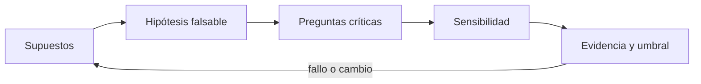
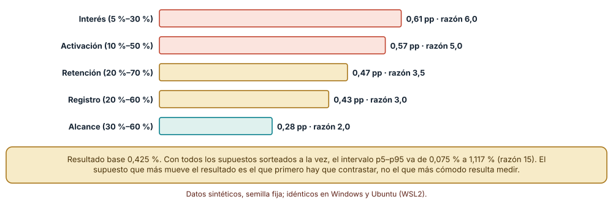
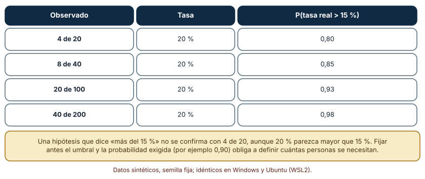
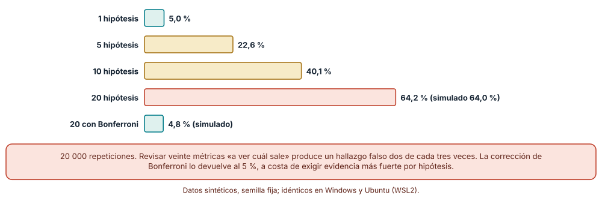

# SE-124 — Hipótesis, supuestos y preguntas críticas

[← SE-123 — Investigación, entrevistas y evidencia cualitativa](https://github.com/vladimiracunadev-create/modern-software-engineering-program/blob/main/classes/part-10-descubrimiento-y-estrategia-de-producto/se-123-investigacion-entrevistas-y-evidencia-cualitativa/README.md) · [↑ Parte 10](https://github.com/vladimiracunadev-create/modern-software-engineering-program/blob/main/classes/part-10-descubrimiento-y-estrategia-de-producto/README.md) · [📚 Índice completo](https://github.com/vladimiracunadev-create/modern-software-engineering-program/blob/main/classes/README.md) · [🌐 Portal](https://vladimiracunadev-create.github.io/modern-software-engineering-program/classes/SE-124.html) · [SE-125 — Propuesta de valor y resultados deseados →](https://github.com/vladimiracunadev-create/modern-software-engineering-program/blob/main/classes/part-10-descubrimiento-y-estrategia-de-producto/se-125-propuesta-de-valor-y-resultados-deseados/README.md)

## Punto profesional y fundamento pedagógico

**Punto profesional.** La clase existe para convertir lo que el equipo cree en afirmaciones que puedan fallar: qué supuestos sostiene la idea, cuál mueve más el resultado, qué dato la refutaría y con qué umbral se decide.

**Por qué aparece aquí.** Se sitúa después de **Investigación, entrevistas y evidencia cualitativa** y antes de **Propuesta de valor y resultados deseados**: `SE-123` dejó citas verificadas y afirmaciones con una o más personas detrás; esta clase las transforma en hipótesis contrastables y en preguntas críticas ordenadas por riesgo. Su mapa de supuestos es lo que `SE-125` usará para formular una propuesta de valor que pueda equivocarse.

**Error conceptual que debe corregir.** Redactar hipótesis que ninguna observación puede refutar, contrastar primero el supuesto más cómodo y contar como hallazgo cualquier métrica que «salió significativa».

**Secuencia de aprendizaje.** Antes de leer la solución, predices qué supuesto de un embudo de cinco pasos mueve más el resultado y qué probabilidad deja un 20 % observado de superar un umbral del 15 %; luego simulas, explicas por qué el supuesto más cómodo no es el más influyente, calculas la probabilidad de un falso positivo al contrastar veinte hipótesis y reconstruyes sin apoyo cómo se fija un umbral antes de mirar los datos. La secuencia usa predicción, explicación propia, contraste y recuperación. [ICAP](https://icap.education.asu.edu/research) distingue participación de construcción de conocimiento; [How People Learn II](https://nap.nationalacademies.org/catalog/24783/how-people-learn-ii-learners-contexts-and-cultures) exige conectar conocimiento previo, contexto y transferencia; la [práctica de recuperación](https://pubmed.ncbi.nlm.nih.gov/16507066/) respalda producir de nuevo la explicación tras una demora; y [Education for Life and Work](https://nap.nationalacademies.org/resource/13398/dbasse_084153.pdf) exige devolución que explique la causa del error.

**Evidencia de aprendizaje.** `hypothesis-map.md` con los supuestos, sus rangos, el orden de riesgo, cada hipótesis con su umbral de decisión fijado de antemano y la probabilidad de falso positivo del conjunto. Debe contener predicción previa, observación, explicación causal, contraejemplo, criterio de aceptación y una nota de qué dato haría cambiar la conclusión.

**Límite de la conclusión.** Los rangos de los supuestos son suposiciones del autor y los datos son sintéticos; el modelo bayesiano usa un a priori uniforme que no refleja conocimiento previo real.

### Trazabilidad fuente → afirmación

| Fuente primaria u oficial | Afirmación que respalda | Lo que no prueba |
|---|---|---|
| [Stanford Encyclopedia of Philosophy: Karl Popper](https://plato.stanford.edu/entries/popper/) | Presenta la falsabilidad como criterio para distinguir afirmaciones empíricas de las que ninguna observación puede contradecir. | No dice cómo decidir cuánta evidencia basta en un producto concreto. |
| [The Lean Startup: principios](https://theleanstartup.com/principles) | Plantea el aprendizaje validado como unidad de progreso bajo incertidumbre extrema y el ciclo construir-medir-aprender. | No es un método estadístico ni garantiza que una prueba concreta sea válida. |
| [Douglas Hubbard: How to Measure Anything](https://www.howtomeasureanything.com/) | Sostiene que la incertidumbre se cuantifica con rangos calibrados y que su reducción tiene un valor económico. | No demuestra que los rangos de este embudo estén calibrados. |

## Antes de empezar

Esta clase continúa **el caso de la plataforma de entregas**. Recupera las citas verificadas de `SE-123` (desconfianza en el borrador, plazos por compañeros), añade una decisión propia sobre **qué debe ser verdad para que valga la pena construir y cómo se sabría que no lo es** y deja un mapa de supuestos para `SE-125`. La pregunta activa es: **¿qué supuesto, si fuera falso, hundiría la idea, y qué dato lo mostraría?**

## Prerrequisitos

- Haber completado `SE-123` o reconstruir al menos dos afirmaciones con citas verificadas.
- Python 3.11 o posterior; solo se usa la biblioteca estándar.
- Trabajar con cifras y datos sintéticos: ninguna observación procede de personas reales.

## Problema auténtico

El equipo propone una función de recuperación de borradores y presenta un embudo: alcanza al 45 % de los estudiantes, el 17,5 % se interesa, el 40 % se registra, el 30 % la activa y el 45 % la retiene; el resultado esperado es 0,4 % de la población. Nadie ha dicho cuál de esas cinco cifras es un dato y cuál una esperanza, ni qué resultado haría abandonar la idea.

## Objetivos observables

Al terminar podrás:

1. listar los supuestos de una idea y separar los observados de los esperados;
2. redactar una hipótesis falsable con umbral y regla de decisión fijados antes de ver los datos;
3. ordenar supuestos por cuánto mueven el resultado y por cuánto cuesta contrastarlos;
4. calcular la probabilidad posterior de que una tasa supere un umbral con distintos tamaños de muestra;
5. estimar la probabilidad de un falso positivo al contrastar varias hipótesis y aplicar una corrección.

## Mapa conceptual



El mapa se lee como una cadena de razonamiento, no como fases obligatorias. La flecha de retorno indica que un supuesto refutado obliga a revisar la lista de supuestos; no autoriza a bajar el umbral hasta que el dato lo cumpla.

## Temas y por qué importan

| Tema | Por qué cambia una decisión profesional | Evidencia mínima |
|---|---|---|
| Supuestos | Toda idea descansa en creencias no verificadas; hacerlas explícitas es lo único que permite contrastarlas. | Predicción, traza causal y contraejemplo de **Supuestos** en `hypothesis-map.md` |
| Hipótesis falsable | Una hipótesis que ninguna observación puede contradecir no orienta ninguna decisión. | Predicción, traza causal y contraejemplo de **Hipótesis falsable** en `hypothesis-map.md` |
| Preguntas críticas | Contrastar primero lo más riesgoso evita gastar semanas en lo que no podría hundir la idea. | Predicción, traza causal y contraejemplo de **Preguntas críticas** en `hypothesis-map.md` |
| Sensibilidad | El supuesto que más mueve el resultado no suele ser el más cómodo de medir. | Predicción, traza causal y contraejemplo de **Sensibilidad** en `hypothesis-map.md` |
| Evidencia y umbral | Cuánta evidencia basta depende del umbral, del tamaño de la muestra y de cuántas hipótesis se contrastan a la vez. | Predicción, traza causal y contraejemplo de **Evidencia y umbral** en `hypothesis-map.md` |

## Conceptos y decisiones

### 1. Supuestos

Un supuesto no es un defecto: es la parte de la idea que todavía es creencia. El defecto es no nombrarlo. Se encuentran preguntándose, para cada paso de la idea, qué tendría que ser cierto: que las personas tengan el problema, que lo reconozcan, que prefieran esta solución a las alternativas, que puedan usarla, que la institución la autorice. Algunos son observados (hay 42 tickets al mes); otros son esperados (el 30 % activará la función). La lista separa ambas columnas y, junto a cada supuesto, deja un rango, no un valor.

### 2. Hipótesis falsable

La falsabilidad —que exista un resultado observable que contradiga la afirmación— distingue una hipótesis de una esperanza. «Los estudiantes valoran la confirmación de entrega» no puede fallar; «al menos 6 de cada 10 estudiantes que ven la confirmación no repiten la entrega en 48 horas» sí. Se completa con la regla: qué se hará si el resultado queda por debajo, por encima o en medio. Fijar umbral y regla antes de ver los datos evita ajustar la vara a la medida del resultado, el error más común y más difícil de notar desde dentro.

### 3. Preguntas críticas

No todos los supuestos merecen una prueba. Una pregunta es crítica cuando una respuesta negativa invalida la idea y no hay cómo compensarla («¿las docentes autorizarán que el sistema guarde borradores de sus alumnos?»). Se ordenan con dos ejes: cuánto mueve el resultado y cuán incierto es. Los supuestos de alto impacto y alta incertidumbre se contrastan primero; los de bajo impacto se aceptan; los de alto impacto bien conocidos se vigilan. La pregunta crítica se redacta como algo que puede responderse con una observación concreta.

### 4. Sensibilidad

En un embudo multiplicativo el resultado es el producto de las tasas de cada paso. Variar cada tasa entre su mínimo y su máximo, manteniendo las demás en su valor central, da su «oscilación»: cuánto cambia el resultado final. El supuesto con mayor oscilación y mayor incertidumbre merece la primera prueba. A menudo no es el que el equipo mide por costumbre (alcance, visitas), sino uno de comportamiento (interés, activación) que solo se aprende con prototipos y conversaciones.

### 5. Evidencia y umbral

Observar un 20 % cuando el umbral es 15 % no equivale a haber superado el umbral: con 20 personas la probabilidad posterior de que la tasa real lo supere es 0,80; con 200, 0,98. Además, cada hipótesis adicional que se mira aumenta la probabilidad de que alguna parezca confirmarse por azar: con veinte hipótesis falsas hay un 64 % de probabilidad de al menos un «hallazgo». Por eso la regla de decisión incluye el tamaño de muestra, la probabilidad exigida y, si hay varias hipótesis, una corrección o una sola hipótesis principal declarada de antemano.

### Qué supuesto mueve más el resultado

El embudo de la plataforma tiene cinco tasas con rangos plausibles: alcance 30–60 %, interés 5–30 %, registro 20–60 %, activación 10–50 % y retención 20–70 %. Con los valores centrales el resultado es 0,425 % de la población. Predicción antes de ejecutar: el supuesto más medido (alcance) es el que menos mueve el resultado.

```python
def salida(v):
    r = 1
    for x in v.values():
        r *= x
    return r

for k, (lo, hi) in rangos.items():
    bajo, alto = dict(centro), dict(centro)
    bajo[k], alto[k] = lo, hi
    oscilacion = salida(alto) - salida(bajo)
```

Oscilaciones (diferencia del resultado entre el máximo y el mínimo de cada supuesto): interés 0,607 puntos porcentuales (razón alto/bajo 6,0), activación 0,567 (5,0), retención 0,472 (3,5), registro 0,425 (3,0) y alcance 0,283 (2,0). Sorteando todos los supuestos a la vez 20 000 veces el resultado va de 0,075 % (p5) a 1,117 % (p95), con mediana 0,321 %; la razón p95/p5 es 15. El supuesto más sensible, el interés, es también el que menos se conoce hasta que alguien habla con personas; el alcance, que sí puede medirse en un panel, es el que menos importa para decidir.



**Cómo leer la figura.** Las barras largas son los supuestos que más cambian el resultado final; la etiqueta da la oscilación en puntos porcentuales y la razón entre el valor alto y el bajo. **Dónde deja de valer:** el embudo es multiplicativo y los rangos son suposiciones; si los pasos se correlacionan (quien se interesa se registra más), el análisis de uno a la vez subestima efectos conjuntos. La sensibilidad dice qué contrastar primero, no cuánto vale la idea.

### La misma tasa observada, más o menos confianza

Un piloto observa que el 20 % de las personas usa la función. El umbral de la hipótesis es 15 %. Con un a priori uniforme Beta(1, 1), la probabilidad posterior de que la tasa real supere el 15 % se calculó con 40 000 sorteos para cuatro tamaños de muestra con la misma tasa observada. Predicción antes de ejecutar: la confianza crece con la muestra, aunque la tasa observada no cambie.

```python
def p_supera(k, n, umbral, rng, sorteos=40000):
    return sum(rng.betavariate(1 + k, 1 + n - k) > umbral for _ in range(sorteos)) / sorteos
```

Resultados: 4 de 20 → 0,80; 8 de 40 → 0,85; 20 de 100 → 0,93; 40 de 200 → 0,98. Un equipo que exija 0,90 necesita unas cien personas; con 20, el mismo 20 % observado deja una probabilidad de una en cinco de que la tasa real esté por debajo del umbral. El número 0,90 no es universal: es una decisión sobre cuánto riesgo se acepta, y debe fijarse antes de observar.



**Cómo leer la figura.** Cada fila conserva la tasa observada (20 %) y solo cambia cuántas personas la respaldan; la última columna es la confianza resultante. **Dónde deja de valer:** el a priori uniforme es una elección; con información previa (otras pruebas, otros productos) un a priori distinto cambiaría las cifras, sobre todo con muestras pequeñas. El cálculo supone observaciones independientes y una población estable durante el piloto.

### Veinte hipótesis, un falso positivo casi seguro

Si un equipo mira veinte métricas buscando cuál «mejora» y ninguna mejora de verdad, ¿con qué frecuencia aparece alguna significativa al 5 %? Simulamos 20 000 repeticiones con veinte hipótesis nulas y un nivel de significación de 0,05 para cada una; en otra serie aplicamos la corrección de Bonferroni (nivel 0,05/20 por hipótesis).

```python
sin_corregir = sum(any(rng.random() < 0.05 for _ in range(20)) for _ in range(20000)) / 20000
bonferroni = sum(any(rng.random() < 0.05 / 20 for _ in range(20)) for _ in range(20000)) / 20000
```

Resultado: 64,0 % de las repeticiones tuvo al menos un «hallazgo» sin corregir (la fórmula 1 − 0,95²⁰ da 64,2 %) y 4,8 % con Bonferroni. Para 1, 5 y 10 hipótesis la fórmula da 5,0 %, 22,6 % y 40,1 %. Casi dos de cada tres informes con veinte métricas encontrarían una «mejora» inexistente. La corrección devuelve el error al 5 % a costa de exigir más evidencia por hipótesis; la alternativa es declarar una única hipótesis principal antes de mirar y tratar el resto como exploración.



**Cómo leer la figura.** Las barras crecen con el número de hipótesis; la última, con corrección, vuelve al nivel nominal. **Dónde deja de valer:** el cálculo supone hipótesis independientes; si las métricas están correlacionadas, la probabilidad real es menor que la fórmula, pero sigue siendo mucho mayor que 5 %. Bonferroni es conservador; existen procedimientos menos estrictos, y la exploración sin corrección es legítima si se declara como tal.

## Definiciones de trabajo

- **supuestos:** creencia sobre personas, mercado, tecnología o negocio que debe ser cierta para que la idea funcione y que aún no ha sido verificada.
- **hipótesis falsable:** afirmación sobre el mundo, con un umbral y una regla de decisión fijados antes de observar, que algún resultado posible refutaría.
- **preguntas críticas:** pregunta cuya respuesta, si fuera desfavorable, cambiaría o cancelaría la decisión; se prioriza por riesgo y por costo de responderla.
- **sensibilidad:** medida de cuánto cambia el resultado de un modelo al variar un supuesto dentro de su rango, con los demás fijos.
- **evidencia y umbral:** regla que convierte observaciones en una decisión: qué se mide, con qué muestra, con qué umbral y con qué control del error por contrastar varias cosas.

Las definiciones son operativas para la plataforma de entregas. No convierten términos con historia más amplia en sinónimos y deben contrastarse con la documentación primaria enlazada al final.

## Ejemplo mínimo

Un fragmento mínimo con una hipótesis falsable y su regla de decisión. Antes de ejecutarlo, predice el resultado para 4 de 20 y para 40 de 200.

```python
import random

def p_supera(k, n, umbral, semilla=1):
    rng = random.Random(semilla)
    return sum(rng.betavariate(1 + k, 1 + n - k) > umbral for _ in range(20000)) / 20000

HIPOTESIS = {"umbral": 0.15, "confianza": 0.90}   # fijados antes de observar

def decide(k, n):
    return "continuar" if p_supera(k, n, HIPOTESIS["umbral"]) >= HIPOTESIS["confianza"] else "seguir probando"

assert decide(4, 20) == "seguir probando"
assert decide(40, 200) == "continuar"
```

Registra versión, comando y salida. La función no se puede ajustar después de ver el dato: el umbral y la confianza están declarados en una constante que forma parte de la hipótesis.

## Ejemplo profesional

En la plataforma de entregas, el mapa de supuestos conserva por cada uno: enunciado, tipo (observado o esperado), rango, impacto en el resultado, costo de contrastarlo, hipótesis falsable, umbral, regla de decisión y fecha en que se fijó. El contrato es que ninguna hipótesis cambia de umbral después de observar y que cada informe indica cuántas hipótesis se miraron.

Compara el caso normal con una hipótesis cuya muestra es demasiado pequeña, con dos hipótesis correlacionadas, con un resultado justo en el umbral y con una hipótesis que fue refutada y reformulada. Un mapa es apropiado cuando esas diferencias quedan registradas con fecha; es peligroso cuando se reescribe después del resultado.

## Práctica guiada

1. Copia el embudo o la cadena de razonamiento de la idea y escribe un supuesto por paso.
2. Marca cada supuesto como observado o esperado y asigna un rango (mínimo, centro, máximo).
3. Calcula la oscilación de cada supuesto y ordénalos de mayor a menor.
4. Redacta la hipótesis falsable del supuesto más sensible, con umbral, tamaño de muestra y probabilidad exigida.
5. Calcula cuántas personas necesitas para que un valor observado del umbral más 5 puntos alcance la confianza declarada.
6. Cuenta cuántas hipótesis vas a mirar y decide cuál es la principal; aplica una corrección a las demás.
7. Pide a otra persona que diga, solo con `hypothesis-map.md`, qué resultado cancelaría la idea.

## Ejercicios

1. **Sensibilidad:** cambia los rangos del embudo (por ejemplo, interés 15–25 %) y comprueba qué supuesto deja de ser el más sensible; explica qué cambiaría en el orden de pruebas.
2. **Muestra:** calcula con la función `p_supera` cuántas personas necesitas para que un 22 % observado supere el umbral de 15 % con confianza 0,90 y 0,95.
3. **Multiplicidad:** simula quince hipótesis nulas y mide la frecuencia de al menos un falso positivo; compárala con 1 − 0,95¹⁵ y con Bonferroni.
4. **Refutación:** escribe tres hipótesis de la plataforma, una por cada resultado posible (se confirma, se refuta, queda en la zona intermedia), con la decisión que tomarías en cada caso.

## Reto verificable

Entrega `hypothesis-map.md` con cinco supuestos con rango, la sensibilidad calculada, una hipótesis falsable con umbral y regla de decisión fijados antes de simular datos, y el número de hipótesis miradas con su corrección. Se aprueba si otra persona ejecuta el cálculo, obtiene la misma ordenación de supuestos y puede decir qué resultado haría abandonar la idea. No se aprueba por la cantidad de supuestos ni por tener un umbral sin regla.

## Caso conductor

La plataforma de entregas propone recuperar borradores. El mapa de supuestos señala que el interés (¿cuántas personas perdieron un borrador y querrían recuperarlo?) es el supuesto más sensible, seguido de la activación. La hipótesis principal: al menos el 15 % de las personas que perdieron un borrador usa la recuperación en el primer mes. Cambia después un solo supuesto —por ejemplo, el alcance— y revisa qué decisiones del mapa cambian.

## Preguntas frecuentes

### ¿Por qué fijar el umbral antes de ver los datos?

Porque con el dato a la vista casi cualquier umbral puede justificarse. Un 14 % se interpreta como «casi 15» si queremos seguir y como «por debajo» si queremos parar. Fijar el umbral y la regla de decisión con fecha elimina esa libertad y convierte la prueba en un compromiso.

### ¿Un 20 % observado supera al umbral del 15 %?

Depende de cuántas personas lo respaldan. Con 20 personas, la probabilidad de que la tasa real supere el 15 % es 0,80; con 200, 0,98. Decidir exige declarar de antemano qué probabilidad se acepta, no mirar si 20 es mayor que 15.

### ¿Es lo mismo un supuesto que una hipótesis?

El supuesto es la creencia; la hipótesis es su versión contrastable, con umbral y regla de decisión. Todo supuesto crítico debería convertirse en hipótesis; un supuesto de bajo impacto puede aceptarse sin contrastar y quedar anotado.

### ¿Debo corregir por multiplicidad en una prueba exploratoria?

Si exploras para generar ideas, no hace falta, pero debes decirlo: lo que sale es una hipótesis nueva y se contrastará con datos nuevos. Si exploras para decidir, la probabilidad de un hallazgo falso con veinte métricas es del 64 % y debes corregir o declarar una sola métrica principal.

## Fallo controlado y diagnóstico

Reproduce el fallo de la clase: **elegir la hipótesis y el umbral después de ver el resultado**. Observa 12 usos en 60 personas (20 %) y declara «superamos el 15 %» sin haber fijado antes cuántas personas ni qué confianza exigías.

Registra síntoma, entrada mínima, hipótesis, observación que descarta cada hipótesis, causa, corrección y prueba de regresión. **Síntoma:** el piloto se declara exitoso y, al ampliar a 200 personas, la tasa observada baja a 13 %. **Hipótesis rivales:** (a) la población del piloto era distinta; (b) la muestra inicial era demasiado pequeña para sostener la conclusión. **Prueba:** calcula la probabilidad posterior para 12 de 60 con umbral 15 % (0,88 con 40 000 sorteos) y compárala con la exigencia previa de 0,90: no se cumplía. **Conclusión:** la decisión se tomó sin una regla fijada. **Regresión:** añade al mapa los campos «umbral», «confianza» y «fecha de fijación» y una prueba que rechace una decisión sin ellos. No cambies a la vez la muestra y el umbral.

## Errores comunes y cómo corregirlos

| Síntoma | Causa probable | Corrección |
|---|---|---|
| El piloto «confirma» la idea y la ampliación no | La conclusión se sacó de una muestra pequeña sin fijar umbral ni confianza | Declarar de antemano tamaño, umbral y probabilidad exigida y calcular la posterior |
| El equipo mide el alcance durante semanas y no avanza | Se contrastó el supuesto más cómodo, no el más sensible | Calcular la oscilación de cada supuesto y contrastar primero el de mayor sensibilidad e incertidumbre |
| El informe presenta una métrica significativa entre veinte | No se corrigió por contrastar muchas hipótesis | Declarar una hipótesis principal o aplicar una corrección y etiquetar el resto como exploración |
| Todas las hipótesis «se cumplen» sea cual sea el resultado | Las hipótesis no son falsables: no especifican un resultado que las contradiga | Reescribir con umbral, muestra y regla para cada resultado posible |
| Los supuestos observados y esperados aparecen mezclados | No se marcó el origen de cada supuesto | Añadir una columna «observado o esperado» con la fuente y su fecha |

## Entorno y archivos clave

```text
work/SE-124/
├── README.md
├── hypotheses/
│   ├── sensibilidad.py
│   ├── posterior.py
│   └── multiples.py
├── fixtures/embudo.json
├── tests/test_decision.py
└── evidence/hypothesis-map.md
```

El `README` declara plataforma, versiones, semilla y comandos. Los scripts usan solo `random` y se ejecutaron con CPython 3.12.9 en Windows 11 y 3.12.3 en Ubuntu bajo WSL2 con salidas idénticas. El a priori Beta(1, 1) y los rangos del embudo son supuestos del autor y se declaran en el `README`.

## Seguridad, ética y accesibilidad

- no uses datos de personas reales para calibrar los rangos sin permiso: una cifra agregada y anonimizada basta;
- una hipótesis puede ser éticamente inaceptable de contrastar (por ejemplo, retener información que alguien necesita): revísala antes con `SE-129`;
- declarar el umbral antes protege también a las personas del piloto: evita prolongar una prueba que daña mientras se busca un resultado favorable;
- ofrece una alternativa textual a las tablas y gráficos y no uses color como única señal;
- registra quién fijó cada umbral y cuándo;
- atribuye los métodos y fórmulas reutilizados y respeta sus licencias.

## Puente hacia el trabajo con agentes

Un agente al que se le pide «valida la hipótesis con estos datos» puede ajustar el umbral, elegir la métrica favorable o probar varias hasta que una salga. Pídele que lea primero `hypothesis-map.md`, que declare cuántas métricas va a mirar, que use el umbral y la confianza escritos con su fecha y que reporte el cálculo aunque la decisión sea desfavorable. Revisa especialmente si propone cambiar el umbral o añadir una métrica después de ver el resultado: es el error de esta clase automatizado.

## Transferencia

Traslada el mapa a otro dominio persistente (por ejemplo, un comercio responsable): cambia el embudo, los rangos y la hipótesis principal, conserva el cálculo de sensibilidad, la posterior y la regla de multiplicidad. La transferencia está lograda cuando puedes explicar qué supuesto juega el papel del «interés» en el nuevo dominio y por qué es el más sensible.

## Evaluación y evidencia

| Criterio | Evidencia para aprobar |
|---|---|
| comprensión | explicación causal de por qué el supuesto más cómodo de medir puede no ser el más influyente |
| corrección | oscilaciones, posterior y probabilidad de falso positivo reproducibles con la misma semilla |
| diseño | mapa de supuestos con rango, impacto, hipótesis, umbral y fecha de fijación |
| diagnóstico | reproducción del fallo «umbral posterior al dato» con regresión |
| responsabilidad | revisión ética de la hipótesis y del piloto |
| reproducibilidad | versiones, comandos, salida y límites declarados |


## Fuentes


- [Stanford Encyclopedia of Philosophy: Karl Popper](https://plato.stanford.edu/entries/popper/) — falsabilidad como criterio de demarcación; autoridad: Stanford University.
- [The Lean Startup: principios](https://theleanstartup.com/principles) — aprendizaje validado y ciclo construir-medir-aprender; autoridad: Eric Ries (fuente del autor).
- [Douglas Hubbard: How to Measure Anything](https://www.howtomeasureanything.com/) — cuantificar la incertidumbre con rangos y valor de la información; autoridad: Hubbard Decision Research.
- [Product Talk: Opportunity Solution Tree](https://www.producttalk.org/opportunity-solution-tree/) — estructura para conectar resultados, oportunidades y experimentos; autoridad: Teresa Torres (fuente del autor).
- [GOV.UK Service Manual: How the discovery phase works](https://www.gov.uk/service-manual/agile-delivery/how-the-discovery-phase-works) — qué averiguar en una discovery y cómo compartir lo aprendido; autoridad: Government Digital Service.
- [SWEBOK Guide v4.0a](https://www.computer.org/education/bodies-of-knowledge/software-engineering) — requisitos, validación y fundamentos de ingeniería; autoridad: IEEE Computer Society.

Cada fuente respalda el mecanismo indicado; ninguna demuestra que los supuestos de la plataforma estén bien rangeados ni que la hipótesis principal sea la correcta. Esa afirmación depende de los datos, de la regla fijada y de la revisión.

- [Python: `random.betavariate`](https://docs.python.org/3/library/random.html#random.betavariate) — distribución beta usada para la probabilidad posterior.
- [NIST/SEMATECH e-Handbook: Bonferroni](https://www.itl.nist.gov/div898/handbook/prc/section4/prc47.htm) — método de corrección por comparaciones múltiples.

## Límites y siguiente paso

Se ejecutaron tres cálculos y simulaciones con datos sintéticos en Windows y Ubuntu (WSL2) con salidas idénticas. Los rangos del embudo y el a priori son supuestos y no se contrastó ninguna hipótesis con personas reales. La siguiente clase transforma la hipótesis más sensible en una propuesta de valor con resultados medibles.

## Glosario

- **supuestos:** creencia sobre personas, mercado, tecnología o negocio que debe ser cierta para que la idea funcione y que aún no ha sido verificada.
- **hipótesis falsable:** afirmación sobre el mundo, con un umbral y una regla de decisión fijados antes de observar, que algún resultado posible refutaría.
- **preguntas críticas:** pregunta cuya respuesta, si fuera desfavorable, cambiaría o cancelaría la decisión; se prioriza por riesgo y por costo de responderla.
- **sensibilidad:** medida de cuánto cambia el resultado de un modelo al variar un supuesto dentro de su rango, con los demás fijos.
- **evidencia y umbral:** regla que convierte observaciones en una decisión: qué se mide, con qué muestra, con qué umbral y con qué control del error por contrastar varias cosas.

---

[← SE-123 — Investigación, entrevistas y evidencia cualitativa](https://github.com/vladimiracunadev-create/modern-software-engineering-program/blob/main/classes/part-10-descubrimiento-y-estrategia-de-producto/se-123-investigacion-entrevistas-y-evidencia-cualitativa/README.md) · [↑ Parte 10](https://github.com/vladimiracunadev-create/modern-software-engineering-program/blob/main/classes/part-10-descubrimiento-y-estrategia-de-producto/README.md) · [📚 Índice completo](https://github.com/vladimiracunadev-create/modern-software-engineering-program/blob/main/classes/README.md) · [🌐 Portal](https://vladimiracunadev-create.github.io/modern-software-engineering-program/classes/SE-124.html) · [SE-125 — Propuesta de valor y resultados deseados →](https://github.com/vladimiracunadev-create/modern-software-engineering-program/blob/main/classes/part-10-descubrimiento-y-estrategia-de-producto/se-125-propuesta-de-valor-y-resultados-deseados/README.md)
