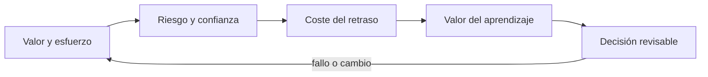
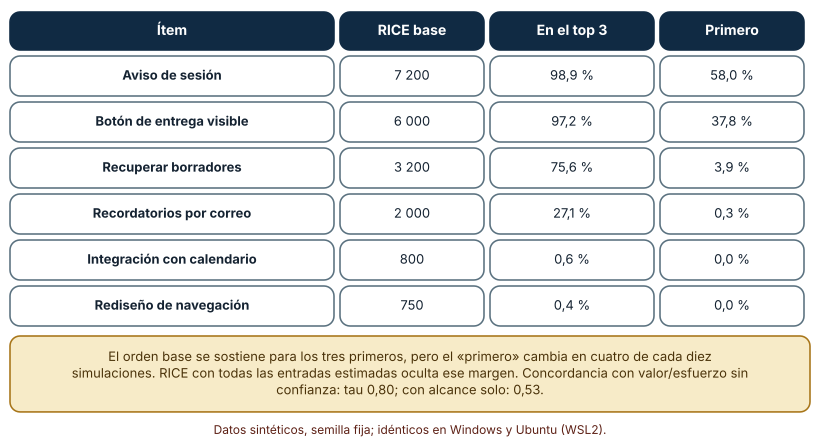
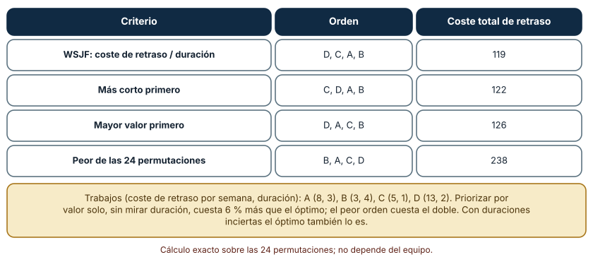
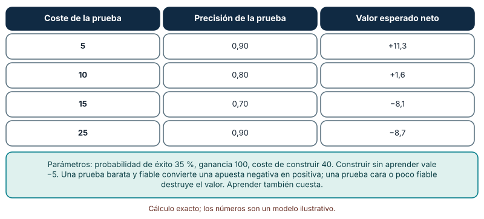

# SE-128 — Priorización por valor, riesgo y aprendizaje

[← SE-127 — Prototipos, experimentos y reducción de incertidumbre](https://github.com/vladimiracunadev-create/modern-software-engineering-program/blob/main/classes/part-10-descubrimiento-y-estrategia-de-producto/se-127-prototipos-experimentos-y-reduccion-de-incertidumbre/README.md) · [↑ Parte 10](https://github.com/vladimiracunadev-create/modern-software-engineering-program/blob/main/classes/part-10-descubrimiento-y-estrategia-de-producto/README.md) · [📚 Índice completo](https://github.com/vladimiracunadev-create/modern-software-engineering-program/blob/main/classes/README.md) · [🌐 Portal](https://vladimiracunadev-create.github.io/modern-software-engineering-program/classes/SE-128.html) · [SE-129 — Ética del descubrimiento y protección de participantes →](https://github.com/vladimiracunadev-create/modern-software-engineering-program/blob/main/classes/part-10-descubrimiento-y-estrategia-de-producto/se-129-etica-del-descubrimiento-y-proteccion-de-participantes/README.md)

## Punto profesional y fundamento pedagógico

**Punto profesional.** La clase existe para ordenar el trabajo con una regla explícita que tenga en cuenta valor, riesgo, urgencia y aprendizaje, y para saber qué parte de ese orden es robusta y cuál es un artefacto de números inciertos.

**Por qué aparece aquí.** Se sitúa después de **Prototipos, experimentos y reducción de incertidumbre** y antes de **Ética del descubrimiento y protección de participantes**: `SE-127` dejó un plan de experimento con tamaño, calendario e intervalos; ahora hay más candidatos que capacidad. Esta clase ordena ítems de descubrimiento y construcción con una fórmula declarada, mide cuánto del orden resiste la incertidumbre de sus entradas y decide cuándo conviene aprender antes de construir. Su registro de priorización alimenta la ética del descubrimiento (`SE-129`) y los criterios de abandono (`SE-130`).

**Error conceptual que debe corregir.** Presentar el resultado de una fórmula de priorización como un hecho, ordenar por valor sin mirar duración y tratar el esfuerzo de aprender como un gasto en lugar de una inversión con retorno.

**Secuencia de aprendizaje.** Antes de leer la solución, predices cuántas veces el primer puesto de un ranking RICE se mantiene si sus entradas varían entre un 60 % y un 140 %, qué criterio de orden minimiza el coste del retraso de cuatro trabajos y cuándo una prueba previa vale su costo; luego simulas, explicas cada resultado y reconstruyes sin apoyo cómo se escribe una regla de priorización revisable. La secuencia usa predicción, explicación propia, contraste y recuperación. [ICAP](https://icap.education.asu.edu/research) distingue participación de construcción de conocimiento; [How People Learn II](https://nap.nationalacademies.org/catalog/24783/how-people-learn-ii-learners-contexts-and-cultures) exige conectar conocimiento previo, contexto y transferencia; la [práctica de recuperación](https://pubmed.ncbi.nlm.nih.gov/16507066/) respalda producir de nuevo la explicación tras una demora; y [Education for Life and Work](https://nap.nationalacademies.org/resource/13398/dbasse_084153.pdf) exige devolución que explique la causa del error.

**Evidencia de aprendizaje.** `prioritization-log.md` con la regla y sus entradas, el ranking base, la probabilidad de cada ítem de estar en el top 3 bajo perturbación, el coste del retraso por criterio y el valor neto de aprender antes. Debe contener predicción previa, observación, explicación causal, contraejemplo, criterio de aceptación y una nota de qué dato haría cambiar la conclusión.

**Límite de la conclusión.** Los doce ítems, sus entradas y los parámetros de la prueba previa son sintéticos y supuestos del autor; la perturbación es uniforme e independiente, mientras que los errores reales de estimación suelen correlacionarse.

### Trazabilidad fuente → afirmación

| Fuente primaria u oficial | Afirmación que respalda | Lo que no prueba |
|---|---|---|
| [Intercom: RICE, simple prioritization for product managers](https://www.intercom.com/blog/rice-simple-prioritization-for-product-managers/) | Define RICE con cuatro factores —alcance, impacto, confianza y esfuerzo— y explica la confianza como control del entusiasmo por ideas con poca evidencia. | No demuestra que RICE ordene mejor que otras reglas ni que sus escalas sean comparables entre equipos. |
| [Scaled Agile Framework: Weighted Shortest Job First](https://scaledagileframework.com/wsjf/) | Define WSJF como el coste relativo del retraso dividido entre la duración relativa del trabajo, para secuenciar según beneficio económico. | Sus puntuaciones relativas son estimaciones; no prueban el coste del retraso real. |
| [Douglas Hubbard: How to Measure Anything](https://www.howtomeasureanything.com/) | Sostiene que la información tiene un valor económico que se calcula y que a menudo conviene medir lo que más reduce la incertidumbre de la decisión. | No valida los parámetros del ejemplo de esta clase. |

## Antes de empezar

Esta clase continúa **el caso de la plataforma de entregas**. Recupera el plan de experimento de `SE-127` y los ítems que ha ido generando la Parte 10, añade una decisión propia sobre **en qué orden hacerlos y qué parte de ese orden es creíble** y deja un registro de priorización para `SE-129`. La pregunta activa es: **¿qué debo hacer primero, y qué tan seguro puedo estar de ese orden?**

## Prerrequisitos

- Haber completado `SE-127` o reconstruir el plan de experimento y su costo.
- Python 3.11 o posterior; solo se usa la biblioteca estándar.
- Trabajar con ítems y puntuaciones sintéticas: ninguna cifra procede de un backlog real.

## Problema auténtico

El backlog tiene doce ítems —aviso de sesión, botón de entrega visible, recuperar borradores, panel para docentes, modo sin conexión, tema oscuro…— y el equipo los ordena con una hoja RICE. El primer puesto lo ocupa «aviso de sesión» con 7 200 y el segundo «botón de entrega visible» con 6 000. Nadie ha preguntado cuánto cambiaría el orden si el alcance o el impacto estuvieran un 40 % equivocados, ni si convendría aprender algo antes de construir lo que quedó tercero.

## Objetivos observables

Al terminar podrás:

1. calcular RICE, WSJF y valor sobre esfuerzo y explicar qué mide y qué omite cada uno;
2. medir la robustez de un ranking a la incertidumbre de sus entradas con una simulación;
3. comparar criterios de orden por el coste total del retraso sobre todas las permutaciones;
4. calcular el valor neto de una prueba previa y decidir si conviene hacerla antes de construir;
5. documentar una regla de priorización de modo que otra persona pueda revisarla y disputarla.

## Mapa conceptual



El mapa se lee como una cadena de razonamiento, no como fases obligatorias. La flecha de retorno indica que un ranking frágil, un coste de retraso mal estimado o una prueba cuyo valor es negativo obliga a revisar la regla de priorización; no autoriza a ajustar números hasta que salga el orden deseado.

## Temas y por qué importan

| Tema | Por qué cambia una decisión profesional | Evidencia mínima |
|---|---|---|
| Valor y esfuerzo | Un cociente de beneficio y costo ordena rápido, pero oculta cuánto se sabe de cada término. | Predicción, traza causal y contraejemplo de **Valor y esfuerzo** en `prioritization-log.md` |
| Riesgo y confianza | La confianza descuenta el entusiasmo por ideas con poca evidencia, pero es otra estimación subjetiva. | Predicción, traza causal y contraejemplo de **Riesgo y confianza** en `prioritization-log.md` |
| Coste del retraso | Cuando el trabajo se secuencia, importa cuánto cuesta cada semana de espera y cuánto dura cada trabajo. | Predicción, traza causal y contraejemplo de **Coste del retraso** en `prioritization-log.md` |
| Valor del aprendizaje | Una prueba barata puede evitar construir lo que no funciona; una cara o poco fiable no compensa. | Predicción, traza causal y contraejemplo de **Valor del aprendizaje** en `prioritization-log.md` |
| Decisión revisable | Una regla que no se puede revisar ni disputar convierte el orden en autoridad. | Predicción, traza causal y contraejemplo de **Decisión revisable** en `prioritization-log.md` |

## Conceptos y decisiones

### 1. Valor y esfuerzo

RICE multiplica alcance (cuántas personas en un periodo), impacto (cuánto mejora a cada una) y confianza (cuánta evidencia respalda las dos estimaciones) y divide entre esfuerzo (persona-meses). La virtud de una fórmula así es obligar a poner números donde antes había opiniones y permitir compararlos. Su límite es que cada número es estimado, y una multiplicación de cuatro estimaciones inciertas produce otra estimación más incierta, pero con apariencia de precisión de entero. Una puntuación sirve para discutir; la discusión es lo que decide.

### 2. Riesgo y confianza

En RICE la confianza (100 %, 80 %, 50 %) penaliza lo que se estima sin datos. Hace dos cosas: reduce el puesto de ideas apasionantes pero indocumentadas y señala qué ítems conviene investigar antes. Pero es una opinión sobre la evidencia, no la evidencia, y puede inflarse o desinflarse según quién la proponga. La salida honesta es tratar los ítems de baja confianza como candidatos a un experimento (`SE-127`) en lugar de a construcción, y registrar de dónde sale cada porcentaje.

### 3. Coste del retraso

Si cuatro trabajos se hacen uno tras otro, cada semana que espera uno acumula su coste de retraso. Ordenar por mayor valor no minimiza el total: un trabajo muy valioso pero largo retrasa a todos los demás. La regla de «trabajo más corto ponderado primero» (WSJF) ordena por coste de retraso dividido entre duración y, en el caso simple de trabajos independientes y sin dependencias, minimiza el coste total. Los costes de retraso reales son difíciles de estimar y las dependencias entre trabajos rompen la regla, de modo que sirve como criterio, no como algoritmo infalible.

### 4. Valor del aprendizaje

Construir un ítem con 35 % de probabilidad de éxito, ganancia de 100 y coste de 40 tiene un valor esperado de −5. Una prueba previa que cuesta 5 y acierta el 90 % de las veces convierte esa apuesta en una decisión informada: se construye solo si la prueba sale positiva, y el valor esperado neto sube a +11,3. Si la prueba cuesta 15 y acierta solo el 70 %, vale −8,1 y conviene no hacerla. El valor de aprender depende de tres cosas: cuánta incertidumbre hay, cuánto cuesta equivocarse y cuánto cuesta la prueba. Es un cálculo con supuestos, pero hace explícito por qué aprender a veces es lo más rentable.

### 5. Decisión revisable

Un registro de priorización conserva la regla, los valores de entrada, quién los estimó, cuándo, de dónde salen y qué los haría cambiar. Incluye una medida de robustez (qué ítems resisten la perturbación) y una lista de ítems «en duda» que se resolverán con un experimento. Evita dos fallos: gaming (inflar alcance o impacto para subir de puesto) y parálisis (esperar números perfectos). La revisión es periódica y se dispara por eventos: una prueba terminada, un cambio de alcance, un incidente.

### Cuánto de un ranking RICE resiste la incertidumbre de sus entradas

Doce ítems del backlog de la plataforma tienen alcance, impacto, confianza y esfuerzo (por ejemplo, «aviso de sesión»: alcance 9 000, impacto 1, confianza 0,8, esfuerzo 1 → RICE 7 200; «botón de entrega visible»: 12 000 × 1 × 0,5 / 1 = 6 000; «recuperar borradores»: 6 000 × 2 × 0,8 / 3 = 3 200). Perturbamos las entradas 5 000 veces: alcance e impacto multiplicados por un factor uniforme entre 0,6 y 1,4, la confianza igual pero acotada a 1 y el esfuerzo entre 0,8 y 1,6 (se subestima más de lo que se sobreestima). Predicción antes de ejecutar: los dos primeros se mantienen en el top 3 casi siempre, pero el primero puesto no es seguro.

```python
sc = [rice(r * u(.6, 1.4), i * u(.6, 1.4), min(1, c * u(.6, 1.4)), e * u(.8, 1.6))
      for _, r, i, c, e in items]
```

Resultados: «aviso de sesión» está en el top 3 en el 98,9 % de las simulaciones y es primero en el 58,0 %; «botón de entrega visible» está en el top 3 el 97,2 % y es primero el 37,8 %; «recuperar borradores» está en el top 3 el 75,6 % (primero 3,9 %); «recordatorios por correo» el 27,1 %; «integración con calendario» y «rediseño de navegación» menos del 1 %. El orden base de los tres primeros es robusto, pero cuál es el primero cambia en cuatro de cada diez simulaciones. La concordancia (tau de Kendall) de RICE con valor/esfuerzo sin confianza es 0,80 y con el alcance solo, 0,53. Idéntico en Windows y Ubuntu.



**Cómo leer la figura.** Cada fila es un ítem con su puntuación base; las dos últimas columnas dicen en qué fracción de 5 000 simulaciones queda entre los tres primeros o primero. **Dónde deja de valer:** la perturbación es uniforme, independiente y de amplitud supuesta; los errores reales se correlacionan (si el alcance está sobrestimado, probablemente lo esté en varios ítems) y pueden ser sesgados. Mide robustez frente a ruido, no frente a un error sistemático en la regla.

### Ordenar por valor o por coste de retraso entre duración

Cuatro trabajos independientes con coste de retraso por semana y duración en semanas: A (8, 3), B (3, 4), C (5, 1) y D (13, 2). El coste total es la suma, para cada trabajo, de su coste de retraso por la semana en que termina. Probamos las 24 permutaciones. Predicción antes de ejecutar: ordenar por mayor valor no minimiza el coste total.

```python
def coste_total(orden):
    t = total = 0
    for j in orden:
        t += duracion[j]
        total += cdr[j] * t
    return total
```

Resultados: el mejor orden de las 24 permutaciones es D, C, A, B con coste 119, que coincide con WSJF (coste de retraso dividido entre duración: D 6,5; C 5,0; A 2,7; B 0,75). «Más corto primero» (C, D, A, B) cuesta 122; «mayor valor primero» (D, A, C, B) cuesta 126, un 6 % más; el peor orden (B, A, C, D) cuesta 238, el doble. La diferencia entre criterios razonables es pequeña aquí (3–6 %); la diferencia con un mal orden es del 100 %. Es un cálculo exacto, idéntico en Windows y Ubuntu, que depende por completo de los números de entrada.



**Cómo leer la figura.** Cada fila es un criterio; el orden indica la secuencia de trabajos y la última columna el coste total del retraso. **Dónde deja de valer:** WSJF es óptimo solo si los trabajos son independientes, se hacen de uno en uno y el coste de retraso es lineal; con dependencias, trabajos paralelos o costes que aparecen en una fecha límite el óptimo cambia. Con duraciones inciertas, el orden óptimo también lo es.

### Cuándo aprender antes de construir vale la pena

Se considera construir un ítem con probabilidad de éxito 35 %, ganancia 100 y costo 40: el valor esperado de construir sin aprender es 0,35 × 100 − 40 = −5, y el de no hacer nada es 0. Una prueba previa con coste conocido y precisión conocida da un resultado positivo con probabilidad p·acc + (1 − p)(1 − acc); solo si es positivo se construye, con probabilidad posterior de éxito p·acc / P(positivo). Predicción antes de ejecutar: una prueba barata y fiable vale la pena; una cara o poco fiable, no.

```python
pos = p * acc + (1 - p) * (1 - acc)
p_exito_dado_pos = p * acc / pos
valor = pos * max(p_exito_dado_pos * G - C, 0) - coste_prueba
```

Resultados: coste 5 y precisión 0,90 → +11,3; coste 10 y 0,80 → +1,6; coste 15 y 0,70 → −8,1; coste 25 y 0,90 → −8,7. Una prueba que cueste 5 convierte una apuesta negativa en positiva; una de 15 con 70 % de precisión destruye más valor del que aporta (lo correcto sería no hacer la prueba ni construir). El cálculo es exacto dados los supuestos y es idéntico en ambos sistemas.



**Cómo leer la figura.** Cada fila es una prueba candidata; el signo del valor neto dice si conviene hacerla. **Dónde deja de valer:** los números (35 %, 100, 40) son un modelo ilustrativo, la precisión se supone simétrica (misma tasa de falsos positivos y negativos) y la ganancia se supone conocida. En decisiones reales la probabilidad y la ganancia son rangos; el método sirve para comparar y para declarar los supuestos, no para predecir.

## Definiciones de trabajo

- **valor y esfuerzo:** razón entre el beneficio esperado de un ítem y su costo estimado; ordena ítems comparables, no mide su valor real.
- **riesgo y confianza:** grado de respaldo empírico de las estimaciones de un ítem, expresado como factor que reduce su puntuación cuando la evidencia es débil.
- **coste del retraso:** pérdida económica o de beneficio por unidad de tiempo en que un trabajo no está disponible; sirve para ordenar trabajos de distinta duración.
- **valor del aprendizaje:** mejora esperada de una decisión gracias a información obtenida antes de decidir, menos el costo de obtenerla.
- **decisión revisable:** regla de priorización escrita con sus entradas, fecha, responsable y condiciones de revisión, de modo que otra persona pueda reproducir y cuestionar el orden.

Las definiciones son operativas para la plataforma de entregas. No convierten términos con historia más amplia en sinónimos y deben contrastarse con la documentación primaria enlazada al final.

## Ejemplo mínimo

Un fragmento mínimo que calcula RICE y WSJF. Antes de ejecutarlo, predice cuál de los dos ítems sube con cada criterio.

```python
def rice(alcance, impacto, confianza, esfuerzo):
    return alcance * impacto * confianza / esfuerzo

def wsjf(coste_retraso, duracion):
    return coste_retraso / duracion

assert rice(9000, 1, 0.8, 1) == 7200            # aviso de sesión
assert rice(6000, 2, 0.8, 3) == 3200            # recuperar borradores
assert wsjf(13, 2) > wsjf(8, 3) > wsjf(3, 4)    # D antes que A antes que B
```

Registra versión, comando y salida. Las dos reglas no ordenan igual en general: RICE mide valor por esfuerzo en un periodo, WSJF mide coste de retraso por duración al secuenciar.

## Ejemplo profesional

En la plataforma de entregas, el registro de priorización conserva por cada ítem: identificador, regla aplicada, valores de entrada con su fuente y fecha, quién los estimó, puntuación base, probabilidad de top 3 bajo perturbación y estado (construir, probar, esperar, descartar). El contrato es que ningún ítem sube de puesto sin que cambie una entrada o su fuente, y que el orden se recalcula cuando se resuelve un experimento.

Compara el caso normal con un ítem de alta puntuación y baja confianza, con uno de baja puntuación que evita un daño grave, con dos ítems dependientes y con una puntuación disputada. Un registro es apropiado cuando esas diferencias se ven y se discuten; es peligroso cuando un número único decide sin explicación.

## Práctica guiada

1. Lista tus ítems con alcance, impacto, confianza y esfuerzo y anota la fuente de cada número.
2. Calcula RICE y valor sobre esfuerzo y compara los órdenes.
3. Perturba las entradas 5 000 veces y calcula la probabilidad de cada ítem de estar en el top 3.
4. Identifica los ítems cuya posición no resiste y decide si necesitan un experimento.
5. Calcula el coste total del retraso para tres criterios sobre todas las permutaciones de cuatro trabajos.
6. Calcula el valor neto de una prueba previa para el ítem de mayor incertidumbre.
7. Pide a otra persona que diga, solo con `prioritization-log.md`, qué ítem cambiaría de puesto si el alcance estuviera un 40 % equivocado.

## Ejercicios

1. **Perturbación:** repite el experimento con ±20 % y ±60 %; explica cómo cambia la probabilidad del primer puesto y cuándo el orden deja de ser informativo.
2. **Gaming:** infla el alcance del ítem n.º 5 un 50 % y registra a qué puesto sube y cuánto debe inflarse para entrar al top 3; propone una defensa.
3. **Retraso:** construye un caso con cuatro trabajos en el que «mayor valor primero» cueste más de un 30 % por encima del óptimo.
4. **Aprender:** busca el punto de equilibrio: ¿hasta qué coste de prueba (con precisión 0,9) sigue siendo positivo el valor neto?

## Reto verificable

Entrega `prioritization-log.md` con doce ítems, la regla, las entradas con fuente, el ranking base, la probabilidad de top 3 bajo perturbación, el coste de retraso por criterio y el valor neto de una prueba previa. Se aprueba si otra persona reproduce la simulación desde un checkout limpio, obtiene los mismos porcentajes y puede señalar qué ítems requieren experimento antes de construirse. No se aprueba por el número de ítems ni por un ranking sin su robustez.

## Caso conductor

La plataforma de entregas ordena doce ítems. «Aviso de sesión» y «botón de entrega visible» resisten la perturbación; «recuperar borradores» entra al top 3 en tres de cada cuatro simulaciones y su confianza es baja, por lo que el registro lo marca para probar con el plan de `SE-127` antes de construir. Cambia después un solo supuesto —por ejemplo, el esfuerzo de recuperar borradores— y revisa qué cambia en el orden.

## Preguntas frecuentes

### ¿RICE es mejor que WSJF?

No son comparables sin más. RICE ordena candidatos por valor sobre esfuerzo en un periodo y WSJF secuencia trabajos por coste de retraso sobre duración. Se parecen cuando el coste de retraso es proporcional al valor; difieren cuando hay urgencia o fechas límite. Elige por la pregunta: ¿qué entra o en qué orden se hace?

### ¿Cómo evito que alguien infle sus números para subir de puesto?

Pidiendo fuentes y fechas para cada entrada, revisando por pares los ítems que suben mucho y mostrando la sensibilidad: si un 50 % más de alcance mueve un ítem al top 3, esa entrada merece más escrutinio.

### ¿Cuándo no conviene priorizar con una fórmula?

Cuando hay obligaciones (cumplimiento legal, seguridad) que no compiten con valor, cuando las entradas son todas conjeturas o cuando hay dependencias fuertes: la fórmula no ordena lo que no es comparable. Se deja constancia de qué ítems se sacan de la fórmula y por qué.

### ¿Aprender antes siempre es mejor que construir?

No: depende del costo y la precisión de la prueba y del daño de equivocarse. Con costo 5 y precisión 0,9 el valor neto es +11,3; con costo 15 y precisión 0,7 es −8,1. Calcularlo con supuestos explícitos evita decidirlo por estilo.

## Fallo controlado y diagnóstico

Reproduce el fallo de la clase: **tratar el primer puesto de una fórmula como un hecho**. Ordena los doce ítems con RICE y asigna el equipo al primero sin mirar la sensibilidad.

Registra síntoma, entrada mínima, hipótesis, observación que descarta cada hipótesis, causa, corrección y prueba de regresión. **Síntoma:** tras re-estimar el alcance en la reunión siguiente, «botón de entrega visible» pasa al primer puesto y el equipo siente que «cambia todo el tiempo». **Hipótesis rivales:** (a) las estimaciones iniciales eran descuidadas; (b) el primer puesto nunca fue estable. **Prueba:** con perturbación de ±40 % el primer puesto de «aviso de sesión» solo se mantiene en el 58,0 % de las simulaciones; «botón de entrega visible» es primero en el 37,8 %. **Conclusión:** la diferencia entre ambos (7 200 frente a 6 000) está dentro del ruido de las estimaciones. **Regresión:** añade al registro la probabilidad de primer puesto y una regla (si dos ítems comparten más del 25 % del primer puesto, se hacen ambos o se decide con otro criterio) y una prueba que falle si se publica un orden sin ese dato. No cambies a la vez las entradas y la regla.

## Errores comunes y cómo corregirlos

| Síntoma | Causa probable | Corrección |
|---|---|---|
| El primer puesto cambia en cada reunión | El ranking no resiste la incertidumbre de sus entradas | Calcular la probabilidad de primer puesto y tratar como empatados los ítems que comparten más del 25 % |
| El equipo hace primero lo más valioso y todo lo demás se retrasa | No se consideró la duración ni el coste del retraso | Comparar con WSJF sobre las permutaciones relevantes y elegir el orden de menor coste total |
| Los números de la hoja son idénticos entre ítems y parecen inventados | No hay fuente por entrada | Registrar fuente, fecha y autor de cada entrada y revisar por pares los cambios grandes |
| Se construye un ítem de baja confianza que no funciona | La baja confianza no activó un experimento | Marcar los ítems de confianza baja como candidatos a prueba antes de construir |
| La prueba previa cuesta más de lo que aporta | No se calculó el valor de la información | Calcular valor neto con costo y precisión supuestos antes de aprobar la prueba |

## Entorno y archivos clave

```text
work/SE-128/
├── README.md
├── priority/
│   ├── rice.py
│   ├── retraso.py
│   └── informacion.py
├── fixtures/backlog.json
├── tests/test_robustez.py
└── evidence/prioritization-log.md
```

El `README` declara plataforma, versiones, semilla y comandos. Los scripts usan solo `random`, `itertools` y `math` y se ejecutaron con CPython 3.12.9 en Windows 11 y 3.12.3 en Ubuntu bajo WSL2 con salidas idénticas. Los doce ítems y sus entradas son sintéticos y se declaran en el `README`.

## Seguridad, ética y accesibilidad

- no priorices solo por alcance: un ítem que protege a una minoría contra un daño grave puede tener un RICE bajo y aun así debe hacerse; marca esos ítems como obligaciones;
- la fórmula no sustituye consideraciones de seguridad, accesibilidad ni cumplimiento; trátalas como restricciones antes de ordenar;
- un ranking oculto invita a manipularlo: publica reglas y entradas dentro del equipo;
- registrar quién estimó cada número permite revisar sesgos sin culpar;
- ofrece una alternativa textual a las tablas y no uses color como única señal;
- atribuye los marcos reutilizados (RICE, WSJF) y respeta sus licencias.

## Puente hacia el trabajo con agentes

Un agente al que se le pide «prioriza este backlog con RICE» devolverá una lista ordenada con números que él mismo inventó cuando faltan datos. Pídele que use únicamente las entradas del registro con su fuente, que marque como «sin dato» las que falten, que reporte la probabilidad de top 3 con una simulación y que proponga experimentos para los ítems de confianza baja en lugar de ordenarlos. Revisa especialmente si rellena huecos con estimaciones plausibles: es el error de esta clase con apariencia de rigor.

## Transferencia

Traslada el registro a otro dominio persistente (por ejemplo, un comercio responsable): cambia los ítems y las entradas, conserva la perturbación, la comparación de criterios y el cálculo del valor de aprender. La transferencia está lograda cuando puedes explicar qué ítem juega el papel de «recuperar borradores» y por qué merece un experimento antes de construirse.

## Evaluación y evidencia

| Criterio | Evidencia para aprobar |
|---|---|
| comprensión | explicación causal de por qué el primer puesto de una fórmula no es un hecho |
| corrección | RICE, perturbación, coste de retraso y valor neto reproducibles con la misma semilla |
| diseño | registro con regla, entradas, fuentes, fechas y robustez |
| diagnóstico | reproducción del fallo «primer puesto como hecho» con regresión |
| responsabilidad | identificación de obligaciones que no compiten por valor |
| reproducibilidad | versiones, comandos, salida y límites declarados |


## Fuentes


- [Intercom: RICE, simple prioritization for product managers](https://www.intercom.com/blog/rice-simple-prioritization-for-product-managers/) — definición de los cuatro factores de RICE; autoridad: Intercom (fuente del autor del método).
- [Scaled Agile Framework: Weighted Shortest Job First](https://scaledagileframework.com/wsjf/) — definición de WSJF y su relación con el coste del retraso; autoridad: Scaled Agile, Inc.
- [Douglas Hubbard: How to Measure Anything](https://www.howtomeasureanything.com/) — valor de la información y cuantificación de la incertidumbre; autoridad: Hubbard Decision Research.
- [Product Talk: Opportunity Solution Tree](https://www.producttalk.org/opportunity-solution-tree/) — estructura para conectar oportunidades, soluciones y experimentos; autoridad: Teresa Torres (fuente del autor).
- [The Lean Startup: principios](https://theleanstartup.com/principles) — aprendizaje validado como unidad de progreso; autoridad: Eric Ries (fuente del autor).
- [SWEBOK Guide v4.0a](https://www.computer.org/education/bodies-of-knowledge/software-engineering) — gestión del alcance, estimación y fundamentos de ingeniería; autoridad: IEEE Computer Society.

Cada fuente respalda el mecanismo indicado; ninguna demuestra que el orden de la plataforma sea el correcto. Esa afirmación depende de las entradas, de su fuente y de la revisión.

- [Python: `itertools.permutations`](https://docs.python.org/3/library/itertools.html#itertools.permutations) — enumeración de las 24 permutaciones para el coste de retraso.
- [Python: `random`](https://docs.python.org/3/library/random.html) — generador con semilla usado en la perturbación del ranking.

## Límites y siguiente paso

Se ejecutaron tres cálculos y simulaciones con datos sintéticos en Windows y Ubuntu (WSL2) con salidas idénticas. No se priorizó un backlog real, la perturbación es independiente y el modelo de aprender antes usa parámetros ilustrativos. La siguiente clase revisa qué aprendizaje es éticamente aceptable y cómo proteger a quienes participan.

## Glosario

- **valor y esfuerzo:** razón entre el beneficio esperado de un ítem y su costo estimado; ordena ítems comparables, no mide su valor real.
- **riesgo y confianza:** grado de respaldo empírico de las estimaciones de un ítem, expresado como factor que reduce su puntuación cuando la evidencia es débil.
- **coste del retraso:** pérdida económica o de beneficio por unidad de tiempo en que un trabajo no está disponible; sirve para ordenar trabajos de distinta duración.
- **valor del aprendizaje:** mejora esperada de una decisión gracias a información obtenida antes de decidir, menos el costo de obtenerla.
- **decisión revisable:** regla de priorización escrita con sus entradas, fecha, responsable y condiciones de revisión, de modo que otra persona pueda reproducir y cuestionar el orden.

---

[← SE-127 — Prototipos, experimentos y reducción de incertidumbre](https://github.com/vladimiracunadev-create/modern-software-engineering-program/blob/main/classes/part-10-descubrimiento-y-estrategia-de-producto/se-127-prototipos-experimentos-y-reduccion-de-incertidumbre/README.md) · [↑ Parte 10](https://github.com/vladimiracunadev-create/modern-software-engineering-program/blob/main/classes/part-10-descubrimiento-y-estrategia-de-producto/README.md) · [📚 Índice completo](https://github.com/vladimiracunadev-create/modern-software-engineering-program/blob/main/classes/README.md) · [🌐 Portal](https://vladimiracunadev-create.github.io/modern-software-engineering-program/classes/SE-128.html) · [SE-129 — Ética del descubrimiento y protección de participantes →](https://github.com/vladimiracunadev-create/modern-software-engineering-program/blob/main/classes/part-10-descubrimiento-y-estrategia-de-producto/se-129-etica-del-descubrimiento-y-proteccion-de-participantes/README.md)
