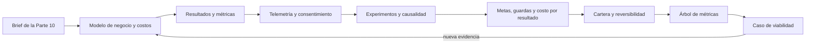

# Parte 11 — Economía, métricas y decisiones de producto

La Parte 10 dejó un brief respaldado por evidencia: qué problema merece atención y qué se sabe de él. La pregunta cambia de «qué merece construirse» a «puede sostenerse, cómo sabremos si funciona y qué decidimos con la incertidumbre que queda». Esta parte continúa con la **plataforma de entregas de tareas**, un caso sintético que recorre las doce clases: un modelo de negocio con centros educativos como clientes, un costo de propiedad que no es solo construir, métricas que se confunden con actividad, retención que se lee mal, telemetría que identifica sin querer, experimentos que se rompen, metas que arrastran lo que no miden, costos que se reparten, carteras, decisiones que no se pueden deshacer y, al final, un árbol de métricas y un caso de viabilidad que otra persona puede recalcular.

## Pregunta rectora

> ¿Qué decisión cambiaría con esta medida, qué daño podría ocultar y con qué incertidumbre se toma?

## Antes del recorrido clase por clase

Esta parte no enseña finanzas ni analítica como lista de fórmulas. Enseña a expresar una decisión de producto con rangos en lugar de puntos, a separar resultado de actividad, a medir sin identificar a nadie, a distinguir una diferencia de un efecto, a poner contrapesos a una meta y a decidir con cuidado cuánto cuesta equivocarse. Cada clase ejecuta experimentos con datos sintéticos y semilla fija que muestran un mecanismo (una razón que se dispara con un abandono pequeño, una curva que se aplana por mezcla, un permiso que el código no respeta, un optimizador que cruza una guarda) y declara lo que ese experimento no demuestra.

El diagrama se lee de izquierda a derecha y no es un proceso obligatorio. El retorno indica que una evidencia nueva reabre los supuestos del modelo; un caso aprobado no cierra la pregunta, la fecha.

## Resultados acumulativos

Podrás expresar un modelo de negocio con su razón de valor de vida y costo de adquisición como intervalo; calcular un costo de propiedad a cinco años y el plazo de un plan con percentiles; clasificar métricas como producción, actividad, resultado o vanidad; medir retención por cohortes sin confundir mezclas ni cohortes incompletas; diseñar un esquema de telemetría mínimo con una puerta de consentimiento probada; estimar efectos con asignación al azar y reconocer selección y regresión a la media; elegir una métrica norte con guardas; calcular costo por resultado y repartir un costo compartido; elegir una cartera y evaluar un piloto; clasificar decisiones por reversibilidad; construir un árbol de métricas con validador; y entregar un caso de viabilidad con valor presente como intervalo y una regla de abandono.

Al finalizar podrás defender una decisión de producto con supuestos declarados, intervalos, un responsable, una fecha y una regla que la detendría, y podrás indicar qué parte de tu conclusión es medición, cuál es modelo y cuál es suposición.

## Prerrequisitos enlazados

- [Parte 4 — Pensamiento computacional](https://github.com/vladimiracunadev-create/modern-software-engineering-program/blob/main/classes/part-04-pensamiento-computacional-y-resolucion-de-problemas/): modelado, invariantes y razonamiento sobre evidencia.
- [Parte 7 — Estructuras de datos y algoritmos](https://github.com/vladimiracunadev-create/modern-software-engineering-program/blob/main/classes/part-07-estructuras-de-datos-y-algoritmos/): medir y comparar sin confundir un resultado con un modelo.
- [Parte 10 — Descubrimiento y estrategia de producto](https://github.com/vladimiracunadev-create/modern-software-engineering-program/blob/main/classes/part-10-descubrimiento-y-estrategia-de-producto/): problema, evidencia, hipótesis y brief.
- Python 3.11+ y terminal; los experimentos usan solo la biblioteca estándar y datos sintéticos.

## Bloques y progresión

1. **Sostenibilidad y costos:** las clases 133–134 expresan la economía del producto con rangos y descomponen el costo de poseerlo.
2. **Medir bien:** las clases 135–137 separan resultado de actividad, definen adopción y retención y deciden qué se puede recoger con consentimiento.
3. **Decidir con evidencia:** las clases 138–140 distinguen una diferencia de un efecto, ponen contrapesos a una meta y calculan el costo por resultado.
4. **Elegir y reducir riesgo:** las clases 141–142 eligen una cartera, evalúan opciones y clasifican decisiones por reversibilidad.
5. **Integrar:** las clases 143–144 organizan las métricas en un árbol con validador y reúnen todo en un caso de viabilidad.

## Evidencia medida y límites

Las figuras y los ejemplos de esta parte usan experimentos ejecutados con CPython 3.12.9 en Windows 11 y repetidos con CPython 3.12.3 en Ubuntu bajo WSL2. Los datos son **sintéticos** y las semillas están fijadas: las salidas fueron idénticas en ambos sistemas; la única diferencia es la versión de SQLite que informa `SE-142` (3.45.3 en Windows y 3.45.1 en Ubuntu). Los experimentos son: razón de valor de vida y costo de adquisición como intervalo, tres modelos de precio durante 36 meses y concentración de ingresos (`SE-133`); costo de propiedad a cinco años, probabilidad de terminar dentro de la suma de medianas y valor presente de dos opciones bajo varias tasas (`SE-134`); una meta de cierres frente a resoluciones, registros acumulados frente a activos y correlación de producción y calidad con el resultado (`SE-135`); una curva de retención agregada y por segmentos, tres definiciones de activo y retención con cohortes incompletas e intervalos de Wilson (`SE-136`); sesgo por consentimiento, unicidad por campos acumulados y once mutantes de una puerta de consentimiento (`SE-137`); efecto observacional, estratificado y aleatorizado, control de proporciones de asignación y regresión a la media (`SE-138`); optimización con y sin guarda, alarmas falsas con varias guardas y descomposición de la métrica norte (`SE-139`); costo por resultado con fallas y volumen, reparto con tres reglas y compromiso de capacidad (`SE-140`); cartera de doce iniciativas y su arrepentimiento, valor de un piloto y secuencias con dependencias (`SE-141`); umbral de reversibilidad, seis migraciones con ida y vuelta en SQLite y despliegue progresivo (`SE-142`); un validador de árbol con dieciséis mutaciones, descomposición exacta frente a aditiva y orden de hojas con baselines inciertos (`SE-143`); y valor presente con incertidumbre, compuerta de abandono y un validador de caso con dieciséis mutaciones (`SE-144`). Los rangos, las tasas, las probabilidades, los precios y los costos son supuestos del autor en unidades monetarias ficticias, no datos de un mercado, un producto, una empresa ni de personas reales; las mutaciones las eligió quien escribió cada validador, de modo que su exactitud real es desconocida. No se midió ninguna plataforma, no se consultó a un especialista legal y `SE-137` no es asesoría jurídica. Esta parte no tiene laboratorio propio en `labs/`; el proyecto integrador `SE-144` define el contrato y la evidencia. Cada clase termina con un puente hacia el trabajo con agentes.

## Guía razonada clase por clase

La plataforma de entregas mantiene un brief, un árbol de métricas y un caso estables mientras cambian las decisiones. Cada clase explica qué incertidumbre reduce, qué experimento la muestra, qué no demuestra y qué evidencia permite abandonar la conclusión.

### Bloque 1 — Sostenibilidad y costos

#### SE-133 — Modelos de negocio y sostenibilidad

Separa quién paga, quién usa y quién decide, compara tres modelos de precio y calcula la economía unitaria. Con rangos triangulares, una razón de 11,5 entre valor de vida y costo de adquisición va de 1,15 a 50,3; con precio plano o con un nivel gratuito la caja puede no equilibrarse, y dos escenarios de dispersión de clientes muestran que el mayor cliente pesa 3 % o 13 % del ingreso.

El estudiante deja `viability-log.md` con supuestos, razón con intervalo, modelos de precio e índice de concentración. `SE-134` abre el costo.

#### SE-134 — Costos de construcción, operación y oportunidad

Descompone el costo en construir, operar y oportunidad. En 20 000 sorteos construir pesa entre 21 % y 36 % del costo a cinco años, la suma de medianas de veinte tareas se cumple en 12 % de los casos y dos inversiones se ordenan distinto según la tasa de descuento (cruce en 13 %).

El estudiante deja `cost-model.md` con costo de propiedad, plazos con percentil 80 y cruce de tasas. `SE-135` pregunta qué se obtiene a cambio.

### Bloque 2 — Medir bien

#### SE-135 — Resultados, outputs, actividad y vanity metrics

Distingue producción, actividad, resultado y vanidad. Una meta de tickets cerrados sube lo premiado 27 % y baja lo resuelto 9 %; los registros acumulados siguen subiendo cinco meses después de que los activos caen; y la producción se asocia 0,20 con el resultado frente a 0,90 de la calidad.

El estudiante deja `metric-audit.md` con diez métricas clasificadas y la regla de no fijar metas sin métrica contraria. `SE-136` define métricas que sí aproximan resultados.

#### SE-136 — Métricas de adopción, retención y tarea útil

Define adopción, tarea útil y retención por cohortes. Una curva agregada se aplana por mezcla de dos segmentos y una tasa constante la subestima 15 veces; el DAU/MAU de la misma población va de 8 % a 28 % según el evento; y contar cohortes incompletas baja la retención a 30 días de 34 % a 27 %.

El estudiante deja `adoption-metrics.md` con definiciones calculables, n e intervalos. `SE-137` decide qué eventos pueden recogerse.

#### SE-137 — Telemetría de producto y consentimiento

Diseña un esquema mínimo de eventos y una puerta de consentimiento con tres estados. Quien acepta sobreestima el uso entre 5 % y 16 %, cinco campos acumulados vuelven únicos a 38 % de los dispositivos y la puerta con tres pruebas del camino feliz mata 2 de 11 mutantes frente a 10 de 11 con pruebas dirigidas. No es asesoría legal.

El estudiante deja `telemetry-plan.md` con esquema, unicidad, puerta y mutantes. `SE-138` usa esos eventos para estimar efectos.

### Bloque 3 — Decidir con evidencia

#### SE-138 — Experimentos, sesgos y causalidad básica

Distingue diferencia observada de efecto causado. Comparar adoptantes con no adoptantes da 2,62 donde el efecto es 0,50; el control de proporciones detecta 5 % de pérdida casi siempre y 2 % casi nunca; y los peores centros «mejoran» hasta 12,6 puntos sin intervención.

El estudiante deja `experiment-readout.md` con tres estimadores, el control y la regresión a la media. `SE-139` añade contrapesos.

#### SE-139 — North Star, guardrails y métricas contrarias

Elige una métrica norte con guardas. Optimizar solo las entregas a tiempo sube 25 puntos y suma 24 puntos de quejas; vigilar diez guardas dispara 41 % de alarmas falsas; y un cambio de 16 % en la métrica se descompone con un factor que explica 93 %.

El estudiante deja `metric-guardrails.md` con la métrica, las guardas y la descomposición. `SE-140` calcula el costo de cada resultado.

#### SE-140 — FinOps de producto y costo por resultado

Calcula el costo por resultado y reparte un costo compartido. El volumen baja el costo por mil resultados de 32 a 2,6, las fallas lo suben 19 %, tres reglas de reparto cobran de 150 a 283 al mismo centro y comprometer capacidad ahorra 25 % pero deja de convenir si la demanda cae.

El estudiante deja `unit-cost.md` con costos unitarios, repartos y compromisos. `SE-141` compara iniciativas.

### Bloque 4 — Elegir y reducir riesgo

#### SE-141 — Portafolio, opciones y secuenciación de inversión

Elige una cartera de 12 iniciativas dentro de un presupuesto y mide su arrepentimiento (es la mejor en 7,5 % de los futuros), evalúa un piloto que vuelve positiva una apuesta de −24 a partir de una exactitud de 0,82 y compara el mejor orden de siete tareas con el voraz.

El estudiante deja `portfolio-log.md`. `SE-142` pregunta cuánto cuesta equivocarse.

#### SE-142 — Decisiones reversibles e irreversibles

Calcula la probabilidad de equivocarse que justifica probar con vuelta atrás (5 %), mide la reversibilidad de seis migraciones en SQLite (tres vuelven completas, una de ellas con un dato creado erróneo; una pierde precisión; dos destruyen datos) y compara un despliegue total con uno por etapas (87 personas afectadas frente a 9 952).

El estudiante deja `decision-reversibility.md`. `SE-143` organiza las métricas.

### Bloque 5 — Integrar

#### SE-143 — Taller: diseñar un árbol de métricas

El taller construye un árbol con una raíz, factores calculables y nodos completos, lo valida y lo muta dieciséis veces (el validador atrapa 12), compara la descomposición exacta con la aditiva y ordena las hojas por efecto por costo con baselines inciertos.

El estudiante deja `metric-tree.md`. `SE-144` lo usa como base.

#### SE-144 — Proyecto: caso de viabilidad técnico-económica

El proyecto integra supuestos con rango, valor presente como intervalo (mediana 459 mil, p5 −470 mil, p95 2 962 mil, 72,9 % de probabilidad de ser positivo), oscilación por supuesto, una compuerta de abandono cuyo costo se mide y un validador que detecta 12 de 16 mutaciones.

El estudiante entrega el caso, el validador con sus pruebas, el registro de mutaciones y la decisión con responsable y fecha. La Parte 12 usa este caso como contexto para elicitar requisitos.

## Resumen operativo del recorrido

| Clase | Capacidad que construye | Pregunta que resuelve | Evidencia acumulativa |
|---|---|---|---|
| [SE-133](https://github.com/vladimiracunadev-create/modern-software-engineering-program/blob/main/classes/part-11-economia-metricas-y-decisiones-de-producto/se-133-modelos-de-negocio-y-sostenibilidad/) | Modelos de negocio y sostenibilidad | ¿Qué tendría que ser verdad para sostenerse? | `viability-log.md` con razón con intervalo y concentración |
| [SE-134](https://github.com/vladimiracunadev-create/modern-software-engineering-program/blob/main/classes/part-11-economia-metricas-y-decisiones-de-producto/se-134-costos-de-construccion-operacion-y-oportunidad/) | Costos de construcción, operación y oportunidad | ¿Cuánto cuesta tener el producto cinco años? | `cost-model.md` con percentiles y cruce de tasas |
| [SE-135](https://github.com/vladimiracunadev-create/modern-software-engineering-program/blob/main/classes/part-11-economia-metricas-y-decisiones-de-producto/se-135-resultados-outputs-actividad-y-vanity-metrics/) | Resultados, actividad y vanidad | ¿Qué cambia si esta métrica sube? | `metric-audit.md` con diez métricas clasificadas |
| [SE-136](https://github.com/vladimiracunadev-create/modern-software-engineering-program/blob/main/classes/part-11-economia-metricas-y-decisiones-de-producto/se-136-metricas-de-adopcion-retencion-y-tarea-util/) | Adopción, retención y tarea útil | ¿Quién llega a hacer la tarea y vuelve? | `adoption-metrics.md` con cohortes e intervalos |
| [SE-137](https://github.com/vladimiracunadev-create/modern-software-engineering-program/blob/main/classes/part-11-economia-metricas-y-decisiones-de-producto/se-137-telemetria-de-producto-y-consentimiento/) | Telemetría y consentimiento | ¿Qué se recoge, con qué permiso y con qué control? | `telemetry-plan.md` con puerta y mutantes |
| [SE-138](https://github.com/vladimiracunadev-create/modern-software-engineering-program/blob/main/classes/part-11-economia-metricas-y-decisiones-de-producto/se-138-experimentos-sesgos-y-causalidad-basica/) | Experimentos, sesgos y causalidad | ¿Qué diferencia es un efecto? | `experiment-readout.md` con tres estimadores |
| [SE-139](https://github.com/vladimiracunadev-create/modern-software-engineering-program/blob/main/classes/part-11-economia-metricas-y-decisiones-de-producto/se-139-north-star-guardrails-y-metricas-contrarias/) | Métrica norte, guardas y contrarias | ¿Qué no puede empeorar mientras la subo? | `metric-guardrails.md` con alarmas y descomposición |
| [SE-140](https://github.com/vladimiracunadev-create/modern-software-engineering-program/blob/main/classes/part-11-economia-metricas-y-decisiones-de-producto/se-140-finops-de-producto-y-costo-por-resultado/) | FinOps y costo por resultado | ¿Cuánto cuesta cada resultado y quién lo paga? | `unit-cost.md` con reparto y compromiso |
| [SE-141](https://github.com/vladimiracunadev-create/modern-software-engineering-program/blob/main/classes/part-11-economia-metricas-y-decisiones-de-producto/se-141-portafolio-opciones-y-secuenciacion-de-inversion/) | Portafolio, opciones y secuencia | ¿Qué conjunto y en qué orden? | `portfolio-log.md` con arrepentimiento y orden |
| [SE-142](https://github.com/vladimiracunadev-create/modern-software-engineering-program/blob/main/classes/part-11-economia-metricas-y-decisiones-de-producto/se-142-decisiones-reversibles-e-irreversibles/) | Decisiones reversibles e irreversibles | ¿Cuánto cuesta equivocarse y cuánto se deshace? | `decision-reversibility.md` con migraciones y despliegue |
| [SE-143](https://github.com/vladimiracunadev-create/modern-software-engineering-program/blob/main/classes/part-11-economia-metricas-y-decisiones-de-producto/se-143-taller-disenar-un-arbol-de-metricas/) | Taller: árbol de métricas | ¿Qué hoja mueve la raíz y quién responde? | `metric-tree.md` con validador y mutaciones |
| [SE-144](https://github.com/vladimiracunadev-create/modern-software-engineering-program/blob/main/classes/part-11-economia-metricas-y-decisiones-de-producto/se-144-proyecto-caso-de-viabilidad-tecnico-economica/) | Proyecto: caso de viabilidad | ¿Puede otra persona decidir y comprobar con este caso? | `viability-case.md`, validador, mutaciones y decisión |

## Proyecto integrador

El proyecto **SE-144** entrega un caso de viabilidad con supuestos declarados con rango, fuente y estado, valor presente como intervalo con probabilidad de ser positivo, oscilación por supuesto, una regla de abandono con su efecto en riesgo y en valor esperado, una decisión con responsable y fecha y los límites. Se acompaña de un validador con sus pruebas y el registro de dieciséis mutaciones con las que sobreviven explicadas.

## Criterios de salida

- las doce clases explican todos sus temas mediante mecanismos, ejemplos y límites;
- cada resultado económico se informa con un intervalo y declara qué supuesto domina;
- cada métrica tiene definición calculable, población, ventana, fuente, responsable y métrica contraria;
- la telemetría recoge solo campos justificados y la puerta de consentimiento se prueba con mutantes;
- los efectos se estiman con asignación al azar o se rotulan como asociación;
- las reglas de abandono tienen comparador, umbral, ventana y responsable, y su costo en valor esperado está medido;
- otra persona reproduce comandos y resultados desde checkout limpio;
- el informe declara lo observado, lo modelado y lo no ejecutado.

## Preguntas de control por bloque

- ¿Qué parte de esta cifra es medición, cuál es modelo y cuál es suposición?
- ¿Qué decisión cambiaría si esta métrica bajara, y qué conducta provocaría como meta?
- ¿Qué defecto no habría detectado este validador y quién lo revisa?
- ¿Cuánto cuesta equivocarse con esta decisión y qué parte puede deshacerse?

## Fuentes de la parte

- [GOV.UK Service Manual: Measuring success](https://www.gov.uk/service-manual/measuring-success) — cómo definir y usar indicadores de un servicio; autoridad: Government Digital Service (Reino Unido).
- [HM Treasury: The Green Book](https://www.gov.uk/government/publications/the-green-book-appraisal-and-evaluation-in-central-governent/the-green-book-2020) — evaluación de opciones, descuento y sesgo de optimismo; autoridad: HM Treasury (Reino Unido).
- [FinOps Foundation: What is FinOps](https://www.finops.org/introduction/what-is-finops/) — gestión financiera de la nube; autoridad: FinOps Foundation (Linux Foundation).
- [EDPB: Guidelines 05/2020 on consent](https://www.edpb.europa.eu/our-work-tools/our-documents/guidelines/guidelines-052020-consent-under-regulation-2016679_en) — condiciones del consentimiento válido; autoridad: Comité Europeo de Protección de Datos.
- [Trustworthy Online Controlled Experiments](https://experimentguide.com/) — experimentos controlados y su calidad; autoridad: Kohavi, Tang y Xu (Cambridge University Press).
- [Google SRE Workbook: Canarying Releases](https://sre.google/workbook/canarying-releases/) — despliegue progresivo; autoridad: Google SRE.
- [SWEBOK Guide v4.0a](https://www.computer.org/education/bodies-of-knowledge/software-engineering) — economía y medición en ingeniería de software; autoridad: IEEE Computer Society.

Las fuentes se vinculan también dentro de cada clase. Definen vocabulario y mecanismos; la adecuación de las decisiones de la plataforma de entregas se demuestra con el caso, la evidencia trazable y la revisión de otra persona, no con la autoridad de la fuente.
