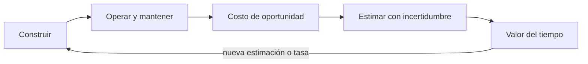
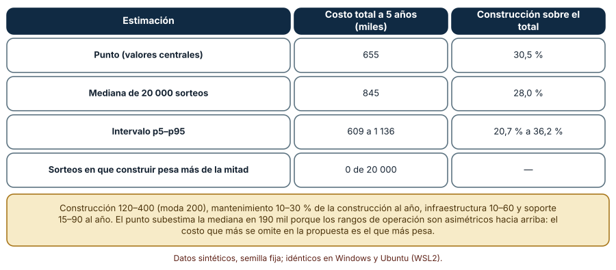
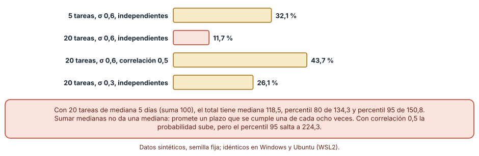
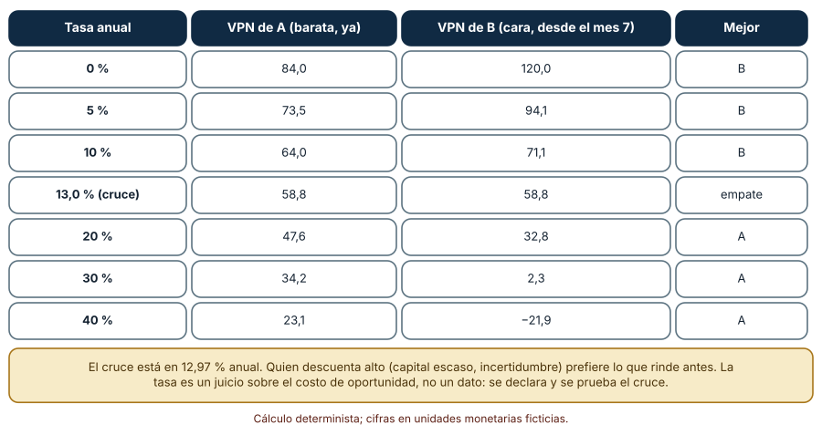

# SE-134 — Costos de construcción, operación y oportunidad

[← SE-133 — Modelos de negocio y sostenibilidad](https://github.com/vladimiracunadev-create/modern-software-engineering-program/blob/main/classes/part-11-economia-metricas-y-decisiones-de-producto/se-133-modelos-de-negocio-y-sostenibilidad/README.md) · [↑ Parte 11](https://github.com/vladimiracunadev-create/modern-software-engineering-program/blob/main/classes/part-11-economia-metricas-y-decisiones-de-producto/README.md) · [📚 Índice completo](https://github.com/vladimiracunadev-create/modern-software-engineering-program/blob/main/classes/README.md) · [🌐 Portal](https://vladimiracunadev-create.github.io/modern-software-engineering-program/classes/SE-134.html) · [SE-135 — Resultados, outputs, actividad y vanity metrics →](https://github.com/vladimiracunadev-create/modern-software-engineering-program/blob/main/classes/part-11-economia-metricas-y-decisiones-de-producto/se-135-resultados-outputs-actividad-y-vanity-metrics/README.md)

## Punto profesional y fundamento pedagógico

**Punto profesional.** La clase existe para que el costo de una decisión incluya lo que cuesta construirla, lo que cuesta mantenerla viva y lo que se deja de hacer por elegirla, y para que una estimación de costo se exprese con un percentil y no con la suma de números optimistas.

**Por qué aparece aquí.** Se sitúa después de **Modelos de negocio y sostenibilidad** y antes de **Resultados, outputs, actividad y vanity metrics**: `SE-133` dejó un modelo cuyo costo de servir entró como un solo número; esta clase lo abre en construcción, operación y oportunidad, y deja un costo de propiedad a cinco años y una regla para estimar plazos que las clases de métricas y de FinOps reutilizarán.

**Error conceptual que debe corregir.** Presentar el costo de construir como el costo del producto, y sumar estimaciones centrales como si el total fuera central.

**Secuencia de aprendizaje.** Antes de ejecutar, predices qué fracción del costo a cinco años es construir y si la suma de las medianas de veinte tareas es un plazo probable; después ejecutas, explicas por qué ambas intuiciones fallan, repites con tareas correlacionadas y comparas dos inversiones bajo varias tasas de descuento. La secuencia usa predicción, explicación propia, contraste y recuperación. [ICAP](https://icap.education.asu.edu/research) distingue participación de construcción de conocimiento; [How People Learn II](https://nap.nationalacademies.org/catalog/24783/how-people-learn-ii-learners-contexts-and-cultures) exige conectar conocimiento previo, contexto y transferencia; la [práctica de recuperación](https://pubmed.ncbi.nlm.nih.gov/16507066/) respalda producir de nuevo la explicación tras una demora; y [Education for Life and Work](https://nap.nationalacademies.org/resource/13398/dbasse_084153.pdf) exige devolución que explique la causa del error.

**Evidencia de aprendizaje.** `cost-model.md` con el costo de propiedad a cinco años como intervalo, la composición construcción/operación, el plazo de un plan de veinte tareas con percentil 80, y la comparación de dos opciones bajo varias tasas con el cruce.

**Límite de la conclusión.** Los costos, las dispersiones y las correlaciones son supuestos del autor en unidades monetarias ficticias. Los experimentos muestran la forma del error de estimación, no el costo real de ninguna plataforma.

### Trazabilidad fuente → afirmación

| Fuente primaria u oficial | Afirmación que respalda | Lo que no prueba |
|---|---|---|
| [HM Treasury: The Green Book](https://www.gov.uk/government/publications/the-green-book-appraisal-and-evaluation-in-central-governent/the-green-book-2020) | Una evaluación de inversión descuenta flujos futuros y corrige el sesgo de optimismo de las estimaciones, y presenta alternativas con sus costos totales. | No fija la tasa que debe usar una empresa ni valida un caso concreto. |
| [AWS Well-Architected: Cost Optimization Pillar](https://docs.aws.amazon.com/wellarchitected/latest/cost-optimization-pillar/welcome.html) | El costo de un sistema incluye su operación continua y se gestiona con prácticas de medición, no solo en la compra. | No dice cuánto cuesta operar tu sistema ni es neutral respecto de ese proveedor. |
| [Python: random](https://docs.python.org/3/library/random.html) | `random.Random(semilla)` con `gauss` y `triangular` permite repetir los sorteos. | No demuestra que la lognormal sea la forma real de las estimaciones de tareas. |

## Antes de empezar

Recupera lo aprendido en `SE-133`: un valor central sin rango oculta suposición. La pregunta activa es: **¿cuánto cuesta de verdad tener este producto durante cinco años, y qué se deja de hacer a cambio?**

## Prerrequisitos

- Haber completado `SE-133` o poder explicar qué supuestos y rangos dejó el modelo de negocio.
- Python 3.11 o posterior y un terminal.
- Trabajar solo con cifras sintéticas en unidades monetarias ficticias.

## Problema auténtico

El equipo de la plataforma presenta un presupuesto de 200 mil para «construir la v1» y se aprueba sin más. Dieciocho meses después, soporte, infraestructura y mantenimiento consumen más que la construcción y la segunda fase no tiene presupuesto. Nadie preguntó cuánto cuesta poseer el producto cinco años ni cuánto tarda en realidad un plan de veinte tareas estimadas de cinco días cada una.

## Objetivos observables

Al terminar podrás:

1. descomponer el costo de un producto en construcción, operación y oportunidad, con un ejemplo de cada uno en la plataforma;
2. estimar el costo de propiedad a cinco años como intervalo y decir qué fracción es construir;
3. explicar por qué la suma de las medianas de varias tareas no es un plazo probable y calcular un percentil de un plan;
4. comparar dos inversiones bajo varias tasas de descuento y localizar el cruce;
5. declarar qué costos quedaron fuera del modelo.

## Mapa conceptual



El mapa se lee como una cadena de razonamiento, no como fases obligatorias. La flecha de retorno indica que una tasa distinta o una estimación corregida reabre la decisión de construir; no autoriza a ajustar solo el último número.

## Temas y por qué importan

| Tema | Por qué cambia una decisión profesional | Evidencia mínima |
|---|---|---|
| Costo de construir | Es el costo visible y el que se aprueba; pesa menos de lo que se cree en el costo de propiedad. | Rango de construcción y su fuente en `cost-model.md` |
| Costo de operar y mantener | Infraestructura, soporte, actualizaciones y deuda técnica se pagan cada año mientras el producto exista. | Mantenimiento anual como fracción de la construcción, con rango |
| Costo de oportunidad | Cada opción elegida es una opción no elegida; su valor es lo mejor a lo que se renunció. | Alternativa descartada y su valor estimado |
| Estimar con incertidumbre | Las estimaciones de tareas son asimétricas y se suman mal; el plazo de un plan se describe con percentiles. | Percentil 50, 80 y 95 de un plan y supuestos de correlación |
| Valor del tiempo | Un costo o beneficio futuro vale menos hoy; la tasa que se elija puede invertir el orden de dos opciones. | Valor presente de ambas opciones y tasa de cruce |

## Conceptos y decisiones

### 1. Costo de construir

Es lo que se paga hasta que el producto está en uso: diseño, desarrollo, pruebas, migración inicial. Se estima por trabajo y por insumos, y casi siempre se subestima porque se estima lo conocido. Su rango debe incluir lo que el equipo todavía no sabe (integraciones, requisitos que cambian), y se declara quién y cuándo lo estimó para poder comparar después con lo real.

### 2. Costo de operar y mantener

Un sistema en uso exige cambios por seguridad, dependencias y requisitos; consume infraestructura proporcional al uso y soporte proporcional a los usuarios. En la plataforma, el mantenimiento se modela como una fracción anual de la construcción, y la infraestructura y el soporte como montos anuales. La fracción real depende de la calidad de lo construido: lo que se entrega sin pruebas ni documentación se paga después en operación.

### 3. Costo de oportunidad

No aparece en ninguna factura. Es el valor de la mejor alternativa a la que se renuncia: las personas que construyen la v1 no construyen otra cosa, y el capital invertido no rinde en otro uso. Se hace visible nombrando la alternativa descartada y estimándola, aunque sea con un rango. Un proyecto con valor presente positivo puede ser mala decisión si la alternativa vale más.

### 4. Estimar con incertidumbre

Las estimaciones de duración y costo son asimétricas: un trabajo puede tardar el doble, rara vez la mitad. La mediana de la suma de variables asimétricas es mayor que la suma de sus medianas, y la correlación (el mismo equipo, la misma tecnología, el mismo requisito mal entendido) ensancha la cola. Por eso un plan se promete con un percentil alto y el sesgo de optimismo se corrige con una referencia externa, como pide la guía del Tesoro británico.

### 5. Valor del tiempo

Un beneficio que llega en 18 meses vale menos que uno de hoy, y lo cuantifica una tasa de descuento que expresa el costo de capital y el riesgo. No es un dato: es un juicio. Dos opciones pueden invertir su orden al cambiar la tasa, y el cruce muestra cuán sensible es la decisión a ese juicio.

### Construir es la parte menor del costo de propiedad

El presupuesto aprobado fue de 200 mil de construcción. Se estima el costo a cinco años como construcción más cinco años de mantenimiento, infraestructura y soporte, con rangos triangulares: construcción 120–400 (moda 200), mantenimiento 10–30 % de la construcción al año (moda 18 %), infraestructura 10–60 al año (moda 25) y soporte 15–90 al año (moda 30). Predicción antes de ejecutar: si un tercio del costo es construir, esa parte debería ser menor que la mitad.

```python
rng = random.Random(1341)
for _ in range(20000):
    construccion = rng.triangular(120, 400, 200)
    mantenimiento = rng.triangular(0.10, 0.30, 0.18) * construccion
    infraestructura = rng.triangular(10, 60, 25)
    soporte = rng.triangular(15, 90, 30)
    total = construccion + 5 * (mantenimiento + infraestructura + soporte)
    parte = construccion / total
```

Resultado, idéntico en Windows (CPython 3.12.9) y en Ubuntu bajo WSL2 (3.12.3): con valores centrales el total a cinco años es 655 mil y construir es 30,5 %. En los sorteos, el total tiene mediana 845 mil, percentil 5 de 609 y percentil 95 de 1 136; construir pesa en mediana 28,0 % (de 20,7 % a 36,2 %) y en ningún sorteo llega a la mitad. El punto subestima la mediana por 190 mil porque los rangos de operación son asimétricos hacia arriba. El presupuesto aprobado cubría entre una quinta y una tercera parte del costo real de tener el producto.



**Cómo leer la figura.** Cada fila es una manera de resumir el mismo modelo; la última dice en cuántos sorteos construir supera la mitad del total (ninguno). **Dónde deja de valer:** el modelo omite desmantelar, migrar de proveedor, el costo de capital y los cambios de alcance, y supone independencia entre los cuatro rubros. Con datos de proyectos reales de la organización las fracciones serían otras, y es lo que debería reemplazarlas cuando existan.

### La suma de medianas no es un plazo probable

Un plan tiene 20 tareas; cada una se estimó con una mediana de 5 días y una dispersión lognormal (σ = 0,6, es decir, una de cada seis tareas tarda más de 1,8 veces la mediana). Suma de medianas: 100 días. Predicción: la probabilidad de terminar en 100 días no debería ser 50 %.

```python
rng = random.Random(1342)
def total(n, sigma, rho):
    comun = rng.gauss(0, 1)
    return sum(5 * math.exp(sigma * (rho ** .5 * comun + (1 - rho) ** .5 * rng.gauss(0, 1)))
               for _ in range(n))
```

Con 10 000 planes simulados: con tareas independientes, la probabilidad de terminar en 100 días es 11,7 %, la mediana del plan es 118,5, el percentil 80 es 134,3 y el 95, 150,8. Con 5 tareas independientes la probabilidad es 32,1 %; con 20 tareas de menor dispersión (σ = 0,3), 26,1 %. Si las tareas comparten una causa común (correlación 0,5) la probabilidad sube a 43,7 %, pero el percentil 95 salta a 224,3 días: la cola se vuelve mucho más pesada. Prometer 100 días es prometer algo que se cumple una vez de cada ocho.



**Cómo leer la figura.** Cada barra es la fracción de 10 000 planes que terminó en 100 o 25 días, según el escenario; la coral es el plan de 20 tareas independientes, el más optimista a primera vista. **Dónde deja de valer:** la lognormal y la correlación única son supuestos; las estimaciones reales dependen de quién estima y del dominio. La figura no dice cuánto tarda tu plan: dice que sumar medianas no sirve para decidir un plazo.

### Una tasa de descuento puede invertir la decisión

Se comparan dos opciones: A cuesta 60 hoy y rinde 4 al mes durante 36 meses; B cuesta 150 hoy, no rinde durante seis meses y luego 7,5 al mes durante 36 meses. Valor presente con la tasa anual dividida entre doce:

```python
def vpn(tasa, flujos):
    return sum(f / (1 + tasa / 12) ** t for t, f in enumerate(flujos))
A = [-60] + [4.0] * 36
B = [-150] + [0] * 6 + [7.5] * 36
```

Con 0 % anual B vale 120 y A 84; con 10 %, 71,1 frente a 64,0; con 20 %, A vale 47,6 y B 32,8; con 40 %, B tiene valor negativo (−21,9) y A conserva 23,1. El cruce está en 12,97 % anual, donde ambas valen 58,8. A una tasa baja conviene la inversión grande y tardía; a una alta, la barata y rápida. Elegir la tasa es elegir la opción.



**Cómo leer la figura.** Cada fila es una tasa; las dos columnas centrales son el valor presente de cada opción y la última dice cuál gana. **Dónde deja de valer:** los flujos son ciertos aquí; en la realidad los beneficios de B son más inciertos y un riesgo mayor haría su valor menor aún. La figura muestra sensibilidad a la tasa, no la tasa correcta.

## Definiciones de trabajo

- **costo de construir:** gasto necesario para dejar el producto en uso, incluidas pruebas, migración inicial y documentación mínima.
- **costo de operar y mantener:** gasto recurrente de infraestructura, soporte, actualizaciones y correcciones mientras el producto exista.
- **costo de oportunidad:** valor de la mejor alternativa a la que se renuncia al elegir una opción.
- **estimación con incertidumbre:** valor expresado con una distribución o percentiles, no con un único número.
- **valor presente neto:** suma de los flujos descontados a una tasa declarada; depende del juicio sobre la tasa.

Las definiciones son operativas para la plataforma de entregas y deben contrastarse con la documentación primaria enlazada al final.

## Ejemplo mínimo

Predice cuánto cuesta cinco años un producto que se construye por 100, se mantiene a 20 % al año y cuesta 15 al año de infraestructura.

```python
construccion, mant, infra = 100, 0.20, 15
total = construccion + 5 * (mant * construccion + infra)
print(total, round(construccion / total, 2))
```

El total es 275 y construir pesa 36 %: aun con supuestos modestos, dos tercios del costo vienen después de la entrega. Registra versión del intérprete, comando y salida; si cambias el mantenimiento a 30 % el total pasa a 325 y la parte de construir a 31 %.

## Ejemplo profesional

En la plataforma, `cost-model.md` contiene una fila por rubro (construcción, mantenimiento, infraestructura, soporte, otro) con mínimo, moda, máximo, quién estimó, fecha y fuente de comparación. El contrato es que el total se calcula siempre desde las filas y que ningún total se informa sin su percentil 80. Esa estructura permite que, cuando haya costos reales, se compare cada fila con su estimación y se mejore el siguiente rango.

Compara el caso normal con el rubro que llega tarde (una licencia que no se previó), con el rubro compartido con otro producto, con el costo que cambia por un incidente y con el que depende del precio de un proveedor. Un modelo es adecuado cuando esas excepciones son filas separadas; es peligroso cuando se absorben en un «imprevistos 10 %» sin dueño.

## Práctica guiada

1. Copia el contrato de rubros (mínimo, moda, máximo, estimador, fecha, fuente) antes de calcular.
2. Predice qué fracción del costo a cinco años es construir y anótala.
3. Ejecuta los 20 000 sorteos con semilla fija; guarda p5, mediana y p95 del total y de la fracción.
4. Simula un plan de 20 tareas con y sin correlación y registra percentiles 50, 80 y 95.
5. Calcula el valor presente de dos opciones con siete tasas y localiza el cruce por bisección.
6. Nombra la alternativa descartada y estima su valor como rango; compáralo con el valor de la opción elegida.
7. Pide a otra persona que reconstruya el total y el plazo solo con `cost-model.md`.

## Ejercicios

1. **Mantenimiento:** repite el experimento con mantenimiento de 5–15 % de la construcción y explica cuándo construir sería más de la mitad del costo.
2. **Plazo:** calcula cuántas tareas independientes de σ = 0,6 hacen que la probabilidad de terminar en la suma de medianas baje de 20 %, y por qué disminuye al aumentar el número.
3. **Tasa:** reemplaza la opción B por otra que rinda 8 desde el mes 4 y busca la nueva tasa de cruce; explica qué cambió.
4. **Oportunidad:** describe una decisión de la plataforma en que el costo de oportunidad supere al costo directo, y qué evidencia lo mostraría.

## Reto verificable

Entrega `cost-model.md` con la tabla de rubros, el costo de propiedad a cinco años como p5–mediana–p95, la fracción de construcción, el plazo de un plan de 20 tareas con y sin correlación (p50, p80 y p95), el cruce de tasas de dos opciones y la alternativa descartada con su valor. Se aprueba si otra persona ejecuta el código desde un checkout limpio, obtiene los mismos números con la semilla indicada y señala qué rubro, de ser falso, cambiaría la decisión. No se aprueba por la cantidad de rubros.

## Caso conductor

La plataforma de entregas de tareas continúa como caso conductor. Esta clase deja el segundo artefacto: el costo de propiedad a cinco años con intervalo, el plazo con percentil 80 y la sensibilidad a la tasa. `SE-135` preguntará cómo se sabrá si ese gasto produce resultados y `SE-140` volverá a los costos por resultado. Cambia después un solo rubro y revisa qué conclusiones del registro cambian.

## Preguntas frecuentes

### ¿Si la mediana de cada tarea es 5 días, por qué el plan no tarda 100?

Porque cada tarea es asimétrica: puede tardar mucho más y casi nunca mucho menos. Al sumar veinte, los retrasos pesan más que los adelantos. En el experimento, la mediana del plan es 118,5 días y solo 11,7 % de los planes termina en 100.

### ¿Qué tasa de descuento debo usar?

La que corresponda al costo de capital y al riesgo de tu organización, declarada y probada. Lo robusto es mostrar el cruce: en el experimento, bajo 13 % conviene la opción grande y sobre 13 % la barata. Si tu tasa está lejos del cruce, la decisión es insensible al juicio; si está cerca, lo es.

### ¿El costo ya gastado cuenta para decidir si seguir?

No como costo futuro: lo ya gastado es hundido y la decisión compara lo que viene. Sí cuenta como información (cuánto costó aprender) y como sesgo que hay que vigilar, porque lleva a seguir por haber invertido. `SE-142` retoma el abandono.

### ¿Puede un modelo de lenguaje estimar el costo de un proyecto?

Puede proponer rubros y rangos de referencia, pero no conoce tu equipo ni tu deuda técnica. Trata su estimación como una hipótesis con fuente y compárala con costos reales de proyectos pasados, que es la corrección de optimismo que recomienda el Tesoro británico.

## Fallo controlado y diagnóstico

Reproduce el fallo clásico de la clase: **comprometer el presupuesto con la suma de estimaciones centrales y solo la construcción**. Aprueba 200 mil y un plan de 100 días. Después ejecuta los experimentos y observa que el costo a cinco años tiene mediana 845 mil y que 100 días se cumplen en 11,7 % de los planes.

Registra síntoma, entrada mínima, hipótesis, observación que descarta cada hipótesis, causa, corrección y prueba de regresión. **Síntoma:** el proyecto agota su presupuesto y se retrasa antes de terminar la segunda fase. **Hipótesis rivales:** (a) el equipo trabajó mal; (b) las estimaciones eran asimétricas y se sumaron como si fueran simétricas; (c) el presupuesto omitió la operación. **Prueba:** calcula p50 y p80 del plan y la fracción de construcción; la hipótesis (b) y (c) se confirman con números, la (a) no es contrastable sin más datos. **Conclusión:** el presupuesto era el punto, no el rango. **Regresión:** añade al contrato una prueba que falle si `cost-model.md` informa un total sin percentil 80 o sin filas de operación. No cambies a la vez las estimaciones y la regla de presentación.

## Errores comunes y cómo corregirlos

| Síntoma | Causa probable | Corrección |
|---|---|---|
| El presupuesto alcanza para construir y no para seguir | Se aprobó solo la construcción | Aprobar un costo de propiedad a cinco años con intervalo |
| El plan «de 100 días» se retrasa casi siempre | Se sumaron medianas | Prometer el percentil 80 del plan y declarar la correlación supuesta |
| El costo operativo parece pequeño y crece cada año | El mantenimiento se ignoró o se fijó en un monto | Modelar el mantenimiento como fracción de la construcción y medir el real |
| Dos opciones se ordenan distinto en dos reuniones | Se usaron tasas distintas sin declararlas | Mostrar el cruce de tasas y registrar cuál se usó |
| El proyecto se aprueba porque su valor es positivo | No se comparó con la mejor alternativa | Estimar el valor de la alternativa descartada y compararlo |

## Entorno y archivos clave

```text
work/SE-134/
├── README.md
├── costos/
│   ├── propiedad.py
│   ├── plazos.py
│   └── descuento.py
├── fixtures/rubros.csv
├── tests/test_propiedad.py
└── evidence/cost-model.md
```

El `README` declara plataforma, versión de Python, semillas (1341, 1342) y comandos. Los experimentos usan solo la biblioteca estándar (`random`, `math`, `statistics`) y se ejecutaron con CPython 3.12.9 en Windows 11 y 3.12.3 en Ubuntu bajo WSL2 con salidas idénticas. Si añades una dependencia, fija procedencia y versión.

## Seguridad, ética y accesibilidad

- los costos reales de una organización son información comercial: trabaja con cifras ficticias o aprobadas para compartir;
- subestimar la operación traslada el costo a quienes mantienen el sistema, con guardias y horas extra: declara el rango aunque reduzca la probabilidad de aprobación;
- un costo de oportunidad suele esconder a personas (el trabajo que no se hace); nómbralas en el registro;
- ofrece una alternativa textual a cada tabla y explica los percentiles con palabras;
- no pegues presupuestos reales en un modelo de lenguaje sin política de datos;
- atribuye las fuentes de los marcos de evaluación usados.

## Puente hacia el trabajo con agentes

Un agente al que se le pide «estima el costo del proyecto» devolverá una cifra y un cronograma con totales exactos. Pídele en cambio que desglose rubros con mínimo, moda y máximo, que entregue p50, p80 y p95 del total con el código y la semilla, que declare la correlación entre tareas y que nombre la alternativa descartada. Revisa especialmente si suma estimaciones centrales o si omite la operación: es el mismo error de la cifra única con aspecto de plan.

## Transferencia

Traslada el experimento a otro dominio persistente (por ejemplo, una aplicación de reparto con comercios): cambia los rubros y las dispersiones, conserva el contrato de filas y comprueba si construir sigue siendo menos de la mitad del costo a cinco años. La transferencia está lograda cuando puedes explicar qué parte del método dependía del dominio y cuál no, no cuando el código se parece.

## Evaluación y evidencia

| Criterio | Evidencia para aprobar |
|---|---|
| comprensión | explicación de por qué construir pesa menos del 50 % y por qué la suma de medianas no es un plazo |
| corrección | costo de propiedad, percentiles de plan y cruce de tasas reproducibles con la misma semilla |
| diseño | contrato de rubros con estimador, fecha y fuente |
| diagnóstico | reproducción del fallo «presupuesto de construcción» con regresión |
| incertidumbre | intervalo p5–p95 y percentil 80 del plan en lugar de puntos |
| reproducibilidad | versiones, comandos, salida y límites declarados |

## Fuentes

- [HM Treasury: The Green Book](https://www.gov.uk/government/publications/the-green-book-appraisal-and-evaluation-in-central-governent/the-green-book-2020) — evaluación de opciones, descuento y corrección del sesgo de optimismo; autoridad: HM Treasury (Reino Unido).
- [AWS Well-Architected: Cost Optimization Pillar](https://docs.aws.amazon.com/wellarchitected/latest/cost-optimization-pillar/welcome.html) — el costo incluye la operación continua y se gestiona con prácticas de medición; autoridad: Amazon Web Services (documentación de un proveedor).
- [FinOps Foundation: What is FinOps](https://www.finops.org/introduction/what-is-finops/) — práctica de gestión del gasto en la nube con responsabilidad compartida; autoridad: FinOps Foundation (Linux Foundation).
- [GOV.UK Service Manual: Measuring cost per transaction](https://www.gov.uk/service-manual/measuring-success/measuring-cost-per-transaction) — cómo calcular el costo por transacción incluyendo costos de operación; autoridad: Government Digital Service.
- [SWEBOK Guide v4.0a](https://www.computer.org/education/bodies-of-knowledge/software-engineering) — economía de la ingeniería de software; autoridad: IEEE Computer Society.

Cada fuente respalda el mecanismo indicado; ninguna demuestra que los rangos de costo de la plataforma sean correctos. Esa afirmación depende de costos reales y de la revisión de otra persona.

- [Python: `random.gauss` y `random.triangular`](https://docs.python.org/3/library/random.html) — generadores usados en los sorteos.
- [Python: `statistics`](https://docs.python.org/3/library/statistics.html) — resumen de resultados.

## Límites y siguiente paso

Se ejecutaron tres experimentos con datos sintéticos en Windows y Ubuntu (WSL2) con resultados idénticos. No se midió el costo de ninguna plataforma real; los rangos, la lognormal, la correlación única y la tasa de descuento son supuestos del autor, y el modelo omite desmantelamiento, cambios de alcance y costo de capital propio. La siguiente clase pregunta qué distingue un resultado de una actividad.

## Glosario

- **costo de construir:** gasto necesario para dejar el producto en uso, incluidas pruebas, migración inicial y documentación mínima.
- **costo de operar y mantener:** gasto recurrente de infraestructura, soporte, actualizaciones y correcciones mientras el producto exista.
- **costo de oportunidad:** valor de la mejor alternativa a la que se renuncia al elegir una opción.
- **estimación con incertidumbre:** valor expresado con una distribución o percentiles, no con un único número.
- **valor presente neto:** suma de los flujos descontados a una tasa declarada; depende del juicio sobre la tasa.

---

[← SE-133 — Modelos de negocio y sostenibilidad](https://github.com/vladimiracunadev-create/modern-software-engineering-program/blob/main/classes/part-11-economia-metricas-y-decisiones-de-producto/se-133-modelos-de-negocio-y-sostenibilidad/README.md) · [↑ Parte 11](https://github.com/vladimiracunadev-create/modern-software-engineering-program/blob/main/classes/part-11-economia-metricas-y-decisiones-de-producto/README.md) · [📚 Índice completo](https://github.com/vladimiracunadev-create/modern-software-engineering-program/blob/main/classes/README.md) · [🌐 Portal](https://vladimiracunadev-create.github.io/modern-software-engineering-program/classes/SE-134.html) · [SE-135 — Resultados, outputs, actividad y vanity metrics →](https://github.com/vladimiracunadev-create/modern-software-engineering-program/blob/main/classes/part-11-economia-metricas-y-decisiones-de-producto/se-135-resultados-outputs-actividad-y-vanity-metrics/README.md)
