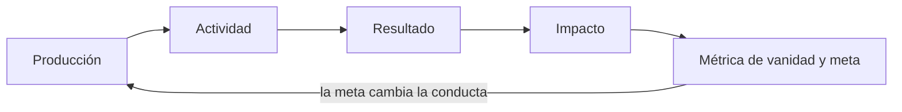
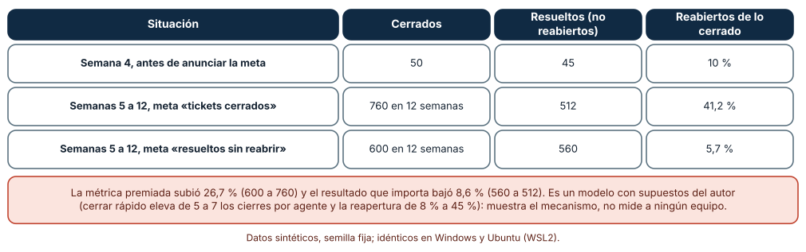
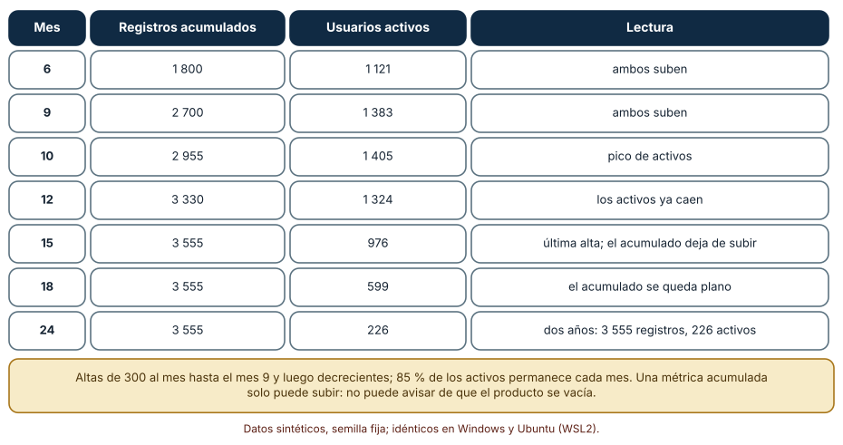
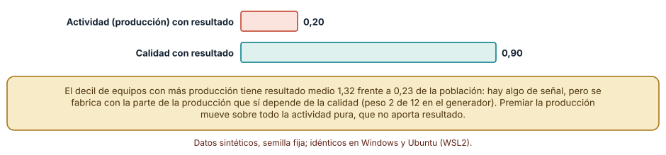

# SE-135 — Resultados, outputs, actividad y vanity metrics

[← SE-134 — Costos de construcción, operación y oportunidad](https://github.com/vladimiracunadev-create/modern-software-engineering-program/blob/main/classes/part-11-economia-metricas-y-decisiones-de-producto/se-134-costos-de-construccion-operacion-y-oportunidad/README.md) · [↑ Parte 11](https://github.com/vladimiracunadev-create/modern-software-engineering-program/blob/main/classes/part-11-economia-metricas-y-decisiones-de-producto/README.md) · [📚 Índice completo](https://github.com/vladimiracunadev-create/modern-software-engineering-program/blob/main/classes/README.md) · [🌐 Portal](https://vladimiracunadev-create.github.io/modern-software-engineering-program/classes/SE-135.html) · [SE-136 — Métricas de adopción, retención y tarea útil →](https://github.com/vladimiracunadev-create/modern-software-engineering-program/blob/main/classes/part-11-economia-metricas-y-decisiones-de-producto/se-136-metricas-de-adopcion-retencion-y-tarea-util/README.md)

## Punto profesional y fundamento pedagógico

**Punto profesional.** La clase existe para distinguir lo que un equipo produce, lo que hace y lo que cambia en la vida de quien usa el producto, de modo que una meta no premie la cifra que más fácil es de mover.

**Por qué aparece aquí.** Se sitúa después de **Costos de construcción, operación y oportunidad** y antes de **Métricas de adopción, retención y tarea útil**: `SE-134` dijo cuánto cuesta poseer el producto; esta clase pregunta qué se obtiene a cambio y cómo se reconoce. Fija el vocabulario (producción, actividad, resultado, impacto, métrica de vanidad) y deja un criterio para revisar cualquier métrica antes de convertirla en meta.

**Error conceptual que debe corregir.** Optimizar actividad o una métrica de vanidad en lugar del resultado, y creer que una métrica que sube ya prueba que algo mejoró.

**Secuencia de aprendizaje.** Antes de ejecutar, predices qué le ocurre a lo que de verdad se resuelve cuando se premian los tickets cerrados; después simulas, explicas por qué una métrica acumulada nunca avisa de una caída y mides cuánto se parecen producción y resultado en equipos sintéticos. La secuencia usa predicción, explicación propia, contraste y recuperación. [ICAP](https://icap.education.asu.edu/research) distingue participación de construcción de conocimiento; [How People Learn II](https://nap.nationalacademies.org/catalog/24783/how-people-learn-ii-learners-contexts-and-cultures) exige conectar conocimiento previo, contexto y transferencia; la [práctica de recuperación](https://pubmed.ncbi.nlm.nih.gov/16507066/) respalda producir de nuevo la explicación tras una demora; y [Education for Life and Work](https://nap.nationalacademies.org/resource/13398/dbasse_084153.pdf) exige devolución que explique la causa del error.

**Evidencia de aprendizaje.** `metric-audit.md` con una tabla de diez métricas de la plataforma clasificadas (producción, actividad, resultado, vanidad), la definición calculable de las que sobreviven, el efecto de una meta sobre una métrica contraria y una nota de qué dato haría cambiar la clasificación.

**Límite de la conclusión.** El modelo de equipos y el de usuarios son sintéticos y sus parámetros, supuestos del autor; no se midió a ningún equipo real. Muestran el mecanismo por el que una meta mal elegida se vuelve contraproducente, no cuánto ocurre en una organización.

### Trazabilidad fuente → afirmación

| Fuente primaria u oficial | Afirmación que respalda | Lo que no prueba |
|---|---|---|
| [GOV.UK Service Manual: Measuring success](https://www.gov.uk/service-manual/measuring-success) | Un servicio define qué medir a partir de lo que necesita saber para mejorarlo y distingue indicadores clave de datos de apoyo. | No dice qué métricas corresponden a la plataforma de entregas. |
| [Manheim y Garrabrant: Categorizing Variants of Goodhart's Law](https://arxiv.org/abs/1803.04585) | Cuando una medida se convierte en objetivo deja de reflejar lo que se quería medir, y hay varios mecanismos distintos. | No cuantifica cuánto ocurre en un equipo concreto. |
| [DORA: Software delivery performance metrics](https://dora.dev/guides/dora-metrics-four-keys/) | Propone medir el rendimiento de entrega con un conjunto equilibrado de cuatro métricas y no con una sola. | No valida esas métricas para otro tipo de producto ni prueba causalidad. |

## Antes de empezar

Recupera lo aprendido en `SE-134`: lo que no se mide con rango se decide con una cifra. La pregunta activa es: **¿qué cambia en la vida de una persona si esta métrica sube, y qué haría un equipo para subirla sin cambiar eso?**

## Prerrequisitos

- Haber completado `SE-134` o poder explicar el costo de propiedad que dejó.
- Python 3.11 o posterior y un terminal.
- Trabajar solo con equipos y usuarios sintéticos: ninguna observación requiere datos de personas reales.

## Problema auténtico

La dirección de soporte de la plataforma anuncia una meta: «mil tickets cerrados al mes». A las cuatro semanas el panel muestra la meta cumplida y los centros se quejan de que sus consultas «se cierran y vuelven». El tablero también presume 3 555 registros acumulados, mientras el uso semanal cae sin que nadie lo vea.

## Objetivos observables

Al terminar podrás:

1. clasificar una métrica de la plataforma como producción, actividad, resultado o vanidad y justificarlo con una pregunta de decisión;
2. predecir qué ocurre con el resultado cuando se premia la producción, y comprobarlo con una simulación;
3. explicar por qué una métrica acumulada no puede avisar de una caída y proponer su reemplazo;
4. medir cuánto se parecen producción y resultado en un conjunto de equipos y qué parte de la señal es fabricada;
5. escribir una definición calculable de una métrica con su métrica contraria.

## Mapa conceptual



El mapa se lee como una cadena de razonamiento, no como fases obligatorias. La flecha de retorno indica que una meta modifica lo que el equipo produce; por eso una métrica se evalúa también por la conducta que provocaría.

## Temas y por qué importan

| Tema | Por qué cambia una decisión profesional | Evidencia mínima |
|---|---|---|
| Producción (output) | Es lo que el equipo entrega: funciones, tickets, versiones; se cuenta con facilidad y no dice si sirvió. | Lista de producciones de la plataforma y qué decisión informan |
| Actividad | Es lo que ocurre en el producto: sesiones, clics, mensajes; mide movimiento, no logro. | Definición calculable y lo que no distingue |
| Resultado (outcome) | Es el cambio en la persona o en la organización: la entrega llegó, el docente corrigió en menos tiempo. | Observable que lo confirma y fuente de datos |
| Métricas de vanidad | Son cifras que suben y favorecen la presentación sin informar una decisión. | Prueba de la pregunta «qué cambiaría si esta cifra bajara» |
| Metas y conducta | Una meta cambia lo que la gente hace para cumplirla; una métrica debe evaluarse por esa conducta. | Métrica contraria elegida junto con la meta |

## Conceptos y decisiones

### 1. Producción

La producción es lo que el equipo entrega: líneas de código, versiones, tickets cerrados, funciones lanzadas. Tiene la virtud de ser controlable por el equipo y de contarse sin ambigüedad; su límite es que no dice si lo producido sirvió. Un equipo con alta producción y resultados nulos es posible; uno con poca producción y alto resultado también. Sirve para planificar capacidad, no para evaluar valor.

### 2. Actividad

La actividad es lo que ocurre dentro del producto: inicios de sesión, vistas, mensajes. Es el primer indicio de que algo se usa y puede crecer por razones ajenas al valor (una notificación, un cambio de diseño que obliga a más clics). La actividad que se acerca al valor (enviar una entrega aceptada) se distingue de la que no (abrir la aplicación), y `SE-136` desarrolla esa diferencia con la tarea útil.

### 3. Resultado

El resultado es el cambio observable en quien usa el producto o en su organización: la persona logra su objetivo, el docente tarda menos, el centro reduce reclamos. Se mide con eventos de logro, tiempos y encuestas con definición calculable, y se atribuye con cautela (`SE-138`). Es más difícil de medir y más difícil de falsear que la producción.

### 4. Métricas de vanidad

Una cifra es de vanidad cuando sube sin que ninguna decisión cambie si baja: registros acumulados, descargas, páginas vistas. Tiene dos defectos típicos: es acumulada (solo sube) y no está ligada a un comportamiento de valor. La prueba es preguntar qué se haría distinto si la cifra bajara a la mitad; si la respuesta es «nada», es de vanidad.

### 5. Metas y conducta

Cuando una medida se convierte en meta, la gente optimiza la medida y no lo que representaba. Manheim y Garrabrant distinguen varios mecanismos (extremal, causal, regresional, adversarial), pero el efecto práctico es el mismo: la medida deja de informar. Por eso toda meta lleva una métrica contraria que se vigila a la vez (`SE-139` la desarrolla) y una revisión periódica de si la definición sigue representando el resultado.

### Premiar lo cerrado: el número sube y lo resuelto baja

Diez agentes de soporte trabajan doce semanas. Hasta la semana 4 cada uno cierra 5 tickets a la semana y una fracción de 8 % se reabre. En la semana 5 se anuncia la meta «tickets cerrados»: en el modelo, cada agente pasa a cerrar 7 (dedica menos tiempo a cada uno) y la reapertura sube a 45 %. Un segundo equipo con meta «resueltos sin reabrir» conserva 5 cierres y 8 %. Predicción antes de ejecutar: ¿sube lo resuelto?

```python
rng = random.Random(1351)
def semana(rapido):
    cierres, p = (7, 0.45) if rapido else (5, 0.08)
    cerrados = 10 * cierres
    resueltos = sum(rng.random() > p for _ in range(cerrados))
    return cerrados, resueltos
```

Resultado, idéntico en Windows (CPython 3.12.9) y en Ubuntu bajo WSL2 (3.12.3): en la semana 4 se cierran 50 y se resuelven 45; en las semanas 5 a 12 con meta de cerrados, el total de 12 semanas es 760 tickets cerrados y 512 resueltos, y el 41,2 % de lo cerrado desde la semana 5 se reabre; con la meta «resueltos sin reabrir», 600 cerrados y 560 resueltos, con 5,7 % de reapertura. La métrica premiada subió 26,7 % y el resultado que importa bajó 8,6 %. Esos números salen de los supuestos (7 cierres, 45 %), que no se midieron: el modelo muestra el mecanismo, no el tamaño.



**Cómo leer la figura.** La fila coral es la meta sobre la producción: cerrados sube y resueltos baja; la tercera fila es la meta sobre el resultado. **Dónde deja de valer:** los parámetros (siete cierres, 45 % de reaperturas) son supuestos del autor; con otros valores la conclusión puede suavizarse o empeorar. Aquí «resuelto» es no reabierto, y que alguien no reabra no prueba que quedó conforme: podría haberse rendido.

### Registros acumulados frente a usuarios activos

La plataforma suma 300 registros al mes hasta el mes 9; luego las altas decrecen en 45 por mes hasta llegar a cero en el mes 16. Cada mes permanece 85 % de los activos y se activa 90 % de los nuevos. Predicción: ¿cuándo el acumulado deja de subir y cuándo lo hacen los activos?

```python
acumulado, activos = 0, 0.0
for mes in range(1, 25):
    altas = 300 if mes <= 9 else max(0, 300 - 45 * (mes - 9))
    acumulado += altas
    activos = activos * 0.85 + altas * 0.9
```

Los activos alcanzan su pico en el mes 10 (1 405) y empiezan a bajar en el mes 11, aunque el acumulado sigue subiendo hasta el mes 15 (3 555). En el mes 24 hay 3 555 registros acumulados y 226 activos. Un panel que solo muestra el acumulado reportó crecimiento durante cinco meses de caída del uso, y nunca mostrará una baja, porque una métrica acumulada es monótona por construcción.



**Cómo leer la figura.** Cada fila es un mes; la tercera fila marca el pico de activos y la cuarta muestra que ya caen mientras el acumulado sigue subiendo. **Dónde deja de valer:** el modelo supone permanencia constante de 85 % y altas con un patrón fijo; en un producto real las dos varían. Un activo que permanece no prueba que obtenga valor: eso se mide con la tarea útil.

### Producción y resultado en trescientos equipos

Se generan 300 equipos con calidad y hábito de actividad independientes. La producción depende sobre todo del hábito (peso 12) y apenas de la calidad (peso 2); el resultado depende sobre todo de la calidad (peso 3) y apenas del hábito (0,3). Predicción: ¿cuánto se parecen los rankings?

```python
rng = random.Random(1353)
calidad, habito = rng.gauss(0, 1), rng.gauss(0, 1)
produccion = 50 + 12 * habito + 2 * calidad + rng.gauss(0, 4)
resultado = 3 * calidad + 0.3 * habito + rng.gauss(0, 1.5)
```

La correlación de rangos de Spearman entre producción y resultado es 0,20; entre calidad y resultado, 0,90. El decil de equipos con más producción tiene un resultado medio de 1,32 frente a 0,23 de la población: hay señal, pero procede de la parte de la producción que sí depende de la calidad. Un gerente que premia la producción mueve sobre todo el hábito de actividad, que casi no mejora el resultado.



**Cómo leer la figura.** La barra coral es producción frente a resultado (0,20); la verde, calidad frente a resultado (0,90). **Dónde deja de valer:** los pesos del generador son supuestos del autor: se escogieron para mostrar el mecanismo. En equipos reales, producción y resultado pueden correlacionar más o menos, y la calidad no se observa directamente.

## Definiciones de trabajo

- **producción:** lo que el equipo entrega, contable y controlable (tickets cerrados, funciones lanzadas).
- **actividad:** lo que ocurre dentro del producto (sesiones, vistas), sin garantizar que alguien logre algo.
- **resultado:** cambio observable en una persona o una organización, con definición calculable y fuente de datos.
- **métrica de vanidad:** cifra que sube sin que ninguna decisión cambie si baja, a menudo acumulada.
- **ley de Goodhart:** una medida que se vuelve meta deja de informar sobre lo que se quería medir.

Las definiciones son operativas para la plataforma de entregas y deben contrastarse con las fuentes enlazadas al final.

## Ejemplo mínimo

Predice qué ocurre con el número de tickets cerrados y con los resueltos si un agente cierra más y reabre más.

```python
antes = (5, 0.08)
despues = (7, 0.45)
for cierres, p in (antes, despues):
    print(cierres, round(cierres * (1 - p), 2))
```

Antes se resuelven 4,6 por agente y semana; después, 3,85, con 40 % más cierres. Registra versión del intérprete, comando y salida. El punto es que la métrica de volumen y la de resolución pueden separarse.

## Ejemplo profesional

En la plataforma, `metric-audit.md` tiene una fila por métrica con definición calculable (numerador, denominador, ventana, filtros), tipo (producción, actividad, resultado, vanidad), decisión que informa, métrica contraria y fecha de revisión. El contrato es que ninguna métrica se convierte en meta sin su métrica contraria y sin la pregunta «qué haría distinto si bajara». Esa estructura permite que otra persona detecte metas sin contrapeso.

Compara el caso normal con una métrica que depende de un cambio de instrumentación, con una que se calcula con una ventana distinta en dos paneles, con una que solo se mide en la versión nueva y con una que los centros pueden manipular (porque la configuran ellos). Una auditoría es adecuada cuando esas diferencias quedan registradas; es peligrosa cuando se archiva solo la definición.

## Práctica guiada

1. Copia el contrato de métrica (definición calculable, tipo, decisión, métrica contraria, revisión) antes de calcular.
2. Lista diez métricas del panel de la plataforma y clasifícalas con la pregunta «qué cambiaría si bajara».
3. Predice si premiar los tickets cerrados mejora lo resuelto y anota por qué.
4. Ejecuta la simulación con semilla fija y guarda cerrados, resueltos y reapertura por semana.
5. Calcula acumulado y activos mensuales y localiza el pico y la primera caída.
6. Genera 300 equipos, calcula las dos correlaciones de rango y el resultado del decil superior.
7. Pide a otra persona que reconstruya la clasificación y la conclusión solo con `metric-audit.md`.

## Ejercicios

1. **Meta:** cambia el cierre rápido a 6 tickets con reapertura de 25 % y calcula cuándo premiar lo cerrado deja de ser contraproducente; explica qué supuesto lo decide.
2. **Acumulado:** diseña tres métricas no acumuladas que reemplacen a los registros acumulados y explica cuál avisaría antes del mes 11.
3. **Rangos:** repite el experimento de equipos con otro peso de la calidad en la producción y describe cómo cambia la correlación y por qué.
4. **Clasificación:** clasifica «tiempo medio de primera respuesta», «satisfacción reportada» y «entregas aceptadas por semana» y señala qué conducta provocaría cada una como meta.

## Reto verificable

Entrega `metric-audit.md` con diez métricas clasificadas, la simulación de la meta de cerrados con cerrados, resueltos y reapertura, el cálculo de acumulado frente a activos y las correlaciones de producción y calidad con el resultado. Se aprueba si otra persona ejecuta el código desde un checkout limpio, obtiene los mismos números con la semilla indicada y puede decir qué métrica contraria acompañaría a cada meta. No se aprueba por clasificar muchas métricas.

## Caso conductor

La plataforma de entregas continúa como caso. Esta clase deja el artefacto `metric-audit.md` con las métricas del panel clasificadas y una regla: ninguna meta sin contrapeso. `SE-136` definirá métricas de adopción, retención y tarea útil que sí aproximan el resultado, y `SE-139` desarrollará los guardrails. Cambia después una sola meta y revisa qué conducta provoca.

## Preguntas frecuentes

### ¿Las métricas de actividad son inútiles?

No: son la señal más rápida de que algo se usa. Su límite es que no dicen si el uso sirvió. En el experimento de los equipos, la actividad correlaciona 0,20 con el resultado: informa algo, pero no lo suficiente para ser meta.

### ¿Por qué no usar solo el resultado?

Porque suele llegar tarde y con ruido: un resultado como la mejora del aprendizaje tarda semanas y depende de muchos factores. Se usan indicadores adelantados que se aproximan a él, siempre revisados contra el resultado cuando existe. Por eso conviene tener ambos y declarar cuál es cuál.

### ¿Cómo sé si una meta está provocando una conducta dañina?

Observando la métrica contraria y los casos límite: si la reapertura sube, si el tiempo por ticket cae demasiado, si los equipos discuten cómo contar. En el experimento, la reapertura pasó de 8 % a 41 % a la vez que los cierres subían 40 %.

### ¿Puede un modelo de lenguaje decidir qué métricas importan?

Puede proponer candidatas y clasificarlas, pero qué cuenta como resultado es una decisión de producto que responde a personas reales. Si un agente propone una meta, exige la métrica contraria y la conducta que provocaría.

## Fallo controlado y diagnóstico

Reproduce el fallo clásico de la clase: **optimizar actividad o una métrica de vanidad en lugar del resultado**. Fija la meta «mil tickets cerrados al mes» y observa cómo la producción sube mientras lo resuelto baja y la reapertura se dispara.

Registra síntoma, entrada mínima, hipótesis, observación que descarta cada hipótesis, causa, corrección y prueba de regresión. **Síntoma:** la meta se cumple y los centros dicen que sus problemas vuelven. **Hipótesis rivales:** (a) más tickets entraron; (b) el equipo cierra con menos esfuerzo; (c) cambió la definición de cierre. **Prueba:** compara cerrados, resueltos y reapertura por semana antes y después; la reapertura pasó de 10 % a 41 % mientras los cierres subieron 40 %, lo que apoya (b). **Conclusión:** la meta premió la producción. **Regresión:** añade al contrato una prueba que falle si una meta se declara sin métrica contraria. No cambies a la vez la meta y la definición de cierre.

## Errores comunes y cómo corregirlos

| Síntoma | Causa probable | Corrección |
|---|---|---|
| La meta se cumple y nadie mejora | Se premió la producción | Reemplazar o acompañar con un resultado y su métrica contraria |
| El panel solo muestra crecimiento | La métrica es acumulada | Usar métricas por periodo (activos del mes, retenidos) |
| Dos paneles dan cifras distintas para «usuarios activos» | La definición no es calculable | Publicar numerador, denominador, ventana y filtros |
| Un equipo gana premios con malos resultados | Se compararon producciones | Compararlos por resultado o por una métrica equilibrada |
| La métrica cambia de tendencia tras un cambio de producto | Cambió la instrumentación | Registrar cambios de definición con fecha y recalcular |

## Entorno y archivos clave

```text
work/SE-135/
├── README.md
├── metricas/
│   ├── goodhart.py
│   ├── acumulado.py
│   └── equipos.py
├── fixtures/metricas.csv
├── tests/test_goodhart.py
└── evidence/metric-audit.md
```

El `README` declara plataforma, versión de Python, semillas (1351, 1353) y comandos. Los experimentos usan solo la biblioteca estándar (`random`, `statistics`) y se ejecutaron con CPython 3.12.9 en Windows 11 y 3.12.3 en Ubuntu bajo WSL2 con salidas idénticas. Si añades una dependencia, fija procedencia y versión.

## Seguridad, ética y accesibilidad

- una meta de volumen sobre personas (agentes de soporte, docentes) las expone a presión y a evaluaciones injustas: acompáñala de una métrica de calidad y de revisión humana;
- no uses métricas individuales de producción para decisiones de empleo sin entender qué miden;
- los datos de actividad pueden ser personales: aplica la minimización de `SE-137`;
- ofrece una alternativa textual a cada tabla y explica los patrones con palabras;
- no pegues datos de empleados o clientes en un modelo de lenguaje sin política de datos;
- atribuye los marcos usados.

## Puente hacia el trabajo con agentes

Un agente al que se le pide «define los KPI del producto» devolverá una lista de actividad y de producción con nombres atractivos. Pídele que clasifique cada métrica (producción, actividad, resultado, vanidad), que dé su definición calculable, que proponga la conducta que provocaría como meta y su métrica contraria. Revisa especialmente si propone cifras acumuladas o conteos sin denominador: es el mismo error de la vanidad con aspecto de panel.

## Transferencia

Traslada el experimento a otro dominio persistente (por ejemplo, un servicio de reparto): cambia el «cierre» por «entrega marcada como completada» y la reapertura por «reclamo»; conserva el contrato de métricas y comprueba si premiar el volumen vuelve a separar producción y resultado. La transferencia está lograda cuando puedes explicar qué dependía del dominio y qué no.

## Evaluación y evidencia

| Criterio | Evidencia para aprobar |
|---|---|
| comprensión | clasificación razonada de diez métricas con la pregunta «qué cambiaría si bajara» |
| corrección | números de la simulación, del acumulado y de las correlaciones reproducibles con la semilla |
| diseño | contrato de métrica con definición calculable y métrica contraria |
| diagnóstico | reproducción del fallo «meta de producción» con regresión |
| incertidumbre | parámetros supuestos declarados y variación con otros valores |
| reproducibilidad | versiones, comandos, salida y límites declarados |

## Fuentes

- [GOV.UK Service Manual: Measuring success](https://www.gov.uk/service-manual/measuring-success) — definir qué medir a partir de lo que se necesita saber; autoridad: Government Digital Service (Reino Unido).
- [GOV.UK Service Manual: Measuring user satisfaction](https://www.gov.uk/service-manual/measuring-success/measuring-user-satisfaction) — cómo medir satisfacción como complemento de indicadores de uso; autoridad: Government Digital Service.
- [Categorizing Variants of Goodhart's Law](https://arxiv.org/abs/1803.04585) — mecanismos por los que una medida deja de informar al volverse objetivo; autoridad: investigación publicada en arXiv (D. Manheim y S. Garrabrant).
- [DORA: Software delivery performance metrics](https://dora.dev/guides/dora-metrics-four-keys/) — conjunto equilibrado de métricas de entrega; autoridad: DORA (Google Cloud).
- [SWEBOK Guide v4.0a](https://www.computer.org/education/bodies-of-knowledge/software-engineering) — medición y economía de la ingeniería de software; autoridad: IEEE Computer Society.

Cada fuente respalda el mecanismo indicado; ninguna demuestra que las metas de la plataforma provoquen esas conductas. Esa afirmación depende de datos de equipos reales y de la revisión de otra persona.

- [Python: `statistics`](https://docs.python.org/3/library/statistics.html) — correlación y resumen usados en el experimento de equipos.
- [Python: `random`](https://docs.python.org/3/library/random.html) — generadores con semilla.

## Límites y siguiente paso

Se ejecutaron tres experimentos con datos sintéticos en Windows y Ubuntu (WSL2) con resultados idénticos. No se midió ningún equipo, producto ni persona; los parámetros de cierre, reapertura, permanencia y pesos de calidad y hábito son supuestos del autor. La siguiente clase define métricas de adopción, retención y tarea útil que sí aproximan resultados.

## Glosario

- **producción:** lo que el equipo entrega, contable y controlable (tickets cerrados, funciones lanzadas).
- **actividad:** lo que ocurre dentro del producto (sesiones, vistas), sin garantizar que alguien logre algo.
- **resultado:** cambio observable en una persona o una organización, con definición calculable y fuente de datos.
- **métrica de vanidad:** cifra que sube sin que ninguna decisión cambie si baja, a menudo acumulada.
- **ley de Goodhart:** una medida que se vuelve meta deja de informar sobre lo que se quería medir.

---

[← SE-134 — Costos de construcción, operación y oportunidad](https://github.com/vladimiracunadev-create/modern-software-engineering-program/blob/main/classes/part-11-economia-metricas-y-decisiones-de-producto/se-134-costos-de-construccion-operacion-y-oportunidad/README.md) · [↑ Parte 11](https://github.com/vladimiracunadev-create/modern-software-engineering-program/blob/main/classes/part-11-economia-metricas-y-decisiones-de-producto/README.md) · [📚 Índice completo](https://github.com/vladimiracunadev-create/modern-software-engineering-program/blob/main/classes/README.md) · [🌐 Portal](https://vladimiracunadev-create.github.io/modern-software-engineering-program/classes/SE-135.html) · [SE-136 — Métricas de adopción, retención y tarea útil →](https://github.com/vladimiracunadev-create/modern-software-engineering-program/blob/main/classes/part-11-economia-metricas-y-decisiones-de-producto/se-136-metricas-de-adopcion-retencion-y-tarea-util/README.md)
