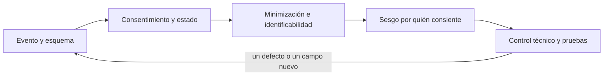
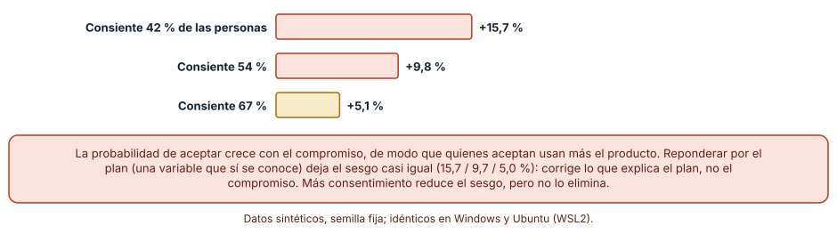
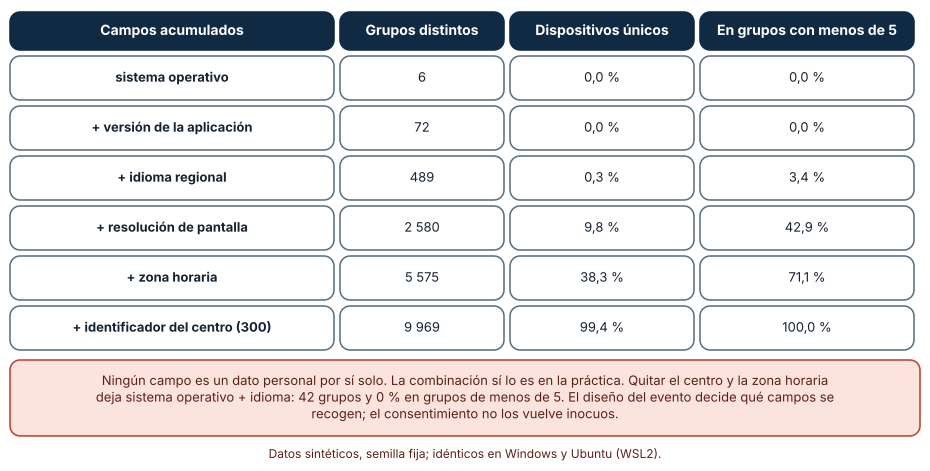
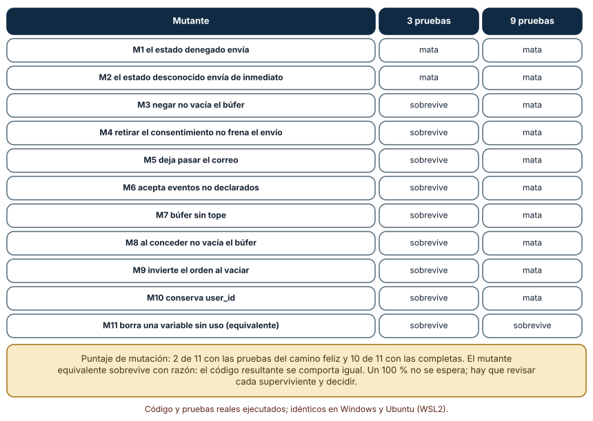

# SE-137 — Telemetría de producto y consentimiento

[← SE-136 — Métricas de adopción, retención y tarea útil](https://github.com/vladimiracunadev-create/modern-software-engineering-program/blob/main/classes/part-11-economia-metricas-y-decisiones-de-producto/se-136-metricas-de-adopcion-retencion-y-tarea-util/README.md) · [↑ Parte 11](https://github.com/vladimiracunadev-create/modern-software-engineering-program/blob/main/classes/part-11-economia-metricas-y-decisiones-de-producto/README.md) · [📚 Índice completo](https://github.com/vladimiracunadev-create/modern-software-engineering-program/blob/main/classes/README.md) · [🌐 Portal](https://vladimiracunadev-create.github.io/modern-software-engineering-program/classes/SE-137.html) · [SE-138 — Experimentos, sesgos y causalidad básica →](https://github.com/vladimiracunadev-create/modern-software-engineering-program/blob/main/classes/part-11-economia-metricas-y-decisiones-de-producto/se-138-experimentos-sesgos-y-causalidad-basica/README.md)

## Punto profesional y fundamento pedagógico

**Punto profesional.** La clase existe para decidir qué se mide de las personas, con qué permiso y con qué cuidado, de modo que la telemetría de producto aporte decisiones sin recoger más de lo necesario, sin identificar a nadie por combinación de campos y sin depender de un permiso que el código no respeta.

**Por qué aparece aquí.** Se sitúa después de **Métricas de adopción, retención y tarea útil** y antes de **Experimentos, sesgos y causalidad básica**: `SE-136` definió métricas que requieren eventos por persona; esta clase decide qué eventos se pueden recoger, con qué consentimiento y minimización, y deja un esquema de eventos y una puerta de consentimiento con pruebas que `SE-138` usará para asignar y medir.

**Error conceptual que debe corregir.** Creer que cada campo inocuo, o un consentimiento obtenido, hacen anónimo e inocuo al conjunto, y que un permiso mostrado en pantalla equivale a un permiso respetado por el código.

**Secuencia de aprendizaje.** Antes de ejecutar, predices cuánto se desvía una métrica medida solo con quienes aceptan y cuántos campos bastan para identificar a un dispositivo; después simulas, mides la unicidad con campos acumulados y evalúas una puerta de consentimiento con pruebas del camino feliz y con pruebas dirigidas. La secuencia usa predicción, explicación propia, contraste y recuperación. [ICAP](https://icap.education.asu.edu/research) distingue participación de construcción de conocimiento; [How People Learn II](https://nap.nationalacademies.org/catalog/24783/how-people-learn-ii-learners-contexts-and-cultures) exige conectar conocimiento previo, contexto y transferencia; la [práctica de recuperación](https://pubmed.ncbi.nlm.nih.gov/16507066/) respalda producir de nuevo la explicación tras una demora; y [Education for Life and Work](https://nap.nationalacademies.org/resource/13398/dbasse_084153.pdf) exige devolución que explique la causa del error.

**Evidencia de aprendizaje.** `telemetry-plan.md` con el esquema de eventos y su justificación, el sesgo estimado por consentimiento, la unicidad de combinaciones de campos, la puerta de consentimiento con sus pruebas y los mutantes que sobreviven, y una nota de qué dato haría cambiar el plan.

**Límite de la conclusión.** Los dispositivos, las probabilidades de consentir y los campos son sintéticos. Esta clase no es asesoría legal: qué base legal aplica, qué se debe informar y cómo se obtiene el consentimiento depende de la jurisdicción y de la persona responsable de cumplimiento; no se consultó a ningún especialista.

### Trazabilidad fuente → afirmación

| Fuente primaria u oficial | Afirmación que respalda | Lo que no prueba |
|---|---|---|
| [EDPB: Guidelines 05/2020 on consent](https://www.edpb.europa.eu/our-work-tools/our-documents/guidelines/guidelines-052020-consent-under-regulation-2016679_en) | El consentimiento debe ser libre, específico, informado e inequívoco, y poder retirarse tan fácilmente como se otorgó. | No decide qué base legal corresponde a tu producto ni sustituye al asesor legal. |
| [NIST Privacy Framework](https://www.nist.gov/privacy-framework) | Ofrece un vocabulario para gestionar el riesgo de privacidad (identificar, gobernar, controlar, comunicar, proteger). | No es una norma de cumplimiento ni garantiza un resultado. |
| [Sweeney: k-Anonymity](https://epic.org/wp-content/uploads/privacy/reidentification/Sweeney_Article.pdf) | Una combinación de atributos aparentemente inocuos puede identificar a una persona, y k-anonimato exige que cada combinación la compartan al menos k registros. | No garantiza la privacidad ante un atacante con información adicional. |

## Antes de empezar

Recupera lo aprendido en `SE-136`: cada métrica de retención necesita eventos por persona. La pregunta activa es: **¿qué es lo mínimo que se necesita recoger para decidir, con qué permiso, y cómo se comprueba que el código lo cumple?**

## Prerrequisitos

- Haber completado `SE-136` o poder definir una métrica con población, evento y ventana.
- Python 3.11 o posterior y un terminal.
- Trabajar solo con dispositivos y eventos sintéticos, con correos de dominio reservado `.test` si se necesitan.

## Problema auténtico

El equipo de la plataforma quiere instrumentar cada pantalla. El diseño envía el correo del docente, el identificador del centro, la resolución de pantalla y la zona horaria en cada evento, «por si sirve». El banner de consentimiento ya existe, pero nadie ha comprobado qué ocurre con los eventos generados antes de aceptar, ni qué fracción de la población acepta, ni si quienes aceptan se parecen a quienes no.

## Objetivos observables

Al terminar podrás:

1. justificar cada campo de un esquema de eventos con la decisión que informa y descartar los que no tienen una;
2. estimar el sesgo de una métrica medida solo con quienes consienten y explicar qué reponderación corrige y cuál no;
3. medir la unicidad de combinaciones de campos y elegir una granularidad que deje grupos de al menos cinco;
4. escribir una puerta de consentimiento con estados (desconocido, concedido, denegado) y pruebas que maten sus mutantes;
5. declarar qué parte del plan es técnica y qué parte exige a una persona responsable de privacidad o asesoría legal.

## Mapa conceptual



El mapa se lee como una cadena de razonamiento, no como fases obligatorias. La flecha de retorno indica que un defecto de la puerta o un campo nuevo obliga a revisar el esquema; no autoriza a corregir solo el banner.

## Temas y por qué importan

| Tema | Por qué cambia una decisión profesional | Evidencia mínima |
|---|---|---|
| Evento y esquema | Un evento sin decisión asociada es un riesgo sin beneficio; el esquema es el contrato de lo que se recoge. | Esquema con una decisión por campo en `telemetry-plan.md` |
| Consentimiento y estado | El permiso debe ser libre, específico, informado y retirable; el código debe respetar tres estados distintos. | Diagrama de estados y qué ocurre con eventos previos y posteriores |
| Minimización e identificabilidad | Campos inocuos por separado identifican en conjunto; la granularidad es una decisión de diseño. | Tabla de unicidad por campos acumulados |
| Sesgo por consentimiento | Quienes aceptan suelen usar más el producto; medir solo con ellos infla la métrica. | Estimación del sesgo y su corrección parcial |
| Control técnico y pruebas | Un permiso que el código no respeta no protege a nadie; solo las pruebas dirigidas lo verifican. | Mutantes y puntaje de mutación de la puerta |

## Conceptos y decisiones

### 1. Evento y esquema

Un evento describe algo que ocurrió: qué, cuándo, en qué contexto. El esquema lista los campos permitidos con tipo, rango y justificación. En la plataforma, «entrega enviada» necesita el curso (agregado) y el resultado de validación; no necesita el correo ni el nombre. Un esquema cerrado, con lista de eventos y campos permitidos, impide que alguien agregue «por si sirve» y hace que cada incorporación sea una decisión revisable.

### 2. Consentimiento y estado

El consentimiento válido, según las directrices del comité europeo de protección de datos, es libre, específico, informado e inequívoco, y retirarlo debe ser tan fácil como darlo. Técnicamente implica tres estados, no dos: **desconocido** (no se ha preguntado), **concedido** y **denegado**. Qué hacer con los eventos de un estado desconocido (descartarlos, guardarlos localmente un tiempo acotado) y cómo se vacía todo al retirar el permiso son decisiones que se escriben y se prueban. No todo dato exige consentimiento: la base legal depende del caso y de la jurisdicción, y esa clasificación la hace una persona responsable.

### 3. Minimización e identificabilidad

Minimizar es recoger solo lo que una decisión necesita, durante el tiempo necesario y con la granularidad más gruesa que sirva. Un campo no identifica solo: la combinación lo hace. Por eso se mide la unicidad (cuántos dispositivos quedan en un grupo de uno) y se aplica k-anonimato como criterio: cada combinación debe compartirla al menos k registros, con k acordado según el riesgo.

### 4. Sesgo por consentimiento

Si la probabilidad de consentir depende del compromiso con el producto, quienes aceptan no representan a la población y cualquier promedio calculado con ellos es optimista. Se puede reponderar por variables conocidas de todos (plan, tamaño del centro), pero no por el compromiso que no se observa en quienes rechazan. La corrección parcial reduce el sesgo atribuible a lo observable y deja el resto sin tocar.

### 5. Control técnico y pruebas

Una puerta de consentimiento es código: decide si un evento sale, se guarda o se descarta. Sus pruebas deben cubrir los estados y las transiciones (conceder, denegar, retirar), el filtrado de campos y los límites del búfer. Probar solo que «si hay consentimiento, se envía» deja pasar casi todos los defectos relevantes.

### Quién acepta no se parece a quien no acepta

Se generan 20 000 personas con compromiso (beta 2 y 3) y un plan; las entregas semanales dependen del compromiso (peso 12) y del plan (peso 2) más ruido. La probabilidad de consentir sube con el compromiso: base + (0,9 − base) × compromiso. Predicción: ¿el promedio de quienes aceptan es mayor que el verdadero, y una reponderación por plan lo arregla?

```python
rng = random.Random(1371)
consiente = rng.random() < min(0.98, base + (0.9 - base) * compromiso)
estimado = statistics.mean(entregas[i] for i in range(N) if consiente_i[i])
```

El promedio verdadero es 5,62 entregas por semana. Con base 0,1 consiente el 42,1 % y el promedio de quienes aceptan es 6,50 (+15,7 %); con base 0,3, 54,3 % consiente y el sesgo es +9,8 %; con base 0,5, 66,6 % consiente y el sesgo es +5,1 %. Reponderar por el plan (que sí se conoce de todos) deja los sesgos en +15,7 %, +9,7 % y +5,0 %: casi igual, porque el sesgo viene del compromiso, que no se observa en quienes rechazan. Resultado idéntico en Windows (CPython 3.12.9) y Ubuntu bajo WSL2 (3.12.3).



**Cómo leer la figura.** Cada barra es el sobreestimado relativo según qué fracción consiente; la coral es la tasa más baja. **Dónde deja de valer:** la relación entre compromiso y probabilidad de consentir es un supuesto del autor; en la práctica puede ser inversa (quienes más cuidan su privacidad pueden ser los más técnicos). La conclusión no es que el sesgo sea positivo, sino que existe, depende de la tasa y no se corrige con variables que no lo explican.

### Cada campo estrecha el grupo hasta una persona

Se generan 10 000 dispositivos con sistema operativo (6 valores con pesos desiguales), versión de la aplicación (12), idioma regional (7), resolución de pantalla (8), zona horaria (6) y centro (300). Predicción: ¿cuántos campos hacen falta para que la mayoría sea única?

```python
grupos = Counter(d[:k] for d in dispositivos)
unicos = sum(1 for d in dispositivos if grupos[d[:k]] == 1)
menores_a_5 = sum(1 for d in dispositivos if grupos[d[:k]] < 5)
```

Con sistema operativo y versión, ningún dispositivo es único (72 grupos); con idioma regional, 0,3 % es único (489 grupos); con resolución, 9,8 % (2 580 grupos y 42,9 % en grupos de menos de cinco); con zona horaria, 38,3 % (71,1 % en grupos de menos de cinco); y con el identificador del centro, 99,4 % es único (9 969 grupos). Un conjunto con solo sistema operativo e idioma regional deja 42 grupos y ningún dispositivo en grupos de menos de cinco. Cuánto se necesita depende del riesgo; lo que no depende es que la combinación, y no cada campo, es lo que identifica.



**Cómo leer la figura.** Cada fila añade un campo a las anteriores; las columnas dicen cuántos grupos distintos hay, qué porcentaje es único y qué porcentaje está en grupos menores de cinco. **Dónde deja de valer:** los campos se generaron de manera independiente y con distribuciones supuestas; los reales están correlacionados (el idioma regional y la zona horaria van juntos), lo que reduce la unicidad. Aun así, el mecanismo es el de Sweeney: la combinación identifica.

### Una puerta de consentimiento con pruebas del camino feliz y con pruebas dirigidas

La puerta es una clase `Tracker` con tres estados, una lista de eventos permitidos, una lista de campos prohibidos (correo, nombre, identificador de usuario) y un búfer de 5 eventos para los de estado desconocido, que se envía al conceder y se descarta al negar. Se escriben tres pruebas del camino feliz (con permiso se envía, denegado no envía, desconocido no envía) y seis dirigidas (negar vacía el búfer, se quitan los campos prohibidos, se filtran eventos no declarados, el búfer tiene tope, el vaciado ocurre una vez y en orden, retirar el permiso detiene el envío). Se generan 11 mutantes del código con cambios mínimos.

```python
MUTANTES = {
    "M3 negar no vacía el búfer": ('elif state == "denied":\n    self.buffer.clear()', 'elif state == "denied":\n    pass'),
    "M5 deja pasar el correo": ('FORBIDDEN = {"email", "nombre", "user_id"}', 'FORBIDDEN = {"nombre", "user_id"}'),
}
```

Resultado, idéntico en ambos sistemas: las tres pruebas del camino feliz matan 2 de 11 mutantes (los que envían con el estado denegado o desconocido); las nueve pruebas matan 10 de 11. El mutante que sobrevive (M11) borra una variable sin uso y es equivalente: el programa se comporta igual y ninguna prueba puede distinguirlo. Los nueve que las tres primeras pruebas dejaban vivos incluyen enviar el correo, aceptar eventos no declarados y conservar el búfer tras negar, defectos de privacidad reales.



**Cómo leer la figura.** Cada fila es un cambio mínimo al código; «mata» significa que alguna prueba falla; «sobrevive», que todas pasan. **Dónde deja de valer:** once mutantes son una muestra pequeña y escrita por quien escribió las pruebas; un 10 de 11 no dice que la puerta sea correcta, solo que esas pruebas detectan esos cambios. No sustituye la revisión de privacidad ni una auditoría del banner y del texto que ve la persona.

## Definiciones de trabajo

- **evento de telemetría:** registro estructurado de algo que ocurrió en el producto, con campos permitidos y justificados.
- **consentimiento:** manifestación libre, específica, informada e inequívoca de una persona, retirable con facilidad.
- **minimización:** recoger solo los datos, el tiempo y la granularidad que una decisión necesita.
- **k-anonimato:** propiedad de un conjunto en que cada combinación de atributos la comparten al menos k registros.
- **mutante:** copia del código con un cambio mínimo que sirve para comprobar si las pruebas lo detectan.

Las definiciones son operativas para la plataforma de entregas y deben contrastarse con las fuentes enlazadas al final.

## Ejemplo mínimo

Predice cuántos grupos distintos hay si una aplicación envía solo el sistema operativo y el idioma.

```python
from collections import Counter
disp = [("win", "es-CL"), ("win", "es-CL"), ("ios", "es-MX"), ("android", "es-CL")]
grupos = Counter(disp)
print(len(grupos), [c for c in grupos.values() if c < 2])
```

Hay tres grupos y dos de ellos tienen un solo dispositivo: con cuatro dispositivos, la combinación ya señala a uno. Registra versión del intérprete, comando y salida; el ejemplo es juguete, pero el mecanismo es el mismo que con diez mil.

## Ejemplo profesional

En la plataforma, `telemetry-plan.md` contiene una fila por evento (nombre, momento, campos permitidos, decisión que informa, retención, base de recolección) y un diagrama de estados del consentimiento. El contrato es que todo campo nuevo exige una decisión asociada y una medición de unicidad antes de entrar al esquema, y que la puerta se prueba con mutantes en integración continua. Esa estructura permite que otra persona vea qué se recoge, por qué y con qué control.

Compara el caso normal con el docente que usa el producto en un dispositivo compartido, con la persona menor de edad cuyo permiso lo da un adulto, con quien retira el permiso con eventos ya enviados y con el centro cuyo reglamento prohíbe recoger cualquier dato. El plan es apropiado cuando esos casos tienen respuesta escrita; es peligroso cuando se confía en que el banner los resuelve.

## Práctica guiada

1. Copia el contrato de evento (nombre, campos, decisión, retención, base) antes de instrumentar nada.
2. Predice si el promedio de quienes aceptan es mayor o menor que el real y anota por qué.
3. Simula consentimiento con tres tasas y calcula el sesgo con y sin reponderación por plan.
4. Genera 10 000 dispositivos, acumula campos y calcula grupos, únicos y grupos de menos de cinco.
5. Implementa la puerta con tres estados y las tres pruebas del camino feliz.
6. Genera los mutantes, mide el puntaje y añade pruebas dirigidas hasta que solo sobreviva el equivalente.
7. Pide a otra persona que reconstruya esquema, sesgo, unicidad y puntaje solo con `telemetry-plan.md`.

## Ejercicios

1. **Granularidad:** sustituye la resolución exacta por tres tramos y la zona horaria por «hemisferio» y calcula cuántos dispositivos quedan en grupos de menos de cinco.
2. **Consentimiento inverso:** modifica el generador para que consienta más quien usa menos el producto y describe el signo del sesgo.
3. **Puerta:** añade el estado «retirado después de conceder» y escribe una prueba que mate un mutante que lo ignore.
4. **Esquema:** elige tres campos de la plataforma, justifica cada uno con una decisión y descarta uno por no tenerla.

## Reto verificable

Entrega `telemetry-plan.md` con el esquema de eventos y su justificación, el sesgo con tres tasas, la tabla de unicidad, la puerta con tres estados, las nueve pruebas y el puntaje de mutación con el mutante equivalente explicado. Se aprueba si otra persona ejecuta el código desde un checkout limpio, obtiene los mismos números con la semilla indicada y puede decir qué campo eliminaría primero. No se aprueba por la cantidad de eventos ni por la cantidad de pruebas.

## Caso conductor

La plataforma de entregas continúa como caso. Esta clase deja un esquema mínimo de eventos y una puerta de consentimiento probada, y declara que no es asesoría legal. `SE-138` usará esos eventos para asignar grupos y medir efectos, y `SE-139` necesitará que las métricas contrarias también cumplan este esquema. Cambia después un campo del esquema y revisa qué conclusiones del registro cambian.

## Preguntas frecuentes

### Si la persona aceptó, ¿puedo recoger lo que quiera?

No. El consentimiento debe ser específico: cubre los fines declarados, no cualquier uso, y los datos recogidos deben ser adecuados y limitados a lo necesario. En el experimento, un permiso para medir «uso» no justifica enviar el correo; y el correo es el campo que, junto con otros, vuelve único a casi todo el conjunto.

### ¿Los datos «anónimos» no necesitan permiso?

Depende de si realmente lo son. Una combinación de campos puede identificar a una persona aunque cada campo no lo haga; en el experimento, con cinco campos el 38,3 % de los dispositivos es único. Si el conjunto puede reidentificarse, se trata como dato personal. La clasificación final corresponde a quien responde por cumplimiento.

### ¿Por qué no basta con medir a quienes aceptan?

Porque quienes aceptan pueden ser distintos. En la simulación, el promedio de quienes aceptan supera al real entre 5 % y 16 %, y la reponderación por plan casi no lo corrige. Informa la tasa de consentimiento junto con cada métrica y declara que la cifra describe a quienes aceptaron.

### ¿Puede un modelo de lenguaje decidir qué eventos recoger?

Puede proponer un esquema inicial, pero tiende a ampliarlo «por si sirve». Exige una decisión por campo y una medición de unicidad. Y no envíes datos reales de personas a un modelo sin una política que lo permita.

## Fallo controlado y diagnóstico

Reproduce el fallo clásico de la clase: **enviar eventos antes de que exista el permiso o después de retirarlo**. Escribe solo las tres pruebas del camino feliz y genera los mutantes.

Registra síntoma, entrada mínima, hipótesis, observación que descarta cada hipótesis, causa, corrección y prueba de regresión. **Síntoma:** las tres pruebas pasan, y un mutante que no vacía el búfer al negar envía eventos de una persona que dijo que no. **Hipótesis rivales:** (a) la puerta es correcta; (b) las pruebas solo cubren la ruta de éxito; (c) el mutante es equivalente. **Prueba:** añade la prueba «negar vacía el búfer»; falla solo con el mutante y no con el original, descartando (a) y (c). **Conclusión:** el defecto estaba en las pruebas, que no ejercitaban la transición. **Regresión:** conserva las nueve pruebas y añade una por cada mutante nuevo que sobreviva y no sea equivalente. No cambies a la vez la puerta y las pruebas.

## Errores comunes y cómo corregirlos

| Síntoma | Causa probable | Corrección |
|---|---|---|
| Se envían eventos de personas que rechazaron | La puerta trata «desconocido» como «concedido» o no vacía el búfer | Probar los tres estados y las transiciones con mutantes |
| El conjunto «anónimo» permite reidentificar | Campos acumulados sin medir la unicidad | Medir grupos y fijar k mínimo; engrosar la granularidad |
| La métrica de uso sube cuando baja el consentimiento | Quedan quienes más usan | Informar la tasa de consentimiento y cautelar la comparación |
| Un campo nuevo entra «por si sirve» | El esquema no es cerrado | Esquema con lista permitida y revisión de cada campo |
| El permiso retirado no detiene el envío | La retirada no se probó | Prueba de retirada y de vaciado del búfer |

## Entorno y archivos clave

```text
work/SE-137/
├── README.md
├── telemetria/
│   ├── puerta.py
│   ├── mutantes.py
│   └── unicidad.py
├── fixtures/dispositivos.csv
├── tests/test_puerta.py
└── evidence/telemetry-plan.md
```

El `README` declara plataforma, versión de Python, semillas (1371, 1372) y comandos. Los experimentos usan solo la biblioteca estándar (`random`, `collections`, `statistics`) y se ejecutaron con CPython 3.12.9 en Windows 11 y 3.12.3 en Ubuntu bajo WSL2 con salidas idénticas. Si añades una dependencia, fija procedencia y versión.

## Seguridad, ética y accesibilidad

- esta clase no es asesoría legal: la base legal, los avisos y los plazos de conservación los define una persona responsable de privacidad o asesoría jurídica;
- no uses el correo, el nombre ni identificadores estables como campo de evento sin una decisión que lo justifique;
- el texto del consentimiento debe ser comprensible, accesible con lector de pantalla y disponible en el idioma de quien lo lee;
- las personas menores de edad y los dispositivos compartidos exigen reglas propias;
- no pegues eventos de personas reales en un modelo de lenguaje sin política de datos;
- registra la fecha y la versión del texto aceptado para poder demostrarlo.

## Puente hacia el trabajo con agentes

Un agente al que se le pide «instrumenta el producto con analítica» añadirá eventos y campos por defecto, a menudo con identificadores, y escribirá un banner. Pídele en cambio un esquema cerrado con una decisión por campo, la medición de unicidad del conjunto, la puerta con tres estados y pruebas que maten mutantes, y que marque como pendiente de revisión legal lo que exija base jurídica. Revisa especialmente si el código envía antes del permiso: es el mismo error de la ruta feliz, ahora con apariencia de cumplimiento.

## Transferencia

Traslada el experimento a otro dominio persistente (por ejemplo, una aplicación de reparto): cambia el evento «entrega enviada» por «pedido entregado» y los campos por los de un comercio; conserva el esquema cerrado y la puerta, y comprueba si la combinación de campos vuelve a identificar. La transferencia está lograda cuando puedes explicar qué dependía del dominio y qué no.

## Evaluación y evidencia

| Criterio | Evidencia para aprobar |
|---|---|
| comprensión | explicación de los tres estados del consentimiento y de por qué la combinación identifica |
| corrección | sesgo, unicidad y puntaje de mutación reproducibles con la misma semilla |
| diseño | esquema cerrado con decisión por campo y puerta con transiciones probadas |
| diagnóstico | reproducción del fallo «ruta feliz» con regresión |
| incertidumbre | tasa de consentimiento junto con cada métrica y mutante equivalente explicado |
| reproducibilidad | versiones, comandos, salida y límites declarados |

## Fuentes

- [EDPB: Guidelines 05/2020 on consent under Regulation 2016/679](https://www.edpb.europa.eu/our-work-tools/our-documents/guidelines/guidelines-052020-consent-under-regulation-2016679_en) — condiciones del consentimiento válido y su retirada; autoridad: Comité Europeo de Protección de Datos.
- [NIST Privacy Framework](https://www.nist.gov/privacy-framework) — vocabulario para gestionar riesgo de privacidad; autoridad: NIST.
- [k-Anonymity: A Model for Protecting Privacy (Sweeney, 2002)](https://epic.org/wp-content/uploads/privacy/reidentification/Sweeney_Article.pdf) — la reidentificación por combinación de atributos y el criterio de k-anonimato; autoridad: artículo académico (International Journal on Uncertainty, Fuzziness and Knowledge-based Systems).
- [GOV.UK Service Manual: Measuring success](https://www.gov.uk/service-manual/measuring-success) — medir lo necesario para mejorar un servicio; autoridad: Government Digital Service.

Cada fuente respalda el mecanismo indicado; ninguna demuestra que el esquema de la plataforma sea legal en tu jurisdicción. Esa afirmación depende de una revisión jurídica y de la política de privacidad de la organización.

- [Python: `collections.Counter`](https://docs.python.org/3/library/collections.html#collections.Counter) — conteo de grupos para la unicidad.
- [Python: `statistics`](https://docs.python.org/3/library/statistics.html) — promedios usados en la estimación del sesgo.

## Límites y siguiente paso

Se ejecutaron tres experimentos con datos sintéticos en Windows y Ubuntu (WSL2) con resultados idénticos. No se recogió ningún dato real, no se consultó a un especialista legal y los campos, las probabilidades de consentir y los once mutantes son supuestos o elecciones del autor. La siguiente clase usa estos eventos para estudiar experimentos, sesgos y causalidad.

## Glosario

- **evento de telemetría:** registro estructurado de algo que ocurrió en el producto, con campos permitidos y justificados.
- **consentimiento:** manifestación libre, específica, informada e inequívoca de una persona, retirable con facilidad.
- **minimización:** recoger solo los datos, el tiempo y la granularidad que una decisión necesita.
- **k-anonimato:** propiedad de un conjunto en que cada combinación de atributos la comparten al menos k registros.
- **mutante:** copia del código con un cambio mínimo que sirve para comprobar si las pruebas lo detectan.

---

[← SE-136 — Métricas de adopción, retención y tarea útil](https://github.com/vladimiracunadev-create/modern-software-engineering-program/blob/main/classes/part-11-economia-metricas-y-decisiones-de-producto/se-136-metricas-de-adopcion-retencion-y-tarea-util/README.md) · [↑ Parte 11](https://github.com/vladimiracunadev-create/modern-software-engineering-program/blob/main/classes/part-11-economia-metricas-y-decisiones-de-producto/README.md) · [📚 Índice completo](https://github.com/vladimiracunadev-create/modern-software-engineering-program/blob/main/classes/README.md) · [🌐 Portal](https://vladimiracunadev-create.github.io/modern-software-engineering-program/classes/SE-137.html) · [SE-138 — Experimentos, sesgos y causalidad básica →](https://github.com/vladimiracunadev-create/modern-software-engineering-program/blob/main/classes/part-11-economia-metricas-y-decisiones-de-producto/se-138-experimentos-sesgos-y-causalidad-basica/README.md)
