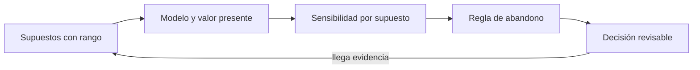
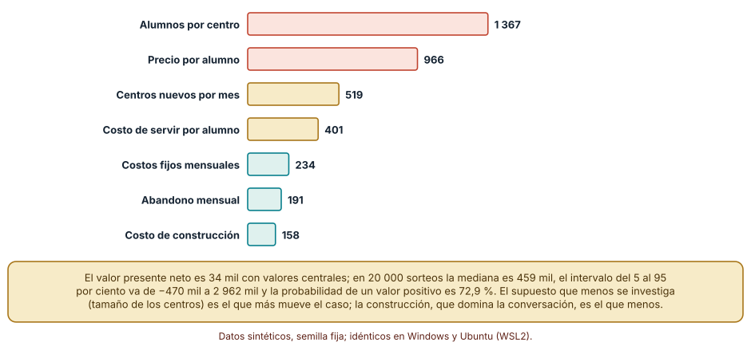
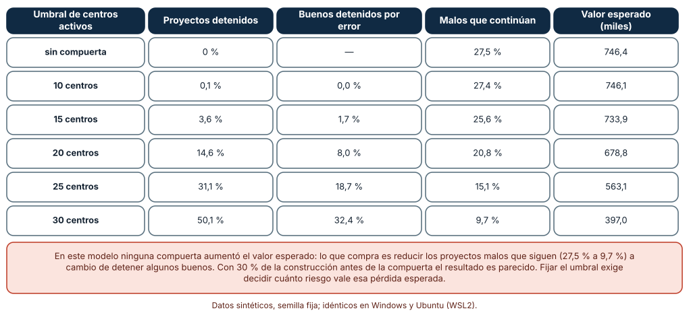
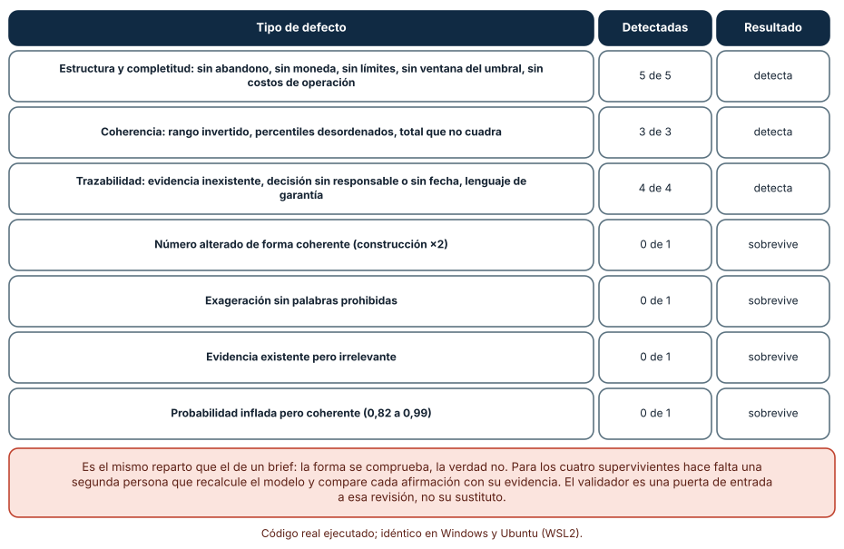

# SE-144 — Proyecto: caso de viabilidad técnico-económica

[← SE-143 — Taller: diseñar un árbol de métricas](https://github.com/vladimiracunadev-create/modern-software-engineering-program/blob/main/classes/part-11-economia-metricas-y-decisiones-de-producto/se-143-taller-disenar-un-arbol-de-metricas/README.md) · [↑ Parte 11](https://github.com/vladimiracunadev-create/modern-software-engineering-program/blob/main/classes/part-11-economia-metricas-y-decisiones-de-producto/README.md) · [📚 Índice completo](https://github.com/vladimiracunadev-create/modern-software-engineering-program/blob/main/classes/README.md) · [🌐 Portal](https://vladimiracunadev-create.github.io/modern-software-engineering-program/classes/SE-144.html) · [SE-145 — Elicitación, análisis, especificación y validación →](https://github.com/vladimiracunadev-create/modern-software-engineering-program/blob/main/classes/part-12-ingenieria-de-requisitos/se-145-elicitacion-analisis-especificacion-y-validacion/README.md)

## Punto profesional y fundamento pedagógico

**Punto profesional.** El proyecto existe para reunir modelo de negocio, costos, métricas, riesgos y reversibilidad en un caso de viabilidad que otra persona puede recalcular, cuestionar y decidir sin pedir contexto: un valor presente con rango, un supuesto dominante, una regla de abandono y una decisión con responsable y fecha.

**Por qué aparece aquí.** Cierra la **Parte 11** después de **Taller: diseñar un árbol de métricas** y antes de la **Parte 12**: las clases 133 a 143 produjeron las piezas (economía unitaria, costo de propiedad, métricas, telemetría, experimentos, guardas, costo por resultado, cartera, reversibilidad y árbol); este proyecto las integra. Lo que entrega alimenta la ingeniería de requisitos: un caso de viabilidad aprobado es el contexto de las decisiones que `SE-145` en adelante tomarán sobre qué construir.

**Error conceptual que debe corregir.** Creer que un caso de viabilidad con un valor presente positivo y un validador en verde está decidido, y que una regla de abandono sirve para aumentar el valor esperado.

**Secuencia de aprendizaje.** Antes de construir, predices qué fracción de los futuros posibles tiene valor presente positivo y si una compuerta de abandono sube el valor esperado; después construyes el caso, mides qué supuesto lo mueve más, evalúas varias reglas de abandono y mutas el caso para medir qué detecta su validador. La secuencia usa predicción, explicación propia, contraste y recuperación. [ICAP](https://icap.education.asu.edu/research) distingue participación de construcción de conocimiento; [How People Learn II](https://nap.nationalacademies.org/catalog/24783/how-people-learn-ii-learners-contexts-and-cultures) exige conectar conocimiento previo, contexto y transferencia; la [práctica de recuperación](https://pubmed.ncbi.nlm.nih.gov/16507066/) respalda producir de nuevo la explicación tras una demora; y [Education for Life and Work](https://nap.nationalacademies.org/resource/13398/dbasse_084153.pdf) exige devolución que explique la causa del error.

**Evidencia de aprendizaje.** `viability-case.md` con los supuestos y sus rangos, el valor presente como intervalo con probabilidad de ser positivo, la oscilación por supuesto, la regla de abandono con su efecto en riesgo y en valor esperado, la decisión con responsable y fecha, el validador con sus pruebas y el registro de dieciséis mutaciones.

**Límite de la conclusión.** Todo es sintético y en unidades monetarias ficticias: los rangos, la forma del modelo (llegada constante de centros, abandono geométrico, precio fijo), la independencia entre supuestos y la exactitud de la señal del mes 6. El caso muestra cómo se argumenta una viabilidad, no si la plataforma real es viable.

### Trazabilidad fuente → afirmación

| Fuente primaria u oficial | Afirmación que respalda | Lo que no prueba |
|---|---|---|
| [HM Treasury: The Green Book](https://www.gov.uk/government/publications/the-green-book-appraisal-and-evaluation-in-central-governent/the-green-book-2020) | Una evaluación compara opciones con una de referencia, descuenta flujos, analiza sensibilidad y corrige el optimismo de las estimaciones. | No fija la tasa ni garantiza que el caso de la plataforma sea correcto. |
| [GOV.UK Service Manual: How the beta phase works](https://www.gov.uk/service-manual/agile-delivery/how-the-beta-phase-works) | Un servicio avanza por fases con puntos de decisión y evidencia por fase, y puede detenerse en cada una. | No determina el umbral ni el tamaño de cada etapa en la plataforma. |
| [SWEBOK Guide v4.0a](https://www.computer.org/education/bodies-of-knowledge/software-engineering) | La economía de la ingeniería de software incluye la evaluación de propuestas, el riesgo y la incertidumbre en las decisiones. | No sustituye datos propios ni la revisión de otra persona. |

## Antes de empezar

Recupera lo aprendido en las once clases anteriores: un rango en lugar de un punto (`SE-133`), el costo de propiedad (`SE-134`), definiciones calculables (`SE-136`), el consentimiento (`SE-137`), efectos con asignación aleatoria (`SE-138`), guardas (`SE-139`), costo por resultado (`SE-140`), opciones (`SE-141`), reversibilidad (`SE-142`) y el árbol (`SE-143`). La pregunta activa es: **¿con qué evidencia, con qué incertidumbre y con qué regla de salida puede otra persona decidir si financiar esta plataforma?**

## Prerrequisitos

- Haber completado `SE-143` o poder explicar el árbol de métricas de la plataforma.
- Python 3.11 o posterior y un terminal; todo usa la biblioteca estándar.
- Trabajar solo con cifras sintéticas y unidades monetarias ficticias.

## Problema auténtico

La dirección pide un «caso de negocio» de una página para decidir si financiar la plataforma. El borrador del equipo dice «valor presente de 34 mil con valores centrales», una sola cifra, sin rango, sin criterio de abandono, con «retorno asegurado» en el resumen y con una decisión sin fecha ni responsable. Otra persona del equipo propone añadir una compuerta de abandono al mes 6 «para proteger el valor».

## Objetivos observables

Al terminar podrás:

1. construir un caso de viabilidad con supuestos declarados con rango, fuente y estado, y un valor presente como intervalo con su probabilidad de ser positivo;
2. identificar el supuesto que más mueve el resultado y priorizar su medición;
3. evaluar una regla de abandono por el riesgo que evita y por el valor esperado que cuesta;
4. escribir un validador del caso y medir qué mutaciones detecta y cuáles no;
5. redactar una decisión con responsable, fecha, criterio de abandono y límites.

## Mapa conceptual



El mapa se lee como una cadena de razonamiento, no como fases obligatorias. La flecha de retorno indica que la evidencia que llega tras la decisión reabre los supuestos; un caso aprobado no cierra la pregunta, la fecha.

## Temas y por qué importan

| Tema | Por qué cambia una decisión profesional | Evidencia mínima |
|---|---|---|
| Supuestos con rango | Cada supuesto es una hipótesis con fuente y estado; sin rango, el resultado es un punto que nadie sabe cuánto vale. | Tabla de supuestos en `viability-case.md` |
| Valor presente con incertidumbre | Un punto cercano a cero con una cola amplia es un caso muy distinto de uno ancho y positivo. | p5, mediana, p95 y probabilidad de valor positivo |
| Sensibilidad por supuesto | Señala qué supuesto medir primero y cuál no merece más esfuerzo. | Oscilación del valor presente por supuesto |
| Regla de abandono | Fija con anticipación qué resultado detiene el proyecto y quién decide; tiene un costo que debe medirse. | Umbral, ventana, responsable y efecto en riesgo y en valor esperado |
| Decisión revisable | Una decisión con responsable, fecha y límites puede cuestionarse; sin ellos, solo puede acatarse. | Decisión con los cuatro elementos y validador |

## Conceptos y decisiones

### 1. Supuestos con rango

El caso parte de la lista de supuestos con mínimo, moda y máximo: nuevos centros por mes, alumnos por centro, precio por alumno, costo de servir, abandono mensual, costo de construcción y costos fijos. Cada fila lleva fuente y estado (medido, derivado, suposición). El estado importa: un caso que descansa en siete suposiciones no es más sólido que uno de dos mediciones y cinco suposiciones, aunque sus gráficos se vean igual.

### 2. Valor presente con incertidumbre

El valor presente a 36 meses es la suma de los márgenes mensuales descontados menos el costo de construcción. Con rangos, no es un número sino una distribución. Lo que se informa es su mediana, el intervalo del 5 al 95 por ciento y la probabilidad de que sea positivo; el punto con valores centrales es un caso entre muchos, y a menudo no el más representativo.

### 3. Sensibilidad por supuesto

Llevar cada supuesto de su percentil 10 al 90 con los demás en su valor central muestra cuánto oscila el resultado por él. El supuesto con mayor oscilación es el que conviene medir primero. Suele ser distinto del que más se discute: el costo de construir domina la conversación porque es visible; el tamaño de los centros domina el resultado porque multiplica el margen por alumno.

### 4. Regla de abandono

Una regla de abandono dice: «si al mes 6 hay menos de X centros activos, se detiene el proyecto». Tiene dos efectos: evita seguir invirtiendo en proyectos malos (riesgo) y detiene a algunos proyectos buenos que parecían malos con la señal ruidosa del mes 6 (valor esperado perdido). El umbral se elige comparando ambos efectos y declarando quién decide y con qué información.

### 5. Decisión revisable

La decisión incluye la opción elegida (financiar por etapas, no financiar, financiar por completo), el responsable, la fecha de decisión, la fecha de revisión, el criterio de abandono y los límites del caso. Un validador comprueba lo que se puede comprobar sin entender el negocio (campos, rangos, sumas, trazabilidad); lo demás exige a otra persona que recalcule el modelo y revise cada afirmación contra su evidencia.

### El valor presente es una distribución, no una cifra

El modelo llega a 36 meses con tasa mensual de 1 %. Cada mes llegan n centros nuevos; cada mes se pierde una fracción c de los existentes, de modo que el número de centros en el mes m es n × (1 − (1 − c)^m) / c. El margen mensual es centros × alumnos × (precio − costo de servir) − costos fijos − 50 por centro. Rangos triangulares: n 2–10 (moda 5), alumnos 150–1 500 (400), precio 0,8–3,0 (1,5), costo de servir 0,3–1,2 (0,6), abandono 0,01–0,08 (0,03), construcción 120 000–400 000 (200 000), costos fijos 6 000–20 000 (12 000). Predicción: ¿qué fracción de los futuros da valor positivo?

```python
def vpn(p, meses=36, tasa=0.01):
    total = -p["construccion"]
    for m in range(1, meses + 1):
        centros = p["n"] * (1 - (1 - p["abandono"]) ** m) / p["abandono"]
        margen = centros * p["alumnos"] * (p["precio"] - p["costo"]) - p["fijos"] - centros * 50
        total += margen / (1 + tasa) ** m
    return total
```

Resultado, idéntico en Windows (CPython 3.12.9) y Ubuntu bajo WSL2 (3.12.3), con 20 000 sorteos y semilla 1441: con valores centrales el valor presente es 34 mil; la mediana de los sorteos es 459 mil, el percentil 5 es −470 mil, el percentil 95 es 2 962 mil, y la probabilidad de un valor positivo es 72,9 %. El punto (34 mil) está cerca de cero y la distribución es muy asimétrica: la cola positiva es casi tres veces más larga que la negativa. Informar «34 mil» ocultaba que el 27 % de los futuros pierde dinero y que el 5 % gana más de 2,9 millones.

### El supuesto que más mueve no es el que más se discute

Se lleva cada supuesto de su percentil 10 al 90 con los demás en su moda (la distribución de cada uno se muestrea con semilla 1442). La oscilación del valor presente es: alumnos por centro, 1 367 mil; precio por alumno, 966 mil; centros nuevos por mes, 519 mil; costo de servir por alumno, 401 mil; costos fijos, 234 mil; abandono, 191 mil; costo de construcción, 158 mil. El costo de construcción, que domina la conversación, es el que menos mueve el resultado; el tamaño de los centros, que nadie ha medido, es el que más. El equilibrio con valores centrales llega a 4,72 centros nuevos por mes (frente a una moda de 5): el caso está justo en el límite.



**Cómo leer la figura.** Cada barra es cuánto cambia el valor presente (en miles) al mover un supuesto en su rango habitual; las coral son los dos mayores. **Dónde deja de valer:** se mueve un supuesto a la vez y se supone independencia; si el tamaño de los centros y el precio se correlacionan (centros grandes negocian descuentos), la oscilación conjunta sería distinta. La barra no dice qué valor tomará el supuesto, solo cuánto importa medirlo.

### Una compuerta reduce el riesgo y no sube el valor esperado

La compuerta se evalúa al mes 6: se observa el número de centros con un error de lectura lognormal de 15 % y, si queda por debajo de un umbral, el proyecto se detiene; el costo de construcción ya está gastado. Se compara con 20 000 sorteos (semilla 1443), contando qué fracción de los proyectos se detiene, cuántos de los buenos se detienen por error, cuántos de los malos continúan y el valor esperado.

```python
observado = centros_mes6 * math.exp(rng.gauss(0, 0.15))
detener = observado < umbral
valor = vpn(p, stop_at=6) if detener else vpn(p)
```

Sin compuerta, el 27,5 % de los proyectos tiene valor negativo y el valor esperado es 746 mil. Con umbral de 10 centros se detiene el 0,1 %; con 15, el 3,6 % (1,7 % de buenos detenidos por error; valor esperado 734 mil); con 20, el 14,6 % (8,0 % y 679 mil); con 25, el 31,1 % (18,7 % y 563 mil); con 30, el 50,1 % (32,4 % y 397 mil). Los proyectos malos que continúan bajan de 27,5 % a 9,7 % con umbral 30. En ningún umbral el valor esperado supera al de no tener compuerta; con 30 % de la construcción antes de la compuerta, el resultado es parecido (481 mil con umbral 30). La compuerta se justifica por el riesgo, y su costo se mide: con umbral 20, bajar 6,7 puntos de proyectos malos que continúan cuesta 68 mil de valor esperado.



**Cómo leer la figura.** Cada fila es un umbral; las columnas muestran qué se detiene, cuánto de eso era un buen proyecto, qué malo continúa y el valor esperado. **Dónde deja de valer:** la señal del mes 6 es un conteo con ruido supuesto (15 %) y el modelo no incluye costos de salida, indemnizaciones ni reputación; un proyecto con la opción de reducir escala en lugar de detenerse tendría otro resultado. Lo que muestra la figura es el método de evaluar una regla de abandono, no el umbral de la plataforma.

### Un validador del caso atrapa 12 de 16 mutaciones

El caso es un diccionario con moneda, horizonte, tasa, evidencias, supuestos (con rango y evidencia), costos (construcción, operación anual y total), resultado (p5, p50, p95 y probabilidad de valor positivo), afirmaciones con evidencia, regla de abandono, decisión y límites. El validador comprueba campos obligatorios, rangos ordenados, evidencias existentes, suma de costos, percentiles ordenados, probabilidad en [0, 1], abandono completo (métrica, comparador, umbral, ventana, responsable), responsable y fecha ISO de la decisión, y un léxico de lenguaje de garantía. Predicción: ¿cuántas de dieciséis mutaciones detectará?

```python
if k.get("total_36m") != k["construccion"] + 3 * k["operacion_anual"]:
    errores.append("el total de costos no cuadra")
if EXAGERACION.search(afirmacion["texto"]):
    errores.append("lenguaje de garantía")
```

Resultado, idéntico en ambos sistemas: el caso base no tiene errores. De las 16 mutaciones se detectan 12: sin regla de abandono, sin moneda, sin límites, umbral sin ventana y sin costos de operación (5 de 5 de estructura y completitud); rango invertido, percentiles desordenados y total que no cuadra (3 de 3 de coherencia); evidencia inexistente, decisión sin responsable, fecha en formato libre y «el proyecto garantiza retorno positivo» (4 de 4 de trazabilidad). Sobreviven cuatro: el número alterado de forma coherente (construcción duplicada con su total recalculado), la exageración «claramente rentable para cualquier centro» (sin palabras del léxico), una evidencia existente pero irrelevante y una probabilidad inflada de 0,82 a 0,99 pero coherente.



**Cómo leer la figura.** Cada fila agrupa mutaciones; las coral son las que sobreviven. **Dónde deja de valer:** las mutaciones las escribió quien escribió el validador, y 12 de 16 es una estimación optimista. Es el mismo reparto que en un brief: la forma se comprueba, la verdad no. Para los cuatro supervivientes hace falta una persona que recalcule el modelo y compare cada afirmación con su evidencia.

## Definiciones de trabajo

- **caso de viabilidad:** documento que expone supuestos, modelo, resultado con incertidumbre, regla de salida y decisión, de modo que otra persona pueda recalcularlo.
- **valor presente con incertidumbre:** distribución del valor presente neto resultante de muestrear los rangos de los supuestos.
- **oscilación por supuesto:** cambio del resultado al mover un supuesto de su percentil 10 al 90 con los demás en su valor central.
- **compuerta de abandono:** regla que detiene el proyecto en una fecha si una métrica no alcanza un umbral, con responsable.
- **mutación:** copia del caso con un defecto conocido que se usa para evaluar el validador.

Las definiciones son operativas para la plataforma de entregas y deben contrastarse con las fuentes enlazadas al final.

## Ejemplo mínimo

Predice el valor presente de un proyecto con construcción 100, margen mensual 30 y tasa mensual de 1 % si dura 3 meses y si dura 4.

```python
def vpn(meses):
    return -100 + sum(30 / 1.01 ** m for m in range(1, meses + 1))
print(round(vpn(3), 2), round(vpn(4), 2))
```

Con 3 meses el valor presente es −11,77 y con 4 meses, +17,06: el horizonte decide el signo, y el cuarto mes es el de equilibrio. Registra versión del intérprete, comando y salida.

## Ejemplo profesional

En la plataforma, `viability-case.md` contiene la tabla de supuestos (rango, fuente, estado), el modelo con código y semilla, el valor presente como p5–mediana–p95 y probabilidad de valor positivo, la oscilación por supuesto, la compuerta con su umbral y su costo, el validador con las dieciséis mutaciones, la decisión (opción, responsable, fecha, revisión) y los límites. El contrato es que ningún resultado se informa sin la tabla de supuestos que lo produjo y que la decisión no se aprueba si el validador falla.

Compara el caso normal con un centro grande que firma un contrato anual, con un cambio de precio por competencia, con un abandono que sube tras un incidente y con un costo de construcción que se desvía. El caso es adecuado cuando esos cambios son escenarios con su efecto en el valor presente; es peligroso cuando se absorben en un «margen de seguridad» sin explicar.

## Práctica guiada

1. Copia el contrato del caso (supuestos, modelo, resultado, abandono, decisión, límites) antes de calcular.
2. Declara los siete supuestos con rango, fuente y estado, y marca cuáles son suposición.
3. Calcula el valor presente con los valores centrales y con 20 000 sorteos de semilla fija; guarda p5, mediana, p95 y probabilidad positiva.
4. Calcula la oscilación por supuesto y ordena de mayor a menor.
5. Evalúa la compuerta con seis umbrales y anota detenidos, buenos detenidos, malos que continúan y valor esperado.
6. Escribe el validador, genera las dieciséis mutaciones y explica cada superviviente.
7. Redacta la decisión con responsable, fecha, revisión y límites, y pide a otra persona que la reconstruya solo con `viability-case.md`.

## Ejercicios

1. **Horizonte:** repite el valor presente a 24 y a 60 meses y describe cómo cambian la mediana y la probabilidad de valor positivo.
2. **Correlación:** introduce una correlación de 0,6 entre alumnos por centro y precio y calcula cómo cambia el intervalo.
3. **Compuerta:** cambia el error de lectura de 15 % a 30 % y explica qué ocurre con los buenos detenidos por error.
4. **Mutación:** diseña una mutación nueva que el validador no detecte y una comprobación humana que la atrape.

## Reto verificable

Entrega `viability-case.md` con la tabla de supuestos, el valor presente como intervalo con probabilidad de ser positivo, la oscilación por supuesto, la compuerta con seis umbrales, el validador con sus pruebas, las dieciséis mutaciones y la decisión con responsable y fecha. Se aprueba si otra persona ejecuta el código desde un checkout limpio, obtiene los mismos números con las semillas indicadas, puede decir qué supuesto mediría primero y qué mutación no habría detectado el validador. No se aprueba por la extensión del caso ni por el número de escenarios.

## Caso conductor

La plataforma de entregas de tareas cierra aquí su recorrido por la Parte 11 con un caso de viabilidad. Reúne el modelo de negocio (`SE-133`), el costo de propiedad (`SE-134`), las definiciones de adopción y retención (`SE-136`), el árbol de métricas (`SE-143`) y las reglas de reversibilidad (`SE-142`). La Parte 12 usará este caso como contexto para elicitar, analizar y especificar requisitos. Cambia después un supuesto —por ejemplo, el tamaño de los centros— y revisa qué conclusiones del caso cambian.

## Preguntas frecuentes

### Si el valor presente con valores centrales es positivo, ¿el caso es viable?

No necesariamente. En el experimento, el punto es 34 mil y 27,1 % de los futuros pierde dinero. «Viable» significa algo que depende de cuánto riesgo se acepta y de cuánto vale reducir la incertidumbre; una probabilidad de 73 % de valor positivo puede ser aceptable o no según quién decide.

### ¿Para qué sirve una compuerta si no sube el valor esperado?

Para reducir el riesgo de seguir invirtiendo en un proyecto malo: con umbral 30 los malos que continúan bajan de 27,5 % a 9,7 %. Se justifica cuando la organización valora ese riesgo más que el valor esperado perdido, o cuando detenerse libera recursos de mayor retorno. La clave es medirlo y escribirlo antes.

### ¿Qué supuesto debo medir primero?

El que más oscila: en el experimento, alumnos por centro (1 367 mil) y precio (966 mil), no el costo de construcción (158 mil). Medir el tamaño de los centros con pilotos reales es la forma más barata de reducir la incertidumbre del caso.

### ¿Puede un modelo de lenguaje escribir el caso de negocio?

Puede redactarlo y construir el modelo, pero no conoce los supuestos ni quién responde por ellos. Pídele rangos con fuente y estado, el valor presente como intervalo, la oscilación por supuesto, la regla de abandono con su costo y el validador con mutaciones, y revisa cada afirmación contra su evidencia.

## Fallo controlado y diagnóstico

Reproduce el fallo clásico de la clase: **dar por decidido un caso porque el valor presente es positivo y el validador está en verde**. Presenta «valor presente de 34 mil» con la afirmación «retorno asegurado»; luego ejecuta el validador y el modelo con rangos.

Registra síntoma, entrada mínima, hipótesis, observación que descarta cada hipótesis, causa, corrección y prueba de regresión. **Síntoma:** el caso se aprueba y a los seis meses hay menos de 10 centros. **Hipótesis rivales:** (a) los supuestos centrales eran correctos y fue mala suerte; (b) el caso ocultaba que el resultado dependía sobre todo del tamaño de los centros; (c) el validador no pudo detectar el lenguaje de garantía. **Prueba:** el modelo con rangos da 27,1 % de futuros negativos, y «retorno asegurado» es detectable por el léxico mientras que «claramente rentable» no; la oscilación por supuesto ubica el tamaño de los centros en el primer lugar. **Conclusión:** el caso presentaba un punto y una afirmación sin sustento. **Regresión:** añade al contrato una prueba que falle si el resultado se informa sin intervalo o sin la probabilidad de valor positivo, y conserva las cuatro mutaciones supervivientes como casos para la revisión humana. No cambies a la vez los supuestos y el umbral de abandono.

## Errores comunes y cómo corregirlos

| Síntoma | Causa probable | Corrección |
|---|---|---|
| El caso se aprueba con un valor presente de 34 mil y falla | Se informó solo el punto | Informar el intervalo y la probabilidad de valor positivo |
| El equipo mide el costo de construcción y no el tamaño de los centros | No se calculó la oscilación por supuesto | Ordenar los supuestos por oscilación y medir el primero |
| Se agrega una compuerta «para proteger el valor» | No se midió su costo | Evaluar riesgo evitado y valor esperado perdido por umbral |
| El validador está en verde y el caso tiene un error | Los defectos eran semánticos | Revisión humana con recálculo y trazabilidad a evidencia |
| La decisión no tiene fecha ni responsable | Se trató como informe y no como decisión | Exigir responsable, fecha y revisión en el contrato |

## Entorno y archivos clave

```text
work/SE-144/
├── README.md
├── viabilidad/
│   ├── modelo.py
│   ├── sensibilidad.py
│   ├── compuerta.py
│   └── validador.py
├── fixtures/supuestos.csv
├── tests/test_validador.py
└── evidence/viability-case.md
```

El `README` declara plataforma, versión de Python, semillas (1441, 1442, 1443) y comandos. Los experimentos usan solo la biblioteca estándar (`random`, `math`, `statistics`, `re`, `copy`) y se ejecutaron con CPython 3.12.9 en Windows 11 y 3.12.3 en Ubuntu bajo WSL2 con salidas idénticas. Si añades una dependencia, fija procedencia y versión.

## Seguridad, ética y accesibilidad

- un caso de viabilidad decide dónde se asigna trabajo y dinero: declara a quiénes beneficia o perjudica una decisión de no financiar o de detener;
- los supuestos de precio y de tamaño de los clientes son información comercial: no uses datos reales sin permiso;
- una compuerta de abandono afecta a personas del equipo: planifica la salida y documenta cómo se comunica;
- describe el caso con palabras y ofrece una alternativa textual a cada gráfico y tabla;
- no pegues el caso con datos reales en un modelo de lenguaje sin política de datos;
- atribuye las fuentes y los marcos usados.

## Puente hacia el trabajo con agentes

Un agente al que se le pide «escribe el caso de negocio» devolverá un documento persuasivo con una cifra y un retorno favorable. Pídele que declare cada supuesto con rango, fuente y estado, que entregue el valor presente como intervalo con la probabilidad de ser positivo, que ordene los supuestos por oscilación, que evalúe la compuerta con riesgo y valor esperado, que deje el código y la semilla y que marque como pendientes los cuatro tipos de defecto que el validador no detecta. Revisa especialmente si el resumen usa «asegurado» o «claramente»: es el mismo error de la afirmación sin evidencia, con apariencia de informe.

## Transferencia

Traslada el proyecto a otro dominio persistente (por ejemplo, un servicio de reparto con comercios como clientes): cambia los rangos y la forma de llegada de clientes, conserva el contrato del caso y el validador, y comprueba si el supuesto que más oscila vuelve a ser distinto del que más se discute. La transferencia está lograda cuando puedes explicar qué dependía del dominio y qué no.

## Evaluación y evidencia

| Criterio | Evidencia para aprobar |
|---|---|
| comprensión | explicación del valor presente como distribución y de por qué la compuerta es una decisión de riesgo |
| corrección | intervalo, oscilación, compuerta y mutaciones reproducibles con las semillas indicadas |
| diseño | contrato del caso con supuestos, resultado, abandono, decisión y límites |
| diagnóstico | reproducción del fallo «valor positivo y validador en verde» con regresión |
| incertidumbre | p5–p95, probabilidad de valor positivo y supuesto dominante |
| reproducibilidad | versiones, comandos, salida y límites declarados |

## Fuentes

- [HM Treasury: The Green Book](https://www.gov.uk/government/publications/the-green-book-appraisal-and-evaluation-in-central-governent/the-green-book-2020) — evaluación de opciones, descuento, sensibilidad y sesgo de optimismo; autoridad: HM Treasury (Reino Unido).
- [GOV.UK Service Manual: How the beta phase works](https://www.gov.uk/service-manual/agile-delivery/how-the-beta-phase-works) — fases con puntos de decisión y evidencia; autoridad: Government Digital Service.
- [GOV.UK Service Manual: How the alpha phase works](https://www.gov.uk/service-manual/agile-delivery/how-the-alpha-phase-works) — probar incertidumbres antes de construir; autoridad: Government Digital Service.
- [GOV.UK Service Manual: Measuring success](https://www.gov.uk/service-manual/measuring-success) — indicadores con cálculo, fuente y uso; autoridad: Government Digital Service.
- [SWEBOK Guide v4.0a](https://www.computer.org/education/bodies-of-knowledge/software-engineering) — economía de la ingeniería de software, riesgo e incertidumbre; autoridad: IEEE Computer Society.

Cada fuente respalda el mecanismo indicado; ninguna demuestra que la plataforma sea viable. Esa afirmación depende de datos reales, de la decisión de quien responde por ella y de la revisión de otra persona.

- [Python: `random.triangular`](https://docs.python.org/3/library/random.html#random.triangular) — muestreo de los rangos.
- [Python: `re`](https://docs.python.org/3/library/re.html) — léxico de lenguaje de garantía del validador.
- [Python: `copy.deepcopy`](https://docs.python.org/3/library/copy.html) — copias del caso para las mutaciones.

## Límites y siguiente paso

Se ejecutaron tres experimentos con datos sintéticos en Windows y Ubuntu (WSL2) con resultados idénticos. No se evaluó ninguna plataforma, mercado ni empresa real; los rangos, la forma del modelo, la independencia entre supuestos, el ruido de la señal del mes 6 y las dieciséis mutaciones son supuestos o elecciones del autor, de modo que la exactitud real del validador es desconocida. La Parte 12 pasa de decidir si financiar a elicitar y especificar qué construir.

## Glosario

- **caso de viabilidad:** documento que expone supuestos, modelo, resultado con incertidumbre, regla de salida y decisión, de modo que otra persona pueda recalcularlo.
- **valor presente con incertidumbre:** distribución del valor presente neto resultante de muestrear los rangos de los supuestos.
- **oscilación por supuesto:** cambio del resultado al mover un supuesto de su percentil 10 al 90 con los demás en su valor central.
- **compuerta de abandono:** regla que detiene el proyecto en una fecha si una métrica no alcanza un umbral, con responsable.
- **mutación:** copia del caso con un defecto conocido que se usa para evaluar el validador.

---

[← SE-143 — Taller: diseñar un árbol de métricas](https://github.com/vladimiracunadev-create/modern-software-engineering-program/blob/main/classes/part-11-economia-metricas-y-decisiones-de-producto/se-143-taller-disenar-un-arbol-de-metricas/README.md) · [↑ Parte 11](https://github.com/vladimiracunadev-create/modern-software-engineering-program/blob/main/classes/part-11-economia-metricas-y-decisiones-de-producto/README.md) · [📚 Índice completo](https://github.com/vladimiracunadev-create/modern-software-engineering-program/blob/main/classes/README.md) · [🌐 Portal](https://vladimiracunadev-create.github.io/modern-software-engineering-program/classes/SE-144.html) · [SE-145 — Elicitación, análisis, especificación y validación →](https://github.com/vladimiracunadev-create/modern-software-engineering-program/blob/main/classes/part-12-ingenieria-de-requisitos/se-145-elicitacion-analisis-especificacion-y-validacion/README.md)
