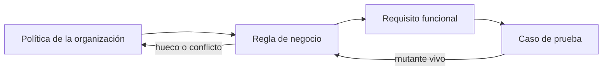
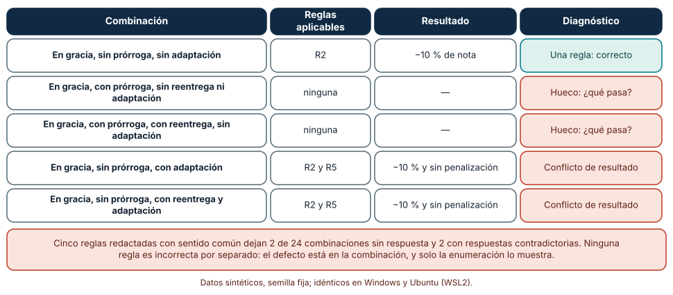
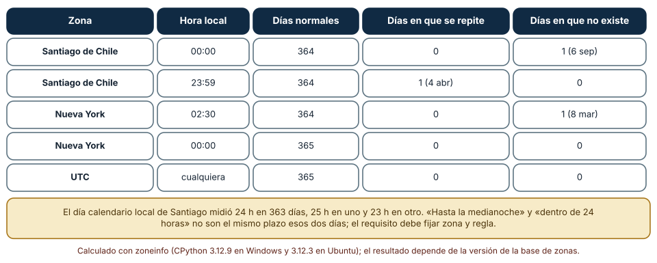
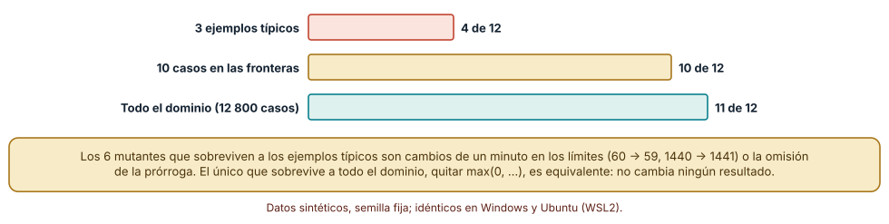

# SE-146 — Requisitos funcionales y reglas de negocio

[← SE-145 — Elicitación, análisis, especificación y validación](https://github.com/vladimiracunadev-create/modern-software-engineering-program/blob/main/classes/part-12-ingenieria-de-requisitos/se-145-elicitacion-analisis-especificacion-y-validacion/README.md) · [↑ Parte 12](https://github.com/vladimiracunadev-create/modern-software-engineering-program/blob/main/classes/part-12-ingenieria-de-requisitos/README.md) · [📚 Índice completo](https://github.com/vladimiracunadev-create/modern-software-engineering-program/blob/main/classes/README.md) · [🌐 Portal](https://vladimiracunadev-create.github.io/modern-software-engineering-program/classes/SE-146.html) · [SE-147 — Atributos de calidad y restricciones →](https://github.com/vladimiracunadev-create/modern-software-engineering-program/blob/main/classes/part-12-ingenieria-de-requisitos/se-147-atributos-de-calidad-y-restricciones/README.md)

## Punto profesional y fundamento pedagógico

**Punto profesional.** La clase existe para separar lo que el sistema hace de lo que la organización decidió, de modo que una regla de penalización por entrega tardía no quede enterrada en un `if` que solo su autor entiende y que nadie sabe si cubre todos los casos.

**Por qué aparece aquí.** Se sitúa después de **Elicitación, análisis, especificación y validación** y antes de **Atributos de calidad y restricciones**: `SE-145` dejó un requisito conductor con origen y criterio; esta clase examina su contenido funcional y las reglas que lo gobiernan, y deja una tabla de decisión verificable que `SE-149` convertirá en ejemplos de aceptación y `SE-154` someterá a la caza de contradicciones.

**Error conceptual que debe corregir.** Creer que una regla de negocio es una condición del código y que una lista de reglas redactadas con sentido común es una regla completa y consistente.

**Secuencia de aprendizaje.** Antes de leer la solución, predices cuántas de las combinaciones posibles quedan sin regla o con reglas contradictorias; después enumeras, explicas por qué las reglas individuales parecían correctas, comparas cómo una suite de ejemplos y una de fronteras detectan mutantes, y reconstruyes sin apoyo la separación entre requisito funcional y regla. La secuencia usa predicción, explicación propia, contraste y recuperación. [ICAP](https://icap.education.asu.edu/research) distingue participación de construcción de conocimiento; [How People Learn II](https://nap.nationalacademies.org/catalog/24783/how-people-learn-ii-learners-contexts-and-cultures) exige conectar conocimiento previo, contexto y transferencia; la [práctica de recuperación](https://pubmed.ncbi.nlm.nih.gov/16507066/) respalda producir de nuevo la explicación tras una demora; y [Education for Life and Work](https://nap.nationalacademies.org/resource/13398/dbasse_084153.pdf) exige devolución que explique la causa del error.

**Evidencia de aprendizaje.** `rules-table.md` con la tabla de decisión de la penalización por tardanza, la lista de combinaciones sin regla o en conflicto, la política de zona horaria del plazo y el registro de mutantes detectados y no detectados. Debe contener predicción previa, observación, explicación causal, contraejemplo, criterio de aceptación y una nota de qué dato haría cambiar la conclusión.

**Límite de la conclusión.** Las cinco reglas, las 24 combinaciones y los 12 mutantes los escribió el autor; no proceden de una universidad ni de un reglamento real. Las cifras de zonas horarias dependen de la versión de la base de datos de zonas del equipo.

### Trazabilidad fuente → afirmación

| Fuente primaria u oficial | Afirmación que respalda | Lo que no prueba |
|---|---|---|
| [Mavin et al., «Easy Approach to Requirements Syntax (EARS)» (2009)](https://doi.org/10.1109/RE.2009.9) | Propone plantillas de frase para requisitos (siempre, cuando, mientras, si… entonces) que hacen explícitos disparador, condición y respuesta. | No demuestra que las plantillas eliminen la ambigüedad. |
| [Business Rules Manifesto (Business Rules Group)](https://www.businessrulesgroup.org/brmanifesto.htm) | Sostiene que las reglas son un tipo de requisito propio, expresables en lenguaje declarativo y separables de los procesos. | No es un estándar ni fija una notación. |
| [RFC 3339: Date and Time on the Internet](https://www.rfc-editor.org/rfc/rfc3339) | Fija un formato de fecha y hora con desplazamiento respecto de UTC. | No resuelve qué significa «hasta la medianoche» en una zona con cambio de hora. |
| [Python: zoneinfo](https://docs.python.org/3/library/zoneinfo.html) | Expone la base de datos de zonas horarias y el atributo `fold` para horas repetidas. | Depende de los datos de zona instalados. |
| [DeMillo, Lipton y Sayward, «Hints on test data selection» (1978)](https://doi.org/10.1109/C-M.1978.218136) | Introduce la idea de mutantes: variantes pequeñas del programa que una buena suite debería distinguir. | No dice cuántos mutantes bastan. |

## Antes de empezar

Retomas el requisito conductor de la Parte 12: recuperar borradores cuando la sesión expira. Alrededor hay una política que la plataforma de entregas debe seguir: qué pasa con una entrega que llega tarde. Recupera lo aprendido en `SE-145`: un requisito sin origen no se puede cuestionar y una suposición sin responsable no se puede comprobar. La pregunta activa es: **¿qué parte de lo que voy a implementar es una decisión de la organización, qué parte es comportamiento del sistema y cómo sé que la regla cubre todos los casos?**

## Prerrequisitos

- Haber completado `SE-145` o poder explicar el ciclo de cuatro actividades.
- Python 3.11 o posterior; `zoneinfo` necesita datos de zona (en Windows, el paquete `tzdata`).
- Trabajar solo con reglas y fechas sintéticas.

## Problema auténtico

Un docente pregunta: «Una estudiante con adaptación entregó 40 minutos tarde, con prórroga de 24 horas. ¿Qué nota recibe?». Tres personas del equipo contestan algo distinto: una aplica el 10 % de penalización, otra lo anula por la adaptación y otra por la prórroga. Ninguna ha leído la regla completa porque nunca se escribió completa; existe en tres condicionales distribuidos en tres módulos.

## Objetivos observables

Al terminar podrás:

1. distinguir un requisito funcional, una regla de negocio y un supuesto con un ejemplo y un contraejemplo de la plataforma;
2. enumerar las combinaciones de una regla y mostrar cuáles no tienen respuesta o tienen respuestas contradictorias;
3. fijar una política de plazo que sobreviva a una hora que no existe o se repite;
4. medir cuántos mutantes de una regla detecta una suite de ejemplos frente a una suite de fronteras;
5. declarar qué parte de la regla es política y quién tiene autoridad para cambiarla.

## Mapa conceptual



El mapa se lee de izquierda a derecha como una cadena de concreción: una política se vuelve regla, la regla se vuelve comportamiento exigido y el comportamiento se vuelve un caso de prueba. Los retornos indican que un hueco o un conflicto en la regla obliga a volver a la política (quien decide), y que un mutante vivo obliga a revisar la regla, no solo la prueba.

## Temas y por qué importan

| Tema | Por qué cambia una decisión profesional | Evidencia mínima |
|---|---|---|
| Requisito funcional | Define qué hace el sistema ante un estímulo y una condición; sin ello no hay qué probar. | Predicción, traza causal y contraejemplo de **Requisito funcional** en `rules-table.md` |
| Regla de negocio | Pertenece a la organización y cambia con la política, no con el código. | Predicción, traza causal y contraejemplo de **Regla de negocio** en `rules-table.md` |
| Tablas de decisión | Muestran huecos y contradicciones que el texto corrido oculta. | Predicción, traza causal y contraejemplo de **Tablas de decisión** en `rules-table.md` |
| Tiempo, plazos y zonas | Un plazo tiene significado distinto según zona, regla de cambio de hora y definición de día. | Predicción, traza causal y contraejemplo de **Tiempo, plazos y zonas** en `rules-table.md` |
| Estados e invariantes | Lo que siempre debe ser cierto (una entrega enviada no se edita) se verifica en cada transición. | Predicción, traza causal y contraejemplo de **Estados e invariantes** en `rules-table.md` |

## Conceptos y decisiones

### 1. Requisito funcional

Un requisito funcional describe una respuesta observable del sistema a un estímulo, bajo una condición. Las plantillas EARS ayudan porque obligan a nombrar las tres partes: «Cuando la sesión expira, el sistema conservará el borrador de los últimos 30 s». Sin estímulo no se sabe cuándo ocurre; sin condición no se sabe cuándo no; sin respuesta observable no se puede probar. Un requisito funcional también debe ser singular: «guardará y cifrará y avisará» son tres requisitos que fallan por separado y se prueban por separado.

### 2. Regla de negocio

Una regla de negocio es una decisión de la organización que existiría aunque no hubiera sistema: «una entrega en gracia pierde el 10 % de la nota». El requisito funcional dice cómo el sistema la aplica; la regla dice qué se aplica. Distinguirlas importa por quién puede cambiarlas: la coordinación académica cambia la regla; el equipo cambia el modo de aplicarla. Si la regla vive solo en el código, cada cambio de política es un cambio de software y cada discusión sobre la política se convierte en una discusión sobre código.

### 3. Tablas de decisión

Cuando una regla depende de varias condiciones, el texto corrido invita a describir los casos felices y olvidar el resto. Una tabla de decisión enumera todas las combinaciones de condiciones y asigna una acción a cada una; permite comprobar dos propiedades: completitud (ninguna combinación sin acción) y consistencia (ninguna combinación con acciones contradictorias). El costo es exponencial —n condiciones binarias dan 2^n filas—, así que su uso se limita a reglas con pocas condiciones o se complementa con pruebas combinatorias (`SE-149`).

### 4. Tiempo, plazos y zonas

«Hasta la medianoche» parece claro hasta que la medianoche no existe. Un plazo necesita cuatro decisiones: qué instante (con desplazamiento respecto de UTC, como en RFC 3339), en qué zona se interpreta, qué ocurre si la hora local se repite o se salta, y si el plazo es una hora fija o una duración. Escribir el plazo como instante UTC resuelve la ambigüedad pero cambia lo que la estudiante ve en pantalla: el requisito debe decir qué fuente manda.

### 5. Estados e invariantes

Una entrega pasa por estados (borrador, enviada, en revisión, calificada) y ciertas propiedades deben cumplirse siempre: una entrega calificada no se modifica sin reabrirse, una entrega enviada tiene fecha de envío. Un invariante es una regla que no depende de la transición que ocurra; se escribe una vez y se comprueba en cada una. Descubrir que algo debería ser un invariante es parte del análisis: aparece cuando alguien dice «eso nunca debería pasar» y nadie sabe dónde se garantiza.

### Una tabla de decisión que parecía completa

La regla de penalización se redactó con cinco reglas: R1, entrega a tiempo, sin penalización; R2, en gracia (hasta 60 minutos) y sin prórroga, −10 %; R3, tarde con prórroga, sin penalización; R4, tarde sin prórroga, se rechaza; R5, estudiante con adaptación y en gracia, sin penalización. Cuatro condiciones: estado (a tiempo, en gracia, tarde), prórroga, reentrega, adaptación; 3 × 2 × 2 × 2 = 24 combinaciones. Predicción antes de ejecutar: cada regla es razonable por sí sola; algunas combinaciones quedarán sin cubrir o cubiertas dos veces.

```python
import itertools
for e, x, r, a in itertools.product(estados, [False, True], [False, True], [False, True]):
    aplicables = [k for k, (cond, accion) in reglas.items() if cond(e, x, r, a)]
    # 0 reglas → hueco; más de una con acciones distintas → conflicto
```

Resultado, idéntico en Windows y en Ubuntu: 20 combinaciones tienen exactamente una regla. 2 no tienen ninguna (en gracia con prórroga, con o sin reentrega y sin adaptación: ¿qué pasa si alguien con prórroga entrega en la ventana de gracia?). 2 activan R2 y R5 a la vez con resultados distintos (−10 % y sin penalización: en gracia, sin prórroga y con adaptación). Ninguna regla es falsa; el defecto está en las combinaciones. La reparación es una decisión de política (¿la adaptación prevalece sobre el 10 %?, ¿la prórroga sustituye la gracia?) y se añade como regla R6 con su responsable.



**Cómo leer la figura.** Cada fila es una combinación de condiciones; las filas coral son huecos o conflictos y la última columna dice cuál. **Dónde deja de valer:** la tabla enumera todas las combinaciones solo porque son 24; con diez condiciones binarias serían 1 024 y la enumeración manual se vuelve inviable. Allí se usan herramientas de generación o se reducen condiciones agrupando casos equivalentes.

### Una medianoche que no existe

El plazo «a las 00:00 de hora local» se evaluó para cada día de 2026 en cinco zonas con `zoneinfo`, comprobando si la hora local existe, se repite o se salta (`fold` distingue las dos pasadas de una hora repetida). Predicción: en las zonas sin cambio de hora no habrá incidencias, y en las que lo tienen habrá un día especial por cada cambio.

```python
def existe(naive, tz):
    a = naive.replace(tzinfo=tz, fold=0)
    ida_y_vuelta = a.astimezone(timezone.utc).astimezone(tz).replace(tzinfo=None)
    if ida_y_vuelta != naive: return "inexistente"
    if a.astimezone(timezone.utc) != naive.replace(tzinfo=tz, fold=1).astimezone(timezone.utc): return "repetida"
    return "ok"
```

Resultado con la base de zonas instalada (idéntico en ambos sistemas): en Santiago de Chile, 00:00 no existe un día del año (el 6 de septiembre) y 23:59 se repite otro (el 4 de abril); en Nueva York, 02:30 no existe un día (el 8 de marzo); en UTC no hay incidencias. Los días calendario locales de Santiago midieron 24 h en 363 casos, 25 h en uno y 23 h en otro. «Hasta la medianoche» y «dentro de las próximas 24 horas» son plazos distintos exactamente esos dos días.



**Cómo leer la figura.** Cada fila es una zona y una hora local; las dos últimas columnas cuentan los días especiales. **Dónde deja de valer:** las fechas de cambio dependen de la política de cada país, que cambia por decreto; los resultados corresponden a la base de datos de zonas del equipo y a 2026. El requisito no debe copiar las fechas, sino nombrar la zona y delegar en la base de datos.

### Ejemplos típicos frente a fronteras: mutantes de la regla

La función de penalización calcula la nota final: con prórroga se descuentan 1 440 minutos; si la tardanza resultante es ≤ 0 se conserva la nota, si es ≤ 60 se aplica 0,9 y si no, se rechaza. Se escribieron 12 mutantes (cambiar `≤ 0` por `< 0`, `60` por `59`, `1440` por `1441`, ignorar la prórroga, quitar `max(0, …)`, reemplazar `round(…, 1)` por `int`, etc.). Se probaron tres suites: tres ejemplos típicos (a tiempo, 30 minutos tarde, 3 horas tarde), diez casos de frontera (0, 1, 60, 61 minutos y 1 440, 1 441, 1 500, 1 501 con prórroga) y todo el dominio (3 200 minutos × 2 × 2 notas). Predicción: los ejemplos típicos matarán los cambios grandes y dejarán vivos los de un minuto.

```python
def mata(mutante, suite):
    return any(mutante(*caso) != original(*caso) for caso in suite)
```

Resultado: los ejemplos típicos matan 4 de 12; las fronteras, 10 de 12; el dominio completo, 11 de 12. Los 6 que se salvan de los ejemplos son cambios de un minuto o la omisión de la prórroga. El que sobrevive a todo (quitar `max(0, …)`) es equivalente: con la condición `≤ 0` posterior no cambia ningún resultado. Otro (`int` en lugar de `round`) solo muere cuando la nota hace que 0,9 × nota tenga decimales: con la nota 70 el resultado coincide, con 65 no. La suite de frontera lo dejó vivo porque variaba el tiempo y no el valor.



**Cómo leer la figura.** Cada barra es una suite; su longitud es cuántos de los 12 mutantes detecta. **Dónde deja de valer:** los mutantes los escribió el autor y reflejan los errores que esperaba; un equipo real comete otros. Que se detecten 10 de 12 no es una probabilidad de que el código esté bien, y los mutantes equivalentes impiden llegar a 12.

## Definiciones de trabajo

- **requisito funcional:** descripción de una respuesta observable del sistema ante un estímulo bajo una condición.
- **regla de negocio:** decisión de la organización, independiente del sistema, sobre qué se acepta, se calcula o se rechaza.
- **tablas de decisión:** enumeración de combinaciones de condiciones con la acción de cada una, que permite comprobar completitud y consistencia.
- **tiempo, plazos y zonas:** especificación de un instante límite que incluye zona, regla de cambio de hora y definición de día.
- **estados e invariantes:** situaciones por las que pasa una entidad y propiedades que deben cumplirse en todas.

Las definiciones son operativas para la plataforma de entregas. No convierten términos con una historia más amplia en sinónimos y deben contrastarse con la documentación primaria enlazada al final.

## Ejemplo mínimo

El fragmento siguiente cuenta las reglas aplicables a una combinación. Antes de ejecutarlo, predice cuántas reglas aplican.

```python
reglas = {
    "R2": lambda e, x, a: e == "en_gracia" and not x,
    "R5": lambda e, x, a: e == "en_gracia" and a,
}
aplicables = [k for k, f in reglas.items() if f("en_gracia", False, True)]
assert aplicables == ["R2", "R5"]   # dos reglas, dos acciones distintas
```

Una combinación activa dos reglas con resultados distintos: es un conflicto, no una excepción. Registra versión del intérprete, comando y salida. La corrección no está en el código sino en la decisión de cuál prevalece y quién la tomó.

## Ejemplo profesional

La política de entregas tardías se registra como regla con identificador, texto, responsable y fecha, separada del requisito que la aplica:

```text
BR-07  Una entrega recibida hasta 60 minutos después del plazo pierde el 10 % de la nota.  Responsable: coordinación académica.  Vigente desde: 2026-03-01.
BR-08  La prórroga de 24 horas sustituye a la gracia de 60 minutos; no se acumulan.        Responsable: coordinación académica.
REQ-020  Cuando se recibe una entrega, el sistema calculará la nota final aplicando BR-07 y BR-08.
```

Compara con el caso de la estudiante con adaptación que entrega en gracia, con el cambio de política a mitad de curso (¿se aplica a entregas ya recibidas?), con la entrega que cruza un cambio de hora y con la entrega duplicada. La separación es apropiada cuando la coordinación puede cambiar BR-07 sin que el equipo toque el código; es peligrosa cuando el valor 0,9 aparece en tres módulos.

## Práctica guiada

1. Escribe las cinco reglas de penalización tal como las contaría una persona, antes de enumerar nada.
2. Predice cuántas de las 24 combinaciones quedan sin regla o en conflicto.
3. Enumera las combinaciones con `itertools.product` y guarda el listado bajo `evidence/`.
4. Redacta BR-09 y BR-10 para cerrar los huecos y los conflictos, con responsable.
5. Fija la política del plazo: zona, instante y qué ocurre si la hora no existe.
6. Escribe los 12 mutantes y compara los resultados de los ejemplos con los de las fronteras.
7. Pide a otra persona que aplique tu tabla a cinco entregas inventadas sin consultarte.

## Ejercicios

1. **Enumeración:** agrega una quinta condición (por ejemplo, entrega parcial) y calcula cuántas combinaciones nuevas aparecen y cuáles quedan sin regla.
2. **Plazo:** reescribe el requisito del plazo con una zona fija y otra versión con instante UTC, y explica qué ve la estudiante en cada caso.
3. **Mutantes:** propón dos mutantes que ninguna de las tres suites detecte y explica si son equivalentes.
4. **Invariante:** escribe un invariante de la entrega que se rompa si alguien implementa solo las reglas BR-07 y BR-08.

## Reto verificable

Entrega `rules-table.md` con la tabla completa de 24 combinaciones (acción o decisión pendiente), la política de plazo y la tabla de mutantes con su resultado por suite. Se aprueba si otra persona ejecuta el código desde un checkout limpio, obtiene los mismos recuentos y puede señalar qué cambio de política invalidaría la tabla. No se aprueba por completar la tabla sin responsables ni por afirmar que «las reglas son obvias».

## Caso conductor

La plataforma de entregas sigue siendo el caso de la parte. Esta clase añade al expediente de `SE-145` una tabla de decisión de penalización y una política de plazo. Las clases siguientes preguntarán qué calidad debe tener la recuperación (`SE-147`), cómo se cuenta desde el punto de vista de quien usa (`SE-148`) y cómo se prueba con ejemplos (`SE-149`). Cambia después una sola regla —por ejemplo, que la prórroga se sume a la gracia— y revisa qué filas de la tabla cambian.

## Preguntas frecuentes

### ¿Una regla de negocio es lo mismo que un requisito funcional?

No. La regla es una decisión de la organización («una entrega en gracia pierde el 10 %»); el requisito funcional es lo que el sistema hace con ella («calculará la nota final aplicando BR-07»). Si la regla cambia, cambia el requisito solo si cambia cómo se aplica; separarlas permite que quien decide la política la cambie sin tocar el código.

### ¿Hay que enumerar todas las combinaciones siempre?

Con pocas condiciones, sí: 24 filas se revisan en una hora y dos defectos aparecieron. Con muchas, se agrupan condiciones equivalentes, se enumeran solo las que importan para la decisión o se usan pruebas combinatorias. Lo que no es válido es suponer que las combinaciones no enumeradas se comportarán bien.

### ¿Por qué no guardar siempre el plazo en UTC y olvidarse de las zonas?

UTC elimina la ambigüedad del instante pero no la de lo que la estudiante entiende por «medianoche». Un estudiante en Santiago que ve «23:59» y entrega a las 23:50 espera estar a tiempo. El requisito debe fijar en qué zona se muestra y se decide el plazo, y qué ocurre en los días de cambio de hora.

### ¿Un mutante que sobrevive siempre significa una prueba débil?

No siempre. Puede ser un mutante equivalente, que no cambia ningún comportamiento observable (quitar `max(0, …)` en el ejemplo). Antes de añadir pruebas, pregunta si existe alguna entrada que distinga mutante y original; si no existe, el mutante no revela un defecto de la suite.

## Fallo controlado y diagnóstico

Reproduce el fallo clásico de la clase: **dar por completa una regla porque cada condicional parece razonable**. Implementa las cinco reglas como `if/elif` en el orden en que se escribieron y pasa la combinación (en gracia, sin prórroga, con adaptación).

Registra síntoma, entrada mínima, hipótesis, observación que descarta cada hipótesis, causa, corrección y prueba de regresión. **Síntoma:** la estudiante con adaptación recibe −10 % en el módulo de notas y 0 % en el de reportes. **Hipótesis rivales:** (a) hay un error de redondeo; (b) dos módulos aplican reglas distintas a la misma entrada. **Prueba:** ejecuta la misma entrada contra R2 y R5 por separado; ambas se activan y dan resultados distintos. **Conclusión:** la regla estaba incompleta en la combinación, no el código. **Regresión:** añade una prueba que enumere las 24 combinaciones y falle si alguna tiene 0 reglas o más de una con acciones distintas. No cambies a la vez la regla y su implementación.

## Errores comunes y cómo corregirlos

| Síntoma | Causa probable | Corrección |
|---|---|---|
| Dos módulos calculan una nota distinta para la misma entrega | La regla vive duplicada en el código y cada copia evolucionó por su lado | Extraer la regla a un único punto con identificador y responsable |
| El comité de política pregunta «¿qué pasa si…?» y nadie lo sabe | Se redactaron solo los casos felices | Enumerar combinaciones y asignar a cada una una acción o una decisión pendiente |
| Estudiantes reclaman por un plazo que «venció una hora antes» | El plazo se interpretó en la zona del servidor y se mostró en la del navegador | Fijar en la regla la zona del plazo y mostrar el instante en esa misma zona |
| La suite pasa con un mutante vivo que sí es un defecto | Solo se probaron ejemplos típicos y no las fronteras | Añadir casos en los límites de cada condición y variar los valores, no solo el tiempo |
| Un cambio de política rompe pruebas que nadie asocia a ella | La regla no tiene identificador ni vínculo a sus casos | Etiquetar cada caso con el identificador de la regla que ejercita |

## Entorno y archivos clave

```text
work/SE-146/
├── README.md
├── reglas/
│   ├── tabla_decision.py
│   ├── plazos.py
│   └── mutantes.py
├── fixtures/entregas.csv
├── tests/test_reglas.py
└── evidence/rules-table.md
```

El `README` declara plataforma, versión de Python y de `tzdata`, y comandos. Los experimentos usan `itertools`, `datetime` y `zoneinfo` y se ejecutaron con CPython 3.12.9 en Windows 11 (con el paquete `tzdata`) y 3.12.3 en Ubuntu bajo WSL2; las salidas fueron idénticas. Si cambias la versión de la base de zonas, repite el recuento.

## Seguridad, ética y accesibilidad

- una regla de penalización afecta calificaciones: registra quién la decidió, desde cuándo y a quiénes alcanza, para que pueda apelarse;
- las adaptaciones por discapacidad son datos sensibles: la regla debe usar un indicador mínimo («adaptación vigente»), no el motivo;
- una regla que ignora zonas horarias perjudica sistemáticamente a quien estudia lejos del servidor; explícitalo;
- ofrece el plazo en texto claro y en formato legible por lectores de pantalla, no solo como un contador visual;
- no uses un modelo de lenguaje con reglamentos reales de una institución sin autorización;
- respeta licencias de reglamentos y atribuye adaptaciones.

## Puente hacia el trabajo con agentes

Un agente al que se le pide «implementa la regla de penalización según el reglamento» producirá condicionales plausibles que cubren los casos descritos en el texto. Pídele en cambio que enumere las combinaciones de condiciones, que marque cuáles quedan sin acción o con acciones distintas, que cite el identificador de la regla en cada caso de prueba y que deje la política como un valor configurable con responsable. Revisa especialmente si decide por su cuenta qué prevalece entre dos reglas: es una decisión de política, no un detalle de implementación.

## Transferencia

Traslada la tabla a otro dominio (por ejemplo, descuentos en un servicio de entregas a domicilio): cambia las condiciones y las acciones, conserva la enumeración y el recuento de huecos y conflictos, y verifica si aparecen defectos que las reglas individuales ocultaban. La transferencia está lograda cuando puedes explicar qué parte del método dependía del dominio y cuál no, no cuando el código se parece.

## Evaluación y evidencia

| Criterio | Evidencia para aprobar |
|---|---|
| comprensión | explicación causal de la diferencia entre requisito funcional, regla de negocio y supuesto, con ejemplo y contraejemplo |
| corrección | recuento reproducible de huecos y conflictos de las 24 combinaciones |
| diseño | regla separada del requisito, con identificador, responsable y vigencia |
| diagnóstico | reproducción del fallo «condicionales razonables que no son completos» con regresión |
| incertidumbre | política de plazo con zona y declaración de la versión de datos de zona usada |
| reproducibilidad | versiones, comandos, salida y límites declarados |

## Fuentes

- [Mavin et al.: Easy Approach to Requirements Syntax, EARS (2009)](https://doi.org/10.1109/RE.2009.9) — plantillas de frase para requisitos; autoridad: IEEE International Requirements Engineering Conference.
- [Sitio de EARS (Alistair Mavin)](https://alistairmavin.com/ears/) — descripción de las plantillas por su autor.
- [Business Rules Manifesto](https://www.businessrulesgroup.org/brmanifesto.htm) — reglas como requisito de primer nivel; autoridad: Business Rules Group.
- [RFC 3339: Date and Time on the Internet](https://www.rfc-editor.org/rfc/rfc3339) — formato de instantes con desplazamiento; autoridad: IETF.
- [IANA: Time Zone Database](https://www.iana.org/time-zones) — origen de las reglas de zona y de sus cambios; autoridad: IANA.
- [DeMillo, Lipton y Sayward: Hints on test data selection (1978)](https://doi.org/10.1109/C-M.1978.218136) — origen de las pruebas de mutación; autoridad: IEEE Computer.
- [ISO/IEC/IEEE 29148:2018](https://www.iso.org/standard/72089.html) — requisito singular y características de un buen requisito; autoridad: ISO, IEC e IEEE.

Cada fuente respalda el mecanismo indicado; ninguna demuestra que la política de entregas tardías de la plataforma sea justa o completa. Esa afirmación depende de la decisión de quien tenga autoridad y de la revisión de otra persona.

- [Python: `zoneinfo`](https://docs.python.org/3/library/zoneinfo.html) — zonas horarias, `fold` y datos instalados.
- [Python: `datetime`](https://docs.python.org/3/library/datetime.html) — conversión entre instantes y horas locales.
- [Python: `itertools.product`](https://docs.python.org/3/library/itertools.html) — enumeración de combinaciones.

## Límites y siguiente paso

Se ejecutaron tres experimentos con reglas y fechas sintéticas en Windows y Ubuntu (WSL2) con resultados idénticos. No se consultó ningún reglamento real, los mutantes y las reglas son del autor y las fechas de cambio de hora corresponden a la base de zonas instalada. La siguiente clase pregunta qué calidad debe tener lo que la regla produce: cuán rápido, cuán disponible, cuán seguro.

## Glosario

- **requisito funcional:** descripción de una respuesta observable del sistema ante un estímulo bajo una condición.
- **regla de negocio:** decisión de la organización, independiente del sistema, sobre qué se acepta, se calcula o se rechaza.
- **tablas de decisión:** enumeración de combinaciones de condiciones con la acción de cada una, que permite comprobar completitud y consistencia.
- **tiempo, plazos y zonas:** especificación de un instante límite que incluye zona, regla de cambio de hora y definición de día.
- **estados e invariantes:** situaciones por las que pasa una entidad y propiedades que deben cumplirse en todas.

---

[← SE-145 — Elicitación, análisis, especificación y validación](https://github.com/vladimiracunadev-create/modern-software-engineering-program/blob/main/classes/part-12-ingenieria-de-requisitos/se-145-elicitacion-analisis-especificacion-y-validacion/README.md) · [↑ Parte 12](https://github.com/vladimiracunadev-create/modern-software-engineering-program/blob/main/classes/part-12-ingenieria-de-requisitos/README.md) · [📚 Índice completo](https://github.com/vladimiracunadev-create/modern-software-engineering-program/blob/main/classes/README.md) · [🌐 Portal](https://vladimiracunadev-create.github.io/modern-software-engineering-program/classes/SE-146.html) · [SE-147 — Atributos de calidad y restricciones →](https://github.com/vladimiracunadev-create/modern-software-engineering-program/blob/main/classes/part-12-ingenieria-de-requisitos/se-147-atributos-de-calidad-y-restricciones/README.md)
