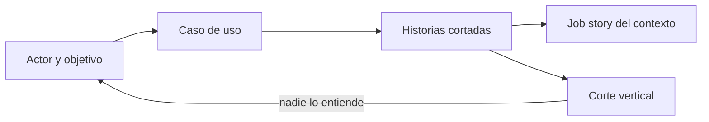
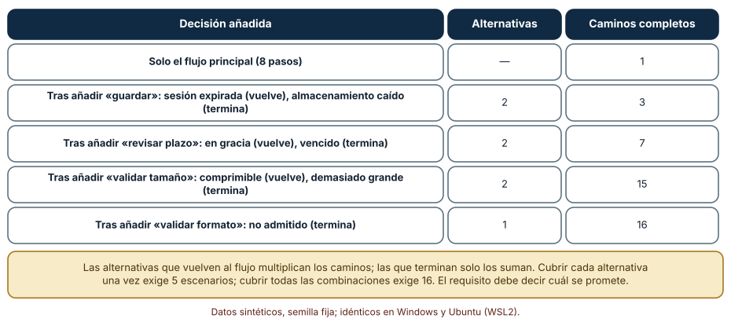
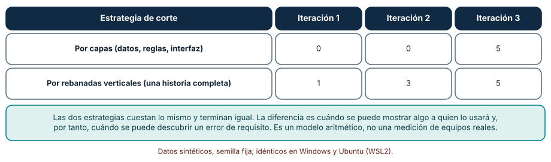
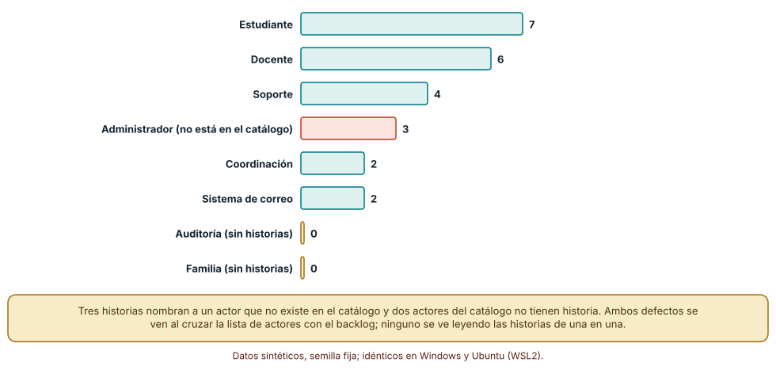

# SE-148 — Casos de uso, historias y job stories

[← SE-147 — Atributos de calidad y restricciones](https://github.com/vladimiracunadev-create/modern-software-engineering-program/blob/main/classes/part-12-ingenieria-de-requisitos/se-147-atributos-de-calidad-y-restricciones/README.md) · [↑ Parte 12](https://github.com/vladimiracunadev-create/modern-software-engineering-program/blob/main/classes/part-12-ingenieria-de-requisitos/README.md) · [📚 Índice completo](https://github.com/vladimiracunadev-create/modern-software-engineering-program/blob/main/classes/README.md) · [🌐 Portal](https://vladimiracunadev-create.github.io/modern-software-engineering-program/classes/SE-148.html) · [SE-149 — Criterios de aceptación y ejemplos →](https://github.com/vladimiracunadev-create/modern-software-engineering-program/blob/main/classes/part-12-ingenieria-de-requisitos/se-149-criterios-de-aceptacion-y-ejemplos/README.md)

## Punto profesional y fundamento pedagógico

**Punto profesional.** La clase existe para que los requisitos se cuenten desde quien los usa y no desde la pantalla del equipo: elegir entre un caso de uso, una historia o una job story según qué incertidumbre hay que reducir, y cortar el trabajo de modo que cada entrega sirva a alguien.

**Por qué aparece aquí.** Se sitúa después de **Atributos de calidad y restricciones** y antes de **Criterios de aceptación y ejemplos**: `SE-146` y `SE-147` dejaron reglas y escenarios de calidad; esta clase los organiza en relatos de uso con actor, objetivo y contexto, y deja historias cortables que `SE-149` completará con ejemplos y `SE-150` ordenará.

**Error conceptual que debe corregir.** Creer que «Como usuario quiero… para…» es una especificación, y que dividir el trabajo por capas técnicas es dividirlo por valor.

**Secuencia de aprendizaje.** Antes de leer la solución, predices cuántos caminos tiene un caso de uso con cuatro decisiones, cuándo recibe valor una persona con dos formas de cortar el trabajo, y qué defectos de actores aparecen en un backlog; después los calculas, explicas por qué el número de escenarios crece como lo hace, comparas ambas estrategias de corte y reconstruyes sin apoyo la diferencia entre las tres formas de contar. La secuencia usa predicción, explicación propia, contraste y recuperación. [ICAP](https://icap.education.asu.edu/research) distingue participación de construcción de conocimiento; [How People Learn II](https://nap.nationalacademies.org/catalog/24783/how-people-learn-ii-learners-contexts-and-cultures) exige conectar conocimiento previo, contexto y transferencia; la [práctica de recuperación](https://pubmed.ncbi.nlm.nih.gov/16507066/) respalda producir de nuevo la explicación tras una demora; y [Education for Life and Work](https://nap.nationalacademies.org/resource/13398/dbasse_084153.pdf) exige devolución que explique la causa del error.

**Evidencia de aprendizaje.** `stories.md` con un caso de uso del requisito conductor (flujo principal, alternativas y extensiones), cinco historias cortadas en vertical, una job story, el catálogo de actores y la verificación cruzada de actores contra historias. Debe contener predicción previa, observación, explicación causal, contraejemplo, criterio de aceptación y una nota de qué dato haría cambiar la conclusión.

**Límite de la conclusión.** Los casos, los backlogs y las capacidades por iteración son sintéticos y los fijó el autor. No se midió ningún equipo ni se comparó la comprensión de personas con las tres formas de relato.

### Trazabilidad fuente → afirmación

| Fuente primaria u oficial | Afirmación que respalda | Lo que no prueba |
|---|---|---|
| Cockburn, *Writing Effective Use Cases* (ISBN 978-0201702255) | Un caso de uso describe un objetivo de un actor con un escenario principal y extensiones que cubren las variantes y los fallos. | No dice cuántas extensiones son suficientes. |
| Cohn, *User Stories Applied* (ISBN 978-0321205681) | Una historia es una promesa de conversación: tarjeta, conversación y confirmación. | No garantiza que la conversación ocurra. |
| [Wake, INVEST in Good Stories, and SMART Tasks](https://xp123.com/articles/invest-in-good-stories-and-smart-tasks/) | Propone criterios para historias independientes, negociables, valiosas, estimables, pequeñas y comprobables. | Los criterios no se aplican mecánicamente. |
| [Klement, Replacing the User Story with the Job Story](https://medium.com/@jtbd.info/replacing-the-user-story-with-the-job-story-af7cdee10c27) | Propone partir de una situación y una motivación en lugar de un rol, con la forma «cuando… quiero… para…». | Es una propuesta de práctica, no un estudio comparativo. |
| [GOV.UK Service Manual: Writing user stories](https://www.gov.uk/service-manual/agile-delivery/writing-user-stories) | Pide historias basadas en necesidades reales y pequeñas, y añade criterios de aceptación. | No sustituye la investigación con personas. |
| [Python: itertools](https://docs.python.org/3/library/itertools.html) | Ofrece utilidades para enumerar combinaciones. | No decide qué escenarios importan. |

## Antes de empezar

Retomas el requisito conductor de la Parte 12: recuperar borradores cuando la sesión expira. Ya tiene origen (`SE-145`), reglas (`SE-146`) y escenarios de calidad (`SE-147`). Ahora hay que contarlo de modo que la estudiante, la docente y quien programa entiendan lo mismo. Recupera lo aprendido: una regla enumerada en una tabla revela huecos que el texto corrido oculta. La pregunta activa es: **¿qué forma de contar el requisito reduce la incertidumbre que más pesa ahora: la secuencia de pasos, la conversación sobre el valor o la situación que desencadena la necesidad?**

## Prerrequisitos

- Haber completado `SE-147` o poder explicar un escenario de calidad completo.
- Python 3.11 o posterior.
- Trabajar solo con actores, historias y casos sintéticos.

## Problema auténtico

El backlog de la plataforma tiene 24 historias que empiezan con «Como usuario quiero…». Nadie sabe quiénes son «los usuarios». El equipo ha cortado el trabajo en «base de datos», «API» y «pantallas», y a la tercera semana no hay nada que mostrar a una docente. El caso de uso de «entregar una tarea» ocupa media página y nadie sabe cuántos escenarios implica probar.

## Objetivos observables

Al terminar podrás:

1. distinguir un caso de uso, una historia y una job story con un ejemplo y un contraejemplo de la plataforma;
2. contar los caminos de un caso de uso y justificar cuántos escenarios se prometen probar;
3. cortar un conjunto de historias en vertical y mostrar cuándo recibe valor una persona con cada corte;
4. detectar historias que nombran actores inexistentes y actores sin historias cruzando catálogo y backlog;
5. elegir la forma de relato según la incertidumbre dominante.

## Mapa conceptual



El mapa se lee de izquierda a derecha. El caso de uso fija la secuencia y sus variantes; la historia fija el incremento de valor; la job story fija la situación que lo motiva. El retorno indica que un corte que no se entiende obliga a volver al actor y a su objetivo, no a cortar de otro modo.

## Temas y por qué importan

| Tema | Por qué cambia una decisión profesional | Evidencia mínima |
|---|---|---|
| Actores y objetivos | Un requisito sin actor no tiene a quién preguntar. | Predicción, traza causal y contraejemplo de **Actores y objetivos** en `stories.md` |
| Casos de uso | Muestran secuencias, variantes y fallos con alcance completo. | Predicción, traza causal y contraejemplo de **Casos de uso** en `stories.md` |
| Historias de usuario | Dividen el valor en incrementos pequeños que se negocian. | Predicción, traza causal y contraejemplo de **Historias de usuario** en `stories.md` |
| Job stories | Parten de la situación y no del rol; útiles cuando el rol no explica el comportamiento. | Predicción, traza causal y contraejemplo de **Job stories** en `stories.md` |
| Corte vertical | Decide cuándo una persona puede ver valor y cuándo puede corregirse un error de requisito. | Predicción, traza causal y contraejemplo de **Corte vertical** en `stories.md` |

## Conceptos y decisiones

### 1. Actores y objetivos

Un actor es quien o lo que interactúa con el sistema para lograr algo: una estudiante, una docente, el sistema de correo, una auditora. El objetivo es el resultado que busca, no la acción que realiza. Distinguir actores primarios (quienes tienen el objetivo) de secundarios (quienes ayudan a lograrlo) evita dos defectos: historias para un «usuario» genérico y actores que nadie consultó. El catálogo de actores es un artefacto vivo, con nombre, objetivo y cómo contactarlo.

### 2. Casos de uso

Un caso de uso narra cómo un actor alcanza un objetivo con el sistema: precondiciones, flujo principal numerado, extensiones (variantes que vuelven al flujo o lo terminan) y resultado garantizado. Su valor es la exhaustividad: obliga a preguntar qué pasa si el archivo es demasiado grande, si el plazo venció, si la sesión expira a mitad. Su costo es el tamaño: cada extensión multiplica o suma caminos, y no todos merecen el mismo detalle.

### 3. Historias de usuario

Una historia es una unidad de valor lo bastante pequeña como para negociarse, estimarse y probarse. Su forma «como… quiero… para…» es una tarjeta; lo importante es la conversación que provoca y la confirmación (los criterios) que la cierra. INVEST resume qué se espera: independiente, negociable, valiosa, estimable, pequeña, comprobable. Una historia que no cumple «valiosa» (por ejemplo, «crear la tabla de borradores») es una tarea técnica; una que no cumple «pequeña» es un épico que todavía no se cortó.

### 4. Job stories

Una job story reemplaza el rol por la situación: «Cuando mi sesión expira mientras escribo, quiero recuperar lo que escribí para no repetir el trabajo». Es útil cuando el rol no explica el comportamiento (la misma estudiante se comporta distinto desde el móvil en el bus que desde un escritorio) y obliga a nombrar el desencadenante, la motivación y el resultado esperado. No sustituye al caso de uso: no dice qué pasa paso a paso ni cubre las variantes.

### 5. Corte vertical

Cortar en vertical es dividir por incrementos que atraviesan todas las capas y entregan algo usable; cortar en horizontal es dividir por capas técnicas. El corte vertical hace posible mostrar algo pronto, y por lo tanto descubrir antes que un requisito estaba mal. El costo es que cada historia toca varias capas a la vez y exige disciplina de diseño. Un corte horizontal no es incorrecto en sí; es un riesgo cuando se usa como estrategia principal de entrega.

### Cuántos caminos tiene un caso de uso

El caso «entregar una tarea» tiene 8 pasos principales y cuatro puntos de decisión: validar formato (una alternativa que termina), validar tamaño (una alternativa que vuelve, «archivo grande comprimible», y una que termina), revisar plazo (una que vuelve, «en gracia», y una que termina, «vencido sin prórroga») y guardar (una que vuelve, «sesión expirada, recupera borrador», y una que termina, «almacenamiento no disponible»). Son 7 alternativas: 3 vuelven y 4 terminan. Predicción antes de ejecutar: el número de caminos completos será bastante mayor que el número de alternativas.

```python
def caminos(i):
    if i == len(decisiones):
        return 1
    _, alternativas = decisiones[i]
    total = caminos(i + 1)                       # no ocurre ninguna alternativa
    for alt in alternativas:
        total += caminos(i + 1) if vuelve(alt) else 1   # las que terminan cortan el camino
    return total
```

Resultado, idéntico en Windows y Ubuntu: añadir la decisión de guardar da 3 caminos; la de plazo, 7; la de tamaño, 15; la de formato, 16. Las alternativas que vuelven multiplican; las que terminan suman. Cubrir cada alternativa al menos una vez requiere 5 escenarios (uno que toma las tres alternativas que vuelven y uno por cada alternativa que termina), mientras que cubrir todas las combinaciones requiere 16. Con ocho decisiones, la diferencia sería mucho mayor.



**Cómo leer la figura.** Cada fila añade una decisión con sus alternativas y muestra cuántos caminos completos hay en total. **Dónde deja de valer:** el conteo supone que las decisiones son independientes y que cada alternativa puede ocurrir en cualquier combinación; en la plataforma, «archivo demasiado grande» impide todo lo que sigue y la tabla ya lo reconoce al sumarlo como camino final. Si dos decisiones se excluyen entre sí, los caminos reales son menos.

### Valor visible por iteración: capas frente a rebanadas

Cinco historias (entregar, ver comprobante, recuperar borrador, reentregar, ver nota), cada una con tres capas (datos, reglas, interfaz). Cada unidad cuesta una; el equipo hace 5 unidades por iteración, y una historia produce valor visible solo cuando están sus tres capas. Estrategia A: primero todos los datos, luego todas las reglas, luego toda la interfaz. Estrategia B: terminar una historia antes de empezar la siguiente. Predicción: el trabajo total y el momento final son iguales, pero la entrega de valor intermedio difiere.

```python
def simular(orden, cap=5):
    hecho, valor = set(), []
    pendientes = list(orden)
    while pendientes:
        for _ in range(min(cap, len(pendientes))):
            hecho.add(pendientes.pop(0))
        valor.append(sum(all((h, c) in hecho for c in capas) for h in historias))
    return valor
```

Resultado: por capas, historias completas al cierre de cada iteración 0, 0 y 5; por rebanadas verticales, 1, 3 y 5. Ambas terminan a la vez. La diferencia es cuándo una docente puede ver algo funcionando y, por lo tanto, cuándo puede decir «esto no es lo que pedí». El modelo es aritmético y no considera el costo de coordinación entre capas, que penalizaría a la estrategia B.



**Cómo leer la figura.** Cada fila es una estrategia y cada columna una iteración; los números son historias que ya entregan valor. **Dónde deja de valer:** supone historias de igual tamaño, independientes y sin retrabajo; en la práctica, algunas capas compartidas (autenticación) deben hacerse una vez y favorecen cierto trabajo horizontal. El experimento enseña la forma de la ventaja, no su magnitud.

### Actores que no existen y actores sin historias

Un backlog sintético de 24 historias asigna un actor a cada una con pesos fijos (semilla 148). El catálogo de actores tiene siete: Estudiante, Docente, Coordinación, Soporte, Auditoría, Familia y Sistema de correo. Predicción: algunas historias nombrarán a alguien que no está en el catálogo y habrá actores sin ninguna historia.

```python
sin_catalogo = [h for h in historias if h.actor not in catalogo]
sin_historias = [a for a in catalogo if not any(h.actor == a for h in historias)]
```

Resultado: Estudiante 7, Docente 6, Soporte 4, Administrador 3, Coordinación 2, Sistema de correo 2. Las tres historias de «Administrador» nombran a un actor que no figura en el catálogo; Auditoría y Familia no tienen ninguna. Los dos defectos son silenciosos: cada historia leída sola parece razonable y cada actor del catálogo parece cubierto en la mente de quien lo escribió. Cruzar las dos listas es una comprobación de segundos que ninguna revisión visual sustituye.



**Cómo leer la figura.** Cada barra es un actor del backlog; la coral es un actor que no existe en el catálogo y las doradas son actores del catálogo sin historias. **Dónde deja de valer:** la distribución de actores es del autor. Que un actor no tenga historias no es siempre un defecto (Familia puede estar fuera de alcance), pero debe ser una decisión escrita.

## Definiciones de trabajo

- **actores y objetivos:** quien interactúa con el sistema y el resultado que busca lograr.
- **casos de uso:** narración de cómo un actor alcanza un objetivo, con flujo principal, extensiones y resultado garantizado.
- **historias de usuario:** unidad de valor pequeña, negociable y comprobable, expresada como tarjeta, conversación y confirmación.
- **job stories:** relato que parte de una situación, una motivación y un resultado esperado, sin depender de un rol.
- **corte vertical:** división del trabajo en incrementos que atraviesan todas las capas y entregan algo utilizable.

Las definiciones son operativas para la plataforma de entregas. No convierten términos con una historia más amplia en sinónimos y deben contrastarse con la documentación primaria enlazada al final.

## Ejemplo mínimo

El fragmento siguiente cruza actores y backlog. Antes de ejecutarlo, predice qué detecta.

```python
catalogo = {"Estudiante", "Docente", "Auditoría"}
historias = [("H1", "Estudiante"), ("H2", "Docente"), ("H3", "Administrador")]
desconocidos = [h for h, a in historias if a not in catalogo]
sin_historia = catalogo - {a for _, a in historias}
assert desconocidos == ["H3"] and sin_historia == {"Auditoría"}
```

Una historia nombra a alguien que no existe y un actor queda sin cobertura. Registra versión del intérprete, comando y salida. La corrección puede ser añadir al actor, cambiar la historia o decidir que Auditoría queda fuera de alcance, pero debe ser una decisión.

## Ejemplo profesional

El requisito conductor se cuenta con las tres formas, cada una para una pregunta distinta:

```text
UC-01  Recuperar un borrador tras expirar la sesión.  Actor: estudiante.  Precondición: borrador editado en los últimos 30 s.
       Principal: 1 expira la sesión; 2 la estudiante inicia sesión; 3 el sistema muestra el borrador; 4 la estudiante lo confirma.
       Extensiones: 2a credenciales inválidas (termina); 3a borrador de otra persona (termina, alarma); 3b borrador vencido (vuelve a 4 con aviso).
H-12   Como estudiante quiero ver mi borrador al volver a iniciar sesión para no repetir el trabajo.   Confirmación: AC-012.
JS-03  Cuando mi sesión expira mientras escribo desde el móvil, quiero recuperar lo escrito para no repetir el trabajo del bus.
```

Compara con el caso de una estudiante que usa un lector de pantalla, con la docente que reabre una entrega y con el borrador que se creó en otro dispositivo. La forma es apropiada cuando cada una responde una pregunta distinta —¿qué secuencia?, ¿qué valor?, ¿en qué situación?—; es peligrosa cuando se repite el mismo contenido en tres formatos sin que ninguno aporte.

## Práctica guiada

1. Lista los actores del requisito conductor y escribe el objetivo de cada uno.
2. Predice cuántos caminos tiene tu caso de uso antes de contarlos.
3. Escribe UC-01 con extensiones y cuenta los caminos con el código de la clase.
4. Corta el requisito en cinco historias verticales y simula el valor por iteración.
5. Escribe una job story para una situación que el rol no explique.
6. Cruza actores e historias de tu backlog y registra los defectos.
7. Pide a otra persona que reconstruya el caso de uso solo con `stories.md`.

## Ejercicios

1. **Caminos:** añade una quinta decisión con una alternativa que vuelve y calcula cuántos caminos nuevos aparecen.
2. **Corte:** cambia la capacidad de 5 a 3 unidades por iteración y explica cómo cambia la ventaja del corte vertical.
3. **Actores:** inventa tres historias que pasen el cruce pero tengan un actor genérico («usuario») y propón una regla para detectarlo.
4. **Forma:** toma una misma necesidad y escríbela como caso de uso, historia y job story; explica qué pregunta responde cada una y cuál omite.

## Reto verificable

Entrega `stories.md` con un caso de uso del requisito conductor (flujo principal y al menos cuatro extensiones), cinco historias verticales con confirmación, una job story, el catálogo de actores y el resultado del cruce. Se aprueba si otra persona ejecuta el código desde un checkout limpio, obtiene el mismo recuento de caminos y puede señalar qué historia depende de otra. No se aprueba por la cantidad de historias ni por usar las tres formas sin distinguir para qué sirve cada una.

## Caso conductor

La plataforma de entregas sigue siendo el caso de la parte. Esta clase añade al expediente UC-01, cinco historias, una job story y un catálogo de actores. Las clases siguientes pedirán ejemplos concretos para cada historia (`SE-149`), ordenarán el conjunto con dependencias (`SE-150`) y enlazarán cada historia con su necesidad y su prueba (`SE-151`). Cambia después una sola decisión —por ejemplo, incluir a la docente como actor del flujo— y revisa qué extensiones aparecen.

## Preguntas frecuentes

### ¿Hay que escribir los tres formatos para cada requisito?

No. Cada uno responde una pregunta distinta: el caso de uso, qué secuencia y qué variantes; la historia, qué incremento de valor; la job story, qué situación lo desencadena. Para un requisito pequeño y bien entendido basta una historia con criterios. Escribe un caso de uso cuando las variantes y los fallos sean el riesgo.

### ¿Por qué no probar los 16 caminos siempre?

Porque crecen con cada decisión y no todos merecen el mismo costo. Cubrir cada alternativa una vez (5 escenarios) suele bastar para detectar defectos de cada rama; probar combinaciones se reserva para las que el análisis de riesgo marque. Lo importante es que el requisito diga cuál cobertura promete.

### ¿Las job stories reemplazan a las historias de usuario?

No necesariamente. Son útiles cuando el rol no explica el comportamiento o cuando el actor es el mismo en situaciones muy distintas. Para un sistema con roles bien separados y permisos distintos, la historia de usuario sigue siendo clara. La decisión es de claridad, no de moda.

### ¿Puede un modelo de lenguaje escribir las historias del backlog?

Puede producir muchas con buena forma; no puede saber cuáles corresponden a actores reales ni cuáles son valiosas. Pídele historias a partir de entrevistas con cita de origen y luego pasa el cruce de actores y de INVEST: la mayoría de los defectos de un backlog generado son actores genéricos y tareas técnicas disfrazadas.

## Fallo controlado y diagnóstico

Reproduce el fallo clásico de la clase: **cortar por capas y descubrir tarde que el requisito estaba mal**. Planifica tres iteraciones con la estrategia horizontal y muestra el avance a la docente solo en la tercera.

Registra síntoma, entrada mínima, hipótesis, observación que descarta cada hipótesis, causa, corrección y prueba de regresión. **Síntoma:** al ver el sistema, la docente dice que quería recuperar también las respuestas ya enviadas y que 30 segundos de borrador no le sirven. **Hipótesis rivales:** (a) la docente cambió de idea; (b) nunca vio nada antes de la iteración 3. **Prueba:** revisa el calendario: con el corte por capas, 0 historias completas en las iteraciones 1 y 2; con el vertical habría visto 1 y 3. **Conclusión:** el corte retrasó el descubrimiento dos iteraciones. **Regresión:** añade al plan la regla «cada iteración termina con al menos una historia completa que alguien pueda usar» y una comprobación en el tablero que la verifique. No cambies a la vez el corte y el alcance.

## Errores comunes y cómo corregirlos

| Síntoma | Causa probable | Corrección |
|---|---|---|
| Todas las historias empiezan con «Como usuario» | No se definió el catálogo de actores | Crear el catálogo con objetivo y contacto y exigir que cada historia nombre uno |
| El caso de uso solo describe el camino feliz | Las extensiones se consideraron «detalles» | Enumerar las alternativas por paso y decidir cuáles se prueban |
| No hay nada que mostrar a mitad de proyecto | El trabajo se dividió por capas técnicas | Reescribir como historias verticales con valor visible |
| El equipo discute si algo es historia o tarea | La historia no tiene valor visible para el actor | Aplicar INVEST y mover las tareas técnicas bajo la historia que las necesita |
| Un actor importante nunca aparece en el backlog | Nadie cruzó el catálogo con las historias | Hacer el cruce una comprobación automática al cerrar cada iteración |

## Entorno y archivos clave

```text
work/SE-148/
├── README.md
├── relatos/
│   ├── caminos.py
│   ├── valor_por_iteracion.py
│   └── actores.py
├── fixtures/backlog.csv
├── tests/test_relatos.py
└── evidence/stories.md
```

El `README` declara plataforma, versión de Python, semilla y comandos. Los experimentos usan `random`, `collections` y recursión simple, y se ejecutaron con CPython 3.12.9 en Windows 11 y 3.12.3 en Ubuntu bajo WSL2; las salidas fueron idénticas. Si añades una dependencia, fija procedencia y versión.

## Seguridad, ética y accesibilidad

- un caso de uso que describe cómo se accede a datos de otras personas debe incluir el flujo de rechazo y su registro;
- los actores no humanos (sistema de correo, procesos programados) también tienen permisos y riesgos: inclúyelos en el catálogo;
- no escribas solo para el «usuario típico»: añade actores con discapacidad, con poca conectividad o con idioma distinto cuando el sistema los alcance;
- redacta las historias con lenguaje comprensible y ofrece una alternativa textual a las figuras;
- no pegues entrevistas reales en un modelo de lenguaje sin una política de datos que lo permita;
- respeta licencias de plantillas y atribuye adaptaciones.

## Puente hacia el trabajo con agentes

Un agente al que se le pide «convierte estas notas en historias de usuario» devolverá historias bien formadas con el actor genérico «usuario» y tareas técnicas mezcladas con valor. Pídele en cambio que parta de un catálogo de actores que le entregues, que marque como «tarea» lo que no tenga valor visible, que proponga el corte vertical con el orden de entrega y que cuente los caminos de cada caso de uso. Revisa especialmente si inventa extensiones plausibles que nadie mencionó: son hipótesis que deben confirmarse con quien conoce el proceso.

## Transferencia

Traslada el análisis a otro dominio (por ejemplo, un servicio de reservas): cambia los actores y las decisiones del caso de uso, conserva el conteo de caminos y la simulación de valor por iteración, y comprueba si el corte vertical sigue adelantando la primera entrega de valor. La transferencia está lograda cuando puedes explicar qué parte del método dependía del dominio y cuál no, no cuando el código se parece.

## Evaluación y evidencia

| Criterio | Evidencia para aprobar |
|---|---|
| comprensión | explicación causal de la diferencia entre caso de uso, historia y job story, con ejemplo y contraejemplo |
| corrección | recuento reproducible de caminos y de valor por iteración |
| diseño | catálogo de actores y cruce con el backlog |
| diagnóstico | reproducción del fallo «corte por capas» con regresión |
| incertidumbre | declaración de qué cobertura de caminos se promete |
| reproducibilidad | versiones, comandos, salida y límites declarados |

## Fuentes

- Cockburn, *Writing Effective Use Cases* (ISBN 978-0201702255) — estructura de caso de uso con extensiones; autoridad: libro de referencia.
- Cohn, *User Stories Applied* (ISBN 978-0321205681) — tarjeta, conversación y confirmación; autoridad: libro de referencia.
- [Wake: INVEST in Good Stories, and SMART Tasks](https://xp123.com/articles/invest-in-good-stories-and-smart-tasks/) — criterios de una buena historia; autoridad: autor del acrónimo.
- [Klement: Replacing the User Story with the Job Story](https://medium.com/@jtbd.info/replacing-the-user-story-with-the-job-story-af7cdee10c27) — propuesta de job stories; autoridad: autor de la propuesta.
- [GOV.UK Service Manual: Writing user stories](https://www.gov.uk/service-manual/agile-delivery/writing-user-stories) — historias basadas en necesidades; autoridad: Government Digital Service.
- [ISO/IEC/IEEE 29148:2018](https://www.iso.org/standard/72089.html) — información sobre conceptos de operación y requisitos de las partes interesadas; autoridad: ISO, IEC e IEEE.

Cada fuente respalda el mecanismo indicado; ninguna demuestra que las historias de la plataforma de entregas sean las correctas. Esa afirmación depende de las personas que la usan y de la revisión de otra persona.

- [Python: `itertools`](https://docs.python.org/3/library/itertools.html) — herramientas de enumeración.
- [Python: `collections.Counter`](https://docs.python.org/3/library/collections.html#collections.Counter) — conteo de historias por actor.

## Límites y siguiente paso

Se ejecutaron tres experimentos con datos sintéticos en Windows y Ubuntu (WSL2) con resultados idénticos. No se midió ningún equipo, no se comparó la comprensión de personas con cada forma de relato y las capacidades e historias son supuestos del autor. La siguiente clase añade a cada historia los ejemplos concretos que permiten aceptar o rechazar el trabajo.

## Glosario

- **actores y objetivos:** quien interactúa con el sistema y el resultado que busca lograr.
- **casos de uso:** narración de cómo un actor alcanza un objetivo, con flujo principal, extensiones y resultado garantizado.
- **historias de usuario:** unidad de valor pequeña, negociable y comprobable, expresada como tarjeta, conversación y confirmación.
- **job stories:** relato que parte de una situación, una motivación y un resultado esperado, sin depender de un rol.
- **corte vertical:** división del trabajo en incrementos que atraviesan todas las capas y entregan algo utilizable.

---

[← SE-147 — Atributos de calidad y restricciones](https://github.com/vladimiracunadev-create/modern-software-engineering-program/blob/main/classes/part-12-ingenieria-de-requisitos/se-147-atributos-de-calidad-y-restricciones/README.md) · [↑ Parte 12](https://github.com/vladimiracunadev-create/modern-software-engineering-program/blob/main/classes/part-12-ingenieria-de-requisitos/README.md) · [📚 Índice completo](https://github.com/vladimiracunadev-create/modern-software-engineering-program/blob/main/classes/README.md) · [🌐 Portal](https://vladimiracunadev-create.github.io/modern-software-engineering-program/classes/SE-148.html) · [SE-149 — Criterios de aceptación y ejemplos →](https://github.com/vladimiracunadev-create/modern-software-engineering-program/blob/main/classes/part-12-ingenieria-de-requisitos/se-149-criterios-de-aceptacion-y-ejemplos/README.md)
