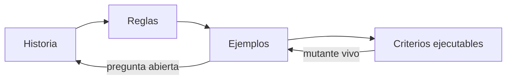
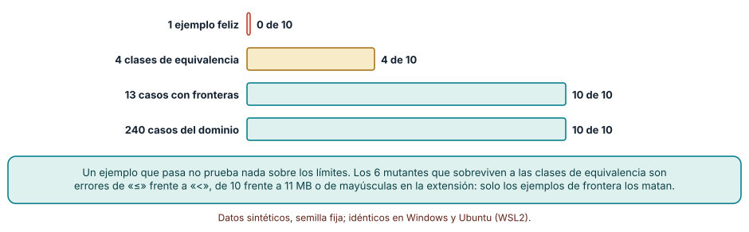
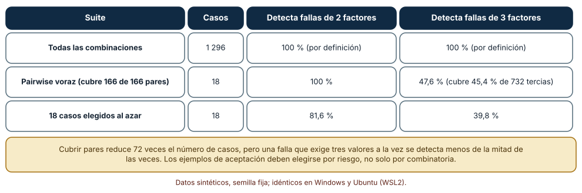
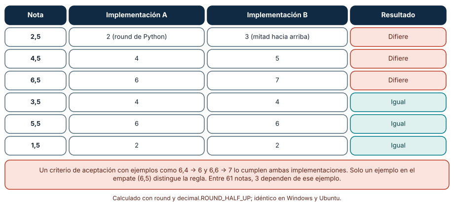

# SE-149 — Criterios de aceptación y ejemplos

[← SE-148 — Casos de uso, historias y job stories](https://github.com/vladimiracunadev-create/modern-software-engineering-program/blob/main/classes/part-12-ingenieria-de-requisitos/se-148-casos-de-uso-historias-y-job-stories/README.md) · [↑ Parte 12](https://github.com/vladimiracunadev-create/modern-software-engineering-program/blob/main/classes/part-12-ingenieria-de-requisitos/README.md) · [📚 Índice completo](https://github.com/vladimiracunadev-create/modern-software-engineering-program/blob/main/classes/README.md) · [🌐 Portal](https://vladimiracunadev-create.github.io/modern-software-engineering-program/classes/SE-149.html) · [SE-150 — Priorización, dependencias y negociación →](https://github.com/vladimiracunadev-create/modern-software-engineering-program/blob/main/classes/part-12-ingenieria-de-requisitos/se-150-priorizacion-dependencias-y-negociacion/README.md)

## Punto profesional y fundamento pedagógico

**Punto profesional.** La clase existe para que «terminado» tenga un significado que dos personas apliquen igual: criterios binarios y ejemplos concretos elegidos porque distinguen implementaciones, no porque sean los primeros que vienen a la mente.

**Por qué aparece aquí.** Se sitúa después de **Casos de uso, historias y job stories** y antes de **Priorización, dependencias y negociación**: `SE-148` cortó el requisito en historias; esta clase les da la confirmación que las cierra, y deja ejemplos de aceptación que `SE-151` enlazará con su origen y `SE-155` pondrá a prueba contra requisitos no verificables.

**Error conceptual que debe corregir.** Creer que tres ejemplos que pasan demuestran que el criterio está cubierto, y que más ejemplos siempre son mejores ejemplos.

**Secuencia de aprendizaje.** Antes de leer el resultado, predices cuántos defectos sembrados detecta un ejemplo feliz, uno por clase de equivalencia y uno por frontera; después ejecutas, explicas por qué los ejemplos típicos no distinguen los límites, comparas la suite combinatoria con el producto completo y reconstruyes sin apoyo cómo un ejemplo en el empate cambia una regla de redondeo. La secuencia usa predicción, explicación propia, contraste y recuperación. [ICAP](https://icap.education.asu.edu/research) distingue participación de construcción de conocimiento; [How People Learn II](https://nap.nationalacademies.org/catalog/24783/how-people-learn-ii-learners-contexts-and-cultures) exige conectar conocimiento previo, contexto y transferencia; la [práctica de recuperación](https://pubmed.ncbi.nlm.nih.gov/16507066/) respalda producir de nuevo la explicación tras una demora; y [Education for Life and Work](https://nap.nationalacademies.org/resource/13398/dbasse_084153.pdf) exige devolución que explique la causa del error.

**Evidencia de aprendizaje.** `acceptance.md` con criterios de aceptación de las cinco historias de `SE-148`, ejemplos elegidos por clase y por frontera, un registro de mutantes detectados por cada suite, una suite combinatoria justificada y un ejemplo en cada empate de redondeo. Debe contener predicción previa, observación, explicación causal, contraejemplo, criterio de aceptación y una nota de qué dato haría cambiar la conclusión.

**Límite de la conclusión.** Los diez mutantes, las 1 296 combinaciones y las 61 notas son sintéticos y los escogió el autor; no representan los defectos de un equipo real. La suite combinatoria se construyó con un algoritmo voraz propio, no con una herramienta de producción.

### Trazabilidad fuente → afirmación

| Fuente primaria u oficial | Afirmación que respalda | Lo que no prueba |
|---|---|---|
| [Cucumber: Gherkin reference](https://cucumber.io/docs/gherkin/reference/) | Describe Given, When y Then como estructura de un escenario ejecutable en lenguaje natural. | Que el escenario sea suficiente o correcto. |
| [Cucumber: Example Mapping](https://cucumber.io/blog/bdd/example-mapping-introduction/) | Propone organizar historia, reglas, ejemplos y preguntas en tarjetas de colores en una conversación breve. | No mide la calidad de los ejemplos. |
| [North, Introducing BDD](https://dannorth.net/introducing-bdd/) | Narra el origen del desarrollo guiado por comportamiento: nombrar pruebas por comportamiento y expresar criterios como escenarios. | No es un estudio de efectividad. |
| [NIST SP 800-142, Practical Combinatorial Testing](https://csrc.nist.gov/pubs/sp/800/142/final) | Presenta pruebas combinatorias de t factores y la evidencia de que pocos factores explican la mayoría de las fallas. | No garantiza cobertura para tu sistema. |
| Myers, Sandler y Badgett, *The Art of Software Testing*, 3.ª ed. (ISBN 978-1118031964) | Explica la partición en clases de equivalencia y el análisis de valores límite. | No elige las clases de tu dominio. |
| [Python: round](https://docs.python.org/3/library/functions.html#round) y [decimal](https://docs.python.org/3/library/decimal.html#decimal.ROUND_HALF_UP) | `round` redondea la mitad al par más cercano; `decimal` permite ROUND_HALF_UP. | No dice cuál regla de redondeo exige tu institución. |

## Antes de empezar

Retomas las cinco historias de `SE-148`. Cada una tiene una conversación pendiente: ¿cuándo diremos que está hecha? Recupera lo aprendido en `SE-146`: una suite de ejemplos típicos dejó vivos 8 de 12 mutantes de la regla de penalización. La pregunta activa es: **¿qué ejemplos, y cuántos, distinguen una implementación correcta de las plausiblemente incorrectas, y cuáles no valen la pena escribir?**

## Prerrequisitos

- Haber completado `SE-148` o poder explicar el corte vertical y la confirmación de una historia.
- Python 3.11 o posterior.
- Trabajar solo con archivos, nombres y notas sintéticos.

## Problema auténtico

La historia H-12 dice: «Como estudiante quiero poder subir mi trabajo para entregarlo». Su criterio de aceptación es «sube un PDF de 2 MB y se guarda». Pasa. Dos semanas después un archivo de exactamente 10 MB es rechazado, otro de 10,1 MB se acepta, uno `.PDF` en mayúsculas falla y un nombre de 51 caracteres rompe la pantalla. Nadie escribió que el límite fuera 10 MB, y todos los ejemplos del criterio eran felices.

## Objetivos observables

Al terminar podrás:

1. distinguir criterio de aceptación, ejemplo y caso de prueba con un ejemplo y un contraejemplo de la plataforma;
2. elegir ejemplos por clase de equivalencia y por frontera y medir cuántos defectos distinguen;
3. justificar una suite combinatoria y declarar qué fallas no cubre;
4. detectar un ejemplo ausente en un empate o en una regla de redondeo;
5. escribir un criterio binario en Given-When-Then que otra persona pueda ejecutar.

## Mapa conceptual



El mapa se lee de izquierda a derecha como una conversación que se vuelve ejecutable: la historia se desglosa en reglas, las reglas en ejemplos concretos y los ejemplos en criterios que una prueba puede evaluar. Los retornos indican que una pregunta abierta devuelve a la historia y que un mutante vivo obliga a añadir ejemplos, no a repetir los existentes.

## Temas y por qué importan

| Tema | Por qué cambia una decisión profesional | Evidencia mínima |
|---|---|---|
| Criterios de aceptación | Convierten «hecho» en una condición binaria que otra persona puede evaluar. | Predicción, traza causal y contraejemplo de **Criterios de aceptación** en `acceptance.md` |
| Ejemplos concretos | Anclan una regla abstracta en casos que distinguen implementaciones. | Predicción, traza causal y contraejemplo de **Ejemplos concretos** en `acceptance.md` |
| Given-When-Then | Estructura el ejemplo en contexto, acción y resultado y permite automatizarlo. | Predicción, traza causal y contraejemplo de **Given-When-Then** en `acceptance.md` |
| Particiones y fronteras | Guían qué ejemplos tienen más probabilidad de revelar un defecto. | Predicción, traza causal y contraejemplo de **Particiones y fronteras** en `acceptance.md` |
| Cobertura combinatoria | Reduce el número de combinaciones a probar cuando intervienen varios factores. | Predicción, traza causal y contraejemplo de **Cobertura combinatoria** en `acceptance.md` |

## Conceptos y decisiones

### 1. Criterios de aceptación

Un criterio de aceptación es una condición que, si se cumple, hace que la historia se dé por completa para quien la pidió. Debe ser binaria (se cumple o no), independiente de la implementación y comprobable por alguien que no escribió el código. «La subida es rápida» no lo es; «un PDF de 10 MB se acepta y uno de 10,1 MB se rechaza con el mensaje que indica el límite» sí. El criterio no es la prueba: es la promesa a la que la prueba se refiere.

### 2. Ejemplos concretos

Una regla abstracta («el archivo no debe exceder el límite») admite lecturas distintas; un ejemplo la ancla («10,0 MB se acepta; 10,1 MB se rechaza»). Example Mapping organiza la conversación en cuatro tipos de tarjeta: la historia, las reglas, los ejemplos que las ilustran y las preguntas sin respuesta. Si hay muchas preguntas, la historia aún no está lista; si hay muchas reglas, es demasiado grande. Los ejemplos son la parte que sobrevive: se convierten en pruebas y, con los años, en documentación viva.

### 3. Given-When-Then

La forma Dado–Cuando–Entonces separa el contexto (dado una estudiante con sesión válida y un archivo de 10,1 MB), la acción (cuando intenta entregarlo) y el resultado observable (entonces ve el mensaje del límite y la entrega no se guarda). Gherkin la hace ejecutable. Su riesgo es la verbosidad: escenarios que describen la interfaz clic por clic en lugar del comportamiento se rompen con cada cambio visual y no aportan información.

### 4. Particiones y fronteras

Las clases de equivalencia agrupan entradas que el sistema debería tratar igual (archivos válidos, demasiado grandes, de extensión no permitida); basta un representante por clase si la partición es correcta. Los valores límite se eligen en el borde de cada clase (10,0 y 10,1 MB, 0 y 0,1 MB, nombres de 50 y 51 caracteres), porque los errores de «menor que» frente a «menor o igual» viven allí. Una partición incorrecta (suponer que `.PDF` y `.pdf` son la misma clase) produce un representante que no representa.

### 5. Cobertura combinatoria

Cuando intervienen varios factores (rol, navegador, idioma, conexión, tipo de archivo, tamaño), el producto completo crece de forma multiplicativa. Las pruebas combinatorias de t factores garantizan que cada combinación de t valores aparece al menos una vez; con t = 2 (pares) el número de casos crece como el producto de los dos mayores dominios, no de todos. La evidencia empírica recopilada por NIST sugiere que la mayoría de las fallas dependen de pocos factores, pero «la mayoría» no es «todas»: una falla que exige tres valores simultáneos puede escapar.

### Cuántos defectos distingue cada suite

La validación de archivos de la plataforma acepta un archivo si `0 < mb <= 10`, la extensión está en `{pdf, docx, zip}` y el nombre tiene entre 1 y 50 caracteres. Se escribieron 10 mutantes: `<=` por `<`; límite 11 en lugar de 10; `0 <= mb`; quitar `zip`; añadir `exe`; nombre `< 50`; nombre vacío permitido; `and` por `or` en una condición; extensión sensible a mayúsculas distinta; ignorar el nombre. Cuatro suites: un ejemplo feliz; cuatro ejemplos por clase (feliz, demasiado grande, extensión no permitida, nombre vacío); 13 casos que añaden fronteras (10,0; 10,1; 0; 0,1; nombres de 50 y 51; `PDF` en mayúsculas; `docx`; `zip`); y 240 casos que recorren todo el dominio. Predicción: el ejemplo feliz no matará ninguno; los ejemplos por clase matarán algunos, y solo las fronteras llegarán a todos.

```python
def mata(mutante, suite):
    return any(mutante(*caso) != valida(*caso) for caso in suite)
```

Resultado, idéntico en Windows y Ubuntu: el ejemplo feliz mata 0 de 10; los cuatro ejemplos por clase, 4; los 13 casos con fronteras, 10; los 240 casos del dominio, 10. Los seis mutantes que sobreviven a las clases de equivalencia son errores de comparación o de lista que ningún representante típico toca: `<` por `<=`, 10 por 11, `0 <=`, quitar `zip`, `< 50` y la sensibilidad a mayúsculas. El ejemplo feliz es la prueba que todos escriben primero y la que menos distingue.



**Cómo leer la figura.** Cada barra es una suite; su longitud es cuántos de los 10 mutantes detecta. **Dónde deja de valer:** los mutantes son los que el autor imaginó; un equipo real comete otros (concurrencia, codificación del nombre, archivos corruptos) que ninguna de las cuatro suites toca. Que las fronteras maten 10 de 10 prueba que cubren esta regla de comparaciones, no que la validación sea correcta.

### Pares y tercias: 18 casos frente a 1 296

Seis factores de prueba de la plataforma: rol (3 valores), navegador (4), idioma (3), conexión (3), tipo de archivo (4) y tamaño (3): 1 296 combinaciones. Se construyó una suite voraz que en cada paso añade el caso que cubre más pares nuevos, hasta cubrir los 166 pares de valores. Predicción: bastarán unas pocas decenas de casos, pero las combinaciones de tres valores no quedarán cubiertas del todo.

```python
suite = []
while pares_cubiertos != todos_los_pares:
    mejor = max(producto, key=lambda caso: len(pares(caso) - pares_cubiertos))
    suite.append(mejor)
    pares_cubiertos |= pares(mejor)
```

Resultado: 18 casos cubren los 166 pares (el mínimo teórico es 16, el producto de los dos dominios mayores). Esos mismos 18 casos cubren 45,4 % de las 732 tercias de valores. Se sembraron 2 000 fallas aleatorias que se activan con una combinación específica: la suite detecta 100 % de las de dos factores y 47,6 % de las de tres; 18 casos elegidos al azar detectan 81,6 % y 39,8 %. La suite reduce 72 veces el número de casos y aun así deja casi la mitad de las fallas de tres factores sin tocar.



**Cómo leer la figura.** Cada fila es una suite; las dos últimas columnas dicen qué fracción de fallas sembradas de dos y tres factores detecta. **Dónde deja de valer:** las fallas se sembraron al azar, con valores uniformes; las fallas reales se concentran en combinaciones de riesgo conocido, y esas conviene añadirlas explícitamente. El algoritmo voraz no produce el mínimo y las herramientas de producción generan suites algo menores.

### El ejemplo que falta en el empate

La plataforma redondea la nota final a un entero. Dos implementaciones razonables: A usa `round()` de Python, que redondea la mitad al par más cercano; B usa mitad hacia arriba con `decimal.ROUND_HALF_UP`. Un criterio de aceptación con los ejemplos «6,4 → 6» y «6,6 → 7» lo cumplen ambas. Predicción: difieren solo en las notas que terminan en 5 décimas, y no en todas.

```python
dif = [n for n in notas if int(mitad_arriba(n)) != round(float(n))]
```

De las 61 notas de 1,0 a 7,0 con un decimal, difieren 3: 2,5 (A da 2, B da 3), 4,5 (4 y 5) y 6,5 (6 y 7). En 1,5, 3,5 y 5,5 coinciden porque el par más cercano es el mismo que redondear hacia arriba. Un solo ejemplo en el empate (6,5 → 7) elige entre las dos reglas; sin él, el criterio queda abierto. Y la corrección de las 3 notas de 61 puede ser la diferencia entre aprobar o no.



**Cómo leer la figura.** Cada fila es una nota con un decimal; las coral son aquellas en que las implementaciones difieren. **Dónde deja de valer:** el ejemplo usa notas decimales exactas; con números de coma flotante, `round(2.675, 2)` da 2.67 por la representación binaria, un problema distinto que se resuelve con `Decimal`. Qué regla de redondeo aplica es una decisión de política (`SE-146`) que el ejemplo hace visible.

## Definiciones de trabajo

- **criterios de aceptación:** condiciones binarias que, si se cumplen, hacen que una historia se considere completa para quien la pidió.
- **ejemplos concretos:** casos con datos específicos que ilustran una regla y permiten distinguir interpretaciones.
- **Given-When-Then:** forma de escribir un ejemplo como contexto, acción y resultado observable.
- **particiones y fronteras:** agrupación de entradas en clases tratadas igual y elección de valores en el borde de cada clase.
- **cobertura combinatoria:** conjunto de casos que garantiza que cada combinación de t valores aparece al menos una vez.

Las definiciones son operativas para la plataforma de entregas. No convierten términos con una historia más amplia en sinónimos y deben contrastarse con la documentación primaria enlazada al final.

## Ejemplo mínimo

El fragmento siguiente prueba un límite. Antes de ejecutarlo, predice si el mutante sobrevive.

```python
def valida(mb):            return 0 < mb <= 10
def mutante(mb):           return 0 < mb < 10     # <= por <

assert valida(2.0) == mutante(2.0)                # el ejemplo típico no distingue
assert valida(10.0) != mutante(10.0)              # la frontera sí
```

El ejemplo feliz no revela nada; el de la frontera mata el mutante. Registra versión del intérprete, comando y salida. La conclusión no es «prueba siempre el 10» sino «el criterio debe incluir el valor que distingue las lecturas».

## Ejemplo profesional

Los criterios de H-12 en forma de escenarios, cada uno con su regla de origen:

```text
Regla: el límite por archivo es de 10 MB, inclusive (BR-11).
  Escenario 1   Dado un PDF de 10,0 MB   Cuando se entrega   Entonces se acepta
  Escenario 2   Dado un PDF de 10,1 MB   Cuando se entrega   Entonces se rechaza y se muestra «máximo 10 MB»
  Escenario 3   Dado un archivo «tarea.PDF»  Cuando se entrega   Entonces se acepta (extensión sin distinguir mayúsculas)
  Escenario 4   Dado un nombre de 51 caracteres  Cuando se entrega   Entonces se rechaza y no se guarda
Pregunta abierta: ¿qué ocurre con un archivo de 0 bytes? Responsable: docencia.
```

Compara con el criterio «la subida funciona», con el ejemplo que depende de un dato de producción, con el escenario escrito clic por clic y con el que solo cubre el camino feliz. Un criterio es apropiado cuando otra persona puede escribir la prueba sin preguntar; es peligroso cuando su aprobación depende de quién lo evalúa.

## Práctica guiada

1. Escribe el criterio de H-12 como lo diría el cliente, antes de analizarlo.
2. Predice cuántos mutantes de tu regla detectaría un ejemplo feliz.
3. Escribe 6 a 10 mutantes de la validación y mide cada suite; guarda la salida bajo `evidence/`.
4. Redacta los escenarios con fronteras y una pregunta abierta con responsable.
5. Identifica los factores de una prueba de la plataforma y genera una suite de pares.
6. Busca una regla de tu historia con un empate (redondeo, igualdad de fechas) y añade el ejemplo.
7. Pide a otra persona que escriba pruebas desde tus escenarios sin consultarte.

## Ejercicios

1. **Mutantes:** escribe dos mutantes que ni siquiera el dominio completo detecte y explica si son equivalentes.
2. **Fronteras:** cambia el límite a 25 MB y recalcula qué ejemplos cambian; explica por qué el ejemplo típico no cambia.
3. **Pares:** añade un séptimo factor de dos valores y calcula cuántos casos añade la suite de pares frente al producto.
4. **Empate:** escribe el criterio completo del redondeo de la nota con el ejemplo del empate y la pregunta abierta sobre el decimal.

## Reto verificable

Entrega `acceptance.md` con los criterios de las cinco historias en forma de escenarios, el registro de mutantes por suite y la suite combinatoria justificada. Se aprueba si otra persona ejecuta el código desde un checkout limpio, obtiene los mismos recuentos y puede señalar qué escenario cubre cada regla. No se aprueba por la cantidad de escenarios ni por declarar «cobertura total» sin medirla.

## Caso conductor

La plataforma de entregas sigue siendo el caso de la parte. Esta clase añade al expediente criterios de aceptación con fronteras, un registro de mutantes y una suite de pares. Las clases siguientes decidirán qué se hace primero (`SE-150`), enlazarán cada criterio con su necesidad (`SE-151`) y buscarán ambigüedades (`SE-154`). Cambia después una sola decisión —por ejemplo, el límite a 25 MB— y revisa qué escenarios deben reescribirse.

## Preguntas frecuentes

### ¿Cuántos ejemplos son suficientes?

Los que distinguen implementaciones plausibles. Un ejemplo feliz distinguió 0 de 10 mutantes; cuatro por clase, 4; trece con fronteras, 10. No hay un número universal: hay una pregunta —¿qué defecto no detectarían estos ejemplos?— y un modo de responderla con mutantes.

### ¿Hace falta usar Gherkin para tener criterios de aceptación?

No. Gherkin es útil cuando los escenarios se automatizan y se comparten con personas de negocio; una tabla de ejemplos o un conjunto de pruebas bien nombradas cumple la misma función. Lo imprescindible es que el criterio sea binario, concreto y esté enlazado con su regla.

### ¿Por qué no probar todas las combinaciones?

Porque crecen de forma multiplicativa y la mayoría de ellas ejercita lo mismo. Pares y tercias reducen el costo con una garantía definida, pero no cubren fallas de más factores. Complementa con las combinaciones de mayor riesgo, elegidas por quien conoce el dominio.

### ¿Puede un modelo de lenguaje proponer los ejemplos?

Puede proponer candidatos útiles, sobre todo fronteras que se olvidan. No sabe qué regla aplica tu institución en el empate ni qué ejemplo tiene un dueño. Revisa cada ejemplo propuesto contra la regla y mide, con mutantes, si distingue algo.

## Fallo controlado y diagnóstico

Reproduce el fallo clásico de la clase: **aprobar con ejemplos que solo cubren el camino feliz**. Escribe el criterio «sube un PDF de 2 MB y se guarda» y ejecuta la suite contra los 10 mutantes.

Registra síntoma, entrada mínima, hipótesis, observación que descarta cada hipótesis, causa, corrección y prueba de regresión. **Síntoma:** la prueba pasa y en producción un archivo de exactamente 10 MB se rechaza. **Hipótesis rivales:** (a) el servidor tiene otro límite; (b) la validación usa `<` en lugar de `<=`. **Prueba:** ejecuta el mutante `mb < 10` contra el ejemplo feliz: coincide; contra el de 10,0 MB: difiere. **Conclusión:** el ejemplo no distinguía la lectura de «hasta 10». **Regresión:** añade a la suite los casos 10,0 y 10,1 y una regla que exija al menos un ejemplo en cada frontera declarada en la regla. No cambies a la vez el límite y el criterio.

## Errores comunes y cómo corregirlos

| Síntoma | Causa probable | Corrección |
|---|---|---|
| Las pruebas pasan y el cliente rechaza la entrega | El criterio solo cubría ejemplos felices | Añadir ejemplos en las fronteras y en las clases no válidas |
| Dos personas aplican la regla de redondeo de forma distinta | No hay ejemplo en el empate | Añadir el ejemplo y registrar quién decidió la regla |
| Los escenarios se rompen con cada cambio de pantalla | Describen clics en lugar de comportamiento | Reescribir a nivel de comportamiento observable |
| La suite combinatoria pasa y falla una combinación de tres valores | Se cubrieron pares y no tercias | Declarar la fuerza t y añadir las combinaciones de riesgo |
| Un criterio nunca se da por cumplido | No es binario o depende de una opinión | Reescribirlo con valores y resultado observables |

## Entorno y archivos clave

```text
work/SE-149/
├── README.md
├── aceptacion/
│   ├── mutantes.py
│   ├── pares.py
│   └── redondeo.py
├── fixtures/escenarios.feature
├── tests/test_aceptacion.py
└── evidence/acceptance.md
```

El `README` declara plataforma, versión de Python, semilla y comandos. Los experimentos usan `itertools`, `random` y `decimal` y se ejecutaron con CPython 3.12.9 en Windows 11 y 3.12.3 en Ubuntu bajo WSL2; las salidas fueron idénticas. Si añades una dependencia (por ejemplo, un ejecutor de Gherkin), fija procedencia y versión.

## Seguridad, ética y accesibilidad

- los ejemplos no deben contener datos reales de estudiantes: usa nombres y archivos sintéticos;
- una frontera mal probada en una regla de calificación afecta notas; registra quién decidió el empate;
- incluye ejemplos de accesibilidad como criterios verificables (el mensaje del límite es legible por un lector de pantalla);
- los archivos de prueba de seguridad (extensiones peligrosas) deben ser inofensivos y estar etiquetados;
- no uses un modelo de lenguaje con entregas reales sin una política de datos que lo permita;
- respeta licencias de herramientas de prueba y atribuye adaptaciones.

## Puente hacia el trabajo con agentes

Un agente al que se le pide «escribe los criterios de aceptación de esta historia» devolverá tres escenarios felices bien redactados y un cuarto de error genérico. Pídele en cambio que enumere las reglas de la historia, que proponga un ejemplo por clase y dos por frontera, que marque como pregunta abierta lo que no esté definido y que escriba mutantes para medir cuántos distingue su propia suite. Revisa especialmente si decide por su cuenta una regla de empate o de redondeo: es una decisión de política con dueño.

## Transferencia

Traslada el análisis a otro dominio (por ejemplo, cupones de descuento): cambia la regla, los mutantes y los factores, conserva la comparación de suites y la suite de pares, y comprueba si el ejemplo feliz sigue distinguiendo muy poco. La transferencia está lograda cuando puedes explicar qué parte del método dependía del dominio y cuál no, no cuando el código se parece.

## Evaluación y evidencia

| Criterio | Evidencia para aprobar |
|---|---|
| comprensión | explicación causal de la diferencia entre criterio, ejemplo y prueba, con ejemplo y contraejemplo |
| corrección | recuento reproducible de mutantes detectados por cada suite |
| diseño | escenarios con frontera, pregunta abierta y regla de origen |
| diagnóstico | reproducción del fallo «solo camino feliz» con regresión |
| incertidumbre | declaración de qué fallas no cubre la suite combinatoria |
| reproducibilidad | versiones, comandos, salida y límites declarados |

## Fuentes

- [Cucumber: Gherkin reference](https://cucumber.io/docs/gherkin/reference/) — sintaxis de Given, When y Then; autoridad: proyecto Cucumber.
- [Cucumber: Example Mapping](https://cucumber.io/blog/bdd/example-mapping-introduction/) — conversación estructurada de reglas y ejemplos; autoridad: proyecto Cucumber.
- [North: Introducing BDD](https://dannorth.net/introducing-bdd/) — origen del desarrollo guiado por comportamiento; autoridad: autor de la técnica.
- [NIST SP 800-142: Practical Combinatorial Testing](https://csrc.nist.gov/pubs/sp/800/142/final) — pruebas combinatorias; autoridad: NIST.
- Myers, Sandler y Badgett, *The Art of Software Testing*, 3.ª ed. (ISBN 978-1118031964) — clases de equivalencia y valores límite; autoridad: libro de referencia.
- Adzic, *Specification by Example* (ISBN 978-1617290084) — ejemplos como especificación ejecutable; autoridad: libro de referencia.

Cada fuente respalda el mecanismo indicado; ninguna demuestra que los escenarios de la plataforma de entregas sean suficientes. Esa afirmación depende de la regla, de los defectos que el equipo cometa y de la revisión de otra persona.

- [Python: `round`](https://docs.python.org/3/library/functions.html#round) — redondeo al par más cercano.
- [Python: `decimal`](https://docs.python.org/3/library/decimal.html#decimal.ROUND_HALF_UP) — redondeo mitad hacia arriba.
- [Python: `itertools`](https://docs.python.org/3/library/itertools.html) — producto cartesiano y combinaciones.

## Límites y siguiente paso

Se ejecutaron tres experimentos con datos sintéticos en Windows y Ubuntu (WSL2) con resultados idénticos. Los mutantes, las fallas sembradas y las notas son supuestos del autor, la suite de pares se obtuvo con un algoritmo voraz propio y no se probó ningún sistema real. La siguiente clase ordena el conjunto de historias teniendo en cuenta sus dependencias y las negociaciones entre interesados.

## Glosario

- **criterios de aceptación:** condiciones binarias que, si se cumplen, hacen que una historia se considere completa para quien la pidió.
- **ejemplos concretos:** casos con datos específicos que ilustran una regla y permiten distinguir interpretaciones.
- **Given-When-Then:** forma de escribir un ejemplo como contexto, acción y resultado observable.
- **particiones y fronteras:** agrupación de entradas en clases tratadas igual y elección de valores en el borde de cada clase.
- **cobertura combinatoria:** conjunto de casos que garantiza que cada combinación de t valores aparece al menos una vez.

---

[← SE-148 — Casos de uso, historias y job stories](https://github.com/vladimiracunadev-create/modern-software-engineering-program/blob/main/classes/part-12-ingenieria-de-requisitos/se-148-casos-de-uso-historias-y-job-stories/README.md) · [↑ Parte 12](https://github.com/vladimiracunadev-create/modern-software-engineering-program/blob/main/classes/part-12-ingenieria-de-requisitos/README.md) · [📚 Índice completo](https://github.com/vladimiracunadev-create/modern-software-engineering-program/blob/main/classes/README.md) · [🌐 Portal](https://vladimiracunadev-create.github.io/modern-software-engineering-program/classes/SE-149.html) · [SE-150 — Priorización, dependencias y negociación →](https://github.com/vladimiracunadev-create/modern-software-engineering-program/blob/main/classes/part-12-ingenieria-de-requisitos/se-150-priorizacion-dependencias-y-negociacion/README.md)
