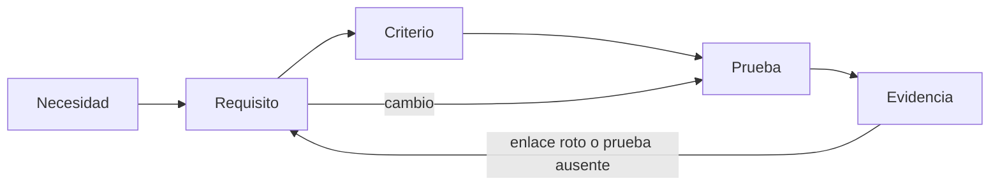
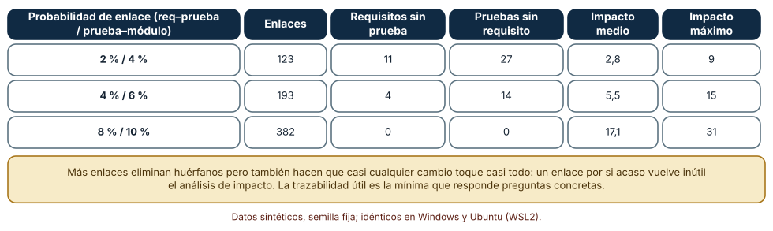
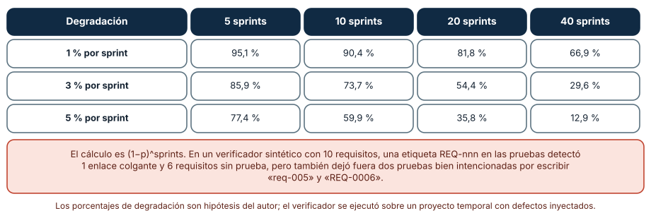
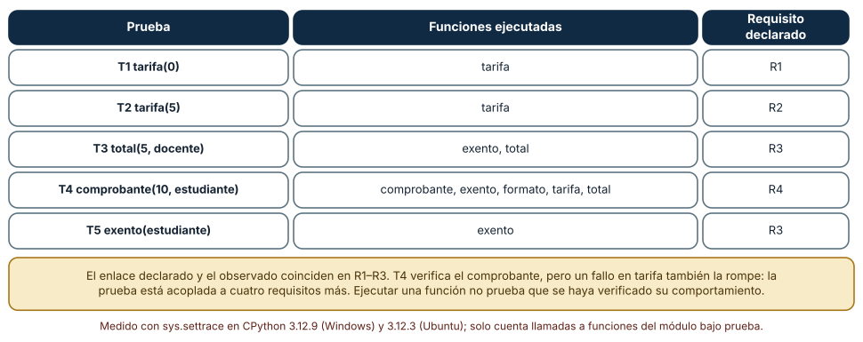

# SE-151 — Trazabilidad desde necesidad hasta evidencia

[← SE-150 — Priorización, dependencias y negociación](https://github.com/vladimiracunadev-create/modern-software-engineering-program/blob/main/classes/part-12-ingenieria-de-requisitos/se-150-priorizacion-dependencias-y-negociacion/README.md) · [↑ Parte 12](https://github.com/vladimiracunadev-create/modern-software-engineering-program/blob/main/classes/part-12-ingenieria-de-requisitos/README.md) · [📚 Índice completo](https://github.com/vladimiracunadev-create/modern-software-engineering-program/blob/main/classes/README.md) · [🌐 Portal](https://vladimiracunadev-create.github.io/modern-software-engineering-program/classes/SE-151.html) · [SE-152 — Requisitos regulatorios, de datos y seguridad →](https://github.com/vladimiracunadev-create/modern-software-engineering-program/blob/main/classes/part-12-ingenieria-de-requisitos/se-152-requisitos-regulatorios-de-datos-y-seguridad/README.md)

## Punto profesional y fundamento pedagógico

**Punto profesional.** La clase existe para que cada requisito pueda seguirse hasta su origen y hasta la evidencia de que se cumple, con enlaces que se mantengan solos o avisen cuando se rompen, y para que un cambio muestre a quién afecta antes de que alguien lo descubra en producción.

**Por qué aparece aquí.** Se sitúa después de **Priorización, dependencias y negociación** y antes de **Requisitos regulatorios, de datos y seguridad**: `SE-150` fijó qué se hará en el trimestre; esta clase enlaza cada requisito elegido con su necesidad de origen, su criterio y su prueba, y deja una matriz mínima que `SE-152` cruzará con obligaciones externas, `SE-153` protegerá como línea base y `SE-156` entregará dentro de la especificación.

**Error conceptual que debe corregir.** Creer que más enlaces significan más trazabilidad, y que una matriz mantenida a mano seguirá siendo cierta.

**Secuencia de aprendizaje.** Antes de leer el resultado, predices cómo cambian los huérfanos y el alcance de un cambio al aumentar la densidad de enlaces, qué fracción de una matriz manual sigue válida tras varios sprints y qué diferencias habrá entre lo que declaran las pruebas y lo que ejecutan; después calculas, explicas cada resultado y reconstruyes sin apoyo la trazabilidad mínima del requisito conductor. La secuencia usa predicción, explicación propia, contraste y recuperación. [ICAP](https://icap.education.asu.edu/research) distingue participación de construcción de conocimiento; [How People Learn II](https://nap.nationalacademies.org/catalog/24783/how-people-learn-ii-learners-contexts-and-cultures) exige conectar conocimiento previo, contexto y transferencia; la [práctica de recuperación](https://pubmed.ncbi.nlm.nih.gov/16507066/) respalda producir de nuevo la explicación tras una demora; y [Education for Life and Work](https://nap.nationalacademies.org/resource/13398/dbasse_084153.pdf) exige devolución que explique la causa del error.

**Evidencia de aprendizaje.** `traceability.md` con la cadena necesidad → requisito → criterio → prueba → resultado del requisito conductor, un verificador que detecta enlaces colgantes y requisitos sin prueba, la lista de preguntas que la matriz debe poder responder y una comparación entre enlaces declarados y observados. Debe contener predicción previa, observación, explicación causal, contraejemplo, criterio de aceptación y una nota de qué dato haría cambiar la conclusión.

**Límite de la conclusión.** Las matrices de 40 requisitos, 60 pruebas y 30 módulos son aleatorias con semilla; las tasas de deterioro son hipótesis del autor. El verificador se ejecutó sobre un proyecto temporal con defectos inyectados, no sobre un repositorio real.

### Trazabilidad fuente → afirmación

| Fuente primaria u oficial | Afirmación que respalda | Lo que no prueba |
|---|---|---|
| [Gotel y Finkelstein, «An analysis of the requirements traceability problem» (1994)](https://doi.org/10.1109/ICRE.1994.292398) | Define la trazabilidad de requisitos como la capacidad de seguir un requisito hacia su origen y hacia su implementación, y analiza por qué falla en la práctica. | No dice qué granularidad elegir. |
| [Cleland-Huang et al., «Software traceability: trends and future directions» (2014)](https://doi.org/10.1145/2593882.2593891) | Resume el estado y los retos de la trazabilidad, incluida la creación y el mantenimiento de enlaces. | No ofrece una cifra de deterioro aplicable a tu proyecto. |
| [ISO/IEC/IEEE 29148:2018](https://www.iso.org/standard/72089.html) | Incluye la trazabilidad entre necesidades, requisitos y verificación entre las características de un conjunto de requisitos. | El texto completo es de pago. |
| [Python: sys.settrace](https://docs.python.org/3/library/sys.html#sys.settrace) | Permite registrar llamadas a funciones durante la ejecución. | Ejecutar una función no equivale a verificarla. |
| [Python: re](https://docs.python.org/3/library/re.html) | Define la sintaxis de las expresiones regulares usadas para leer etiquetas. | No decide cuál convención de etiquetas usar. |

## Antes de empezar

Retomas el conjunto cerrado de `SE-150`: cuatro requisitos elegidos para el trimestre. Cada uno tiene origen, regla, escenario de calidad, historia y ejemplos. ¿Dónde está todo eso escrito y quién lo mantiene? Recupera lo aprendido en `SE-149`: un criterio se refiere a una regla, y una prueba a un criterio. La pregunta activa es: **¿qué enlaces mínimos permiten contestar «¿por qué existe esto?», «¿qué pasa si lo cambio?» y «¿cómo sé que se cumple?», y cómo me entero cuando uno se rompe?**

## Prerrequisitos

- Haber completado `SE-150` o poder explicar qué es un conjunto entregable.
- Python 3.11 o posterior.
- Trabajar solo con requisitos, pruebas y módulos sintéticos.

## Problema auténtico

Una auditoría pregunta: «Muéstrenos la prueba de que el borrador se conserva 30 segundos». El equipo tarda un día en encontrar la prueba, y descubre que fue renombrada hace tres meses, que el requisito cambió de 60 a 30 segundos y que otra prueba menciona un requisito que ya no existe. La matriz de trazabilidad de la hoja de cálculo se completó en la primera semana del proyecto.

## Objetivos observables

Al terminar podrás:

1. distinguir trazabilidad hacia atrás, hacia adelante y bidireccional con un ejemplo y un contraejemplo de la plataforma;
2. medir cómo la densidad de enlaces afecta a los huérfanos y al alcance de un cambio;
3. estimar cuánto se degrada una matriz manual y escribir un verificador que detecte enlaces colgantes y requisitos sin prueba;
4. comparar los enlaces declarados con los observados al ejecutar las pruebas;
5. declarar qué preguntas debe poder responder la matriz y qué costo de mantenimiento acepta el equipo.

## Mapa conceptual



El mapa se lee de izquierda a derecha como la cadena que debe poder recorrerse en ambos sentidos. Los retornos indican que un enlace roto o una prueba ausente obliga a revisar el requisito, y que un cambio en el requisito obliga a revisar las pruebas que dependen de él.

## Temas y por qué importan

| Tema | Por qué cambia una decisión profesional | Evidencia mínima |
|---|---|---|
| Trazabilidad bidireccional | Permite saber por qué existe algo y qué cubre cada prueba. | Predicción, traza causal y contraejemplo de **Trazabilidad bidireccional** en `traceability.md` |
| Granularidad de los enlaces | Enlaces demasiado gruesos no responden preguntas; demasiado finos no se mantienen. | Predicción, traza causal y contraejemplo de **Granularidad de los enlaces** en `traceability.md` |
| Análisis de impacto | Dice a qué elementos afecta un cambio antes de hacerlo. | Predicción, traza causal y contraejemplo de **Análisis de impacto** en `traceability.md` |
| Mantenimiento y deterioro | Una matriz manual se degrada; hay que detectarlo o mantenerla automáticamente. | Predicción, traza causal y contraejemplo de **Mantenimiento y deterioro** en `traceability.md` |
| Enlace frente a evidencia | Un enlace declarado no demuestra que la prueba verifique el requisito. | Predicción, traza causal y contraejemplo de **Enlace frente a evidencia** en `traceability.md` |

## Conceptos y decisiones

### 1. Trazabilidad bidireccional

Hacia atrás, la trazabilidad responde «¿de dónde viene este requisito?»: necesidad, entrevista, norma. Hacia adelante, «¿qué lo implementa y cómo se verifica?»: diseño, código, prueba. Ambas direcciones son necesarias: la primera detecta requisitos sin origen (trabajo que nadie pidió); la segunda, requisitos sin evidencia (promesas que nadie comprueba). Gotel y Finkelstein muestran que el problema no es solo tener los enlaces sino mantenerlos cuando las personas y los documentos cambian.

### 2. Granularidad de los enlaces

Un enlace puede ir de un documento a otro, de un requisito a una prueba o de un criterio a una línea de código. Más fino responde preguntas más precisas y cuesta más mantener. La granularidad correcta es la que responde las preguntas que alguien realmente hará: una auditoría pregunta por requisito y prueba; un cambio pregunta por requisito y módulo. Enlazar todo con todo no aumenta la información: la diluye, porque ya no distingue lo relevante de lo incidental.

### 3. Análisis de impacto

Dado un cambio en un requisito, el alcance se obtiene recorriendo los enlaces: las pruebas que lo verifican, los módulos que esas pruebas ejercitan y los requisitos que dependen de él. El tamaño de ese conjunto es una estimación del costo del cambio y del riesgo de olvidar algo. Si el alcance de casi cualquier cambio es casi todo el sistema, la matriz no ayuda a decidir; si el alcance es siempre cero, probablemente faltan enlaces.

### 4. Mantenimiento y deterioro

Los enlaces cambian porque cambian los nombres, los documentos y las personas. Una matriz en una hoja de cálculo depende de que alguien recuerde actualizarla; cada sprint pierde una fracción de enlaces válidos, y el efecto se compone. Las defensas son tres: poner el enlace donde cambia el artefacto (la etiqueta en la prueba), verificar la matriz automáticamente al integrar, y reducir el número de enlaces a los que responden preguntas reales.

### 5. Enlace frente a evidencia

Un enlace dice «esta prueba pertenece a este requisito»; no dice que la prueba lo verifique. Una prueba puede ejecutar el código del requisito sin comprobar su resultado, o comprobar algo distinto. La evidencia es el resultado de ejecutar la prueba en una versión concreta, con fecha y entorno. La trazabilidad completa conecta tres cosas: el enlace, la prueba y su última ejecución. Cualquiera de las tres ausente deja una promesa.

### Densidad de enlaces: huérfanos frente a alcance

Se generaron matrices sintéticas con semilla 151: 40 requisitos, 60 pruebas y 30 módulos, con probabilidad p de enlace requisito–prueba y q de prueba–módulo. Para cada requisito se calcula el alcance de un cambio: las pruebas enlazadas más los módulos que esas pruebas ejercitan. Predicción: con pocos enlaces habrá huérfanos y alcances pequeños; con muchos, ningún huérfano pero alcances enormes.

```python
for r in requisitos:
    pruebas_r = {t for a, t in req_prueba if a == r}
    modulos_r = {m for t, m in prueba_modulo if t in pruebas_r}
    impacto.append(len(pruebas_r) + len(modulos_r))
```

Resultado, idéntico en Windows y Ubuntu: con p = 2 % y q = 4 % hay 123 enlaces, 11 requisitos sin prueba, 27 pruebas sin requisito, impacto medio de 2,8 elementos y máximo de 9; con 4 % y 6 %, 193 enlaces, 4 requisitos sin prueba, 14 pruebas sin requisito, impacto medio de 5,5 y máximo de 15; con 8 % y 10 %, 382 enlaces, ningún huérfano, impacto medio de 17,1 y máximo de 31. La densidad que elimina los huérfanos hace que casi cualquier cambio toque más de la mitad del sistema.



**Cómo leer la figura.** Cada fila es una densidad de enlaces; las columnas centrales cuentan huérfanos y las dos últimas, el alcance de un cambio. **Dónde deja de valer:** los enlaces son aleatorios y uniformes; en un sistema real están agrupados (un módulo de seguridad se asocia a pocos requisitos). El experimento enseña la tensión entre cobertura y utilidad del análisis, no cuántos enlaces conviene tener.

### Cuánto dura una matriz mantenida a mano

Si cada sprint deja inválida una fracción p de los enlaces (renombres, requisitos reescritos, pruebas movidas), la fracción que sigue siendo cierta tras s sprints es (1 − p)^s. Predicción: con una pérdida modesta por sprint, la matriz será poco fiable en pocos meses.

```python
vigente = [(1 - p) ** s for s in (5, 10, 20, 40)]
```

Con p = 1 %: 95,1 %, 90,4 %, 81,8 % y 66,9 % tras 5, 10, 20 y 40 sprints; con 3 %: 85,9 %, 73,7 %, 54,4 % y 29,6 %; con 5 %: 77,4 %, 59,9 %, 35,8 % y 12,9 %. Esos porcentajes son hipótesis, no mediciones: lo que muestran es el efecto compuesto. Para la defensa automática se creó un proyecto temporal con diez requisitos (`REQ-001` a `REQ-010`) y siete archivos de prueba con etiquetas del tipo `# REQ-001`, y se escribió un verificador con una expresión regular. Detectó 4 requisitos con prueba y 6 sin prueba, un enlace colgante (`REQ-099`, que no existe) y 3 pruebas sin etiqueta válida. De esas tres, dos tenían buena intención: una escribió `req-005` en minúsculas y otra `REQ-0006` con un cero de más. El verificador es estricto y por eso las hace visibles; también por eso conviene fijar y documentar el formato.



**Cómo leer la figura.** Cada fila es una tasa de degradación por sprint y cada columna un horizonte; el número es la fracción de enlaces que aún son correctos. **Dónde deja de valer:** el modelo supone una pérdida constante e independiente; en la práctica las pérdidas llegan en lotes (un refactor renombra cien pruebas). Las tasas son supuestos del autor. El verificador sintético muestra el mecanismo de detección, no la tasa de errores de un equipo real.

### Enlace declarado frente a enlace observado

Un módulo con cuatro funciones (`tarifa`, `exento`, `total`, `comprobante` con `formato`) y cinco pruebas. Con `sys.settrace` se registró qué funciones del módulo llama cada prueba. Predicción: lo observado coincidirá casi siempre con lo declarado, pero las pruebas de más alto nivel tocarán más funciones de las que pretenden verificar.

```python
def funciones_tocadas(prueba):
    tocadas = set()
    def trazador(frame, evento, _):
        if evento == "call" and frame.f_code.co_filename == archivo:
            tocadas.add(frame.f_code.co_name)
    sys.settrace(trazador)
    try: prueba()
    finally: sys.settrace(None)
    return tocadas
```

Resultado: T1 y T2 ejecutan solo `tarifa`; T3, `exento` y `total`; T5, solo `exento`; T4 (el comprobante) ejecuta `comprobante`, `formato`, `total`, `exento` y `tarifa`. Los tres primeros requisitos coinciden con lo declarado. T4 está declarada para el requisito del comprobante, pero un fallo en `tarifa` también la rompe: queda acoplada a cuatro requisitos más. El enlace declarado era cierto y aun así incompleto en lo que importa para el análisis de impacto.



**Cómo leer la figura.** Cada fila es una prueba y la columna central lista las funciones que realmente ejecutó; la última es el requisito al que se declaró. **Dónde deja de valer:** el módulo, las pruebas y las funciones son de juguete. Ejecutar no es verificar: una prueba puede llamar a `tarifa` y no comprobar su resultado. La traza proporciona un complemento al enlace declarado, no un sustituto.

## Definiciones de trabajo

- **trazabilidad bidireccional:** capacidad de seguir un elemento hacia su origen y hacia su implementación y verificación.
- **granularidad de los enlaces:** nivel de detalle de los elementos que se enlazan, desde documentos hasta líneas de código.
- **análisis de impacto:** determinación de los elementos que un cambio puede afectar a partir de los enlaces.
- **mantenimiento y deterioro:** esfuerzo necesario para que los enlaces sigan siendo ciertos y su pérdida por cambios no registrados.
- **enlace frente a evidencia:** diferencia entre declarar que una prueba pertenece a un requisito y demostrar, con una ejecución fechada, que lo verifica.

Las definiciones son operativas para la plataforma de entregas. No convierten términos con una historia más amplia en sinónimos y deben contrastarse con la documentación primaria enlazada al final.

## Ejemplo mínimo

El fragmento siguiente busca enlaces colgantes y requisitos sin prueba. Antes de ejecutarlo, predice qué detecta.

```python
import re
requisitos = {"REQ-001", "REQ-002", "REQ-003"}
pruebas = "# REQ-001\n# REQ-009\n"
etiquetas = set(re.findall(r"\bREQ-\d{3}\b", pruebas))
assert etiquetas - requisitos == {"REQ-009"}        # colgante
assert requisitos - etiquetas == {"REQ-002", "REQ-003"}   # sin prueba
```

Una etiqueta apunta a un requisito que no existe y dos requisitos no tienen prueba. Registra versión del intérprete, comando y salida. La corrección puede ser crear, retirar o renombrar, y debe quedar registrada.

## Ejemplo profesional

La cadena del requisito conductor, con una etiqueta en cada artefacto y un verificador al integrar:

```text
NEC-01  Necesito recuperar mi respuesta si la sesión expira.             (SE-121, 42 tickets)
REQ-001 Cuando la sesión expira, el sistema conservará el borrador de los últimos 30 s.   ← NEC-01
AC-001  Dado un borrador editado hace 20 s ... entonces aparece al volver.                 ← REQ-001
tests/test_borradores.py::test_recupera_a_los_20s    # REQ-001 AC-001
Evidencia: CI #1842, 2026-03-02, versión 0.9.3, resultado: pasa.
```

Los identificadores, la fecha y el número de ejecución son ilustrativos. Compara con el requisito sin necesidad de origen, el que cambió de 60 a 30 s sin tocar la prueba, la prueba que cita un requisito retirado y la que ejecuta el código sin comprobar nada. La cadena es apropiada cuando una auditora puede recorrerla en minutos; es peligrosa cuando depende de que alguien la recuerde.

## Práctica guiada

1. Escribe la cadena necesidad → requisito → criterio → prueba → evidencia de REQ-001 sin ayuda.
2. Predice cuántos enlaces mínimos necesitas para responder las tres preguntas de la clase.
3. Genera una matriz sintética con la semilla 151 y calcula huérfanos e impacto; guarda la salida bajo `evidence/`.
4. Escribe el verificador de etiquetas y pruébalo con tres defectos inyectados.
5. Mide con `sys.settrace` qué funciones ejecuta cada prueba y compáralo con lo declarado.
6. Decide qué preguntas debe poder responder la matriz y borra los enlaces que no ayudan.
7. Pide a otra persona que siga la cadena de REQ-001 solo con `traceability.md`.

## Ejercicios

1. **Densidad:** busca la probabilidad de enlace que deje 0 huérfanos con el menor impacto medio y explica el compromiso.
2. **Deterioro:** calcula tras cuántos sprints cae por debajo de 50 % una matriz con 2 % de pérdida por sprint.
3. **Etiqueta:** amplía el verificador para aceptar `req-005` en minúsculas y explica qué riesgos añade.
4. **Traza:** escribe una prueba que ejecute `total` sin comprobar nada y explica por qué el enlace y la traza no detectan el problema.

## Reto verificable

Entrega `traceability.md` con la cadena completa de REQ-001, el verificador con sus pruebas y los tres defectos inyectados que detecta, la tabla de huérfanos e impacto de tu matriz y la comparación entre enlaces declarados y observados. Se aprueba si otra persona ejecuta el código desde un checkout limpio, obtiene los mismos recuentos y puede señalar qué enlace sobra. No se aprueba por la cantidad de enlaces ni por una matriz sin fecha de verificación.

## Caso conductor

La plataforma de entregas sigue siendo el caso de la parte. Esta clase añade al expediente la cadena completa de REQ-001, un verificador y una comparación entre enlaces declarados y observados. Las clases siguientes cruzarán la matriz con obligaciones externas (`SE-152`), la protegerán como línea base (`SE-153`) y la usarán para localizar contradicciones (`SE-154`). Cambia después una sola decisión —por ejemplo, de 30 a 60 segundos— y revisa qué pruebas se invalidan.

## Preguntas frecuentes

### ¿Hace falta una herramienta especial de trazabilidad?

No para empezar. Una etiqueta en la prueba y un verificador de pocas líneas ejecutado en cada integración cubren lo esencial en proyectos pequeños. Una herramienta compensa cuando hay muchos artefactos de tipos distintos, requisitos regulatorios o equipos que no comparten repositorio; incluso entonces el criterio de qué enlazar sigue siendo tuyo.

### ¿Se enlaza todo con todo?

No. Se enlaza lo que responde preguntas. Con 8 % de densidad el experimento no dejó huérfanos y casi cualquier cambio tocaba 17 elementos de media; la matriz era completa e inútil para decidir. Define las preguntas primero y conserva solo los enlaces que las contestan.

### ¿Un enlace de prueba a requisito demuestra que el requisito se cumple?

No. Demuestra que alguien declaró la relación. La evidencia requiere que la prueba compruebe el resultado esperado y que haya una ejecución reciente con versión y fecha. La traza de ejecución ayuda a ver acoplamientos, no a validar comprobaciones.

### ¿Puede un modelo de lenguaje reconstruir la matriz?

Puede proponer enlaces probables a partir de nombres y textos, y eso acelera el arranque. Cada enlace propuesto es una hipótesis que alguien debe confirmar; un enlace plausible pero falso es peor que uno ausente porque da seguridad que no existe.

## Fallo controlado y diagnóstico

Reproduce el fallo clásico de la clase: **creer que la matriz de la primera semana sigue siendo cierta**. Parte de la cadena de REQ-001 y cambia el umbral de 60 a 30 segundos en el requisito sin tocar la prueba.

Registra síntoma, entrada mínima, hipótesis, observación que descarta cada hipótesis, causa, corrección y prueba de regresión. **Síntoma:** la auditoría encuentra la prueba, que verifica 60 segundos, enlazada a un requisito de 30. **Hipótesis rivales:** (a) la prueba está mal escrita; (b) el requisito cambió y la prueba no. **Prueba:** compara la fecha del último cambio del requisito con la de la prueba enlazada y el valor del umbral en ambos. **Conclusión:** el enlace se mantuvo cierto como etiqueta y falso como evidencia. **Regresión:** añade al verificador una comprobación que falle cuando el requisito cambió más recientemente que su prueba, y una etiqueta con versión del requisito. No cambies a la vez el requisito y la convención de etiquetas.

## Errores comunes y cómo corregirlos

| Síntoma | Causa probable | Corrección |
|---|---|---|
| Una auditoría tarda un día en encontrar una prueba | La matriz está en un documento que nadie actualiza | Poner la etiqueta en la prueba y verificarla al integrar |
| Casi todo cambio «afecta» a casi todo | Se enlazó todo con todo | Reducir los enlaces a los que responden preguntas concretas |
| El verificador falla con etiquetas «casi correctas» | No hay formato fijado | Documentar el formato y probar el verificador con variantes |
| Hay enlaces correctos y requisitos sin verificar | Se confunde enlace con evidencia | Exigir resultado, versión y fecha de la última ejecución |
| Una prueba rompe con cambios no relacionados | Está acoplada a funciones de otros requisitos | Revisar con la traza qué ejecuta y aislar lo que verifica |

## Entorno y archivos clave

```text
work/SE-151/
├── README.md
├── trazas/
│   ├── matriz.py
│   ├── verificador.py
│   └── traza.py
├── fixtures/requisitos.md
├── tests/test_trazas.py
└── evidence/traceability.md
```

El `README` declara plataforma, versión de Python, semilla y comandos. Los experimentos usan `random`, `re`, `tempfile`, `pathlib` y `sys.settrace`, y se ejecutaron con CPython 3.12.9 en Windows 11 y 3.12.3 en Ubuntu bajo WSL2; las salidas fueron idénticas. Si añades una dependencia, fija procedencia y versión.

## Seguridad, ética y accesibilidad

- una matriz de trazabilidad puede contener nombres de personas y de clientes: sepáralos del contenido o aplica el mínimo necesario;
- el verificador no debe ejecutar código de terceros sin aislamiento; `sys.settrace` instrumenta tu propio código de prueba;
- la trazabilidad de requisitos de accesibilidad y de seguridad debe llegar a la evidencia, no quedarse en la declaración;
- publica la matriz en un formato legible con teclado y lector de pantalla, no solo como una imagen;
- no uses un modelo de lenguaje con repositorios privados sin una política de datos que lo permita;
- respeta licencias de herramientas y atribuye adaptaciones.

## Puente hacia el trabajo con agentes

Un agente al que se le pide «genera la matriz de trazabilidad del repositorio» enlazará por similitud de nombres y devolverá una matriz completa y plausible. Pídele en cambio que proponga enlaces con la línea de origen de cada uno, que marque como «inferido» lo que no tenga etiqueta explícita, que ejecute el verificador y que liste las pruebas que tocan más funciones de las que declaran. Revisa especialmente si crea requisitos para justificar pruebas huérfanas: invierte el sentido de la trazabilidad.

## Transferencia

Traslada la medición a otro dominio (por ejemplo, un servicio de reservas): cambia el número de requisitos y de pruebas, conserva el recuento de huérfanos y de impacto y el verificador, y comprueba si existe una densidad que elimine los huérfanos sin hacer inútil el análisis. La transferencia está lograda cuando puedes explicar qué parte del método dependía del dominio y cuál no, no cuando el código se parece.

## Evaluación y evidencia

| Criterio | Evidencia para aprobar |
|---|---|
| comprensión | explicación causal de la diferencia entre enlace, prueba y evidencia, con ejemplo y contraejemplo |
| corrección | recuentos de huérfanos, impacto y enlaces colgantes reproducibles |
| diseño | etiquetas en los artefactos y verificador automático |
| diagnóstico | reproducción del fallo «matriz obsoleta» con regresión |
| incertidumbre | tasas de deterioro declaradas como hipótesis |
| reproducibilidad | versiones, comandos, salida y límites declarados |

## Fuentes

- [Gotel y Finkelstein: An analysis of the requirements traceability problem (1994)](https://doi.org/10.1109/ICRE.1994.292398) — definición y problemas de la trazabilidad; autoridad: IEEE International Conference on Requirements Engineering.
- [Cleland-Huang et al.: Software traceability, trends and future directions (2014)](https://doi.org/10.1145/2593882.2593891) — estado y retos; autoridad: ACM, Future of Software Engineering.
- [ISO/IEC/IEEE 29148:2018](https://www.iso.org/standard/72089.html) — trazabilidad entre necesidades, requisitos y verificación; autoridad: ISO, IEC e IEEE.
- [SWEBOK Guide v4.0a](https://www.computer.org/education/bodies-of-knowledge/software-engineering) — gestión de requisitos y trazabilidad; autoridad: IEEE Computer Society.

Cada fuente respalda el mecanismo indicado; ninguna demuestra que la trazabilidad de la plataforma de entregas sea completa. Esa afirmación depende de las pruebas, de su última ejecución y de la revisión de otra persona.

- [Python: `sys.settrace`](https://docs.python.org/3/library/sys.html#sys.settrace) — registro de llamadas durante la ejecución.
- [Python: `re`](https://docs.python.org/3/library/re.html) — expresiones regulares del verificador.
- [Python: `tempfile`](https://docs.python.org/3/library/tempfile.html) — directorios temporales para el proyecto de prueba.

## Límites y siguiente paso

Se ejecutaron tres experimentos con datos sintéticos en Windows y Ubuntu (WSL2) con resultados idénticos. No se analizó ningún repositorio real, las tasas de deterioro son hipótesis y la traza cubre un módulo de juguete. La siguiente clase cruza la matriz con obligaciones externas: datos personales, seguridad y regulación.

## Glosario

- **trazabilidad bidireccional:** capacidad de seguir un elemento hacia su origen y hacia su implementación y verificación.
- **granularidad de los enlaces:** nivel de detalle de los elementos que se enlazan, desde documentos hasta líneas de código.
- **análisis de impacto:** determinación de los elementos que un cambio puede afectar a partir de los enlaces.
- **mantenimiento y deterioro:** esfuerzo necesario para que los enlaces sigan siendo ciertos y su pérdida por cambios no registrados.
- **enlace frente a evidencia:** diferencia entre declarar que una prueba pertenece a un requisito y demostrar, con una ejecución fechada, que lo verifica.

---

[← SE-150 — Priorización, dependencias y negociación](https://github.com/vladimiracunadev-create/modern-software-engineering-program/blob/main/classes/part-12-ingenieria-de-requisitos/se-150-priorizacion-dependencias-y-negociacion/README.md) · [↑ Parte 12](https://github.com/vladimiracunadev-create/modern-software-engineering-program/blob/main/classes/part-12-ingenieria-de-requisitos/README.md) · [📚 Índice completo](https://github.com/vladimiracunadev-create/modern-software-engineering-program/blob/main/classes/README.md) · [🌐 Portal](https://vladimiracunadev-create.github.io/modern-software-engineering-program/classes/SE-151.html) · [SE-152 — Requisitos regulatorios, de datos y seguridad →](https://github.com/vladimiracunadev-create/modern-software-engineering-program/blob/main/classes/part-12-ingenieria-de-requisitos/se-152-requisitos-regulatorios-de-datos-y-seguridad/README.md)
