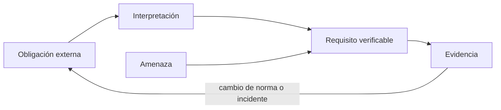
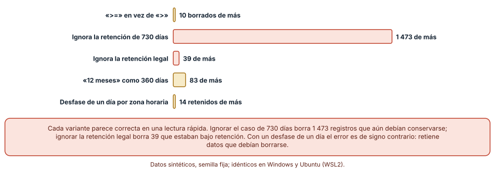
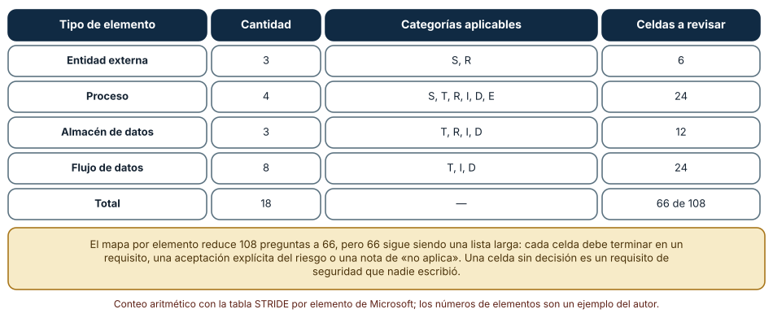
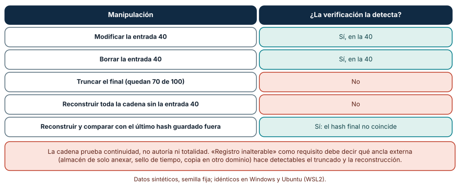

# SE-152 — Requisitos regulatorios, de datos y seguridad

[← SE-151 — Trazabilidad desde necesidad hasta evidencia](https://github.com/vladimiracunadev-create/modern-software-engineering-program/blob/main/classes/part-12-ingenieria-de-requisitos/se-151-trazabilidad-desde-necesidad-hasta-evidencia/README.md) · [↑ Parte 12](https://github.com/vladimiracunadev-create/modern-software-engineering-program/blob/main/classes/part-12-ingenieria-de-requisitos/README.md) · [📚 Índice completo](https://github.com/vladimiracunadev-create/modern-software-engineering-program/blob/main/classes/README.md) · [🌐 Portal](https://vladimiracunadev-create.github.io/modern-software-engineering-program/classes/SE-152.html) · [SE-153 — Gestión de cambios y líneas base →](https://github.com/vladimiracunadev-create/modern-software-engineering-program/blob/main/classes/part-12-ingenieria-de-requisitos/se-153-gestion-de-cambios-y-lineas-base/README.md)

## Punto profesional y fundamento pedagógico

**Punto profesional.** La clase existe para que una obligación externa —conservar un dato un tiempo máximo, registrar quién accedió, proteger una comunicación— se convierta en requisitos que se pueden probar, con un responsable que interpreta la norma, y para que un requisito de seguridad se derive de amenazas enumeradas y no de una lista de buenas intenciones.

**Por qué aparece aquí.** Se sitúa después de **Trazabilidad desde necesidad hasta evidencia** y antes de **Gestión de cambios y líneas base**: `SE-151` enlazó cada requisito con su origen y su prueba; esta clase añade un tipo de origen distinto, la obligación externa, que no se negocia como una preferencia y exige evidencia propia. Deja requisitos de retención, registro y amenazas que `SE-153` protegerá como línea base y `SE-154` buscará contradicciones.

**Error conceptual que debe corregir.** Creer que «cumplir la norma» es un requisito, y que una variante de implementación que parece equivalente (mayor o igual, un mes de 30 días) cumple la misma obligación.

**Secuencia de aprendizaje.** Antes de leer el resultado, predices cuántos registros se tratan mal con cada variante de una regla de retención, cuántas preguntas de amenaza genera un diagrama pequeño y qué manipulaciones de un registro de auditoría detecta una cadena de hashes; después calculas, explicas cada resultado y reconstruyes sin apoyo cómo una obligación se convierte en requisito, prueba y evidencia. La secuencia usa predicción, explicación propia, contraste y recuperación. [ICAP](https://icap.education.asu.edu/research) distingue participación de construcción de conocimiento; [How People Learn II](https://nap.nationalacademies.org/catalog/24783/how-people-learn-ii-learners-contexts-and-cultures) exige conectar conocimiento previo, contexto y transferencia; la [práctica de recuperación](https://pubmed.ncbi.nlm.nih.gov/16507066/) respalda producir de nuevo la explicación tras una demora; y [Education for Life and Work](https://nap.nationalacademies.org/resource/13398/dbasse_084153.pdf) exige devolución que explique la causa del error.

**Evidencia de aprendizaje.** `compliance-requirements.md` con la obligación, su interpretación y quién la interpretó, los requisitos derivados con criterio, un inventario de las 66 celdas de amenaza del diagrama con su decisión, y las pruebas de retención y de registro con sus variantes. Debe contener predicción previa, observación, explicación causal, contraejemplo, criterio de aceptación y una nota de qué dato haría cambiar la conclusión.

**Límite de la conclusión.** Esta clase no es asesoría legal: ninguna norma se interpretó para un caso real ni se consultó a una persona especialista. Los 10 000 registros, los 18 elementos y las 100 entradas del registro son sintéticos y las reglas de retención las fijó el autor.

### Trazabilidad fuente → afirmación

| Fuente primaria u oficial | Afirmación que respalda | Lo que no prueba |
|---|---|---|
| [Reglamento (UE) 2016/679, artículos 5, 17 y 25](https://eur-lex.europa.eu/eli/reg/2016/679/oj) | Los datos personales no deben conservarse identificables más tiempo del necesario (limitación del plazo de conservación); existe un derecho de supresión con excepciones; y se exige protección de datos desde el diseño. | No determina si tu plataforma está sujeta al reglamento ni cuántos días son «necesarios». |
| [NIST Privacy Framework](https://www.nist.gov/privacy-framework) | Ofrece un vocabulario para gestionar riesgos de privacidad a lo largo del ciclo de datos. | No es una obligación legal. |
| [OWASP Application Security Verification Standard](https://owasp.org/www-project-application-security-verification-standard/) | Lista requisitos de seguridad verificables por nivel de rigor. | No decide qué nivel corresponde a tu sistema. |
| [Microsoft: amenazas del Threat Modeling Tool (STRIDE)](https://learn.microsoft.com/en-us/azure/security/develop/threat-modeling-tool-threats) | Clasifica amenazas en suplantación, manipulación, repudio, divulgación de información, denegación de servicio y elevación de privilegios. | No enumera las amenazas de tu sistema. |
| Shostack, *Threat Modeling: Designing for Security* (ISBN 978-1118809990) | Describe el uso de diagramas de flujo de datos y de STRIDE por tipo de elemento. | No garantiza que la lista sea exhaustiva. |
| [Schneier y Kelsey, «Secure audit logs to support computer forensics» (1999)](https://doi.org/10.1145/317087.317089) | Presenta registros de auditoría con integridad encadenada criptográficamente. | No resuelve la custodia de la clave ni el truncado por sí solo. |
| [Python: hashlib](https://docs.python.org/3/library/hashlib.html) | Documenta SHA-256, usado en la cadena del experimento. | No dice cuándo una cadena es suficiente como control. |

## Antes de empezar

Retomas el expediente de la Parte 12. Hasta ahora los requisitos venían de personas; ahora aparecen otros que nadie «pidió» porque ya existían: conservar los datos solo el tiempo necesario, registrar quién accedió, proteger la comunicación. Recupera lo aprendido en `SE-147`: una restricción tiene origen externo y no se negocia como un requisito más. La pregunta activa es: **¿cómo convierto una obligación externa en algo que pueda probar, quién la interpreta y cómo detecto una implementación que parece cumplirla sin hacerlo?**

## Prerrequisitos

- Haber completado `SE-151` o poder explicar la cadena necesidad → requisito → evidencia.
- Python 3.11 o posterior.
- Trabajar solo con registros, diagramas y entradas sintéticas.

## Problema auténtico

Privacidad dice: «los borradores no deben conservarse más tiempo del necesario». Docencia necesita los borradores hasta fin de curso; Auditoría, 730 días para las entregas de un tipo de evaluación; Soporte quiere un registro de cada acceso para investigar incidentes. Se implementa una purga nocturna con «más de 365 días» y un registro de accesos en una tabla. Un año después, una revisión descubre que algunos registros con retención legal se borraron y que nadie puede demostrar que el registro de accesos no fue alterado.

## Objetivos observables

Al terminar podrás:

1. distinguir una obligación externa, su interpretación, el requisito derivado y la evidencia con un ejemplo y un contraejemplo de la plataforma;
2. medir cuántos registros se tratan mal con variantes plausibles de una regla de retención;
3. enumerar las preguntas de amenaza de un diagrama de flujo de datos y asignar a cada una una decisión;
4. verificar qué manipulaciones de un registro de auditoría detecta una cadena de hashes y cuáles no;
5. declarar quién interpreta la norma y qué parte del requisito no es una decisión de ingeniería.

## Mapa conceptual



El mapa se lee de izquierda a derecha: la obligación se interpreta (con una persona responsable), se convierte en un requisito con criterio y se respalda con evidencia. Las amenazas son otra fuente de requisitos de seguridad. El retorno indica que un cambio de norma o un incidente reabre la obligación original, no solo el código.

## Temas y por qué importan

| Tema | Por qué cambia una decisión profesional | Evidencia mínima |
|---|---|---|
| Obligaciones externas | No se negocian como preferencias y exigen un responsable que las interprete. | Predicción, traza causal y contraejemplo de **Obligaciones externas** en `compliance-requirements.md` |
| Requisitos de datos | Fijan qué se conserva, cuánto y con qué excepciones. | Predicción, traza causal y contraejemplo de **Requisitos de datos** en `compliance-requirements.md` |
| Amenazas y requisitos de seguridad | Derivan los requisitos de amenazas enumeradas en lugar de listas genéricas. | Predicción, traza causal y contraejemplo de **Amenazas y requisitos de seguridad** en `compliance-requirements.md` |
| Registros de auditoría | Permiten reconstruir quién hizo qué y detectar manipulaciones. | Predicción, traza causal y contraejemplo de **Registros de auditoría** en `compliance-requirements.md` |
| Evidencia de cumplimiento | Una afirmación de cumplimiento vale lo que la evidencia que la sostiene. | Predicción, traza causal y contraejemplo de **Evidencia de cumplimiento** en `compliance-requirements.md` |

## Conceptos y decisiones

### 1. Obligaciones externas

Una obligación externa viene de una ley, un contrato, una norma o una política institucional, y su redacción rara vez es un requisito. «Los datos personales se conservarán de forma que permita identificar a los interesados durante no más tiempo del necesario» no dice cuántos días ni a qué datos; alguien con la competencia debe interpretarla para el caso. El ingeniero no interpreta la ley: pide la interpretación, la registra con su responsable y la traduce a algo verificable. Sin esa persona, el requisito de «cumplir» no tiene dueño.

### 2. Requisitos de datos

Para cada categoría de datos, un requisito completo responde: qué se guarda, con qué finalidad, por cuánto tiempo, quién accede, cómo se borra, qué excepciones hay (retención legal, litigio) y cómo se demuestra el borrado. La regla de retención del experimento parece una línea; en realidad contiene decisiones de política (365 o 730 días según el tipo), de semántica («más de» o «al menos»), de calendario (qué es un año) y de excepción (retención legal). Cada una puede fallar por separado.

### 3. Amenazas y requisitos de seguridad

Una lista de requisitos de seguridad copiada de un estándar es útil como punto de partida y mala como argumento. El modelado de amenazas parte de un diagrama de flujo de datos (entidades externas, procesos, almacenes y flujos) y pregunta, por tipo de elemento, qué categoría de amenaza puede aplicar: suplantación, manipulación, repudio, divulgación de información, denegación de servicio, elevación de privilegios (STRIDE). Cada pregunta termina en un requisito, en una aceptación explícita del riesgo con responsable o en una nota de «no aplica» con su razón. Una pregunta sin respuesta es un requisito que nadie escribió.

### 4. Registros de auditoría

Un registro de auditoría responde quién hizo qué, sobre qué, cuándo y con qué resultado. Para que sirva como evidencia, además de contenido necesita integridad: que no se pueda alterar o borrar sin que alguien lo note. Una cadena de hashes (cada entrada incluye el hash de la anterior) detecta la modificación y la eliminación de una entrada intermedia; no detecta el truncado del final ni la reconstrucción completa por alguien con acceso de escritura. Esas se cubren con un ancla externa: un hash publicado o guardado fuera del alcance de quien escribe el registro.

### 5. Evidencia de cumplimiento

Cumplir es una afirmación; la evidencia es lo que la sostiene: la configuración vigente, el resultado fechado de una prueba, el registro del borrado. Una auditoría pregunta por ambas. La evidencia debe poder generarse sin intervención heroica y sin exponer datos personales: por ejemplo, el recuento de registros borrados por día, no los registros. Un requisito sin una forma de generar su evidencia cumplida es un requisito que no se puede defender.

### Cuatro variantes de una regla de retención

Diez mil registros sintéticos (semilla 152) tienen una fecha de creación en los últimos 800 días, una retención de 365 o de 730 días (dos tercios y un tercio) y un 1 % bajo retención legal. La regla correcta: purgar si han pasado más de los días de retención y no hay retención legal. Para el día de referencia, 3 907 registros deben purgarse y 104 están bajo retención legal. Se comparan cinco variantes plausibles. Predicción: ninguna coincide exactamente; algunas borran de más y otra retiene de más.

```python
def correcta(r):  return dias(r) > r["retencion"] and not r["hold"]
def mayor_igual(r): return dias(r) >= r["retencion"] and not r["hold"]
def ignora_730(r):  return dias(r) > 365 and not r["hold"]
def ignora_hold(r): return dias(r) > r["retencion"]
def mes_30(r):      return dias(r) > (360 if r["retencion"] == 365 else 720) and not r["hold"]
def desfase(r):     return dias(r) > r["retencion"] + 1 and not r["hold"]
```

Resultado, idéntico en Windows y Ubuntu: «mayor o igual» borra 10 registros de más; ignorar la retención de 730 días borra 1 473 de más; ignorar la retención legal borra 39; tratar 12 meses como 360 días borra 83 de más; un desfase de un día por zona horaria no borra de más sino que retiene 14 que debían purgarse. Cada variante pasa una revisión rápida del código. Los 1 473 de la segunda variante son datos que otra política exigía conservar; los 14 de la última son datos que la política de privacidad exigía borrar.



**Cómo leer la figura.** Cada barra es una variante y su longitud el número de registros tratados mal respecto a la regla correcta; la última es de signo contrario (retiene de más). **Dónde deja de valer:** la distribución de fechas y los porcentajes de retención son del autor; los errores relativos cambiarían con otra distribución. La regla correcta es una decisión de política que este ejercicio no valida.

### Cuántas preguntas de amenaza genera un diagrama pequeño

Un diagrama de flujo de datos de la plataforma tiene 3 entidades externas (estudiante, docente, sistema de correo), 4 procesos, 3 almacenes (borradores, entregas, registro) y 8 flujos: 18 elementos. STRIDE por elemento asigna categorías a cada tipo: entidad externa, suplantación y repudio; proceso, las seis; almacén, manipulación, repudio, divulgación y denegación; flujo, manipulación, divulgación y denegación. Predicción: el número de preguntas será bastante menor que 18 × 6 = 108 y aun así largo.

```python
categorias = {"entidad externa": "SR", "proceso": "STRIDE", "almacen": "TRID", "flujo": "TID"}
preguntas = sum(len(categorias[tipo]) * n for tipo, n in elementos.items())
```

Resultado: 6 + 24 + 12 + 24 = 66 preguntas, 42 menos que el producto completo. Por categoría: suplantación 7, manipulación 15, repudio 10, divulgación 15, denegación 15, elevación 4. Cada una es una decisión pendiente: un requisito, una aceptación del riesgo con responsable o un «no aplica» con razón. 66 respuestas no son un plan de seguridad, pero 0 sí es una omisión.



**Cómo leer la figura.** Cada fila es un tipo de elemento con su cantidad, las categorías aplicables y las celdas resultantes; la última suma 66 de 108. **Dónde deja de valer:** el diagrama es un ejemplo del autor; uno real tendría más elementos y fronteras de confianza, y el mapa por elemento es una guía, no una prueba de exhaustividad. Las categorías aplicables dependen de la fuente que se adopte.

### Qué detecta una cadena de hashes

Cada entrada de un registro de 100 eventos guarda el hash SHA-256 de la concatenación del hash anterior con su texto. Se verifica recorriendo la cadena. Se aplican cinco manipulaciones. Predicción: se detectarán las que dejan un hash inconsistente y no las que producen una cadena válida.

```python
def verifica(registro):
    previo = "0" * 64
    for i, (texto, h) in enumerate(registro):
        if hashlib.sha256((previo + texto).encode()).hexdigest() != h:
            return i
        previo = h
```

Resultado: modificar la entrada 40 se detecta en la 40; borrarla también; truncar el final (se conservan 70 entradas) no se detecta porque la cadena restante es consistente; reconstruir la cadena completa sin la entrada 40 tampoco se detecta, porque quien puede reescribir el registro puede recalcular todos los hashes. Si el último hash se guardó fuera del alcance de quien escribe, la reconstrucción se detecta: el hash final difiere del ancla, mientras que el original coincide. Una cadena prueba continuidad, no totalidad ni autoría.



**Cómo leer la figura.** Cada fila es una manipulación; las verdes se detectan y las coral no. **Dónde deja de valer:** la cadena sintética no tiene claves ni firmas; un diseño real añade autenticación (HMAC o firma) y un sellado de tiempo de un tercero (por ejemplo, un servicio conforme con RFC 3161). El ancla debe guardarse con una persistencia que el atacante no controle.

## Definiciones de trabajo

- **obligaciones externas:** exigencias de una ley, un contrato o una norma que el equipo no puede negociar como preferencias.
- **requisitos de datos:** condiciones sobre qué datos se guardan, por cuánto tiempo, quién accede, cómo se borran y qué excepciones existen.
- **amenazas y requisitos de seguridad:** hipótesis de ataque enumeradas por elemento del sistema y los requisitos que las mitigan o las aceptan.
- **registros de auditoría:** historial de acciones con quién, qué, cuándo y resultado, con protección frente a alteración.
- **evidencia de cumplimiento:** artefactos fechados que sostienen una afirmación de que se cumple una obligación.

Las definiciones son operativas para la plataforma de entregas. No convierten términos con una historia más amplia en sinónimos y deben contrastarse con la documentación primaria enlazada al final.

## Ejemplo mínimo

El fragmento siguiente compara dos reglas de retención en el borde. Antes de ejecutarlo, predice si difieren.

```python
def correcta(dias, retencion): return dias > retencion
def mayor_igual(dias, retencion): return dias >= retencion
assert correcta(365, 365) is False and mayor_igual(365, 365) is True
```

Un registro de exactamente 365 días se purga o se conserva según la variante. Registra versión del intérprete, comando y salida. La corrección no está en el código sino en la redacción: «más de 365 días» o «a partir de 365 días» son requisitos distintos.

## Ejemplo profesional

La obligación de limitar la conservación del borrador, trazada hasta su evidencia:

```text
OBL-02  Los datos personales no se conservan más tiempo del necesario.   Fuente: política institucional de datos, §4.   Interpretación: privacidad (2026-02-10).
REQ-014 El borrador se eliminará 30 días después de su última edición, salvo retención legal vigente.   ← OBL-02
AC-014  Dado un borrador editado hace 31 días sin retención, cuando corre la purga, entonces no existe.   Dado uno editado hace 30 días, entonces existe.
EV-014  Recuento diario de borrados por motivo (sin contenido), conservado 24 meses.
RISK-07 Aceptado: copias de seguridad conservan el borrador hasta 35 días.   Responsable: seguridad.
```

Los identificadores, las fechas y los plazos son ilustrativos. Compara con el registro bajo retención legal, el borrador de una estudiante que pidió la supresión, la copia de seguridad y el cambio de política a 15 días. El requisito es apropiado cuando la persona que interpreta la norma puede reconocer su obligación en él; es peligroso cuando oculta una decisión legal detrás de un número.

## Práctica guiada

1. Escribe una obligación externa del caso con su fuente y quién la interpreta, antes de redactar requisitos.
2. Predice cuántos registros tratará mal cada variante de tu regla de retención.
3. Implementa la regla correcta y las variantes con la semilla 152; guarda la salida bajo `evidence/`.
4. Dibuja un diagrama de flujo de datos de tu caso y cuenta las celdas STRIDE por elemento.
5. Asigna a cada celda un requisito, una aceptación con responsable o un «no aplica» con razón.
6. Implementa la cadena de hashes y prueba las cinco manipulaciones.
7. Pide a otra persona que reconstruya la cadena OBL → REQ → EV solo con `compliance-requirements.md`.

## Ejercicios

1. **Retención:** añade la variante «un año = 366 días en bisiesto» y calcula cuántos registros afecta con tu semilla.
2. **STRIDE:** añade un flujo y un almacén al diagrama y recalcula las celdas por categoría.
3. **Registro:** diseña un ancla externa para la cadena y explica qué ataque sigue siendo posible.
4. **Evidencia:** escribe qué evidencia generaría la purga sin guardar el contenido de los borradores.

## Reto verificable

Entrega `compliance-requirements.md` con una obligación, su interpretación con responsable, tres requisitos derivados con criterio, las 66 celdas con su decisión, la tabla de variantes de retención y el resultado de las cinco manipulaciones del registro. Se aprueba si otra persona ejecuta el código desde un checkout limpio, obtiene los mismos recuentos y puede señalar qué parte del requisito no es una decisión de ingeniería. No se aprueba por declarar «cumple» sin evidencia ni por asignar «no aplica» sin razón.

## Caso conductor

La plataforma de entregas sigue siendo el caso de la parte. Esta clase añade al expediente la obligación de limitar la conservación, los requisitos de retención y de registro, y el inventario de amenazas. Las clases siguientes protegerán todo esto como línea base (`SE-153`), buscarán contradicciones entre obligaciones y deseos (`SE-154`) y lo integrarán en la especificación (`SE-156`). Cambia después una sola decisión —por ejemplo, de 30 a 15 días— y revisa qué evidencia debe regenerarse.

## Preguntas frecuentes

### ¿El equipo de ingeniería decide cuántos días hay que conservar los datos?

No. Decide cómo cumplirlo; el plazo lo fija quien interpreta la obligación para el caso (privacidad, legal, el responsable de los datos). Si no hay quien lo interprete, el requisito debe quedar como pregunta abierta con nombre, no como un número elegido por quien programa.

### ¿Un registro de auditoría con hashes es «inalterable»?

No. Detecta ciertas alteraciones, pero quien puede reescribir toda la cadena puede recalcularla. «Inalterable» requiere decir contra quién: contra un usuario común, un administrador o un atacante con acceso al almacenamiento. Cada nivel pide un control distinto, y el ancla externa es la diferencia entre los dos últimos.

### ¿Los requisitos de seguridad se copian de un estándar?

Se parte de un estándar como lista de preguntas, y se completa con las amenazas del sistema. Copiar sin derivar produce requisitos que no corresponden a ninguna amenaza del caso, y deja sin cubrir las que no estaban en la lista. Las 66 celdas son el mínimo de preguntas de un diagrama de 18 elementos, no un máximo.

### ¿Puede un modelo de lenguaje decir si cumplimos una norma?

Puede resumir un texto y proponer verificaciones, pero no interpretar su aplicación a tu caso ni asumir responsabilidad por ello. Úsalo para generar preguntas y variantes de prueba, y deja la conclusión de cumplimiento a la persona competente con la evidencia a la vista.

## Fallo controlado y diagnóstico

Reproduce el fallo clásico de la clase: **implementar una obligación sin comprobar sus bordes**. Escribe «más de 365 días» como `>= 365` y ejecuta la purga sobre los 10 000 registros.

Registra síntoma, entrada mínima, hipótesis, observación que descarta cada hipótesis, causa, corrección y prueba de regresión. **Síntoma:** 10 registros de exactamente 365 días desaparecen un día antes de lo que la política indica. **Hipótesis rivales:** (a) la política era «a partir de 365»; (b) la implementación usa el operador equivocado. **Prueba:** compara el texto de la obligación y de la interpretación firmada («más de 365») con el operador; compara con la regla correcta sobre un registro de 365 días exactos. **Conclusión:** el requisito era ambiguo en el borde y la implementación eligió sin consultar. **Regresión:** añade pruebas con registros de 364, 365 y 366 días y una etiqueta con el texto de la interpretación en la prueba. No cambies a la vez el operador y el plazo.

## Errores comunes y cómo corregirlos

| Síntoma | Causa probable | Corrección |
|---|---|---|
| Se borraron datos bajo retención legal | La regla ignoró una excepción | Incluir las excepciones en el requisito y en las pruebas |
| Una auditoría pide evidencia del borrado y no hay | No se diseñó cómo generarla | Definir la evidencia junto con el requisito, sin guardar contenido |
| La lista de requisitos de seguridad no corresponde a ninguna amenaza | Se copió de un estándar sin derivar | Enumerar amenazas por elemento y asignar cada una a un requisito o una aceptación |
| El registro se alteró y nadie lo notó | No hay integridad ni ancla externa | Añadir encadenamiento, autenticación y un hash guardado fuera del alcance |
| Dos áreas interpretan la norma de forma distinta | No hay un responsable de la interpretación | Registrar quién interpreta, cuándo y con qué alcance |

## Entorno y archivos clave

```text
work/SE-152/
├── README.md
├── cumplimiento/
│   ├── retencion.py
│   ├── stride.py
│   └── cadena.py
├── fixtures/registros.csv
├── tests/test_cumplimiento.py
└── evidence/compliance-requirements.md
```

El `README` declara plataforma, versión de Python, semilla y comandos. Los experimentos usan `random`, `datetime` y `hashlib` y se ejecutaron con CPython 3.12.9 en Windows 11 y 3.12.3 en Ubuntu bajo WSL2; las salidas fueron idénticas. Si añades una dependencia, fija procedencia y versión.

## Seguridad, ética y accesibilidad

- los registros de auditoría contienen datos de comportamiento: aplica el mínimo necesario y define quién puede leerlos;
- una purga irreversible necesita una prueba en un entorno aislado y un respaldo verificado antes de ejecutarse en producción;
- los datos de personas con adaptaciones o necesidades especiales merecen una categoría de protección explícita;
- explica las obligaciones y los plazos a las personas afectadas en lenguaje claro y en formatos accesibles;
- no uses un modelo de lenguaje con registros reales ni con textos legales confidenciales sin una política de datos que lo permita;
- este material no es asesoría legal: consulta a la persona competente de tu organización.

## Puente hacia el trabajo con agentes

Un agente al que se le pide «asegúrate de que cumplimos la normativa de datos» devolverá una lista de buenas prácticas y afirmaciones de cumplimiento sin evidencia. Pídele en cambio que identifique qué obligación respalda cada requisito, que marque como «interpretación pendiente» lo que requiere a una persona competente, que enumere las celdas STRIDE de tu diagrama y que genere pruebas de borde para cada regla de retención. Revisa especialmente si declara «cumple» sin una evidencia que puedas abrir: una frase de cumplimiento no es una evidencia.

## Transferencia

Traslada el análisis a otro dominio (por ejemplo, una app de salud o de pagos): cambia las obligaciones, el diagrama y las retenciones, conserva las variantes de la regla, el conteo de celdas y las manipulaciones del registro, y comprueba qué variantes siguen tratando mal registros. La transferencia está lograda cuando puedes explicar qué parte del método dependía del dominio y cuál no, no cuando el código se parece.

## Evaluación y evidencia

| Criterio | Evidencia para aprobar |
|---|---|
| comprensión | explicación causal de la diferencia entre obligación, interpretación, requisito y evidencia, con ejemplo y contraejemplo |
| corrección | recuento reproducible de registros mal tratados por variante y de celdas STRIDE |
| diseño | requisitos con excepciones, responsable de la interpretación y evidencia asociada |
| diagnóstico | reproducción del fallo «borde sin comprobar» con regresión |
| incertidumbre | declaración de qué manipulaciones del registro no se detectan |
| reproducibilidad | versiones, comandos, salida y límites declarados |

## Fuentes

- [Reglamento (UE) 2016/679](https://eur-lex.europa.eu/eli/reg/2016/679/oj) — limitación del plazo de conservación, supresión y protección desde el diseño; autoridad: Unión Europea.
- [NIST Privacy Framework](https://www.nist.gov/privacy-framework) — gestión del riesgo de privacidad; autoridad: NIST.
- [OWASP Application Security Verification Standard](https://owasp.org/www-project-application-security-verification-standard/) — requisitos de seguridad verificables; autoridad: OWASP.
- [Microsoft: amenazas del Threat Modeling Tool](https://learn.microsoft.com/en-us/azure/security/develop/threat-modeling-tool-threats) — categorías STRIDE; autoridad: Microsoft.
- Shostack, *Threat Modeling: Designing for Security* (ISBN 978-1118809990) — modelado de amenazas con diagramas de flujo de datos; autoridad: libro de referencia.
- [Schneier y Kelsey: Secure audit logs to support computer forensics (1999)](https://doi.org/10.1145/317087.317089) — registros con integridad encadenada; autoridad: ACM Transactions on Information and System Security.
- [RFC 3161: Time-Stamp Protocol](https://www.rfc-editor.org/rfc/rfc3161) — sellado de tiempo por un tercero; autoridad: IETF.
- [NIST SP 800-92: Guide to Computer Security Log Management](https://csrc.nist.gov/pubs/sp/800/92/final) — gestión de registros de seguridad; autoridad: NIST.

Cada fuente respalda el mecanismo indicado; ninguna demuestra que la plataforma de entregas cumpla una norma concreta. Esa afirmación depende de la interpretación de una persona competente, de la evidencia y de la revisión de otra persona.

- [Python: `hashlib`](https://docs.python.org/3/library/hashlib.html) — SHA-256 usado en la cadena.
- [Python: `datetime`](https://docs.python.org/3/library/datetime.html) — diferencias de fechas en la regla de retención.

## Límites y siguiente paso

Se ejecutaron tres experimentos con datos sintéticos en Windows y Ubuntu (WSL2) con resultados idénticos. No se interpretó ninguna norma para un caso real, no es asesoría legal, el diagrama y las retenciones son ejemplos del autor y la cadena de hashes no incluye claves ni sellado de tiempo. La siguiente clase protege el conjunto de requisitos con líneas base y control de cambios.

## Glosario

- **obligaciones externas:** exigencias de una ley, un contrato o una norma que el equipo no puede negociar como preferencias.
- **requisitos de datos:** condiciones sobre qué datos se guardan, por cuánto tiempo, quién accede, cómo se borran y qué excepciones existen.
- **amenazas y requisitos de seguridad:** hipótesis de ataque enumeradas por elemento del sistema y los requisitos que las mitigan o las aceptan.
- **registros de auditoría:** historial de acciones con quién, qué, cuándo y resultado, con protección frente a alteración.
- **evidencia de cumplimiento:** artefactos fechados que sostienen una afirmación de que se cumple una obligación.

---

[← SE-151 — Trazabilidad desde necesidad hasta evidencia](https://github.com/vladimiracunadev-create/modern-software-engineering-program/blob/main/classes/part-12-ingenieria-de-requisitos/se-151-trazabilidad-desde-necesidad-hasta-evidencia/README.md) · [↑ Parte 12](https://github.com/vladimiracunadev-create/modern-software-engineering-program/blob/main/classes/part-12-ingenieria-de-requisitos/README.md) · [📚 Índice completo](https://github.com/vladimiracunadev-create/modern-software-engineering-program/blob/main/classes/README.md) · [🌐 Portal](https://vladimiracunadev-create.github.io/modern-software-engineering-program/classes/SE-152.html) · [SE-153 — Gestión de cambios y líneas base →](https://github.com/vladimiracunadev-create/modern-software-engineering-program/blob/main/classes/part-12-ingenieria-de-requisitos/se-153-gestion-de-cambios-y-lineas-base/README.md)
