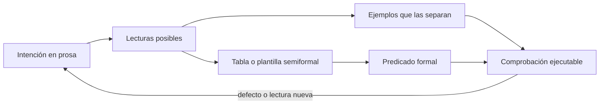
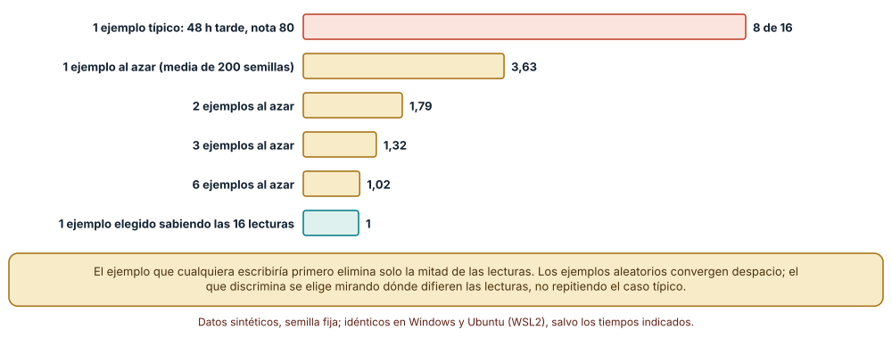
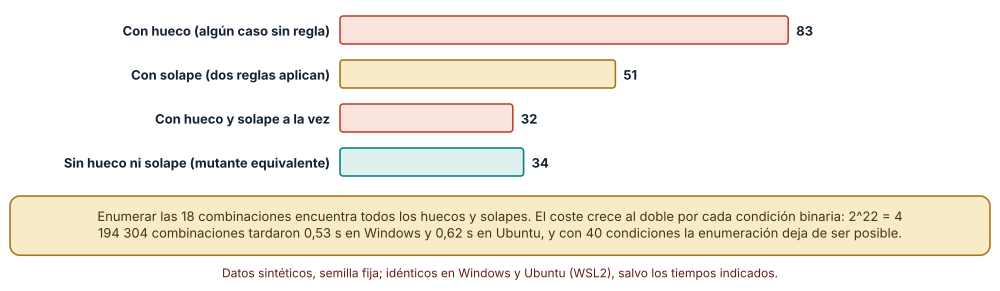
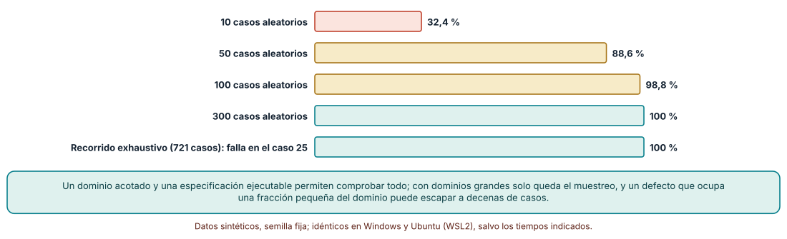

# SE-157 — Especificación informal, semiformal y formal

[← SE-156 — Proyecto: especificación de requisitos revisable](https://github.com/vladimiracunadev-create/modern-software-engineering-program/blob/main/classes/part-12-ingenieria-de-requisitos/se-156-proyecto-especificacion-de-requisitos-revisable/README.md) · [↑ Parte 13](https://github.com/vladimiracunadev-create/modern-software-engineering-program/blob/main/classes/part-13-especificaciones-contratos-y-modelos/README.md) · [📚 Índice completo](https://github.com/vladimiracunadev-create/modern-software-engineering-program/blob/main/classes/README.md) · [🌐 Portal](https://vladimiracunadev-create.github.io/modern-software-engineering-program/classes/SE-157.html) · [SE-158 — Specification by Example y BDD →](https://github.com/vladimiracunadev-create/modern-software-engineering-program/blob/main/classes/part-13-especificaciones-contratos-y-modelos/se-158-specification-by-example-y-bdd/README.md)

## Punto profesional y fundamento pedagógico

**Punto profesional.** La clase existe para que elijas cuánta precisión necesita cada promesa del sistema y sepas medir cuánta ambigüedad queda en una redacción, de modo que «la entrega tardía se penaliza» no signifique dieciséis comportamientos distintos según quién la implemente.

**Por qué aparece aquí.** Se sitúa después de **Proyecto: especificación de requisitos revisable** y antes de **Specification by Example y BDD**: la Parte 12 terminó con requisitos que otra persona puede revisar; la Parte 13 pregunta cuándo un requisito redactado en prosa ya no alcanza y qué lo reemplaza. Esta clase fija los tres niveles de precisión (informal, semiformal, formal), el criterio para pasar de uno al siguiente y la regla de penalización por entrega tardía que las once clases siguientes irán convirtiendo en ejemplos, contratos, modelos, esquemas y paquete trazable.

**Error conceptual que debe corregir.** Creer que más formalidad siempre es mejor, o que una redacción cuidadosa en prosa basta: la formalidad cuesta y solo compensa donde la ambigüedad también cuesta, y la prosa cuidadosa sigue admitiendo varias lecturas que nadie nota hasta que dos personas implementan.

**Secuencia de aprendizaje.** Antes de leer la solución, predices cuántas lecturas distintas admite una frase de una línea; después cuentas las lecturas ejecutando todas, mides qué eliminan uno, dos y seis ejemplos, validas una tabla de decisión por enumeración y comparas el muestreo aleatorio con la comprobación exhaustiva de un defecto de frontera. La secuencia usa predicción, explicación propia, contraste y recuperación. [ICAP](https://icap.education.asu.edu/research) distingue participación de construcción de conocimiento; [How People Learn II](https://nap.nationalacademies.org/catalog/24783/how-people-learn-ii-learners-contexts-and-cultures) exige conectar conocimiento previo, contexto y transferencia; la [práctica de recuperación](https://pubmed.ncbi.nlm.nih.gov/16507066/) respalda producir de nuevo la explicación tras una demora; y [Education for Life and Work](https://nap.nationalacademies.org/resource/13398/dbasse_084153.pdf) exige devolución que explique la causa del error.

**Evidencia de aprendizaje.** `spec-log.md` con la regla en los tres niveles (prosa, tabla de decisión y predicado), las dieciséis lecturas enumeradas con su resultado, una predicción previa, el conjunto mínimo de ejemplos que las separa, la salida de la comprobación de la tabla y una nota de qué hallazgo haría abandonar el nivel elegido.

**Límite de la conclusión.** Las dieciséis lecturas son las que el autor imaginó: una persona con otra experiencia podría imaginar más. Los ejemplos que separan lecturas se eligieron conociendo todas ellas, algo que en un proyecto real no se tiene. Ningún nivel de formalidad demuestra que la regla sea la que la institución quiere.

### Trazabilidad fuente → afirmación

| Fuente primaria u oficial | Afirmación que respalda | Lo que no prueba |
|---|---|---|
| [Meyer, «On formalism in specifications» (IEEE Software, 1985)](https://doi.org/10.1109/MS.1985.229776) | Cataloga los defectos de las especificaciones en lenguaje natural (ruido, silencio, sobreespecificación, contradicción, ambigüedad) y propone remedios en un continuo de formalidad. | No demuestra que una notación formal elimine todos esos defectos ni que su coste compense en cualquier proyecto. |
| [Hall, «Seven myths of formal methods» (IEEE Software, 1990)](https://doi.org/10.1109/52.57887) | Distingue lo que los métodos formales aportan (precisión, análisis) de lo que se les atribuye (garantía total, dedicación exclusiva de matemáticos). | No fija una frontera entre dominios donde compensan y donde no. |
| [Newcombe et al., «How Amazon Web Services uses formal methods» (CACM, 2015)](https://doi.org/10.1145/2699417) | Informa de usos industriales de especificación formal (TLA+) para encontrar defectos de diseño que las pruebas no habían hallado. | No generaliza a una plataforma de entregas ni mide el coste en otra organización. |

## Antes de empezar

Esta clase abre la **Parte 13 sobre la plataforma de entregas de tareas**, el caso que recorrerá las doce clases. Recupera lo aprendido en la Parte 12: un requisito revisable dice qué se espera; ahora importa cuánto margen deja a quien lo implementa. La pregunta activa es: **¿cuántos comportamientos distintos caben en esta frase y qué nivel de precisión elimina los que no queremos?**

## Prerrequisitos

- Haber completado `SE-156` o poder explicar qué requisitos entregó y cuáles quedaron ambiguos.
- Python 3.11 o posterior y un terminal; todo el código usa solo la biblioteca estándar.
- Trabajar con la regla de penalización por entrega tardía y notas sintéticas: ningún experimento necesita datos reales.

## Problema auténtico

El requisito aprobado dice: «Una entrega fuera de plazo se penaliza un 10 % por día de retraso, hasta un máximo». Tres equipos lo implementan: el de la aplicación web, el de las exportaciones a la secretaría y el del módulo de apelaciones. Cuando se comparan, una nota de 80 con 50 horas de retraso da 56 en un sistema, 64 en otro y 50 en el tercero. Nadie mintió: la frase admite más de una lectura.

## Objetivos observables

Al terminar podrás:

1. distinguir una especificación informal, una semiformal y una formal con un ejemplo y un contraejemplo de la plataforma de entregas;
2. contar las lecturas que admite un enunciado, ejecutándolas, y medir cuántas elimina cada ejemplo según cómo se elija;
3. verificar por enumeración que una tabla de decisión no tiene huecos ni solapes, y declarar hasta dónde crece ese coste;
4. predecir cuántos casos aleatorios hacen falta para encontrar un defecto de frontera y cuándo conviene comprobar todo el dominio;
5. justificar el nivel de formalidad elegido para una regla concreta, con el coste que acepta y el riesgo que deja.

## Mapa conceptual



El mapa se lee como una cadena de reducción de ambigüedad, no como fases obligatorias: se puede parar en el ejemplo, en la tabla o en el predicado. La flecha de retorno indica que un defecto hallado o una lectura nueva reabre la intención; el predicado más elegante no corrige un requisito que nadie quería.

## Temas y por qué importan

| Tema | Por qué cambia una decisión profesional | Evidencia mínima |
|---|---|---|
| Ambigüedad | Una frase con varios puntos abiertos multiplica las lecturas: cuatro puntos binarios dan dieciséis comportamientos. | Predicción, traza causal y contraejemplo de **Ambigüedad** en `spec-log.md` |
| Especificación informal | La prosa es barata y legible para todos, y es la que más lecturas admite. | Predicción, traza causal y contraejemplo de **Especificación informal** en `spec-log.md` |
| Especificación semiformal | Tablas, plantillas y diagramas con reglas de forma permiten comprobar completitud sin matemática avanzada. | Predicción, traza causal y contraejemplo de **Especificación semiformal** en `spec-log.md` |
| Especificación formal | Un predicado sin ambigüedad se comprueba mecánicamente en un dominio acotado, a cambio de esfuerzo y de leerse con dificultad. | Predicción, traza causal y contraejemplo de **Especificación formal** en `spec-log.md` |
| Elección del nivel | Pasar al nivel siguiente solo se justifica si el coste de una lectura equivocada supera el de precisar. | Predicción, traza causal y contraejemplo de **Elección del nivel** en `spec-log.md` |

## Conceptos y decisiones

### 1. Ambigüedad

Meyer describió varios defectos de las especificaciones en lenguaje natural; dos importan aquí. El **silencio** omite un caso («¿qué pasa si el retraso es de 30 minutos?») y la **ambigüedad** admite dos lecturas con el mismo texto («por día», ¿día natural o bloque de 24 horas?). La ambigüedad no es un defecto de redacción individual sino una propiedad del texto frente a sus lectores: lo que a una persona le parece obvio, otra lo resuelve distinto. Por eso se mide ejecutando: si dos implementaciones compatibles con la frase dan resultados distintos sobre una misma entrada, la frase es ambigua con prueba, no por opinión.

### 2. Especificación informal

La prosa es el nivel donde empieza todo y donde casi todo se queda. Su fortaleza es que cualquiera la lee, la discute y la corrige; su debilidad, que no tiene un procedimiento para decidir si dos lecturas son la misma. Una especificación informal bien hecha declara sus términos («día» significa bloque de 24 horas desde el plazo), nombra sus casos límite y trae ejemplos con valores. No se vuelve semiformal por usar viñetas: se vuelve semiformal cuando una regla de forma permite comprobar algo mecánicamente.

### 3. Especificación semiformal

Una tabla de decisión, una plantilla con campos obligatorios («Actor / Disparador / Resultado observable / Límite») o un diagrama de estados con reglas de construcción son semiformales: su forma se comprueba aunque su significado dependa de quien lee. La virtud práctica es la completitud: una tabla de condiciones puede revisarse en busca de combinaciones sin regla (huecos) o con dos reglas (solapes), algo que en prosa exige leer con atención y aun así se escapa. Su límite es que las celdas siguen escritas en lenguaje natural: «tarde con prórroga» puede significar cosas distintas.

### 4. Especificación formal

Un predicado como `nota_final(n, h) = redondear(n · (1 − min(0,10 · ⌈h/24⌉, 0,50)))` para `h > 0` no admite lecturas: fija el redondeo, el tope y el cálculo del número de días. Su valor es que se ejecuta: el predicado se transforma en una función de referencia con la que comparar cualquier implementación en todo un dominio acotado. El coste es doble: escribirlo exige acordar antes todos los puntos abiertos, y leerlo exige formación. Hall recuerda que formal no es sinónimo de correcto: la especificación puede describir con exactitud algo que nadie quería.

### 5. Elección del nivel

El nivel se elige por la relación entre el coste de equivocarse y el coste de precisar. Una frase en una página interna de ayuda no necesita predicado; una regla que decide una nota que consta en un acta, sí. La decisión se documenta como cualquier otra: qué nivel se eligió, qué riesgo se acepta y qué hallazgo obligaría a subir de nivel (por ejemplo, la primera discrepancia entre dos sistemas). Los equipos industriales que usan métodos formales los reservan para el núcleo donde un defecto es caro y difícil de hallar con pruebas.

### Contar lecturas: dieciséis comportamientos en una frase

La frase tiene cuatro puntos abiertos que el autor identificó leyéndola con la pregunta «¿qué podría decidir distinto otro equipo?»: el número de días se obtiene redondeando hacia arriba o hacia abajo las horas entre 24; la penalización es relativa a la nota o se resta en puntos; «hasta un máximo» no dice cuál (50 % o 30 %); y el redondeo del resultado es al entero más cercano o truncado. Cada combinación es una función, y las dieciséis se ejecutan sobre 20 301 entradas (201 retrasos de 0 a 200 horas × 101 notas de 0 a 100).

```python
import itertools, math
def make(ceil, rel, tope, redondeo):
    def f(h, nota):
        if h <= 0: return nota
        d = math.ceil(h / 24) if ceil else h // 24
        pen = min(0.10 * d, tope)
        r = nota * (1 - pen) if rel else nota - 100 * pen
        r = max(r, 0)
        return int(r + 0.5) if redondeo else int(r)
    return f
combos = list(itertools.product([True, False], [True, False], [0.5, 0.3], [True, False]))
```

Resultado, idéntico en Windows (CPython 3.12.9) y en Ubuntu bajo WSL2 (3.12.3): las 16 funciones forman **14 comportamientos distintos** sobre el dominio (dos pares coinciden en todas las entradas probadas). El ejemplo que cualquiera escribiría primero, 48 horas de retraso con nota 80, deja vivas **8** de las 16 lecturas: la mitad sigue siendo compatible. Con un ejemplo al azar quedan 3,63 en media (200 semillas), con dos 1,79 y con seis 1,02. Un ejemplo elegido sabiendo cómo difieren las lecturas (73 horas, nota 13) deja una sola. El mensaje no es «elige ejemplos más inteligentes»: es que el ejemplo típico es el que menos discrimina, y que sin conocer las lecturas se necesitan varios ejemplos de frontera.



**Cómo leer la figura.** Cada barra es el número medio de lecturas compatibles con los ejemplos dados; la coral es el ejemplo típico y la verde el ejemplo elegido con conocimiento de todas las lecturas. **Dónde deja de valer:** las dieciséis lecturas son las que el autor imaginó; una lectura no pensada (por ejemplo, contar solo días hábiles) no aparece y ningún ejemplo la elimina. Además, la verdad usada para decidir qué lecturas sobreviven es una de las dieciséis, algo que en la práctica se decide hablando con quien pidió la regla.

### Completitud de una tabla de decisión

La misma regla se expresa como tabla semiformal con tres condiciones (estado de la entrega, prórroga concedida y tramo de retraso) y ocho reglas; las combinaciones posibles son 3 × 2 × 3 = 18. Comprobar completitud es enumerar las 18 combinaciones y contar las reglas que se aplican a cada una: cero es un hueco, dos o más es un solape. La tabla base resulta con 0 huecos y 0 solapes. Después se aplican 200 mutaciones aleatorias con semilla fija (quitar una regla, ensanchar una condición a comodín o cambiar un valor).

El resultado: 83 mutaciones dejan al menos un hueco, 51 un solape, 32 ambos y 34 no cambian el comportamiento (mutantes equivalentes, por ejemplo ensanchar una condición que ya cubría todo). La enumeración encuentra todos los defectos de la tabla sin leerla, y su coste crece al doble por cada condición binaria: recorrer 2^22 = 4 194 304 combinaciones tardó 0,53 s en Windows y 0,62 s en Ubuntu en un bucle mínimo, y con cuarenta condiciones sería inviable.

```python
puntos = list(itertools.product(*conds.values()))
huecos = sum(1 for p in puntos if not any(coincide(r, p) for r in reglas))
solapes = sum(1 for p in puntos if sum(coincide(r, p) for r in reglas) > 1)
```



**Cómo leer la figura.** Cada barra cuenta cuántas de las 200 mutaciones produjeron ese defecto; la verde son mutaciones que no cambian nada. **Dónde deja de valer:** la enumeración comprueba completitud y exclusión de la tabla, no que cada celda signifique lo que se quería; «tarde con prórroga» sigue siendo prosa. Y deja de ser viable cuando el espacio de combinaciones crece más rápido que la paciencia: ahí se parte la tabla en tablas más pequeñas o se pasa a una herramienta que razona sin enumerar.

### Muestrear frente a comprobar todo

El predicado formal permite comparar una implementación con la referencia. Sea una implementación con un defecto de frontera: calcula `h // 24 + 1` en lugar de `⌈h/24⌉`, y por eso se equivoca justo cuando el retraso es un múltiplo exacto de 24 horas. En el dominio de 0 a 720 horas (721 valores) hay 30 entradas defectuosas, el 4,16 %. Se ejecutó la comparación con casos aleatorios, 500 semillas por tamaño: con 10 casos se encuentra el defecto en el 32,4 % de las semillas, con 50 en el 88,6 %, con 100 en el 98,8 % y con 300 en el 100 %. El recorrido exhaustivo lo encuentra siempre, en el caso 25 (h = 24).



**Cómo leer la figura.** Cada barra es el porcentaje de 500 semillas en que el método halló el defecto; la barra inferior es la comprobación de todo el dominio. **Dónde deja de valer:** comprobar 721 casos es barato; con dominios de 10^12 casos solo se muestrea, y un defecto que ocupa una fracción del 4 % exige decenas de casos para tener buena probabilidad de hallarlo. Si el defecto ocupara el 0,01 % del dominio, los 300 casos aleatorios lo encontrarían en el 3 % de los intentos, y solo el razonamiento sobre las fronteras lo haría visible.

## Definiciones de trabajo

- **ambigüedad:** propiedad de un enunciado que admite al menos dos implementaciones compatibles con el texto que dan resultados distintos para una misma entrada.
- **especificación informal:** descripción en lenguaje natural sin reglas de forma que permitan decidir mecánicamente si dos lecturas coinciden.
- **especificación semiformal:** descripción con estructura comprobable (tabla de decisión, plantilla con campos obligatorios, diagrama con reglas de construcción) cuyo contenido sigue escrito en lenguaje natural.
- **especificación formal:** descripción en una notación con semántica definida, ejecutable o comprobable por una herramienta, en un dominio acotado o con una demostración.
- **mutante equivalente:** variante de una regla o de un programa que no cambia ninguna salida sobre el dominio considerado.

Las definiciones son operativas para la plataforma de entregas. No convierten términos con una historia académica más amplia en sinónimos y deben contrastarse con la documentación primaria enlazada al final.

## Ejemplo mínimo

El fragmento compara una implementación con un defecto de frontera y la referencia sobre un dominio pequeño. Antes de ejecutarlo, predice en qué entradas difieren.

```python
import math

def ref(h):
    return 0 if h <= 0 else math.ceil(h / 24)

def candidata(h):
    return 0 if h <= 0 else h // 24 + 1

dif = [h for h in range(0, 121) if ref(h) != candidata(h)]
assert dif == [24, 48, 72, 96, 120]
```

El defecto aparece solo en los múltiplos de 24, donde un retraso de exactamente un día se contaría como dos. Registra versión del intérprete, comando y salida; si cambias `<=` por `<` en la referencia, predice primero si la diferencia desaparece.

## Ejemplo profesional

La plataforma de entregas publica la regla de penalización en tres artefactos coordinados. La prosa vive en la política académica: una frase con los cuatro términos definidos (día, tope, base de cálculo, redondeo). La tabla de decisión vive en el documento de diseño y cubre estado de la entrega, prórroga y tramo de retraso. El predicado vive en una función de referencia con sus pruebas, y es contra esa función que se comparan la aplicación web, las exportaciones y el módulo de apelaciones. Cada artefacto cita a los otros dos con un identificador, de modo que una discrepancia señala a cuál debe corregirse.

Compara el caso normal con una entrega a las 24 horas exactas, una con prórroga que vence mientras se envía y una con nota 0. Una especificación es apropiada cuando esos tres casos tienen respuesta escrita; es peligrosa cuando la respuesta existe solo en la cabeza de quien implementó.

## Práctica guiada

1. Escribe la regla en una frase y subraya cada término que otra persona podría interpretar distinto.
2. Predice cuántas lecturas distintas admite y escribe el número antes de ejecutar nada.
3. Implementa las lecturas como funciones parametrizadas y cuéntalas sobre un dominio acotado.
4. Mide cuántas lecturas elimina un ejemplo típico, uno al azar y uno elegido con un criterio explícito.
5. Escribe la tabla de decisión y comprueba huecos y solapes por enumeración.
6. Introduce un defecto de frontera en una implementación y mide cuántos casos aleatorios hacen falta para verlo.
7. Entrega `spec-log.md` y pide a otra persona que reconstruya la regla solo desde esos tres artefactos.

## Ejercicios

1. **Lecturas:** añade un quinto punto abierto (por ejemplo, si «día» cuenta solo días hábiles) y calcula cuántas lecturas distintas hay ahora y cuántos ejemplos de frontera se necesitan para separarlas.
2. **Tabla:** diseña una tabla de decisión para la regla de prórrogas (quién la concede, hasta cuántas horas, si se acumula) y comprueba por enumeración sus huecos y solapes.
3. **Frontera:** calcula la fracción de entradas defectuosa de un defecto en `h == 0` y cuántos casos aleatorios harían falta para el 95 % de detección.
4. **Nivel:** elige tres reglas de la plataforma y justifica con coste y riesgo el nivel de formalidad de cada una; indica qué hallazgo te haría subir de nivel.

## Reto verificable

Entrega `spec-log.md` con la regla de penalización en los tres niveles, las lecturas enumeradas con su resultado, la tabla con su comprobación y la medición de detección de un defecto de frontera. Se aprueba si otra persona ejecuta el código desde un checkout limpio, obtiene los mismos conteos y puede señalar qué dato haría que cambiaras de nivel. No se aprueba por la longitud del documento ni por el número de lecturas imaginadas.

## Caso conductor

La plataforma de entregas de tareas es el caso conductor de la Parte 13. Esta clase deja el primer artefacto: la regla de penalización escrita en tres niveles, con dieciséis lecturas conocidas y una función de referencia. Las clases siguientes la convertirán en ejemplos con significado (`SE-158`), contratos con invariantes (`SE-159`), un modelo de información y de comportamiento (`SE-160` y `SE-161`), un esquema (`SE-162`) y un contrato de interfaz (`SE-163`). Cambia después una sola decisión, el tope del 50 % al 30 %, y revisa qué artefactos hay que tocar.

## Preguntas frecuentes

### ¿Una especificación formal evita escribir pruebas?

No: la especificación formal da la referencia contra la que se prueba y permite comprobar todo un dominio acotado, pero hay que ejecutar esa comparación contra la implementación. Y no protege de especificar lo que nadie quería: el predicado de la clase es exacto y podría ser el equivocado.

### ¿Cuándo basta con la prosa?

Cuando equivocarse sea barato y la regla tenga pocos puntos abiertos: un texto de ayuda, una convención interna, una descripción de intención. Si dos personas pueden implementarla y la diferencia llega a una nota, a un cobro o a un acta, conviene subir al menos a ejemplos y tabla.

### ¿Cómo sé que listé todas las lecturas?

No lo sabes. Se reduce el riesgo con técnicas de revisión (pedir a alguien ajeno que implemente solo desde la frase, comparar implementaciones independientes), pero la lista siempre es la de quien la imaginó. Por eso se declara como límite.

### ¿La tabla de decisión sustituye al predicado?

Cumplen funciones distintas: la tabla muestra la estructura de casos y permite revisarla con personas no técnicas; el predicado fija el cálculo. En la plataforma conviven y se citan entre sí; si discrepan, hay un defecto en alguno.

## Fallo controlado y diagnóstico

Reproduce el fallo clásico de la clase: **creer que la frase aprobada tiene un solo significado**. Pide a dos personas que implementen la regla por separado, sin hablar entre ellas, y compara resultados sobre las 20 301 entradas.

Registra síntoma, entrada mínima, hipótesis, observación que descarta cada hipótesis, causa, corrección y prueba de regresión. **Síntoma:** la exportación a la secretaría da 64 para 80 puntos con 50 horas y la aplicación web da 56. **Hipótesis rivales:** (a) una de las dos tiene un error de cálculo; (b) las dos son lecturas válidas de la frase. **Prueba:** busca la entrada mínima que separa las implementaciones y comprueba que ambas coinciden con alguna de las dieciséis lecturas; si ambas son lecturas válidas, la frase es ambigua. **Conclusión:** la causa es el punto abierto (penalización relativa o en puntos), no un error. **Regresión:** añade a la especificación el término definido y un ejemplo de frontera que separa las lecturas, y una prueba que compare ambas implementaciones con la función de referencia. No cambies a la vez la definición y las implementaciones.

## Errores comunes y cómo corregirlos

| Síntoma | Causa probable | Corrección |
|---|---|---|
| Dos sistemas dan notas distintas para la misma entrega y ambos «cumplen» la política | La frase admite varias lecturas y nadie ejecutó ninguna | Enumerar las lecturas, elegir una, y escribirla como predicado y como ejemplos de frontera |
| Los ejemplos de la política son todos del camino típico y los defectos aparecen en el límite | Se eligió el ejemplo más natural y no el que más separa lecturas | Añadir ejemplos en múltiplos de 24 horas, en el tope y en nota 0 |
| La tabla de decisión «cubre todo» pero un caso real no tiene regla | La completitud se verificó leyendo, no enumerando | Enumerar el producto de condiciones y contar reglas por combinación |
| El predicado es perfecto y el producto sigue sin pasar la revisión académica | Se formalizó una lectura que nadie había acordado | Acordar primero los términos con quien pidió la regla y registrar el acuerdo |
| La función de referencia y el código de producción divergen con el tiempo | La referencia no está en las pruebas del repositorio | Ejecutar la comparación contra la referencia en la integración continua |

## Entorno y archivos clave

```text
work/SE-157/
├── README.md
├── spec/
│   ├── lecturas.py
│   ├── tabla.py
│   └── frontera.py
├── tests/test_lecturas.py
└── evidence/spec-log.md
```

El `README` declara plataforma, versión de Python, semillas y comandos. Los experimentos usan solo la biblioteca estándar (`itertools`, `math`, `random`, `time`) y se ejecutaron con CPython 3.12.9 en Windows 11 y 3.12.3 en Ubuntu bajo WSL2: las salidas fueron idénticas salvo los tiempos de la enumeración, que se informan como medidas de un equipo. Si añades una dependencia, fija procedencia y versión.

## Seguridad, ética y accesibilidad

- una regla de penalización decide notas de personas: una lectura distinta para dos estudiantes es un problema de equidad, no de estilo;
- los ejemplos de la política usan notas y horas sintéticas; no incluyas datos de estudiantes reales en un documento que circulará;
- la tabla de decisión debe tener una alternativa textual accesible y celdas redactadas en lenguaje comprensible;
- documenta quién aprobó cada lectura y cuándo, para que la responsabilidad no se disuelva en «el sistema lo calcula»;
- respeta licencias de las notaciones y herramientas formales que adoptes, y atribuye adaptaciones.

## Puente hacia el trabajo con agentes

Un agente al que se le pide «implementa la regla de penalización» elegirá una lectura sin avisar y la implementará con convicción. Pídele en cambio que enumere los puntos abiertos de la frase antes de escribir código, que proponga ejemplos de frontera que separen las lecturas y que entregue la función de referencia con su tabla. Revisa especialmente si decidió un punto abierto por su cuenta (el tope, el redondeo): es la misma ambigüedad que separó a los tres equipos, ahora con apariencia de implementación completa.

## Transferencia

Traslada el experimento a otro de los dominios persistentes (por ejemplo, un servicio de entregas a domicilio con un recargo por espera): cambia los puntos abiertos, conserva el procedimiento de enumerar lecturas y medir cuántas elimina cada ejemplo. La transferencia está lograda cuando puedes explicar qué parte del método dependía de la regla y cuál no, no cuando el código se parece.

## Evaluación y evidencia

| Criterio | Evidencia para aprobar |
|---|---|
| comprensión | explicación de la diferencia entre ambigüedad, silencio y contradicción con un ejemplo de la plataforma |
| corrección | conteo reproducible de lecturas y de mutaciones de la tabla con las mismas semillas |
| diseño | regla escrita en los tres niveles con referencias cruzadas |
| diagnóstico | reproducción del fallo «una frase, un solo significado» con regresión |
| incertidumbre | declaración de las lecturas no consideradas y del coste del muestreo frente a la enumeración |
| reproducibilidad | versiones, comandos, salida y límites declarados |

## Fuentes

- [Meyer, «On formalism in specifications» (IEEE Software, 1985)](https://doi.org/10.1109/MS.1985.229776) — los defectos de las especificaciones en lenguaje natural y la progresión hacia la formalidad; autoridad: IEEE Software.
- [Hall, «Seven myths of formal methods» (IEEE Software, 1990)](https://doi.org/10.1109/52.57887) — qué aportan y qué no aportan los métodos formales; autoridad: IEEE Software.
- [Newcombe et al., «How Amazon Web Services uses formal methods» (CACM, 2015)](https://doi.org/10.1145/2699417) — experiencia industrial de especificación formal para hallar defectos de diseño; autoridad: Communications of the ACM.
- [Woodcock et al., «Formal methods: practice and experience» (ACM Computing Surveys, 2009)](https://doi.org/10.1145/1592434.1592436) — estudio de uso industrial de métodos formales y de su coste; autoridad: ACM Computing Surveys.
- [Lamport, «Who builds a house without drawing blueprints?» (CACM, 2015)](https://doi.org/10.1145/2736348) — argumento a favor de especificar antes de codificar; autoridad: Communications of the ACM.
- [SWEBOK Guide v4.0a](https://www.computer.org/education/bodies-of-knowledge/software-engineering) — requisitos y fundamentos de ingeniería; autoridad: IEEE Computer Society.

Cada fuente respalda el mecanismo indicado; ninguna demuestra que las dieciséis lecturas de la clase agoten las posibles ni que el nivel elegido sea el adecuado para la plataforma de entregas. Esa afirmación depende de las reglas, de quién las revisa y del coste de equivocarse.

- [Python: `itertools.product`](https://docs.python.org/3/library/itertools.html#itertools.product) — producto cartesiano usado para enumerar combinaciones.
- [Python: `math.ceil`](https://docs.python.org/3/library/math.html#math.ceil) — redondeo hacia arriba usado en el cálculo de días.
- [Python: `random`](https://docs.python.org/3/library/random.html) — generador con semilla para los casos aleatorios.

## Límites y siguiente paso

Se ejecutaron tres experimentos con datos sintéticos en Windows y Ubuntu (WSL2) con resultados idénticos salvo los tiempos de enumeración. No se midió a ningún equipo ni persona: las dieciséis lecturas y el defecto de frontera son construcciones del autor. La siguiente clase pregunta cómo los ejemplos con significado se convierten en la especificación que todos revisan.

## Glosario

- **ambigüedad:** propiedad de un enunciado que admite al menos dos implementaciones compatibles con el texto que dan resultados distintos para una misma entrada.
- **especificación informal:** descripción en lenguaje natural sin reglas de forma que permitan decidir mecánicamente si dos lecturas coinciden.
- **especificación semiformal:** descripción con estructura comprobable (tabla de decisión, plantilla con campos obligatorios, diagrama con reglas de construcción) cuyo contenido sigue escrito en lenguaje natural.
- **especificación formal:** descripción en una notación con semántica definida, ejecutable o comprobable por una herramienta, en un dominio acotado o con una demostración.
- **mutante equivalente:** variante de una regla o de un programa que no cambia ninguna salida sobre el dominio considerado.

---

[← SE-156 — Proyecto: especificación de requisitos revisable](https://github.com/vladimiracunadev-create/modern-software-engineering-program/blob/main/classes/part-12-ingenieria-de-requisitos/se-156-proyecto-especificacion-de-requisitos-revisable/README.md) · [↑ Parte 13](https://github.com/vladimiracunadev-create/modern-software-engineering-program/blob/main/classes/part-13-especificaciones-contratos-y-modelos/README.md) · [📚 Índice completo](https://github.com/vladimiracunadev-create/modern-software-engineering-program/blob/main/classes/README.md) · [🌐 Portal](https://vladimiracunadev-create.github.io/modern-software-engineering-program/classes/SE-157.html) · [SE-158 — Specification by Example y BDD →](https://github.com/vladimiracunadev-create/modern-software-engineering-program/blob/main/classes/part-13-especificaciones-contratos-y-modelos/se-158-specification-by-example-y-bdd/README.md)
