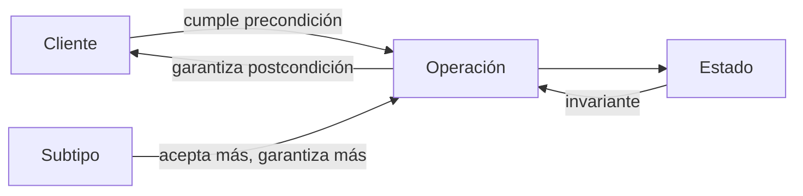
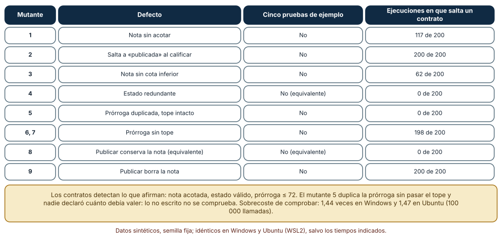
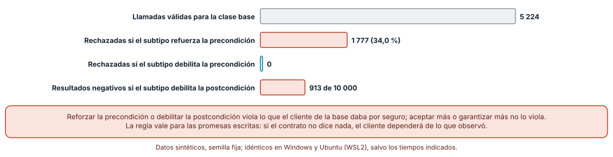
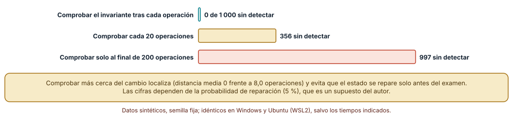

# SE-159 — Contratos, invariantes y diseño por contrato

[← SE-158 — Specification by Example y BDD](https://github.com/vladimiracunadev-create/modern-software-engineering-program/blob/main/classes/part-13-especificaciones-contratos-y-modelos/se-158-specification-by-example-y-bdd/README.md) · [↑ Parte 13](https://github.com/vladimiracunadev-create/modern-software-engineering-program/blob/main/classes/part-13-especificaciones-contratos-y-modelos/README.md) · [📚 Índice completo](https://github.com/vladimiracunadev-create/modern-software-engineering-program/blob/main/classes/README.md) · [🌐 Portal](https://vladimiracunadev-create.github.io/modern-software-engineering-program/classes/SE-159.html) · [SE-160 — Modelos estructurales, conductuales y de información →](https://github.com/vladimiracunadev-create/modern-software-engineering-program/blob/main/classes/part-13-especificaciones-contratos-y-modelos/se-160-modelos-estructurales-conductuales-y-de-informacion/README.md)

## Punto profesional y fundamento pedagógico

**Punto profesional.** La clase existe para escribir lo que un componente promete y exige como afirmaciones que se ejecutan, de modo que una violación se detecte en el punto donde ocurre y no tres módulos más adelante.

**Por qué aparece aquí.** Se sitúa después de **Specification by Example y BDD** y antes de **Modelos estructurales, conductuales y de información**: `SE-158` dejó ejemplos que separan lecturas de la regla de penalización; esta clase pregunta qué se cumple para todos los casos y no solo para los ejemplos. Fija precondiciones, postcondiciones e invariantes sobre el ciclo de vida de una calificación, y deja las afirmaciones que `SE-160` y `SE-161` convertirán en modelos de estructura y de estados.

**Error conceptual que debe corregir.** Creer que un contrato es documentación o un sinónimo de pruebas: un contrato ejecutable declara una responsabilidad compartida entre quien llama y quien implementa, y solo detecta lo que alguien tuvo la disciplina de escribir.

**Secuencia de aprendizaje.** Antes de leer la solución, predices qué defectos de una clase detectarán cinco pruebas de ejemplo y cuáles los contratos; después inyectas nueve defectos y mides, calculas qué rompe un subtipo que refuerza una precondición y comparas comprobar un invariante en cada operación, cada veinte o solo al final. La secuencia usa predicción, explicación propia, contraste y recuperación. [ICAP](https://icap.education.asu.edu/research) distingue participación de construcción de conocimiento; [How People Learn II](https://nap.nationalacademies.org/catalog/24783/how-people-learn-ii-learners-contexts-and-cultures) exige conectar conocimiento previo, contexto y transferencia; la [práctica de recuperación](https://pubmed.ncbi.nlm.nih.gov/16507066/) respalda producir de nuevo la explicación tras una demora; y [Education for Life and Work](https://nap.nationalacademies.org/resource/13398/dbasse_084153.pdf) exige devolución que explique la causa del error.

**Evidencia de aprendizaje.** `contracts-log.md` con la clase y sus contratos, los nueve defectos inyectados, qué detectó cada técnica, el cálculo del subtipo y la medición de distancia de detección. Debe contener predicción previa, observación, explicación causal, contraejemplo y qué hallazgo haría retirar un contrato.

**Límite de la conclusión.** Los defectos son nueve variaciones escritas por el autor sobre una clase de juguete; el conductor aleatorio respeta las precondiciones por construcción; la probabilidad de reparación del invariante (5 %) y el sobrecoste medido son de un equipo.

### Trazabilidad fuente → afirmación

| Fuente primaria u oficial | Afirmación que respalda | Lo que no prueba |
|---|---|---|
| [Meyer, «Applying design by contract» (IEEE Computer, 1992)](https://doi.org/10.1109/2.161279) | Formula el diseño por contrato: precondiciones, postcondiciones e invariantes como obligaciones y beneficios entre cliente y proveedor. | No mide cuántos defectos evitan en un proyecto concreto. |
| [Liskov y Wing, «A behavioral notion of subtyping» (TOPLAS, 1994)](https://doi.org/10.1145/197320.197383) | Un subtipo debe aceptar al menos lo que acepta el tipo base y garantizar al menos lo que este garantiza, para que los clientes de la base sigan funcionando. | No dice qué hacer cuando las propiedades no están escritas. |
| [Hoare, «An axiomatic basis for computer programming» (CACM, 1969)](https://doi.org/10.1145/363235.363259) | Introduce la tripleta precondición–instrucción–postcondición como forma de razonar sobre corrección. | No ofrece una herramienta práctica para un sistema grande. |

## Antes de empezar

Recupera lo aprendido en `SE-158`: tres ejemplos elegidos para separar variantes defectuosas superan a diez típicos. La pregunta activa es: **¿qué afirmaciones valen para todos los casos, quién debe cumplir cada una y dónde se comprueban?**

## Prerrequisitos

- Haber completado `SE-158` o poder explicar qué detecta y qué no una suite de ejemplos.
- Python 3.11 o posterior y un terminal; los contratos se escriben con `assert` y funciones, sin bibliotecas externas.
- Trabajar con la clase de calificación de la plataforma y datos sintéticos.

## Problema auténtico

La plataforma de entregas tiene una clase `Calificacion` con tres estados (borrador, calificada, publicada). Un día aparece una nota publicada sin valor, y otro una prórroga de 90 horas cuando el máximo es 72. Cada defecto se detectó en un módulo distinto del que lo introdujo, días después. Las pruebas de ejemplo de la clase pasaban.

## Objetivos observables

Al terminar podrás:

1. escribir precondiciones, postcondiciones e invariantes de una clase pequeña y asignar a cada una quién debe cumplirla;
2. medir qué defectos detecta un conjunto de contratos con un conductor aleatorio y cuáles se le escapan;
3. aplicar la regla de subtipado conductual para decidir qué cambios de contrato son seguros para los clientes de una clase base;
4. decidir con qué frecuencia comprobar un invariante y estimar su sobrecoste;
5. declarar qué contratos se comprueban en desarrollo, cuáles en producción y por qué.

## Mapa conceptual



El mapa se lee como un reparto de obligaciones: el cliente cumple la precondición y recibe la postcondición; el proveedor mantiene el invariante entre operaciones; un subtipo puede ampliar lo aceptado y reforzar lo garantizado, nunca lo contrario. No describe una secuencia de ejecución.

## Temas y por qué importan

| Tema | Por qué cambia una decisión profesional | Evidencia mínima |
|---|---|---|
| Precondiciones | Fijan qué debe cumplir quien llama; una violación es un defecto del cliente, no del proveedor. | Predicción, traza causal y contraejemplo de **Precondiciones** en `contracts-log.md` |
| Postcondiciones | Fijan lo que el proveedor garantiza al terminar; sin ellas el cliente depende de lo observado. | Predicción, traza causal y contraejemplo de **Postcondiciones** en `contracts-log.md` |
| Invariantes | Fijan lo que es verdad entre operaciones y localizan el momento en que se rompe. | Predicción, traza causal y contraejemplo de **Invariantes** en `contracts-log.md` |
| Subtipado conductual | Un cambio de contrato es seguro solo si acepta más y garantiza más. | Predicción, traza causal y contraejemplo de **Subtipado conductual** en `contracts-log.md` |
| Dónde comprobar | Comprobar cuesta; la política depende del riesgo y del coste de cada afirmación. | Predicción, traza causal y contraejemplo de **Dónde comprobar** en `contracts-log.md` |

## Conceptos y decisiones

### 1. Precondiciones

Una precondición dice qué debe ser cierto al llamar a una operación: `calificar` exige que la calificación no esté publicada; `dar_prórroga` exige horas positivas. El punto conceptual es el reparto de culpa: si la precondición falla, el defecto es del cliente, y el proveedor no tiene por qué comportarse bien. Esa precisión evita código defensivo repetido en cada capa y obliga a decidir quién valida la entrada. Una precondición demasiado débil traslada al proveedor casos que debería rechazar; una demasiado fuerte hace inutilizable la operación.

### 2. Postcondiciones

La postcondición describe lo que el proveedor garantiza al volver: tras `calificar`, la nota está en el rango y el estado es «calificada». Meyer la presenta como el beneficio del cliente a cambio de cumplir la precondición. Sirve a la persona que lee (describe lo que puede suponerse) y al comprobador (detecta violaciones sin conocer el cálculo). Su límite es que solo afirma lo escrito: una operación que duplica una prórroga sin pasar del tope cumple todas las postcondiciones que nadie escribió.

### 3. Invariantes

Un invariante es una propiedad de la clase que se cumple antes y después de cada operación pública: la nota está entre 0 y el máximo, una calificación publicada tiene nota, la prórroga no supera 72 horas. Se comprueba en las fronteras de las operaciones y no necesariamente dentro de ellas, donde el estado puede estar transitoriamente roto. Un invariante bien elegido concentra la definición de «estado válido» en un lugar y permite que un defecto se localice por el primer invariante que falla.

### 4. Subtipado conductual

Liskov y Wing formalizan cuándo una subclase puede sustituir a su base sin romper a los clientes: **precondición igual o más débil** (acepta al menos lo mismo), **postcondición igual o más fuerte** (garantiza al menos lo mismo) e **invariante preservado**. La herencia sintáctica no basta: una subclase `CalificacionEstricta` que exige `1 ≤ horas ≤ 48` donde la base acepta `0 ≤ horas ≤ 72` compila, hereda y rompe llamadas válidas. El criterio sirve también para versionar servicios: es el mismo principio de «aceptar más, devolver más» que reaparece en `SE-164`.

### 5. Dónde comprobar

Las comprobaciones cuestan tiempo y a veces dinero. Python permite desactivar las sentencias `assert` con la opción `-O`, de modo que las mismas afirmaciones sirven en desarrollo y se retiran donde el coste importa. Una política razonable es comprobarlo todo en pruebas e integración continua, mantener en producción solo las que protegen datos o dinero y que son baratas, y registrar —no ocultar— lo que se retira. Un contrato desactivado debe seguir expresando la expectativa en el código.

### Nueve defectos frente a cinco pruebas de ejemplo

La clase `Calificacion` tiene tres operaciones (`calificar`, `dar_prorroga`, `publicar`) y contratos con `assert`: precondiciones (no recalificar una publicada, horas positivas, publicar solo una calificada), una postcondición (tras calificar, la nota existe y el estado es «calificada») y tres invariantes (nota en 0–100, publicada implica nota, prórroga ≤ 72). Se escribieron nueve variantes defectuosas: nota sin acotar, salto a «publicada» al calificar, nota sin cota inferior, un cambio de estado redundante, prórroga duplicada con el tope intacto, prórroga sin tope (dos formas) y publicar que conserva o borra la nota. Dos de ellas (la redundante y la que conserva la nota) son equivalentes.

Cinco pruebas de ejemplo que miran solo salidas finales **no matan ninguna** de las nueve. Un conductor aleatorio que respeta las precondiciones (cuarenta operaciones por corrida, 200 semillas) hace saltar un contrato en: nota sin acotar, 117 corridas de 200; salto de estado, 200; nota sin cota inferior, 62; prórroga sin tope, 198 en las dos formas; publicar que borra la nota, 200. El conductor sin defecto no produjo ninguna violación, lo que confirma que no ataca a la clase con entradas ilegales. La prórroga duplicada dentro del tope (variante 5) **no la detecta nada**: ninguna afirmación dice cuánto debe valer la prórroga acumulada.

```python
def calificar(self, n):
    assert self.estado != "publicada", "pre: no se recalifica una publicada"
    self.nota = max(0, min(self.max_, n)); self.estado = "calificada"
    assert self.nota is not None and self.estado == "calificada", "post: queda calificada"
    self.inv()
```



**Cómo leer la figura.** Cada fila es un defecto; la columna final cuenta en cuántas de 200 corridas aleatorias saltó algún contrato. **Dónde deja de valer:** el resultado depende de qué contratos se escribieron; con otros se detectaría otra parte. El sobrecoste de comprobar fue de 1,44 veces en Windows y 1,47 en Ubuntu en un bucle de 100 000 llamadas, cifras de un equipo que se leen como orden de magnitud.

### Un subtipo que exige más

Se sortearon 10 000 retrasos de −20 a 120 horas. La clase base acepta `0 ≤ h ≤ 72`: 5 224 de las entradas son válidas para un cliente de la base. Un subtipo que reforzó la precondición a `1 ≤ h ≤ 48` rechaza **1 777** de esas llamadas válidas (34,0 %); uno que la debilitó a `−10 ≤ h ≤ 100` no rechaza ninguna. En la postcondición, un subtipo que garantiza «cualquier número» en lugar de «mayor o igual que cero» devuelve 913 resultados negativos de 10 000, que un cliente de la base no esperaba.



**Cómo leer la figura.** La barra gris es el universo de llamadas válidas; la coral, lo que se rompe al reforzar o debilitar donde no debe, y la verde, lo que no se rompe al aceptar más. **Dónde deja de valer:** el cálculo supone que los clientes usan solo las promesas escritas; los clientes reales dependen de comportamientos no prometidos (la ley de Hyrum), y para ellos casi cualquier cambio observable es rompedor.

### Cuándo comprobar el invariante

Un estado tiene dos campos relacionados (`nota_final = 0,9 × nota`, redondeada). Un defecto en la operación `t`, elegida entre la 20 y la 120 de 200 operaciones, suma 7 a `nota_final`; después, con probabilidad 0,05 por operación, otra operación recalcula todo y repara el estado sin avisar. En 1 000 corridas con semillas fijas, comprobar el invariante **tras cada operación** no pierde ninguna (distancia media de detección 0); comprobarlo **cada 20 operaciones** pierde 356 (distancia media 8,0 cuando detecta); comprobarlo **solo al final** pierde 997.



**Cómo leer la figura.** Cada barra cuenta cuántas de las 1 000 corridas terminan sin que se detecte el defecto; la verde es comprobar siempre. **Dónde deja de valer:** el 5 % de reparación silenciosa es un supuesto del autor, y un defecto que no se repara solo se detectaría también al final. La enseñanza es otra: cuanto más tarde se comprueba, más probable es que el estado se haya reparado (o corrompido más) y menos probable que la causa sea localizable.

## Definiciones de trabajo

- **precondición:** condición que debe cumplirse al invocar una operación; su incumplimiento es un defecto del cliente.
- **postcondición:** condición que la operación garantiza al terminar si se cumplió la precondición.
- **invariante de clase:** propiedad que se cumple antes y después de cada operación pública.
- **subtipado conductual:** relación por la que una subclase puede sustituir a su base aceptando al menos lo mismo y garantizando al menos lo mismo.
- **contrato ejecutable:** afirmación de un contrato escrita en código que puede comprobarse en ejecución o en pruebas.

Las definiciones son operativas para la plataforma de entregas. No convierten términos con historia más amplia en sinónimos y deben contrastarse con la documentación primaria enlazada al final.

## Ejemplo mínimo

El fragmento declara una precondición y una postcondición para la prórroga. Antes de ejecutarlo, predice cuál de las dos llamadas falla.

```python
def dar_prorroga(actual, horas):
    assert horas > 0, "pre: horas positivas"
    nueva = min(actual + horas, 72)
    assert actual <= nueva <= 72, "post: no baja ni supera el tope"
    return nueva

assert dar_prorroga(60, 24) == 72
try:
    dar_prorroga(10, 0)
except AssertionError as e:
    assert "pre" in str(e)
```

La segunda llamada viola la precondición: el defecto es de quien llama. Registra versión del intérprete y salida; ejecuta con `python -O` y observa qué desaparece.

## Ejemplo profesional

En la plataforma, cada operación pública de `Calificacion` documenta su contrato en el docstring (quién debe qué) y lo ejecuta con `assert` en pruebas. Los invariantes viven en un método `inv()` que cada operación llama al terminar. Un módulo de pruebas basadas en un conductor aleatorio ejecuta secuencias válidas y falla si algún contrato salta; un segundo conjunto ejecuta entradas ilegales y comprueba que la precondición correcta rechaza cada una. La política declara qué contratos se mantienen en producción (nota en rango, publicada con nota) y cuáles se retiran.

Compara el caso normal con una secuencia que alcanza el tope de prórroga, una calificación repetida y una publicación con nota 0. Un contrato es apropiado cuando esas tres situaciones están cubiertas por una afirmación; es peligroso cuando la única defensa es una prueba escrita para el caso típico.

## Práctica guiada

1. Escribe en prosa las promesas de las tres operaciones de la clase y marca quién debe cumplir cada una.
2. Predice cuántos defectos detectan cinco pruebas de ejemplo que solo miran salidas finales.
3. Convierte las promesas en `assert` (pre, post e invariantes) y escribe el conductor aleatorio.
4. Inyecta nueve defectos, ejecuta el conductor y registra cuántas corridas disparan un contrato.
5. Identifica un defecto que ningún contrato detecta y escribe la afirmación que lo haría visible.
6. Calcula qué rompe un subtipo con una precondición reforzada y uno con una debilitada.
7. Mide el sobrecoste de comprobar y pide a otra persona que reconstruya los contratos solo desde `contracts-log.md`.

## Ejercicios

1. **Afirmación faltante:** escribe la postcondición de `dar_prorroga` que detecte la variante que duplica la prórroga dentro del tope y comprueba que se dispara.
2. **Subtipo:** diseña una `CalificacionConRevision` válida (que acepta más y garantiza más) y otra inválida; explica con el cálculo de la clase por qué cada una lo es.
3. **Frecuencia:** repite la medición de distancia con probabilidades de reparación de 0,01 y 0,20 y explica cómo cambia la diferencia entre comprobar cada operación y cada 20.
4. **Política:** decide qué contratos mantendrías en producción en la plataforma y qué métrica te haría retirar alguno.

## Reto verificable

Entrega `contracts-log.md` con la clase y sus contratos, los nueve defectos, la tabla de qué detectó cada técnica, el cálculo del subtipo y la medición de frecuencia. Se aprueba si otra persona ejecuta el código desde un checkout limpio, obtiene los mismos conteos y puede señalar qué afirmación escribiría para el defecto que no se detectó. No se aprueba por el número de `assert` ni por una cobertura de líneas.

## Caso conductor

La plataforma de entregas es el caso conductor de la Parte 13. Esta clase deja los contratos de `Calificacion` (precondiciones, postcondición e invariantes) y un conductor aleatorio. `SE-160` modelará la estructura de esas entidades y `SE-161` el comportamiento como máquina de estados cuyos invariantes se comprobarán sobre todos los estados alcanzables. Cambia después un solo contrato, el tope de prórroga de 72 a 48 horas, y revisa qué ejemplos, pruebas y clientes dependían de él.

## Preguntas frecuentes

### ¿Un contrato reemplaza la validación de entradas?

No: la validación trata con entradas de fuera del sistema (formularios, mensajes) y debe responder con un error amable; la precondición expresa lo que un componente interno da por hecho. Mezclarlas hace que el código interno valide de más o que la frontera valide de menos.

### ¿Los contratos ralentizan producción?

Se midió un sobrecoste de 1,44 a 1,47 veces en un bucle muy pequeño; en un sistema real el efecto depende de qué se comprueba y con qué frecuencia. Python permite retirar los `assert` con `-O`, pero lo que se retira ya no protege.

### ¿Qué pasa si el contrato y el código discrepan?

Hay un defecto en alguno de los dos y hay que decidir cuál. Si el contrato refleja una regla de negocio acordada, se corrige el código; si el código encarna una decisión posterior, se actualiza el contrato y los ejemplos asociados.

### ¿Cómo se relacionan los contratos con los ejemplos de BDD?

Son complementarios: los ejemplos fijan puntos concretos y los contratos afirman lo que vale para todos los puntos. Un buen hábito es derivar un ejemplo de cada contrato (el caso límite) y un contrato de cada grupo de ejemplos (lo que tienen en común).

## Fallo controlado y diagnóstico

Reproduce el fallo clásico de la clase: **dar por cubierto lo que ningún contrato dice**. Usa la variante que duplica la prórroga dentro del tope.

Registra síntoma, entrada mínima, hipótesis, observación que descarta cada hipótesis, causa, corrección y prueba de regresión. **Síntoma:** un estudiante con 24 horas de prórroga recibe otras 12 y queda con 60 en lugar de 36, un valor dentro del tope que ningún invariante rechaza. **Hipótesis rivales:** (a) el invariante `prorroga ≤ 72` está mal escrito; (b) falta una postcondición que relacione el valor nuevo con el anterior. **Prueba:** ejecuta el conductor con el defecto: 0 corridas saltan, porque el campo se acota. **Conclusión:** la causa es una afirmación ausente, no incorrecta. **Regresión:** añade la postcondición `nueva == min(actual + horas, 72)` y una prueba que falle con la variante 5. No cambies a la vez el tope y la fórmula.

## Errores comunes y cómo corregirlos

| Síntoma | Causa probable | Corrección |
|---|---|---|
| El invariante falla lejos de donde se corrompió el estado | Se comprueba al final o cada muchas operaciones | Comprobar en la frontera de cada operación pública, al menos en pruebas |
| Una subclase rompe a los clientes de la base pese a compilar | Reforzó una precondición o debilitó una postcondición | Aplicar la regla: aceptar al menos lo mismo, garantizar al menos lo mismo |
| Los `assert` no se ejecutan en producción y nadie lo sabe | Se arrancó con `python -O` o la configuración los retira | Declarar la política y registrar qué contratos viven en producción |
| Una precondición validada en tres capas distintas | No se acordó quién valida la entrada | Decidir un responsable y expresar el resto como afirmaciones internas |
| Todos los contratos pasan y un defecto de lógica persiste | Falta una afirmación sobre esa relación | Escribir la afirmación que lo detectaría y medirla con una variante |

## Entorno y archivos clave

```text
work/SE-159/
├── README.md
├── contratos/
│   ├── calificacion.py
│   ├── conductor.py
│   └── subtipos.py
├── tests/test_contratos.py
└── evidence/contracts-log.md
```

El `README` declara plataforma, versión de Python, semillas y comandos. Los experimentos usan solo la biblioteca estándar (`random`, `time`) y se ejecutaron con CPython 3.12.9 en Windows 11 y 3.12.3 en Ubuntu bajo WSL2: las salidas fueron idénticas salvo los tiempos del sobrecoste, que se informan como medidas de un equipo. Si adoptas una biblioteca de contratos, fija procedencia y versión.

## Seguridad, ética y accesibilidad

- una invariante que protege notas, dinero o datos personales no debe retirarse en producción sin una decisión registrada y un responsable;
- los mensajes de las afirmaciones no deben incluir datos personales: terminan en registros y en informes de error;
- las precondiciones validan entradas externas en la frontera, nunca confiando solo en `assert`, que puede desactivarse;
- redacta los contratos con lenguaje comprensible para quien revisa la regla de negocio y ofrece una alternativa textual a las tablas;
- respeta las licencias de las bibliotecas de contratos y atribuye adaptaciones.

## Puente hacia el trabajo con agentes

Un agente al que se le pide «añade validaciones a esta clase» suele escribir comprobaciones defensivas dentro de cada método, sin separar precondición de postcondición ni decidir quién es responsable. Pídele que escriba explícitamente las tres categorías, que explique para cada una quién debe cumplirla, que proponga una variante defectuosa por afirmación y que ejecute el conductor aleatorio. Revisa especialmente si una precondición validó una entrada externa solo con `assert`: es el mismo defecto de la entrada ilegal, ahora con apariencia de contrato.

## Transferencia

Traslada el experimento a otro de los dominios persistentes (por ejemplo, un servicio de entregas a domicilio con estados de pedido): escribe contratos para `confirmar`, `despachar` y `entregar`, inyecta defectos y mide qué detectan. La transferencia está lograda cuando puedes explicar qué parte del método dependía de la clase y cuál no, no cuando los `assert` se parecen.

## Evaluación y evidencia

| Criterio | Evidencia para aprobar |
|---|---|
| comprensión | explicación de quién debe cumplir cada afirmación y de la regla de subtipado |
| corrección | tabla reproducible de defectos detectados con las mismas semillas |
| diseño | contratos que separan precondición, postcondición e invariante |
| diagnóstico | reproducción del fallo «afirmación ausente» con regresión |
| incertidumbre | declaración de qué defectos quedan fuera de los contratos escritos |
| reproducibilidad | versiones, comandos, salida y límites declarados |

## Fuentes

- [Meyer, «Applying design by contract» (IEEE Computer, 1992)](https://doi.org/10.1109/2.161279) — formulación del diseño por contrato; autoridad: IEEE Computer.
- [Liskov y Wing, «A behavioral notion of subtyping» (TOPLAS, 1994)](https://doi.org/10.1145/197320.197383) — subtipado conductual y reglas de sustitución; autoridad: ACM TOPLAS.
- [Hoare, «An axiomatic basis for computer programming» (CACM, 1969)](https://doi.org/10.1145/363235.363259) — tripleta precondición–instrucción–postcondición; autoridad: Communications of the ACM.
- [Eiffel: Design by Contract](https://www.eiffel.com/values/design-by-contract/) — descripción del mecanismo en el lenguaje que lo introdujo; autoridad: Eiffel Software.
- [Python: sentencia `assert`](https://docs.python.org/3/reference/simple_stmts.html#the-assert-statement) — semántica de `assert` y su desactivación; autoridad: documentación de Python.
- [Python: opción `-O`](https://docs.python.org/3/using/cmdline.html#cmdoption-O) — cómo se retiran las afirmaciones al ejecutar; autoridad: documentación de Python.

Cada fuente respalda el mecanismo indicado; ninguna demuestra que los contratos de la clase de calificación sean los que la institución necesita. Esa afirmación depende de las reglas y de quién las acuerda.

- [Python: `time.perf_counter`](https://docs.python.org/3/library/time.html#time.perf_counter) — reloj usado para medir el sobrecoste.
- [Python: `random`](https://docs.python.org/3/library/random.html) — semillas del conductor aleatorio.

## Límites y siguiente paso

Se ejecutaron tres experimentos con datos sintéticos en Windows y Ubuntu (WSL2) con resultados idénticos salvo los tiempos. No se usó ninguna biblioteca de contratos, los nueve defectos y la probabilidad de reparación son supuestos del autor y no se midió a ningún equipo. La siguiente clase pregunta qué estructura y qué comportamiento tienen las entidades cuyos contratos se acaban de escribir.

## Glosario

- **precondición:** condición que debe cumplirse al invocar una operación; su incumplimiento es un defecto del cliente.
- **postcondición:** condición que la operación garantiza al terminar si se cumplió la precondición.
- **invariante de clase:** propiedad que se cumple antes y después de cada operación pública.
- **subtipado conductual:** relación por la que una subclase puede sustituir a su base aceptando al menos lo mismo y garantizando al menos lo mismo.
- **contrato ejecutable:** afirmación de un contrato escrita en código que puede comprobarse en ejecución o en pruebas.

---

[← SE-158 — Specification by Example y BDD](https://github.com/vladimiracunadev-create/modern-software-engineering-program/blob/main/classes/part-13-especificaciones-contratos-y-modelos/se-158-specification-by-example-y-bdd/README.md) · [↑ Parte 13](https://github.com/vladimiracunadev-create/modern-software-engineering-program/blob/main/classes/part-13-especificaciones-contratos-y-modelos/README.md) · [📚 Índice completo](https://github.com/vladimiracunadev-create/modern-software-engineering-program/blob/main/classes/README.md) · [🌐 Portal](https://vladimiracunadev-create.github.io/modern-software-engineering-program/classes/SE-159.html) · [SE-160 — Modelos estructurales, conductuales y de información →](https://github.com/vladimiracunadev-create/modern-software-engineering-program/blob/main/classes/part-13-especificaciones-contratos-y-modelos/se-160-modelos-estructurales-conductuales-y-de-informacion/README.md)
