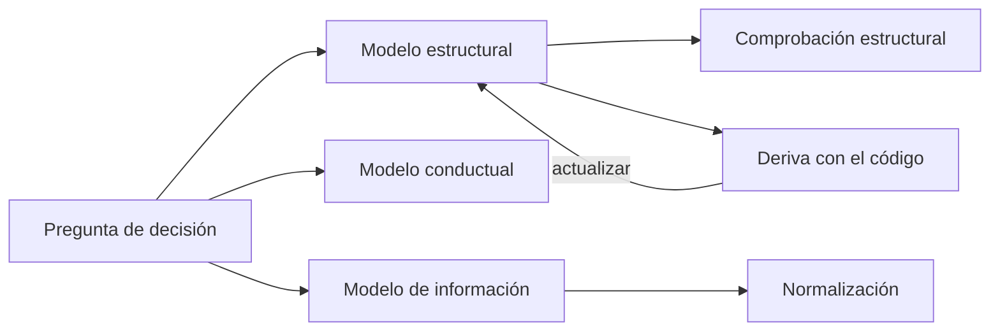
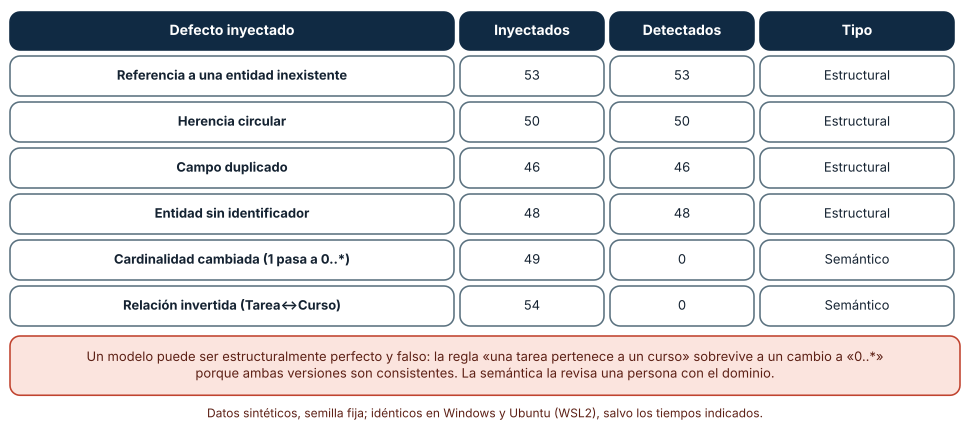
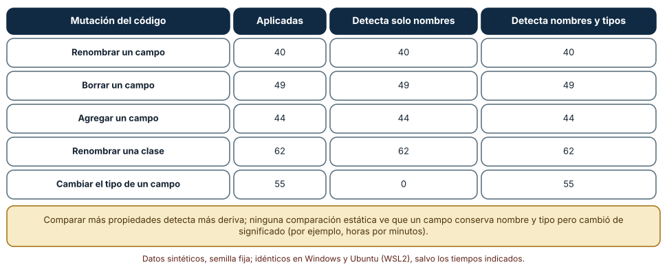
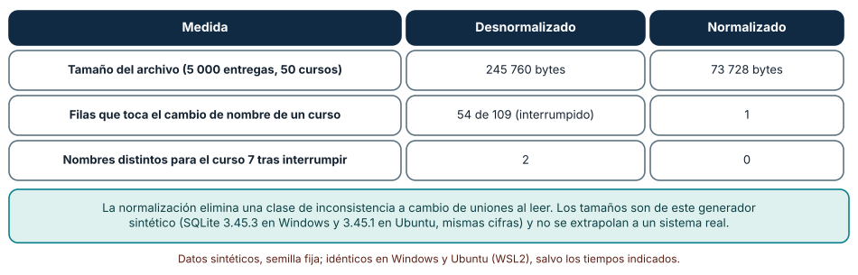

# SE-160 — Modelos estructurales, conductuales y de información

[← SE-159 — Contratos, invariantes y diseño por contrato](https://github.com/vladimiracunadev-create/modern-software-engineering-program/blob/main/classes/part-13-especificaciones-contratos-y-modelos/se-159-contratos-invariantes-y-diseno-por-contrato/README.md) · [↑ Parte 13](https://github.com/vladimiracunadev-create/modern-software-engineering-program/blob/main/classes/part-13-especificaciones-contratos-y-modelos/README.md) · [📚 Índice completo](https://github.com/vladimiracunadev-create/modern-software-engineering-program/blob/main/classes/README.md) · [🌐 Portal](https://vladimiracunadev-create.github.io/modern-software-engineering-program/classes/SE-160.html) · [SE-161 — Máquinas de estado y model checking introductorio →](https://github.com/vladimiracunadev-create/modern-software-engineering-program/blob/main/classes/part-13-especificaciones-contratos-y-modelos/se-161-maquinas-de-estado-y-model-checking-introductorio/README.md)

## Punto profesional y fundamento pedagógico

**Punto profesional.** La clase existe para elegir qué se modela (estructura, comportamiento o información), con qué nivel de detalle y cómo se comprueba que el modelo sigue diciendo la verdad del sistema, de modo que un diagrama deje de ser un dibujo que envejece.

**Por qué aparece aquí.** Se sitúa después de **Contratos, invariantes y diseño por contrato** y antes de **Máquinas de estado y model checking introductorio**: `SE-159` afirmó propiedades de una clase; esta clase pregunta qué entidades hay, cómo se relacionan y qué información guardan, y cómo se detecta cuando el modelo y el código se separan. Deja un modelo de ocho entidades de la plataforma de entregas con comprobaciones automáticas, y la entidad cuyo comportamiento `SE-161` modelará como máquina de estados.

**Error conceptual que debe corregir.** Creer que un modelo bien dibujado es un modelo correcto: la consistencia estructural se comprueba con una herramienta, la verdad semántica no, y un modelo no mantenido se vuelve una fuente de desinformación autorizada.

**Secuencia de aprendizaje.** Antes de leer la solución, predices qué defectos de un modelo detectará un comprobador y cuáles no; después inyectas defectos, mides la deriva entre un modelo y su código con dos criterios de comparación y compruebas en una base de datos qué cambia al normalizar. La secuencia usa predicción, explicación propia, contraste y recuperación. [ICAP](https://icap.education.asu.edu/research) distingue participación de construcción de conocimiento; [How People Learn II](https://nap.nationalacademies.org/catalog/24783/how-people-learn-ii-learners-contexts-and-cultures) exige conectar conocimiento previo, contexto y transferencia; la [práctica de recuperación](https://pubmed.ncbi.nlm.nih.gov/16507066/) respalda producir de nuevo la explicación tras una demora; y [Education for Life and Work](https://nap.nationalacademies.org/resource/13398/dbasse_084153.pdf) exige devolución que explique la causa del error.

**Evidencia de aprendizaje.** `models-log.md` con el modelo de entidades, el comprobador, las mutaciones inyectadas, la comparación de deriva con `ast` y la medición en SQLite. Debe contener predicción previa, observación, explicación causal, contraejemplo y qué hallazgo haría descartar el modelo.

**Límite de la conclusión.** El modelo tiene ocho entidades inventadas para la plataforma; el código es un fragmento de seis clases; los tamaños de SQLite son de un generador sintético. Ninguna comprobación estructural dice que las relaciones sean las que la institución quiere.

### Trazabilidad fuente → afirmación

| Fuente primaria u oficial | Afirmación que respalda | Lo que no prueba |
|---|---|---|
| [OMG: Unified Modeling Language](https://www.omg.org/spec/UML/) | Define una notación estándar de modelos estructurales (clases, componentes) y conductuales (estados, secuencias, actividades). | No prescribe qué modelar ni con qué detalle en un proyecto. |
| [Chen, «The entity-relationship model» (ACM TODS, 1976)](https://doi.org/10.1145/320434.320440) | Propone entidades, relaciones y cardinalidades como vista unificada de los datos. | No resuelve cómo mantener sincronizado el modelo con una base viva. |
| [Codd, «A relational model of data for large shared data banks» (CACM, 1970)](https://doi.org/10.1145/362384.362685) | Fundamenta el modelo relacional y la normalización para evitar redundancias que producen inconsistencias. | No mide el coste de las uniones en un sistema concreto. |

## Antes de empezar

Recupera lo aprendido en `SE-159`: una clase promete precondiciones, postcondiciones e invariantes. La pregunta activa es: **¿qué entidades existen, cómo se relacionan, qué información guardan y cómo se sabe que el modelo y el sistema siguen coincidiendo?**

## Prerrequisitos

- Haber completado `SE-159` o poder explicar qué es un invariante y dónde se comprueba.
- Python 3.11 o posterior y un terminal; los experimentos usan `ast`, `sqlite3` y la biblioteca estándar.
- Trabajar con las entidades de la plataforma de entregas y datos sintéticos.

## Problema auténtico

El equipo de la plataforma dibujó un diagrama de clases hace un año. Hoy el código tiene una clase `Prorroga` que el diagrama no recoge, el campo `plazo` pasó de fecha a número de horas y la relación entre `Tarea` y `Curso` es «muchos a muchos» en la base y «uno a uno» en el diagrama. Nadie lo notó hasta que un informe usó el diagrama para estimar el impacto de un cambio.

## Objetivos observables

Al terminar podrás:

1. distinguir un modelo estructural, uno conductual y uno de información, con un ejemplo y un contraejemplo de cada uno en la plataforma;
2. comprobar la consistencia estructural de un modelo (referencias, herencia, identificadores) y declarar qué defectos semánticos quedan fuera;
3. medir la deriva entre un modelo y el código con dos criterios de comparación y decidir cuál usar;
4. explicar con una medición qué elimina la normalización y qué cuesta;
5. decidir qué modelar y con qué detalle según qué decisión debe habilitar.

## Mapa conceptual



El mapa se lee desde la pregunta que el modelo debe responder: según ella se elige la vista. Las comprobaciones (estructural, de deriva, de normalización) acotan lo que un modelo puede decir con verdad; la flecha de retorno indica que una deriva detectada obliga a actualizar el modelo o el código, no a ignorarla.

## Temas y por qué importan

| Tema | Por qué cambia una decisión profesional | Evidencia mínima |
|---|---|---|
| Modelos estructurales | Muestran partes y relaciones; sirven para razonar sobre dependencias y alcance de cambios. | Predicción, traza causal y contraejemplo de **Modelos estructurales** en `models-log.md` |
| Modelos conductuales | Muestran cómo cambia el sistema en el tiempo; sirven donde importan los estados y el orden. | Predicción, traza causal y contraejemplo de **Modelos conductuales** en `models-log.md` |
| Modelos de información | Muestran qué se guarda y con qué restricciones; deciden dónde puede aparecer una inconsistencia. | Predicción, traza causal y contraejemplo de **Modelos de información** en `models-log.md` |
| Nivel de detalle | Un modelo útil omite casi todo; lo que omite define qué decisiones puede apoyar. | Predicción, traza causal y contraejemplo de **Nivel de detalle** en `models-log.md` |
| Mantener el modelo | Un modelo que no se comprueba contra el sistema se vuelve falso sin avisar. | Predicción, traza causal y contraejemplo de **Mantener el modelo** en `models-log.md` |

## Conceptos y decisiones

### 1. Modelos estructurales

Un modelo estructural describe qué partes existen y cómo se conectan: entidades con atributos, relaciones con cardinalidad, componentes con dependencias. Responde a preguntas de alcance («¿qué toca cambiar la entrega si cambia el curso?») y de coherencia («¿toda prórroga pertenece a una tarea y a una estudiante?»). Su límite es que no dice cuándo ni en qué orden ocurre algo. UML ofrece una notación estándar; para muchos fines basta una tabla de entidades con sus campos y referencias, comprobable por programa.

### 2. Modelos conductuales

Un modelo conductual describe cómo evoluciona el sistema: estados y transiciones, secuencias de mensajes, flujos de actividad. Sirve cuando el orden importa (una entrega no se publica antes de calificarse) y cuando hay concurrencia. Su fortaleza es que se puede recorrer: una máquina de estados admite análisis exhaustivo, tema de `SE-161`. Su debilidad es el crecimiento: un diagrama con cuarenta estados deja de ser legible, y se pasa a una tabla o a un programa.

### 3. Modelos de información

Un modelo de información declara qué datos se almacenan, cuáles son claves, qué es único y qué restricciones se cumplen. La **normalización** de Codd organiza los datos para que cada hecho se guarde en un solo lugar: el nombre de un curso no se repite en cada entrega. Su efecto es eliminar una clase de inconsistencia (dos nombres para el mismo curso); su coste es leer con uniones. La decisión de desnormalizar es legítima cuando la lectura domina y la escritura es controlada, pero debe tomarse sabiendo qué inconsistencia se acepta.

### 4. Nivel de detalle

Un modelo que lo incluye todo es el sistema. Un modelo útil responde a una pregunta: para estimar el impacto de un cambio basta con entidades y relaciones; para razonar sobre una publicación basta con los estados; para escribir un esquema hacen falta tipos y restricciones. Mezclar niveles en un mismo diagrama (atributos privados de una clase junto a la relación entre contextos del sistema) produce un dibujo que no sirve para ninguna decisión. Conviene nombrar la pregunta en el título del modelo.

### 5. Mantener el modelo

Un modelo se mantiene si alguna comprobación falla cuando deja de ser cierto. Eso se logra generándolo a partir del código o comparándolo con él en integración continua. La comparación depende de lo que se compare: solo nombres detecta renombrados y borrados; añadir tipos detecta cambios de significado numérico; ninguna comparación estática ve que un campo conservó nombre y tipo pero pasó de horas a minutos. Cada criterio compra un tipo de confianza y deja otro sin cubrir.

### Qué defectos ve un comprobador estructural

El modelo de la plataforma tiene ocho entidades (`Estudiante`, `Curso`, `Tarea`, `Entrega`, `EntregaTardia` como especialización de `Entrega`, `Calificacion`, `Prorroga` y `Apelacion`), campos y referencias con cardinalidad. El comprobador verifica cuatro propiedades: que toda referencia apunte a una entidad existente, que la herencia no sea circular, que no haya campos duplicados y que cada entidad tenga identificador. Se aplicaron 300 mutaciones con semilla fija, cada una con un defecto de uno de seis tipos.

Las cuatro mutaciones estructurales se detectaron todas: referencia colgante, 53 de 53; herencia circular, 50 de 50; campo duplicado, 46 de 46; sin identificador, 48 de 48. Las dos semánticas no se detectó ninguna: cambiar la cardinalidad de `Entrega → Tarea` de «1» a «0..*», 0 de 49; e invertir la relación entre `Tarea` y `Curso`, 0 de 54. El resultado es idéntico en Windows y Ubuntu.

```python
def comprobar(m):
    errores = set()
    for nombre, e in m.items():
        for destino, _ in e["refs"]:
            if destino not in m: errores.add("referencia colgante")
        ...
    return errores
```



**Cómo leer la figura.** Cada fila es un tipo de defecto con cuántas veces se inyectó y cuántas se detectó; las dos últimas son semánticas. **Dónde deja de valer:** el comprobador solo ve propiedades que alguien escribió como regla; un modelo con la cardinalidad equivocada es estructuralmente perfecto. La corrección semántica exige que una persona con el dominio lea el modelo y lo contraste con la política.

### Deriva entre el modelo y el código

Se escribió un fragmento de código con seis clases anotadas (`id: str`, `plazo: int`, …) y se extrajo su estructura con `ast`. Se aplicaron 250 mutaciones al texto del código: renombrar un campo (40), borrar un campo (49), agregar un campo (44), renombrar una clase (62) y cambiar el tipo de un campo (55). Comparar solo **nombres** detecta renombrados, borrados, agregados y renombrado de clases (los 195) y **ninguno** de los 55 cambios de tipo; comparar nombres y **anotaciones de tipo** detecta los 250.

```python
def extraer(src, con_tipos):
    for c in [n for n in ast.parse(src).body if isinstance(n, ast.ClassDef)]:
        campos = {s.target.id: (ast.unparse(s.annotation) if con_tipos else None)
                  for s in c.body if isinstance(s, ast.AnnAssign)}
```



**Cómo leer la figura.** Cada fila es un tipo de cambio en el código; las dos columnas finales cuentan cuántos detecta cada criterio de comparación. **Dónde deja de valer:** `ast` lee la forma del código, no su significado: un campo que sigue llamándose `plazo` y siendo `int` pero pasa de horas a minutos no cambia ninguna comparación. El criterio crece con más propiedades (valores por defecto, restricciones), no con más fe.

### Qué elimina la normalización

En SQLite 3.45 se construyeron dos bases con 5 000 entregas y 50 cursos (nombres de 34 caracteres): una **desnormalizada**, con el nombre del curso repetido en cada entrega, y una **normalizada**, con una tabla de cursos y la entrega con una clave. La desnormalizada ocupó 245 760 bytes y la normalizada 73 728. Se cambió el nombre del curso 7 (109 entregas): la normalizada actualizó **1** fila; en la desnormalizada se simuló una actualización interrumpida a la mitad (54 de 109 filas) y quedaron **dos nombres distintos** para el mismo curso. Las cifras fueron las mismas con SQLite 3.45.3 en Windows y 3.45.1 en Ubuntu.

```python
con.execute("create table curso(id integer primary key, nombre text)")
con.execute("create table entrega(id integer primary key, curso_id integer, estudiante integer)")
```



**Cómo leer la figura.** Cada fila es una medida; las dos columnas comparan el diseño desnormalizado y el normalizado. **Dónde deja de valer:** el tamaño depende del generador (nombres largos y repetidos) y no se extrapola a un sistema real; la ganancia de la normalización se paga leyendo con uniones, algo que este experimento no midió, y una transacción habría evitado la interrupción a medias, otra defensa distinta de normalizar.

## Definiciones de trabajo

- **modelo estructural:** descripción de las partes de un sistema y sus relaciones, sin el orden en que ocurren las cosas.
- **modelo conductual:** descripción de cómo cambia el sistema en el tiempo mediante estados, transiciones o secuencias.
- **modelo de información:** descripción de los datos almacenados, sus claves, unicidades y restricciones.
- **normalización:** organización de los datos de modo que cada hecho se guarde en un único lugar.
- **deriva:** diferencia entre lo que un modelo afirma y lo que el sistema hace.

Las definiciones son operativas para la plataforma de entregas. No convierten términos con historia más amplia en sinónimos y deben contrastarse con la documentación primaria enlazada al final.

## Ejemplo mínimo

El fragmento comprueba que toda referencia de un modelo apunte a una entidad existente. Antes de ejecutarlo, predice cuál es el error.

```python
modelo = {
    "Tarea": {"refs": ["Curso"]},
    "Entrega": {"refs": ["Tarea", "Estudiante"]},
    "Curso": {"refs": []},
}
colgantes = [(n, r) for n, e in modelo.items() for r in e["refs"] if r not in modelo]
assert colgantes == [("Entrega", "Estudiante")]
```

La entidad `Estudiante` se referencia sin existir en el modelo; el comprobador la encuentra por enumeración. Registra versión del intérprete y salida; añade la entidad y comprueba que el error desaparece.

## Ejemplo profesional

En la plataforma, el modelo de entidades vive en un archivo estructurado junto al código (entidad, campos con tipo, referencias con cardinalidad). Un comprobador de integración continua verifica la consistencia estructural; un segundo extrae del código las clases con `ast` y compara nombres y tipos con el modelo, y falla con un mensaje que dice qué cambio de qué archivo causó la divergencia. Los diagramas para humanos se generan a partir de ese archivo, no al revés. Las decisiones de normalización se documentan por tabla (qué se repite, por qué y qué inconsistencia se acepta).

Compara el caso normal con una entidad nueva sin documentar, un campo cuyo significado cambió y una relación con la cardinalidad invertida. Un modelo es apropiado cuando los dos primeros casos hacen fallar la integración continua; es peligroso cuando el tercero pasa y nadie lo revisa.

## Práctica guiada

1. Enumera las entidades de la plataforma y escribe sus campos y referencias con cardinalidad en un archivo estructurado.
2. Predice qué defectos detectará un comprobador estructural y cuáles no.
3. Implementa el comprobador (referencias, herencia, duplicados, identificadores) y aplica 300 mutaciones.
4. Extrae del código las clases con `ast` y compara con el modelo usando solo nombres y luego nombres y tipos.
5. Crea la base desnormalizada y la normalizada, actualiza el nombre de un curso y mide filas tocadas e inconsistencias.
6. Escribe qué pregunta responde cada modelo y qué omite.
7. Entrega `models-log.md` y pide a otra persona que añada una entidad guiándose solo por el modelo.

## Ejercicios

1. **Defecto semántico:** diseña una comprobación que detecte el cambio de cardinalidad de `Entrega → Tarea` usando ejemplos de datos (¿qué dato lo delata?) y explica qué no cubre.
2. **Deriva:** añade al extractor los valores por defecto de los campos y mide cuántas mutaciones nuevas detecta.
3. **Normalización:** calcula cuántas filas toca cambiar el nombre de un curso con 1 000, 5 000 y 50 000 entregas en cada diseño.
4. **Nivel de detalle:** dibuja el mismo sistema en tres niveles (contexto, entidades, tabla) y escribe para cada uno la decisión que apoya.

## Reto verificable

Entrega `models-log.md` con el modelo, el comprobador, las 300 mutaciones, la comparación de deriva con dos criterios y la medición en SQLite. Se aprueba si otra persona ejecuta el código desde un checkout limpio, obtiene los mismos conteos y puede señalar qué defecto semántico no detecta el comprobador. No se aprueba por el número de entidades ni por la belleza del diagrama.

## Caso conductor

La plataforma de entregas es el caso conductor de la Parte 13. Esta clase deja el modelo de ocho entidades con comprobadores de consistencia y de deriva. `SE-161` tomará la entidad `Entrega` y modelará su ciclo de vida como máquina de estados, y `SE-162` convertirá los campos y restricciones en esquemas de validación. Cambia después una sola decisión, hacer opcional la prórroga por tarea, y revisa qué parte del modelo, de la base y del código cambia.

## Preguntas frecuentes

### ¿Hace falta UML para modelar?

No: UML es una notación estándar útil para comunicar, pero un archivo estructurado con entidades, campos y referencias, o una tabla, puede ser más fácil de comprobar por programa. Lo importante es que el modelo responda a una pregunta y se mantenga.

### ¿Cuándo conviene desnormalizar?

Cuando la lectura domina, las actualizaciones están controladas (transacciones, un único escritor) y la inconsistencia que se acepta es tolerable. El experimento muestra lo que se arriesga: una actualización interrumpida deja dos nombres para el mismo curso.

### ¿Un modelo generado desde el código es mejor?

Evita la deriva por construcción, pero solo refleja lo que el código expresa: no recoge la intención ni las relaciones que el código no declara. Muchos equipos combinan: el código genera la estructura y las personas anotan la semántica.

### ¿Cómo sé qué nivel de detalle necesita el modelo?

Pregúntate qué decisión debe apoyar. Si nadie puede nombrar una decisión que cambie según un detalle del modelo, ese detalle sobra o pertenece a otro modelo.

## Fallo controlado y diagnóstico

Reproduce el fallo clásico de la clase: **dar por verdadero un modelo que nadie comprueba**. Cambia en el código el tipo de `plazo` de fecha a número de horas y deja el modelo como está.

Registra síntoma, entrada mínima, hipótesis, observación que descarta cada hipótesis, causa, corrección y prueba de regresión. **Síntoma:** un informe de impacto, hecho a partir del modelo, subestima el trabajo porque cree que `plazo` es una fecha. **Hipótesis rivales:** (a) el informe usó mal el modelo; (b) el modelo ya no coincidía con el código. **Prueba:** ejecuta la comparación de deriva solo con nombres (no detecta nada: 0 de 55 cambios de tipo) y luego con nombres y tipos (detecta el cambio). **Conclusión:** la causa es un criterio de comparación demasiado débil. **Regresión:** pasa a comparar nombres y tipos en integración continua y añade una prueba con una mutación de tipo. No cambies a la vez el extractor y el modelo.

## Errores comunes y cómo corregirlos

| Síntoma | Causa probable | Corrección |
|---|---|---|
| El diagrama no coincide con la base en producción | Se dibujó una vez y no se comprueba | Generar el diagrama desde un archivo que se compara con el código o la base |
| El comprobador estructural da verde y la relación está invertida | La semántica no es comprobable estructuralmente | Revisión por una persona con el dominio y ejemplos de datos que contradigan la relación |
| El mismo dato aparece en cinco tablas con valores distintos | Desnormalización sin control de escritura | Normalizar o centralizar la escritura en una sola operación transaccional |
| El diagrama tiene tantos detalles que nadie lo lee | Mezcla niveles de detalle | Separar vistas y titular cada una con la pregunta que responde |
| Un cambio de tipo pasa inadvertido en la revisión | El criterio de deriva solo mira nombres | Incluir tipos (y restricciones) en la comparación |

## Entorno y archivos clave

```text
work/SE-160/
├── README.md
├── modelo/
│   ├── entidades.py
│   ├── comprobar.py
│   └── deriva.py
├── tests/test_modelo.py
└── evidence/models-log.md
```

El `README` declara plataforma, versión de Python, semillas y comandos. Los experimentos usan solo la biblioteca estándar (`ast`, `sqlite3`, `random`) y se ejecutaron con CPython 3.12.9 en Windows 11 (SQLite 3.45.3) y 3.12.3 en Ubuntu bajo WSL2 (SQLite 3.45.1) con salidas idénticas. Si añades una dependencia de modelado, fija procedencia y versión.

## Seguridad, ética y accesibilidad

- un modelo de información puede incluir datos personales: etiqueta los campos sensibles y decide qué circula en documentos y diagramas;
- las bases de los experimentos usan datos sintéticos; no copies datos reales de estudiantes a ejemplos que circulan;
- los diagramas deben tener alternativa textual (una tabla o una descripción) y no depender solo del color;
- el modelo es una autoridad aparente: registra quién lo aprobó y cuándo, para que una decisión no se justifique con un dibujo caduco;
- respeta las licencias de las notaciones y herramientas de modelado y atribuye adaptaciones.

## Puente hacia el trabajo con agentes

Un agente al que se le pide «dibuja el diagrama de clases del sistema» devolverá un diagrama plausible a partir de los nombres, con relaciones inferidas que pueden no existir. Pídele que genere el modelo desde el código con `ast` o desde el esquema de la base, que marque cada relación como declarada o inferida y que ejecute el comprobador de deriva. Revisa especialmente las cardinalidades: es el defecto que el comprobador estructural no ve y que un diagrama bonito esconde.

## Transferencia

Traslada el experimento a otro de los dominios persistentes (por ejemplo, un servicio de entregas a domicilio con pedidos, repartidores y rutas): modela las entidades, inyecta defectos y mide qué detecta el comprobador. La transferencia está lograda cuando puedes explicar qué parte del método dependía del sistema y cuál no, no cuando el diagrama se parece.

## Evaluación y evidencia

| Criterio | Evidencia para aprobar |
|---|---|
| comprensión | explicación de qué decisión apoya cada tipo de modelo y qué omite |
| corrección | conteos reproducibles de defectos detectados y de deriva con las mismas semillas |
| diseño | modelo en un formato comprobable, con cardinalidades y claves |
| diagnóstico | reproducción del fallo «modelo no comprobado» con regresión |
| incertidumbre | declaración de qué defectos semánticos quedan fuera de la comprobación |
| reproducibilidad | versiones, comandos, salida y límites declarados |

## Fuentes

- [OMG: Unified Modeling Language](https://www.omg.org/spec/UML/) — especificación de la notación de modelos estructurales y conductuales; autoridad: Object Management Group.
- [Chen, «The entity-relationship model» (ACM TODS, 1976)](https://doi.org/10.1145/320434.320440) — entidades, relaciones y cardinalidades; autoridad: ACM Transactions on Database Systems.
- [Codd, «A relational model of data for large shared data banks» (CACM, 1970)](https://doi.org/10.1145/362384.362685) — modelo relacional y fundamento de la normalización; autoridad: Communications of the ACM.
- [The C4 model](https://c4model.com/) — vistas de la arquitectura por nivel de detalle; autoridad: autor del modelo.
- [Harel, «Statecharts» (Science of Computer Programming, 1987)](https://doi.org/10.1016/0167-6423%2887%2990035-9) — formalismo visual para modelos conductuales; autoridad: Science of Computer Programming.
- [SWEBOK Guide v4.0a](https://www.computer.org/education/bodies-of-knowledge/software-engineering) — modelado y diseño de software; autoridad: IEEE Computer Society.

Cada fuente respalda el mecanismo indicado; ninguna demuestra que el modelo de ocho entidades de la clase sea el de la institución. Esa afirmación depende de las reglas y de quién las revisa.

- [Python: `ast`](https://docs.python.org/3/library/ast.html) — análisis del árbol sintáctico usado para extraer clases y campos.
- [Python: `sqlite3`](https://docs.python.org/3/library/sqlite3.html) — interfaz con SQLite usada en la medición.
- [SQLite: UPDATE](https://www.sqlite.org/lang_update.html) — semántica de la actualización usada en el experimento.

## Límites y siguiente paso

Se ejecutaron tres experimentos con datos sintéticos en Windows y Ubuntu (WSL2) con resultados idénticos. No se midió el coste de lectura con uniones, no se usó una herramienta de modelado ni se comparó con un sistema real, y las mutaciones son construcciones del autor. La siguiente clase toma la entidad `Entrega` y pregunta cómo se explora todo su comportamiento posible.

## Glosario

- **modelo estructural:** descripción de las partes de un sistema y sus relaciones, sin el orden en que ocurren las cosas.
- **modelo conductual:** descripción de cómo cambia el sistema en el tiempo mediante estados, transiciones o secuencias.
- **modelo de información:** descripción de los datos almacenados, sus claves, unicidades y restricciones.
- **normalización:** organización de los datos de modo que cada hecho se guarde en un único lugar.
- **deriva:** diferencia entre lo que un modelo afirma y lo que el sistema hace.

---

[← SE-159 — Contratos, invariantes y diseño por contrato](https://github.com/vladimiracunadev-create/modern-software-engineering-program/blob/main/classes/part-13-especificaciones-contratos-y-modelos/se-159-contratos-invariantes-y-diseno-por-contrato/README.md) · [↑ Parte 13](https://github.com/vladimiracunadev-create/modern-software-engineering-program/blob/main/classes/part-13-especificaciones-contratos-y-modelos/README.md) · [📚 Índice completo](https://github.com/vladimiracunadev-create/modern-software-engineering-program/blob/main/classes/README.md) · [🌐 Portal](https://vladimiracunadev-create.github.io/modern-software-engineering-program/classes/SE-160.html) · [SE-161 — Máquinas de estado y model checking introductorio →](https://github.com/vladimiracunadev-create/modern-software-engineering-program/blob/main/classes/part-13-especificaciones-contratos-y-modelos/se-161-maquinas-de-estado-y-model-checking-introductorio/README.md)
