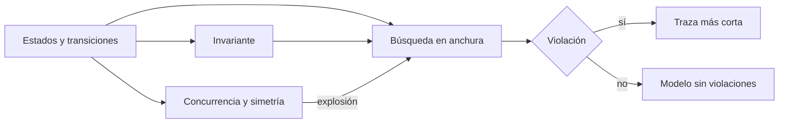
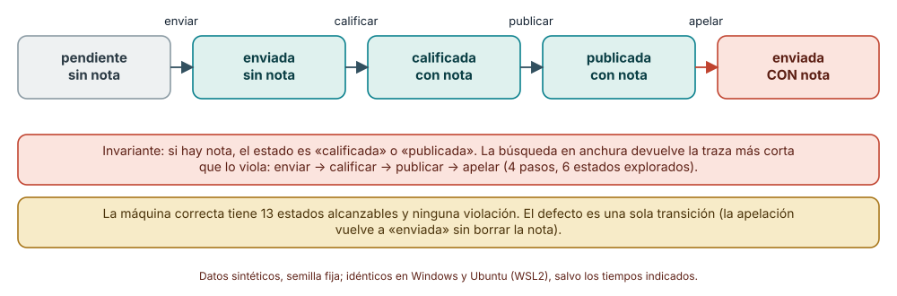
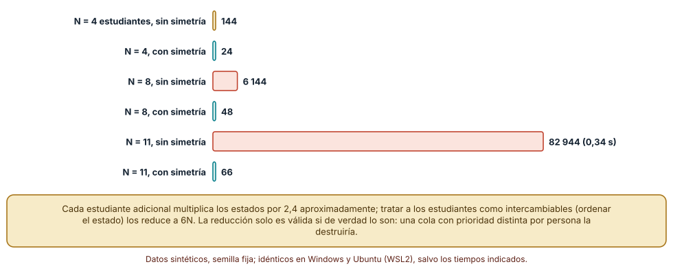
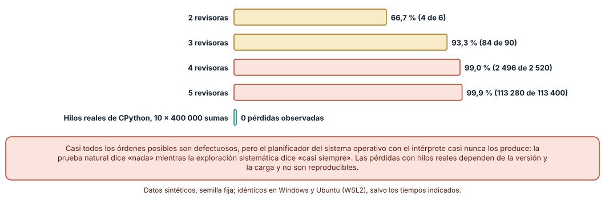

# SE-161 — Máquinas de estado y model checking introductorio

[← SE-160 — Modelos estructurales, conductuales y de información](https://github.com/vladimiracunadev-create/modern-software-engineering-program/blob/main/classes/part-13-especificaciones-contratos-y-modelos/se-160-modelos-estructurales-conductuales-y-de-informacion/README.md) · [↑ Parte 13](https://github.com/vladimiracunadev-create/modern-software-engineering-program/blob/main/classes/part-13-especificaciones-contratos-y-modelos/README.md) · [📚 Índice completo](https://github.com/vladimiracunadev-create/modern-software-engineering-program/blob/main/classes/README.md) · [🌐 Portal](https://vladimiracunadev-create.github.io/modern-software-engineering-program/classes/SE-161.html) · [SE-162 — Esquemas de datos y validación →](https://github.com/vladimiracunadev-create/modern-software-engineering-program/blob/main/classes/part-13-especificaciones-contratos-y-modelos/se-162-esquemas-de-datos-y-validacion/README.md)

## Punto profesional y fundamento pedagógico

**Punto profesional.** La clase existe para modelar el comportamiento de una entidad como máquina de estados y explorar todos sus estados alcanzables con una búsqueda, de modo que una violación de un invariante llegue acompañada de la traza más corta que la produce y no de una sospecha.

**Por qué aparece aquí.** Se sitúa después de **Modelos estructurales, conductuales y de información** y antes de **Esquemas de datos y validación**: `SE-160` mostró qué entidades hay y cómo se relacionan; esta clase toma la entrega y pregunta qué recorridos admite su ciclo de vida y cuáles son ilegales. Deja una máquina de estados con invariantes comprobados exhaustivamente y una estimación honesta de cuándo esa exploración deja de ser viable.

**Error conceptual que debe corregir.** Creer que un diagrama de estados revisado a ojo es suficiente, o que una prueba de estrés encuentra las carreras: los estados ilegales aparecen por combinaciones de transiciones que nadie dibujó, y los planificadores naturales casi nunca producen los intercalados que los exponen.

**Secuencia de aprendizaje.** Antes de leer la solución, predices si una máquina con una transición defectuosa se detectará con una búsqueda y cuántos pasos tendrá la traza; después ejecutas la búsqueda en anchura, cuentas estados al crecer el número de estudiantes con y sin reducción por simetría, y comparas explorar todos los intercalados de una carrera con dejar que los hilos del sistema la produzcan. La secuencia usa predicción, explicación propia, contraste y recuperación. [ICAP](https://icap.education.asu.edu/research) distingue participación de construcción de conocimiento; [How People Learn II](https://nap.nationalacademies.org/catalog/24783/how-people-learn-ii-learners-contexts-and-cultures) exige conectar conocimiento previo, contexto y transferencia; la [práctica de recuperación](https://pubmed.ncbi.nlm.nih.gov/16507066/) respalda producir de nuevo la explicación tras una demora; y [Education for Life and Work](https://nap.nationalacademies.org/resource/13398/dbasse_084153.pdf) exige devolución que explique la causa del error.

**Evidencia de aprendizaje.** `states-log.md` con la tabla de transiciones, el verificador, el invariante, la traza del contraejemplo, la tabla de crecimiento de estados y la enumeración de intercalados. Debe contener predicción previa, observación, explicación causal, contraejemplo y qué hallazgo haría dar por inválido el modelo.

**Límite de la conclusión.** El modelo es una abstracción de la entrega con cinco estados; el verificador es una búsqueda mínima y no TLA+ ni SPIN; los hilos reales de CPython dependen de la versión y de la carga, y el resultado de «cero pérdidas» no es reproducible en general.

### Trazabilidad fuente → afirmación

| Fuente primaria u oficial | Afirmación que respalda | Lo que no prueba |
|---|---|---|
| [Clarke y Emerson, «Design and synthesis of synchronization skeletons» (1981)](https://doi.org/10.1007/BFb0025774) | Origen del model checking: explorar el espacio de estados de un sistema finito para comprobar propiedades temporales. | No dice que se pueda explorar un sistema real de tamaño arbitrario. |
| [Holzmann, «The model checker SPIN» (IEEE TSE, 1997)](https://doi.org/10.1109/32.588521) | Describe una herramienta que explora estados de sistemas concurrentes y devuelve contraejemplos. | No garantiza que el modelo describa fielmente el sistema. |
| [Harel, «Statecharts» (1987)](https://doi.org/10.1016/0167-6423%2887%2990035-9) | Propone estados jerárquicos y concurrentes para evitar la explosión de un diagrama plano. | No cuantifica cuánto se reduce un modelo concreto. |

## Antes de empezar

Recupera lo aprendido en `SE-160`: un modelo conductual muestra cómo cambia el sistema en el tiempo. La pregunta activa es: **¿qué estados puede alcanzar una entrega, cuáles violan lo que prometimos, y cuánto cuesta saberlo con certeza?**

## Prerrequisitos

- Haber completado `SE-160` o poder explicar para qué sirve un modelo conductual.
- Python 3.11 o posterior y un terminal; el verificador usa `collections.deque` y `threading`.
- Trabajar con el ciclo de vida de una entrega y datos sintéticos.

## Problema auténtico

El ciclo de vida de una entrega parece sencillo: pendiente, enviada, calificada, publicada. Se añade la apelación, que permite recalificar una entrega publicada, y un revisor reporta una entrega «enviada» con nota todavía puesta. El diagrama dibujado a mano no tiene ninguna flecha que explique cómo llegó ahí.

## Objetivos observables

Al terminar podrás:

1. modelar una entidad como estados, transiciones e invariantes y distinguir un invariante de una propiedad de vivacidad;
2. explorar con una búsqueda en anchura todos los estados alcanzables y obtener la traza más corta de una violación;
3. predecir cómo crece el número de estados con la concurrencia y cuándo una reducción por simetría es legítima;
4. explicar por qué un intercalado defectuoso puede ser casi universal en el modelo y casi inexistente en la ejecución;
5. declarar qué garantiza la exploración exhaustiva de un modelo y qué no garantiza sobre el sistema real.

## Mapa conceptual



El mapa se lee desde las transiciones: junto con el invariante alimentan la búsqueda, que devuelve una traza o confirma que no hay violación en el modelo. La concurrencia multiplica los estados y retroalimenta el coste de la búsqueda. «Sin violaciones» se refiere al modelo, no al sistema.

## Temas y por qué importan

| Tema | Por qué cambia una decisión profesional | Evidencia mínima |
|---|---|---|
| Estados y transiciones | Hacen explícito qué recorridos son legales; lo que no está dibujado queda prohibido o indefinido. | Predicción, traza causal y contraejemplo de **Estados y transiciones** en `states-log.md` |
| Invariantes y propiedades | Un invariante dice qué estados son malos; la vivacidad dice qué debe terminar ocurriendo. | Predicción, traza causal y contraejemplo de **Invariantes y propiedades** en `states-log.md` |
| Exploración exhaustiva | Recorrer todos los estados da certeza dentro del modelo y un contraejemplo mínimo si falla. | Predicción, traza causal y contraejemplo de **Exploración exhaustiva** en `states-log.md` |
| Explosión de estados | La concurrencia multiplica estados; sin una reducción, la verificación se vuelve inviable. | Predicción, traza causal y contraejemplo de **Explosión de estados** en `states-log.md` |
| Del modelo al sistema | Un modelo correcto no implica un sistema correcto: la distancia entre ambos se gestiona. | Predicción, traza causal y contraejemplo de **Del modelo al sistema** en `states-log.md` |

## Conceptos y decisiones

### 1. Estados y transiciones

Una máquina de estados enumera los estados de una entidad y las transiciones permitidas, con la acción que las dispara. Lo que no aparece como transición está prohibido, y esa propiedad es la que hace útil el modelo: obliga a decidir qué ocurre con una entrega anulada que recibe una calificación. Las máquinas planas crecen rápido; los statecharts de Harel introducen jerarquía y concurrencia para que el diagrama no se desborde. Para verificar, basta una representación explícita: un estado es una tupla de valores y una transición es una función que devuelve los estados siguientes.

### 2. Invariantes y propiedades

Un **invariante** es una propiedad que debe cumplirse en todos los estados alcanzables («si hay nota, el estado es calificada o publicada»); su violación se demuestra con una traza finita. Una propiedad de **vivacidad** exige que algo ocurra eventualmente («toda entrega enviada termina calificada o anulada») y su violación es una ejecución infinita sin progreso. Pnueli propuso la lógica temporal para expresar ambas. Esta clase se limita a invariantes: son comprobables con una búsqueda simple y cubren los errores más frecuentes del ciclo de vida.

### 3. Exploración exhaustiva

La búsqueda en anchura parte del estado inicial, genera los estados siguientes y marca los ya vistos; si encuentra uno que viola el invariante, devuelve el camino que lo alcanzó. La anchura garantiza que ese camino es el más corto, lo que importa para entenderlo: una traza de cuatro pasos se lee, una de cuarenta no. El resultado «sin violación» es una afirmación sobre el modelo completo, algo que ninguna cantidad de pruebas de ejemplo equivale a decir.

### 4. Explosión de estados

Cada componente concurrente añade su propio estado y los estados globales son el producto. Con N estudiantes que envían a la vez y tres estados locales cada uno, el espacio crece exponencialmente. Las defensas son abstraer (modelar solo lo que importa), acotar (probar con N pequeño) y reducir por simetría (tratar como idénticos los estudiantes intercambiables). La reducción por simetría solo es válida si la intercambiabilidad es real: si una cola atiende por prioridad individual, ordenar el estado destruye diferencias que importan.

### 5. Del modelo al sistema

Una verificación exitosa dice que el modelo cumple el invariante, no que el código lo haga. La distancia entre ambos tiene tres fuentes: el modelo omite detalles (tiempo, fallos de red), el código no coincide con el modelo, y los supuestos del modelo sobre el entorno son falsos. Los usos industriales de TLA+ combinan el modelo con pruebas del código y revisión de supuestos. Un contraejemplo del modelo, en cambio, es casi siempre una pista útil: señala una combinación que merece una prueba en el sistema.

### Un contraejemplo de cuatro pasos

El modelo de la entrega tiene cinco estados (`pendiente`, `enviada`, `calificada`, `publicada`, `anulada`), una marca de si hay nota y un contador de apelaciones (máximo 2). El invariante es «si hay nota, el estado es `calificada` o `publicada`». La máquina correcta tiene **13 estados alcanzables** y no lo viola. Se introduce un defecto en una transición: la apelación devuelve la entrega a `enviada` sin borrar la nota. La búsqueda en anchura devuelve, tras descubrir 6 estados, la traza `enviar → calificar → publicar → apelar` (4 pasos). Ni una prueba de ejemplo del camino feliz ni un diagrama leído a ojo la habrían mostrado con esa claridad.

```python
def bfs(bug):
    ini = ("pendiente", False, 0); seen = {ini: None}; q = deque([ini])
    while q:
        s = q.popleft()
        if not invariante(s): return reconstruir(seen, s)
        for accion, t in siguientes(s, bug):
            if t not in seen: seen[t] = (s, accion); q.append(t)
```



**Cómo leer la figura.** Las cajas verdes son los estados legales de la traza, con su marca de nota; la coral es el estado que viola el invariante; las flechas llevan la acción. **Dónde deja de valer:** la traza es mínima para este modelo; un modelo que abstrae el tiempo no puede mostrar una carrera entre dos apelaciones, y un modelo con la transición correcta no demuestra que el código la implemente.

### Cuántos estados hay con N estudiantes

Se modeló el envío concurrente: N estudiantes con estados locales `idle`, `enviando` y `enviada`, un servidor que atiende como máximo 2 envíos simultáneos y un cierre global del plazo que puede ocurrir en cualquier momento. Sin reducción, el número de estados alcanzables es 144 para N = 4, 6 144 para N = 8 y **82 944** para N = 11 (0,34 s en el mismo equipo). Con reducción por simetría (ordenar los estados locales, porque los estudiantes son intercambiables) son 24, 48 y 66: crecen linealmente, 6N. Los tiempos son de un equipo y las cifras de estados fueron idénticas en Windows y Ubuntu.

```python
def norm(s):
    loc, cierre, ocup = s
    return (tuple(sorted(loc)), cierre, ocup)   # estudiantes intercambiables
```



**Cómo leer la figura.** Las barras doradas y coral crecen con N; las verdes, de la misma N, son los estados con simetría. **Dónde deja de valer:** la reducción solo vale para componentes intercambiables; añade a un estudiante con una prórroga distinta y la simetría se rompe. Con N = 30 el espacio sin reducir superaría el billón de estados, y no se calculó: el extremo es una extrapolación del ritmo de crecimiento (×2,4 por estudiante), no una medición.

### Una carrera: todos los intercalados frente a los hilos reales

Dos o más revisoras suman 5 puntos a una nota en dos pasos: leer y escribir `valor_leído + 5`. Si dos leen antes de que alguna escriba, se pierde una actualización. Con `k` revisoras, los intercalados válidos son `(2k)!/2^k`: 6 para k = 2, 90 para k = 3, 2 520 para k = 4 y 113 400 para k = 5. Se ejecutaron todos: con actualización perdida resultan **4 de 6 (66,7 %)**, **84 de 90 (93,3 %)**, **2 496 de 2 520 (99,0 %)** y **113 280 de 113 400 (99,9 %)**. Un planificador que elige un intercalado al azar con k = 4 encuentra la carrera en el 99,1 % de los intentos con una sola ejecución. En cambio, dos hilos reales de CPython que sumaban 200 000 veces cada uno sin cerrojo **no perdieron ninguna actualización** en diez ejecuciones (CPython 3.12.9 en Windows y 3.12.3 en Ubuntu).

```python
def ejecutar(orden):
    nota, local = 0, {}
    for r, paso in orden:
        if paso == "leer": local[r] = nota
        else: nota = local[r] + 5
    return nota
```



**Cómo leer la figura.** Las barras de revisoras muestran el porcentaje de todos los intercalados que pierden una actualización; la última barra, a cero, son las pérdidas observadas con hilos reales. **Dónde deja de valer:** el modelo da la misma probabilidad a todos los intercalados, algo que el planificador real no hace; en CPython el intérprete cambia de hilo en puntos poco frecuentes y la prueba natural casi no produce el intercalado. Con otro intérprete, otra versión o una carga distinta, las pérdidas podrían aparecer; el experimento no demuestra que la carrera no exista en el sistema.

## Definiciones de trabajo

- **máquina de estados:** modelo con un conjunto de estados, un estado inicial y transiciones etiquetadas con acciones.
- **invariante:** propiedad que debe cumplirse en todos los estados alcanzables.
- **contraejemplo:** traza finita de transiciones que lleva del estado inicial a un estado que viola una propiedad.
- **explosión de estados:** crecimiento del número de estados globales con el número de componentes concurrentes.
- **reducción por simetría:** tratar como idénticos los estados que difieren solo por permutación de componentes intercambiables.

Las definiciones son operativas para la plataforma de entregas. No convierten términos con historia más amplia en sinónimos y deben contrastarse con la documentación primaria enlazada al final.

## Ejemplo mínimo

El fragmento explora una máquina de tres estados y comprueba un invariante. Antes de ejecutarlo, predice cuántos estados alcanza.

```python
from collections import deque

T = {"pendiente": ["enviada"], "enviada": ["calificada"], "calificada": ["publicada"], "publicada": []}
vistos, cola = {"pendiente"}, deque(["pendiente"])
while cola:
    s = cola.popleft()
    for t in T[s]:
        if t not in vistos:
            vistos.add(t); cola.append(t)
assert vistos == {"pendiente", "enviada", "calificada", "publicada"}
```

Con una sola transición por estado la búsqueda recorre un camino; añade `T["publicada"] = ["enviada"]` y observa que el número de estados no cambia pero aparece un ciclo. Registra versión del intérprete y salida.

## Ejemplo profesional

En la plataforma, el ciclo de vida de la entrega vive en una tabla de transiciones (estado, acción, estado siguiente, condición) que usan tanto el código de producción como el verificador. El verificador, ejecutado en integración continua, explora el modelo con los invariantes (si hay nota, estado válido; una entrega anulada no vuelve a ningún estado; el contador de apelaciones no supera 2) y falla con la traza si hay violación. Un segundo modelo con la concurrencia de las revisoras explora los intercalados de lectura y escritura con k pequeño. Los resultados se archivan junto al diseño.

Compara el caso normal con una apelación sobre una entrega anulada, dos revisoras que califican a la vez y un cierre de plazo durante un envío. Un modelo es apropiado cuando esas tres situaciones tienen estados y transiciones explícitos; es peligroso cuando la tabla de transiciones se escribió a mano y el código la contradice.

## Práctica guiada

1. Dibuja la máquina de estados de la entrega con acciones y condiciones.
2. Predice si una transición defectuosa introducida a propósito se detectará con una búsqueda y con cuántos pasos.
3. Implementa el verificador con `deque` y reconstruye la traza más corta.
4. Introduce el defecto de la apelación y comprueba la traza; corrígelo y comprueba que no hay violaciones.
5. Modela N estudiantes y calcula el número de estados con y sin reducción por simetría para N de 1 a 11.
6. Enumera todos los intercalados de una carrera de lectura y escritura con k de 2 a 5 revisoras.
7. Entrega `states-log.md` y pide a otra persona que añada una transición y ejecute el verificador.

## Ejercicios

1. **Invariante nuevo:** formula «una entrega anulada no vuelve a ningún otro estado» como invariante sobre pares de estados consecutivos y comprueba si el modelo lo cumple.
2. **Simetría rota:** añade a uno de los N estudiantes una condición distinta (tiene prórroga) y recalcula los estados con simetría; explica qué cambia.
3. **Carrera con cerrojo:** modela un cerrojo (nadie lee mientras otra escribe) y recalcula la fracción de intercalados con actualización perdida.
4. **Frontera:** estima, con el factor de crecimiento observado, cuántos estados tendría N = 20 sin reducción y decide si la verificación es viable en tu equipo.

## Reto verificable

Entrega `states-log.md` con la tabla de transiciones, el verificador, la traza del contraejemplo, la tabla de estados para N de 1 a 11 con y sin simetría y la enumeración de intercalados. Se aprueba si otra persona ejecuta el código desde un checkout limpio, obtiene los mismos conteos y puede señalar qué suposición del modelo no cubre el sistema real. No se aprueba por el número de estados ni por que el verificador no encuentre nada.

## Caso conductor

La plataforma de entregas es el caso conductor de la Parte 13. Esta clase deja la máquina de estados de la entrega con tres invariantes comprobados exhaustivamente, la traza de un defecto de apelación y una tabla de crecimiento de estados. `SE-162` pasará a lo que viaja por el sistema, con esquemas que validan los datos, y `SE-163` a los contratos de interfaz que los transportan. Cambia después una sola decisión, permitir apelar una entrega ya apelada, y revisa qué invariantes dejan de cumplirse.

## Preguntas frecuentes

### ¿Necesito TLA+ o SPIN para hacer model checking?

Para modelos pequeños basta una búsqueda en anchura como la de la clase; las herramientas especializadas aportan lenguajes de propiedades, reducciones y escala. Conviene empezar con el verificador mínimo para entender qué hace y luego decidir si una herramienta compensa.

### ¿Un modelo sin violaciones prueba que el sistema es correcto?

No: prueba que el modelo cumple el invariante dentro de sus supuestos. El sistema puede divergir del modelo o enfrentarse a un entorno que el modelo no considera. Se reduce la distancia con pruebas del código derivadas del modelo y revisión de supuestos.

### ¿Cuántos estados son demasiados?

Depende del equipo y del tiempo disponible; los experimentos de la clase recorrieron 82 944 estados en menos de un segundo. El crecimiento exponencial es el problema: pasar de N = 11 a N = 20 multiplicaría el espacio por unas 2 600 veces. Antes de comprar más hardware conviene abstraer o reducir.

### ¿Por qué no basta con probar con muchos hilos?

Porque el planificador elige intercalados concretos y la mayoría de los defectuosos casi nunca ocurre. En el experimento, 99,0 % de los intercalados con cuatro revisoras eran defectuosos y diez ejecuciones con hilos reales no perdieron ninguna actualización.

## Fallo controlado y diagnóstico

Reproduce el fallo clásico de la clase: **creer que el diagrama revisado a ojo es la máquina de estados**. Añade la apelación sin borrar la nota y revisa solo el diagrama dibujado a mano.

Registra síntoma, entrada mínima, hipótesis, observación que descarta cada hipótesis, causa, corrección y prueba de regresión. **Síntoma:** una entrega aparece como «enviada» con una nota puesta. **Hipótesis rivales:** (a) un error de la interfaz muestra una nota antigua; (b) existe una secuencia de transiciones que deja la nota sin borrar. **Prueba:** ejecuta el verificador sobre la tabla de transiciones; devuelve `enviar → calificar → publicar → apelar`. **Conclusión:** la causa es una transición, no la interfaz. **Regresión:** añade el invariante a integración continua y una prueba que ejecute la traza sobre el código real. No cambies a la vez la transición y el invariante.

## Errores comunes y cómo corregirlos

| Síntoma | Causa probable | Corrección |
|---|---|---|
| El diagrama parece correcto y un estado ilegal aparece en producción | La revisión visual no recorre combinaciones de transiciones | Explorar el modelo con una búsqueda y comprobar invariantes en integración continua |
| La verificación tarda horas con pocos componentes | Explosión de estados sin reducción | Abstraer detalles, acotar N y aplicar simetría solo a componentes intercambiables |
| La reducción por simetría oculta un defecto | Los componentes no eran intercambiables | Comprobar la intercambiabilidad y retirar la reducción si falla |
| Las pruebas de estrés no encuentran la carrera y el defecto aparece en producción | El planificador natural casi no produce el intercalado defectuoso | Explorar sistemáticamente los intercalados del modelo y probar el código con una traza concreta |
| El modelo cumple todo y el código no | El código divergió del modelo | Derivar pruebas del modelo y compartir la tabla de transiciones con el código |

## Entorno y archivos clave

```text
work/SE-161/
├── README.md
├── estados/
│   ├── entrega.py
│   ├── verificador.py
│   └── carrera.py
├── tests/test_estados.py
└── evidence/states-log.md
```

El `README` declara plataforma, versión de Python y comandos. Los experimentos usan solo la biblioteca estándar (`collections`, `random`, `threading`, `time`) y se ejecutaron con CPython 3.12.9 en Windows 11 y 3.12.3 en Ubuntu bajo WSL2: las cifras de estados e intercalados fueron idénticas; los tiempos y las pérdidas con hilos reales se informan como medidas de un equipo. Si adoptas TLA+ o SPIN, fija procedencia y versión.

## Seguridad, ética y accesibilidad

- un estado ilegal en una plataforma que publica notas tiene consecuencias para personas: trata los invariantes del ciclo de vida como controles de integridad;
- los modelos no deben incluir datos personales en los nombres de estados ni en las trazas que se archivan;
- los diagramas de estados deben tener alternativa textual (la tabla de transiciones) y no depender solo del color;
- la verificación de un modelo no sustituye la revisión de seguridad de las transiciones que cambian derechos (publicar, anular);
- respeta las licencias de las herramientas de verificación y atribuye adaptaciones.

## Puente hacia el trabajo con agentes

Un agente al que se le pide «verifica que el flujo de estados es correcto» tenderá a razonar en prosa sobre el diagrama y declarar que lo es. Pídele que escriba la tabla de transiciones como datos, que ejecute una búsqueda con los invariantes y que devuelva la traza más corta de cada violación; si dice que no hay violaciones, que indique qué estados exploró. Revisa especialmente si acotó N sin avisarlo: es el mismo límite que una prueba con pocos casos, ahora con apariencia de verificación.

## Transferencia

Traslada el experimento a otro de los dominios persistentes (por ejemplo, un servicio de entregas a domicilio con pedidos que pasan de confirmado a despachado a entregado): escribe los estados, el invariante y un defecto, y obtén la traza. La transferencia está lograda cuando puedes explicar qué parte del método dependía del dominio y cuál no, no cuando el diagrama se parece.

## Evaluación y evidencia

| Criterio | Evidencia para aprobar |
|---|---|
| comprensión | explicación de la diferencia entre invariante y vivacidad y entre modelo y sistema |
| corrección | verificador reproducible con la misma traza y los mismos conteos |
| diseño | tabla de transiciones compartida entre el modelo y el código |
| diagnóstico | reproducción del fallo «diagrama revisado a ojo» con regresión |
| incertidumbre | declaración de N acotado, de la simetría asumida y de los supuestos del entorno |
| reproducibilidad | versiones, comandos, salida y límites declarados |

## Fuentes

- [Clarke y Emerson, «Design and synthesis of synchronization skeletons using branching time temporal logic» (1981)](https://doi.org/10.1007/BFb0025774) — origen del model checking; autoridad: Logics of Programs, Lecture Notes in Computer Science.
- [Holzmann, «The model checker SPIN» (IEEE TSE, 1997)](https://doi.org/10.1109/32.588521) — herramienta de exploración de estados de sistemas concurrentes; autoridad: IEEE Transactions on Software Engineering.
- [Pnueli, «The temporal logic of programs» (FOCS, 1977)](https://doi.org/10.1109/SFCS.1977.32) — lógica temporal para propiedades de seguridad y de vivacidad; autoridad: IEEE FOCS.
- [Harel, «Statecharts» (Science of Computer Programming, 1987)](https://doi.org/10.1016/0167-6423%2887%2990035-9) — estados jerárquicos y concurrentes; autoridad: Science of Computer Programming.
- [Newcombe et al., «How Amazon Web Services uses formal methods» (CACM, 2015)](https://doi.org/10.1145/2699417) — uso industrial de TLA+; autoridad: Communications of the ACM.
- [Lamport: TLA+](https://lamport.azurewebsites.net/tla/tla.html) — lenguaje y herramientas de especificación; autoridad: sitio del autor.

Cada fuente respalda el mecanismo indicado; ninguna demuestra que el modelo de cinco estados de la clase describa fielmente el ciclo de vida real de una entrega. Esa afirmación depende de las reglas y de quién las revisa.

- [Python: `collections.deque`](https://docs.python.org/3/library/collections.html#collections.deque) — cola usada en la búsqueda en anchura.
- [Python: `threading`](https://docs.python.org/3/library/threading.html) — hilos del experimento de la carrera.
- [Python: `sys.setswitchinterval`](https://docs.python.org/3/library/sys.html#sys.setswitchinterval) — intervalo con que el intérprete cede el hilo, que explica por qué la carrera casi no aparece.

## Límites y siguiente paso

Se ejecutaron tres experimentos con datos sintéticos en Windows y Ubuntu (WSL2): estados e intercalados idénticos, tiempos y resultados con hilos reales variables. No se usó TLA+ ni SPIN, el modelo es una abstracción de cinco estados y no se verificó ningún código real. La siguiente clase pregunta cómo se valida lo que viaja entre esas entidades.

## Glosario

- **máquina de estados:** modelo con un conjunto de estados, un estado inicial y transiciones etiquetadas con acciones.
- **invariante:** propiedad que debe cumplirse en todos los estados alcanzables.
- **contraejemplo:** traza finita de transiciones que lleva del estado inicial a un estado que viola una propiedad.
- **explosión de estados:** crecimiento del número de estados globales con el número de componentes concurrentes.
- **reducción por simetría:** tratar como idénticos los estados que difieren solo por permutación de componentes intercambiables.

---

[← SE-160 — Modelos estructurales, conductuales y de información](https://github.com/vladimiracunadev-create/modern-software-engineering-program/blob/main/classes/part-13-especificaciones-contratos-y-modelos/se-160-modelos-estructurales-conductuales-y-de-informacion/README.md) · [↑ Parte 13](https://github.com/vladimiracunadev-create/modern-software-engineering-program/blob/main/classes/part-13-especificaciones-contratos-y-modelos/README.md) · [📚 Índice completo](https://github.com/vladimiracunadev-create/modern-software-engineering-program/blob/main/classes/README.md) · [🌐 Portal](https://vladimiracunadev-create.github.io/modern-software-engineering-program/classes/SE-161.html) · [SE-162 — Esquemas de datos y validación →](https://github.com/vladimiracunadev-create/modern-software-engineering-program/blob/main/classes/part-13-especificaciones-contratos-y-modelos/se-162-esquemas-de-datos-y-validacion/README.md)
