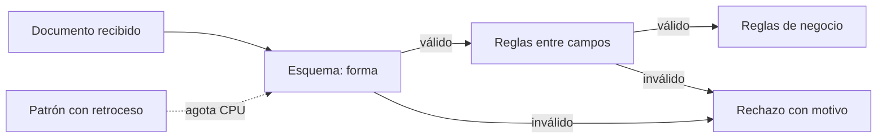
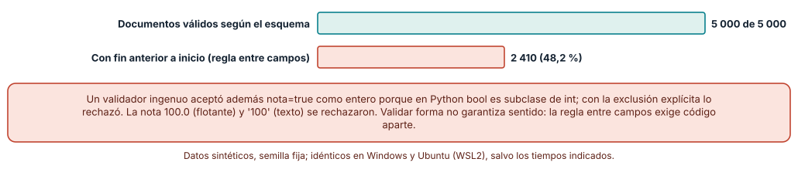
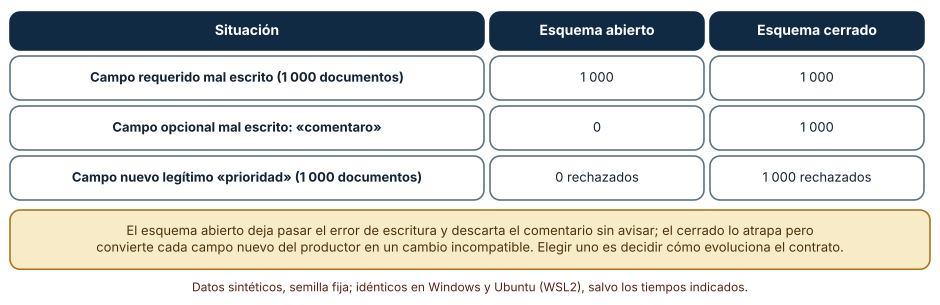
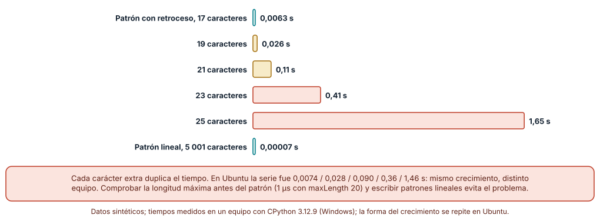

# SE-162 — Esquemas de datos y validación

[← SE-161 — Máquinas de estado y model checking introductorio](https://github.com/vladimiracunadev-create/modern-software-engineering-program/blob/main/classes/part-13-especificaciones-contratos-y-modelos/se-161-maquinas-de-estado-y-model-checking-introductorio/README.md) · [↑ Parte 13](https://github.com/vladimiracunadev-create/modern-software-engineering-program/blob/main/classes/part-13-especificaciones-contratos-y-modelos/README.md) · [📚 Índice completo](https://github.com/vladimiracunadev-create/modern-software-engineering-program/blob/main/classes/README.md) · [🌐 Portal](https://vladimiracunadev-create.github.io/modern-software-engineering-program/classes/SE-162.html) · [SE-163 — OpenAPI, AsyncAPI, GraphQL y contratos de eventos →](https://github.com/vladimiracunadev-create/modern-software-engineering-program/blob/main/classes/part-13-especificaciones-contratos-y-modelos/se-163-openapi-asyncapi-graphql-y-contratos-de-eventos/README.md)

## Punto profesional y fundamento pedagógico

**Punto profesional.** La clase existe para describir con un esquema la forma que deben tener los datos que cruzan una frontera, y para saber qué errores atrapa ese esquema, cuáles no, y qué ataques abre el propio acto de validar.

**Por qué aparece aquí.** Se sitúa después de **Máquinas de estado y model checking introductorio** y antes de **OpenAPI, AsyncAPI, GraphQL y contratos de eventos**: `SE-161` fijó qué estados admite una entrega; esta clase pregunta cómo se valida el documento que la describe cuando viaja entre sistemas. Deja un esquema de entrega con un validador mínimo y medido, y los tipos de datos que `SE-163` ubicará dentro de contratos de interfaz.

**Error conceptual que debe corregir.** Creer que «validar contra el esquema» equivale a «el dato es correcto»: el esquema comprueba forma (tipo, rango, formato) y no reglas entre campos ni verdad, y la propia validación puede ser una vía de ataque si usa patrones con retroceso.

**Secuencia de aprendizaje.** Antes de leer la solución, predices cuántos documentos válidos según el esquema violan una regla de negocio; después mides esa fracción, comparas qué errores atrapan un esquema abierto y uno cerrado y cronometras una expresión regular con retroceso. La secuencia usa predicción, explicación propia, contraste y recuperación. [ICAP](https://icap.education.asu.edu/research) distingue participación de construcción de conocimiento; [How People Learn II](https://nap.nationalacademies.org/catalog/24783/how-people-learn-ii-learners-contexts-and-cultures) exige conectar conocimiento previo, contexto y transferencia; la [práctica de recuperación](https://pubmed.ncbi.nlm.nih.gov/16507066/) respalda producir de nuevo la explicación tras una demora; y [Education for Life and Work](https://nap.nationalacademies.org/resource/13398/dbasse_084153.pdf) exige devolución que explique la causa del error.

**Evidencia de aprendizaje.** `schema-log.md` con el esquema de entrega, el validador, la medición de documentos válidos que violan una regla entre campos, la comparación abierto/cerrado y los tiempos de las expresiones regulares. Debe contener predicción previa, observación, explicación causal, contraejemplo y qué hallazgo haría rechazar el esquema.

**Límite de la conclusión.** El validador es un subconjunto mínimo (tipo, rango, longitud, patrón, enumeración, requeridos, propiedades adicionales) escrito para la clase, no una implementación completa de JSON Schema. Los documentos son sintéticos; los tiempos son de un equipo.

### Trazabilidad fuente → afirmación

| Fuente primaria u oficial | Afirmación que respalda | Lo que no prueba |
|---|---|---|
| [JSON Schema 2020-12: Validation](https://json-schema.org/draft/2020-12/json-schema-validation) | Define las palabras clave de validación (`type`, `minimum`, `pattern`, `enum`, `required`, `additionalProperties`…) y su semántica. | No expresa reglas que relacionen dos campos como «fin ≥ inicio». |
| [RFC 8259: The JSON Data Interchange Format](https://www.rfc-editor.org/rfc/rfc8259) | Fija la sintaxis de JSON y los tipos que distingue (objeto, arreglo, cadena, número, booleano, nulo). | No distingue entero de decimal ni fija el rango de un número. |
| [OWASP: Regular expression Denial of Service](https://owasp.org/www-community/attacks/Regular_expression_Denial_of_Service_-_ReDoS) | Describe cómo ciertos patrones con retroceso exponencial permiten agotar la CPU con entradas pequeñas. | No cuantifica el efecto sobre tu sistema ni sobre un motor sin retroceso. |

## Antes de empezar

Recupera lo aprendido en `SE-161`: el ciclo de vida de la entrega admite unos estados y no otros. La pregunta activa es: **¿qué forma debe tener el documento que representa una entrega y qué parte de su corrección puede comprobarse sin conocer el negocio?**

## Prerrequisitos

- Haber completado `SE-161` o poder explicar qué es un invariante de una máquina de estados.
- Python 3.11 o posterior y un terminal; el validador usa `re` y `time`.
- Trabajar con documentos de entrega sintéticos.

## Problema auténtico

La plataforma recibe entregas desde la aplicación web, una integración con una secretaría y un importador. Un documento llega con `nota: true`, otro con `fin` anterior a `inicio` y un tercero con un campo `comentaro` escrito sin la «i» final. Los tres pasaron la validación y los tres produjeron datos incorrectos.

## Objetivos observables

Al terminar podrás:

1. escribir un esquema de datos con tipos, rangos, formatos, enumeraciones y campos requeridos para un documento de la plataforma;
2. medir qué fracción de documentos válidos según el esquema viola una regla entre campos y decidir dónde comprobar esa regla;
3. elegir entre un esquema abierto y uno cerrado sabiendo qué errores atrapa cada uno y qué cambios rechaza;
4. detectar y evitar un patrón con retroceso exponencial en una validación;
5. declarar qué garantiza un documento validado y qué no.

## Mapa conceptual



El mapa se lee como una cascada de comprobaciones, cada una más cara y más cercana al negocio. El esquema comprueba la forma; lo que no puede expresar pasa a la capa siguiente. La flecha punteada recuerda que el validador mismo es superficie de ataque.

## Temas y por qué importan

| Tema | Por qué cambia una decisión profesional | Evidencia mínima |
|---|---|---|
| Tipos y formatos | Fijan qué valores aceptan los campos; los tipos de un lenguaje no coinciden con los de JSON. | Predicción, traza causal y contraejemplo de **Tipos y formatos** en `schema-log.md` |
| Esquema abierto o cerrado | Decide si un campo desconocido se acepta, se ignora o se rechaza. | Predicción, traza causal y contraejemplo de **Esquema abierto o cerrado** en `schema-log.md` |
| Reglas entre campos | Un esquema no expresa relaciones entre campos; hay que comprobarlas aparte. | Predicción, traza causal y contraejemplo de **Reglas entre campos** en `schema-log.md` |
| Validar en la frontera | La validación pertenece donde entra el dato, con un motivo de rechazo útil. | Predicción, traza causal y contraejemplo de **Validar en la frontera** en `schema-log.md` |
| Validar como superficie de ataque | Un patrón mal escrito convierte la validación en un vector de denegación de servicio. | Predicción, traza causal y contraejemplo de **Validar como superficie de ataque** en `schema-log.md` |

## Conceptos y decisiones

### 1. Tipos y formatos

JSON distingue objeto, arreglo, cadena, número, booleano y nulo; no distingue entero de decimal ni fija el rango. El esquema añade `integer`, `minimum`, `maximum`, `pattern` y `enum`. La trampa aparece en la implementación: en Python, `bool` es una subclase de `int`, de modo que `isinstance(True, int)` es verdadero y un validador ingenuo acepta `nota: true` como entero. La definición de un tipo debe leerse en la semántica del esquema, no en la del lenguaje que lo implementa, y conviene tener un caso de prueba para cada diferencia conocida (booleano, flotante con parte entera, cadena numérica).

### 2. Esquema abierto o cerrado

Un esquema **abierto** acepta propiedades no declaradas; uno **cerrado** (`additionalProperties: false`) las rechaza. El abierto favorece la evolución (un productor puede añadir campos sin romper a nadie) y deja pasar errores de escritura (`comentaro` se descarta sin aviso). El cerrado atrapa esos errores y convierte cualquier campo nuevo en un cambio incompatible. No hay una respuesta correcta: la elección expresa cómo evoluciona el contrato, y se relaciona directamente con el principio del lector tolerante de `SE-164`.

### 3. Reglas entre campos

La comprobación de que `fin ≥ inicio`, de que una prórroga no exceda el tope de la tarea o de que una nota coincida con su calificación pertenece a otro nivel: ninguna palabra clave estándar de validación relaciona dos campos de forma general. Las salidas son comprobarlas en código, expresarlas con una extensión del esquema o moverlas a una regla de negocio con nombre. Lo importante es que alguien las sea dueño: una regla entre campos ausente es una de las causas más habituales de datos «válidos» e incoherentes.

### 4. Validar en la frontera

El esquema y las reglas se aplican donde el dato entra al sistema, con un motivo de rechazo que diga qué campo y qué regla falló, sin repetir el dato recibido si es sensible. Validar en el interior es redundante si la frontera lo hizo, y validar solo en el interior significa que los datos incorrectos ya circularon. La política habitual es validar en la frontera, comprobar los invariantes internos con contratos (`SE-159`) y registrar los rechazos como señal de calidad de las integraciones.

### 5. Validar como superficie de ataque

La validación ejecuta código sobre datos hostiles. Un patrón como `^(\w+\s?)*$` tiene dos formas de dividir cada secuencia de letras y espacios; con una entrada que casi encaja y falla al final, el motor prueba un número de combinaciones exponencial. La defensa es acotar la longitud antes del patrón, escribir patrones sin cuantificadores anidados ambiguos, usar un motor con garantías de tiempo lineal donde esté disponible y poner un límite de tiempo a la validación.

### Lo que el esquema acepta y la regla rechaza

Se definió un esquema con seis campos requeridos (`id` con patrón `E-` y seis dígitos, `estudiante` de 3 a 20 caracteres, `nota` entera de 0 a 100, `inicio` y `fin` con formato de fecha y `estado` en una enumeración) y uno opcional (`comentario`). Se generaron 5 000 documentos válidos con semilla fija: los 5 000 pasan el validador. Pero **2 410 (48,2 %)** tienen `fin` anterior a `inicio`, porque las fechas se sortearon por separado. Además, el validador ingenuo aceptó `nota: true`; al excluir los booleanos explícitamente, lo rechazó; la nota `100.0` y la cadena `"100"` fueron rechazadas.

```python
if t == "integer":
    if estricto_bool and isinstance(doc, bool): return False
    if not isinstance(doc, int): return False
```



**Cómo leer la figura.** La barra verde son los documentos que cumplen el esquema; la coral, los que además tienen una fecha de fin anterior a la de inicio. **Dónde deja de valer:** la fracción del 48,2 % depende de cómo se sortearon las fechas (independientes, dentro de 2026) y no es una tasa de la plataforma; con fechas generadas por una aplicación real sería menor, y no por eso la regla sobra.

### Abierto o cerrado: qué atrapa y qué rechaza

Se tomaron 1 000 documentos válidos con un `comentario` y se aplicaron dos alteraciones por documento: escribir mal el nombre de un campo requerido elegido al azar (por ejemplo, `nota` → `not`) y escribir mal el campo opcional (`comentario` → `comentaro`). Ambos esquemas detectan los 1 000 documentos con el requerido mal escrito (falta el campo); en el opcional mal escrito, el **abierto detecta 0** y el **cerrado detecta 1 000**. A cambio, un campo nuevo y legítimo (`prioridad`) fue rechazado en **1 000 de 1 000** documentos por el cerrado y aceptado por el abierto.

```python
def validar(doc, sch, cerrado=False):
    for k in doc:
        if k not in sch["properties"] and cerrado:
            return False
```



**Cómo leer la figura.** Cada fila es una situación; las dos columnas finales dicen cuántos de los 1 000 documentos rechaza cada diseño. **Dónde deja de valer:** el experimento supone un único error por documento; en producción el mismo documento puede tener varios, y el motivo de un rechazo del esquema cerrado debe decir qué campo sobra para que no parezca un fallo del proveedor. Elegir es decidir quién paga: el productor que añade campos o el consumidor que pierde errores de escritura.

### Un patrón que parece inocente

Se midió `re.match(r"^(\w+\s?)*$", "a" * n + "!")` con n de 16 a 24 en pasos de 2. En Windows (CPython 3.12.9) la serie fue 0,0063 s, 0,026 s, 0,11 s, 0,41 s y 1,65 s; en Ubuntu (3.12.3), 0,0074, 0,028, 0,090, 0,36 y 1,46 s: cada dos caracteres el tiempo se cuadruplica. Un patrón lineal (`^[\w ]*$`) tardó 0,00007 s con 5 001 caracteres, y comprobar una longitud máxima de 20 antes de aplicar el patrón costó una millonésima de segundo y rechazó la entrada de 25 caracteres sin ejecutarlo.

```python
patron = re.compile(r"^(\w+\s?)*$")
ok = len(s) <= 20 and bool(patron.match(s))   # la longitud va primero
```



**Cómo leer la figura.** Cada barra es el tiempo de una sola validación; las coral son las que ya serían un problema con unas pocas peticiones simultáneas. **Dónde deja de valer:** los tiempos son de un equipo; la forma del crecimiento (duplicación por carácter) es la parte transferible. Algunos motores de expresiones regulares garantizan tiempo lineal y no sufren este fallo, y algunos patrones con cuantificadores anidados no lo presentan; la defensa sólida es acotar la entrada y medir el patrón.

## Definiciones de trabajo

- **esquema de datos:** descripción declarativa de la forma (tipos, rangos, formatos, campos requeridos) que debe cumplir un documento.
- **esquema abierto:** esquema que acepta propiedades no declaradas.
- **esquema cerrado:** esquema que rechaza propiedades no declaradas.
- **regla entre campos:** condición que relaciona el valor de dos o más campos y que un esquema de forma no expresa.
- **retroceso catastrófico:** crecimiento exponencial del tiempo de una expresión regular al explorar divisiones alternativas de una entrada.

Las definiciones son operativas para la plataforma de entregas. No convierten términos con historia más amplia en sinónimos y deben contrastarse con la documentación primaria enlazada al final.

## Ejemplo mínimo

El fragmento valida la nota de un documento y un campo desconocido. Antes de ejecutarlo, predice cuáles de los tres documentos pasan.

```python
def valida(doc):
    n = doc.get("nota")
    return isinstance(n, int) and not isinstance(n, bool) and 0 <= n <= 100 and set(doc) <= {"id", "nota"}

assert valida({"id": "E-000001", "nota": 80})
assert not valida({"id": "E-000001", "nota": True})
assert not valida({"id": "E-000001", "nota": 80, "comentaro": "x"})
```

El segundo documento solo se rechaza por la exclusión explícita de booleanos; el tercero, por la comprobación de campos desconocidos. Registra versión del intérprete y salida.

## Ejemplo profesional

En la plataforma, el esquema del documento de entrega vive en un archivo versionado junto al código del consumidor y del productor. La frontera valida primero la longitud y el tamaño del documento, después la forma con el esquema y por último las reglas entre campos con funciones con nombre (`fin_no_anterior_a_inicio`, `prorroga_no_supera_tope`). Cada rechazo devuelve el campo, la regla y un código estable, sin repetir valores sensibles. Los patrones se revisan por cuantificadores anidados y se miden con una entrada hostil en integración continua.

Compara el caso normal con una nota `true`, una fecha inversa, un campo desconocido y una cadena de 10 000 caracteres. Un esquema es apropiado cuando esos cuatro casos se rechazan por el motivo correcto y en tiempo acotado; es peligroso cuando uno pasa o consume segundos.

## Práctica guiada

1. Escribe el esquema de entrega con tipos, rangos, formatos y enumeración.
2. Predice qué fracción de documentos válidos violará `fin ≥ inicio` si las fechas se sortean por separado.
3. Implementa el validador mínimo, incluida la exclusión de booleanos, y genera 5 000 documentos con semilla fija.
4. Mide los documentos que cumplen el esquema y violan la regla entre campos y escribe la comprobación que falta.
5. Altera el nombre de campos requeridos y opcionales y compara el esquema abierto con el cerrado.
6. Cronometra un patrón con retroceso con entradas de 16 a 24 caracteres y compáralo con uno lineal y con una comprobación de longitud.
7. Entrega `schema-log.md` y pide a otra persona que añada un campo opcional guiándose solo por el esquema.

## Ejercicios

1. **Booleano:** escribe tres documentos que un validador ingenuo acepte y uno estricto rechace (booleano, flotante, cadena numérica).
2. **Regla:** escribe la regla entre campos «la prórroga no supera el tope de la tarea» y una prueba con un documento válido según el esquema y rechazado por la regla.
3. **Evolución:** decide si el esquema de la plataforma debe ser abierto o cerrado para el importador de la secretaría y justifica con el coste de cada error.
4. **Patrón:** reescribe `^(\w+\s?)*$` sin cuantificadores anidados y mide su tiempo con la misma entrada.

## Reto verificable

Entrega `schema-log.md` con el esquema, el validador, la medición de documentos válidos que violan una regla entre campos, la comparación abierto/cerrado y la serie de tiempos del patrón. Se aprueba si otra persona ejecuta el código desde un checkout limpio, obtiene los mismos conteos y puede señalar qué regla de negocio no cubre el esquema. No se aprueba por el número de palabras clave ni por que todos los documentos pasen.

## Caso conductor

La plataforma de entregas es el caso conductor de la Parte 13. Esta clase deja el esquema del documento de entrega, un validador mínimo medido y una decisión abierto/cerrado. `SE-163` colocará ese esquema dentro de contratos de interfaz (rutas, respuestas, eventos) y `SE-164` estudiará cómo cambiarlo sin romper a nadie. Cambia después una sola decisión, hacer `nota` opcional hasta que la entrega esté calificada, y revisa qué esquemas, reglas y ejemplos cambian.

## Preguntas frecuentes

### ¿Qué valida mejor, el esquema o el código?

Hacen cosas distintas: el esquema es declarativo, legible por herramientas y compartible entre sistemas; el código expresa reglas entre campos y de negocio. Se complementan; confiar solo en uno deja huecos (el esquema no ve `fin < inicio`, el código disperso valida cada campo de manera distinta).

### ¿Por qué no usar `additionalProperties: false` siempre?

Porque convierte cada campo nuevo del productor en un cambio incompatible. Si los productores evolucionan con frecuencia y los consumidores no pueden actualizarse al mismo ritmo, conviene un esquema abierto con reglas claras sobre qué se ignora.

### ¿Un modelo de lenguaje puede escribir el esquema?

Puede proponer uno razonable a partir de ejemplos, y suele proponerlo permisivo (cadenas sin límite, números sin rango). Pídele que fije `minimum`, `maximum`, `maxLength` y formatos, y revisa si dejó la regla entre campos fuera.

### ¿Cómo evito los patrones peligrosos?

Acota la longitud antes del patrón, evita cuantificadores anidados sobre subpatrones que se solapan, prueba el patrón con entradas hostiles y, si el entorno lo permite, usa un motor con garantías de tiempo lineal.

## Fallo controlado y diagnóstico

Reproduce el fallo clásico de la clase: **creer que un documento que pasa el esquema es correcto**. Genera 5 000 documentos con el esquema y procésalos con la regla de fechas.

Registra síntoma, entrada mínima, hipótesis, observación que descarta cada hipótesis, causa, corrección y prueba de regresión. **Síntoma:** el informe de la secretaría muestra plazos negativos para casi la mitad de las entregas. **Hipótesis rivales:** (a) el importador corrompe las fechas; (b) los documentos ya venían con el fin antes del inicio y el esquema los aceptó. **Prueba:** cuenta los documentos con `fin < inicio` entre los que pasan el esquema: 2 410 de 5 000. **Conclusión:** la causa es una regla entre campos ausente. **Regresión:** añade `fin_no_anterior_a_inicio` a la frontera y una prueba que rechace un documento con fechas invertidas. No cambies a la vez el esquema y la regla.

## Errores comunes y cómo corregirlos

| Síntoma | Causa probable | Corrección |
|---|---|---|
| Una nota `true` se almacena como 1 | El validador usa `isinstance(x, int)` y `bool` es subclase de `int` | Excluir booleanos explícitamente y probar tipos con casos de cada lenguaje |
| Un campo opcional mal escrito se descarta en silencio | Esquema abierto sin comprobación de campos conocidos | Cerrar el esquema donde la evolución lo permita o registrar los campos desconocidos |
| Los datos son válidos pero incoherentes | Las reglas entre campos no están en ninguna capa | Escribir las reglas con nombre y aplicarlas en la frontera |
| Una petición pequeña bloquea un worker durante segundos | Patrón con retroceso exponencial | Limitar la longitud, reescribir el patrón y probar con una entrada hostil |
| El mensaje de rechazo repite datos personales | El validador devuelve el valor recibido | Devolver campo, regla y código, sin el valor |

## Entorno y archivos clave

```text
work/SE-162/
├── README.md
├── esquema/
│   ├── entrega.schema.json
│   ├── validador.py
│   └── reglas.py
├── tests/test_esquema.py
└── evidence/schema-log.md
```

El `README` declara plataforma, versión de Python, semilla y comandos. Los experimentos usan solo la biblioteca estándar (`re`, `random`, `time`) y se ejecutaron con CPython 3.12.9 en Windows 11 y 3.12.3 en Ubuntu bajo WSL2: los conteos fueron idénticos y los tiempos de las expresiones regulares fueron distintos y se informan por separado. Si adoptas una biblioteca de validación completa, fija procedencia y versión.

## Seguridad, ética y accesibilidad

- la validación procesa entradas hostiles: acota tamaño y tiempo antes de aplicar patrones y mide el peor caso;
- los mensajes de rechazo no deben repetir datos personales ni exponer detalles internos;
- los esquemas de entrada deben tener límites de longitud y rango, también para evitar consumos de memoria desproporcionados;
- redacta los mensajes de error con lenguaje comprensible para quien integra y ofrece una alternativa textual a las tablas;
- respeta las licencias de las bibliotecas de validación y atribuye adaptaciones.

## Puente hacia el trabajo con agentes

Un agente al que se le pide «escribe el esquema JSON de este documento» producirá un esquema plausible a partir de un ejemplo: tipos correctos, sin rangos ni longitudes máximas y, casi siempre, con `additionalProperties` abierto. Pídele que fije límites explícitos, que decida abierto o cerrado y lo justifique, que liste las reglas entre campos que el esquema no cubre y que ejecute la prueba de documentos hostiles. Revisa especialmente si propuso un patrón con cuantificadores anidados: es el mismo defecto del experimento, ahora con apariencia de validación.

## Transferencia

Traslada el experimento a otro de los dominios persistentes (por ejemplo, un servicio de entregas a domicilio con un documento de pedido): escribe el esquema, las reglas entre campos y mide qué fracción de pedidos válidos viola alguna. La transferencia está lograda cuando puedes explicar qué parte del método dependía del documento y cuál no, no cuando el esquema se parece.

## Evaluación y evidencia

| Criterio | Evidencia para aprobar |
|---|---|
| comprensión | explicación de lo que el esquema comprueba y de lo que no |
| corrección | conteos reproducibles de documentos válidos que violan una regla con la misma semilla |
| diseño | decisión abierto/cerrado justificada y reglas entre campos con nombre |
| diagnóstico | reproducción del fallo «válido según el esquema pero incorrecto» con regresión |
| incertidumbre | declaración del subconjunto de JSON Schema implementado y del peor caso medido |
| reproducibilidad | versiones, comandos, salida y límites declarados |

## Fuentes

- [JSON Schema 2020-12: Validation](https://json-schema.org/draft/2020-12/json-schema-validation) — palabras clave de validación y su semántica; autoridad: proyecto JSON Schema.
- [Understanding JSON Schema](https://json-schema.org/understanding-json-schema/) — guía oficial de uso, incluido `additionalProperties`; autoridad: proyecto JSON Schema.
- [RFC 8259: The JSON Data Interchange Format](https://www.rfc-editor.org/rfc/rfc8259) — sintaxis y tipos de JSON; autoridad: IETF.
- [OWASP: Regular expression Denial of Service](https://owasp.org/www-community/attacks/Regular_expression_Denial_of_Service_-_ReDoS) — retroceso exponencial como vector de ataque; autoridad: OWASP.
- [OWASP: Input Validation Cheat Sheet](https://cheatsheetseries.owasp.org/cheatsheets/Input_Validation_Cheat_Sheet.html) — validar en la frontera, listas permitidas y límites; autoridad: OWASP.
- [Python: `bool`](https://docs.python.org/3/library/functions.html#bool) — `bool` es una subclase de `int`; autoridad: documentación de Python.

Cada fuente respalda el mecanismo indicado; ninguna demuestra que el esquema de la clase sea suficiente para la plataforma de entregas. Esa afirmación depende de las reglas, de quién las revisa y de las integraciones reales.

- [Python: `re`, expresiones regulares](https://docs.python.org/3/library/re.html) — motor con retroceso usado en el experimento.
- [Python: `random`](https://docs.python.org/3/library/random.html) — generación de documentos con semilla.

## Límites y siguiente paso

Se ejecutaron tres experimentos con datos sintéticos en Windows y Ubuntu (WSL2): conteos idénticos y tiempos distintos. No se usó una biblioteca de validación completa, las fechas se sortearon de forma independiente y no se midió ninguna integración real. La siguiente clase coloca este esquema dentro de contratos de interfaz y de eventos.

## Glosario

- **esquema de datos:** descripción declarativa de la forma (tipos, rangos, formatos, campos requeridos) que debe cumplir un documento.
- **esquema abierto:** esquema que acepta propiedades no declaradas.
- **esquema cerrado:** esquema que rechaza propiedades no declaradas.
- **regla entre campos:** condición que relaciona el valor de dos o más campos y que un esquema de forma no expresa.
- **retroceso catastrófico:** crecimiento exponencial del tiempo de una expresión regular al explorar divisiones alternativas de una entrada.

---

[← SE-161 — Máquinas de estado y model checking introductorio](https://github.com/vladimiracunadev-create/modern-software-engineering-program/blob/main/classes/part-13-especificaciones-contratos-y-modelos/se-161-maquinas-de-estado-y-model-checking-introductorio/README.md) · [↑ Parte 13](https://github.com/vladimiracunadev-create/modern-software-engineering-program/blob/main/classes/part-13-especificaciones-contratos-y-modelos/README.md) · [📚 Índice completo](https://github.com/vladimiracunadev-create/modern-software-engineering-program/blob/main/classes/README.md) · [🌐 Portal](https://vladimiracunadev-create.github.io/modern-software-engineering-program/classes/SE-162.html) · [SE-163 — OpenAPI, AsyncAPI, GraphQL y contratos de eventos →](https://github.com/vladimiracunadev-create/modern-software-engineering-program/blob/main/classes/part-13-especificaciones-contratos-y-modelos/se-163-openapi-asyncapi-graphql-y-contratos-de-eventos/README.md)
