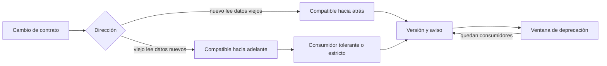
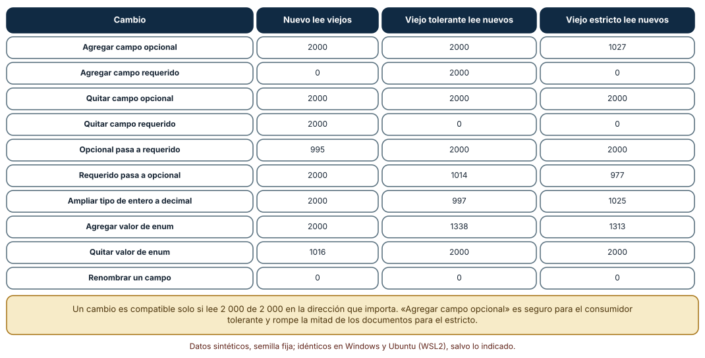
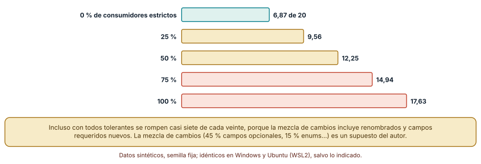
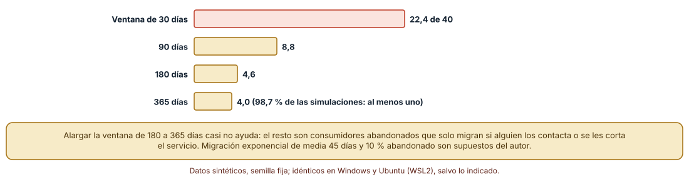

# SE-164 — Compatibilidad, versionado y evolución de contratos

[← SE-163 — OpenAPI, AsyncAPI, GraphQL y contratos de eventos](https://github.com/vladimiracunadev-create/modern-software-engineering-program/blob/main/classes/part-13-especificaciones-contratos-y-modelos/se-163-openapi-asyncapi-graphql-y-contratos-de-eventos/README.md) · [↑ Parte 13](https://github.com/vladimiracunadev-create/modern-software-engineering-program/blob/main/classes/part-13-especificaciones-contratos-y-modelos/README.md) · [📚 Índice completo](https://github.com/vladimiracunadev-create/modern-software-engineering-program/blob/main/classes/README.md) · [🌐 Portal](https://vladimiracunadev-create.github.io/modern-software-engineering-program/classes/SE-164.html) · [SE-165 — Spec-first, spec-anchored y spec-as-source →](https://github.com/vladimiracunadev-create/modern-software-engineering-program/blob/main/classes/part-13-especificaciones-contratos-y-modelos/se-165-spec-first-spec-anchored-y-spec-as-source/README.md)

## Punto profesional y fundamento pedagógico

**Punto profesional.** La clase existe para cambiar un contrato sin romper a quien ya lo usa: saber qué cambios son compatibles en qué dirección, cómo el tipo de consumidor cambia la respuesta y cuánto tarda en retirarse una versión que nadie quiere mantener.

**Por qué aparece aquí.** Se sitúa después de **OpenAPI, AsyncAPI, GraphQL y contratos de eventos** y antes de **Spec-first, spec-anchored y spec-as-source**: `SE-163` dejó el contrato de la API de entregas y las reglas de los eventos; esta clase pregunta cómo evoluciona ese contrato cuando cambian las reglas de la institución. Fija una taxonomía de cambios medida contra consumidores reales y una política de deprecación que `SE-165` conectará con la especificación como fuente.

**Error conceptual que debe corregir.** Creer que «agregar un campo» siempre es compatible y que un número de versión (SemVer) protege a los consumidores: la compatibilidad depende de la dirección del cambio y de cómo lee el consumidor, y un número no cambia lo que el cambio rompe.

**Secuencia de aprendizaje.** Antes de leer la solución, predices cuáles de diez cambios de esquema son seguros para un consumidor nuevo, para uno viejo tolerante y para uno viejo estricto; después los ejecutas sobre 2 000 documentos por caso, estimas cuántos consumidores rompe una mezcla de cambios según la proporción de consumidores estrictos y simulas cuánto tarda en vaciarse una versión vieja. La secuencia usa predicción, explicación propia, contraste y recuperación. [ICAP](https://icap.education.asu.edu/research) distingue participación de construcción de conocimiento; [How People Learn II](https://nap.nationalacademies.org/catalog/24783/how-people-learn-ii-learners-contexts-and-cultures) exige conectar conocimiento previo, contexto y transferencia; la [práctica de recuperación](https://pubmed.ncbi.nlm.nih.gov/16507066/) respalda producir de nuevo la explicación tras una demora; y [Education for Life and Work](https://nap.nationalacademies.org/resource/13398/dbasse_084153.pdf) exige devolución que explique la causa del error.

**Evidencia de aprendizaje.** `evolution-log.md` con el esquema base, los diez cambios, la tabla de lectura por tipo de consumidor, la simulación de lanzamientos y la de ventana de deprecación. Debe contener predicción previa, observación, explicación causal, contraejemplo y qué hallazgo haría retirar la política.

**Límite de la conclusión.** Los consumidores y los documentos son sintéticos; la mezcla de cambios por lanzamiento (45 % campos opcionales, 15 % valores de enum, etc.) y el comportamiento de migración (media de 45 días, 10 % abandonado) son supuestos del autor. «Estricto» y «tolerante» son dos modelos de lector, no una medición de clientes reales.

### Trazabilidad fuente → afirmación

| Fuente primaria u oficial | Afirmación que respalda | Lo que no prueba |
|---|---|---|
| [Semantic Versioning 2.0.0](https://semver.org/) | Define cuándo incrementar versión mayor, menor y parche según el efecto sobre la API pública. | No dice si un cambio concreto rompe a tus consumidores: eso depende de cómo leen. |
| [Google API Design Guide: Compatibility](https://cloud.google.com/apis/design/compatibility) | Enumera cambios compatibles e incompatibles de fuente, binario y red, y la recomendación de no reutilizar nombres. | No garantiza que sus reglas valgan para otros formatos o consumidores. |
| [Fowler: Tolerant Reader](https://martinfowler.com/bliki/TolerantReader.html) | Recomienda leer solo lo necesario e ignorar lo desconocido para que el consumidor sobreviva a cambios compatibles del productor. | No dice cuánta tolerancia es segura: un consumidor puede ignorar un campo que cambia el significado. |

## Antes de empezar

Recupera lo aprendido en `SE-163`: un contrato describe operaciones y mensajes, y la descripción puede mentir. La pregunta activa es: **¿qué cambios puedo hacer sin que nadie se entere, cuáles exigen avisar y cuánto tiempo debo mantener lo viejo?**

## Prerrequisitos

- Haber completado `SE-163` o poder explicar la diferencia entre un contrato de petición y uno de eventos.
- Python 3.11 o posterior y un terminal; las simulaciones usan la biblioteca estándar.
- Trabajar con el documento de entrega de la plataforma y consumidores sintéticos.

## Problema auténtico

La plataforma de entregas quiere añadir el estado `calificada` a un campo que hoy solo admite `pendiente` y `enviada`, renombrar `plazo` a `vence` y volver obligatorio el campo `comentario`. Tiene veinte consumidores conocidos y un número desconocido de otros. Un colega propone subir a la versión 1.1 porque «solo se añaden cosas».

## Objetivos observables

Al terminar podrás:

1. clasificar un cambio de esquema como compatible hacia atrás, hacia adelante, en ambas direcciones o en ninguna, con un ejemplo y un contraejemplo;
2. medir con consumidores sintéticos qué cambios rompen a un lector tolerante y a uno estricto;
3. estimar cuántos consumidores rompe una mezcla de cambios según la proporción de lectores estrictos;
4. decidir la duración de una ventana de deprecación sabiendo qué fracción de consumidores no migra por sí sola;
5. escribir una política de versionado con criterio de ruptura, aviso y retirada.

## Mapa conceptual



El mapa se lee desde el cambio: lo primero es la dirección en que se lee (quién lee qué), y el tipo de consumidor modula la respuesta. De ahí salen la versión, el aviso y una ventana de retirada. La flecha de retorno indica que si quedan consumidores al cierre hay que decidir de nuevo.

## Temas y por qué importan

| Tema | Por qué cambia una decisión profesional | Evidencia mínima |
|---|---|---|
| Compatibilidad hacia atrás y hacia adelante | Un cambio es compatible en una dirección determinada; confundirlas rompe a alguien. | Predicción, traza causal y contraejemplo de **Compatibilidad hacia atrás y hacia adelante** en `evolution-log.md` |
| Lector tolerante o estricto | El mismo cambio rompe a un consumidor estricto y no a uno tolerante. | Predicción, traza causal y contraejemplo de **Lector tolerante o estricto** en `evolution-log.md` |
| Versionado semántico | Un número comunica una intención; no verifica la compatibilidad. | Predicción, traza causal y contraejemplo de **Versionado semántico** en `evolution-log.md` |
| Deprecación y retirada | Sin una ventana y un aviso, la retirada rompe; con una ventana, quedan abandonados. | Predicción, traza causal y contraejemplo de **Deprecación y retirada** en `evolution-log.md` |
| Medir antes de cambiar | Conocer qué consumidores existen y qué campos leen decide qué cambios son seguros. | Predicción, traza causal y contraejemplo de **Medir antes de cambiar** en `evolution-log.md` |

## Conceptos y decisiones

### 1. Compatibilidad hacia atrás y hacia adelante

Un cambio es **compatible hacia atrás** si el lector nuevo entiende los datos viejos, y **compatible hacia adelante** si el lector viejo entiende los datos nuevos. Una API que se actualiza primero en el servidor necesita compatibilidad hacia adelante para los clientes que aún no se actualizaron; un almacén de datos que se lee con el código nuevo necesita compatibilidad hacia atrás. Muchos cambios son compatibles en una sola dirección: agregar un campo requerido rompe a quien lee datos viejos con el esquema nuevo; quitarlo rompe a quien espera encontrarlo.

### 2. Lector tolerante o estricto

Un lector **tolerante** lee los campos que necesita e ignora los campos que no conoce; un lector **estricto** rechaza lo que no reconoce (campos desconocidos). En el experimento de esta clase ninguno de los dos acepta valores de enum nuevos, un tercer eje de tolerancia que el consumidor debe decidir por separado. El mismo cambio produce resultados distintos: agregar un campo opcional es inocuo para el tolerante y rompe al estricto. Postel formuló la idea en el RFC 793 como «sé liberal en lo que aceptas de los demás»; el reverso es que la tolerancia puede esconder cambios de significado. Elegir es una decisión de diseño del consumidor, y el productor debe suponer que hay de los dos tipos.

### 3. Versionado semántico

SemVer comunica la intención: un incremento mayor indica ruptura, uno menor indica funcionalidad compatible y uno de parche corrige defectos. Sirve como lenguaje común, y su límite es que nadie verifica que el número diga la verdad: una «versión menor» que cambia el significado de un campo rompe a los consumidores igualmente. Conviene acompañar el número con una comprobación automática de compatibilidad (comparar esquemas) y con un registro de cambios que explique qué cambió y a quién afecta.

### 4. Deprecación y retirada

Retirar un campo o una versión exige tres elementos: aviso (cabeceras, documentación, correos), ventana (un plazo razonable) y medición (quién sigue usando lo viejo). Existen mecanismos estandarizados para avisar en la propia respuesta: la cabecera `Sunset` (RFC 8594) y `Deprecation` (RFC 9745). El problema práctico es que una parte de los consumidores no migra por sí sola, por abandono o falta de atención, y alargar el plazo no los hace migrar; solo el contacto directo o el corte del servicio lo consigue.

### 5. Medir antes de cambiar

La pregunta «¿es seguro este cambio?» solo tiene respuesta con datos: qué consumidores existen, qué campos leen y cómo reaccionan a lo desconocido. Un servicio con registros de uso por campo y por versión puede decir que nadie lee `plazo` fuera de dos clientes identificados; sin ellos, solo queda suponer lo peor. Las pruebas contractuales dirigidas por el consumidor (`SE-166`) son la forma sistemática de recoger esa información.

### Diez cambios, tres lectores

El esquema base tiene cuatro campos: `id` y `nota` requeridos, `estado` requerido con los valores `pendiente` y `enviada`, y `comentario` opcional. Se aplicaron diez cambios y, para cada uno, se generaron 2 000 documentos con el esquema que corresponde y se leyeron con un lector del otro. Se midió cuántos de los 2 000 se leyeron sin error en tres situaciones: un consumidor **nuevo** que lee documentos viejos (compatibilidad hacia atrás), uno **viejo tolerante** que lee documentos nuevos y uno **viejo estricto** que rechaza campos desconocidos (los dos rechazan valores de enum que no conocen).

Los resultados fueron idénticos en Windows y Ubuntu. Quitar un campo opcional fue legible en las tres situaciones (2 000 de 2 000). Agregar un campo opcional se leyó en 2 000 de 2 000 para el tolerante y en **1 027** para el estricto. Agregar uno requerido se leyó en 2 000 para el tolerante, pero el nuevo no leyó **ninguno** de los documentos viejos (0 de 2 000). Quitar un campo requerido se leyó hacia atrás en 2 000 y ninguno (0) hacia adelante. Renombrar un campo no se leyó en **0** de 2 000 en ninguna situación. Agregar un valor de enum se leyó en 1 338 (tolerante) y 1 313 (estricto): ninguno de los dos lectores viejos acepta el valor nuevo, de modo que esa tercera dimensión de tolerancia hay que decidirla aparte. Quitar un valor de enum se leyó hacia atrás en 1 016.

```python
def leer(sch, d, estricto):
    for k, (tipo, requerido, enum) in sch.items():
        if k not in d:
            if requerido: return False
            continue
        if enum and d[k] not in enum: return False
    return not (estricto and any(k not in sch for k in d))
```



**Cómo leer la figura.** Cada fila es un cambio; las tres columnas cuentan cuántos de 2 000 documentos se leyeron en cada situación. Un cambio es compatible en una dirección solo si lee 2 000 de 2 000 en la columna que importa. **Dónde deja de valer:** los lectores son modelos de dos comportamientos extremos; un consumidor real puede ser tolerante con campos y estricto con enums. Tampoco mide el significado: un campo puede conservar nombre y tipo y cambiar de unidad, y todas las columnas dirían que es compatible.

### Una mezcla de cambios y una población de consumidores

Se simularon 2 000 lanzamientos, cada uno con un cambio elegido según una distribución supuesta (agregar campo opcional 45 %, agregar valor de enum 15 %, agregar campo requerido 10 %, renombrar 8 %, quitar opcional 7 %, ampliar tipo 5 %, opcional pasa a requerido 4 %, quitar requerido 3 %, requerido pasa a opcional 2 %, quitar valor de enum 1 %), y 20 consumidores con una proporción dada de lectores estrictos. Un consumidor «se rompe» si el cambio produce algún documento ilegible. El promedio de consumidores rotos por lanzamiento sube de **6,87** de 20 sin lectores estrictos a **9,56** con un 25 %, **12,25** con un 50 %, **14,94** con un 75 % y **17,63** con todos estrictos.

```python
rotos += rompe(cambio, estricto)   # 20 consumidores por lanzamiento
```



**Cómo leer la figura.** Cada barra es el promedio de consumidores rotos por lanzamiento para una proporción de lectores estrictos; el color pasa de verde a coral al aumentar. **Dónde deja de valer:** la distribución de cambios es un supuesto del autor, no una medición de un producto, y la lectura «se rompe si algún documento falla» es más severa que la de un consumidor que se recupera. Aun con todos tolerantes se rompen casi siete de cada veinte, porque los renombrados y los campos requeridos no los salva ninguna tolerancia.

### Cuánto tarda en vaciarse una versión

Se simularon 2 000 retiradas con 40 consumidores: el 10 % no migra por sí solo y el resto migra en un tiempo exponencial de media 45 días. Al cerrarse una ventana de 30 días quedan **22,4** consumidores en media en la versión vieja; con 90 días, **8,8**; con 180, **4,6**; con 365, **4,0**. En el 98,7 % de las simulaciones con una ventana de 365 días queda al menos un consumidor.

```python
if rr.random() < 0.10: quedan += 1                 # nunca migra solo
elif rr.expovariate(1 / 45) > ventana: quedan += 1
```



**Cómo leer la figura.** Cada barra es el número medio de consumidores (de 40) que siguen en la versión vieja al cierre; la última barra se acerca al suelo del 10 % abandonado. **Dónde deja de valer:** los parámetros (media de 45 días, 10 % abandonado) son supuestos del autor; con tus consumidores pueden ser otros, y se deben medir. La conclusión estructural es que alargar la ventana tiene rendimientos decrecientes: pasar de 180 a 365 días casi no ayuda porque el resto no se mueve por sí solo.

## Definiciones de trabajo

- **compatibilidad hacia atrás:** un lector nuevo entiende datos escritos con el contrato anterior.
- **compatibilidad hacia adelante:** un lector viejo entiende datos escritos con el contrato nuevo.
- **lector tolerante:** consumidor que ignora los campos que no conoce.
- **lector estricto:** consumidor que rechaza los campos que no conoce.
- **ventana de deprecación:** periodo entre el aviso de retirada de una característica y su eliminación efectiva.

Las definiciones son operativas para la plataforma de entregas. No convierten términos con historia más amplia en sinónimos y deben contrastarse con la documentación primaria enlazada al final.

## Ejemplo mínimo

El fragmento muestra que agregar un valor de enum rompe a un lector estricto. Antes de ejecutarlo, predice qué ocurre con cada lector.

```python
ESTADOS_VIEJOS = {"pendiente", "enviada"}

def lector_estricto(doc):
    return doc["estado"] in ESTADOS_VIEJOS

def lector_tolerante(doc):
    return "estado" in doc   # acepta cualquier valor, incluso uno nuevo

nuevo = {"estado": "calificada"}
assert not lector_estricto(nuevo)
assert lector_tolerante(nuevo)
```

El estricto falla porque `calificada` no existía; el tolerante sigue, aunque no sabe tratar el valor nuevo. Registra versión del intérprete y salida; ninguna de las dos decisiones es «la correcta».

## Ejemplo profesional

En la plataforma, el contrato de la API de entregas tiene una política escrita: los cambios que agregan campos opcionales o valores de enum se anuncian en el registro de cambios y no cambian la versión mayor; los renombrados, los campos requeridos nuevos y las eliminaciones exigen versión mayor, aviso con `Deprecation` y `Sunset` y una ventana mínima de 180 días. Un comprobador de integración continua compara el esquema nuevo con el anterior y falla si un cambio de la lista de rupturas no incrementa la versión mayor. El servicio registra qué clientes leen qué versión y qué campos y contacta directamente a los que no migran.

Compara el caso normal con el renombrado de `plazo`, un valor de enum nuevo y la retirada de una versión con tres consumidores activos. Una política es apropiada cuando esos tres casos tienen una acción definida; es peligrosa cuando el número de versión es lo único que cambia.

## Práctica guiada

1. Escribe el esquema base y diez cambios de esquema con un nombre cada uno.
2. Predice en una tabla qué cambios son legibles para un consumidor nuevo, uno viejo tolerante y uno viejo estricto.
3. Implementa los tres lectores, genera 2 000 documentos por caso con semilla fija y mide cuántos se leen.
4. Simula 2 000 lanzamientos con una mezcla de cambios y 20 consumidores con diferentes proporciones de estrictos.
5. Simula la migración de 40 consumidores con distintas ventanas y cuenta cuántos quedan.
6. Escribe la política de versionado: qué cambios son rupturas, cómo se avisa y qué ventana se aplica.
7. Entrega `evolution-log.md` y pide a otra persona que clasifique un cambio nuevo sin ejecutar código.

## Ejercicios

1. **Cambio ambiguo:** clasifica «ampliar el tipo de nota de entero a decimal» para los tres lectores y explica por qué los resultados no son simétricos.
2. **Mezcla:** cambia la distribución de cambios a la tuya y recalcula los consumidores rotos por lanzamiento con 0, 50 y 100 % de lectores estrictos.
3. **Ventana:** calcula la ventana que deja menos de cinco consumidores con 40 consumidores, 10 % de abandono y media de 20 días, y explica qué te dice el resultado.
4. **Aviso:** redacta el mensaje de deprecación de `plazo` con fecha, motivo, alternativa y contacto, y decide por qué canales lo enviarías.

## Reto verificable

Entrega `evolution-log.md` con el esquema base, la tabla de diez cambios y tres lectores, las simulaciones de lanzamientos y de ventana y la política de versionado. Se aprueba si otra persona ejecuta el código desde un checkout limpio, obtiene los mismos conteos y puede señalar qué supuesto de la política cambiaría el resultado. No se aprueba por el número de cambios ni por la longitud de la política.

## Caso conductor

La plataforma de entregas es el caso conductor de la Parte 13. Esta clase deja una taxonomía de cambios medida, una política de versionado y una ventana de deprecación estimada. `SE-165` preguntará cómo mantener la especificación como fuente de verdad para que esa política se cumpla, y `SE-166` cómo comprobar que los consumidores siguen funcionando. Cambia después una sola decisión, renombrar `plazo` a `vence`, y revisa qué consumidores, ejemplos y esquemas se ven afectados.

## Preguntas frecuentes

### ¿Agregar un campo siempre es compatible?

Solo si el campo es opcional y los consumidores son tolerantes. En el experimento, agregar un campo opcional se leyó en 2 000 de 2 000 documentos para el lector tolerante y en 1 027 para el estricto. Un campo requerido nuevo no se leyó en ningún documento viejo con el esquema nuevo.

### ¿Hace falta una versión nueva por cada cambio?

No: los cambios compatibles pueden convivir en una misma versión mayor si se documentan y se comunican. La versión mayor se reserva para las rupturas. Lo que se debe evitar es cambiar el significado de un campo sin cambiar su nombre ni su versión.

### ¿Cuánto debe durar una ventana de deprecación?

Lo que alcance para que la mayoría de los consumidores migre y para contactar a los demás. El experimento muestra rendimientos decrecientes: más tiempo no mueve a los abandonados. Mide cuántos consumidores quedan a medida que pasa el plazo y decide con ese dato.

### ¿Un modelo de lenguaje puede clasificar los cambios?

Puede proponer una clasificación a partir de la diferencia entre dos esquemas, y suele pasar por alto cómo lee cada consumidor y los cambios de significado. Úsalo para listar candidatos y comprueba cada clasificación con documentos de prueba y con los consumidores conocidos.

## Fallo controlado y diagnóstico

Reproduce el fallo clásico de la clase: **publicar un cambio como «compatible» sin medir cómo leen los consumidores**. Agrega el valor `calificada` al enum de `estado` y publícalo como versión menor.

Registra síntoma, entrada mínima, hipótesis, observación que descarta cada hipótesis, causa, corrección y prueba de regresión. **Síntoma:** un cliente antiguo falla al recibir documentos con `calificada`. **Hipótesis rivales:** (a) el cliente tiene un error propio; (b) el cliente es estricto con los valores del enum. **Prueba:** ejecuta el lector viejo estricto sobre documentos del esquema nuevo: lee 1 313 de 2 000 (falla al aparecer `calificada`), y el tolerante 1 338, que falla por el valor que no sabe tratar. **Conclusión:** la causa es que el contrato no obligaba a tolerar valores de enum desconocidos: ni siquiera el lector tolerante de la clase lo hacía. **Regresión:** añade al contrato una regla explícita («los consumidores deben tolerar valores de enum desconocidos») y una prueba contractual con un valor nuevo. No cambies a la vez el enum y la política de lectores.

## Errores comunes y cómo corregirlos

| Síntoma | Causa probable | Corrección |
|---|---|---|
| Un cambio «solo agrega» y rompe a un cliente | El cliente es estricto con campos o valores desconocidos | Documentar que los consumidores deben tolerar lo desconocido y probar con un valor nuevo |
| El número de versión sube y los clientes se rompen igual | Se versionó por intención y no se comprobó la compatibilidad | Comparar esquemas en integración continua y exigir versión mayor para las rupturas |
| La ventana de deprecación termina y quedan clientes activos | Parte de los consumidores no migra sola | Medir quién usa lo viejo, contactar directamente y decidir el corte con un responsable |
| Un campo cambia de significado sin cambiar de nombre | Se trató como compatible por tener el mismo tipo | Crear un campo nuevo, deprecar el anterior y describir la equivalencia |
| El productor no sabe qué campos lee cada cliente | No hay registro de uso ni contratos de consumidor | Registrar uso por versión y campo, y recoger contratos dirigidos por el consumidor |

## Entorno y archivos clave

```text
work/SE-164/
├── README.md
├── evolucion/
│   ├── cambios.py
│   ├── lectores.py
│   └── ventana.py
├── tests/test_evolucion.py
└── evidence/evolution-log.md
```

El `README` declara plataforma, versión de Python, semillas y comandos. Los experimentos usan solo la biblioteca estándar (`copy`, `random`) y se ejecutaron con CPython 3.12.9 en Windows 11 y 3.12.3 en Ubuntu bajo WSL2 con salidas idénticas. Si adoptas una herramienta de comparación de esquemas, fija procedencia y versión.

## Seguridad, ética y accesibilidad

- retirar una versión sin aviso puede dejar a estudiantes sin poder entregar: trata el aviso y la ventana como parte de la seguridad operativa;
- los registros de uso por cliente son datos operativos: minimiza la información personal y define su retención;
- el cambio del significado de un campo que afecta notas o plazos debe pasar por revisión humana, no solo por una comparación de esquemas;
- redacta los avisos de deprecación en lenguaje comprensible, con alternativas, y ofrece una alternativa textual a las tablas;
- respeta las licencias de las herramientas de versionado y atribuye adaptaciones.

## Puente hacia el trabajo con agentes

Un agente al que se le pide «actualiza el contrato para añadir este campo» lo añadirá, subirá la versión menor y declarará el cambio compatible. Pídele que clasifique el cambio para lectores tolerantes y estrictos con documentos de prueba, que liste los consumidores conocidos y los campos que leen, y que escriba el aviso de deprecación si procede. Revisa especialmente los cambios de significado sin cambio de nombre: es la ruptura que ninguna comparación de esquemas ve, ahora con apariencia de cambio menor.

## Transferencia

Traslada el experimento a otro de los dominios persistentes (por ejemplo, un servicio de entregas a domicilio con una API de pedidos): escribe el esquema, diez cambios y los tres lectores, y simula una ventana. La transferencia está lograda cuando puedes explicar qué parte del método dependía del contrato y cuál no, no cuando la tabla se parece.

## Evaluación y evidencia

| Criterio | Evidencia para aprobar |
|---|---|
| comprensión | explicación de la dirección de la compatibilidad y de la diferencia entre lectores |
| corrección | tabla reproducible de lectura por cambio y por tipo de lector |
| diseño | política de versionado con criterio de ruptura, aviso y ventana |
| diagnóstico | reproducción del fallo «cambio compatible solo para tolerantes» con regresión |
| incertidumbre | declaración de los supuestos de mezcla de cambios y de migración |
| reproducibilidad | versiones, comandos, salida y límites declarados |

## Fuentes

- [Semantic Versioning 2.0.0](https://semver.org/) — convención de versiones mayor, menor y parche; autoridad: especificación de SemVer.
- [Google API Design Guide: Compatibility](https://cloud.google.com/apis/design/compatibility) — cambios compatibles e incompatibles de una API; autoridad: Google Cloud.
- [Fowler: Tolerant Reader](https://martinfowler.com/bliki/TolerantReader.html) — lector que ignora lo desconocido; autoridad: autor del patrón.
- [RFC 793: Transmission Control Protocol](https://www.rfc-editor.org/rfc/rfc793) — origen de la recomendación de ser liberal en lo que se acepta; autoridad: IETF.
- [RFC 8594: The Sunset HTTP Header Field](https://www.rfc-editor.org/rfc/rfc8594) — aviso de retirada de un recurso; autoridad: IETF.
- [RFC 9745: The Deprecation HTTP Response Header Field](https://www.rfc-editor.org/rfc/rfc9745) — aviso de deprecación en la respuesta; autoridad: IETF.
- [Protocol Buffers: updating a message type](https://protobuf.dev/programming-guides/proto3/#updating) — reglas de evolución compatible de mensajes; autoridad: Protocol Buffers.
- [Apache Avro: schema resolution](https://avro.apache.org/docs/current/specification/#schema-resolution) — reglas de lectura entre esquema de escritor y de lector; autoridad: Apache Avro.

Cada fuente respalda el mecanismo indicado; ninguna demuestra que la política de la clase sea la adecuada para los consumidores de la plataforma de entregas. Esa afirmación depende de los consumidores, de su uso medido y de quién la revisa.

- [Python: `random`](https://docs.python.org/3/library/random.html) — semillas y distribución exponencial usadas en las simulaciones.
- [Python: `copy`](https://docs.python.org/3/library/copy.html) — copia profunda de los esquemas al aplicar cambios.

## Límites y siguiente paso

Se ejecutaron tres experimentos con datos sintéticos en Windows y Ubuntu (WSL2) con resultados idénticos. Los lectores son dos modelos extremos, la mezcla de cambios y la migración de consumidores son supuestos del autor y no se midió ningún cliente real. La siguiente clase pregunta cómo mantener la especificación como fuente de verdad frente al código.

## Glosario

- **compatibilidad hacia atrás:** un lector nuevo entiende datos escritos con el contrato anterior.
- **compatibilidad hacia adelante:** un lector viejo entiende datos escritos con el contrato nuevo.
- **lector tolerante:** consumidor que ignora los campos que no conoce.
- **lector estricto:** consumidor que rechaza los campos que no conoce.
- **ventana de deprecación:** periodo entre el aviso de retirada de una característica y su eliminación efectiva.

---

[← SE-163 — OpenAPI, AsyncAPI, GraphQL y contratos de eventos](https://github.com/vladimiracunadev-create/modern-software-engineering-program/blob/main/classes/part-13-especificaciones-contratos-y-modelos/se-163-openapi-asyncapi-graphql-y-contratos-de-eventos/README.md) · [↑ Parte 13](https://github.com/vladimiracunadev-create/modern-software-engineering-program/blob/main/classes/part-13-especificaciones-contratos-y-modelos/README.md) · [📚 Índice completo](https://github.com/vladimiracunadev-create/modern-software-engineering-program/blob/main/classes/README.md) · [🌐 Portal](https://vladimiracunadev-create.github.io/modern-software-engineering-program/classes/SE-164.html) · [SE-165 — Spec-first, spec-anchored y spec-as-source →](https://github.com/vladimiracunadev-create/modern-software-engineering-program/blob/main/classes/part-13-especificaciones-contratos-y-modelos/se-165-spec-first-spec-anchored-y-spec-as-source/README.md)
