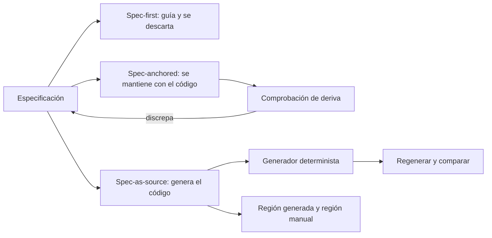
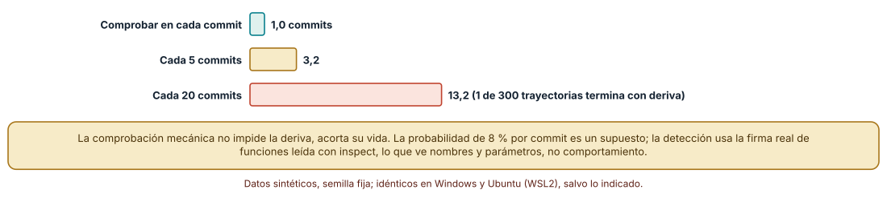
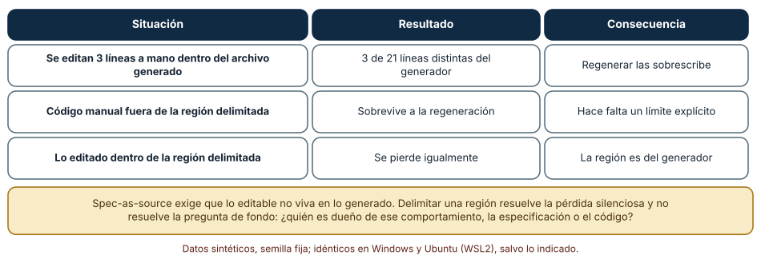
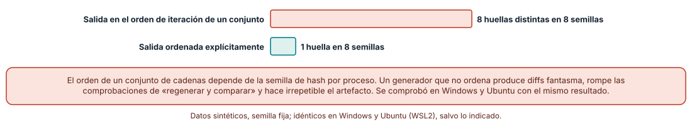

# SE-165 — Spec-first, spec-anchored y spec-as-source

[← SE-164 — Compatibilidad, versionado y evolución de contratos](https://github.com/vladimiracunadev-create/modern-software-engineering-program/blob/main/classes/part-13-especificaciones-contratos-y-modelos/se-164-compatibilidad-versionado-y-evolucion-de-contratos/README.md) · [↑ Parte 13](https://github.com/vladimiracunadev-create/modern-software-engineering-program/blob/main/classes/part-13-especificaciones-contratos-y-modelos/README.md) · [📚 Índice completo](https://github.com/vladimiracunadev-create/modern-software-engineering-program/blob/main/classes/README.md) · [🌐 Portal](https://vladimiracunadev-create.github.io/modern-software-engineering-program/classes/SE-165.html) · [SE-166 — Especificaciones ejecutables y pruebas contractuales →](https://github.com/vladimiracunadev-create/modern-software-engineering-program/blob/main/classes/part-13-especificaciones-contratos-y-modelos/se-166-especificaciones-ejecutables-y-pruebas-contractuales/README.md)

## Punto profesional y fundamento pedagógico

**Punto profesional.** La clase existe para decidir qué papel tiene la especificación en el ciclo de vida del software (borrador previo, documento vivo que acompaña al código o fuente de la que se genera el código) y para saber qué mecanismos mantienen esa relación honesta: comprobación de deriva, regiones generadas y generación determinista.

**Por qué aparece aquí.** Se sitúa después de **Compatibilidad, versionado y evolución de contratos** y antes de **Especificaciones ejecutables y pruebas contractuales**: `SE-164` fijó cómo cambia un contrato sin romper consumidores; esta clase pregunta quién es dueño de ese contrato, la especificación o el código, y qué ocurre cuando discrepan. Deja una decisión explícita de nivel por cada artefacto de la plataforma de entregas y las comprobaciones que `SE-166` convertirá en pruebas ejecutables.

**Error conceptual que debe corregir.** Creer que «especificar primero» garantiza que el código seguirá la especificación, o que generar código desde una especificación elimina la necesidad de revisarlo: sin un mecanismo que detecte la deriva y la regeneración limpia, la especificación y el código se separan y el que gana es el que se ejecuta.

**Secuencia de aprendizaje.** Antes de leer la solución, predices cuánto dura una deriva según con qué frecuencia se comprueba; después simulas trayectorias de commits con firmas de funciones reales, regeneras código sobre ediciones manuales y ejecutas un generador con distintas semillas de hash. La secuencia usa predicción, explicación propia, contraste y recuperación. [ICAP](https://icap.education.asu.edu/research) distingue participación de construcción de conocimiento; [How People Learn II](https://nap.nationalacademies.org/catalog/24783/how-people-learn-ii-learners-contexts-and-cultures) exige conectar conocimiento previo, contexto y transferencia; la [práctica de recuperación](https://pubmed.ncbi.nlm.nih.gov/16507066/) respalda producir de nuevo la explicación tras una demora; y [Education for Life and Work](https://nap.nationalacademies.org/resource/13398/dbasse_084153.pdf) exige devolución que explique la causa del error.

**Evidencia de aprendizaje.** `spec-role-log.md` con la especificación de seis operaciones, el comprobador de deriva con `inspect`, la simulación de trayectorias, el experimento de regeneración y la comparación de huellas del generador. Debe contener predicción previa, observación, explicación causal, contraejemplo y qué hallazgo haría cambiar el nivel elegido.

**Límite de la conclusión.** La especificación es un diccionario de seis operaciones y la deriva se mide solo en firmas (nombres y parámetros), no en comportamiento. La probabilidad de deriva por commit (8 %) es un supuesto del autor. Ningún experimento usa un generador de producción ni un asistente de programación.

### Trazabilidad fuente → afirmación

| Fuente primaria u oficial | Afirmación que respalda | Lo que no prueba |
|---|---|---|
| [Böckeler, «Understanding Spec-Driven-Development: Kiro, spec-kit, and Tessl» (martinfowler.com)](https://martinfowler.com/articles/exploring-gen-ai/sdd-3-tools.html) | Distingue tres niveles de uso de la especificación: spec-first, spec-anchored y spec-as-source, y observa herramientas concretas en cada uno. | No mide cuál nivel produce mejores resultados en un proyecto concreto. |
| [GitHub: spec-kit](https://github.com/github/spec-kit) | Ejemplo de herramienta de código abierto que organiza un flujo de especificación, plan y tareas antes de implementar con un asistente. | No demuestra que el flujo reduzca defectos ni que las especificaciones se mantengan con el tiempo. |
| [Python: `PYTHONHASHSEED`](https://docs.python.org/3/using/cmdline.html#envvar-PYTHONHASHSEED) | La aleatorización del hash de cadenas es por proceso, de modo que iterar un conjunto de cadenas da órdenes distintos entre ejecuciones. | No dice cómo debe ordenar tu generador; eso lo decide el diseño. |

## Antes de empezar

Recupera lo aprendido en `SE-164`: un contrato evoluciona con una política y con medición de quién lo usa. La pregunta activa es: **¿qué papel juega la especificación frente al código en cada artefacto, y qué detecta cuando discrepan?**

## Prerrequisitos

- Haber completado `SE-164` o poder explicar la diferencia entre un cambio compatible y una ruptura.
- Python 3.11 o posterior y un terminal; los experimentos usan `inspect`, `subprocess` y `hashlib`.
- Trabajar con las seis operaciones de la plataforma de entregas y datos sintéticos.

## Problema auténtico

El equipo de la plataforma mantiene un documento de especificación de la API con seis operaciones. El código tiene siete funciones públicas, una con un parámetro de más y otra renombrada. Al regenerar los clientes desde la especificación, el cliente móvil pierde la ayuda que alguien había añadido a mano en un archivo generado.

## Objetivos observables

Al terminar podrás:

1. describir qué papel tiene la especificación en spec-first, spec-anchored y spec-as-source y elegir uno por artefacto con una justificación;
2. medir cuánto dura una deriva entre especificación y código según la frecuencia de comprobación;
3. explicar qué se pierde al regenerar sobre ediciones manuales y cómo una región delimitada lo evita;
4. detectar la no determinación de un generador y corregirla;
5. declarar qué garantiza una comprobación de firmas y qué no garantiza sobre el comportamiento.

## Mapa conceptual



El mapa se lee desde el papel que se da a la especificación: cada nivel exige un mecanismo distinto para mantenerla honesta (comprobar deriva, generar de forma determinista, delimitar lo editable). La flecha de retorno indica que una discrepancia obliga a corregir el código o la especificación, nunca a dejarla.

## Temas y por qué importan

| Tema | Por qué cambia una decisión profesional | Evidencia mínima |
|---|---|---|
| Spec-first | La especificación guía la implementación y puede quedar obsoleta apenas se escribe el código. | Predicción, traza causal y contraejemplo de **Spec-first** en `spec-role-log.md` |
| Spec-anchored | La especificación se mantiene viva con el código; exige un mecanismo que detecte la deriva. | Predicción, traza causal y contraejemplo de **Spec-anchored** en `spec-role-log.md` |
| Spec-as-source | La especificación es lo que se edita; el código se genera y no se toca a mano. | Predicción, traza causal y contraejemplo de **Spec-as-source** en `spec-role-log.md` |
| Generación determinista | Un generador que no es reproducible hace imposible comparar y revisar lo generado. | Predicción, traza causal y contraejemplo de **Generación determinista** en `spec-role-log.md` |
| Elegir el nivel | El nivel adecuado depende de cuánto cambia el contrato y de cuánto cuesta la deriva. | Predicción, traza causal y contraejemplo de **Elegir el nivel** en `spec-role-log.md` |

## Conceptos y decisiones

### 1. Spec-first

En el enfoque spec-first la especificación se escribe antes del código y guía la implementación, pero no se mantiene después: cumplió su función cuando el código existe. Es el uso más extendido y el más barato. Su riesgo es que la especificación se convierta en una fotografía de la intención inicial y alguien la consulte meses después creyendo que describe el sistema. Funciona bien para decisiones que se toman una vez y se revisan con pocas modificaciones, y mal para contratos que cambian a menudo.

### 2. Spec-anchored

En spec-anchored la especificación se mantiene con el código a lo largo de la vida del sistema: un cambio de comportamiento exige actualizar ambos. El valor es que el contrato sigue siendo una fuente fiable para consumidores y revisores; el coste, que exige un mecanismo que haga fallar la integración continua cuando discrepan. Sin ese mecanismo, el anclaje es una promesa: la deriva aparece en el primer apuro. La comprobación se puede hacer por firmas, por ejemplos o por pruebas contractuales, con distinta potencia y coste.

### 3. Spec-as-source

En spec-as-source la especificación es lo único que se edita y el código se genera a partir de ella; el humano no toca el código generado. El beneficio es que la deriva desaparece por construcción y que cambiar un contrato es editar un archivo. Los costes son reales: hay que confiar en el generador (y revisar lo que produce), la especificación debe ser lo bastante expresiva para cubrir el comportamiento, y todo lo que no se pueda expresar vive fuera. Cuando la especificación no alcanza, alguien edita lo generado, y entonces la regeneración destruye ese trabajo.

### 4. Generación determinista

Un generador debe producir la misma salida con la misma entrada: así se puede regenerar y comparar con lo comprometido, y detectar cambios con un diff. Las fuentes habituales de no determinación son iterar estructuras sin orden garantizado, incluir marcas de tiempo o rutas absolutas, y depender de la configuración regional. En Python, el orden de iteración de un conjunto de cadenas cambia entre procesos porque el hash de las cadenas se aleatoriza por proceso. Un generador debe ordenar explícitamente todo lo que serializa.

### 5. Elegir el nivel

El nivel no es una escala de madurez sino una decisión por artefacto. Una especificación de arquitectura puede ser spec-first; el contrato de la API pública, spec-anchored con comprobación en integración continua; los clientes generados, spec-as-source con regiones claramente delimitadas. Conviene registrar la elección, el mecanismo que la sostiene y la señal que haría cambiar de nivel (por ejemplo, la tercera deriva en un trimestre).

### Cuánto dura una deriva

La especificación tiene seis operaciones con sus parámetros; el «código» es un conjunto de funciones compiladas de verdad con `exec` y leídas con `inspect.signature`. En cada commit hay una probabilidad del 8 % de introducir una deriva (renombrar un parámetro, agregar uno o quitar uno). Una comprobación compara firmas y nombres con la especificación; cuando detecta deriva, se corrige en ese mismo commit y el código vuelve a coincidir con la especificación. Se simularon 300 trayectorias de 200 commits con semilla fija y cuatro frecuencias de comprobación. Con una comprobación **en cada commit**, la deriva dura en media **1,0** commits; **cada 5**, **3,2**; **cada 20**, **13,2**, y 1 de 300 trayectorias termina con una deriva sin detectar. Sin comprobar, las 300 trayectorias terminan con deriva. Las cifras fueron idénticas en Windows y Ubuntu.

```python
real = {n: list(inspect.signature(f).parameters) for n, f in funciones.items()}
deriva = sum(1 for n, p in SPEC.items() if real.get(n) != p)
```



**Cómo leer la figura.** Cada barra es la duración media de una deriva antes de que la comprobación la detecte; la verde es comprobar siempre. **Dónde deja de valer:** el 8 % por commit es un supuesto; la detección se limita a nombres y parámetros, y un cambio de comportamiento con la misma firma no se ve. Comprobar con más frecuencia acorta la vida de la deriva, no impide que aparezca.

### Qué se pierde al regenerar

Un generador produce seis funciones `raise NotImplementedError` con una cabecera «GENERADO: no editar». Se editan **3 líneas** a mano (una implementación mínima en las primeras funciones) y se regenera: las 3 líneas se pierden, de 21 totales. Se rediseña el archivo con una región generada delimitada por marcas (`# --- inicio ---` y `# --- fin ---`) y código manual debajo: tras regenerar, las funciones manuales fuera de la región sobreviven, y lo editado dentro de la región se pierde igualmente.

```python
def regenerar_con_ancla(archivo, spec):
    fin = archivo.index("# --- fin ---")
    return generar(spec)[:-1] + archivo[fin:]   # solo se reescribe la región
```



**Cómo leer la figura.** Cada fila es una situación; la columna central dice qué ocurre al regenerar y la última, la consecuencia de diseño. **Dónde deja de valer:** el experimento regenera un archivo sencillo; en un generador real con plantillas, imports y formateo la frontera entre región y resto es más difícil de mantener. Delimitar la región evita la pérdida silenciosa, no decide quién es dueño del comportamiento.

### Un generador que cambia de salida por sí solo

Un generador escribe una línea por cada uno de siete campos de la especificación guardados en un conjunto. Se ejecutó en ocho procesos con ocho valores distintos de `PYTHONHASHSEED` y se calculó la huella SHA-256 de la salida. Iterando el conjunto directamente se obtuvieron **8 huellas distintas**; ordenando los campos antes de escribir, **1 huella**. El resultado fue el mismo en Windows y Ubuntu, y el efecto de la semilla es el documentado por Python para la aleatorización del hash de cadenas.

```python
campos = {"id", "estudiante", "nota", "inicio", "fin", "estado", "comentario"}
it = sorted(campos)            # sin sorted, el orden cambia entre procesos
```



**Cómo leer la figura.** Cada barra es el número de salidas distintas que produjo el generador en ocho ejecuciones; lo deseable es uno. **Dónde deja de valer:** solo se examinó una fuente de no determinación (el orden de un conjunto); otras (marcas de tiempo, rutas, configuración regional, versiones de bibliotecas) se comprueban igual, ejecutando dos veces y comparando huellas, y un generador que supera esa prueba puede seguir produciendo código incorrecto.

## Definiciones de trabajo

- **spec-first:** uso de la especificación como guía previa a la implementación, sin mantenerla después.
- **spec-anchored:** uso de la especificación como documento vivo que se actualiza junto con el código.
- **spec-as-source:** uso de la especificación como único artefacto editable del que se genera el código.
- **deriva:** diferencia entre lo que la especificación afirma y lo que el código hace.
- **generación determinista:** propiedad de un generador que produce salida idéntica para la misma entrada.

Las definiciones son operativas para la plataforma de entregas. No convierten términos con historia más amplia en sinónimos y deben contrastarse con la documentación primaria enlazada al final.

## Ejemplo mínimo

El fragmento compara las firmas de una función con la especificación. Antes de ejecutarlo, predice qué detecta.

```python
import inspect

SPEC = {"calificar": ["entrega", "nota"]}

def calificar(entrega, puntos):   # renombrado respecto de la especificación
    pass

real = list(inspect.signature(calificar).parameters)
assert real != SPEC["calificar"]
assert real == ["entrega", "puntos"]
```

La comparación detecta el renombrado de `nota` a `puntos`; no detectaría que `calificar` pasara a truncar la nota. Registra versión del intérprete y salida.

## Ejemplo profesional

En la plataforma, cada artefacto tiene un nivel declarado. El documento de arquitectura es spec-first (guía y se archiva). El contrato de la API es spec-anchored: un comprobador en integración continua compara las operaciones del código con el documento OpenAPI y falla con el nombre del parámetro que discrepa. Los clientes se generan desde el documento (spec-as-source) con un generador que ordena toda su salida y marca la región generada; una comprobación regenera y compara huellas, y falla si hay diferencias con lo comprometido. Una nota por artefacto registra la señal que haría cambiar de nivel.

Compara el caso normal con un parámetro renombrado, una edición manual dentro de una región generada y un generador que cambia de salida entre ejecuciones. Una política es apropiada cuando esos tres casos fallan en integración continua; es peligrosa cuando pasan y se descubren en producción.

## Práctica guiada

1. Escribe la especificación de las seis operaciones de la plataforma como datos.
2. Predice cuánto durará una deriva si se comprueba en cada commit, cada 5 y cada 20.
3. Implementa el comprobador con `inspect.signature` y simula 300 trayectorias de 200 commits.
4. Genera un archivo desde la especificación, edítalo a mano y regenera; cuenta las líneas perdidas.
5. Delimita una región generada y verifica qué sobrevive.
6. Ejecuta el generador con ocho valores de `PYTHONHASHSEED` y compara las huellas con y sin ordenar.
7. Entrega `spec-role-log.md` y pide a otra persona que elija el nivel de un artefacto nuevo y lo justifique.

## Ejercicios

1. **Deriva de comportamiento:** escribe una deriva que conserve las firmas y cambie el resultado, y explica qué comprobación la detectaría.
2. **Frecuencia:** calcula cuántos commits dura una deriva si la comprobación cuesta 10 minutos y los commits son cada 15 minutos, y decide qué frecuencia usarías.
3. **Región:** diseña la frontera entre región generada y código manual de un cliente móvil y lista qué no puede ir dentro.
4. **Nivel:** elige el nivel para cuatro artefactos (política de notas, API pública, cliente generado, guía de estilo) y justifica con el coste de la deriva.

## Reto verificable

Entrega `spec-role-log.md` con la especificación, el comprobador, la simulación de deriva, el experimento de regeneración y la comparación de huellas. Se aprueba si otra persona ejecuta el código desde un checkout limpio, obtiene los mismos conteos y puede señalar qué deriva no ve el comprobador. No se aprueba por el nivel elegido ni por el número de artefactos.

## Caso conductor

La plataforma de entregas es el caso conductor de la Parte 13. Esta clase deja una decisión de nivel por artefacto, un comprobador de deriva y un generador determinista con regiones delimitadas. `SE-166` convertirá la comprobación de firmas en pruebas que ejecutan la especificación, y `SE-167` pondrá a prueba el procedimiento completo en un taller. Cambia después una sola decisión, pasar la API de spec-anchored a spec-as-source, y revisa qué mecanismos nuevos exige.

## Preguntas frecuentes

### ¿Spec-as-source significa que ya no se programa?

No: significa que lo que se programa vive en la especificación y en el generador. Todo lo que la especificación no puede expresar sigue necesitando código escrito a mano, y ese código debe vivir fuera de lo generado.

### ¿Cuándo basta spec-first?

Cuando el contrato cambia poco, la deriva es barata y el documento no se consulta como fuente de verdad después. Si alguien lo cita en una revisión o a un consumidor, conviene subir a spec-anchored.

### ¿Un asistente de programación puede mantener la especificación?

Puede proponer cambios coherentes entre especificación y código y, si no hay un comprobador, puede introducir una deriva con la misma facilidad. Mantén la comprobación mecánica en integración continua y revisa los cambios que el asistente hizo en ambos lados.

### ¿Cómo sé si mi generador es determinista?

Ejecútalo dos veces en entornos distintos (otra semilla de hash, otro sistema operativo, otra carpeta) y compara huellas de la salida. Si difieren, busca estructuras sin orden, marcas de tiempo, rutas absolutas y diferencias de saltos de línea.

## Fallo controlado y diagnóstico

Reproduce el fallo clásico de la clase: **editar a mano un archivo generado y regenerarlo**. Edita tres líneas del cliente generado y vuelve a generarlo.

Registra síntoma, entrada mínima, hipótesis, observación que descarta cada hipótesis, causa, corrección y prueba de regresión. **Síntoma:** el cliente móvil pierde la ayuda añadida a mano. **Hipótesis rivales:** (a) alguien revirtió el commit; (b) la regeneración sobrescribió la edición. **Prueba:** compara el archivo con el comprometido antes de regenerar: 3 de 21 líneas distintas desaparecen. **Conclusión:** la causa es una edición dentro de la región que pertenece al generador. **Regresión:** delimita la región con marcas, mueve el código manual fuera y añade una comprobación que falle si hay diferencias dentro de la región. No cambies a la vez el generador y las ediciones.

## Errores comunes y cómo corregirlos

| Síntoma | Causa probable | Corrección |
|---|---|---|
| La especificación dice una cosa y el código otra, y nadie lo sabe | Spec-anchored sin comprobación mecánica | Comparar firmas o ejemplos en integración continua |
| La regeneración borra trabajo manual | Ediciones dentro de lo generado | Delimitar la región generada y mover lo manual fuera |
| El diff de lo generado cambia sin que cambie la especificación | El generador no ordena su salida | Ordenar toda estructura serializada y comparar huellas entre ejecuciones |
| Se cree que la especificación es fiable porque existe | Spec-first usado como fuente de verdad | Declarar el nivel y fechar cada especificación |
| La comprobación pasa y el comportamiento cambió | Solo se compararon firmas | Añadir ejemplos o pruebas contractuales (`SE-166`) |

## Entorno y archivos clave

```text
work/SE-165/
├── README.md
├── spec/
│   ├── operaciones.py
│   ├── deriva.py
│   └── generador.py
├── tests/test_spec.py
└── evidence/spec-role-log.md
```

El `README` declara plataforma, versión de Python, semillas y comandos. Los experimentos usan solo la biblioteca estándar (`inspect`, `subprocess`, `hashlib`, `random`) y se ejecutaron con CPython 3.12.9 en Windows 11 y 3.12.3 en Ubuntu bajo WSL2 con salidas idénticas. Si adoptas un generador real, fija procedencia y versión y registra su semilla y su configuración.

## Seguridad, ética y accesibilidad

- un generador ejecuta código derivado de una especificación: trata la especificación como entrada que debe revisarse como código, sobre todo si la edita un asistente;
- el código generado puede incluir datos de ejemplo: no copies datos reales de estudiantes a la especificación;
- las marcas de región deben ser visibles y explicar por qué no se edita lo generado, para quien llega después;
- redacta las especificaciones con lenguaje comprensible y ofrece una alternativa textual a las tablas;
- respeta las licencias de las herramientas de especificación y generación y atribuye adaptaciones.

## Puente hacia el trabajo con agentes

Un agente al que se le pide «actualiza la API y la especificación» modificará ambos y declarará que están sincronizados. Pídele que ejecute el comprobador de deriva y que muestre la salida, que explique qué edits hizo dentro y fuera de las regiones generadas, y que regenere y compare huellas. Revisa especialmente si editó un archivo generado: es la edición que la regeneración destruye, ahora con apariencia de trabajo terminado.

## Transferencia

Traslada el experimento a otro de los dominios persistentes (por ejemplo, un servicio de entregas a domicilio con una API de pedidos): escribe la especificación, simula la deriva y comprueba la determinación del generador. La transferencia está lograda cuando puedes explicar qué parte del método dependía del artefacto y cuál no, no cuando el código se parece.

## Evaluación y evidencia

| Criterio | Evidencia para aprobar |
|---|---|
| comprensión | explicación de los tres niveles y del mecanismo que sostiene cada uno |
| corrección | simulación y huellas reproducibles con las mismas semillas |
| diseño | nivel declarado por artefacto con la señal que lo cambiaría |
| diagnóstico | reproducción del fallo «edición de un archivo generado» con regresión |
| incertidumbre | declaración de qué deriva no detecta la comprobación de firmas |
| reproducibilidad | versiones, comandos, salida y límites declarados |

## Fuentes

- [Böckeler, «Understanding Spec-Driven-Development: Kiro, spec-kit, and Tessl»](https://martinfowler.com/articles/exploring-gen-ai/sdd-3-tools.html) — distinción entre spec-first, spec-anchored y spec-as-source; autoridad: martinfowler.com.
- [GitHub: spec-kit](https://github.com/github/spec-kit) — herramienta de código abierto de flujo guiado por especificación; autoridad: GitHub.
- [OpenAPI Generator](https://openapi-generator.tech/) — generación de clientes y servidores desde un documento de especificación; autoridad: proyecto OpenAPI Generator.
- [Python: `PYTHONHASHSEED`](https://docs.python.org/3/using/cmdline.html#envvar-PYTHONHASHSEED) — aleatorización del hash y semilla fija; autoridad: documentación de Python.
- [Python: `inspect`](https://docs.python.org/3/library/inspect.html) — lectura de firmas de funciones; autoridad: documentación de Python.
- [Fowler: Model Driven Software Development](https://martinfowler.com/bliki/ModelDrivenSoftwareDevelopment.html) — antecedente de generar código desde modelos y sus tensiones; autoridad: martinfowler.com.

Cada fuente respalda el mecanismo indicado; ninguna demuestra que un nivel de uso de la especificación sea mejor que otro para la plataforma de entregas. Esa afirmación depende del contrato, de la frecuencia de cambio y de la disciplina del equipo.

- [Python: `hashlib`](https://docs.python.org/3/library/hashlib.html) — SHA-256 usado para las huellas.
- [Python: `subprocess`](https://docs.python.org/3/library/subprocess.html) — ejecución del generador con distintas semillas de hash.

## Límites y siguiente paso

Se ejecutaron tres experimentos con datos sintéticos en Windows y Ubuntu (WSL2) con resultados idénticos. La deriva se midió solo en firmas, la probabilidad de deriva es un supuesto y no se usó ningún generador de producción ni un asistente de programación. La siguiente clase convierte las comprobaciones de firmas en especificaciones que se ejecutan.

## Glosario

- **spec-first:** uso de la especificación como guía previa a la implementación, sin mantenerla después.
- **spec-anchored:** uso de la especificación como documento vivo que se actualiza junto con el código.
- **spec-as-source:** uso de la especificación como único artefacto editable del que se genera el código.
- **deriva:** diferencia entre lo que la especificación afirma y lo que el código hace.
- **generación determinista:** propiedad de un generador que produce salida idéntica para la misma entrada.

---

[← SE-164 — Compatibilidad, versionado y evolución de contratos](https://github.com/vladimiracunadev-create/modern-software-engineering-program/blob/main/classes/part-13-especificaciones-contratos-y-modelos/se-164-compatibilidad-versionado-y-evolucion-de-contratos/README.md) · [↑ Parte 13](https://github.com/vladimiracunadev-create/modern-software-engineering-program/blob/main/classes/part-13-especificaciones-contratos-y-modelos/README.md) · [📚 Índice completo](https://github.com/vladimiracunadev-create/modern-software-engineering-program/blob/main/classes/README.md) · [🌐 Portal](https://vladimiracunadev-create.github.io/modern-software-engineering-program/classes/SE-165.html) · [SE-166 — Especificaciones ejecutables y pruebas contractuales →](https://github.com/vladimiracunadev-create/modern-software-engineering-program/blob/main/classes/part-13-especificaciones-contratos-y-modelos/se-166-especificaciones-ejecutables-y-pruebas-contractuales/README.md)
