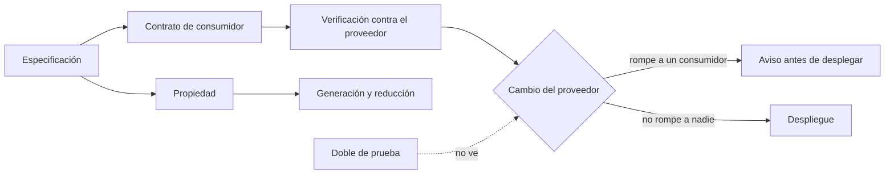
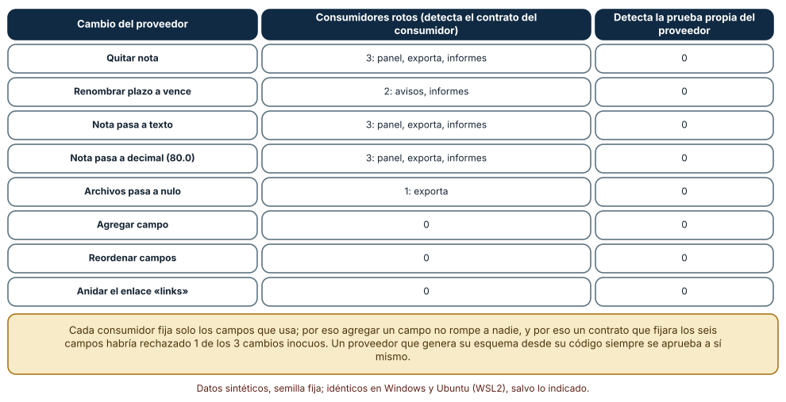
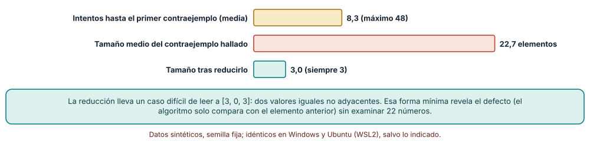
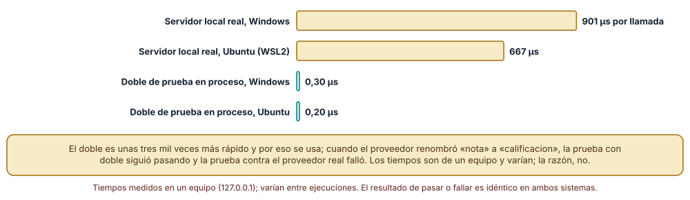

# SE-166 — Especificaciones ejecutables y pruebas contractuales

[← SE-165 — Spec-first, spec-anchored y spec-as-source](https://github.com/vladimiracunadev-create/modern-software-engineering-program/blob/main/classes/part-13-especificaciones-contratos-y-modelos/se-165-spec-first-spec-anchored-y-spec-as-source/README.md) · [↑ Parte 13](https://github.com/vladimiracunadev-create/modern-software-engineering-program/blob/main/classes/part-13-especificaciones-contratos-y-modelos/README.md) · [📚 Índice completo](https://github.com/vladimiracunadev-create/modern-software-engineering-program/blob/main/classes/README.md) · [🌐 Portal](https://vladimiracunadev-create.github.io/modern-software-engineering-program/classes/SE-166.html) · [SE-167 — Taller: convertir intención en contrato comprobable →](https://github.com/vladimiracunadev-create/modern-software-engineering-program/blob/main/classes/part-13-especificaciones-contratos-y-modelos/se-167-taller-convertir-intencion-en-contrato-comprobable/README.md)

## Punto profesional y fundamento pedagógico

**Punto profesional.** La clase existe para convertir una especificación en algo que se ejecuta contra el sistema, y para decidir qué tipo de prueba protege a quién: las pruebas del proveedor, los contratos dirigidos por el consumidor, las propiedades con reducción de contraejemplos y los dobles de prueba.

**Por qué aparece aquí.** Se sitúa después de **Spec-first, spec-anchored y spec-as-source** y antes de **Taller: convertir intención en contrato comprobable**: `SE-165` dejó comprobaciones de firmas que no ven el comportamiento; esta clase añade las pruebas que lo ejecutan. Reúne los ejemplos de `SE-158`, los contratos de `SE-159` y los esquemas de `SE-162` en un conjunto de pruebas contractuales, y prepara el taller donde `SE-167` las usará de extremo a extremo.

**Error conceptual que debe corregir.** Creer que si el proveedor prueba su propia API los consumidores están protegidos, o que un doble de prueba rápido equivale a probar contra el proveedor: un proveedor que genera su esquema desde su código siempre se aprueba a sí mismo, y un doble puede seguir pasando después de que el proveedor cambió.

**Secuencia de aprendizaje.** Antes de leer la solución, predices qué consumidores rompe cada uno de ocho cambios de un proveedor y qué detectan las pruebas propias; después ejecutas contratos de consumidor, buscas y reduces un contraejemplo con una propiedad y comparas un servidor local real con un doble. La secuencia usa predicción, explicación propia, contraste y recuperación. [ICAP](https://icap.education.asu.edu/research) distingue participación de construcción de conocimiento; [How People Learn II](https://nap.nationalacademies.org/catalog/24783/how-people-learn-ii-learners-contexts-and-cultures) exige conectar conocimiento previo, contexto y transferencia; la [práctica de recuperación](https://pubmed.ncbi.nlm.nih.gov/16507066/) respalda producir de nuevo la explicación tras una demora; y [Education for Life and Work](https://nap.nationalacademies.org/resource/13398/dbasse_084153.pdf) exige devolución que explique la causa del error.

**Evidencia de aprendizaje.** `contract-tests-log.md` con los cinco contratos de consumidor, la matriz de cambios, la propiedad con su reductor, la medición del servidor local y la comparación con el doble. Debe contener predicción previa, observación, explicación causal, contraejemplo y qué hallazgo haría retirar un contrato.

**Límite de la conclusión.** Los cinco consumidores y los ocho cambios son construcciones del autor; la propiedad de deduplicación es un ejemplo mínimo; el servidor es un `http.server` en `127.0.0.1` y sus latencias son de un equipo, con variación entre ejecuciones (dos ejecuciones en Windows dieron 723 y 901 µs). No se usó Pact ni Hypothesis.

### Trazabilidad fuente → afirmación

| Fuente primaria u oficial | Afirmación que respalda | Lo que no prueba |
|---|---|---|
| [Fowler: Consumer-Driven Contracts](https://martinfowler.com/articles/consumerDrivenContracts.html) | Propone que cada consumidor exprese lo que usa del proveedor y que el proveedor ejecute esas expectativas antes de cambiar. | No dice cómo gestionar cientos de consumidores ni cuánto cuesta mantenerlos. |
| [Pact documentation](https://docs.pact.io/) | Documenta una implementación del enfoque: los consumidores generan un contrato y el proveedor lo verifica. | No demuestra que un contrato verificado garantice el comportamiento fuera de las interacciones registradas. |
| [Claessen y Hughes, «QuickCheck» (ICFP, 2000)](https://doi.org/10.1145/351240.351266) | Introduce las pruebas basadas en propiedades con generación aleatoria y reducción de contraejemplos. | No garantiza que los generadores cubran los casos que importan. |

## Antes de empezar

Recupera lo aprendido en `SE-165`: comprobar firmas detecta deriva de forma y no de comportamiento. La pregunta activa es: **¿quién escribe la prueba que protege a un consumidor, contra qué se ejecuta y qué se pierde al sustituir al proveedor por un doble?**

## Prerrequisitos

- Haber completado `SE-165` o poder explicar qué detecta una comprobación de firmas.
- Python 3.11 o posterior y un terminal; se usan `http.server`, `http.client`, `statistics` y `random`.
- Trabajar con la API de la plataforma de entregas en `127.0.0.1` y datos sintéticos.

## Problema auténtico

La plataforma renombra el campo `nota` a `calificacion` en la respuesta de una entrega. Las pruebas del proveedor pasan porque su esquema se regenera desde el código. Las pruebas del consumidor móvil también pasan porque usan un doble que sigue devolviendo `nota`. El día del despliegue, el panel de docentes y las exportaciones dejan de funcionar.

## Objetivos observables

Al terminar podrás:

1. escribir un contrato de consumidor que fije solo lo que ese consumidor usa y ejecutarlo contra un proveedor;
2. medir qué consumidores rompe cada cambio de un proveedor y qué detectan las pruebas del propio proveedor;
3. escribir una propiedad con un generador aleatorio y reducir un contraejemplo a su forma mínima;
4. comparar un servidor local real con un doble de prueba en latencia y en capacidad de detectar un cambio;
5. decidir qué contratos conviene mantener y cuál es el coste de un contrato que fija demasiado.

## Mapa conceptual



El mapa se lee desde la especificación: de ella salen contratos que cada consumidor fija y propiedades que se generan; ambos se ejecutan contra el proveedor. El doble queda fuera del circuito: acelera las pruebas del consumidor, y la flecha punteada marca lo que no puede ver.

## Temas y por qué importan

| Tema | Por qué cambia una decisión profesional | Evidencia mínima |
|---|---|---|
| Contratos dirigidos por el consumidor | Cada consumidor declara lo que usa; el proveedor sabe a quién rompe antes de cambiar. | Predicción, traza causal y contraejemplo de **Contratos dirigidos por el consumidor** en `contract-tests-log.md` |
| Pruebas del proveedor | Protegen su lógica y no a sus consumidores si el esquema se genera de su código. | Predicción, traza causal y contraejemplo de **Pruebas del proveedor** en `contract-tests-log.md` |
| Propiedades y reducción | Una propiedad se comprueba con muchos casos generados y un contraejemplo se reduce a una forma legible. | Predicción, traza causal y contraejemplo de **Propiedades y reducción** en `contract-tests-log.md` |
| Dobles de prueba | Aceleran las pruebas del consumidor y pueden seguir pasando tras un cambio del proveedor. | Predicción, traza causal y contraejemplo de **Dobles de prueba** en `contract-tests-log.md` |
| Sobreespecificar | Un contrato que fija todo rechaza cambios inocuos y se vuelve un freno. | Predicción, traza causal y contraejemplo de **Sobreespecificar** en `contract-tests-log.md` |

## Conceptos y decisiones

### 1. Contratos dirigidos por el consumidor

En el enfoque de Fowler, cada consumidor expresa en una prueba qué espera de la respuesta del proveedor: los campos que usa y sus tipos, no los que el proveedor devuelve. El proveedor reúne esos contratos y los ejecuta antes de cada cambio; si alguno falla, sabe qué consumidor se rompería y por qué. Su virtud es que traslada el conocimiento del uso al lugar donde se decide el cambio. Su coste es organizativo: alguien debe publicar, versionar y mantener los contratos de los consumidores.

### 2. Pruebas del proveedor

Las pruebas del proveedor comprueban su lógica y, a menudo, su respuesta contra un esquema. Si el esquema se genera desde el propio código, la prueba pasa siempre: el código se compara consigo mismo. Un esquema escrito a mano y compartido con los consumidores es una barrera mejor, y un contrato de consumidor es otra distinta: protege a quien consume, no a quien produce. Las tres pruebas son complementarias; confiar solo en la primera deja a los consumidores sin protección.

### 3. Propiedades y reducción

Una prueba basada en propiedades afirma algo para todas las entradas de un tipo («la deduplicación no deja elementos repetidos») y la comprueba con muchas entradas generadas. Cuando falla, el contraejemplo original suele ser largo y ruidoso; la **reducción** lo simplifica probando entradas más pequeñas que siguen fallando hasta llegar a una forma mínima. La reducción convierte una lista de 22 números en tres, y esa forma mínima revela el defecto con una lectura.

### 4. Dobles de prueba

Un doble (stub, mock, fake) sustituye a un proveedor para que las pruebas del consumidor sean rápidas y deterministas. Es una herramienta legítima y tiene un riesgo concreto: el doble encarna la creencia del consumidor sobre el proveedor, y cuando el proveedor cambia, el doble sigue diciendo lo mismo. La defensa es verificar el doble contra el proveedor real, de modo que cada afirmación del doble sea una afirmación comprobada (la idea de fondo de las pruebas de contrato).

### 5. Sobreespecificar

Un contrato que fija todos los campos de la respuesta rechaza cambios inocuos (un campo nuevo, un orden distinto) y desincentiva la evolución. La regla práctica es que cada consumidor fije lo que usa y ninguna otra cosa. Cuando los contratos de varios consumidores se agregan, el proveedor obtiene el conjunto de campos realmente usados, y puede retirar los demás con seguridad.

### Ocho cambios, cinco consumidores

La respuesta base de una entrega tiene `id`, `estado`, `nota`, `plazo`, `archivos` y `links`. Cinco consumidores fijan subconjuntos: el panel usa `id`, `estado` y `nota`; los avisos, `id` y `plazo`; las exportaciones, `id`, `nota` y `archivos`; el móvil, `id`, `estado` y `links`; los informes, `nota` y `plazo`. Cada contrato fija el tipo del campo (cadena, entero, lista, objeto). Se aplicaron ocho cambios del proveedor y se ejecutaron los cinco contratos.

Los contratos detectaron **qué consumidores** rompe cada cambio: quitar `nota` rompe a 3 (panel, exportaciones, informes); renombrar `plazo` a `vence`, a 2 (avisos, informes); pasar `nota` a texto, a 3; pasar `nota` a `80.0`, a 3 (un decimal no es entero); poner `archivos` en nulo, a 1 (exportaciones); agregar un campo, reordenar campos y anidar el enlace dentro de `links`, a 0. Las pruebas del propio proveedor sobre un esquema generado desde su código detectaron **0 de 8**. Un contrato que fija los seis campos habría rechazado 1 de los 3 cambios que no rompen a nadie (agregar un campo). Resultados idénticos en Windows y Ubuntu.

```python
def cumple(contrato, d):
    return all(k in d and isinstance(d[k], t) and not (t is int and isinstance(d[k], bool))
               for k, t in contrato.items())
```



**Cómo leer la figura.** Cada fila es un cambio; la columna central lista los consumidores cuyo contrato falla y la última, lo que detecta la prueba propia del proveedor. **Dónde deja de valer:** los contratos se escribieron por el autor conociendo los campos; en un proyecto real los consumidores usan más de lo que declaran y los contratos se desactualizan. El contrato detecta un cambio de forma, no un cambio de significado con la misma forma (la nota pasa de 0–100 a 0–10).

### Hallar y reducir un contraejemplo

La función `dedup_malo` quita los duplicados adyacentes en lugar de todos los duplicados. La propiedad es: el resultado no tiene repetidos y contiene los mismos elementos que la entrada. Un generador crea listas de 0 a 30 enteros entre 0 y 999. En 300 semillas, se encontró un contraejemplo en **8,3** intentos en media (máximo 48); su tamaño medio era de **22,7** elementos. El reductor (quitar un elemento o bajar un valor mientras la propiedad siga fallando) lo llevó siempre a **3** elementos, la forma `[a, b, a]`, por ejemplo `[3, 0, 3]`.

```python
def reducir(xs):
    for i in range(len(xs)):
        c = xs[:i] + xs[i + 1:]
        if not propiedad(c): return reducir(c)
    return xs
```



**Cómo leer la figura.** La primera barra son los intentos hasta fallar; las otras dos, el tamaño del contraejemplo hallado y el reducido. **Dónde deja de valer:** el defecto aparece con frecuencia en el dominio generado (duplicados no adyacentes en listas de 15 elementos de 1 000 valores); un defecto raro exigiría un generador dirigido a esa región. La reducción simplifica, pero no explica: alguien debe leer `[3, 0, 3]` y ver que el algoritmo solo compara con el elemento anterior.

### Servidor real frente a doble

Se levantó un servidor `http.server` en `127.0.0.1` con un puerto efímero que devuelve `{"id": "E-1", "nota": 80}` y se midieron 300 llamadas con `http.client` y 300 al doble en proceso. La mediana por llamada fue de **901 µs** al servidor local en Windows y **667 µs** en Ubuntu; la del doble, **0,30 µs** y **0,20 µs**. Después el proveedor cambió el campo `nota` a `calificacion`: la prueba del consumidor con el **doble sigue pasando** y la prueba contra el **proveedor real falla**.

```python
estado["campo"] = "calificacion"        # el proveedor cambia el contrato
ok(doble)   # True: el doble sigue diciendo "nota"
ok(pedir)   # False: el proveedor real ya no devuelve "nota"
```



**Cómo leer la figura.** Las barras doradas son el servidor real y las verdes el doble, en los dos sistemas; la razón entre ambas es de unas tres mil veces. **Dónde deja de valer:** los tiempos son de un equipo, medidos en el bucle local y sin red; una red real añade latencia y variabilidad, y los números cambian entre ejecuciones. El resultado cualitativo (el doble no ve el cambio) no depende del equipo.

## Definiciones de trabajo

- **contrato de consumidor:** prueba escrita por un consumidor que fija lo que espera de la respuesta de un proveedor.
- **prueba contractual:** prueba que verifica que un proveedor cumple lo que un contrato afirma.
- **propiedad:** afirmación que debe cumplirse para todas las entradas de un tipo y que se comprueba con entradas generadas.
- **reducción:** simplificación de un contraejemplo hasta una forma mínima que sigue fallando.
- **doble de prueba:** sustituto de un componente real usado para acelerar o aislar una prueba.

Las definiciones son operativas para la plataforma de entregas. No convierten términos con historia más amplia en sinónimos y deben contrastarse con la documentación primaria enlazada al final.

## Ejemplo mínimo

El fragmento fija lo que un consumidor usa y lo ejecuta contra una respuesta. Antes de ejecutarlo, predice cuál de los dos cambios lo rompe.

```python
contrato = {"id": str, "nota": int}

def cumple(resp):
    return all(isinstance(resp.get(k), t) for k, t in contrato.items())

assert cumple({"id": "E-1", "nota": 80, "extra": 1})      # campo nuevo: no rompe
assert not cumple({"id": "E-1", "calificacion": 80})      # renombrado: rompe
```

Agregar un campo no afecta al consumidor porque solo fijó lo que usa; renombrar `nota` sí. Registra versión del intérprete y salida.

## Ejemplo profesional

En la plataforma, cada consumidor mantiene su contrato en su repositorio y lo publica en una carpeta compartida con su versión. El proveedor ejecuta todos los contratos publicados en integración continua antes de cada cambio y falla con el nombre del consumidor y del campo. Una carpeta de propiedades ejecuta la deduplicación y la regla de penalización con entradas generadas y reduce los contraejemplos. Los dobles de prueba de cada consumidor se verifican cada noche contra el proveedor real en un entorno de pruebas; un doble que falla la verificación se marca como obsoleto.

Compara el caso normal con un campo renombrado, un tipo que cambia de entero a decimal y un campo nuevo. Un conjunto de pruebas contractuales es apropiado cuando los dos primeros casos fallan antes de desplegar y el tercero pasa; es peligroso cuando fallan los tres (sobreespecifica) o ninguno (no protege).

## Práctica guiada

1. Lista los campos que usa cada consumidor de la API de entregas y escribe su contrato.
2. Predice qué consumidores rompe cada uno de ocho cambios y cuántos detectan las pruebas del proveedor.
3. Ejecuta los contratos contra cada cambio y compara con tu predicción.
4. Escribe una propiedad de la regla de penalización («la nota final no supera la entregada») y un generador con semilla fija.
5. Introduce un defecto, halla un contraejemplo y redúcelo a su forma mínima.
6. Levanta un servidor local, mide 300 llamadas y compáralas con un doble; cambia el campo del proveedor y comprueba cuál prueba falla.
7. Entrega `contract-tests-log.md` y pide a otra persona que añada un consumidor y su contrato.

## Ejercicios

1. **Matriz:** añade un sexto consumidor (la secretaría) que usa `nota` y `estado` y calcula qué cambios lo rompen.
2. **Propiedad:** formula una propiedad sobre `penalizar(h, nota)` (monotonía en `h`) y busca un defecto con tu generador.
3. **Doble:** diseña una comprobación nocturna que verifique que el doble sigue coincidiendo con el servidor y decide qué haces si no coincide.
4. **Sobreespecificación:** decide qué campos de la respuesta no debe fijar ningún contrato y justifícalo.

## Reto verificable

Entrega `contract-tests-log.md` con los cinco contratos, la matriz de ocho cambios, la propiedad con su reductor y la comparación del servidor local con el doble. Se aprueba si otra persona ejecuta el código desde un checkout limpio, obtiene la misma matriz y el mismo contraejemplo reducido y puede señalar qué cambio de significado no detecta ningún contrato. No se aprueba por el número de contratos ni por que todos pasen.

## Caso conductor

La plataforma de entregas es el caso conductor de la Parte 13. Esta clase deja cinco contratos de consumidor, una propiedad con reducción y una comprobación de dobles contra el proveedor real. `SE-167` los integrará en un taller que convierte una intención en un contrato comprobable de extremo a extremo, y `SE-168` los empaquetará con su trazabilidad. Cambia después una sola decisión, retirar el campo `links`, y revisa qué consumidores, ejemplos y pruebas se ven afectados.

## Preguntas frecuentes

### ¿Los contratos de consumidor sustituyen las pruebas de integración?

No: comprueban la forma de las interacciones que cada consumidor declara, no el flujo completo. Reducen la necesidad de pruebas de extremo a extremo para detectar rupturas de interfaz, no la eliminan para el comportamiento del sistema.

### ¿Cómo evito que los contratos se desactualicen?

Haz que el contrato se genere o se verifique en la integración continua del consumidor (si deja de usar un campo, la prueba cambia) y que el proveedor ejecute los contratos publicados en cada cambio. Un contrato que nadie ejecuta es documentación.

### ¿Cuándo no conviene usar un doble?

Cuando el comportamiento del proveedor es lo que se quiere probar, o cuando el doble no se verifica contra el proveedor real. Un doble sin verificación es una creencia, y la creencia se desactualiza.

### ¿Se puede usar un modelo de lenguaje para generar los contratos?

Puede proponer contratos a partir del código del consumidor, y suele fijar más campos de los que usa. Pídele que fije solo los campos leídos en el código y revisa que no incluya campos que el consumidor no usa.

## Fallo controlado y diagnóstico

Reproduce el fallo clásico de la clase: **probar al consumidor solo contra un doble**. Renombra `nota` a `calificacion` en el proveedor y ejecuta las pruebas del consumidor con el doble.

Registra síntoma, entrada mínima, hipótesis, observación que descarta cada hipótesis, causa, corrección y prueba de regresión. **Síntoma:** el panel de docentes falla en el entorno de pruebas tras el despliegue del proveedor. **Hipótesis rivales:** (a) el panel tiene un defecto propio; (b) el doble sigue devolviendo `nota` aunque el proveedor ya no lo hace. **Prueba:** ejecuta la prueba contra el doble (pasa) y contra el proveedor local real (falla). **Conclusión:** la causa es un doble sin verificar. **Regresión:** añade el contrato del panel al conjunto del proveedor y una verificación del doble contra el proveedor real. No cambies a la vez el proveedor y los dobles.

## Errores comunes y cómo corregirlos

| Síntoma | Causa probable | Corrección |
|---|---|---|
| Las pruebas del consumidor pasan y la integración falla | El doble no se verifica contra el proveedor | Verificar cada doble contra el proveedor real de forma periódica |
| El proveedor despliega un cambio que rompe a un cliente | Solo prueba su propio esquema, generado desde su código | Ejecutar contratos de consumidor antes de cada cambio |
| Los contratos rechazan cambios inocuos | Fijan todos los campos de la respuesta | Fijar solo lo que el consumidor usa |
| El contraejemplo de una propiedad tiene 22 elementos y no se entiende | No hay reducción | Reducir el contraejemplo a su forma mínima antes de analizarlo |
| La propiedad nunca falla pero el defecto existe | El generador no cubre la región del defecto | Dirigir el generador a fronteras y valores especiales |

## Entorno y archivos clave

```text
work/SE-166/
├── README.md
├── contratos/
│   ├── consumidores.py
│   ├── propiedades.py
│   └── servidor_local.py
├── tests/test_contratos.py
└── evidence/contract-tests-log.md
```

El `README` declara plataforma, versión de Python, semillas y comandos. Los experimentos usan solo la biblioteca estándar (`http.server`, `http.client`, `random`, `statistics`) y se ejecutaron con CPython 3.12.9 en Windows 11 y 3.12.3 en Ubuntu bajo WSL2: la matriz y las reducciones fueron idénticas y las latencias variaron entre ejecuciones. Si adoptas Pact o Hypothesis, fija procedencia y versión.

## Seguridad, ética y accesibilidad

- el servidor de las pruebas escucha solo en `127.0.0.1` y se detiene al terminar; no lo expongas a la red ni uses datos reales;
- un contrato de consumidor puede revelar qué campos usa cada equipo: trátalo como documentación interna;
- las pruebas contra proveedores reales no deben ejecutarse contra producción con datos de estudiantes;
- redacta los mensajes de fallo con el nombre del consumidor y del campo, en lenguaje comprensible, y ofrece una alternativa textual a las tablas;
- respeta las licencias de las herramientas de pruebas contractuales y atribuye adaptaciones.

## Puente hacia el trabajo con agentes

Un agente al que se le pide «añade pruebas para esta API» escribirá pruebas del propio proveedor y un doble para el consumidor, y todo pasará. Pídele que escriba contratos de consumidor que fijen solo los campos leídos en el código, que escriba una propiedad con un generador y que ejecute una verificación del doble contra el proveedor real. Revisa especialmente si inventó un comportamiento del proveedor para el doble: es la creencia sin verificar, ahora con apariencia de prueba.

## Transferencia

Traslada el experimento a otro de los dominios persistentes (por ejemplo, un servicio de entregas a domicilio con consumidores como el repartidor, el cliente y el contable): escribe los contratos, cambios y una propiedad. La transferencia está lograda cuando puedes explicar qué parte del método dependía del proveedor y cuál no, no cuando las pruebas se parecen.

## Evaluación y evidencia

| Criterio | Evidencia para aprobar |
|---|---|
| comprensión | explicación de qué protege cada tipo de prueba y de qué deja sin proteger |
| corrección | matriz y contraejemplo reducido reproducibles con las mismas semillas |
| diseño | contratos que fijan solo lo usado y dobles verificados |
| diagnóstico | reproducción del fallo «solo un doble» con regresión |
| incertidumbre | declaración de los cambios de significado que ningún contrato detecta |
| reproducibilidad | versiones, comandos, salida y límites declarados |

## Fuentes

- [Fowler: Consumer-Driven Contracts](https://martinfowler.com/articles/consumerDrivenContracts.html) — contratos que expresan lo que cada consumidor usa; autoridad: martinfowler.com.
- [Pact documentation](https://docs.pact.io/) — implementación del enfoque dirigido por el consumidor; autoridad: proyecto Pact.
- [Claessen y Hughes, «QuickCheck» (ICFP, 2000)](https://doi.org/10.1145/351240.351266) — pruebas basadas en propiedades y reducción; autoridad: ACM SIGPLAN ICFP.
- [Hypothesis documentation](https://hypothesis.readthedocs.io/en/latest/) — biblioteca de pruebas de propiedades para Python con reducción; autoridad: proyecto Hypothesis.
- [Python: `doctest`](https://docs.python.org/3/library/doctest.html) — ejemplos ejecutables dentro de la documentación; autoridad: documentación de Python.
- [Python: `unittest`](https://docs.python.org/3/library/unittest.html) — marco de pruebas de la biblioteca estándar; autoridad: documentación de Python.

Cada fuente respalda el mecanismo indicado; ninguna demuestra que los cinco contratos de la clase cubran a los consumidores reales de la plataforma de entregas. Esa afirmación depende de los consumidores y de quién mantiene los contratos.

- [Python: `http.server`](https://docs.python.org/3/library/http.server.html) — servidor local usado en el experimento.
- [Python: `http.client`](https://docs.python.org/3/library/http.client.html) — cliente HTTP usado para medir las llamadas.

## Límites y siguiente paso

Se ejecutaron tres experimentos con datos sintéticos en Windows y Ubuntu (WSL2): matriz y reducción idénticas, latencias distintas y variables entre ejecuciones. No se usó Pact ni Hypothesis, los consumidores y los cambios son construcciones del autor y el servidor es local, sin red. La siguiente clase reúne lo anterior en un taller de extremo a extremo.

## Glosario

- **contrato de consumidor:** prueba escrita por un consumidor que fija lo que espera de la respuesta de un proveedor.
- **prueba contractual:** prueba que verifica que un proveedor cumple lo que un contrato afirma.
- **propiedad:** afirmación que debe cumplirse para todas las entradas de un tipo y que se comprueba con entradas generadas.
- **reducción:** simplificación de un contraejemplo hasta una forma mínima que sigue fallando.
- **doble de prueba:** sustituto de un componente real usado para acelerar o aislar una prueba.

---

[← SE-165 — Spec-first, spec-anchored y spec-as-source](https://github.com/vladimiracunadev-create/modern-software-engineering-program/blob/main/classes/part-13-especificaciones-contratos-y-modelos/se-165-spec-first-spec-anchored-y-spec-as-source/README.md) · [↑ Parte 13](https://github.com/vladimiracunadev-create/modern-software-engineering-program/blob/main/classes/part-13-especificaciones-contratos-y-modelos/README.md) · [📚 Índice completo](https://github.com/vladimiracunadev-create/modern-software-engineering-program/blob/main/classes/README.md) · [🌐 Portal](https://vladimiracunadev-create.github.io/modern-software-engineering-program/classes/SE-166.html) · [SE-167 — Taller: convertir intención en contrato comprobable →](https://github.com/vladimiracunadev-create/modern-software-engineering-program/blob/main/classes/part-13-especificaciones-contratos-y-modelos/se-167-taller-convertir-intencion-en-contrato-comprobable/README.md)
