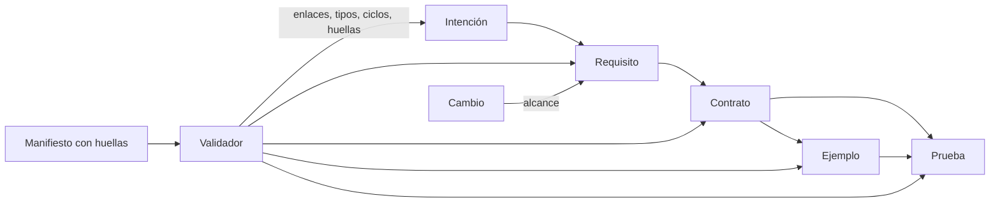
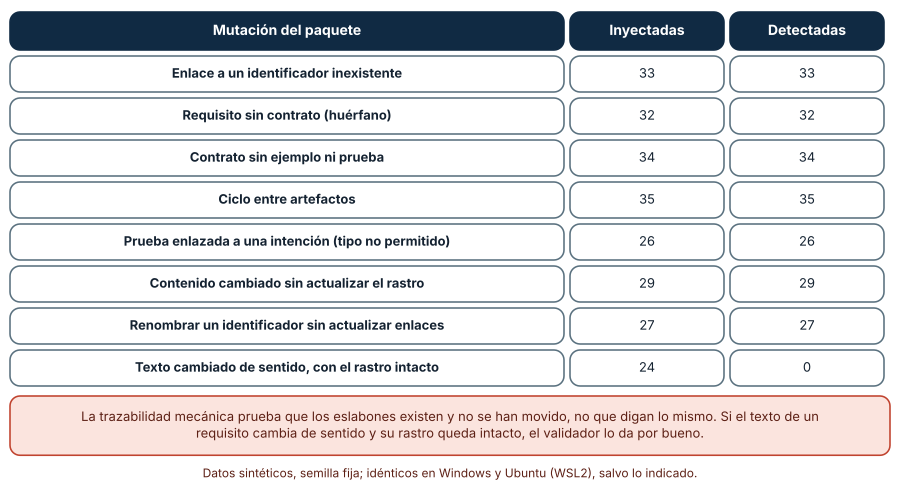
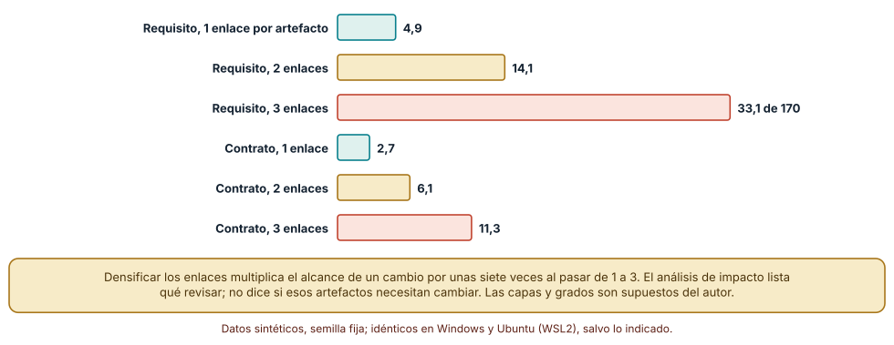
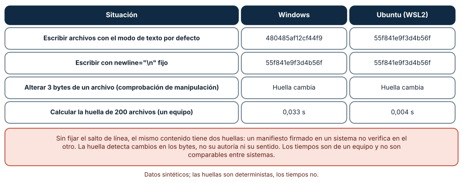

# SE-168 — Proyecto: paquete de especificaciones trazables

[← SE-167 — Taller: convertir intención en contrato comprobable](https://github.com/vladimiracunadev-create/modern-software-engineering-program/blob/main/classes/part-13-especificaciones-contratos-y-modelos/se-167-taller-convertir-intencion-en-contrato-comprobable/README.md) · [↑ Parte 13](https://github.com/vladimiracunadev-create/modern-software-engineering-program/blob/main/classes/part-13-especificaciones-contratos-y-modelos/README.md) · [📚 Índice completo](https://github.com/vladimiracunadev-create/modern-software-engineering-program/blob/main/classes/README.md) · [🌐 Portal](https://vladimiracunadev-create.github.io/modern-software-engineering-program/classes/SE-168.html) · [SE-169 — Diseño centrado en personas y tareas →](https://github.com/vladimiracunadev-create/modern-software-engineering-program/blob/main/classes/part-14-experiencia-accesibilidad-e-internacionalizacion/se-169-diseno-centrado-en-personas-y-tareas/README.md)

## Punto profesional y fundamento pedagógico

**Punto profesional.** El proyecto existe para entregar un paquete que otra persona pueda revisar sin pedir contexto: intenciones, requisitos, contratos, ejemplos y pruebas enlazados entre sí, con una comprobación mecánica de que los enlaces existen y no se han movido, una estimación de cuánto alcanza un cambio y una huella reproducible del conjunto.

**Por qué aparece aquí.** Cierra la **Parte 13** después de **Taller: convertir intención en contrato comprobable**: los doce artefactos de la parte (regla en tres niveles, escenarios, contratos, modelo, máquina de estados, esquema, contrato de interfaz, política de evolución, nivel por artefacto, pruebas contractuales, taller) se reúnen en un solo paquete, con la trazabilidad que ninguna clase aislada podía dar. Deja la base que la Parte 14 usará al diseñar la experiencia sobre un contrato conocido.

**Error conceptual que debe corregir.** Creer que un paquete con muchos documentos y enlaces es un paquete trazable: los enlaces pueden existir y decir cosas distintas, y una huella solo prueba que los bytes no cambiaron, no que el texto de un requisito conserve su sentido.

**Secuencia de aprendizaje.** Antes de leer la solución, predices qué mutaciones de un paquete de 41 artefactos detectará un validador y cuáles no; después mides cuántos artefactos alcanza un cambio según la densidad de enlaces y calculas la huella del mismo paquete en dos sistemas operativos. La secuencia usa predicción, explicación propia, contraste y recuperación. [ICAP](https://icap.education.asu.edu/research) distingue participación de construcción de conocimiento; [How People Learn II](https://nap.nationalacademies.org/catalog/24783/how-people-learn-ii-learners-contexts-and-cultures) exige conectar conocimiento previo, contexto y transferencia; la [práctica de recuperación](https://pubmed.ncbi.nlm.nih.gov/16507066/) respalda producir de nuevo la explicación tras una demora; y [Education for Life and Work](https://nap.nationalacademies.org/resource/13398/dbasse_084153.pdf) exige devolución que explique la causa del error.

**Evidencia de aprendizaje.** `package-log.md` con el paquete (intenciones, requisitos, contratos, ejemplos, pruebas y sus enlaces), el validador, las 240 mutaciones, la estimación de alcance, la huella del paquete en dos sistemas y las decisiones humanas abiertas. Debe contener predicción previa, observación, explicación causal, contraejemplo y qué hallazgo haría rechazar el paquete.

**Límite de la conclusión.** El paquete es sintético (41 artefactos de la plataforma de entregas), el validador comprueba enlaces, tipos, ciclos y huellas, y no el sentido de los textos; los grafos de alcance tienen capas y grados supuestos por el autor; los tiempos de cálculo de huellas son de un equipo.

### Trazabilidad fuente → afirmación

| Fuente primaria u oficial | Afirmación que respalda | Lo que no prueba |
|---|---|---|
| [Gotel y Finkelstein, «An analysis of the requirements traceability problem» (ICRE, 1994)](https://doi.org/10.1109/ICRE.1994.292398) | Define la trazabilidad de requisitos como la capacidad de seguir un requisito hacia atrás y hacia adelante, y analiza por qué falla en la práctica. | No mide cuánta trazabilidad compensa su coste en un proyecto. |
| [Cleland-Huang et al., «Software traceability: trends and future directions» (FOSE, 2014)](https://doi.org/10.1145/2593882.2593891) | Revisa técnicas de creación y mantenimiento de enlaces de trazabilidad y sus límites. | No demuestra que un conjunto concreto de enlaces sea correcto. |
| [FIPS 180-4: Secure Hash Standard](https://csrc.nist.gov/pubs/fips/180-4/upd1/final) | Especifica SHA-256, que produce una huella determinista de una secuencia de bytes. | No dice si los bytes tienen el contenido que se quería. |

## Antes de empezar

Recupera lo aprendido en `SE-167`: un revisor mecánico verifica coherencia interna y deja los cambios de sentido a una persona. La pregunta activa es: **¿cómo se entrega un conjunto de artefactos de modo que quien llegue pueda seguir cada afirmación hasta su origen y saber qué se ve afectado si algo cambia?**

## Prerrequisitos

- Haber completado `SE-167` o poder explicar qué detecta y qué no un revisor de coherencia.
- Python 3.11 o posterior y un terminal; se usan `hashlib`, `os`, `tempfile` y la biblioteca estándar.
- Trabajar con los artefactos de la plataforma de entregas producidos en las clases anteriores.

## Problema auténtico

La secretaría pide una revisión del paquete de especificaciones antes de adoptar la regla de penalización. Quien revisa abre la intención, el requisito, el contrato, los ejemplos y las pruebas, y no puede responder tres preguntas: ¿qué ejemplo respalda esta cláusula?, ¿qué prueba protege este ejemplo?, ¿qué habría que revisar si cambia el tope del 50 %? Un colega propone calcular una huella del paquete para «asegurar su integridad» y la huella calculada en Windows no coincide con la de Ubuntu.

## Objetivos observables

Al terminar podrás:

1. ensamblar un paquete con intenciones, requisitos, contratos, ejemplos y pruebas enlazados por identificadores con tipos de enlace permitidos;
2. validar mecánicamente enlaces, tipos, cobertura, ciclos y huellas, y medir qué mutaciones detecta y cuáles no;
3. estimar cuántos artefactos alcanza un cambio y cómo depende de la densidad de enlaces;
4. producir una huella reproducible del paquete entre sistemas operativos y detectar una manipulación;
5. entregar el paquete con sus límites y las decisiones humanas abiertas.

## Mapa conceptual



El mapa se lee de la intención a la prueba como cadena de justificación; el validador recorre todos los artefactos y el manifiesto fija sus huellas. Un cambio en cualquier punto tiene un alcance que se estima recorriendo los enlaces. No es un proceso de entrega: es la estructura del paquete.

## Temas y por qué importan

| Tema | Por qué cambia una decisión profesional | Evidencia mínima |
|---|---|---|
| Estructura del paquete | Un paquete con tipos de artefacto y de enlace definidos permite comprobaciones mecánicas. | Predicción, traza causal y contraejemplo de **Estructura del paquete** en `package-log.md` |
| Trazabilidad | Seguir cada afirmación hasta su origen permite revisar sin contexto y medir el alcance de un cambio. | Predicción, traza causal y contraejemplo de **Trazabilidad** en `package-log.md` |
| Validación mecánica | Comprobar enlaces, tipos, ciclos y huellas atrapa una clase de errores y deja otra. | Predicción, traza causal y contraejemplo de **Validación mecánica** en `package-log.md` |
| Análisis de impacto | Estimar el alcance de un cambio decide cuánto revisar y cuánto cuesta cambiar. | Predicción, traza causal y contraejemplo de **Análisis de impacto** en `package-log.md` |
| Integridad y reproducibilidad | Una huella determinista permite detectar manipulaciones y comparar entre entornos. | Predicción, traza causal y contraejemplo de **Integridad y reproducibilidad** en `package-log.md` |

## Conceptos y decisiones

### 1. Estructura del paquete

El paquete se compone de cinco tipos de artefacto (intención, requisito, contrato, ejemplo y prueba) con identificadores estables (`INT-1`, `REQ-4`, `CON-4`, `EJE-7`, `TST-3`) y una lista de enlaces que apuntan hacia el origen: un requisito enlaza a una intención, un contrato a un requisito, un ejemplo y una prueba a un contrato, y una prueba también a un ejemplo. Los tipos de enlace permitidos están declarados, de modo que una prueba enlazada directamente a una intención es un error de estructura. El identificador no cambia cuando cambia el título, y el contenido tiene una huella.

### 2. Trazabilidad

Gotel y Finkelstein definen la trazabilidad como la capacidad de seguir un requisito hacia su origen y hacia sus consecuencias. Para que sirva, debe haber cobertura en ambos sentidos: todo requisito tiene al menos un contrato, todo contrato tiene ejemplo y prueba, y todo ejemplo y prueba pertenece a algún contrato. Los enlaces que nadie mantiene se convierten en ruido y la trazabilidad cae en desuso; por eso conviene un coste de mantenimiento bajo (identificadores estables, comprobación en integración continua) y un alcance acotado (no todo se enlaza con todo).

### 3. Validación mecánica

El validador recorre el paquete y comprueba cinco cosas: que cada enlace apunte a un identificador existente, que el par de tipos esté permitido, que requisitos y contratos tengan descendientes, que no haya ciclos y que la huella de cada artefacto coincida con la del manifiesto. Son comprobaciones de forma, baratas y automatizables. No ven si el texto de un requisito conserva su sentido ni si un ejemplo respalda realmente la cláusula a la que se enlaza.

### 4. Análisis de impacto

Dado un artefacto que cambia, su alcance es el conjunto de artefactos alcanzables siguiendo los enlaces hacia sus consecuencias. Estimarlo antes de cambiar responde cuánto hay que revisar y a quién avisar. Es una cota superior (no todo lo alcanzable necesita cambiar) y depende de cuán denso sea el grafo: pocos enlaces por artefacto acotan el alcance; muchos lo disparan. Un alcance grande no es malo por sí mismo: es una señal de que el cambio merece una revisión específica.

### 5. Integridad y reproducibilidad

Una huella SHA-256 de cada archivo y de su conjunto permite detectar que algo cambió y comprobar que dos copias coinciden. Para que sea reproducible hay que fijar todo lo que influye en los bytes: orden de los archivos, codificación y, sobre todo, saltos de línea. Un mismo texto escrito con el modo por defecto de Python tiene bytes distintos en Windows (`\r\n`) y en Linux (`\n`), y el manifiesto firmado en uno no verifica en el otro. La huella prueba bytes, no sentido ni autoría.

### Qué mutaciones detecta un validador de trazabilidad

El paquete tiene **41 artefactos**: 3 intenciones, 8 requisitos, 8 contratos, 12 ejemplos y 10 pruebas, con los enlaces descritos. El validador comprueba enlaces colgantes, tipos permitidos, requisitos y contratos sin descendiente, ciclos y huellas del manifiesto. Se aplicaron 240 mutaciones de ocho tipos con semilla fija. Detectó **todas** las de forma: enlace a un identificador inexistente (33 de 33), requisito sin contrato (32 de 32), contrato sin ejemplo ni prueba (34 de 34), ciclo (35 de 35), prueba enlazada a una intención (26 de 26), contenido cambiado sin actualizar el rastro (29 de 29) y renombrar un identificador sin actualizar los enlaces (27 de 27): 216 en total. No detectó **ninguna** (0 de 24) de las que cambian el sentido de un texto con el rastro intacto. Los resultados fueron idénticos en Windows y Ubuntu.

```python
if (v["tipo"], n[d]["tipo"]) not in VALIDO: errores.add("enlace de tipo no permitido")
if v["hash"] != esperado.get(k, v["hash"]): errores.add("contenido cambiado sin actualizar el rastro")
```



**Cómo leer la figura.** Cada fila es un tipo de mutación con cuántas veces se inyectó y cuántas se detectó; la última cambia el sentido de un texto. **Dónde deja de valer:** el validador comprueba forma y huellas, y el paquete es sintético; en uno real, los enlaces los escribe una persona que puede enlazar mal, y un enlace válido puede apuntar al artefacto equivocado. La detección de «contenido cambiado» supone que la huella del manifiesto la actualiza una persona o un proceso consciente.

### Cuánto alcanza un cambio

Se generaron 200 grafos sintéticos de cinco capas (5 intenciones, 20 requisitos, 30 contratos, 60 ejemplos y 80 pruebas) con un número de enlaces hacia la capa siguiente de 1, 2 o 3 por artefacto (distribución normal de desviación 0,7, redondeada). Se eligió al azar un requisito, y por separado un contrato, y se contaron los artefactos alcanzables. Con un enlace por artefacto, cambiar un requisito alcanza en media **4,9** artefactos y cambiar un contrato **2,7**; con dos, **14,1** y **6,1**; con tres, **33,1** y **11,3** (de 170 descendientes posibles para un requisito).

```python
def alcance(hijos, ini):
    visto, pila = {ini}, [ini]
    while pila:
        for h in hijos[pila.pop()]:
            if h not in visto: visto.add(h); pila.append(h)
    return len(visto) - 1
```



**Cómo leer la figura.** Cada barra es el alcance medio de un cambio; las primeras tres son requisitos y las últimas tres contratos. **Dónde deja de valer:** las capas, los tamaños y el grado son supuestos del autor; en un paquete real la estructura no es aleatoria y los enlaces se concentran en pocos artefactos centrales. El alcance es una cota superior de lo que hay que revisar, no de lo que hay que cambiar.

### La misma carpeta, dos huellas

Se escribieron 200 archivos de texto con tres líneas cada uno y se calculó una huella SHA-256 que combina nombres y contenidos ordenados. Con el **modo de texto por defecto**, la huella en Windows fue `480485af12cf44f9` y en Ubuntu `55f841e9f3d4b56f` (primeros 16 caracteres). Fijando `newline="\n"` al escribir, la huella fue `55f841e9f3d4b56f` en **ambos**. Alterar tres bytes de un archivo cambió la huella. Calcular la huella de 200 archivos tardó 0,033 s en Windows y 0,004 s en Ubuntu en una medición de un equipo.

```python
with open(ruta, "w", encoding="utf-8", newline="\n") as f:
    f.write(texto)               # sin newline="\n", Windows escribe \r\n
```



**Cómo leer la figura.** Las dos primeras filas comparan la huella entre sistemas con y sin salto de línea fijo; la tercera, la detección de una alteración, y la cuarta, el tiempo. **Dónde deja de valer:** la huella es sensible a todo lo que cambie los bytes (codificación, orden, saltos de línea, conversiones de un sistema de control de versiones) y no dice nada sobre el sentido; los tiempos son de un equipo y no son comparables entre sistemas. Un archivo `.gitattributes` que fije los saltos de línea evita que el sistema de control de versiones los convierta.

## Definiciones de trabajo

- **paquete trazable:** conjunto de artefactos con identificadores estables, enlaces de tipos permitidos y huellas verificables.
- **trazabilidad:** capacidad de seguir un artefacto hacia su origen y hacia sus consecuencias.
- **alcance de un cambio:** conjunto de artefactos alcanzables desde uno modificado siguiendo los enlaces.
- **manifiesto:** lista de artefactos con su identificador y su huella que permite verificar el paquete.
- **huella reproducible:** resumen criptográfico del paquete que no depende del sistema operativo ni del orden de lectura.

Las definiciones son operativas para la plataforma de entregas. No convierten términos con historia más amplia en sinónimos y deben contrastarse con la documentación primaria enlazada al final.

## Ejemplo mínimo

El fragmento valida los enlaces de un paquete de tres artefactos. Antes de ejecutarlo, predice cuál enlace falla.

```python
nodos = {
    "REQ-1": {"tipo": "requisito", "enlaza": ["INT-1"]},
    "CON-1": {"tipo": "contrato", "enlaza": ["REQ-1"]},
    "TST-1": {"tipo": "prueba", "enlaza": ["CON-1", "EJE-9"]},
}
colgantes = [(k, d) for k, v in nodos.items() for d in v["enlaza"] if d not in nodos]
assert colgantes == [("REQ-1", "INT-1"), ("TST-1", "EJE-9")]
```

Hay dos enlaces colgantes: la intención `INT-1` y el ejemplo `EJE-9` no existen en el paquete. Registra versión del intérprete y salida; añade los artefactos y comprueba que el resultado queda vacío.

## Ejemplo profesional

En la plataforma, el paquete vive en una carpeta con un archivo por artefacto (cabecera con identificador, tipo y enlaces, y cuerpo) y un manifiesto con las huellas. Un validador de integración continua comprueba enlaces, tipos, cobertura, ciclos y huellas, y falla con el identificador y el motivo; un segundo paso calcula el alcance de los artefactos modificados en cada cambio y lo escribe en la descripción de la revisión. Los archivos se escriben con saltos de línea fijos, y un `.gitattributes` evita conversiones. Una lista de decisiones humanas abiertas, con responsable y fecha, acompaña al paquete y se revisa en cada cambio.

Compara el caso normal con un requisito sin contrato, un texto cambiado sin actualizar su huella y un requisito cuyo sentido cambia sin tocar los enlaces. Un paquete es apropiado cuando los dos primeros casos fallan en integración continua y el tercero llega a una persona con el dominio; es peligroso cuando el tercero se da por revisado.

## Práctica guiada

1. Define los cinco tipos de artefacto, los enlaces permitidos y el formato de identificador.
2. Ensambla el paquete con los artefactos de las clases anteriores (intención, requisitos, contratos, ejemplos y pruebas) y escribe el manifiesto.
3. Predice qué mutaciones detectará el validador y cuáles no, y escribe la lista.
4. Implementa el validador y aplica 240 mutaciones con semilla fija; registra los conteos.
5. Estima el alcance de un cambio al tope del 50 % recorriendo los enlaces de tu paquete.
6. Calcula la huella del paquete con y sin `newline="\n"` y comprueba el resultado en los dos sistemas si dispones de ellos.
7. Entrega `package-log.md` con las decisiones humanas abiertas y pide a otra persona que revise un requisito siguiendo solo los enlaces.

## Ejercicios

1. **Cobertura:** añade una regla que exija que todo ejemplo esté referenciado por una prueba y mide cuántas de las 240 mutaciones nuevas detecta.
2. **Alcance:** calcula el alcance de cambiar cada requisito de tu paquete y ordénalos; decide cuáles revisarías primero.
3. **Huella:** diseña un manifiesto que incluya la versión de Python y la lista ordenada de archivos, y explica qué problema evita.
4. **Sentido:** diseña una comprobación que ayude a detectar un cambio de sentido (por ejemplo, un ejemplo de frontera por requisito) y explica qué no cubre.

## Reto verificable

Entrega el paquete con su manifiesto, el validador, las 240 mutaciones, la estimación de alcance, la huella en dos sistemas y la lista de decisiones abiertas. Se aprueba si otra persona ejecuta el validador desde un checkout limpio, obtiene los mismos conteos y la misma huella y puede seguir una afirmación hasta su intención y hasta sus pruebas, señalando además qué cambio de sentido no detecta el validador. No se aprueba por el número de artefactos ni por que el validador dé verde.

## Caso conductor

La plataforma de entregas es el caso conductor de la Parte 13. Este proyecto reúne la regla de penalización escrita en tres niveles (`SE-157`), sus escenarios (`SE-158`), los contratos (`SE-159`), el modelo y la máquina de estados (`SE-160` y `SE-161`), el esquema (`SE-162`), el contrato de interfaz (`SE-163`), la política de evolución (`SE-164`), la decisión de nivel (`SE-165`), las pruebas contractuales (`SE-166`) y el contrato del taller (`SE-167`), con identificadores, enlaces y huellas. Cambia después una sola decisión, el tope del 50 % al 30 %, y revisa el alcance estimado frente a los artefactos que realmente tuviste que tocar.

## Preguntas frecuentes

### ¿Cuántos enlaces conviene mantener?

Los que permitan responder las preguntas de revisión y de impacto que importan, y no más: cada enlace es un coste de mantenimiento. El experimento de alcance muestra que la densidad de enlaces multiplica el alcance de un cambio, de modo que enlazar de más no es gratis.

### ¿La huella demuestra que el paquete es correcto?

No: demuestra que los bytes no cambiaron desde que se calculó. No dice si el contenido es el que se quería ni quién lo calculó. Para autoría hace falta una firma; para corrección, revisión.

### ¿Qué hago con las decisiones humanas abiertas?

Se registran con responsable, fecha y evidencia que las modificaría, y se revisan en cada cambio. Un paquete que las oculta aparenta estar completo; uno que las declara muestra dónde está el riesgo.

### ¿Puede un agente mantener el paquete?

Puede proponer enlaces, cambios y actualizaciones de huellas, y puede hacer que todo cuadre sin que el sentido se conserve. Mantén el validador mecánico en integración continua y exige que una persona con el dominio revise los cambios de texto de los requisitos.

## Fallo controlado y diagnóstico

Reproduce el fallo clásico del proyecto: **dar por revisado un paquete porque todos los enlaces y huellas cuadran**. Cambia el tope del requisito de 50 % a 5 % en el texto y actualiza su huella en el manifiesto.

Registra síntoma, entrada mínima, hipótesis, observación que descarta cada hipótesis, causa, corrección y prueba de regresión. **Síntoma:** una estudiante con seis días de retraso conserva el 95 % de su nota y la secretaría pregunta por qué. **Hipótesis rivales:** (a) el validador falló; (b) el validador solo ve forma y huellas. **Prueba:** ejecuta las 24 mutaciones de cambio de sentido: 0 detectadas. **Conclusión:** la causa es un cambio de sentido con el rastro actualizado. **Regresión:** añade un ejemplo de frontera en el tope (121 horas con nota 80 debe dar 40) y una regla de revisión que obligue a una persona a aprobar cada cambio de texto de un requisito. No cambies a la vez el requisito y el manifiesto.

## Errores comunes y cómo corregirlos

| Síntoma | Causa probable | Corrección |
|---|---|---|
| Un revisor no sabe qué ejemplo respalda una cláusula | Faltan enlaces entre contrato y ejemplo | Exigir cobertura en ambos sentidos y comprobarla en integración continua |
| Al renombrar un artefacto se rompen enlaces | Los identificadores dependen del título | Identificadores estables y comprobación de enlaces colgantes |
| La huella del paquete difiere entre Windows y Ubuntu | Los saltos de línea cambian los bytes | Escribir con `newline="\n"` y fijarlos con `.gitattributes` |
| Un cambio pequeño exige revisar medio paquete | Densidad excesiva de enlaces | Estimar el alcance y enlazar solo lo necesario para responder las preguntas de revisión |
| Todo cuadra y la regla cambió de sentido | El validador solo comprueba forma y huellas | Revisión humana de los cambios de texto y ejemplos de frontera por requisito |

## Entorno y archivos clave

```text
work/SE-168/
├── README.md
├── paquete/
│   ├── intenciones/
│   ├── requisitos/
│   ├── contratos/
│   ├── ejemplos/
│   ├── pruebas/
│   └── MANIFEST.json
├── trazabilidad/
│   ├── validar.py
│   ├── alcance.py
│   └── huella.py
├── tests/test_paquete.py
└── evidence/package-log.md
```

El `README` declara plataforma, versión de Python, semillas y comandos. Los experimentos usan solo la biblioteca estándar (`hashlib`, `os`, `tempfile`, `random`, `time`) y se ejecutaron con CPython 3.12.9 en Windows 11 y 3.12.3 en Ubuntu bajo WSL2: las mutaciones y el alcance fueron idénticos, la huella con el modo de texto por defecto fue distinta y los tiempos variaron. Si adoptas una herramienta de trazabilidad, fija procedencia y versión.

## Seguridad, ética y accesibilidad

- un paquete que justifica una regla que decide notas debe poder auditarse: guarda el manifiesto y las revisiones, y registra quién aprobó cada cambio;
- una huella no es una firma: no uses el manifiesto como prueba de autoría sin un mecanismo de firma adicional y una gestión de claves;
- los artefactos son sintéticos: no incluyas datos de estudiantes reales en ejemplos, pruebas o manifiestos que circulan;
- redacta los artefactos con lenguaje comprensible para quien revisa la regla y ofrece una alternativa textual a las tablas y grafos;
- respeta las licencias de las herramientas y atribuye adaptaciones.

## Puente hacia el trabajo con agentes

Un agente al que se le pide «ensambla el paquete de especificaciones» producirá archivos con enlaces plausibles y huellas que cuadran, y puede haberlos generado todos sin leer ninguno. Pídele que escriba el validador y que muestre su salida, que liste los enlaces que creó con el motivo de cada uno y que calcule el alcance de un cambio sobre el paquete real. Revisa especialmente los enlaces entre ejemplos y cláusulas: son los que más fácilmente existen sin que el ejemplo respalde nada, ahora con apariencia de trazabilidad.

## Transferencia

Traslada el proyecto a otro de los dominios persistentes (por ejemplo, un servicio de entregas a domicilio con una regla de recargo por espera): ensambla los cinco tipos de artefacto, valida y estima el alcance. La transferencia está lograda cuando puedes explicar qué parte del paquete dependía del dominio y cuál no, no cuando la carpeta se parece.

## Evaluación y evidencia

| Criterio | Evidencia para aprobar |
|---|---|
| comprensión | explicación de qué comprueba el validador, qué no y por qué la huella no prueba sentido |
| corrección | validador, mutaciones, alcance y huella reproducibles con las mismas semillas |
| diseño | paquete con identificadores estables, enlaces tipados, cobertura en ambos sentidos y manifiesto |
| diagnóstico | reproducción del fallo «todo cuadra pero el sentido cambió» con regresión |
| incertidumbre | declaración de los cambios de sentido no detectados y de las decisiones humanas abiertas |
| reproducibilidad | versiones, comandos, salida, huella en dos sistemas y límites declarados |

## Fuentes

- [Gotel y Finkelstein, «An analysis of the requirements traceability problem» (ICRE, 1994)](https://doi.org/10.1109/ICRE.1994.292398) — definición y problemas de la trazabilidad de requisitos; autoridad: IEEE International Conference on Requirements Engineering.
- [Cleland-Huang et al., «Software traceability: trends and future directions» (FOSE, 2014)](https://doi.org/10.1145/2593882.2593891) — técnicas de creación y mantenimiento de enlaces; autoridad: ACM Future of Software Engineering.
- [FIPS 180-4: Secure Hash Standard](https://csrc.nist.gov/pubs/fips/180-4/upd1/final) — especificación de SHA-256; autoridad: NIST.
- [Git: gitattributes](https://git-scm.com/docs/gitattributes) — control de los saltos de línea y de las conversiones; autoridad: proyecto Git.
- [SWEBOK Guide v4.0a](https://www.computer.org/education/bodies-of-knowledge/software-engineering) — requisitos, configuración y calidad de software; autoridad: IEEE Computer Society.
- [Fowler: Consumer-Driven Contracts](https://martinfowler.com/articles/consumerDrivenContracts.html) — enlaces entre contratos y consumidores; autoridad: martinfowler.com.

Cada fuente respalda el mecanismo indicado; ninguna demuestra que el paquete del proyecto sea el que la secretaría necesita. Esa afirmación depende del contenido de los artefactos, de quienes los revisan y de lo que decidan.

- [Python: `hashlib`](https://docs.python.org/3/library/hashlib.html) — funciones de resumen usadas en las huellas.
- [Python: `open`](https://docs.python.org/3/library/functions.html#open) — parámetro `newline` que fija los saltos de línea al escribir.
- [Python: `tempfile`](https://docs.python.org/3/library/tempfile.html) — directorios temporales de los experimentos.

## Límites y siguiente paso

Se ejecutaron tres experimentos con datos sintéticos en Windows y Ubuntu (WSL2): mutaciones y alcance idénticos, huella distinta con el modo de texto por defecto e idéntica con el salto de línea fijo, tiempos distintos. El paquete es sintético, el validador comprueba forma y huellas, y los grafos de alcance son supuestos del autor. No se usó firma criptográfica, no se auditó ningún paquete real y la Parte 13 no tiene laboratorio propio en `labs/`. La siguiente parte pregunta cómo se diseña la experiencia de las personas que usarán la plataforma cuyo comportamiento ya está especificado.

## Glosario

- **paquete trazable:** conjunto de artefactos con identificadores estables, enlaces de tipos permitidos y huellas verificables.
- **trazabilidad:** capacidad de seguir un artefacto hacia su origen y hacia sus consecuencias.
- **alcance de un cambio:** conjunto de artefactos alcanzables desde uno modificado siguiendo los enlaces.
- **manifiesto:** lista de artefactos con su identificador y su huella que permite verificar el paquete.
- **huella reproducible:** resumen criptográfico del paquete que no depende del sistema operativo ni del orden de lectura.

---

[← SE-167 — Taller: convertir intención en contrato comprobable](https://github.com/vladimiracunadev-create/modern-software-engineering-program/blob/main/classes/part-13-especificaciones-contratos-y-modelos/se-167-taller-convertir-intencion-en-contrato-comprobable/README.md) · [↑ Parte 13](https://github.com/vladimiracunadev-create/modern-software-engineering-program/blob/main/classes/part-13-especificaciones-contratos-y-modelos/README.md) · [📚 Índice completo](https://github.com/vladimiracunadev-create/modern-software-engineering-program/blob/main/classes/README.md) · [🌐 Portal](https://vladimiracunadev-create.github.io/modern-software-engineering-program/classes/SE-168.html) · [SE-169 — Diseño centrado en personas y tareas →](https://github.com/vladimiracunadev-create/modern-software-engineering-program/blob/main/classes/part-14-experiencia-accesibilidad-e-internacionalizacion/se-169-diseno-centrado-en-personas-y-tareas/README.md)
