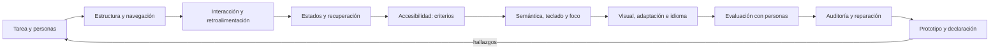

# Parte 14 — Experiencia, accesibilidad e internacionalización

La Parte 13 terminó con un comportamiento especificado y comprobable. La pregunta cambia de «qué promete el sistema» a «quién puede usar esa promesa, con qué cuerpo, en qué idioma y en qué condiciones». Esta parte trabaja sobre la **entrega de una tarea en la plataforma de entregas**, el mismo caso sintético, y la recorre con una lente distinta en cada clase: la tarea y quien la hace, dónde vive en la estructura, cómo responde cada control, qué se ve cuando algo falla, quién puede percibirla y operarla, cómo se ve bajo otra visión, otro ancho y otro idioma, cómo se mide si las personas la logran y cómo se audita, se repara y se declara.

## Pregunta rectora

> ¿Quién puede completar la tarea, con qué modalidad y en qué estado de error o recuperación?

## Antes del recorrido clase por clase

Esta parte no enseña una herramienta ni una norma de memoria. Enseña a convertir «es usable» y «es accesible» en cálculos, simulaciones y comprobaciones con sus límites declarados: cuánto tarda cada diseño, a cuánta gente deja fuera el promedio, qué etapa pierde más personas, cuánto cuesta una estructura de navegación, qué errores deja un objetivo pequeño, qué protege una clave de idempotencia, qué combinaciones de estado son imposibles, qué ve un auditor automático y qué no, qué colores se confunden, qué anchos y preferencias quedan sin cubrir, qué rompe una suposición de una sola lengua, qué se puede concluir con pocas personas y qué parte de una declaración de conformidad es evidencia y cuál es supuesto. Cada clase ejecuta tres experimentos con datos sintéticos que muestran un mecanismo y declara lo que ese experimento no demuestra.

El diagrama se lee de izquierda a derecha y no es un proceso obligatorio. El retorno indica que un hallazgo de la evaluación o de la auditoría reabre la tarea o la estructura; un prototipo con declaración de conformidad no cierra el diseño, lo fecha y acota su alcance.

## Resultados acumulativos

Podrás descomponer una tarea en operadores y estimar su tiempo, explicar por qué el promedio no sirve y localizar la etapa que más pierde gente; comparar anchuras y profundidades de navegación, estimar cuántas personas hacen falta para ordenar tarjetas y medir el alcance de un grafo de enlaces; calcular el costo de un objetivo pequeño, hacer seguro un reenvío con una clave de idempotencia y comparar confirmar con deshacer; representar los estados de una vista como una unión con transiciones y comparar políticas de reintento; calcular el contraste y construir un auditor de reglas sabiendo qué defectos no ve; calcular el orden de foco y el nombre accesible y distinguir lo nativo de lo imitado; simular tres visiones del color, el reflujo al ampliar y la inversión de un tema; cubrir pares de preferencias y estimar el peso de una página; contar formas de plural, longitudes de texto y fechas ambiguas; informar proporciones con intervalo y estimar la potencia de una comparación; auditar, ordenar, reparar y mutar un flujo; y entregar un prototipo con una declaración de conformidad que cuenta lo no probado.

Al finalizar podrás defender un diseño con una tarea, escenarios, cálculos con supuestos declarados, una estructura medida, una política de estados, una auditoría con sus puntos ciegos, un plan de evaluación con su incertidumbre y una lista de lo que ninguna herramienta ve, y podrás indicar qué parte de tu conclusión es observación, cuál es inferencia y cuál es suposición.

## Prerrequisitos enlazados

- [Parte 4 — Pensamiento computacional](https://github.com/vladimiracunadev-create/modern-software-engineering-program/blob/main/classes/part-04-pensamiento-computacional-y-resolucion-de-problemas/): modelado y razonamiento sobre evidencia.
- [Parte 7 — Estructuras de datos y algoritmos](https://github.com/vladimiracunadev-create/modern-software-engineering-program/blob/main/classes/part-07-estructuras-de-datos-y-algoritmos/): medir, comparar y no confundir un resultado con un modelo.
- [Parte 12 — Ingeniería de requisitos](https://github.com/vladimiracunadev-create/modern-software-engineering-program/blob/main/classes/part-12-ingenieria-de-requisitos/): necesidades de las personas y criterios de aceptación revisables.
- [Parte 13 — Especificaciones, contratos y modelos](https://github.com/vladimiracunadev-create/modern-software-engineering-program/blob/main/classes/part-13-especificaciones-contratos-y-modelos/): comportamiento especificado, estados, esquemas y contratos que esta parte hace usables.
- Python 3.11+ y terminal; los experimentos usan solo la biblioteca estándar y datos sintéticos.

## Bloques y progresión

1. **Entender la tarea y organizarla:** las clases 169–170 pasan de la pantalla a la tarea, miden el costo de los pasos, la variación entre personas y el alcance de una estructura de navegación.
2. **Hacer que responda y que falle bien:** las clases 171–172 diseñan la respuesta de cada control y los estados de una vista, con duplicados, reintentos y esperas medidos.
3. **Hacerla accesible:** las clases 173–175 pasan de los criterios a la semántica nativa, el teclado, el foco y lo visual, midiendo lo que ve y no ve un auditor.
4. **Adaptarla a quien la usa:** las clases 176–177 la adaptan a anchos, preferencias, conexiones, idiomas y formatos.
5. **Medir, auditar y entregar:** las clases 178–180 miden con personas, auditan y reparan un flujo y entregan un prototipo con su declaración de conformidad.

## Evidencia medida y límites

Las figuras y los ejemplos de esta parte usan experimentos ejecutados con CPython 3.12.9 en Windows 11 y repetidos con CPython 3.12.3 en Ubuntu bajo WSL2. Los datos son **sintéticos** y las semillas están fijadas: las salidas fueron idénticas en ambos sistemas, sin ninguna diferencia salvo la versión del intérprete que se imprime. Los experimentos no miden tiempos de ejecución, de modo que la parte no tiene diferencias de tiempo entre sistemas.

Los experimentos son: tres diseños de una entrega con operadores, una población simulada de diez dimensiones y un embudo de seis etapas (`SE-169`); anchura y profundidad de un menú de 4 096 destinos, estabilidad de un ordenamiento de tarjetas y alcance de un grafo de 120 páginas (`SE-170`); tamaño del objetivo con la ley de Fitts, un doble envío con y sin clave de idempotencia y confirmar frente a deshacer (`SE-171`); combinaciones imposibles de banderas, tres políticas de reintento tras una caída y umbrales de una latencia lognormal (`SE-172`); razones de contraste, un auditor de reglas con doce defectos y destinos de 24 px (`SE-173`); el orden de foco, un cálculo de nombre accesible y la estructura de encabezados (`SE-174`); tres simulaciones de daltonismo, reflujo con zoom y la inversión ingenua de colores (`SE-175`); diez mil anchos con dos maquetaciones, una matriz de cinco preferencias y el peso de las imágenes (`SE-176`); categorías de plural, longitudes de texto y cadenas numéricas y fechas ambiguas (`SE-177`); problemas hallados con probabilidades heterogéneas, tres intervalos para una proporción y la potencia de una comparación (`SE-178`); auditoría de un formulario roto, tres órdenes de reparación y trece mutaciones (`SE-179`); y la probabilidad de ver una barrera, la cobertura de cuatro modalidades y kappa (`SE-180`).

Los parámetros (los operadores de nivel de teclado, el factor común de las dimensiones, las tasas del embudo, el error por nivel de la navegación, el 25 % de ruido de las tarjetas, la dispersión de los toques, la latencia y la paciencia, el 10 % de recargas, los porcentajes de confirmación por reflejo, los eventos aleatorios, la mezcla de anchos de pantalla, los 60 defectos de preferencias, la distribución beta de los problemas de usabilidad, la media y desviación de SUS, los 12 hallazgos con sus estimaciones, las prevalencias de barreras y el 8 % de error de los evaluadores) son supuestos del autor o valores medios de la literatura, no datos de un producto, una institución ni de personas reales. Las matrices de simulación de daltonismo se aplican en RGB lineal como aproximación, las reglas de plural se aplicaron a mano a enteros de 0 a 120 y el auditor y los modelos de foco y de nombre accesible son subconjuntos pequeños de las especificaciones. No se usó ningún escáner de producción, lector de pantalla, navegador automatizado, biblioteca de localización ni herramienta de analítica, no se reclutó a nadie, no se auditó un sitio real ni se hizo ninguna evaluación con personas con discapacidad. Esta parte no tiene laboratorio propio en `labs/`; el proyecto `SE-180` define el paquete y la evidencia. Cada clase termina con un puente hacia el trabajo con agentes y ninguna constituye asesoría legal sobre normas de accesibilidad.

## Guía razonada clase por clase

La entrega de una tarea mantiene una tarea, unos escenarios y un prototipo estables mientras cambian las decisiones. Cada clase explica qué decisión sustituye una impresión por un cálculo, qué experimento lo muestra, qué no demuestra y qué evidencia permite abandonar la conclusión.

### Bloque 1 — Entender la tarea y organizarla

#### SE-169 — Diseño centrado en personas y tareas

«Es largo» no es una cifra y «el usuario típico» no existe. La clase estima con operadores lo que cuesta cada diseño de la entrega, simula cuántas personas caen en la banda central de varias dimensiones y calcula dónde se pierde la gente en un embudo con tasas supuestas.

El estudiante entrega el modelo de la tarea, tres escenarios y el embudo con sus supuestos. `SE-170` organiza dónde vive cada tarea.

#### SE-170 — Arquitectura de información y navegación

Una estructura se comprueba con personas buscando y con su alcance. La clase calcula el costo esperado de distintas anchuras de menú, simula cuántas personas hacen falta para que un ordenamiento de tarjetas sea estable y mide el alcance de un grafo con y sin menú global.

El estudiante entrega el esquema de información con etiquetas alternativas y comprobaciones de alcance. `SE-171` decide cómo responde cada control.

### Bloque 2 — Hacer que responda y que falle bien

#### SE-171 — Interacción, affordances y retroalimentación

Un control se diseña con su tamaño, su respuesta y su garantía de reintento. La clase calcula tiempo y fallos de un objetivo según su tamaño, simula duplicados con tres protecciones y compara el diálogo de confirmación con una ventana de deshacer.

El estudiante entrega el contrato de interacción del botón de enviar. `SE-172` trata lo que ocurre cuando no hay datos o algo falla.

#### SE-172 — Estados vacíos, carga, error y recuperación

Las banderas independientes producen combinaciones que nadie diseñó. La clase enumera las combinaciones, compara tres políticas de reintento tras una caída y calcula cuántas cargas mostrarían un indicador que parpadea.

El estudiante entrega la tabla de estados con textos, acciones y transiciones. `SE-173` pregunta si todo es perceptible, operable y comprensible.

### Bloque 3 — Hacerla accesible

#### SE-173 — Accesibilidad perceptible, operable y comprensible

Un auditor ve presencia, no verdad. La clase calcula razones de contraste, mide qué defectos de doce detecta un auditor de reglas y calcula qué destinos pequeños cumplen según su separación.

El estudiante entrega los criterios aplicables, el auditor y una declaración de alcance. `SE-174` baja a la semántica y al foco.

#### SE-174 — Semántica, teclado, foco y tecnologías de asistencia

Lo nativo trae rol, nombre, foco y teclado; lo imitado necesita que alguien lo reconstruya. La clase calcula el orden de foco, el nombre accesible de varios fragmentos y el costo de leer una página con y sin encabezados reales.

El estudiante entrega la ficha semántica de los componentes. `SE-175` aplica lo visual sin romperla.

#### SE-175 — Diseño visual, tipografía, color y contraste

Un tema no se obtiene invirtiendo colores y un estado no se codifica solo con tono. La clase simula tres visiones del color, compara el reflujo de tres maquetaciones al ampliar y mide qué pares dejan de cumplir al invertir.

El estudiante entrega los tokens con señales redundantes. `SE-176` los adapta a anchos y preferencias.

### Bloque 4 — Adaptarla a quien la usa

#### SE-176 — Responsive, adaptativo y preferencias del usuario

Los anchos son continuos y las preferencias se combinan. La clase compara dos maquetaciones sobre diez mil anchos, cubre pares de cinco preferencias y calcula el peso de las imágenes por dispositivo.

El estudiante entrega la maquetación adaptable y el plan de pruebas con sus lagunas. `SE-177` añade idiomas y formatos.

#### SE-177 — Internacionalización, localización y formatos culturales

Una suposición de una sola lengua rompe el primer plural. La clase cuenta formas de plural por lengua, mide la longitud de una misma cadena de cuatro maneras y calcula qué cadenas numéricas y fechas son ambiguas.

El estudiante entrega los recursos de mensajes y las pruebas por locale. `SE-178` mide si las personas logran la tarea.

### Bloque 5 — Medir, auditar y entregar

#### SE-178 — Investigación de usabilidad y medición

Con pocas personas, una cifra necesita su intervalo y una ausencia de efecto necesita potencia. La clase compara la fórmula de problemas hallados con una simulación heterogénea, calcula tres intervalos para una proporción y estima la potencia de una comparación.

El estudiante entrega un protocolo con sus límites. `SE-179` lo aplica a un flujo excluyente.

#### SE-179 — Taller: auditar y reparar un flujo excluyente

Cero hallazgos no es accesibilidad. El taller audita un formulario roto, compara tres órdenes de reparación, repara y muta la solución para medir qué protege una regresión automática.

El estudiante entrega el registro de hallazgos, la reparación y la lista de lo no comprobado con responsable. `SE-180` los integra en un prototipo.

#### SE-180 — Proyecto: prototipo accesible evaluado con usuarios

Una declaración de conformidad vale por su alcance y por la política de lo no probado. El proyecto calcula con qué probabilidad un plan ve una barrera y cubre cuatro modalidades, mide el acuerdo entre evaluadores con kappa y aplica una política para lo no probado.

El estudiante entrega el paquete con el prototipo, la tabla de criterios, el plan y los límites. La Parte 15 estima y planifica el trabajo de llevar el prototipo a producción.

## Resumen operativo del recorrido

| Clase | Capacidad que construye | Pregunta que resuelve | Evidencia acumulativa |
|---|---|---|---|
| [SE-169](https://github.com/vladimiracunadev-create/modern-software-engineering-program/blob/main/classes/part-14-experiencia-accesibilidad-e-internacionalizacion/se-169-diseno-centrado-en-personas-y-tareas/) | Diseño centrado en personas y tareas | ¿Cuánto cuesta cada diseño y dónde se pierde la gente? | `task-log.md` con operadores y embudo |
| [SE-170](https://github.com/vladimiracunadev-create/modern-software-engineering-program/blob/main/classes/part-14-experiencia-accesibilidad-e-internacionalizacion/se-170-arquitectura-de-informacion-y-navegacion/) | Arquitectura de información y navegación | ¿Dónde vive cada tarea y cuántos pasos cuesta llegar? | `ia-log.md` con anchura, tarjetas y alcance |
| [SE-171](https://github.com/vladimiracunadev-create/modern-software-engineering-program/blob/main/classes/part-14-experiencia-accesibilidad-e-internacionalizacion/se-171-interaccion-affordances-y-retroalimentacion/) | Interacción, affordances y retroalimentación | ¿Qué señal, qué respuesta y qué garantía tiene un control? | `interaction-log.md` con Fitts y duplicados |
| [SE-172](https://github.com/vladimiracunadev-create/modern-software-engineering-program/blob/main/classes/part-14-experiencia-accesibilidad-e-internacionalizacion/se-172-estados-vacios-carga-error-y-recuperacion/) | Estados vacíos, carga, error y recuperación | ¿Qué ve la persona cuando no hay datos o algo falla? | `states-log.md` con estados y reintentos |
| [SE-173](https://github.com/vladimiracunadev-create/modern-software-engineering-program/blob/main/classes/part-14-experiencia-accesibilidad-e-internacionalizacion/se-173-accesibilidad-perceptible-operable-y-comprensible/) | Accesibilidad perceptible, operable y comprensible | ¿Qué criterio se cumple y qué ve un auditor? | `a11y-log.md` con contraste y auditor |
| [SE-174](https://github.com/vladimiracunadev-create/modern-software-engineering-program/blob/main/classes/part-14-experiencia-accesibilidad-e-internacionalizacion/se-174-semantica-teclado-foco-y-tecnologias-de-asistencia/) | Semántica, teclado, foco y tecnologías de apoyo | ¿Qué rol, nombre y orden de foco tiene cada control? | `semantics-log.md` con foco y nombres |
| [SE-175](https://github.com/vladimiracunadev-create/modern-software-engineering-program/blob/main/classes/part-14-experiencia-accesibilidad-e-internacionalizacion/se-175-diseno-visual-tipografia-color-y-contraste/) | Diseño visual, tipografía, color y contraste | ¿Qué se distingue y se lee bajo otra visión o zoom? | `visual-log.md` con simulación y reflujo |
| [SE-176](https://github.com/vladimiracunadev-create/modern-software-engineering-program/blob/main/classes/part-14-experiencia-accesibilidad-e-internacionalizacion/se-176-responsive-adaptativo-y-preferencias-del-usuario/) | Responsive, adaptativo y preferencias | ¿Para qué anchos y preferencias se ha comprobado? | `adaptive-log.md` con matriz y peso |
| [SE-177](https://github.com/vladimiracunadev-create/modern-software-engineering-program/blob/main/classes/part-14-experiencia-accesibilidad-e-internacionalizacion/se-177-internacionalizacion-localizacion-y-formatos-culturales/) | Internacionalización y localización | ¿Qué suposición de una lengua hay en el producto? | `i18n-log.md` con plurales y formatos |
| [SE-178](https://github.com/vladimiracunadev-create/modern-software-engineering-program/blob/main/classes/part-14-experiencia-accesibilidad-e-internacionalizacion/se-178-investigacion-de-usabilidad-y-medicion/) | Investigación de usabilidad y medición | ¿Qué se puede concluir con pocas personas? | `usability-log.md` con intervalos y potencia |
| [SE-179](https://github.com/vladimiracunadev-create/modern-software-engineering-program/blob/main/classes/part-14-experiencia-accesibilidad-e-internacionalizacion/se-179-taller-auditar-y-reparar-un-flujo-excluyente/) | Taller: auditar y reparar un flujo | ¿Qué bloquea, en qué orden se repara y qué protege? | `workshop-log.md` con hallazgos y mutaciones |
| [SE-180](https://github.com/vladimiracunadev-create/modern-software-engineering-program/blob/main/classes/part-14-experiencia-accesibilidad-e-internacionalizacion/se-180-proyecto-prototipo-accesible-evaluado-con-usuarios/) | Proyecto: prototipo accesible evaluado con usuarios | ¿Qué afirmo, con qué evidencia y a quién dejo fuera? | `project-log.md`, prototipo y declaración |

## Proyecto integrador

El proyecto **SE-180** entrega un prototipo del formulario de entrega con estructura semántica y estados, una tabla de criterios con los cuatro estados (pasa, falla, no probado, no aplica) y su política para lo no probado, un plan de evaluación con cuotas por modalidad y la probabilidad de ver cada barrera, el acuerdo entre evaluadores con kappa y prevalencia, una declaración de alcance y la lista de decisiones humanas abiertas con responsable y fecha. Se acompaña de los límites declarados y de una explicación de qué parte de cada afirmación es observación, inferencia o suposición.

## Criterios de salida

- las doce clases explican todos sus temas mediante mecanismos, ejemplos y límites;
- cada decisión de diseño aparece con una tarea, un cálculo o una simulación y una comprobación que se ejecutan;
- los operadores, las tasas, las dispersiones, las prevalencias y los porcentajes de error se declaran como supuestos y nunca como mediciones de un producto o de personas;
- ninguna declaración de accesibilidad se apoya solo en un auditor automático y toda declaración dice qué se evaluó y qué quedó sin probar;
- las decisiones humanas abiertas tienen responsable, fecha y evidencia que las modificaría;
- otra persona reproduce comandos y resultados desde un checkout limpio;
- el informe declara lo observado, lo inferido y lo no ejecutado.

## Preguntas de control por bloque

- ¿Cuánto cuesta cada diseño de la tarea y en qué etapa se pierde más gente?
- ¿Qué señal, qué respuesta y qué garantía de reintento tiene este control?
- ¿Qué estados puede tener esta vista y cuáles son imposibles?
- ¿Qué ve un auditor automático en esta página y qué solo ve una persona?
- ¿Para qué anchos, preferencias e idiomas se ha comprobado y cuáles quedan sin cubrir?
- ¿Qué conclusión permite este tamaño de muestra y con qué intervalo?

## Fuentes de la parte

- [Gould y Lewis, «Designing for usability» (CACM, 1985)](https://doi.org/10.1145/3166.3170) — diseño centrado en usuarios y tareas; autoridad: Communications of the ACM.
- [Card, Moran y Newell, «The keystroke-level model» (CACM, 1980)](https://doi.org/10.1145/358886.358895) — estimar el tiempo de una tarea con operadores; autoridad: Communications of the ACM.
- [Norman, «Affordance, conventions, and design» (Interactions, 1999)](https://doi.org/10.1145/301153.301168) — señal percibida frente a posibilidad real; autoridad: ACM Interactions.
- [W3C: Web Content Accessibility Guidelines (WCAG) 2.2](https://www.w3.org/TR/WCAG22/) — criterios de éxito de accesibilidad web; autoridad: W3C.
- [W3C: WCAG-EM, metodología de evaluación de conformidad](https://www.w3.org/WAI/test-evaluate/conformance/wcag-em/) — alcance, muestra y reporte de una evaluación; autoridad: W3C.
- [W3C: Accessible Name and Description Computation 1.2](https://www.w3.org/TR/accname-1.2/) — cálculo del nombre accesible; autoridad: W3C.
- [W3C: ARIA Authoring Practices Guide](https://www.w3.org/WAI/ARIA/apg/) — patrones de interacción con teclado y roles; autoridad: W3C.
- [Unicode CLDR: reglas de plural](https://cldr.unicode.org/index/cldr-spec/plural-rules) — categorías de plural por lengua; autoridad: Unicode Consortium.
- [Nielsen y Landauer, «A mathematical model of the finding of usability problems» (INTERCHI, 1993)](https://doi.org/10.1145/169059.169166) — hallazgo de problemas de usabilidad según el número de participantes; autoridad: ACM.
- [Nielsen Norman Group: 10 heurísticas de usabilidad](https://www.nngroup.com/articles/ten-usability-heuristics/) — criterios de revisión de interfaces; autoridad: Nielsen Norman Group.

Las fuentes se vinculan también dentro de cada clase. Definen vocabulario y mecanismos; la adecuación de las decisiones de la plataforma de entregas se demuestra con el caso, la evidencia trazable, la evaluación con personas y la revisión de otra persona, no con la autoridad de la fuente.
