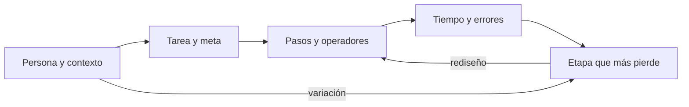
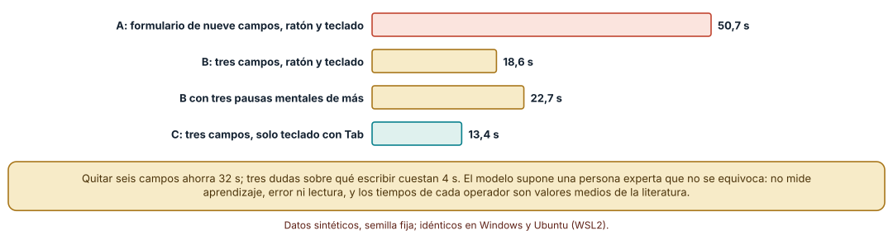
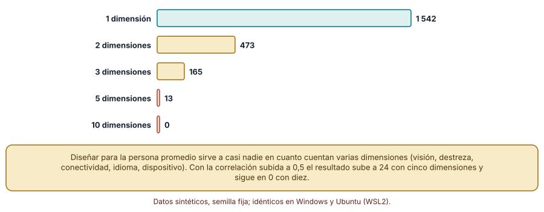
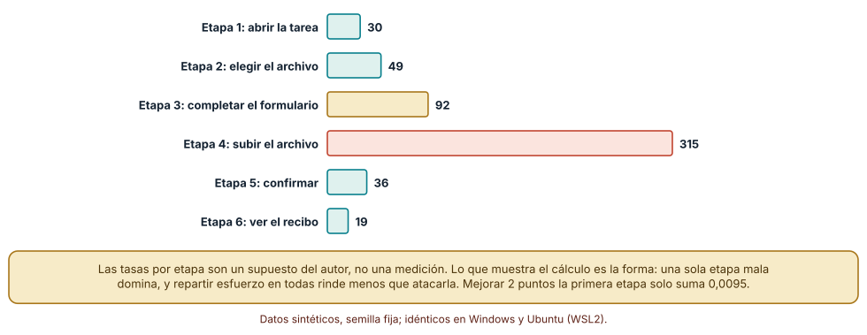

# SE-169 — Diseño centrado en personas y tareas

[← SE-168 — Proyecto: paquete de especificaciones trazables](https://github.com/vladimiracunadev-create/modern-software-engineering-program/blob/main/classes/part-13-especificaciones-contratos-y-modelos/se-168-proyecto-paquete-de-especificaciones-trazables/README.md) · [↑ Parte 14](https://github.com/vladimiracunadev-create/modern-software-engineering-program/blob/main/classes/part-14-experiencia-accesibilidad-e-internacionalizacion/README.md) · [📚 Índice completo](https://github.com/vladimiracunadev-create/modern-software-engineering-program/blob/main/classes/README.md) · [🌐 Portal](https://vladimiracunadev-create.github.io/modern-software-engineering-program/classes/SE-169.html) · [SE-170 — Arquitectura de información y navegación →](https://github.com/vladimiracunadev-create/modern-software-engineering-program/blob/main/classes/part-14-experiencia-accesibilidad-e-internacionalizacion/se-170-arquitectura-de-informacion-y-navegacion/README.md)

## Punto profesional y fundamento pedagógico

**Punto profesional.** La clase existe para que partas de lo que una persona intenta lograr, en qué condiciones y con qué margen de error, y no de la pantalla que alguien ya dibujó; así el diseño se discute con cálculos y observaciones y no con gustos.

**Por qué aparece aquí.** Abre la Parte 14 después de **Proyecto: paquete de especificaciones trazables** y antes de **Arquitectura de información y navegación**: `SE-168` dejó especificado cómo se comporta la plataforma de entregas; esta clase pregunta para quién y para qué tarea. Fija la tarea «entregar una tarea y recibir un recibo» como caso de la parte, y deja el modelo de tareas que `SE-170` convertirá en estructura de navegación.

**Error conceptual que debe corregir.** Creer que centrar el diseño en las personas es dibujar una persona ficticia promedio y complacerla: un diseño centrado en tareas y personas decide con la distribución de capacidades y contextos, con el paso que más gente pierde y con el costo de cada operación, no con un retrato.

**Secuencia de aprendizaje.** Antes de leer la solución, predices cuánto tarda una persona experta en entregar una tarea con un formulario de nueve campos frente a uno de tres, cuántas personas caen en la banda central de varias dimensiones y qué etapa de un embudo conviene mejorar; después calculas con un modelo de operadores, simulas una población y comparas dónde invertir un esfuerzo limitado. La secuencia usa predicción, explicación propia, contraste y recuperación. [ICAP](https://icap.education.asu.edu/research) distingue participación de construcción de conocimiento; [How People Learn II](https://nap.nationalacademies.org/catalog/24783/how-people-learn-ii-learners-contexts-and-cultures) exige conectar conocimiento previo, contexto y transferencia; la [práctica de recuperación](https://pubmed.ncbi.nlm.nih.gov/16507066/) respalda producir de nuevo la explicación tras una demora; y [Education for Life and Work](https://nap.nationalacademies.org/resource/13398/dbasse_084153.pdf) exige devolución que explique la causa del error.

**Evidencia de aprendizaje.** `task-log.md` con el modelo de tareas de la entrega, los tiempos de tres diseños, la simulación de población y el embudo con sus supuestos. Debe distinguir qué número es observación del cálculo y cuál es una tasa supuesta. Debe contener predicción previa, observación, explicación causal, contraejemplo y qué hallazgo haría retirar la conclusión.

**Límite de la conclusión.** Los tiempos de los operadores son valores medios de la literatura para personas expertas; la población simulada usa dimensiones normales con un factor común; las tasas del embudo son supuestos del autor. Ningún número describe a una persona, un curso o un producto real.

### Trazabilidad fuente → afirmación

| Fuente primaria u oficial | Afirmación que respalda | Lo que no prueba |
|---|---|---|
| [Gould y Lewis, «Designing for usability» (CACM, 1985)](https://doi.org/10.1145/3166.3170) | Propone centrarse en usuarios y tareas desde el principio, medir con prototipos y diseñar de forma iterativa. | No dice qué técnica concreta conviene a un producto ni mide la ganancia de un proyecto. |
| [Card, Moran y Newell, «The keystroke-level model» (CACM, 1980)](https://doi.org/10.1145/358886.358895) | Estima el tiempo de una tarea de una persona experta sumando operadores (tecla, apuntar, mano, pausa mental). | No predice errores, aprendizaje ni la conducta de quien usa el sistema por primera vez. |
| [W3C WAI: principios de accesibilidad](https://www.w3.org/WAI/fundamentals/accessibility-principles/) | Presenta la accesibilidad como diseño para la diversidad de capacidades y contextos de uso. | No garantiza que un diseño concreto sea accesible. |

## Antes de empezar

Recupera lo aprendido en `SE-168`: un paquete es revisable si sus enlaces se comprueban y no se confunde la huella con el sentido. La pregunta activa es: **¿para quién es esta tarea, qué le cuesta completarla y en qué paso se pierde más gente?**

## Prerrequisitos

- Haber completado `SE-168` o poder explicar qué evidencia produce un paquete trazable.
- Python 3.11 o posterior y un terminal; los cálculos usan solo la biblioteca estándar (`random`, `statistics`, `math`).
- Trabajar con la plataforma de entregas y datos sintéticos; no se recluta a nadie ni se mide a nadie.

## Problema auténtico

La plataforma de entregas permite subir una tarea. El equipo recibe dos quejas contradictorias: «el formulario es largo» y «no sé qué poner en este campo». Una propuesta quita campos; otra añade ayuda en cada uno; una tercera rediseña la pantalla «para la estudiante típica». Nadie sabe cuánto tarda cada variante, a cuánta gente deja fuera ni en qué paso se pierde más gente.

## Objetivos observables

Al terminar podrás:

1. descomponer una tarea en pasos y operadores y estimar su tiempo con un modelo declarado;
2. explicar por qué un diseño para la persona promedio sirve a casi nadie cuando cuentan varias dimensiones;
3. localizar la etapa de un embudo que domina la pérdida y comparar dónde invertir un esfuerzo limitado;
4. distinguir qué es medición, cálculo con supuestos y observación pendiente;
5. escribir un modelo de tareas con personas, contexto y criterio de éxito que otra persona pueda revisar.

## Mapa conceptual



El mapa se lee como un lazo: la tarea se descompone en pasos, los pasos se cuestan, el costo localiza la etapa que más pierde y el rediseño vuelve a los pasos. La variación entre personas entra en cada vuelta; el mapa no es un proceso de entrega.

## Temas y por qué importan

| Tema | Por qué cambia una decisión profesional | Evidencia mínima |
|---|---|---|
| Tarea y meta | Separa lo que la persona quiere lograr de la pantalla que se le ofrece. | Predicción, traza causal y contraejemplo de **Tarea y meta** en `task-log.md` |
| Persona y contexto | Obliga a declarar quién usa, con qué dispositivo, con qué prisa y con qué ayudas. | Predicción, traza causal y contraejemplo de **Persona y contexto** en `task-log.md` |
| Descomposición y costo de pasos | Convierte «es largo» en una cifra comparable entre diseños. | Predicción, traza causal y contraejemplo de **Descomposición y costo de pasos** en `task-log.md` |
| Variación y promedio | Evita diseñar para alguien que no existe. | Predicción, traza causal y contraejemplo de **Variación y promedio** en `task-log.md` |
| Dónde se pierde la gente | Dirige el esfuerzo a la etapa que domina la pérdida. | Predicción, traza causal y contraejemplo de **Dónde se pierde la gente** en `task-log.md` |

## Conceptos y decisiones

### 1. Tarea y meta

Una tarea es un objetivo de la persona con un resultado observable: «entregar el informe antes de la hora límite y tener constancia». Una pantalla es una de las maneras de lograrla. La distinción importa porque dos diseños muy distintos pueden resolver la misma tarea (un formulario, un arrastre de archivo, un envío por correo) y porque una función puede existir sin servir a ninguna tarea. Describir la tarea sin mencionar la interfaz es la prueba: si no se puede, se está describiendo una pantalla.

### 2. Persona y contexto

Una persona usuaria no es un promedio: tiene capacidades, dispositivos, conectividad, idioma y presión de tiempo que varían a la vez. Un artefacto útil es un conjunto pequeño de escenarios que cubra los extremos relevantes (teclado sin ratón, pantalla pequeña con conexión lenta, atención dividida) y no un retrato único. Lo que se descarta importa tanto como lo que se incluye: toda persona que no aparece en los escenarios queda fuera de lo que se comprueba.

### 3. Descomposición y costo de pasos

Un modelo de operadores suma el costo de teclear, apuntar, cambiar de mano y pensar. Card, Moran y Newell propusieron valores medios (0,2 s por tecla, 1,1 s por apuntar, 0,4 s por cambio de mano, 1,35 s por pausa mental) para una persona experta que no se equivoca. El valor del modelo no es el segundo exacto sino la comparación: separa lo que cuesta quitar un campo de lo que cuesta una duda. Su límite está en la frase «experta y sin errores»: no ve el aprendizaje, la lectura ni el tropiezo.

### 4. Variación y promedio

Con una dimensión, la banda central captura una fracción apreciable de la población; con varias, esa fracción se desploma porque pocas personas son promedio en todo a la vez. El argumento aparece en la ergonomía (diseñar una cabina para el piloto medio) y vale para capacidades de uso. La consecuencia de diseño es práctica: se diseña para los extremos que importan y se permite ajustar, no para un centro que casi nadie ocupa.

### 5. Dónde se pierde la gente

Una tarea de varias etapas completa el producto de las tasas de paso. Mejorar la etapa más débil aporta más que repartir la misma mejora entre todas, porque el producto penaliza el eslabón más bajo y porque ahí hay más personas que recuperar. Las tasas rara vez se conocen con precisión; el cálculo sirve para decidir qué medir primero y para saber cuánto debe valer una mejora para compensar su costo.

### Tres diseños de la misma entrega, cronometrados con operadores

La entrega se descompuso en operadores del modelo de nivel de teclado: por cada campo, una pausa mental, apuntar, hacer clic, pasar la mano al teclado y doce teclas. El diseño A tiene nueve campos (147 operadores, 50,7 s); el B, tres campos con ratón (51 operadores, 18,6 s); el C, tres campos solo con teclado y Tab (44 operadores, 13,4 s). Si en el B tres campos generan una duda de qué escribir, se suman tres pausas mentales y el tiempo sube a 22,7 s. Quitar seis campos ahorra 32 s; evitar tres dudas, 4 s.

```python
K, P, H, M, B = 0.2, 1.1, 0.4, 1.35, 0.1
campo = ['M', 'P', 'B', 'H'] + ['K'] * 12
disenio_b = campo * 3 + ['M', 'P', 'B']
tiempo = sum({'K': K, 'P': P, 'H': H, 'M': M, 'B': B}[o] for o in disenio_b)  # 18.6 s
```



**Cómo leer la figura.** Cada barra es el tiempo que sumarían los operadores de un diseño; el coral es el más largo y el verde el más corto. **Dónde deja de valer:** el modelo supone una persona experta sin errores y valores medios de operadores; no mide a quien lee las etiquetas por primera vez, usa un lector de pantalla o se equivoca. Sirve para comparar diseños, no para prometer un tiempo.

### La persona promedio casi no existe

Se simularon 5 000 personas con diez dimensiones de uso (destreza, agudeza visual, velocidad de conexión, edad del dispositivo y similares) que comparten un factor común con correlación 0,3, y se contó cuántas caen dentro de la banda central del 30 % en todas las dimensiones consideradas: 1 542 con una dimensión, 473 con dos, 165 con tres, 13 con cinco y ninguna con diez. Con correlación 0,5 los números son 1 556, 514, 195, 24 y 0. Un diseño ajustado al centro de todas las dimensiones sirve, con diez, a nadie.

```python
z = NormalDist().inv_cdf
lo, hi = z(0.35), z(0.65)          # banda central del 30 %
x = sqrt(rho) * f + sqrt(1 - rho) * rnd.gauss(0, 1)   # factor común f
dentro = all(lo <= x_j <= hi for x_j in dimensiones)
```



**Cómo leer la figura.** Cada barra cuenta cuántas de 5 000 personas simuladas son «promedio» en todas las dimensiones indicadas; la barra de diez dimensiones no se ve porque vale cero. **Dónde deja de valer:** las dimensiones son normales con un factor común; las capacidades reales no tienen ese reparto y varias son categóricas. El experimento muestra cómo se comporta una conjunción de condiciones, no cuántas personas reales quedan fuera.

### Una etapa domina la pérdida

Un embudo de seis etapas con tasas de paso supuestas (0,97, 0,95, 0,90, 0,62, 0,93, 0,96) completa el 45,9 %. De 1 000 personas que empiezan se pierden 30, 49, 92, 315, 36 y 19 por etapa; completan 478 en el cálculo y 437 en una simulación de 1 000 personas con semilla fija. Mejorar cada etapa 2 puntos sube la tasa a 0,526 (+0,067); mejorar solo la cuarta 10 puntos, a 0,533 (+0,074); mejorar la primera 2 puntos, a 0,468 (+0,0095). La etapa 4 es subir el archivo, y la forma de la pérdida orienta qué observar: ¿falla, confunde o tarda?

```python
pasos = [0.97, 0.95, 0.90, 0.62, 0.93, 0.96]
base = prod(pasos)                                  # 0.4591
mejor_peor = prod(pasos[:3] + [0.72] + pasos[4:])  # 0.5331
todas_mas_2 = prod(min(1, p + 0.02) for p in pasos)  # 0.5264
```



**Cómo leer la figura.** Cada barra es cuántas de las 1 000 personas se pierden en esa etapa; la coral destaca la que domina. **Dónde deja de valer:** las seis tasas son un supuesto del autor, no una medición de nadie. Con tasas reales cambiaría qué etapa domina; lo que se conserva es el procedimiento y la comparación entre repartir esfuerzo y concentrarlo.

## Definiciones de trabajo

- **tarea:** objetivo de una persona con un resultado observable, independiente de la pantalla que se use para lograrlo.
- **escenario de uso:** descripción de persona, contexto, dispositivo, objetivo y condiciones que se usa para comprobar un diseño.
- **modelo de nivel de teclado:** método que estima el tiempo de una tarea de una persona experta sumando operadores elementales.
- **embudo:** serie de etapas cuya tasa de paso se multiplica para dar la tasa de completar la tarea.
- **persona de diseño:** representación de un grupo de usuarios para razonar; no sustituye observar a personas reales.

Las definiciones son operativas para la plataforma de entregas. No convierten términos con historia más amplia en sinónimos y deben contrastarse con la documentación primaria enlazada al final.

## Ejemplo mínimo

El fragmento estima el tiempo de un diseño sumando operadores. Antes de ejecutarlo, predice cuánto cambia el tiempo si se añade una pausa mental por campo.

```python
T = {'K': 0.2, 'P': 1.1, 'H': 0.4, 'M': 1.35, 'B': 0.1}

def tiempo(ops):
    return sum(T[o] for o in ops)

campo = ['M', 'P', 'B', 'H'] + ['K'] * 12
print(round(tiempo(campo * 3 + ['M', 'P', 'B']), 1))   # 18.6
print(round(tiempo(['M'] * 3 + campo * 3 + ['M', 'P', 'B']), 1))  # 22.7
```

El valor importa menos que la diferencia entre diseños y que cada operador está declarado. Registra versión del intérprete y salida; cambia un operador y anota qué conclusión se mantiene.

## Ejemplo profesional

En la plataforma, el equipo documenta la tarea «entregar una tarea y obtener constancia» con tres escenarios: estudiante con teclado y lector de pantalla, estudiante con teléfono y conexión lenta, y docente que corrige desde un portátil. Cada diseño candidato se descompone en operadores y se estima; el embudo se mide en un piloto con datos anónimos agregados y se compara con el supuesto. La decisión final se acompaña de la etapa que más pierde y de la señal que haría cambiarla.

Compara el caso normal con una entrega con archivo de 40 MB, una con la sesión caducada y una desde un teléfono sin teclado externo. Un diseño es apropiado cuando esos tres casos tienen un camino y un mensaje; es peligroso cuando solo está probado con la persona de siempre.

## Práctica guiada

1. Describe la tarea sin mencionar pantallas ni controles y marca qué resultado la daría por lograda.
2. Escribe tres escenarios que difieran en dispositivo, capacidad y presión de tiempo.
3. Descompón dos diseños en operadores y predice cuál tarda menos antes de calcular.
4. Calcula y registra la diferencia y qué operador la explica.
5. Simula la banda central para una, tres y cinco dimensiones y compara con tu predicción.
6. Asigna tasas de paso a cada etapa, márcalas como supuestos y localiza la que domina.
7. Pide a otra persona que reconstruya la decisión solo desde `task-log.md`.

## Ejercicios

1. **Operadores:** descompón la entrega por arrastre de archivo y compárala con el formulario de tres campos; explica qué operador desaparece.
2. **Variación:** repite la simulación con correlación 0,8 y explica por qué sube el número de personas en la banda central sin llegar a cubrir a todo el mundo.
3. **Embudo:** calcula cuánto debería mejorar la etapa 2 para igualar a una mejora de 10 puntos de la etapa 4.
4. **Descarte:** escribe qué escenario de uso tu análisis no cubre y qué observación lo cubriría.

## Reto verificable

Entrega `task-log.md` con la tarea, los tres escenarios, los operadores de dos diseños, la simulación de variación y el embudo con sus supuestos. Se aprueba si otra persona reproduce los cálculos con las mismas semillas y puede señalar qué observación con personas reales cambiaría la decisión. No se aprueba por la elegancia de una persona ficticia ni por un tiempo sin sus operadores.

## Caso conductor

La plataforma de entregas es el caso conductor de la Parte 14. Esta clase deja el modelo de la tarea «entregar y obtener constancia», tres escenarios y el embudo. `SE-170` organizará la información y la navegación alrededor de esas tareas, y `SE-171` decidirá cómo responde la interfaz a cada acción. Cambia después un solo supuesto, la tasa de la etapa de subida, y revisa qué decisiones dependían de él.

## Preguntas frecuentes

### ¿Una persona ficticia no sirve entonces?

Sirve para razonar y comunicar, y se vuelve peligrosa cuando reemplaza a la observación. Una persona de diseño es una hipótesis con nombre; lo que la justifica son datos de gente real y lo que la limita son las dimensiones que no incluye.

### ¿El modelo de operadores reemplaza una prueba con usuarios?

No: compara diseños para personas expertas sin errores y ahorra pruebas triviales. Lo que descubre una sesión con personas (confusión, lectura, abandono) queda fuera del modelo.

### ¿Y si no conozco las tasas del embudo?

Se marcan como supuestos, se calcula con rangos y se mide primero la etapa que más cambie el resultado. Un embudo de supuestos sirve para decidir qué medir, no para informar un resultado.

### ¿Qué pasa si dos escenarios se contradicen?

Se anota la contradicción como decisión pendiente con su costo: a veces un ajuste del usuario (tamaño de texto, modo de entrada) la resuelve; otras, hay que priorizar y declarar a quién se perjudica.

## Fallo controlado y diagnóstico

Reproduce el fallo clásico de la clase: **optimizar la etapa equivocada por falta de un cálculo**. Usa el embudo con las tasas supuestas y una mejora de la etapa 1.

Registra síntoma, entrada mínima, hipótesis, observación que descarta cada hipótesis, causa, corrección y prueba de regresión. **Síntoma:** el equipo rediseña la pantalla de abrir la tarea y la tasa de completar sube de 0,459 a 0,468. **Hipótesis rivales:** (a) el rediseño fue mal ejecutado; (b) la etapa 1 no era donde se pierde la gente. **Prueba:** calcula el efecto de la misma mejora en cada etapa: 0,0095 en la 1 frente a 0,074 en la 4. **Conclusión:** la causa es la elección de la etapa, no la ejecución. **Regresión:** escribe en `task-log.md` el cálculo de efecto por etapa antes de decidir. No cambies a la vez la etapa y el diseño.

## Errores comunes y cómo corregirlos

| Síntoma | Causa probable | Corrección |
|---|---|---|
| «Es largo» sin ninguna cifra | No se descompuso la tarea en pasos | Estimar con operadores y comparar diseños |
| Un diseño para la persona promedio falla a casi todos | Se consideró una dimensión a la vez | Definir escenarios que cubran extremos relevantes y permitir ajustes |
| Se mejora lo fácil en vez de lo que más pierde | No se calculó el efecto por etapa | Calcular el efecto de la misma mejora en cada etapa |
| Un tiempo estimado se cita como medición | Se olvidó que el modelo supone persona experta | Declarar el supuesto junto a la cifra |
| La tarea describe una pantalla | Se mezcló meta y solución | Reescribir la tarea sin controles ni vistas |

## Entorno y archivos clave

```text
work/SE-169/
├── README.md
├── tareas/
│   ├── klm.py
│   ├── poblacion.py
│   └── embudo.py
├── tests/test_tareas.py
└── evidence/task-log.md
```

El `README` declara plataforma, versión de Python, semillas y comandos. Los experimentos usan solo la biblioteca estándar y se ejecutaron con CPython 3.12.9 en Windows 11 y 3.12.3 en Ubuntu bajo WSL2: las salidas fueron idénticas. No se usó ninguna herramienta de analítica ni se midió a ninguna persona.

## Seguridad, ética y accesibilidad

- una persona de diseño no debe construirse con datos personales reales ni con rasgos de una persona identificable;
- los datos de un embudo real se agregan y se anonimizan antes de compartirlos; no incluyen identificadores ni textos escritos por las personas;
- decidir qué escenarios se cubren es una decisión con consecuencias para quien queda fuera: debe quedar escrita y revisable;
- ofrece una alternativa textual a cada tabla y figura y no uses el color como única señal;
- atribuye las fuentes y no copies materiales de pago ni imágenes con licencia incompatible.

## Puente hacia el trabajo con agentes

Un agente al que se le pide «rediseña el formulario de entrega para que sea más usable» producirá una pantalla plausible y un argumento, sin tarea, sin escenarios y sin cifras. Pídele primero que describa la tarea sin mencionar controles, que proponga tres escenarios distintos y que estime con operadores el tiempo de dos variantes, declarando sus supuestos. Revisa especialmente si trata «el usuario» como un solo perfil y si cita porcentajes de mejora que no pudo calcular: es la misma persona promedio, ahora con apariencia de análisis.

## Transferencia

Traslada el análisis a otra tarea con otro dominio (pedir una cita médica en línea o solicitar un reembolso): descompón dos diseños, define tres escenarios y localiza la etapa que más pierde con tasas supuestas. La transferencia está lograda cuando puedes explicar qué parte del método dependía de la plataforma de entregas y cuál no.

## Evaluación y evidencia

| Criterio | Evidencia para aprobar |
|---|---|
| comprensión | explicación de por qué el promedio no sirve y qué decide un modelo de operadores |
| corrección | tiempos y conteos reproducibles con las mismas semillas |
| diseño | tarea sin pantalla, tres escenarios y criterio de éxito |
| diagnóstico | reproducción del fallo «etapa equivocada» con su cálculo de regresión |
| incertidumbre | supuestos de operadores, dimensiones y tasas declarados |
| reproducibilidad | versiones, comandos, salida y límites declarados |

## Fuentes

- [Gould y Lewis, «Designing for usability» (CACM, 1985)](https://doi.org/10.1145/3166.3170) — principios de diseño centrado en usuarios y tareas; autoridad: Communications of the ACM.
- [Card, Moran y Newell, «The keystroke-level model for user performance time with interactive systems» (CACM, 1980)](https://doi.org/10.1145/358886.358895) — modelo de operadores; autoridad: Communications of the ACM.
- [W3C WAI: principios de accesibilidad](https://www.w3.org/WAI/fundamentals/accessibility-principles/) — diversidad de capacidades y contextos; autoridad: W3C.
- [Nielsen Norman Group: 10 heurísticas de usabilidad](https://www.nngroup.com/articles/ten-usability-heuristics/) — criterios de revisión de interfaces; autoridad: Nielsen Norman Group.
- [Usability.gov: personas](https://www.usability.gov/how-to-and-tools/methods/personas.html) — qué son y cómo se usan las personas de diseño; autoridad: gobierno de EE. UU.

Cada fuente respalda el mecanismo indicado; ninguna demuestra que los escenarios, los operadores o las tasas de la plataforma de entregas sean los correctos. Esa afirmación depende de observar a las personas que la usan.

- [Python: `random`](https://docs.python.org/3/library/random.html) — semillas de la simulación.
- [Python: `statistics`](https://docs.python.org/3/library/statistics.html) — distribución normal e inversa usadas en la banda central.

## Límites y siguiente paso

Se ejecutaron tres experimentos con datos sintéticos en Windows y Ubuntu (WSL2) con resultados idénticos. No se midió a ninguna persona, no se usó ninguna herramienta de analítica y los operadores, las dimensiones y las tasas del embudo son supuestos o valores medios de la literatura. La siguiente clase pregunta cómo se organiza la información para que esas tareas se encuentren.

## Glosario

- **tarea:** objetivo de una persona con un resultado observable, independiente de la pantalla que se use para lograrlo.
- **escenario de uso:** descripción de persona, contexto, dispositivo, objetivo y condiciones que se usa para comprobar un diseño.
- **modelo de nivel de teclado:** método que estima el tiempo de una tarea de una persona experta sumando operadores elementales.
- **embudo:** serie de etapas cuya tasa de paso se multiplica para dar la tasa de completar la tarea.
- **persona de diseño:** representación de un grupo de usuarios para razonar; no sustituye observar a personas reales.

---

[← SE-168 — Proyecto: paquete de especificaciones trazables](https://github.com/vladimiracunadev-create/modern-software-engineering-program/blob/main/classes/part-13-especificaciones-contratos-y-modelos/se-168-proyecto-paquete-de-especificaciones-trazables/README.md) · [↑ Parte 14](https://github.com/vladimiracunadev-create/modern-software-engineering-program/blob/main/classes/part-14-experiencia-accesibilidad-e-internacionalizacion/README.md) · [📚 Índice completo](https://github.com/vladimiracunadev-create/modern-software-engineering-program/blob/main/classes/README.md) · [🌐 Portal](https://vladimiracunadev-create.github.io/modern-software-engineering-program/classes/SE-169.html) · [SE-170 — Arquitectura de información y navegación →](https://github.com/vladimiracunadev-create/modern-software-engineering-program/blob/main/classes/part-14-experiencia-accesibilidad-e-internacionalizacion/se-170-arquitectura-de-informacion-y-navegacion/README.md)
