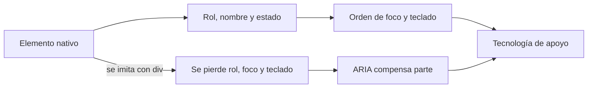
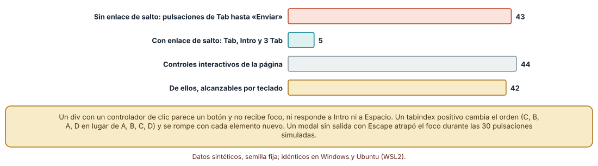
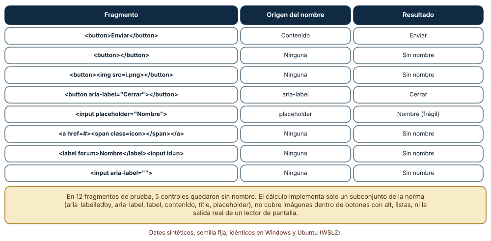
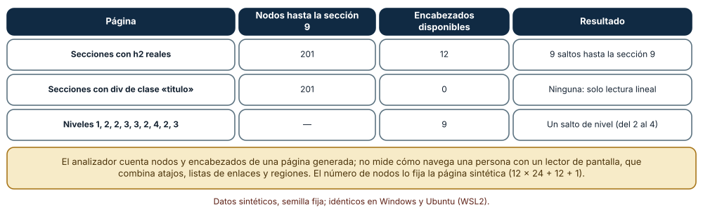

# SE-174 — Semántica, teclado, foco y tecnologías de asistencia

[← SE-173 — Accesibilidad perceptible, operable y comprensible](https://github.com/vladimiracunadev-create/modern-software-engineering-program/blob/main/classes/part-14-experiencia-accesibilidad-e-internacionalizacion/se-173-accesibilidad-perceptible-operable-y-comprensible/README.md) · [↑ Parte 14](https://github.com/vladimiracunadev-create/modern-software-engineering-program/blob/main/classes/part-14-experiencia-accesibilidad-e-internacionalizacion/README.md) · [📚 Índice completo](https://github.com/vladimiracunadev-create/modern-software-engineering-program/blob/main/classes/README.md) · [🌐 Portal](https://vladimiracunadev-create.github.io/modern-software-engineering-program/classes/SE-174.html) · [SE-175 — Diseño visual, tipografía, color y contraste →](https://github.com/vladimiracunadev-create/modern-software-engineering-program/blob/main/classes/part-14-experiencia-accesibilidad-e-internacionalizacion/se-175-diseno-visual-tipografia-color-y-contraste/README.md)

## Punto profesional y fundamento pedagógico

**Punto profesional.** La clase existe para que construyas la interfaz con los elementos y atributos que expresan su significado, de modo que el teclado, el foco y las tecnologías de apoyo tengan algo fiable que usar, y para que midas lo que cuesta y lo que se rompe cuando se imita con elementos genéricos.

**Por qué aparece aquí.** Se sitúa después de **Accesibilidad perceptible, operable y comprensible** y antes de **Diseño visual, tipografía, color y contraste**: `SE-173` dejó los criterios y la frontera del auditor; esta clase baja a lo que el auditor necesita ver bien: roles, nombres, orden de foco y estructura. Deja la base semántica sobre la que `SE-175` aplicará lo visual.

**Error conceptual que debe corregir.** Creer que añadir atributos ARIA a cualquier elemento lo vuelve accesible: la semántica nativa (un botón, una etiqueta, un encabezado) trae rol, nombre, teclado y foco gratis, y ARIA solo describe, no añade comportamiento; un atributo equivocado empeora la experiencia más que su ausencia.

**Secuencia de aprendizaje.** Antes de leer la solución, predices cuántas pulsaciones de Tab cuesta llegar al botón de enviar con 40 enlaces de navegación, qué controles quedan sin nombre en un conjunto de fragmentos y cuántos pasos exige leer hasta una sección según haya o no encabezados reales; después ejecutas un modelo de foco, un cálculo de nombre accesible y un analizador de estructura. La secuencia usa predicción, explicación propia, contraste y recuperación. [ICAP](https://icap.education.asu.edu/research) distingue participación de construcción de conocimiento; [How People Learn II](https://nap.nationalacademies.org/catalog/24783/how-people-learn-ii-learners-contexts-and-cultures) exige conectar conocimiento previo, contexto y transferencia; la [práctica de recuperación](https://pubmed.ncbi.nlm.nih.gov/16507066/) respalda producir de nuevo la explicación tras una demora; y [Education for Life and Work](https://nap.nationalacademies.org/resource/13398/dbasse_084153.pdf) exige devolución que explique la causa del error.

**Evidencia de aprendizaje.** `semantics-log.md` con el orden de foco de la entrega, el cálculo de nombres de ocho a doce fragmentos y el análisis de estructura de una página. Debe contener la diferencia entre un elemento nativo y uno imitado, y qué parte del comportamiento de una tecnología de apoyo no se modeló. Debe contener predicción previa, observación, explicación causal, contraejemplo y qué hallazgo haría retirar la conclusión.

**Límite de la conclusión.** El modelo de foco, el cálculo de nombre y el analizador son subconjuntos pequeños de las especificaciones; no se usó ningún lector de pantalla ni navegador real, y la página de 12 secciones es sintética. Ningún resultado describe la experiencia de una persona usuaria.

### Trazabilidad fuente → afirmación

| Fuente primaria u oficial | Afirmación que respalda | Lo que no prueba |
|---|---|---|
| [W3C: Accessible Name and Description Computation 1.2](https://www.w3.org/TR/accname-1.2/) | Define el orden en que se calcula el nombre accesible (aria-labelledby, aria-label, etiqueta nativa, contenido, título). | Esta clase implementa un subconjunto; no cubre todos los casos de la norma. |
| [W3C: ARIA Authoring Practices Guide](https://www.w3.org/WAI/ARIA/apg/) | Recoge patrones de interacción con el teclado y los roles que cada componente debe tener y la regla de usar HTML nativo primero. | No es una especificación normativa ni garantiza el comportamiento en cada lector. |
| [W3C: Comprender 2.1.1 Teclado](https://www.w3.org/WAI/WCAG22/Understanding/keyboard.html) | Exige que toda la funcionalidad sea operable con teclado sin requerir un tiempo específico. | No dice si el orden o los atajos elegidos son cómodos. |

## Antes de empezar

Recupera lo aprendido en `SE-173`: un auditor ve presencia, no verdad. La pregunta activa es: **¿qué rol, nombre y estado tiene cada control, en qué orden recibe el foco y qué se rompe si lo imito con un elemento genérico?**

## Prerrequisitos

- Haber completado `SE-173` o poder explicar la diferencia entre presencia y verdad de un atributo.
- Python 3.11 o posterior y un terminal; los modelos usan solo `html.parser` de la biblioteca estándar.
- Trabajar con el formulario de entrega de la plataforma y fragmentos de HTML sintéticos.

## Problema auténtico

La estudiante que usa teclado entra al formulario de entrega y tarda 43 pulsaciones de Tab en llegar al botón de enviar porque cada página repite 40 enlaces. Dos controles del formulario son un div con clic que el teclado no alcanza. El lector de pantalla anuncia «botón» sin nombre para un icono, y la página no tiene encabezados, de modo que llegar a «Entregas» exige leerlo todo. Una propuesta añade `aria-label` a todo; otra añade `tabindex` positivo; otra ofrece una versión de solo texto.

## Objetivos observables

Al terminar podrás:

1. calcular el número de pulsaciones de Tab hasta un control con y sin enlace de salto;
2. explicar por qué un div con clic no es un botón y qué le falta;
3. calcular el nombre accesible de un control y detectar los que quedan sin nombre;
4. medir el costo de leer una página con y sin encabezados reales;
5. escribir una lista de comprobaciones de teclado, foco y nombre para un componente.

## Mapa conceptual



El mapa se lee como dos caminos hacia la misma tecnología de apoyo: el nativo trae rol, nombre, foco y teclado; el imitado necesita que alguien los reconstruya con ARIA y código, y casi siempre pierde algo. La flecha de ARIA compensa solo lo que se describe; no es una receta de equivalencia.

## Temas y por qué importan

| Tema | Por qué cambia una decisión profesional | Evidencia mínima |
|---|---|---|
| Semántica nativa | Da rol, estado y comportamiento a cambio de usar el elemento correcto. | Predicción, traza causal y contraejemplo de **Semántica nativa** en `semantics-log.md` |
| Nombre, rol y valor | Hace que cada control diga qué es, cómo se llama y en qué estado está. | Predicción, traza causal y contraejemplo de **Nombre, rol y valor** en `semantics-log.md` |
| Teclado y orden de foco | Hace que todo se pueda alcanzar y que el orden tenga sentido. | Predicción, traza causal y contraejemplo de **Teclado y orden de foco** en `semantics-log.md` |
| Estructura y regiones | Permite saltar en lugar de leer en orden. | Predicción, traza causal y contraejemplo de **Estructura y regiones** en `semantics-log.md` |
| ARIA y sus límites | Describe lo que un elemento no puede decir por sí mismo, sin cambiar su comportamiento. | Predicción, traza causal y contraejemplo de **ARIA y sus límites** en `semantics-log.md` |

## Conceptos y decisiones

### 1. Semántica nativa

Un `button` es enfocable, se activa con Intro y Espacio, anuncia su rol y su nombre y se desactiva con `disabled`. Un `a` con `href` navega y se abre en otra pestaña. Un `input` con `label` asocia el nombre al control. Todo esto viene sin escribir código. Imitarlo con un `div` obliga a reproducir el rol, el foco, las dos teclas y el estado, y es fácil olvidar uno. La primera regla de ARIA es la de no usar ARIA si un elemento nativo sirve.

### 2. Nombre, rol y valor

Una tecnología de apoyo anuncia rol (qué es), nombre (cómo se llama) y valor o estado (en qué situación). El nombre accesible se calcula con un orden de prioridad: la relación `aria-labelledby`, el `aria-label`, la etiqueta nativa (`label`), el contenido y, como último recurso, el título; un `placeholder` no es una etiqueta fiable porque desaparece al escribir. Un control sin nombre se anuncia como «botón» o «cuadro de edición» y no dice para qué sirve.

### 3. Teclado y orden de foco

El orden de foco sigue el orden del documento salvo que se altere con `tabindex`. Un `tabindex` positivo reordena y se rompe cada vez que se añade un elemento, por lo que se evita; un `tabindex="-1"` quita un elemento del orden sin ocultarlo; un `tabindex="0"` pone un elemento no nativo en el orden. Los enlaces para saltar bloques repetidos acortan el recorrido. Un componente modal debe llevar el foco dentro al abrirse, permitir salir con Escape y devolver el foco al elemento que lo abrió.

### 4. Estructura y regiones

Los encabezados (h1 a h6), las listas y las regiones (main, nav, header, footer) forman un esquema que las tecnologías de apoyo usan para navegar. Una persona ciega puede listar los encabezados y saltar a uno; si todo es un `div` con clase de título, no existe esa vía. Los niveles de encabezado deben reflejar la estructura (sin saltos de h2 a h4) y no el tamaño visual, que se controla con estilos.

### 5. ARIA y sus límites

ARIA añade roles, estados y propiedades al árbol de accesibilidad; no añade foco, ni teclado, ni activación. Un `div role="button"` anuncia un botón y sigue sin responder a Intro ni a Espacio hasta que se programe. Un `aria-label` mal puesto sustituye un nombre visible correcto y deja al texto y al nombre diciendo cosas distintas. Se usa cuando no hay un elemento nativo adecuado, para estados dinámicos (`aria-expanded`) y para regiones que anuncian cambios, siempre siguiendo los patrones documentados.

### Cuántas pulsaciones cuesta llegar a «Enviar»

Se modeló una página con 40 enlaces de navegación seguidos de un formulario con dos campos, un div con clic y un botón. El orden de foco se calculó con una regla simplificada: se incluyen los elementos nativos enfocables (enlaces con `href`, botones, campos), se excluyen los desactivados y los de `tabindex` negativo, y se ordena primero por `tabindex` positivo y luego por orden del documento. Llegar a «Enviar» cuesta 43 pulsaciones de Tab. Con un enlace de salto al contenido principal, 1 Tab, Intro y 3 Tab (5 pulsaciones). De 44 controles interactivos (con clic o nativos) solo 42 son alcanzables: los dos div no reciben foco. Con `tabindex` 2 y 1 en dos de cuatro botones, el orden DOM A, B, C, D pasa a ser C, B, A, D.

```python
def en_orden(items):
    cand = []
    for i, (tag, a) in enumerate(items):
        ti = a.get('tabindex')
        nativo = tag in ('button', 'input', 'select', 'textarea') or (tag == 'a' and 'href' in a)
        if 'disabled' in a or (ti is not None and int(ti) < 0):
            continue
        if ti is not None or nativo:
            cand.append((int(ti) if ti and int(ti) > 0 else 10**9, i, tag))
    return sorted(cand)
```



**Cómo leer la figura.** Las dos primeras barras comparan el costo con y sin enlace de salto; las dos últimas, los controles que existen y los que el teclado alcanza. **Dónde deja de valer:** el modelo implementa una parte de la regla de foco (sin `iframe`, sin `contenteditable`, sin diálogos nativos) y no incluye cómo lo anuncia ninguna tecnología de apoyo. Muestra el costo y lo que queda fuera, no la experiencia de uso.

### Nombre accesible de doce fragmentos

Se implementó un subconjunto de la computación del nombre accesible con prioridad: `aria-labelledby`, `aria-label`, etiqueta con `for`, contenido (para botones, enlaces y `role=button`), título y `placeholder`. Sobre doce fragmentos, cinco controles quedan sin nombre: un botón vacío, un botón con solo una imagen sin `alt`, un enlace con solo un icono, un campo cuya etiqueta apunta a un id distinto y un campo con un `aria-label` vacío. Un botón con `aria-label` y un campo con `aria-labelledby` tienen nombre; un campo con solo `placeholder` tiene un nombre frágil que desaparece al escribir.

```python
if a.get('aria-labelledby'):
    nombre = ' '.join(texto_de(i) for i in a['aria-labelledby'].split())
if not nombre and a.get('aria-label', '').strip():
    nombre = a['aria-label'].strip()
if not nombre and a.get('id') in etiquetas:
    nombre = etiquetas[a['id']]
if not nombre and tag in ('button', 'a'):
    nombre = contenido.strip()
```



**Cómo leer la figura.** Cada fila es un fragmento; la columna central dice de dónde sale el nombre y «Ninguna» marca un control sin nombre. **Dónde deja de valer:** el cálculo cubre un subconjunto de la norma (sin imágenes con `alt` dentro de botones, sin listas ni tablas, sin nombres por `title` en todos los casos) y no reproduce lo que anuncia un lector de pantalla concreto.

### Leer una página con y sin encabezados reales

Se generó una página con 12 secciones y 24 párrafos por sección. Con encabezados `h2` reales, una persona puede saltar entre 12 encabezados y llegar a la sección 9 con 9 saltos. Con un `div` de clase «titulo», no hay encabezados disponibles, y la única vía es leer en orden: 201 nodos hasta la sección 9. Una secuencia de niveles 1, 2, 2, 3, 3, 2, 4, 2, 3 tiene un salto del 2 al 4 que un analizador detecta. El número de nodos lo fija la página sintética; en una real, la diferencia depende de su tamaño.

```python
class Cuenta(HTMLParser):
    def handle_starttag(self, tag, a):
        if tag in ('h1', 'h2', 'h3', 'h4', 'h5', 'h6'):
            self.encabezados += 1
        if tag in ('h2', 'p', 'div'):
            self.nodos += 1
saltos = [(a, b) for a, b in zip(niveles, niveles[1:]) if b - a > 1]
```



**Cómo leer la figura.** Cada fila es una variante de la misma página; compara los nodos que hay que leer con los encabezados disponibles para saltar. **Dónde deja de valer:** el analizador cuenta nodos y encabezados de una página generada; no mide cómo navega una persona real, que combina listas de enlaces, regiones y búsqueda de texto.

## Definiciones de trabajo

- **nombre accesible:** texto con el que una tecnología de apoyo anuncia un control, calculado a partir de sus atributos y contenido.
- **rol:** categoría semántica de un elemento (botón, enlace, campo de texto) que determina su comportamiento esperado.
- **orden de foco:** secuencia en la que los controles reciben el foco al pulsar Tab.
- **enlace de salto:** enlace al principio de una página que lleva al contenido principal para evitar bloques repetidos.
- **región:** zona con un propósito semántico (principal, navegación, cabecera) que se puede alcanzar por atajos.

Las definiciones son operativas para la plataforma de entregas. No convierten términos con historia más amplia en sinónimos y deben contrastarse con la documentación primaria enlazada al final.

## Ejemplo mínimo

El fragmento lista el orden en que recibirán el foco cuatro elementos. Antes de ejecutarlo, predice cuáles se excluyen y en qué orden quedan los demás.

```python
items = [('a', {'href': '/'}), ('div', {'onclick': 'x'}),
         ('button', {}), ('button', {'disabled': ''}), ('input', {'tabindex': '-1'})]

def foco(items):
    orden = []
    for i, (tag, a) in enumerate(items):
        nativo = tag in ('button', 'input') or (tag == 'a' and 'href' in a)
        if nativo and 'disabled' not in a and a.get('tabindex') != '-1':
            orden.append(i)
    return orden

print(foco(items))   # [0, 2]
```

El div, el botón desactivado y el campo con `tabindex="-1"` quedan fuera. Cambia el div a `button` y observa qué ocurre con su posición; registra versión y salida.

## Ejemplo profesional

En la plataforma, cada componente tiene una ficha con su elemento nativo, su nombre accesible, su comportamiento de teclado y su gestión de foco; una prueba recorre el árbol de la página y falla si un control interactivo no tiene nombre, si un elemento con clic no es enfocable o si el orden de foco difiere del visual. Cada página lleva un enlace de salto, una región `main` y encabezados que reflejan la estructura; el modal de confirmación lleva el foco a su primer control, cierra con Escape y devuelve el foco a quien lo abrió.

Compara el caso normal con una persona que solo usa teclado, con un lector de pantalla que lista encabezados y con un mensaje de error que aparece tras enviar. Un componente es apropiado cuando esos tres casos tienen un camino y un anuncio; es peligroso cuando solo se probó con el ratón.

## Práctica guiada

1. Lista los controles de la entrega y escribe su elemento nativo, su nombre y su comportamiento de teclado.
2. Predice cuántas pulsaciones cuesta llegar a Enviar y calcula con el modelo de foco.
3. Calcula el nombre accesible de doce fragmentos y marca los que quedan sin nombre.
4. Genera la página de 12 secciones con y sin encabezados y mide los pasos hasta la sección 9.
5. Convierte los dos div clicables en botones y repite el recuento de controles alcanzables.
6. Introduce el fallo controlado y registra el síntoma antes de corregirlo.
7. Pide a otra persona que reconstruya la ficha de un componente solo desde `semantics-log.md`.

## Ejercicios

1. **Enlace de salto:** añade el enlace de salto y calcula cuántas pulsaciones ahorra con 10, 40 y 100 enlaces de navegación.
2. **Nombre:** reescribe los cinco fragmentos sin nombre para que lo tengan sin usar ARIA y explica cuándo sería necesario usarlo.
3. **Modal:** describe el recorrido de foco de un modal de confirmación al abrir, al pulsar Tab en el último control y al cerrar.
4. **Niveles:** corrige la secuencia 1, 2, 2, 3, 3, 2, 4, 2, 3 y explica por qué no se arregla cambiando el tamaño visual del encabezado.

## Reto verificable

Entrega `semantics-log.md` con la ficha de los componentes de la entrega, el cálculo del orden de foco, la tabla de nombres accesibles y la comparación de la página con y sin encabezados. Se aprueba si otra persona reproduce los números y puede nombrar un comportamiento que el modelo no cubre. No se aprueba por añadir atributos ARIA ni por un puntaje.

## Caso conductor

La plataforma de entregas es el caso conductor de la Parte 14. Esta clase deja la ficha semántica del formulario de entrega con sus nombres, su orden de foco y su estructura. `SE-175` aplicará el diseño visual sobre esa estructura sin romperla; `SE-176` la adaptará a distintos anchos y preferencias. Cambia después un solo control, el botón «Enviar», de `button` a `div role="button"`, y revisa qué comportamientos pierde.

## Preguntas frecuentes

### ¿Cuándo uso ARIA?

Cuando no existe un elemento nativo para lo que necesitas (una pestaña, un árbol, un menú desplegable personalizado), para expresar estados dinámicos y para regiones que anuncian cambios. Con un elemento nativo disponible, se usa el nativo.

### ¿Un tabindex positivo ayuda a ordenar?

Casi nunca: crea un orden distinto del visual y se rompe al añadir un elemento. El orden correcto se consigue con un orden del documento que coincida con el visual.

### ¿Hace falta un lector de pantalla para probar?

Para comprobar lo que anuncian sí; un modelo como el de la clase detecta nombres ausentes y controles inalcanzables, pero no lo que una persona oye ni cómo lo interpreta. Conviene probar con al menos uno en cada sistema que la población use.

### ¿Por qué no usar un div y programar todo?

Se puede, y rara vez compensa: hay que reproducir rol, foco, dos teclas, estado y nombre, y cada navegador y lector los trata distinto. Un `button` ya lo trae y está probado.

## Fallo controlado y diagnóstico

Reproduce el fallo clásico de la clase: **un div con clic que parece un botón y el teclado no alcanza**. Usa los dos div clicables del formulario.

Registra síntoma, entrada mínima, hipótesis, observación que descarta cada hipótesis, causa, corrección y prueba de regresión. **Síntoma:** una persona con teclado no puede activar el control de «Adjuntar archivo» aunque funciona con ratón. **Hipótesis rivales:** (a) el controlador de clic falla; (b) el elemento no recibe foco ni responde a Intro. **Prueba:** el modelo de foco lo excluye (42 de 44 alcanzables) y el `div` no tiene rol ni nombre. **Conclusión:** la causa es un elemento sin semántica, no el controlador. **Regresión:** cámbialo a `button` y añade una prueba que falle si un elemento con clic no es enfocable. No cambies a la vez el elemento y los estilos.

## Errores comunes y cómo corregirlos

| Síntoma | Causa probable | Corrección |
|---|---|---|
| Un control funciona con ratón y no con teclado | Un div con clic sin foco ni teclas | Usar el elemento nativo o reproducir rol, foco y teclas |
| El lector anuncia «botón» sin más | Falta nombre accesible | Texto visible, etiqueta nativa o `aria-label` si no hay otra opción |
| Tab recorre en un orden extraño | `tabindex` positivo o un orden del documento distinto al visual | Quitar los positivos y ordenar el documento |
| Hay que leer toda la página para llegar a una sección | Títulos hechos con div | Encabezados reales con niveles coherentes |
| Un modal atrapa el foco | No se gestionó la salida ni el retorno | Escape, foco inicial y retorno al elemento que lo abrió |

## Entorno y archivos clave

```text
work/SE-174/
├── README.md
├── semantica/
│   ├── foco.py
│   ├── nombre.py
│   └── estructura.py
├── tests/test_semantica.py
└── evidence/semantics-log.md
```

El `README` declara plataforma, versión de Python, semillas y comandos. Los modelos usan solo `html.parser` y se ejecutaron con CPython 3.12.9 en Windows 11 y 3.12.3 en Ubuntu bajo WSL2: las salidas fueron idénticas. No se usó ningún lector de pantalla, navegador automatizado ni persona usuaria de tecnologías de apoyo.

## Seguridad, ética y accesibilidad

- los nombres accesibles y los mensajes anunciados no deben incluir datos personales ni información que no deba leerse en voz alta en un lugar público;
- un modal de confirmación para una acción irreversible debe ser operable con teclado y anunciar su consecuencia;
- no desactives funciones de las tecnologías de apoyo para «proteger» contenido: es una barrera sin beneficio de seguridad;
- ofrece una alternativa textual a cada tabla y figura y no uses el color como única señal;
- atribuye las fuentes y respeta las licencias de las bibliotecas de componentes.

## Puente hacia el trabajo con agentes

Un agente al que se le pide «haz el botón accesible» añadirá `role="button"` y `aria-label` a un `div` y declarará resuelto el problema, sin foco ni teclado. Pídele que use el elemento nativo, que explique qué roles, nombre y estados tiene el componente y que escriba una prueba de teclado (Tab, Intro, Espacio, Escape). Revisa especialmente si dejó `tabindex` positivo o un `aria-label` que contradice el texto visible: es el mismo atributo presente pero incorrecto, ahora con apariencia de arreglo.

## Transferencia

Traslada el análisis a otro componente (un menú desplegable o un selector de fecha): escribe su ficha, calcula su nombre accesible, modela su orden de foco y decide si un elemento nativo basta. La transferencia está lograda cuando puedes explicar qué parte dependía de la plataforma de entregas y cuál no.

## Evaluación y evidencia

| Criterio | Evidencia para aprobar |
|---|---|
| comprensión | explicación de por qué lo nativo da rol, nombre, foco y teclado y qué no añade ARIA |
| corrección | pulsaciones, controles alcanzables, nombres y saltos reproducibles |
| diseño | ficha de componente con elemento, nombre, teclado y foco |
| diagnóstico | reproducción del fallo del div clicable con su regresión |
| incertidumbre | lista de lo que el modelo no cubre (lectores reales, iframes, diálogos nativos) |
| reproducibilidad | versiones, comandos, salida y límites declarados |

## Fuentes

- [W3C: Accessible Name and Description Computation 1.2](https://www.w3.org/TR/accname-1.2/) — cálculo del nombre accesible; autoridad: W3C.
- [W3C: ARIA Authoring Practices Guide](https://www.w3.org/WAI/ARIA/apg/) — patrones de interacción y regla de usar HTML nativo primero; autoridad: W3C.
- [W3C: Comprender 2.1.1 Teclado](https://www.w3.org/WAI/WCAG22/Understanding/keyboard.html) — funcionalidad operable con teclado; autoridad: W3C.
- [W3C: Comprender 2.4.3 Orden del foco](https://www.w3.org/WAI/WCAG22/Understanding/focus-order.html) — orden del foco con sentido; autoridad: W3C.
- [W3C: Comprender 4.1.2 Nombre, función, valor](https://www.w3.org/WAI/WCAG22/Understanding/name-role-value.html) — rol, nombre y estado de los componentes; autoridad: W3C.
- [W3C: Comprender 1.3.1 Información y relaciones](https://www.w3.org/WAI/WCAG22/Understanding/info-and-relationships.html) — estructura que se puede determinar por programa; autoridad: W3C.
- [WHATWG: HTML Living Standard](https://html.spec.whatwg.org/multipage/) — elementos, atributos y comportamiento de foco; autoridad: WHATWG.
- [MDN: HTML y accesibilidad](https://developer.mozilla.org/en-US/docs/Learn_web_development/Core/Accessibility/HTML) — uso de la semántica nativa; autoridad: Mozilla.

Cada fuente respalda el mecanismo indicado; ninguna demuestra que los componentes de la plataforma funcionen con un lector de pantalla concreto. Esa afirmación depende de probarlos con esas tecnologías.

- [Python: `html.parser`](https://docs.python.org/3/library/html.parser.html) — analizador usado por los tres modelos.

## Límites y siguiente paso

Se ejecutaron tres modelos con datos sintéticos en Windows y Ubuntu (WSL2) con resultados idénticos. No se usó ningún lector de pantalla, navegador automatizado ni persona usuaria de tecnologías de apoyo, y el modelo de foco, el cálculo de nombre y el analizador son subconjuntos de las especificaciones. La siguiente clase aplica el diseño visual sobre esta estructura.

## Glosario

- **nombre accesible:** texto con el que una tecnología de apoyo anuncia un control, calculado a partir de sus atributos y contenido.
- **rol:** categoría semántica de un elemento (botón, enlace, campo de texto) que determina su comportamiento esperado.
- **orden de foco:** secuencia en la que los controles reciben el foco al pulsar Tab.
- **enlace de salto:** enlace al principio de una página que lleva al contenido principal para evitar bloques repetidos.
- **región:** zona con un propósito semántico (principal, navegación, cabecera) que se puede alcanzar por atajos.

---

[← SE-173 — Accesibilidad perceptible, operable y comprensible](https://github.com/vladimiracunadev-create/modern-software-engineering-program/blob/main/classes/part-14-experiencia-accesibilidad-e-internacionalizacion/se-173-accesibilidad-perceptible-operable-y-comprensible/README.md) · [↑ Parte 14](https://github.com/vladimiracunadev-create/modern-software-engineering-program/blob/main/classes/part-14-experiencia-accesibilidad-e-internacionalizacion/README.md) · [📚 Índice completo](https://github.com/vladimiracunadev-create/modern-software-engineering-program/blob/main/classes/README.md) · [🌐 Portal](https://vladimiracunadev-create.github.io/modern-software-engineering-program/classes/SE-174.html) · [SE-175 — Diseño visual, tipografía, color y contraste →](https://github.com/vladimiracunadev-create/modern-software-engineering-program/blob/main/classes/part-14-experiencia-accesibilidad-e-internacionalizacion/se-175-diseno-visual-tipografia-color-y-contraste/README.md)
