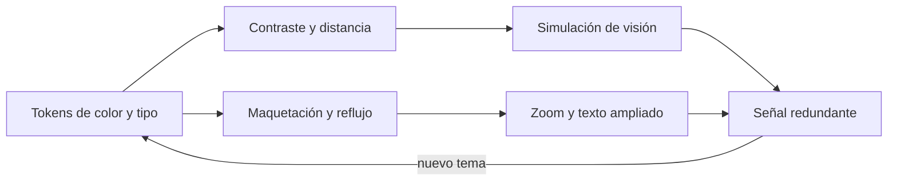
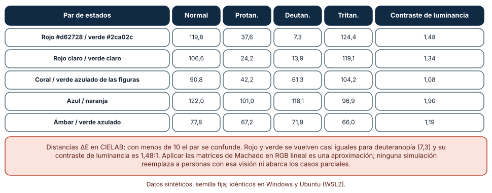
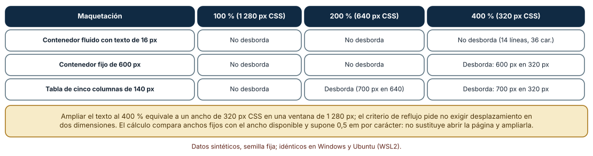
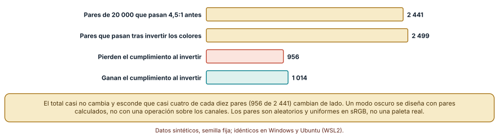

# SE-175 — Diseño visual, tipografía, color y contraste

[← SE-174 — Semántica, teclado, foco y tecnologías de asistencia](https://github.com/vladimiracunadev-create/modern-software-engineering-program/blob/main/classes/part-14-experiencia-accesibilidad-e-internacionalizacion/se-174-semantica-teclado-foco-y-tecnologias-de-asistencia/README.md) · [↑ Parte 14](https://github.com/vladimiracunadev-create/modern-software-engineering-program/blob/main/classes/part-14-experiencia-accesibilidad-e-internacionalizacion/README.md) · [📚 Índice completo](https://github.com/vladimiracunadev-create/modern-software-engineering-program/blob/main/classes/README.md) · [🌐 Portal](https://vladimiracunadev-create.github.io/modern-software-engineering-program/classes/SE-175.html) · [SE-176 — Responsive, adaptativo y preferencias del usuario →](https://github.com/vladimiracunadev-create/modern-software-engineering-program/blob/main/classes/part-14-experiencia-accesibilidad-e-internacionalizacion/se-176-responsive-adaptativo-y-preferencias-del-usuario/README.md)

## Punto profesional y fundamento pedagógico

**Punto profesional.** La clase existe para que decidas color, tipografía y maquetación con cálculos y simulaciones (contraste, confusión de colores, reflujo) y no con una impresión, y para que sepas qué se conserva y qué se rompe cuando un tema, un zoom o una visión distinta cambian lo que se ve.

**Por qué aparece aquí.** Se sitúa después de **Semántica, teclado, foco y tecnologías de apoyo** y antes de **Responsive, adaptativo y preferencias del usuario**: `SE-174` dejó la estructura sobre la que se pinta; esta clase decide cómo se ve sin romper la estructura ni la legibilidad. Deja los tokens de color y tipografía que `SE-176` adaptará a anchos y preferencias.

**Error conceptual que debe corregir.** Creer que un buen diseño visual es una paleta atractiva y que un modo oscuro se obtiene invirtiendo los colores: el contraste, la distinción entre estados y el reflujo se calculan, y una transformación ingenua cambia de lado una de cada dos comprobaciones.

**Secuencia de aprendizaje.** Antes de leer la solución, predices qué pares de estados se confunden con tres tipos de daltonismo, qué maquetaciones desbordan al ampliar al 400 % y cuántos pares de colores que cumplían dejan de cumplir al invertir; después calculas con matrices publicadas, comparas anchos y simulas. La secuencia usa predicción, explicación propia, contraste y recuperación. [ICAP](https://icap.education.asu.edu/research) distingue participación de construcción de conocimiento; [How People Learn II](https://nap.nationalacademies.org/catalog/24783/how-people-learn-ii-learners-contexts-and-cultures) exige conectar conocimiento previo, contexto y transferencia; la [práctica de recuperación](https://pubmed.ncbi.nlm.nih.gov/16507066/) respalda producir de nuevo la explicación tras una demora; y [Education for Life and Work](https://nap.nationalacademies.org/resource/13398/dbasse_084153.pdf) exige devolución que explique la causa del error.

**Evidencia de aprendizaje.** `visual-log.md` con los tokens de color de la plataforma, la tabla de distancia de color bajo tres simulaciones, la tabla de reflujo y la comparación antes y después de invertir. Debe distinguir una aproximación (simulación de visión) de una medición con personas. Debe contener predicción previa, observación, explicación causal, contraejemplo y qué hallazgo haría retirar la conclusión.

**Límite de la conclusión.** Las matrices de simulación de daltonismo se aplican en RGB lineal como aproximación, el reflujo usa 0,5 em por carácter y los pares de colores son aleatorios y uniformes; ninguna cifra reemplaza a personas con visión distinta ni a una evaluación de la maquetación real.

### Trazabilidad fuente → afirmación

| Fuente primaria u oficial | Afirmación que respalda | Lo que no prueba |
|---|---|---|
| [Machado, Oliveira y Fernandes (IEEE TVCG, 2009)](https://doi.org/10.1109/TVCG.2009.113) | Propone un modelo fisiológico para simular deficiencias de color con matrices por tipo y severidad. | Es un modelo aproximado; no reproduce la experiencia de una persona concreta. |
| [W3C: Comprender 1.4.10 Reflujo](https://www.w3.org/WAI/WCAG22/Understanding/reflow.html) | Pide que el contenido se presente sin desplazamiento en dos dimensiones a 320 px CSS de ancho (400 % de zoom en 1280 px). | No cubre contenido que por naturaleza necesita dos dimensiones, como mapas o tablas de datos. |
| [W3C: Comprender 1.4.1 Uso del color](https://www.w3.org/WAI/WCAG22/Understanding/use-of-color.html) | Exige que el color no sea el único medio para transmitir información. | No indica qué señal adicional conviene en cada caso. |

## Antes de empezar

Recupera lo aprendido en `SE-174`: lo que importa de un control es su rol, nombre y orden, no su aspecto. La pregunta activa es: **¿qué se distingue y qué se lee cuando cambian la visión, el zoom o el tema?**

## Prerrequisitos

- Haber completado `SE-174` o poder explicar qué aporta la semántica nativa.
- Python 3.11 o posterior y un terminal; los cálculos usan solo la biblioteca estándar.
- Trabajar con los tokens de color de la plataforma y pares de colores sintéticos.

## Problema auténtico

El diseño de la plataforma marca los estados con verde y rojo, usa un gris claro para los avisos, define contenedores de 600 px y un modo oscuro que se obtuvo invirtiendo los colores. Quien tiene deuteranopía ve igual «entregado» y «pendiente»; con el zoom del 400 % hay que desplazarse lateralmente; y en el modo oscuro hay textos que antes se leían y ahora no. Una propuesta añade más colores; otra elimina el modo oscuro; otra agranda el texto.

## Objetivos observables

Al terminar podrás:

1. calcular la distancia entre dos colores y estimar su confusión con una simulación de visión;
2. decidir qué señal adicional necesita un estado que se codifica con color;
3. calcular si una maquetación desborda al ampliar y por qué;
4. medir cuántos pares de colores dejan de cumplir al invertir un tema;
5. escribir tokens de color y tipografía con su razón de contraste comprobable.

## Mapa conceptual



El mapa se lee como un conjunto de comprobaciones sobre los mismos tokens: contraste y distancia entre colores, simulación de visión y reflujo. Todas convergen en una señal redundante (texto, forma, patrón) y un nuevo tema reabre los tokens. No es una secuencia.

## Temas y por qué importan

| Tema | Por qué cambia una decisión profesional | Evidencia mínima |
|---|---|---|
| Tokens de color y de tipografía | Centralizan las decisiones para poder comprobarlas. | Predicción, traza causal y contraejemplo de **Tokens de color y de tipografía** en `visual-log.md` |
| Contraste y legibilidad | Hace que el texto se distinga del fondo para visión reducida, luz solar o pantallas de baja calidad. | Predicción, traza causal y contraejemplo de **Contraste y legibilidad** en `visual-log.md` |
| Visión del color | Evita que un estado dependa de distinguir tonos que una parte de la población no distingue. | Predicción, traza causal y contraejemplo de **Visión del color** en `visual-log.md` |
| Maquetación, zoom y reflujo | Hace que el contenido se adapte al ancho disponible al ampliar. | Predicción, traza causal y contraejemplo de **Maquetación, zoom y reflujo** en `visual-log.md` |
| Temas y preferencias de color | Respeta lo que la persona eligió en su sistema. | Predicción, traza causal y contraejemplo de **Temas y preferencias de color** en `visual-log.md` |

## Conceptos y decisiones

### 1. Tokens de color y de tipografía

Un token es un nombre para un valor de diseño (color de texto, de fondo, de error; tamaño y escala de texto). Centralizarlos permite calcular el contraste de todos los pares permitidos una vez y fallar en una prueba si alguien añade uno que no cumple. Una escala tipográfica con una razón constante (por ejemplo 1,25) da jerarquía sin decidir cada tamaño por separado y debe expresarse en unidades relativas para respetar las preferencias de la persona.

### 2. Contraste y legibilidad

La razón mínima es 4,5:1 para texto normal y 3:1 para texto grande y componentes. Es necesaria y no suficiente: un texto muy fino, una tipografía de trazos ambiguos o un fondo con textura pueden ser ilegibles con una razón alta. Se comprueba con el texto real y con el tamaño real. Un exceso (blanco sobre negro puro) puede causar deslumbramiento en algunas personas; por eso los temas oscuros usan grises.

### 3. Visión del color

Las deficiencias de color (protanopía, deuteranopía, tritanopía) cambian qué pares de tonos se confunden. Se estima con matrices que transforman el color y se mide con una distancia perceptual (CIELAB). Una distancia de menos de unos diez puntos indica confusión probable. Rojo y verde son el caso clásico: casi iguales en deuteranopía. La solución no es otra paleta única, sino añadir una señal que no sea el color: un texto, un icono con nombre o una forma.

### 4. Maquetación, zoom y reflujo

Ampliar el texto al 400 % en una ventana de 1 280 px deja un ancho útil de 320 px CSS. Un contenedor de ancho fijo de 600 px obliga a desplazarse en dos dimensiones, y una tabla de cinco columnas de 140 px lo hace ya al 200 %. Los anchos relativos, las rejillas que envuelven y los textos en unidades relativas evitan el problema. Algunas tablas de datos necesitan un desplazamiento horizontal, que el criterio admite como excepción.

### 5. Temas y preferencias de color

El modo oscuro, el alto contraste y los colores forzados responden a preferencias de la persona. Un tema oscuro se diseña con pares calculados para ese fondo, no por inversión: el contraste no se conserva, un color saturado vibra sobre negro y las sombras desaparecen. Los colores forzados sustituyen los colores del autor por los del sistema, y por eso un estado que se marca solo con un color de fondo desaparece.

### Pares de estados bajo tres simulaciones de visión

Se aplicaron las matrices de simulación de Machado (severidad completa) en RGB lineal y se midió la distancia ΔE en CIELAB entre pares de colores de estado. El rojo #d62728 y el verde #2ca02c están a 119,8 con visión normal, 37,6 con protanopía, 7,3 con deuteranopía y 124,4 con tritanopía; sus luminancias dan un contraste de solo 1,48:1. Los colores coral y verde azulado de las figuras del programa pasan de 90,8 a 42,2 y 61,3; el par azul y naranja, a 101,0 y 118,1, y el de ámbar y verde azulado, a 67,2 y 71,9. El par rojo-verde solo se separa por tono; el azul y el naranja se separan también por luminancia y por eso resisten.

```python
def simular(rgb, M):
    l = [lin(c) for c in rgb]
    return tuple(to_srgb(sum(M[i][j] * l[j] for j in range(3))) for i in range(3))

def delta_e(a, b):
    return math.dist(lab(a), lab(b))
```



**Cómo leer la figura.** Cada fila es un par de colores; las columnas muestran su distancia con visión normal y con cada simulación; un valor bajo indica confusión. **Dónde deja de valer:** las matrices se aplican en RGB lineal y a severidad completa, una aproximación; muchas personas tienen deficiencias parciales y ninguna simulación sustituye a personas con esa visión. Un ΔE menor que 10 es un umbral práctico, no una medida de percepción individual.

### Una misma página al ampliar

Se comparó el ancho útil con el ancho fijo de tres maquetaciones al 100 %, 200 % y 400 % en una ventana de 1 280 px (1 280, 640 y 320 px CSS). El contenedor fluido con texto de 16 px nunca desborda: a 320 px de ancho caben unos 36 caracteres por línea y un párrafo de 500 caracteres ocupa 14 líneas. El contenedor fijo de 600 px no desborda al 100 % ni al 200 %, y sí al 400 % (600 px en 320). La tabla de cinco columnas de 140 px (700 px) desborda ya al 200 % (700 px en 640) y al 400 %.

```python
vw = 1280 / (zoom / 100)                       # ancho CSS disponible
desborda = ancho_fijo > vw
caracteres_por_linea = int(vw / (16 * 0.5))      # 0,5 em por carácter, supuesto
```



**Cómo leer la figura.** Cada fila es una maquetación y cada columna un nivel de ampliación; «Desborda» indica desplazamiento horizontal. **Dónde deja de valer:** el cálculo compara anchos fijos con el ancho disponible y supone 0,5 em por carácter; el desbordamiento real depende de las reglas de maquetación, del contenido y del navegador, y debe comprobarse abriendo la página.

### Invertir los colores no conserva el contraste

De 20 000 pares de colores al azar, 2 441 pasan 4,5:1. Al invertir cada canal (255 − c), pasan 2 499: casi el mismo total, pero 956 de los pares que pasaban dejan de pasar (el 39 %) y 1 014 que fallaban pasan. La razón de contraste de un par #767676 sobre blanco sube de 4,54 a 6,00 y la de #c0432f sobre blanco, de 5,14 a 9,32: invertir cambia el contraste de forma impredecible. Un tema oscuro necesita sus propios pares calculados.

```python
inv = lambda c: tuple(255 - x for x in c)
antes = razon(fg, bg) >= 4.5
despues = razon(inv(fg), inv(bg)) >= 4.5
pierden = antes and not despues
```



**Cómo leer la figura.** Las dos primeras barras son los pares que pasan antes y después; las dos siguientes, los que cambian de lado. **Dónde deja de valer:** los pares son aleatorios y uniformes en sRGB y no una paleta real, en la que la mayoría de los pares son de bajo contraste por diseño. El experimento muestra que la inversión no conserva el contraste, no cuántos pares de una paleta se rompen.

## Definiciones de trabajo

- **token de diseño:** nombre asignado a un valor de diseño (color, tamaño, espacio) que centraliza su uso.
- **razón de contraste:** cociente entre las luminancias relativas del color claro y del oscuro, con un término de 0,05 sumado.
- **distancia de color ΔE:** distancia en un espacio perceptual como CIELAB entre dos colores.
- **reflujo:** adaptación del contenido al ancho disponible sin desplazamiento en dos dimensiones.
- **señal redundante:** indicador adicional al color, como texto, forma o patrón.

Las definiciones son operativas para la plataforma de entregas. No convierten términos con historia más amplia en sinónimos y deben contrastarse con la documentación primaria enlazada al final.

## Ejemplo mínimo

El fragmento calcula si un contenedor de ancho fijo desborda a un nivel de zoom. Antes de ejecutarlo, predice a qué zoom empieza a desbordar uno de 600 px en una ventana de 1 280 px.

```python
def desborda(ancho_fijo, zoom, ventana=1280):
    return ancho_fijo > ventana / (zoom / 100)

for z in (100, 150, 200, 250, 400):
    print(z, desborda(600, z))   # desborda desde 250 %
```

Desde el 214 % el ancho disponible baja de 600 px. Prueba con 700 px y anota desde qué zoom desborda; registra versión y salida.

## Ejemplo profesional

En la plataforma, los tokens de color viven en un archivo con los pares permitidos de texto sobre fondo; una prueba calcula la razón de cada par y falla si alguno baja de 4,5:1 (3:1 para componentes), y otra calcula la distancia entre los colores de estado bajo tres simulaciones de visión y exige una señal redundante cuando baja de diez. El tema oscuro se define con sus propios pares y la maquetación usa anchos relativos; una captura a 320 px CSS comprueba que no hay desplazamiento horizontal.

Compara el caso normal con una persona con deuteranopía, con el zoom del 400 % y con colores forzados del sistema. Un diseño es apropiado cuando los estados se distinguen por texto o forma además del color; es peligroso cuando solo se probó con la paleta original.

## Práctica guiada

1. Lista los pares de colores de texto y de estado de la plataforma.
2. Predice qué pares se confunden en deuteranopía y calcula la distancia.
3. Añade a cada estado una señal redundante y vuelve a evaluar la confusión.
4. Calcula si cada contenedor y tabla desbordan al 200 % y al 400 %.
5. Invierte la paleta, mide cuántos pares dejan de cumplir y diseña los pares del tema oscuro.
6. Introduce el fallo controlado y registra el síntoma antes de corregirlo.
7. Pide a otra persona que reconstruya los tokens y las comprobaciones solo desde `visual-log.md`.

## Ejercicios

1. **Estados:** propón una codificación de «entregado», «pendiente» y «tarde» que cumpla distancia y señal redundante y calcula su distancia bajo las tres simulaciones.
2. **Reflujo:** transforma la tabla de cinco columnas en una presentación que no desborde al 400 % y explica qué se pierde.
3. **Tema oscuro:** diseña los pares del tema oscuro con razón de al menos 4,5:1 y explica por qué no usas blanco puro sobre negro puro.
4. **Escala:** calcula una escala tipográfica de razón 1,25 en unidades relativas y comprueba el contraste de cada nivel sobre su fondo.

## Reto verificable

Entrega `visual-log.md` con los tokens de la plataforma, la tabla de distancia de color bajo tres simulaciones, la tabla de reflujo y la comparación antes y después de invertir. Se aprueba si otra persona reproduce los números y puede nombrar una condición que las simulaciones no cubren. No se aprueba por una paleta atractiva ni por la inversión de una paleta clara.

## Caso conductor

La plataforma de entregas es el caso conductor de la Parte 14. Esta clase deja los tokens de color y tipografía, las señales redundantes de estado y las comprobaciones de contraste y reflujo. `SE-176` adaptará esa maquetación a anchos y preferencias, y `SE-177` a idiomas y formatos. Cambia después un solo token, el color de error, y revisa qué pares, qué estados y qué capturas dependían de él.

## Preguntas frecuentes

### ¿Cuántos colores de estado puedo usar?

Pocos y con una señal adicional. Cada color añadido compite con los otros por distinguibilidad y, sin una señal redundante, depende de que la persona distinga tonos; la cifra depende de la distancia mínima que exijas bajo simulación.

### ¿Basta con simular daltonismo?

No: la simulación ayuda a descubrir pares que se confunden y no reemplaza a personas con esa visión ni cubre deficiencias parciales ni baja visión. Es una comprobación barata, no una evaluación.

### ¿El modo oscuro es obligatorio?

No lo exige ninguna pauta; lo exige la persona cuando lo elige en su sistema. Si lo ofreces, debe cumplir los mismos contrastes con sus propios pares, y si no lo ofreces, debe funcionar el sistema de colores forzados.

### ¿Por qué unidades relativas?

Porque respetan el tamaño de texto que la persona eligió en el navegador y permiten el reflujo al ampliar; con píxeles fijos, esa preferencia se ignora y los contenedores desbordan.

## Fallo controlado y diagnóstico

Reproduce el fallo clásico de la clase: **codificar estados solo con rojo y verde**. Usa el par de estados con la simulación de deuteranopía.

Registra síntoma, entrada mínima, hipótesis, observación que descarta cada hipótesis, causa, corrección y prueba de regresión. **Síntoma:** una persona con deuteranopía no distingue «entregado» de «pendiente» en la lista. **Hipótesis rivales:** (a) el color verde elegido es demasiado claro; (b) el par depende solo del tono. **Prueba:** con deuteranopía la distancia cae de 119,8 a 7,3 y el contraste de luminancia es 1,48:1, de modo que cambiar un tono no lo arregla. **Conclusión:** la causa es depender únicamente del tono. **Regresión:** añade texto o forma a cada estado y una prueba que falle si un par de estados baja de diez puntos sin señal redundante. No cambies a la vez la paleta y los textos.

## Errores comunes y cómo corregirlos

| Síntoma | Causa probable | Corrección |
|---|---|---|
| Dos estados se ven iguales a una parte de los usuarios | Se codificaron solo con tono | Añadir texto, forma o patrón y comprobar la distancia |
| El modo oscuro tiene textos ilegibles | Se invirtieron los colores | Definir pares calculados para el tema oscuro |
| Hay que desplazarse lateralmente al ampliar | Anchos fijos en píxeles | Anchos relativos, rejillas que envuelven y unidades relativas |
| El texto se lee mal pese a cumplir 4,5:1 | Texto fino, fondo con textura o tipografía ambigua | Comprobar con el texto real y su grosor |
| Un token nuevo rompe el contraste | No hay prueba sobre los pares | Prueba que calcule la razón de cada par de los tokens |

## Entorno y archivos clave

```text
work/SE-175/
├── README.md
├── visual/
│   ├── tokens.py
│   ├── daltonismo.py
│   └── reflujo.py
├── tests/test_visual.py
└── evidence/visual-log.md
```

El `README` declara plataforma, versión de Python, semillas y comandos. Los cálculos usan solo la biblioteca estándar y se ejecutaron con CPython 3.12.9 en Windows 11 y 3.12.3 en Ubuntu bajo WSL2: las salidas fueron idénticas. No se usó ningún navegador, simulador de visión de terceros ni persona con deficiencia de color.

## Seguridad, ética y accesibilidad

- no reveles información sensible solo mediante el color, que puede no percibirse y que no se transmite a un lector de pantalla;
- los temas deben respetar las preferencias de la persona (esquema, contraste, colores forzados) y no sobrescribirlas;
- una animación o un parpadeo en un tema puede provocar molestias o crisis: evita destellos y respeta la preferencia de movimiento reducido (`SE-176`);
- ofrece una alternativa textual a cada tabla y figura y no uses el color como única señal;
- atribuye las fuentes y respeta las licencias de tipografías e iconos.

## Puente hacia el trabajo con agentes

Un agente al que se le pide «añade un modo oscuro» invertirá las variables de color o generará una paleta atractiva sin calcular ningún par, y marcará los estados con los mismos rojo y verde. Pídele que calcule la razón de contraste de cada par del tema, que simule tres tipos de daltonismo con los colores de estado, que añada señales redundantes y que escriba una prueba sobre los tokens. Revisa especialmente si aplicó un filtro de inversión sobre toda la página: es la misma inversión ingenua, ahora con apariencia de tema.

## Transferencia

Traslada el análisis a otra interfaz (un tablero con alertas de colores o un mapa de calor): calcula los pares, simula tres visiones, decide señales redundantes y mide el reflujo. La transferencia está lograda cuando puedes explicar qué parte dependía de la plataforma de entregas y cuál no.

## Evaluación y evidencia

| Criterio | Evidencia para aprobar |
|---|---|
| comprensión | explicación de por qué el tono solo no basta y por qué invertir no conserva el contraste |
| corrección | razones, distancias y desbordes reproducibles con las mismas semillas |
| diseño | tokens con pares comprobados y señales redundantes de estado |
| diagnóstico | reproducción del fallo rojo-verde con su regresión |
| incertidumbre | declaración de que la simulación es una aproximación sin personas |
| reproducibilidad | versiones, comandos, salida y límites declarados |

## Fuentes

- [Machado, Oliveira y Fernandes, «A physiologically-based model for simulation of color vision deficiency» (IEEE TVCG, 2009)](https://doi.org/10.1109/TVCG.2009.113) — matrices de simulación de deficiencias de color; autoridad: IEEE Transactions on Visualization and Computer Graphics.
- [W3C: Comprender 1.4.3 Contraste (mínimo)](https://www.w3.org/WAI/WCAG22/Understanding/contrast-minimum.html) — razones de contraste y cálculo; autoridad: W3C.
- [W3C: Comprender 1.4.1 Uso del color](https://www.w3.org/WAI/WCAG22/Understanding/use-of-color.html) — señales no basadas solo en color; autoridad: W3C.
- [W3C: Comprender 1.4.10 Reflujo](https://www.w3.org/WAI/WCAG22/Understanding/reflow.html) — contenido sin desplazamiento en dos dimensiones; autoridad: W3C.
- [MDN: `prefers-color-scheme`](https://developer.mozilla.org/en-US/docs/Web/CSS/@media/prefers-color-scheme) — preferencia de esquema claro u oscuro; autoridad: Mozilla.
- [MDN: `forced-colors`](https://developer.mozilla.org/en-US/docs/Web/CSS/@media/forced-colors) — modo de colores forzados; autoridad: Mozilla.
- [MDN: `prefers-contrast`](https://developer.mozilla.org/en-US/docs/Web/CSS/@media/prefers-contrast) — preferencia de contraste; autoridad: Mozilla.

Cada fuente respalda el mecanismo indicado; ninguna demuestra que la paleta de la plataforma sea distinguible para una persona concreta. Esa afirmación depende de probarla con personas con esa visión.

- [Python: `math`](https://docs.python.org/3/library/math.html) — funciones usadas en luminancia y distancia de color.
- [Python: `random`](https://docs.python.org/3/library/random.html) — semillas del sorteo de pares de colores.

## Límites y siguiente paso

Se ejecutaron tres experimentos con datos sintéticos en Windows y Ubuntu (WSL2) con resultados idénticos. No se usó ningún navegador, simulador de terceros ni persona con deficiencia de color; las matrices se aplican en RGB lineal como aproximación, el reflujo supone 0,5 em por carácter y los pares de colores son aleatorios. La siguiente clase adapta la maquetación a anchos y preferencias.

## Glosario

- **token de diseño:** nombre asignado a un valor de diseño (color, tamaño, espacio) que centraliza su uso.
- **razón de contraste:** cociente entre las luminancias relativas del color claro y del oscuro, con un término de 0,05 sumado.
- **distancia de color ΔE:** distancia en un espacio perceptual como CIELAB entre dos colores.
- **reflujo:** adaptación del contenido al ancho disponible sin desplazamiento en dos dimensiones.
- **señal redundante:** indicador adicional al color, como texto, forma o patrón.

---

[← SE-174 — Semántica, teclado, foco y tecnologías de asistencia](https://github.com/vladimiracunadev-create/modern-software-engineering-program/blob/main/classes/part-14-experiencia-accesibilidad-e-internacionalizacion/se-174-semantica-teclado-foco-y-tecnologias-de-asistencia/README.md) · [↑ Parte 14](https://github.com/vladimiracunadev-create/modern-software-engineering-program/blob/main/classes/part-14-experiencia-accesibilidad-e-internacionalizacion/README.md) · [📚 Índice completo](https://github.com/vladimiracunadev-create/modern-software-engineering-program/blob/main/classes/README.md) · [🌐 Portal](https://vladimiracunadev-create.github.io/modern-software-engineering-program/classes/SE-175.html) · [SE-176 — Responsive, adaptativo y preferencias del usuario →](https://github.com/vladimiracunadev-create/modern-software-engineering-program/blob/main/classes/part-14-experiencia-accesibilidad-e-internacionalizacion/se-176-responsive-adaptativo-y-preferencias-del-usuario/README.md)
