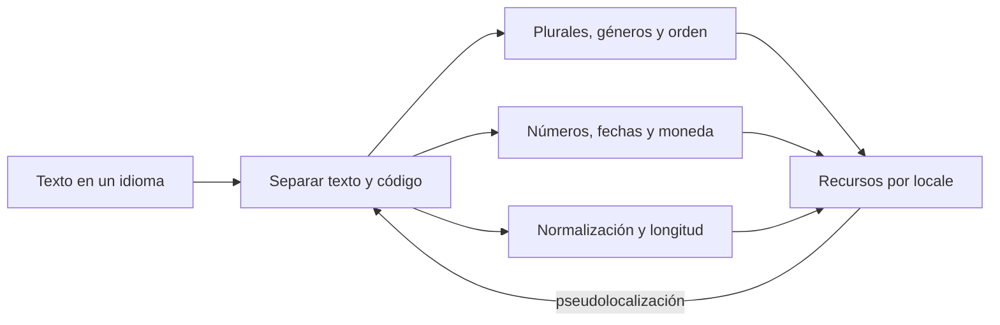
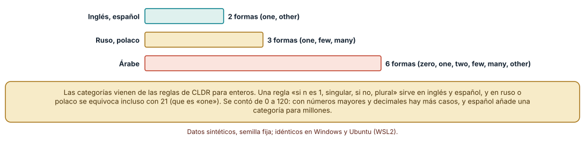
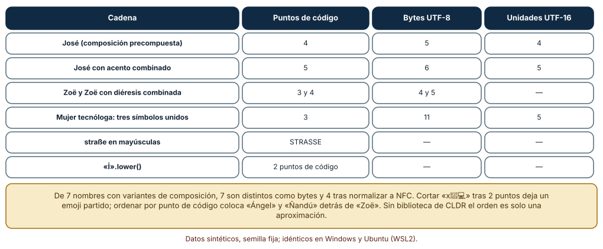
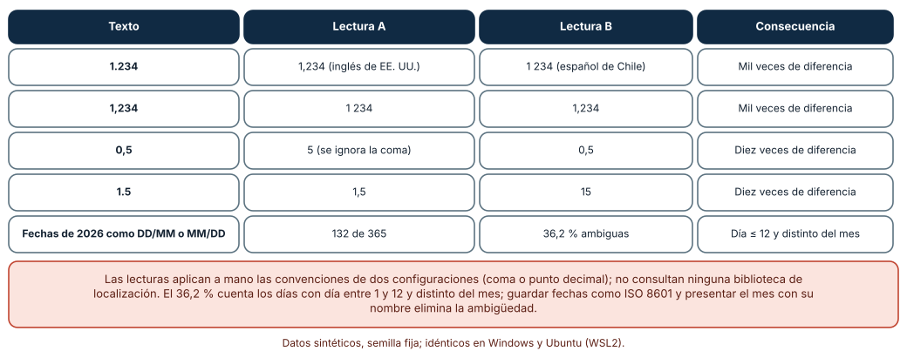

# SE-177 — Internacionalización, localización y formatos culturales

[← SE-176 — Responsive, adaptativo y preferencias del usuario](https://github.com/vladimiracunadev-create/modern-software-engineering-program/blob/main/classes/part-14-experiencia-accesibilidad-e-internacionalizacion/se-176-responsive-adaptativo-y-preferencias-del-usuario/README.md) · [↑ Parte 14](https://github.com/vladimiracunadev-create/modern-software-engineering-program/blob/main/classes/part-14-experiencia-accesibilidad-e-internacionalizacion/README.md) · [📚 Índice completo](https://github.com/vladimiracunadev-create/modern-software-engineering-program/blob/main/classes/README.md) · [🌐 Portal](https://vladimiracunadev-create.github.io/modern-software-engineering-program/classes/SE-177.html) · [SE-178 — Investigación de usabilidad y medición →](https://github.com/vladimiracunadev-create/modern-software-engineering-program/blob/main/classes/part-14-experiencia-accesibilidad-e-internacionalizacion/se-178-investigacion-de-usabilidad-y-medicion/README.md)

## Punto profesional y fundamento pedagógico

**Punto profesional.** La clase existe para que separes lo que cambia con el idioma y la cultura (textos, plurales, números, fechas, orden, longitud) del código que no debe cambiar, y para que midas con casos concretos dónde falla una suposición de una sola lengua.

**Por qué aparece aquí.** Se sitúa después de **Responsive, adaptativo y preferencias del usuario** y antes de **Investigación de usabilidad y medición**: `SE-176` dejó una maquetación que se adapta a anchos y preferencias; esta clase pregunta qué ocurre cuando el texto, los números y las fechas cambian de lengua. Deja los recursos de traducción y las comprobaciones que `SE-179` y `SE-180` usarán.

**Error conceptual que debe corregir.** Creer que internacionalizar es traducir cadenas: es preparar el producto para que cualquier lengua y región funcione (plurales, orden, longitud, formatos, normalización de texto), y localizar es después adaptar a una de ellas; sin lo primero, la traducción se rompe en el primer plural.

**Secuencia de aprendizaje.** Antes de leer la solución, predices cuántas formas de plural necesita el árabe, cuántos caracteres cuenta una cadena con acento combinado o un emoji compuesto y cuántas fechas de un año son ambiguas entre día y mes; después calculas con reglas publicadas, con la biblioteca estándar de Unicode y con enumeración. La secuencia usa predicción, explicación propia, contraste y recuperación. [ICAP](https://icap.education.asu.edu/research) distingue participación de construcción de conocimiento; [How People Learn II](https://nap.nationalacademies.org/catalog/24783/how-people-learn-ii-learners-contexts-and-cultures) exige conectar conocimiento previo, contexto y transferencia; la [práctica de recuperación](https://pubmed.ncbi.nlm.nih.gov/16507066/) respalda producir de nuevo la explicación tras una demora; y [Education for Life and Work](https://nap.nationalacademies.org/resource/13398/dbasse_084153.pdf) exige devolución que explique la causa del error.

**Evidencia de aprendizaje.** `i18n-log.md` con las categorías de plural por lengua, la tabla de longitudes de cadenas, la tabla de números ambiguos y la proporción de fechas ambiguas. Debe distinguir lo que sale de reglas publicadas de lo que es un supuesto del autor (la expansión del texto). Debe contener predicción previa, observación, explicación causal, contraejemplo y qué hallazgo haría retirar la conclusión.

**Límite de la conclusión.** Las reglas de plural son las de CLDR para enteros de 0 a 120 que el autor aplicó a mano; los formatos de números son de cuatro configuraciones; la expansión del texto por tamaño es un supuesto; no se usó ninguna biblioteca de localización ni se tradujo contenido real.

### Trazabilidad fuente → afirmación

| Fuente primaria u oficial | Afirmación que respalda | Lo que no prueba |
|---|---|---|
| [Unicode CLDR: reglas de plural](https://cldr.unicode.org/index/cldr-spec/plural-rules) | Define las categorías de plural (cero, uno, dos, pocos, muchos, otros) y las reglas por lengua. | No traduce ni dice cómo redactar cada forma. |
| [Unicode UAX #15: formas de normalización](https://www.unicode.org/reports/tr15/) | Define NFC y NFD para comparar cadenas canónicamente equivalentes. | No resuelve el orden alfabético ni la comparación sin acentos. |
| [W3C Internationalization: ¿qué es la internacionalización?](https://www.w3.org/International/questions/qa-i18n) | Distingue internacionalización de localización y recomienda separar texto y código. | No cubre una lengua o región concreta. |

## Antes de empezar

Recupera lo aprendido en `SE-176`: una maquetación debe aguantar variación de anchos y preferencias. La pregunta activa es: **¿qué suposición de una sola lengua hay en el texto, en los números, en las fechas o en la longitud de una cadena?**

## Prerrequisitos

- Haber completado `SE-176` o poder explicar por qué la maquetación debe aguantar variación.
- Python 3.11 o posterior y un terminal; los cálculos usan `unicodedata` y la biblioteca estándar.
- Trabajar con los mensajes de la plataforma de entregas y datos sintéticos; no se traduce contenido real.

## Problema auténtico

La plataforma anuncia «1 entrega pendientes» y «2 entrega pendiente», muestra «1.234» a una persona que lo lee como 1,234, ordena «Ñandú» después de «Zoë», cuenta 3 caracteres en un emoji y la fecha «03/04/2026» es el 3 de abril para unos y el 4 de marzo para otros. Una propuesta traduce las cadenas; otra añade una biblioteca de fechas; otra pone un selector de idioma en la cabecera.

## Objetivos observables

Al terminar podrás:

1. distinguir internacionalización, localización y traducción y qué se prepara en cada una;
2. calcular cuántas formas de plural necesita una lengua y cuántos números rompen una regla de singular o plural;
3. explicar por qué la longitud, el orden y la igualdad de cadenas dependen de la normalización y de la unidad de cuenta;
4. identificar cadenas numéricas y fechas ambiguas y decidir un formato inequívoco;
5. escribir recursos de mensajes y comprobaciones que otra persona pueda revisar.

## Mapa conceptual



El mapa se lee como una separación: el texto sale del código y se vuelve a unir por locale, con reglas de plural, formatos y normalización. La pseudolocalización devuelve un resultado a la preparación. No es un proceso de traducción.

## Temas y por qué importan

| Tema | Por qué cambia una decisión profesional | Evidencia mínima |
|---|---|---|
| Internacionalización, localización y traducción | Fija quién hace qué y cuándo. | Predicción, traza causal y contraejemplo de **Internacionalización, localización y traducción** en `i18n-log.md` |
| Plurales y concordancia | Evita frases como «1 entregas». | Predicción, traza causal y contraejemplo de **Plurales y concordancia** en `i18n-log.md` |
| Texto, normalización y longitud | Evita que la misma palabra se cuente, ordene o compare de formas distintas. | Predicción, traza causal y contraejemplo de **Texto, normalización y longitud** en `i18n-log.md` |
| Números, fechas y monedas | Evita que una misma cadena signifique dos cosas. | Predicción, traza causal y contraejemplo de **Números, fechas y monedas** en `i18n-log.md` |
| Expansión del texto y pseudolocalización | Hace visibles los problemas de longitud antes de traducir. | Predicción, traza causal y contraejemplo de **Expansión del texto y pseudolocalización** en `i18n-log.md` |

## Conceptos y decisiones

### 1. Internacionalización, localización y traducción

Internacionalizar es preparar el producto para cualquier lengua y región: texto fuera del código, formatos configurables, unicode correcto y maquetación flexible. Localizar es adaptar a una lengua y región concretas: textos, formatos, imágenes, convenciones. Traducir es una parte de la localización. Internacionalizar primero evita que cada nueva lengua obligue a tocar el código; saltarlo convierte cada traducción en una fuente de defectos.

### 2. Plurales y concordancia

El inglés y el español distinguen una forma para uno y otra para el resto. Otras lenguas necesitan más: el ruso y el polaco tienen formas para uno, pocos y muchos; el árabe, seis. Una regla «si n es 1, singular; si no, plural» sirve para inglés y español y falla en las demás, incluso con el 21 en ruso. CLDR publica las categorías por lengua, y las bibliotecas de mensajes las aplican; el género y el caso añaden más variantes, que se resuelven con mensajes completos y no con fragmentos concatenados.

### 3. Texto, normalización y longitud

Una letra con acento puede escribirse como un punto de código precompuesto o como una letra y un acento combinado: las dos se ven igual, miden distinto y no son iguales en bytes. La normalización (NFC o NFD) las hace comparables. «Longitud» puede ser puntos de código, unidades UTF-16, bytes UTF-8 o grafemas, y un emoji compuesto cuenta distinto en cada unidad. Truncar por puntos de código puede partir un grafema. Las mayúsculas y minúsculas tampoco son uno a uno («ß» en mayúscula es «SS»).

### 4. Números, fechas y monedas

El separador decimal y el de miles cambian con la región: «1.234» es 1,234 en una y 1 234 en otra. Las fechas con día y mes numéricos son ambiguas cuando ambos son menores o iguales que 12. Las monedas añaden símbolo, posición y decimales. Un formato inequívoco para almacenar y transmitir (números sin separadores de miles, fechas ISO 8601) se combina con un formato local para mostrar, y la entrada de datos acepta el formato local con validación explícita.

### 5. Expansión del texto y pseudolocalización

Las traducciones suelen ser más largas que el original y las cadenas cortas crecen más en proporción. Una pseudolocalización transforma el texto fuente (acentos, relleno, corchetes) para detectar cadenas truncadas, concatenaciones y texto fijo en el código sin traducir nada. La holgura de la maquetación debe decidirse con las longitudes reales de las traducciones, y los botones y etiquetas con texto fijo son los primeros en romperse.

### Cuántas formas de plural necesita una lengua

Se aplicaron a mano las reglas de plural de CLDR para enteros a los números de 0 a 120. El inglés y el español necesitan 2 formas (uno y otros); el ruso y el polaco, 3 (uno, pocos, muchos); el árabe, 6 (cero, uno, dos, pocos, muchos, otros). Una regla ingenua «uno → singular, resto → plural» coincide con la regla real para inglés y español en los 121 números, y se equivoca en 120 de 121 en ruso y polaco (incluidos el 21, el 31 y el 101, que son «uno» en ruso) y en 117 de 121 en árabe. En versiones recientes de CLDR, el español añade además una categoría para múltiplos de un millón, que este rango no cubre.

```python
def plural_ru(n):
    if n % 10 == 1 and n % 100 != 11: return 'uno'
    if 2 <= n % 10 <= 4 and not 12 <= n % 100 <= 14: return 'pocos'
    return 'muchos'

fallos = sum(plural_ru(n) != ('uno' if n == 1 else 'otros') for n in range(121))
```



**Cómo leer la figura.** Cada barra es el número de formas distintas que necesita una lengua en el rango de 0 a 120. **Dónde deja de valer:** las reglas son las de CLDR para enteros, aplicadas a mano por el autor; no se consideraron decimales ni números mayores, donde aparecen más casos, ni se contrastaron con una biblioteca de producción.

### Una letra, varias longitudes

Con `unicodedata`, «José» con el acento precompuesto tiene 4 puntos de código y 5 bytes UTF-8; con la letra y el acento combinado, 5 puntos y 6 bytes; las dos se ven igual y no son iguales hasta normalizar a NFC. De 7 variantes de nombres con composición distinta, 7 son distintas en bruto y 4 tras la normalización. El emoji de una mujer tecnóloga (tres símbolos unidos) tiene 3 puntos de código, 11 bytes UTF-8 y 5 unidades UTF-16; cortar tras 2 puntos deja un símbolo partido. Las mayúsculas de «straße» son «STRASSE» y su `casefold` coincide con el de «STRASSE». Ordenar por punto de código deja «Ángel» y «Ñandú» detrás de «Zoë».

```python
import unicodedata
a, b = 'José', 'Jose\u0301'
len(a), len(b)                       # 4, 5
a == b                               # False
unicodedata.normalize('NFC', a) == unicodedata.normalize('NFC', b)   # True
```



**Cómo leer la figura.** Cada fila es una cadena; las columnas son tres formas de medirla; las dos últimas filas muestran problemas de mayúsculas. **Dónde deja de valer:** la biblioteca estándar no ordena según las reglas de una lengua ni cuenta grafemas; el orden alfabético correcto y los grafemas exigen CLDR y UAX #29, que no se usaron.

### Cadenas numéricas, fechas y expansión del texto

La cadena «1.234» vale 1,234 en inglés de EE. UU. y 1 234 en español de Chile; «1,234» es lo contrario; «0,5» se lee 5 si se ignora la coma; «1.5» vale 15 con la lectura de Chile. De las 365 fechas de 2026, 132 (36,2 %) son ambiguas entre día-mes y mes-día porque el día es menor o igual que 12 y distinto del mes. Para la expansión se asignaron, como supuesto, factores de 1,9 a cadenas de hasta 10 caracteres, 1,5 a las de 11 a 20, 1,35 a las de 21 a 40 y 1,3 a las mayores; en 200 cadenas, una holgura de la maquetación del 20 % desborda en las 200, del 40 % en 134, del 60 % en 80 y del 100 % en ninguna.

```python
ambiguas = sum(1 for d in fechas_2026 if d.day <= 12 and d.day != d.month)   # 132 de 365

def a_flotante(s, decimal, miles):
    return float(s.replace(miles, '').replace(decimal, '.'))
```



**Cómo leer la figura.** Cada fila es un texto numérico o un conjunto de fechas y muestra dos lecturas distintas con la misma cadena. **Dónde deja de valer:** las lecturas aplican a mano las convenciones de dos configuraciones y no consultan una biblioteca de localización; los factores de expansión son un supuesto del autor, no una medición de traducciones reales.

## Definiciones de trabajo

- **internacionalización:** preparación de un producto para que funcione en cualquier lengua y región.
- **localización:** adaptación de un producto internacionalizado a una lengua y región concretas.
- **locale:** identificador de lengua y región que determina formatos y convenciones.
- **normalización Unicode:** conversión de texto a una forma canónica para comparar cadenas equivalentes.
- **pseudolocalización:** transformación del texto fuente que simula expansión y acentos para detectar problemas antes de traducir.

Las definiciones son operativas para la plataforma de entregas. No convierten términos con historia más amplia en sinónimos y deben contrastarse con la documentación primaria enlazada al final.

## Ejemplo mínimo

El fragmento compara dos escrituras de la misma palabra. Antes de ejecutarlo, predice si son iguales antes y después de normalizar.

```python
import unicodedata

a, b = 'José', 'Jose\u0301'
print(a == b, len(a), len(b))                                   # False 4 5
nfc = lambda s: unicodedata.normalize('NFC', s)
print(nfc(a) == nfc(b), len(nfc(b)))                            # True 4
```

Se ven iguales y la comparación directa falla hasta normalizar. Prueba con `casefold()` y anota cuándo lo harías antes de comparar; registra versión y salida.

## Ejemplo profesional

En la plataforma, los mensajes viven en recursos por locale con un formato que admite plurales y géneros, y ninguna cadena se construye por concatenación. Una prueba comprueba que cada clave existe en todos los locales con las categorías de plural que exige su lengua; otra aplica pseudolocalización y falla si una etiqueta se trunca; las fechas se guardan en ISO 8601 y los números sin separador de miles, y se formatean al mostrar. Los nombres de personas se almacenan sin cambiar su normalización y se comparan tras normalizar.

Compara el caso normal con un nombre con acento combinado, el plural de 21 en ruso y una fecha 03/04 de una persona de otra región. Una internacionalización es apropiada cuando esos tres casos están cubiertos; es peligrosa cuando solo se probó con el español de quien la escribió.

## Práctica guiada

1. Lista los mensajes de la plataforma y marca los que contienen cantidades, fechas, nombres u orden.
2. Predice cuántas formas de plural necesita cada lengua y calcula los fallos de la regla ingenua.
3. Calcula longitudes en cuatro unidades para siete cadenas y compara con la normalización.
4. Escribe diez cadenas numéricas y cinco fechas y marca cuáles son ambiguas.
5. Pseudolocaliza los mensajes y marca los que no caben en su contenedor.
6. Introduce el fallo controlado y registra el síntoma antes de corregirlo.
7. Pide a otra persona que reconstruya el recurso de mensajes y las pruebas solo desde `i18n-log.md`.

## Ejercicios

1. **Plurales:** escribe la regla para una lengua distinta de las de la clase (por ejemplo el lituano o el checo) usando CLDR y cuenta cuántos números de 0 a 120 rompe la regla ingenua.
2. **Comparación:** escribe una función de igualdad de nombres que normalice y distinga de la comparación sin acentos, y decide cuándo usar cada una.
3. **Formato:** diseña el almacenamiento de un importe con moneda y fecha que no sea ambiguo y el formateo de salida para dos regiones.
4. **Pseudolocalización:** implementa una transformación que añada acentos y un 40 % de relleno y úsala para encontrar una cadena truncada.

## Reto verificable

Entrega `i18n-log.md` con el recurso de mensajes, las categorías de plural por lengua, la tabla de longitudes, la tabla de números y fechas ambiguos y los resultados de la pseudolocalización. Se aprueba si otra persona reproduce los números y puede nombrar una suposición de lengua que el recurso aún contiene. No se aprueba por tener las cadenas traducidas ni por añadir un selector de idioma.

## Caso conductor

La plataforma de entregas es el caso conductor de la Parte 14. Esta clase deja los mensajes de la plataforma como recursos por locale, las pruebas de plural, la política de fechas y números y la pseudolocalización. `SE-178` medirá si las personas completan tareas con esos mensajes; `SE-179` auditará un flujo completo en dos lenguas. Cambia después una sola cadena, «entrega pendiente», y revisa qué plurales, géneros y espacios necesita en cada locale.

## Preguntas frecuentes

### ¿Basta con traducir las cadenas?

No: la traducción de cadenas sueltas rompe plurales, concordancia, orden y longitud. Se necesita preparar el producto para esos casos y después traducir mensajes completos con contexto.

### ¿Qué formato de fecha uso para almacenar?

ISO 8601 (año-mes-día) y, si hay hora, con su zona. Para mostrarla se usa el formato local, y para evitar ambigüedades se puede mostrar el mes con su nombre.

### ¿Cuántos locales debo soportar?

Los que tu población usa y puedes mantener con calidad. Cada locale es un compromiso: sus textos, sus pruebas y su revisión. Un locale a medias es peor que uno ausente con un mensaje claro.

### ¿Debo normalizar los nombres de personas?

Se compara normalizando y se muestra lo que la persona escribió. Cambiar su nombre al almacenarlo es una decisión con consecuencias (identidad, coincidencia con documentos) que debe tomarse y registrarse.

## Fallo controlado y diagnóstico

Reproduce el fallo clásico de la clase: **una regla de plural de una sola lengua aplicada a otra**. Usa la regla «uno o resto» con el ruso.

Registra síntoma, entrada mínima, hipótesis, observación que descarta cada hipótesis, causa, corrección y prueba de regresión. **Síntoma:** el mensaje «21 entrega» aparece en ruso con la forma de «muchos» en lugar de la de «uno». **Hipótesis rivales:** (a) la traducción de la forma «uno» es incorrecta; (b) la regla del código solo distingue el 1. **Prueba:** la regla ingenua se equivoca en 120 de 121 números de 0 a 120 en ruso, incluido el 21; la regla de CLDR da «uno». **Conclusión:** la causa es la regla, no la traducción. **Regresión:** reemplaza la regla por la biblioteca de mensajes y añade una prueba por locale con los números 0, 1, 2, 5, 21 y 101. No cambies a la vez la regla y los textos.

## Errores comunes y cómo corregirlos

| Síntoma | Causa probable | Corrección |
|---|---|---|
| «1 entregas» o «2 entrega» | Regla de plural de una sola lengua o concatenación | Mensajes completos con categorías de plural por locale |
| Dos nombres iguales se tratan como distintos | Distinta composición Unicode sin normalizar | Normalizar a NFC al comparar |
| «1.234» se lee mal | Formato local usado para almacenar | Almacenar sin separadores y formatear al mostrar |
| Una etiqueta se corta al traducir | Contenedor sin holgura para la expansión | Pseudolocalización y maquetación flexible |
| Un emoji aparece partido tras truncar | Truncado por puntos de código | Truncar por grafemas con una biblioteca adecuada |

## Entorno y archivos clave

```text
work/SE-177/
├── README.md
├── i18n/
│   ├── plurales.py
│   ├── cadenas.py
│   └── formatos.py
├── mensajes/
│   ├── es.json
│   └── ru.json
├── tests/test_i18n.py
└── evidence/i18n-log.md
```

El `README` declara plataforma, versión de Python, semillas y comandos. Los cálculos usan solo la biblioteca estándar (`unicodedata`, `datetime`, `random`) y se ejecutaron con CPython 3.12.9 en Windows 11 y 3.12.3 en Ubuntu bajo WSL2: las salidas fueron idénticas. No se usó ninguna biblioteca de localización ni se tradujo contenido real.

## Seguridad, ética y accesibilidad

- la normalización incorrecta de nombres puede producir suplantaciones por caracteres visualmente idénticos (homógrafos): decide una política para identificadores y cuentas;
- los textos de usuarios mezclan direcciones de escritura y pueden desordenar una interfaz: aísla su dirección;
- no envíes textos de usuarios a servicios de traducción externos sin una decisión informada sobre privacidad;
- ofrece una alternativa textual a cada tabla y figura y marca el idioma de cada fragmento para las tecnologías de apoyo;
- atribuye las fuentes y respeta las licencias de las traducciones y de los datos de localización.

## Puente hacia el trabajo con agentes

Un agente al que se le pide «traduce la aplicación al portugués y al inglés» devolverá cadenas traducidas, concatenadas con variables y con una regla de plural de dos formas, sin comprobar longitudes ni fechas. Pídele que use mensajes con categorías de plural, que no concatene, que pseudolocalice y que escriba una prueba por locale con 0, 1, 2, 5, 21 y 101. Revisa especialmente si dejó fechas con un formato fijo o cadenas partidas con variables: es la misma suposición de una lengua, ahora en dos más.

## Transferencia

Traslada el análisis a otro producto (una tienda en línea o una aplicación de reservas): lista los mensajes con cantidades, calcula plurales para dos lenguas, normaliza nombres y marca fechas ambiguas. La transferencia está lograda cuando puedes explicar qué parte dependía de la plataforma de entregas y cuál no.

## Evaluación y evidencia

| Criterio | Evidencia para aprobar |
|---|---|
| comprensión | explicación de la diferencia entre internacionalizar y localizar y de los plurales por lengua |
| corrección | conteos de plurales, longitudes y fechas ambiguas reproducibles |
| diseño | recursos de mensajes por locale sin concatenación |
| diagnóstico | reproducción del fallo de plural con su regresión por locale |
| incertidumbre | declaración de que las reglas se aplicaron a mano y no se usó una biblioteca de CLDR |
| reproducibilidad | versiones, comandos, salida y límites declarados |

## Fuentes

- [Unicode CLDR: reglas de plural](https://cldr.unicode.org/index/cldr-spec/plural-rules) — categorías de plural por lengua; autoridad: Unicode Consortium.
- [Unicode TR35: números](https://www.unicode.org/reports/tr35/tr35-numbers.html) — formatos y patrones de números por región; autoridad: Unicode Consortium.
- [Unicode UAX #15: formas de normalización](https://www.unicode.org/reports/tr15/) — NFC y NFD; autoridad: Unicode Consortium.
- [Unicode UAX #29: segmentación de texto](https://www.unicode.org/reports/tr29/) — grafemas, palabras y oraciones; autoridad: Unicode Consortium.
- [W3C Internationalization: ¿qué es la internacionalización?](https://www.w3.org/International/questions/qa-i18n) — conceptos y buenas prácticas; autoridad: W3C.
- [W3C: etiquetas de idioma en HTML y XML](https://www.w3.org/International/articles/language-tags/) — uso de etiquetas de idioma; autoridad: W3C.
- [IETF RFC 5646: etiquetas para identificar idiomas](https://www.rfc-editor.org/rfc/rfc5646) — sintaxis de etiquetas de idioma (BCP 47); autoridad: IETF.
- [ECMA-402: API de internacionalización de ECMAScript](https://tc39.es/ecma402/) — formato de números, fechas y plurales en JavaScript; autoridad: Ecma International.
- [MDN: `Intl.PluralRules`](https://developer.mozilla.org/en-US/docs/Web/JavaScript/Reference/Global_Objects/Intl/PluralRules) — acceso a las reglas de plural desde JavaScript; autoridad: Mozilla.

Cada fuente respalda el mecanismo indicado; ninguna demuestra que los recursos de la plataforma estén correctos en una lengua concreta. Esa afirmación depende de revisarlos con personas hablantes de esa lengua.

- [Python: `unicodedata`](https://docs.python.org/3/library/unicodedata.html) — normalización y propiedades de caracteres.
- [Python: `random`](https://docs.python.org/3/library/random.html) — semillas de la asignación de longitudes.

## Límites y siguiente paso

Se ejecutaron tres experimentos con datos sintéticos en Windows y Ubuntu (WSL2) con resultados idénticos. No se usó ninguna biblioteca de localización, no se tradujo contenido real y las reglas de plural se aplicaron a mano a enteros de 0 a 120; la expansión del texto es un supuesto del autor. La siguiente clase pregunta cómo medir si las personas logran la tarea con todo esto.

## Glosario

- **internacionalización:** preparación de un producto para que funcione en cualquier lengua y región.
- **localización:** adaptación de un producto internacionalizado a una lengua y región concretas.
- **locale:** identificador de lengua y región que determina formatos y convenciones.
- **normalización Unicode:** conversión de texto a una forma canónica para comparar cadenas equivalentes.
- **pseudolocalización:** transformación del texto fuente que simula expansión y acentos para detectar problemas antes de traducir.

---

[← SE-176 — Responsive, adaptativo y preferencias del usuario](https://github.com/vladimiracunadev-create/modern-software-engineering-program/blob/main/classes/part-14-experiencia-accesibilidad-e-internacionalizacion/se-176-responsive-adaptativo-y-preferencias-del-usuario/README.md) · [↑ Parte 14](https://github.com/vladimiracunadev-create/modern-software-engineering-program/blob/main/classes/part-14-experiencia-accesibilidad-e-internacionalizacion/README.md) · [📚 Índice completo](https://github.com/vladimiracunadev-create/modern-software-engineering-program/blob/main/classes/README.md) · [🌐 Portal](https://vladimiracunadev-create.github.io/modern-software-engineering-program/classes/SE-177.html) · [SE-178 — Investigación de usabilidad y medición →](https://github.com/vladimiracunadev-create/modern-software-engineering-program/blob/main/classes/part-14-experiencia-accesibilidad-e-internacionalizacion/se-178-investigacion-de-usabilidad-y-medicion/README.md)
