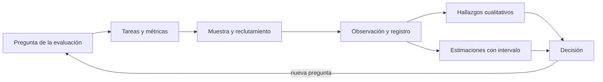
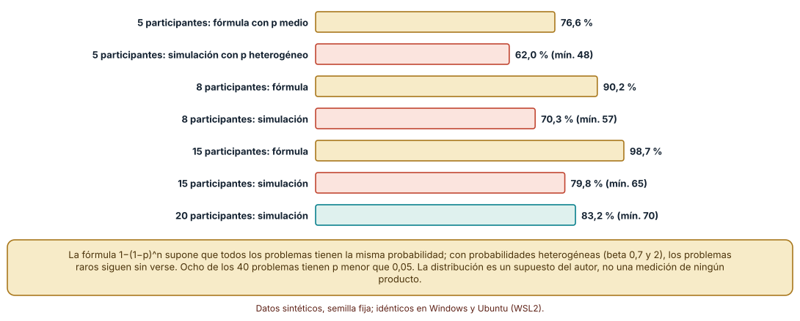
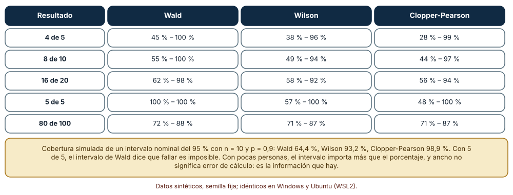
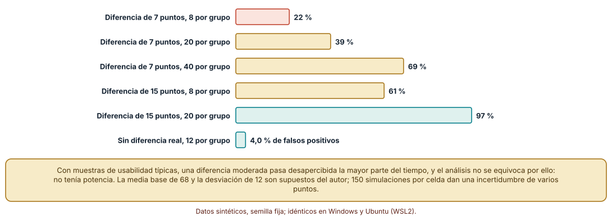

# SE-178 — Investigación de usabilidad y medición

[← SE-177 — Internacionalización, localización y formatos culturales](https://github.com/vladimiracunadev-create/modern-software-engineering-program/blob/main/classes/part-14-experiencia-accesibilidad-e-internacionalizacion/se-177-internacionalizacion-localizacion-y-formatos-culturales/README.md) · [↑ Parte 14](https://github.com/vladimiracunadev-create/modern-software-engineering-program/blob/main/classes/part-14-experiencia-accesibilidad-e-internacionalizacion/README.md) · [📚 Índice completo](https://github.com/vladimiracunadev-create/modern-software-engineering-program/blob/main/classes/README.md) · [🌐 Portal](https://vladimiracunadev-create.github.io/modern-software-engineering-program/classes/SE-178.html) · [SE-179 — Taller: auditar y reparar un flujo excluyente →](https://github.com/vladimiracunadev-create/modern-software-engineering-program/blob/main/classes/part-14-experiencia-accesibilidad-e-internacionalizacion/se-179-taller-auditar-y-reparar-un-flujo-excluyente/README.md)

## Punto profesional y fundamento pedagógico

**Punto profesional.** La clase existe para que planifiques una evaluación de usabilidad con un tamaño de muestra, unas métricas y unos intervalos que digan lo que realmente se puede concluir con pocas personas, y para que distingas un hallazgo cualitativo de una estimación cuantitativa.

**Por qué aparece aquí.** Se sitúa después de **Internacionalización, localización y formatos culturales** y antes de **Taller: auditar y reparar un flujo excluyente**: `SE-177` dejó los mensajes y formatos en varias lenguas; esta clase pregunta cómo se sabe si las personas logran la tarea con ellos. Deja el protocolo de evaluación y la manera de informar incertidumbre que `SE-179` y `SE-180` aplicarán.

**Error conceptual que debe corregir.** Creer que cinco participantes bastan para «encontrar el 85 % de los problemas» o que un porcentaje de éxito sobre ocho personas es una estimación precisa: la fórmula supone problemas igual de probables, un porcentaje de pocas personas tiene un intervalo muy ancho y una diferencia moderada entre diseños casi nunca se detecta con muestras pequeñas.

**Secuencia de aprendizaje.** Antes de leer la solución, predices qué fracción de 40 problemas de probabilidades distintas encuentran cinco participantes, qué intervalo da «4 de 5» con tres métodos y con qué probabilidad detecta una comparación de dos diseños una diferencia de 7 puntos de SUS; después simulas, calculas intervalos exactos y estimas potencia por permutaciones. La secuencia usa predicción, explicación propia, contraste y recuperación. [ICAP](https://icap.education.asu.edu/research) distingue participación de construcción de conocimiento; [How People Learn II](https://nap.nationalacademies.org/catalog/24783/how-people-learn-ii-learners-contexts-and-cultures) exige conectar conocimiento previo, contexto y transferencia; la [práctica de recuperación](https://pubmed.ncbi.nlm.nih.gov/16507066/) respalda producir de nuevo la explicación tras una demora; y [Education for Life and Work](https://nap.nationalacademies.org/resource/13398/dbasse_084153.pdf) exige devolución que explique la causa del error.

**Evidencia de aprendizaje.** `usability-log.md` con el protocolo de la evaluación de la entrega, la comparación entre la fórmula y la simulación, los intervalos con tres métodos y la potencia de una comparación. Debe distinguir lo que sale de la muestra (hallazgos cualitativos) de lo que se estima (porcentajes con intervalo). Debe contener predicción previa, observación, explicación causal, contraejemplo y qué hallazgo haría retirar la conclusión.

**Límite de la conclusión.** La distribución de probabilidades de los problemas (beta 0,7 y 2), la media y desviación de la escala (68 y 12) y las 150 simulaciones por celda son supuestos del autor; no se evaluó a ninguna persona ni se midió ningún producto, y los resultados describen el comportamiento de métodos, no de una población.

### Trazabilidad fuente → afirmación

| Fuente primaria u oficial | Afirmación que respalda | Lo que no prueba |
|---|---|---|
| [Nielsen y Landauer, «A mathematical model of the finding of usability problems» (INTERCHI, 1993)](https://doi.org/10.1145/169059.169166) | Propone que la proporción de problemas hallados crece como 1 − (1 − p)^n con p la probabilidad media de hallazgo. | No dice que p sea igual para todos los problemas ni que se mantenga entre productos. |
| [Faulkner, «Beyond the five-user assumption» (Behav. Res. Methods, 2003)](https://doi.org/10.3758/BF03195514) | Muestra con datos que cinco participantes pueden encontrar solo una parte de los problemas y que la variabilidad entre muestras es grande. | No fija un tamaño de muestra universal. |
| [Brown, Cai y DasGupta, «Interval estimation for a binomial proportion» (Stat. Sci., 2001)](https://doi.org/10.1214/ss/1009213286) | Compara intervalos para una proporción y muestra que el de Wald cubre mal con pocas observaciones. | No elige un intervalo para tu estudio. |

## Antes de empezar

Recupera lo aprendido en `SE-177`: cada suposición de una lengua rompe algo. La pregunta activa es: **¿cuántas personas hacen falta para qué conclusión, y qué intervalo acompaña a cada número que voy a informar?**

## Prerrequisitos

- Haber completado `SE-177` o poder explicar por qué una suposición de una sola lengua rompe un mensaje.
- Python 3.11 o posterior y un terminal; los cálculos usan solo la biblioteca estándar (`random`, `statistics`, `math`).
- Trabajar con la evaluación de la entrega y datos sintéticos; no se recluta a nadie.

## Problema auténtico

El equipo prueba la entrega con cinco personas, cuatro la completan, y la conclusión es «el 80 % lo logra». Se afirma que cinco bastan para hallar el 85 % de los problemas y se compara un diseño nuevo con el actual con ocho personas por grupo, sin diferencia significativa: «el rediseño no mejora». Una propuesta suma más preguntas al cuestionario; otra compra un panel; otra declara el rediseño ganador por la media.

## Objetivos observables

Al terminar podrás:

1. calcular con una simulación qué fracción de problemas halla una muestra cuando sus probabilidades difieren;
2. calcular intervalos para una proporción con tres métodos y explicar cuándo no coinciden;
3. estimar por simulación la potencia de una comparación entre dos diseños según el tamaño de muestra y la diferencia;
4. distinguir un hallazgo cualitativo de una estimación cuantitativa y qué lenguaje corresponde a cada uno;
5. escribir un protocolo de evaluación con tareas, métricas, tamaño y límites que otra persona pueda repetir.

## Mapa conceptual



El mapa se lee de izquierda a derecha con dos salidas de la observación: lo que se ve (hallazgos) y lo que se cuenta (estimaciones con su incertidumbre). Ambas alimentan una decisión y la decisión abre nuevas preguntas. No es un proceso lineal de investigación.

## Temas y por qué importan

| Tema | Por qué cambia una decisión profesional | Evidencia mínima |
|---|---|---|
| Qué responde una evaluación | Alinea el método con la pregunta. | Predicción, traza causal y contraejemplo de **Qué responde una evaluación** en `usability-log.md` |
| Tareas, métricas y criterio de éxito | Define de antemano qué cuenta como lograrlo. | Predicción, traza causal y contraejemplo de **Tareas, métricas y criterio de éxito** en `usability-log.md` |
| Tamaño de muestra y descubrimiento de problemas | Evita confiar en una regla de tamaño único. | Predicción, traza causal y contraejemplo de **Tamaño de muestra y descubrimiento de problemas** en `usability-log.md` |
| Intervalos para una proporción | Informa lo que se sabe y lo que no con pocas personas. | Predicción, traza causal y contraejemplo de **Intervalos para una proporción** en `usability-log.md` |
| Comparar diseños y potencia | Evita declarar que no hay diferencia cuando no se podía ver. | Predicción, traza causal y contraejemplo de **Comparar diseños y potencia** en `usability-log.md` |

## Conceptos y decisiones

### 1. Qué responde una evaluación

Una evaluación formativa busca problemas para corregirlos: con pocas personas y tareas realistas se observa dónde se atascan y por qué. Una evaluación sumativa busca una cifra o una comparación y exige muestras mayores, tareas fijadas de antemano y un criterio de decisión. Confundirlas produce conclusiones de ambos tipos mal sustentadas: un porcentaje de cinco personas no es una estimación y un hallazgo cualitativo no necesita un valor p.

### 2. Tareas, métricas y criterio de éxito

Las métricas habituales son éxito de la tarea (binaria), tiempo, errores y una escala subjetiva como la System Usability Scale (SUS). Cada una responde a algo distinto y se informa con su incertidumbre. El criterio de éxito de cada tarea (por ejemplo, «el recibo es visible y la persona lo identifica») se escribe antes de la sesión, y también cuándo se da por rendida una tarea. Sin eso, el éxito se decide con la observación y cambia según quién observe.

### 3. Tamaño de muestra y descubrimiento de problemas

La fórmula de Nielsen y Landauer supone una probabilidad igual para todos los problemas. Con probabilidades heterogéneas, los frecuentes aparecen pronto y los raros quedan sin ver, de modo que la fracción hallada con n personas es menor que la predicha. La conclusión práctica es iterar con grupos pequeños y diferentes tareas, y no suponer que una ronda de cinco halla casi todo.

### 4. Intervalos para una proporción

Con pocas personas, un porcentaje tiene un intervalo muy ancho. El intervalo de Wald (normal) es el más conocido y es el peor: da anchos cero cuando todos acertaron y cubre mal. El de Wilson y el exacto de Clopper-Pearson son mejores con muestras pequeñas; el segundo es conservador. Informar «4 de 5 (intervalo del 95 %: de 28 % a 99 %)» dice lo que el estudio permite afirmar.

### 5. Comparar diseños y potencia

La potencia es la probabilidad de detectar una diferencia real de un tamaño dado. Con ocho personas por grupo y una diferencia de 7 puntos de SUS, casi nunca se detecta; «sin diferencia significativa» no equivale a «sin diferencia». La respuesta honesta a una comparación sin potencia es informar el tamaño observado con su intervalo, no declarar un empate, y decidir si compensa un estudio mayor o una decisión basada en otros criterios.

### Cinco participantes y problemas de probabilidad distinta

Se simularon 40 problemas cuya probabilidad de que una persona los encuentre sigue una distribución beta (0,7 y 2): media 0,25, mediana 0,19 y 8 problemas con probabilidad menor de 0,05. La fórmula con la probabilidad media predice 76,6 % con 5 participantes, 90,2 % con 8, 96,9 % con 12 y 98,7 % con 15. La simulación de 500 estudios halla 62,0 % con 5 (mínimo 48 %), 70,3 % con 8 (mínimo 57 %), 76,5 % con 12, 79,8 % con 15 y 83,2 % con 20 (mínimo 70 %). La heterogeneidad hace que la fórmula sobreestime lo hallado en todos los tamaños.

```python
probs = [r.betavariate(0.7, 2.0) for _ in range(40)]
media = statistics.mean(probs)
formula = 1 - (1 - media) ** n
hallados = sum(any(r.random() < p for _ in range(n)) for p in probs) / 40
```



**Cómo leer la figura.** Las barras amarillas son la fórmula con la probabilidad media; las coral son la simulación con probabilidades distintas; la diferencia es lo que la fórmula sobreestima. **Dónde deja de valer:** la distribución beta es un supuesto del autor; en un producto real la forma de las probabilidades es desconocida y depende de las tareas y de las personas, y los problemas no son independientes.

### Tres intervalos para pocas personas

Con 4 éxitos de 5, el intervalo del 95 % es de 45 % a 100 % con Wald, de 38 % a 96 % con Wilson y de 28 % a 99 % con Clopper-Pearson. Con 8 de 10: 55–100, 49–94 y 44–97; con 16 de 20: 62–98, 58–92 y 56–94; con 5 de 5, Wald da 100–100 (dice que fallar es imposible), Wilson 57–100 y Clopper-Pearson 48–100; con 80 de 100 los tres coinciden en 71–87 aproximadamente. La cobertura simulada de un intervalo del 95 % con n = 10 y p = 0,9 es 64,4 % para Wald, 93,2 % para Wilson y 98,9 % para Clopper-Pearson.

```python
def wilson(k, n, z=1.96):
    p = k / n; d = 1 + z * z / n
    c = p + z * z / (2 * n)
    h = z * math.sqrt(p * (1 - p) / n + z * z / (4 * n * n))
    return (c - h) / d, (c + h) / d
```



**Cómo leer la figura.** Cada fila es un resultado; las columnas son tres métodos; compara el ancho de cada intervalo. **Dónde deja de valer:** la cobertura se simuló con una sola probabilidad real y observaciones independientes; las personas de un estudio de usabilidad no son una muestra aleatoria de la población, y ningún intervalo corrige un reclutamiento sesgado.

### Potencia de una comparación entre dos diseños

Se simuló la comparación de dos grupos con SUS normal (media 68, desviación 12) mediante una prueba de permutación con 200 permutaciones y 150 estudios por celda. Con una diferencia real de 7 puntos, la probabilidad de detectarla es 11 % con 5 por grupo, 22 % con 8, 27 % con 12, 39 % con 20 y 69 % con 40. Con una diferencia de 15 puntos, 35 %, 61 %, 79 %, 97 % y 100 %. Sin diferencia real, la proporción de falsos positivos es 2,7 %, 4,0 % y 4,7 % con 5, 12 y 40 por grupo, en torno al 5 % nominal.

```python
obs = abs(mean(a) - mean(b))
perm = sum(abs(mean(pool[:n]) - mean(pool[n:])) >= obs for _ in range(200))
significativo = (perm + 1) / 201 < 0.05
```



**Cómo leer la figura.** Cada barra es la probabilidad de detectar la diferencia indicada con ese tamaño de grupo; la última barra comprueba que sin diferencia real el error se mantiene en torno al 5 %. **Dónde deja de valer:** la media, la desviación y la normalidad son supuestos; 150 estudios por celda dejan una incertidumbre de varios puntos porcentuales; la escala SUS no es normal en un producto real.

## Definiciones de trabajo

- **evaluación formativa:** evaluación cuyo objetivo es encontrar problemas para corregirlos.
- **evaluación sumativa:** evaluación cuyo objetivo es estimar un resultado o comparar alternativas.
- **intervalo de confianza:** rango calculado con un procedimiento que, repetido, cubre el valor verdadero con una frecuencia nominal.
- **potencia estadística:** probabilidad de detectar una diferencia real de un tamaño dado con un procedimiento y una muestra.
- **System Usability Scale:** cuestionario de diez preguntas que da una puntuación de 0 a 100 de usabilidad percibida.

Las definiciones son operativas para la plataforma de entregas. No convierten términos con historia más amplia en sinónimos y deben contrastarse con la documentación primaria enlazada al final.

## Ejemplo mínimo

El fragmento calcula el intervalo de Wilson de 4 éxitos de 5. Antes de ejecutarlo, predice si el límite inferior es mayor o menor que 50 %.

```python
import math

def wilson(k, n, z=1.96):
    p = k / n
    d = 1 + z * z / n
    c = p + z * z / (2 * n)
    h = z * math.sqrt(p * (1 - p) / n + z * z / (4 * n * n))
    return round((c - h) / d, 2), round((c + h) / d, 2)

print(wilson(4, 5))   # (0.38, 0.96)
```

El límite inferior es 38 %: con cinco personas no se descarta que menos de la mitad lo logre. Prueba con 8 de 10 y compara el ancho; registra versión y salida.

## Ejemplo profesional

En la plataforma, cada evaluación de la entrega comienza con un protocolo: la pregunta, tres tareas con su criterio de éxito escrito, las métricas, el número de participantes con su razón y lo que no se podrá concluir. Se hacen rondas de cinco participantes con arreglos entre rondas para encontrar problemas, y las cifras se informan como «k de n» con un intervalo de Wilson. Una comparación entre diseños declara de antemano la diferencia que quiere poder detectar y su tamaño de grupo, y si no lo alcanza, se informa como exploratoria.

Compara el caso normal con una tarea que nadie completa, una que todos completan y una que depende de una persona con lector de pantalla. Un informe es apropiado cuando esos tres casos están descritos y las cifras llevan su intervalo; es peligroso cuando solo hay un porcentaje.

## Práctica guiada

1. Escribe la pregunta de la evaluación y decide si es formativa o sumativa.
2. Define tres tareas con su criterio de éxito y de rendición antes de la sesión.
3. Predice qué fracción de 40 problemas halla cada tamaño de muestra y simula con probabilidades heterogéneas.
4. Calcula los tres intervalos para cuatro resultados y compáralos.
5. Estima la potencia de una comparación para dos diferencias y cuatro tamaños de grupo.
6. Escribe el protocolo con sus límites y lo que no se podrá concluir.
7. Pide a otra persona que reconstruya el protocolo y las cifras solo desde `usability-log.md`.

## Ejercicios

1. **Heterogeneidad:** repite la simulación con una distribución de probabilidades más concentrada (beta 3 y 9) y explica por qué la fórmula se acerca más.
2. **Intervalos:** calcula los tres intervalos para 3 de 3 y para 0 de 6 y explica qué informarías.
3. **Potencia:** estima cuántas personas por grupo necesitas para detectar 10 puntos con una potencia del 80 % con tu simulación.
4. **Redacción:** reescribe «el rediseño no mejora la usabilidad» con la información que sí sustenta una comparación sin potencia.

## Reto verificable

Entrega `usability-log.md` con el protocolo, la comparación entre fórmula y simulación, los tres intervalos y la estimación de potencia. Se aprueba si otra persona reproduce los números con las mismas semillas y puede nombrar una conclusión que el estudio no permite. No se aprueba por un número de participantes ni por un valor p.

## Caso conductor

La plataforma de entregas es el caso conductor de la Parte 14. Esta clase deja el protocolo de evaluación de la entrega, la política de intervalos y la potencia de las comparaciones. `SE-179` lo aplica a un flujo excluyente con una auditoría y una reparación, y `SE-180` a un prototipo evaluado con personas. Cambia después un solo supuesto, la media de la probabilidad de hallazgo, y revisa qué tamaños de muestra y conclusiones dependían de él.

## Preguntas frecuentes

### ¿Cinco participantes bastan?

Para una ronda formativa con arreglos entre rondas, a menudo sirven; no bastan para estimar un porcentaje ni para detectar diferencias moderadas. La cifra depende de lo que quieres concluir y de cuán heterogéneos sean los problemas.

### ¿Puedo informar un porcentaje con ocho personas?

Sí, como «k de n» con su intervalo. Un «80 %» sin intervalo da una precisión que el estudio no tiene.

### ¿Qué hago si no hay diferencia significativa?

Informa el tamaño observado con su intervalo y la potencia que tenías; con poca potencia, la ausencia de significación no dice nada. Decide si ampliar o si otros criterios (costo, riesgo, accesibilidad) deciden.

### ¿Mido la usabilidad solo con SUS?

No: SUS mide percepción global y no localiza problemas. Se combina con éxito, tiempo y observación de dónde se atascan, y se informa cada cifra con su incertidumbre.

## Fallo controlado y diagnóstico

Reproduce el fallo clásico de la clase: **declarar que no hay diferencia con un estudio sin potencia**. Usa la comparación con 8 personas por grupo.

Registra síntoma, entrada mínima, hipótesis, observación que descarta cada hipótesis, causa, corrección y prueba de regresión. **Síntoma:** la comparación de dos diseños con 8 personas por grupo no da diferencia significativa y el equipo concluye que el rediseño no mejora. **Hipótesis rivales:** (a) el rediseño no mejora nada; (b) el estudio no tenía capacidad para verlo. **Prueba:** la simulación da una potencia del 22 % para 7 puntos con 8 por grupo: se pasa por alto una diferencia real casi cuatro de cada cinco veces. **Conclusión:** la causa es la falta de potencia, no la ausencia de efecto. **Regresión:** añade al protocolo la diferencia mínima de interés y la potencia calculada, e informa un intervalo del efecto. No cambies a la vez el tamaño y la métrica.

## Errores comunes y cómo corregirlos

| Síntoma | Causa probable | Corrección |
|---|---|---|
| «El 80 % lo logra» con cinco personas | Se informó una proporción sin intervalo | Informar k de n con intervalo de Wilson o exacto |
| Se cree que cinco personas hallan el 85 % de los problemas | Se aplicó la fórmula con probabilidades iguales | Iterar con rondas pequeñas y no extrapolar el 85 % |
| «No mejora» tras una comparación pequeña | Sin potencia | Calcular la potencia y informar el efecto con intervalo |
| Cada observador decide distinto si hubo éxito | No se escribió el criterio de éxito | Criterio de éxito y de rendición antes de la sesión |
| Se promedian escalas sin distribución | Solo se informa la media | Informar mediana, dispersión y el intervalo |

## Entorno y archivos clave

```text
work/SE-178/
├── README.md
├── usabilidad/
│   ├── hallazgos.py
│   ├── intervalos.py
│   └── potencia.py
├── tests/test_usabilidad.py
└── evidence/usability-log.md
```

El `README` declara plataforma, versión de Python, semillas y comandos. Los cálculos usan solo la biblioteca estándar y se ejecutaron con CPython 3.12.9 en Windows 11 y 3.12.3 en Ubuntu bajo WSL2: las salidas fueron idénticas. La simulación de potencia tarda aproximadamente un minuto. No se evaluó a ninguna persona.

## Seguridad, ética y accesibilidad

- la participación en una evaluación exige consentimiento informado, derecho a retirarse y trato respetuoso de quien participa, con atención a las personas con discapacidad;
- las grabaciones y notas pueden identificar a las personas: se anonimizan, se guardan con acceso restringido y se borran según lo acordado;
- no se debe presionar a una persona para completar una tarea que no puede hacer: se registra el abandono como dato;
- ofrece una alternativa textual a cada tabla y figura y no uses el color como única señal;
- atribuye las fuentes y no copies cuestionarios con licencia sin permiso.

## Puente hacia el trabajo con agentes

Un agente al que se le pide «analiza los resultados de la prueba de usabilidad» calculará medias y porcentajes y declarará un ganador, sin intervalos, sin potencia y sin distinguir lo observado de lo inferido. Pídele que informe «k de n» con intervalo, que calcule la potencia de la comparación y que separe los hallazgos cualitativos de las estimaciones. Revisa especialmente si dedujo una conclusión de una diferencia no significativa: es el mismo estudio sin potencia, ahora con apariencia de análisis.

## Transferencia

Traslada el análisis a otra evaluación (el alta de un usuario en una aplicación o el pago de un servicio): simula la heterogeneidad, calcula los intervalos y estima la potencia. La transferencia está lograda cuando puedes explicar qué parte dependía de la plataforma de entregas y cuál no.

## Evaluación y evidencia

| Criterio | Evidencia para aprobar |
|---|---|
| comprensión | explicación de por qué la fórmula de cinco participantes depende de un supuesto y de qué es la potencia |
| corrección | fracciones halladas, intervalos y potencias reproducibles con las mismas semillas |
| diseño | protocolo con tareas, criterios de éxito y límites de la conclusión |
| diagnóstico | reproducción del fallo «sin diferencia» con su regresión |
| incertidumbre | intervalos informados y supuestos de distribución declarados |
| reproducibilidad | versiones, comandos, salida y límites declarados |

## Fuentes

- [Nielsen y Landauer, «A mathematical model of the finding of usability problems» (INTERCHI, 1993)](https://doi.org/10.1145/169059.169166) — modelo de hallazgo de problemas; autoridad: ACM.
- [Virzi, «Refining the test phase of usability evaluation» (Human Factors, 1992)](https://doi.org/10.1177/001872089203400407) — tamaño de muestra y problemas hallados; autoridad: Human Factors.
- [Faulkner, «Beyond the five-user assumption» (Behavior Research Methods, 2003)](https://doi.org/10.3758/BF03195514) — variabilidad de los problemas hallados con pocos participantes; autoridad: Behavior Research Methods.
- [Nielsen Norman Group: por qué cinco usuarios](https://www.nngroup.com/articles/why-you-only-need-to-test-with-5-users/) — contexto y condiciones de la regla de cinco; autoridad: Nielsen Norman Group.
- [Wilson, «Probable inference, the law of succession, and statistical inference» (JASA, 1927)](https://doi.org/10.1080/01621459.1927.10502953) — intervalo de Wilson; autoridad: Journal of the American Statistical Association.
- [Clopper y Pearson (Biometrika, 1934)](https://doi.org/10.1093/biomet/26.4.404) — intervalo exacto para una proporción; autoridad: Biometrika.
- [Brown, Cai y DasGupta, «Interval estimation for a binomial proportion» (Statistical Science, 2001)](https://doi.org/10.1214/ss/1009213286) — comparación de intervalos; autoridad: Statistical Science.
- [Bangor, Kortum y Miller, «An empirical evaluation of the System Usability Scale» (Int. J. Hum.-Comput. Interact., 2008)](https://doi.org/10.1080/10447310802205776) — uso y distribución de SUS; autoridad: International Journal of Human–Computer Interaction.

Cada fuente respalda el mecanismo indicado; ninguna demuestra que las probabilidades de hallazgo o la dispersión de SUS de la plataforma sean las simuladas. Esa afirmación depende de medirlas con personas reales.

- [Python: `statistics`](https://docs.python.org/3/library/statistics.html) — media, mediana y correlación usadas en las simulaciones.
- [Python: `random`](https://docs.python.org/3/library/random.html) — semillas y distribuciones beta y normal.

## Límites y siguiente paso

Se ejecutaron tres experimentos con datos sintéticos en Windows y Ubuntu (WSL2) con resultados idénticos. No se evaluó a ninguna persona ni se midió ningún producto, y la distribución de probabilidades de los problemas, la media y desviación de SUS y las 150 simulaciones por celda son supuestos del autor. La siguiente clase aplica la medición a un flujo excluyente.

## Glosario

- **evaluación formativa:** evaluación cuyo objetivo es encontrar problemas para corregirlos.
- **evaluación sumativa:** evaluación cuyo objetivo es estimar un resultado o comparar alternativas.
- **intervalo de confianza:** rango calculado con un procedimiento que, repetido, cubre el valor verdadero con una frecuencia nominal.
- **potencia estadística:** probabilidad de detectar una diferencia real de un tamaño dado con un procedimiento y una muestra.
- **System Usability Scale:** cuestionario de diez preguntas que da una puntuación de 0 a 100 de usabilidad percibida.

---

[← SE-177 — Internacionalización, localización y formatos culturales](https://github.com/vladimiracunadev-create/modern-software-engineering-program/blob/main/classes/part-14-experiencia-accesibilidad-e-internacionalizacion/se-177-internacionalizacion-localizacion-y-formatos-culturales/README.md) · [↑ Parte 14](https://github.com/vladimiracunadev-create/modern-software-engineering-program/blob/main/classes/part-14-experiencia-accesibilidad-e-internacionalizacion/README.md) · [📚 Índice completo](https://github.com/vladimiracunadev-create/modern-software-engineering-program/blob/main/classes/README.md) · [🌐 Portal](https://vladimiracunadev-create.github.io/modern-software-engineering-program/classes/SE-178.html) · [SE-179 — Taller: auditar y reparar un flujo excluyente →](https://github.com/vladimiracunadev-create/modern-software-engineering-program/blob/main/classes/part-14-experiencia-accesibilidad-e-internacionalizacion/se-179-taller-auditar-y-reparar-un-flujo-excluyente/README.md)
