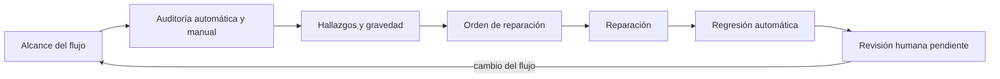
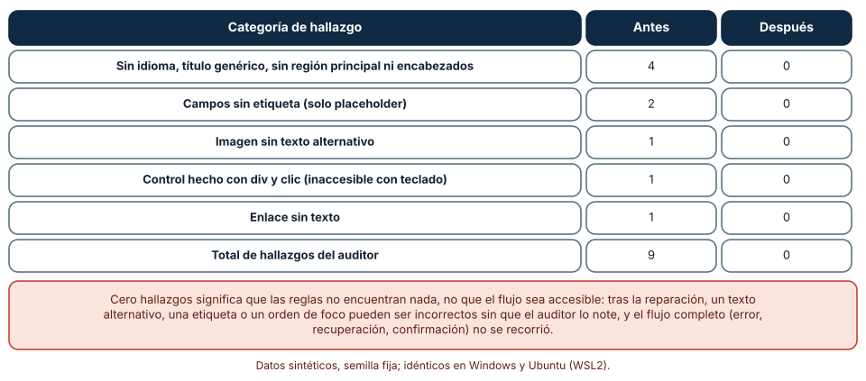
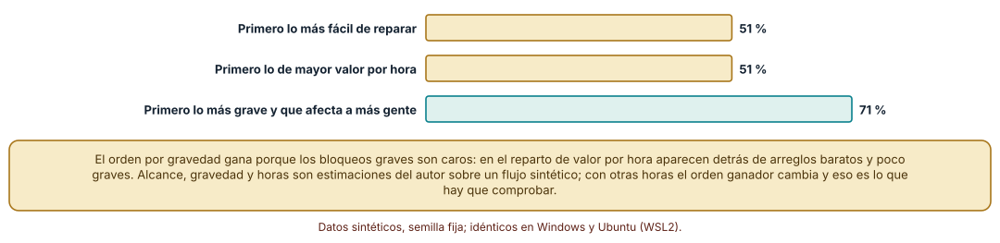
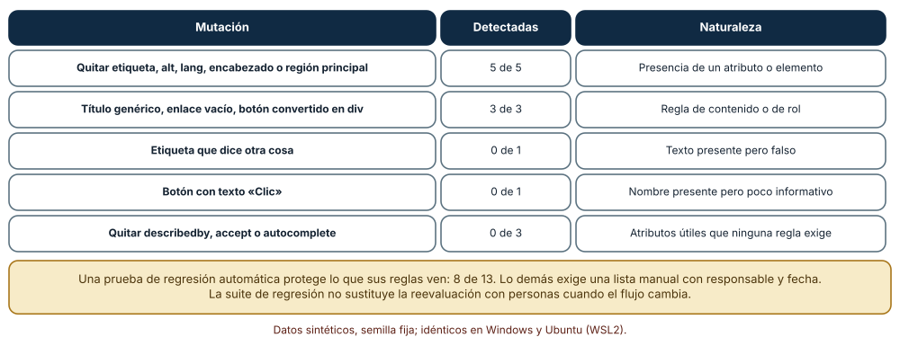

# SE-179 — Taller: auditar y reparar un flujo excluyente

[← SE-178 — Investigación de usabilidad y medición](https://github.com/vladimiracunadev-create/modern-software-engineering-program/blob/main/classes/part-14-experiencia-accesibilidad-e-internacionalizacion/se-178-investigacion-de-usabilidad-y-medicion/README.md) · [↑ Parte 14](https://github.com/vladimiracunadev-create/modern-software-engineering-program/blob/main/classes/part-14-experiencia-accesibilidad-e-internacionalizacion/README.md) · [📚 Índice completo](https://github.com/vladimiracunadev-create/modern-software-engineering-program/blob/main/classes/README.md) · [🌐 Portal](https://vladimiracunadev-create.github.io/modern-software-engineering-program/classes/SE-179.html) · [SE-180 — Proyecto: prototipo accesible evaluado con usuarios →](https://github.com/vladimiracunadev-create/modern-software-engineering-program/blob/main/classes/part-14-experiencia-accesibilidad-e-internacionalizacion/se-180-proyecto-prototipo-accesible-evaluado-con-usuarios/README.md)

## Punto profesional y fundamento pedagógico

**Punto profesional.** El taller existe para que recorras de principio a fin una auditoría y una reparación: encontrar las barreras de un flujo, ordenarlas por quién bloquean y cuánto cuesta arreglarlas, repararlas y proteger la reparación con pruebas, declarando lo que las pruebas no ven.

**Por qué aparece aquí.** Se sitúa después de **Investigación de usabilidad y medición** y antes de **Proyecto: prototipo accesible evaluado con usuarios**: `SE-178` dejó el protocolo y la incertidumbre; este taller aplica los criterios de `SE-173` a `SE-177` a un flujo roto de la plataforma de entregas y deja el método de auditoría, priorización y regresión que `SE-180` integra.

**Error conceptual que debe corregir.** Creer que auditar es pasar un escáner y arreglar lo que sale: una auditoría recorre el flujo completo, prioriza por el número de personas que bloquea y la gravedad frente al esfuerzo, repara y protege lo reparado con pruebas, y declara que lo que ningún auditor automático ve queda para una revisión humana con responsable y fecha.

**Secuencia de aprendizaje.** Antes de leer la solución, predices cuántos hallazgos encontrará un auditor en un formulario roto y con qué orden de reparación se libera antes a la población bloqueada; después audita, repara, vuelve a auditar, compara órdenes de reparación y muta la solución para medir qué protege una regresión automática. La secuencia usa predicción, explicación propia, contraste y recuperación. [ICAP](https://icap.education.asu.edu/research) distingue participación de construcción de conocimiento; [How People Learn II](https://nap.nationalacademies.org/catalog/24783/how-people-learn-ii-learners-contexts-and-cultures) exige conectar conocimiento previo, contexto y transferencia; la [práctica de recuperación](https://pubmed.ncbi.nlm.nih.gov/16507066/) respalda producir de nuevo la explicación tras una demora; y [Education for Life and Work](https://nap.nationalacademies.org/resource/13398/dbasse_084153.pdf) exige devolución que explique la causa del error.

**Evidencia de aprendizaje.** `workshop-log.md` con el formulario roto y su versión reparada, la lista de hallazgos antes y después, la comparación de órdenes de reparación y la tabla de mutaciones detectadas. Debe contener lo que quedó sin comprobar y su responsable. Debe contener predicción previa, observación, explicación causal, contraejemplo y qué hallazgo haría retirar la conclusión.

**Límite de la conclusión.** El formulario es sintético, los hallazgos y sus estimaciones de personas afectadas, gravedad y horas son supuestos del autor, el auditor es un programa pequeño y no se recorrió el flujo con tecnologías de apoyo ni personas. «Cero hallazgos» no es accesibilidad.

### Trazabilidad fuente → afirmación

| Fuente primaria u oficial | Afirmación que respalda | Lo que no prueba |
|---|---|---|
| [W3C: WCAG-EM, metodología de evaluación de conformidad](https://www.w3.org/WAI/test-evaluate/conformance/wcag-em/) | Estructura una evaluación en alcance, exploración, muestra, auditoría y reporte. | No fija cuántas páginas auditar ni garantiza que se encuentre todo. |
| [W3C: Comprender 3.3.2 Etiquetas o instrucciones](https://www.w3.org/WAI/WCAG22/Understanding/labels-or-instructions.html) | Exige etiquetas o instrucciones cuando el contenido pide datos de entrada. | No evalúa si la etiqueta es clara para la población. |
| [W3C: Comprender 3.3.7 Entrada redundante](https://www.w3.org/WAI/WCAG22/Understanding/redundant-entry.html) | Evita que se pida la misma información dos veces en un mismo proceso. | No indica cómo guardar los datos entre pasos. |

## Antes de empezar

Recupera lo aprendido en `SE-178`: una cifra con pocas personas necesita su intervalo y una ausencia de efecto necesita potencia. La pregunta activa es: **¿qué barreras tiene este flujo, a quién bloquean, cuánto cuesta arreglarlas y qué protege que no vuelvan?**

## Prerrequisitos

- Haber completado `SE-173` a `SE-178` o poder explicar sus criterios, estructura, color, adaptación, idioma y evaluación.
- Python 3.11 o posterior y un terminal; el auditor usa solo `html.parser`.
- Trabajar con un formulario de entrega sintético; no se audita un sistema real ni se prueba con personas.

## Problema auténtico

El formulario de entrega de una versión antigua de la plataforma tiene campos con solo placeholder, un control hecho con un div, una imagen de ayuda sin texto, un enlace vacío, un título «Documento», ninguna región principal ni encabezados y ningún idioma declarado. Hay tiempo para arreglar la mitad antes del cierre de semestre. Una propuesta arregla lo más fácil; otra, lo más grave; otra rehace el formulario.

## Objetivos observables

Al terminar podrás:

1. ejecutar una auditoría mínima y listar los hallazgos con su criterio y su gravedad;
2. ordenar hallazgos por personas bloqueadas, gravedad y esfuerzo y comparar tres órdenes de reparación;
3. reparar el flujo y volver a auditar para comprobar que desaparecen los hallazgos;
4. mutar la solución para medir qué protege una prueba automática y qué no;
5. escribir un informe que separe lo comprobado automáticamente, lo revisado por una persona y lo no cubierto, con responsables.

## Mapa conceptual



El mapa se lee de izquierda a derecha: se acota el alcance, se audita, se priorizan hallazgos, se repara, se protege con regresión y se declara lo que queda para una revisión humana. El retorno indica que un cambio en el flujo reabre el alcance. No es un orden fijo.

## Temas y por qué importan

| Tema | Por qué cambia una decisión profesional | Evidencia mínima |
|---|---|---|
| Alcance y flujo completo | Define qué se audita y evita aprobar pantallas sueltas. | Predicción, traza causal y contraejemplo de **Alcance y flujo completo** en `workshop-log.md` |
| Hallazgos con criterio, gravedad y evidencia | Convierte una observación en algo que se pueda arreglar y comprobar. | Predicción, traza causal y contraejemplo de **Hallazgos con criterio, gravedad y evidencia** en `workshop-log.md` |
| Priorización por bloqueo y esfuerzo | Decide qué se arregla primero con un criterio explícito. | Predicción, traza causal y contraejemplo de **Priorización por bloqueo y esfuerzo** en `workshop-log.md` |
| Reparación y verificación | Cierra un hallazgo solo cuando se comprueba que dejó de ocurrir. | Predicción, traza causal y contraejemplo de **Reparación y verificación** en `workshop-log.md` |
| Regresión y límites de lo automático | Evita que lo reparado vuelva a romperse y reconoce lo que no se protege. | Predicción, traza causal y contraejemplo de **Regresión y límites de lo automático** en `workshop-log.md` |

## Conceptos y decisiones

### 1. Alcance y flujo completo

Un flujo (abrir, completar, enviar, ver el recibo, corregir un error) cumple si todos sus pasos cumplen. El alcance lista las pantallas, los estados (error, éxito, carga) y los dispositivos y tecnologías de apoyo. Una auditoría que deja fuera el estado de error pasa por alto el lugar donde más se rompen los formularios. El alcance también dice qué queda fuera y por qué.

### 2. Hallazgos con criterio, gravedad y evidencia

Un hallazgo registra el criterio incumplido, dónde ocurre, cómo se reproduce, a quién afecta, su gravedad (una escala fija y escrita) y la evidencia (captura, fragmento, descripción). Un hallazgo vago («mejorar accesibilidad») no se puede reparar ni comprobar. La gravedad no es solo técnica: un bloqueo total del proceso para quien usa teclado es más grave que un título genérico, aunque ambos sean fallos de criterio.

### 3. Priorización por bloqueo y esfuerzo

Tres órdenes razonables son: lo más fácil primero (rápido, poco impacto), valor por hora (personas × gravedad ÷ esfuerzo) y gravedad y alcance primero. No hay un ganador universal: depende de si el esfuerzo es escaso y de cuánta gente bloquea cada hallazgo. Lo importante es que el criterio sea explícito y comparado con una estimación de a cuántas personas se libera antes, y que los bloqueos totales nunca queden esperando a lo cosmético.

### 4. Reparación y verificación

Una reparación es correcta cuando el criterio se cumple y no aparece otro defecto: un campo sin etiqueta se repara con una etiqueta correcta, no con un `aria-label` que contradice lo visible. La verificación vuelve a ejecutar la comprobación que encontró el hallazgo, y con una persona la que no puede automatizarse. Una reparación sin verificación es una hipótesis.

### 5. Regresión y límites de lo automático

Una prueba automática de las reglas protege lo que sus reglas ven y deja sin proteger lo que depende del significado: una etiqueta que dice otra cosa, un botón con texto poco informativo, un atributo de apoyo que se quita. Esa parte se protege con una lista de revisión manual con responsable y fecha y con una reevaluación cuando el flujo cambie. Medirlo con mutaciones da una cifra honesta de la cobertura.

### Auditar un formulario roto y su reparación

El formulario roto tiene un campo con solo placeholder y un campo de archivo sin etiqueta, un aviso fuera de los campos, una imagen sin `alt`, un div con clic, un enlace sin texto, el título «Documento», ninguna región principal ni encabezados y ningún idioma. El auditor, de ocho reglas, informa 9 hallazgos: 4 de documento (sin idioma, título genérico, sin región principal, sin encabezados), 2 campos sin etiqueta, 1 imagen sin `alt`, 1 div clicable y 1 enlace vacío. La versión reparada (idioma, título descriptivo, región principal, encabezado, etiquetas con `for`, descripción asociada con `aria-describedby`, `alt`, botón nativo y texto de enlace) produce 0 hallazgos. Cero hallazgos significa solo que las ocho reglas no encuentran nada.

```python
roto = audit(BROKEN)      # Counter con 9 hallazgos
reparado = audit(FIXED)   # Counter vacío
assert sum(roto.values()) == 9 and not reparado
```



**Cómo leer la figura.** Cada fila es una categoría de hallazgo; las columnas comparan el formulario roto con el reparado. **Dónde deja de valer:** el auditor es un programa de ocho reglas y el flujo es un formulario de una página sin estados de error ni éxito; tras la reparación, un texto alternativo, una etiqueta o un orden de foco pueden seguir siendo incorrectos sin que se note.

### Tres órdenes de reparación con cuatro horas

Se escribieron 12 hallazgos con personas afectadas por cada 100, gravedad de 1 a 4 y horas de reparación (por ejemplo, campo sin etiqueta: 12, 4, 0,5 h; error solo en rojo: 8, 4, 2 h; tiempo de sesión de 5 minutos: 5, 4, 6 h). Con 4 horas disponibles, reparar primero lo más fácil libera al 51 % de la población con bloqueo total; el orden por valor por hora, al 51 %; y el orden por gravedad y alcance, al 71 %. Las horas pesan: los bloqueos totales son caros de arreglar y el orden barato los deja esperando.

```python
por_facil = sorted(HALLAZGOS, key=lambda h: h.horas)
por_valor = sorted(HALLAZGOS, key=lambda h: -(h.personas * h.gravedad) / h.horas)
por_gravedad = sorted(HALLAZGOS, key=lambda h: (-h.gravedad, -h.personas))
```



**Cómo leer la figura.** Cada barra es el porcentaje de la población con un bloqueo total que queda liberado tras cuatro horas con ese orden. **Dónde deja de valer:** los 12 hallazgos, sus alcances, gravedades y horas son estimaciones del autor sobre un flujo sintético; con otras horas el orden ganador cambia. La enseñanza es comparar los órdenes con tu estimación y no una regla.

### Mutar la solución: qué protege la regresión

Sobre el formulario reparado se aplicaron 13 mutaciones, una por vez. El auditor detecta 8: quitar la etiqueta, el `alt`, el idioma, el encabezado o la región principal (5 de 5), y dejar un título genérico, un enlace vacío o convertir el botón en un div clicable (3 de 3). No detecta 5: una etiqueta que dice «Archivo» sobre el campo del nombre, un botón cuyo texto es «Clic», y quitar `aria-describedby`, `accept` o `autocomplete`. La regresión automática protege 8 de 13; el resto exige una lista manual.

```python
for nombre, mutar in MUTACIONES:
    detectada = sum(audit(mutar(FIXED)).values()) > 0
    resultados.append((nombre, detectada))
print(sum(d for _, d in resultados), 'de', len(MUTACIONES))   # 8 de 13
```



**Cómo leer la figura.** Cada fila agrupa mutaciones del mismo tipo; la columna «Detectadas» dice cuántas señaló el auditor. **Dónde deja de valer:** las 13 mutaciones las eligió quien escribió el auditor y reflejan sus puntos ciegos conocidos; un conjunto escrito por otra persona encontraría otros. La cifra es una cota de lo protegido, no una garantía.

## Definiciones de trabajo

- **hallazgo:** observación de un incumplimiento con su criterio, lugar, reproducción, afectados, gravedad y evidencia.
- **alcance de la auditoría:** conjunto de pantallas, estados y entornos que se evalúan y lo que se excluye de forma explícita.
- **gravedad:** escala escrita que mide el impacto de un hallazgo sobre la capacidad de completar la tarea.
- **regresión:** reaparición de un defecto ya reparado.
- **mutación:** cambio pequeño de una solución que reintroduce un defecto para comprobar si las pruebas lo detectan.

Las definiciones son operativas para la plataforma de entregas. No convierten términos con historia más amplia en sinónimos y deben contrastarse con la documentación primaria enlazada al final.

## Ejemplo mínimo

El fragmento cuenta hallazgos de un formulario con dos reglas. Antes de ejecutarlo, predice cuántos hallazgos produce.

```python
from html.parser import HTMLParser

class A(HTMLParser):
    def __init__(self):
        super().__init__()
        self.n = 0
        self.labels = set()
        self.inputs = []
    def handle_starttag(self, tag, at):
        a = dict(at)
        if tag == 'label' and 'for' in a: self.labels.add(a['for'])
        if tag == 'input': self.inputs.append(a)
        if tag == 'img' and 'alt' not in a: self.n += 1

p = A()
p.feed('<label for=n>Nombre</label><input id=n><input id=f>')
print(p.n + sum(1 for i in p.inputs if i.get('id') not in p.labels))   # 2
```

El campo `f` no tiene etiqueta y la imagen no tiene `alt`. Añade las correcciones y confirma que el recuento baja a cero; registra versión y salida.

## Ejemplo profesional

En la plataforma, la auditoría de un flujo parte de un alcance firmado (pasos, estados y entornos), usa el auditor en cada cambio y una lista manual por criterio con responsable y fecha. Los hallazgos viven en un registro con criterio, gravedad, afectados estimados y esfuerzo; el orden de reparación se discute con la tabla de valor por hora y la lista de bloqueos totales. Cada reparación incluye la prueba que fallaba antes y pasa después, y una revisión con una persona que usa tecnologías de apoyo cierra los hallazgos graves.

Compara el caso normal con una entrega con error de validación, una con sesión caducada y una con archivo demasiado grande. Un flujo está listo cuando esos tres casos pasan la auditoría y la revisión; es peligroso cuando solo se auditó el camino feliz.

## Práctica guiada

1. Acota el alcance: pasos, estados y entornos que se auditan y lo que queda fuera.
2. Predice cuántos hallazgos encontrará el auditor en el formulario roto y ejecútalo.
3. Escribe cada hallazgo con criterio, gravedad, afectados y esfuerzo.
4. Compara tres órdenes de reparación con cuatro horas y elige uno con su razón.
5. Repara el formulario y vuelve a auditar hasta llegar a cero hallazgos.
6. Aplica las 13 mutaciones y marca cuáles detecta el auditor; añade una a mano para cada punto ciego.
7. Pide a otra persona que reconstruya el informe solo desde `workshop-log.md`.

## Ejercicios

1. **Estado de error:** añade al formulario un mensaje de error de validación y audítalo: ¿qué reglas nuevas necesitas y qué parte exige una persona?
2. **Orden:** cambia las horas del hallazgo «tiempo de sesión» de 6 a 1 y explica cómo cambia el orden de valor por hora.
3. **Mutaciones:** escribe tres mutaciones nuevas que el auditor no detecta y propone la regla o la revisión manual que las cubriría.
4. **Informe:** redacta la declaración de alcance y las tres cosas no comprobadas con responsable y fecha.

## Reto verificable

Entrega `workshop-log.md` con el alcance, los hallazgos, la comparación de órdenes de reparación, la reparación con su auditoría, la tabla de mutaciones y la lista de lo no comprobado. Se aprueba si otra persona reproduce los números, repara un hallazgo nuevo con el procedimiento y puede nombrar una barrera que el auditor no ve. No se aprueba por llegar a cero hallazgos ni por la cantidad de reparaciones.

## Caso conductor

La plataforma de entregas es el caso conductor de la Parte 14. Este taller deja el registro de hallazgos del formulario de entrega, el orden de reparación elegido, la versión reparada y la regresión. `SE-180` los integra en un prototipo evaluado con personas, con un informe de conformidad que distingue lo comprobado de lo supuesto. Cambia después un solo criterio, el de entrada redundante, y revisa qué hallazgos y pruebas cambian.

## Preguntas frecuentes

### ¿Cuántos hallazgos debo esperar?

Los que existan: un conteo bajo no prueba accesibilidad y uno alto no prueba mala calidad. Lo importante es la gravedad y el alcance de cada uno, y que el alcance de la auditoría haya incluido los estados donde más se rompe.

### ¿Debo arreglar todo antes de lanzar?

Depende de la gravedad y del compromiso: los bloqueos totales de un proceso esencial no se lanzan, y los menores se programan con fecha. Lo que no se arregla se registra con su riesgo y su responsable.

### ¿Por qué mutar la solución?

Porque una regresión automática solo protege lo que ve, y la mutación mide cuánto: 8 de 13 en este formulario. Con esa cifra se decide qué parte queda en una lista manual.

### ¿Quién revisa lo que no es automático?

Una persona con el criterio delante y, para los hallazgos graves, una persona usuaria de tecnologías de apoyo. La asignación de responsable y fecha es parte del informe y no un deseo.

## Fallo controlado y diagnóstico

Reproduce el fallo clásico del taller: **llegar a cero hallazgos y declarar el flujo accesible**. Usa la versión reparada con una etiqueta que dice otra cosa.

Registra síntoma, entrada mínima, hipótesis, observación que descarta cada hipótesis, causa, corrección y prueba de regresión. **Síntoma:** el auditor da 0 hallazgos y una persona con lector de pantalla anuncia «Archivo» al llegar al campo del nombre. **Hipótesis rivales:** (a) el lector falla; (b) las reglas ven que hay etiqueta pero no si es la correcta. **Prueba:** la mutación «etiqueta equivocada» no se detecta; 5 de 13 mutaciones pasan sin reporte. **Conclusión:** la causa es la frontera de las reglas, no el lector. **Regresión:** añade a la lista manual la comprobación de que cada etiqueta describe su campo, con responsable y fecha, y una sesión con una persona usuaria de lector de pantalla. No cambies a la vez la regla y el texto.

## Errores comunes y cómo corregirlos

| Síntoma | Causa probable | Corrección |
|---|---|---|
| Se declara el flujo accesible con cero hallazgos | Se confundió «las reglas no encuentran nada» con accesibilidad | Declarar alcance, revisión humana y lo no comprobado |
| Se arreglan los hallazgos baratos y los bloqueos esperan | Orden por facilidad | Comparar órdenes con personas bloqueadas y esfuerzo |
| Un cambio rompe lo reparado | No hay regresión | Auditor en cada cambio y lista manual periódica |
| Se audita solo el camino feliz | Alcance sin estados de error | Incluir error, carga, éxito y recuperación en el alcance |
| Un `aria-label` contradice el texto visible | Se reparó con un atributo en vez de una etiqueta | Etiqueta visible asociada y `aria-label` solo si no hay otra opción |

## Entorno y archivos clave

```text
work/SE-179/
├── README.md
├── taller/
│   ├── roto.html
│   ├── reparado.html
│   ├── auditor.py
│   └── mutaciones.py
├── tests/test_taller.py
└── evidence/workshop-log.md
```

El `README` declara plataforma, versión de Python, semillas y comandos. El auditor usa solo `html.parser` y los cálculos se ejecutaron con CPython 3.12.9 en Windows 11 y 3.12.3 en Ubuntu bajo WSL2: las salidas fueron idénticas. No se usó ningún escáner de producción, lector de pantalla ni persona usuaria de tecnologías de apoyo.

## Seguridad, ética y accesibilidad

- no audites sistemas ajenos sin autorización y no incluyas datos reales en el formulario de prueba;
- los hallazgos pueden revelar fallos de seguridad (campos sin validar, errores que filtran datos): trátalos con el canal de seguridad correspondiente;
- las sesiones con personas usuarias de tecnologías de apoyo exigen consentimiento, compensación justa y trato respetuoso;
- ofrece una alternativa textual a cada tabla y figura y no uses el color como única señal;
- atribuye las fuentes y respeta las licencias de las herramientas de auditoría.

## Puente hacia el trabajo con agentes

Un agente al que se le pide «audita y arregla la accesibilidad de este formulario» ejecutará un escáner, añadirá atributos hasta que no haya avisos y declarará terminado. Pídele que acote el alcance, que registre cada hallazgo con criterio y gravedad, que compare órdenes de reparación, que muestre qué mutaciones no detecta su prueba y que deje la lista manual con responsable. Revisa especialmente si inventó textos alternativos o etiquetas para silenciar una regla: es el mismo atributo presente pero incorrecto, ahora con apariencia de reparación.

## Transferencia

Traslada el taller a otro flujo (el registro en una aplicación o el pago de un servicio): acota el alcance, audita, ordena, repara, muta y declara lo no comprobado. La transferencia está lograda cuando puedes explicar qué parte del procedimiento dependía de la plataforma de entregas y cuál no.

## Evaluación y evidencia

| Criterio | Evidencia para aprobar |
|---|---|
| comprensión | explicación de por qué cero hallazgos no es accesibilidad y de cómo se prioriza |
| corrección | hallazgos, órdenes de reparación y mutaciones reproducibles con el mismo código |
| diseño | alcance, registro de hallazgos y regresión con lista manual |
| diagnóstico | reproducción del fallo «cero hallazgos» con su regresión |
| incertidumbre | lista de lo no comprobado con responsable y fecha |
| reproducibilidad | versiones, comandos, salida y límites declarados |

## Fuentes

- [W3C: WCAG-EM, metodología de evaluación de conformidad](https://www.w3.org/WAI/test-evaluate/conformance/wcag-em/) — alcance, muestra, auditoría y reporte; autoridad: W3C.
- [W3C: Comprender 3.3.2 Etiquetas o instrucciones](https://www.w3.org/WAI/WCAG22/Understanding/labels-or-instructions.html) — etiquetas en la entrada de datos; autoridad: W3C.
- [W3C: Comprender 3.3.7 Entrada redundante](https://www.w3.org/WAI/WCAG22/Understanding/redundant-entry.html) — no pedir dos veces lo mismo; autoridad: W3C.
- [W3C: Comprender 3.3.8 Autenticación accesible (mínimo)](https://www.w3.org/WAI/WCAG22/Understanding/accessible-authentication-minimum.html) — autenticación sin pruebas cognitivas; autoridad: W3C.
- [W3C: Comprender 3.1.1 Idioma de la página](https://www.w3.org/WAI/WCAG22/Understanding/language-of-page.html) — idioma declarado; autoridad: W3C.
- [W3C: Comprender 2.4.7 Foco visible](https://www.w3.org/WAI/WCAG22/Understanding/focus-visible.html) — indicador de foco visible; autoridad: W3C.
- [Nielsen Norman Group: guía de mensajes de error](https://www.nngroup.com/articles/error-message-guidelines/) — redacción de mensajes que ayudan a recuperarse; autoridad: Nielsen Norman Group.

Cada fuente respalda el mecanismo indicado; ninguna demuestra que un flujo concreto de la plataforma sea accesible tras una reparación. Esa afirmación depende de la revisión humana y de personas usuarias de tecnologías de apoyo.

- [Python: `html.parser`](https://docs.python.org/3/library/html.parser.html) — analizador usado por el auditor.
- [Python: `collections.Counter`](https://docs.python.org/3/library/collections.html#collections.Counter) — recuento de hallazgos por categoría.

## Límites y siguiente paso

Se ejecutaron tres experimentos con datos sintéticos en Windows y Ubuntu (WSL2) con resultados idénticos. No se usó ningún escáner de producción, lector de pantalla ni persona usuaria de tecnologías de apoyo, y los hallazgos, sus estimaciones, el auditor de ocho reglas y las 13 mutaciones son construcciones del autor. La siguiente clase integra todo en un prototipo evaluado con personas.

## Glosario

- **hallazgo:** observación de un incumplimiento con su criterio, lugar, reproducción, afectados, gravedad y evidencia.
- **alcance de la auditoría:** conjunto de pantallas, estados y entornos que se evalúan y lo que se excluye de forma explícita.
- **gravedad:** escala escrita que mide el impacto de un hallazgo sobre la capacidad de completar la tarea.
- **regresión:** reaparición de un defecto ya reparado.
- **mutación:** cambio pequeño de una solución que reintroduce un defecto para comprobar si las pruebas lo detectan.

---

[← SE-178 — Investigación de usabilidad y medición](https://github.com/vladimiracunadev-create/modern-software-engineering-program/blob/main/classes/part-14-experiencia-accesibilidad-e-internacionalizacion/se-178-investigacion-de-usabilidad-y-medicion/README.md) · [↑ Parte 14](https://github.com/vladimiracunadev-create/modern-software-engineering-program/blob/main/classes/part-14-experiencia-accesibilidad-e-internacionalizacion/README.md) · [📚 Índice completo](https://github.com/vladimiracunadev-create/modern-software-engineering-program/blob/main/classes/README.md) · [🌐 Portal](https://vladimiracunadev-create.github.io/modern-software-engineering-program/classes/SE-179.html) · [SE-180 — Proyecto: prototipo accesible evaluado con usuarios →](https://github.com/vladimiracunadev-create/modern-software-engineering-program/blob/main/classes/part-14-experiencia-accesibilidad-e-internacionalizacion/se-180-proyecto-prototipo-accesible-evaluado-con-usuarios/README.md)
