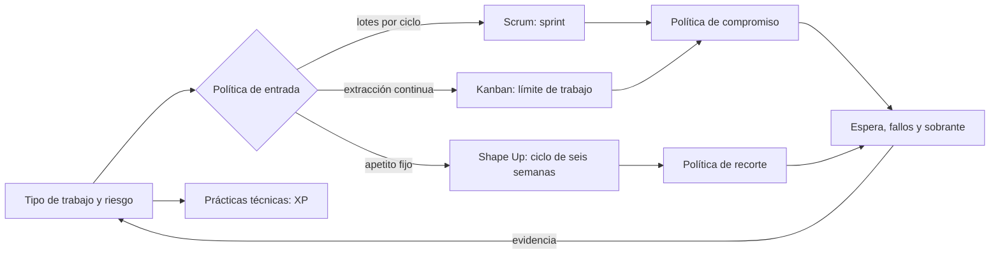
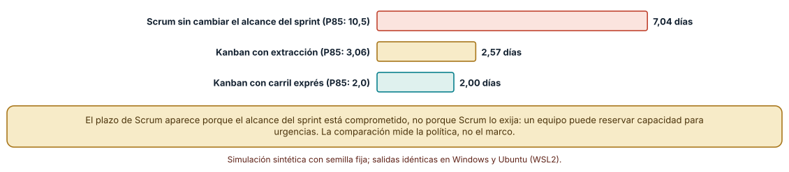
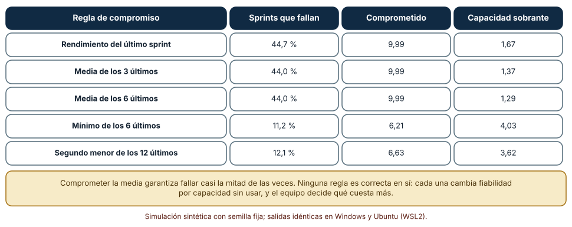
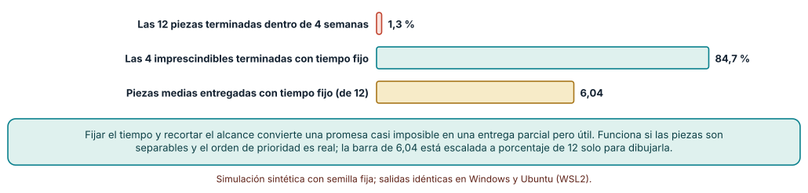

# SE-183 — Scrum, Kanban, XP y Shape Up

[← SE-182 — Agile como principios y no como ceremonia](https://github.com/vladimiracunadev-create/modern-software-engineering-program/blob/main/classes/part-15-procesos-planificacion-y-estimacion/se-182-agile-como-principios-y-no-como-ceremonia/README.md) · [↑ Parte 15](https://github.com/vladimiracunadev-create/modern-software-engineering-program/blob/main/classes/part-15-procesos-planificacion-y-estimacion/README.md) · [📚 Índice completo](https://github.com/vladimiracunadev-create/modern-software-engineering-program/blob/main/classes/README.md) · [🌐 Portal](https://vladimiracunadev-create.github.io/modern-software-engineering-program/classes/SE-183.html) · [SE-184 — Lean, teoría de colas y límites de trabajo →](https://github.com/vladimiracunadev-create/modern-software-engineering-program/blob/main/classes/part-15-procesos-planificacion-y-estimacion/se-184-lean-teoria-de-colas-y-limites-de-trabajo/README.md)

## Punto profesional y fundamento pedagógico

**Punto profesional.** La clase existe para que elijas o combines marcos por la política que cada uno impone (cuándo entra trabajo, cuánto se compromete, qué se recorta) y por el problema que resuelve, en lugar de adoptar uno entero por reputación.

**Por qué aparece aquí.** Se sitúa después de **Agile como principios y no como ceremonia** y antes de **Lean, teoría de colas y límites de trabajo**: la clase anterior dio el criterio (¿qué decisión cambia esta práctica?); esta lo aplica a cuatro marcos y descubre que cada uno es, ante todo, un conjunto de políticas de flujo. La clase siguiente explica con colas por qué esas políticas tienen los efectos que se miden aquí.

**Error conceptual que debe corregir.** Creer que los marcos son paquetes que se aceptan o rechazan completos, o que Scrum «obliga» a esperar al siguiente sprint para una urgencia: la espera viene de una política de compromiso, que se puede cambiar, y no del nombre del marco.

**Secuencia de aprendizaje.** Antes de leer los resultados, predices cuánto espera un trabajo urgente con cada política; después simulas esa espera, comparas cinco reglas para comprometer elementos en un sprint y mides qué ocurre cuando se fija el tiempo y se deja variar el alcance. La secuencia usa predicción, explicación propia, contraste y recuperación. [ICAP](https://icap.education.asu.edu/research) distingue participación de construcción de conocimiento; [How People Learn II](https://nap.nationalacademies.org/catalog/24783/how-people-learn-ii-learners-contexts-and-cultures) exige conectar conocimiento previo, contexto y transferencia; la [práctica de recuperación](https://pubmed.ncbi.nlm.nih.gov/16507066/) respalda producir de nuevo la explicación tras una demora; y [Education for Life and Work](https://nap.nationalacademies.org/resource/13398/dbasse_084153.pdf) exige devolución que explique la causa del error.

**Evidencia de aprendizaje.** `frameworks-log.md` con una tabla de cuatro marcos (política de entrada, política de compromiso, política de recorte, riesgo que atiende), la espera de un urgente por política, la tasa de fallo de cada regla de compromiso y el efecto de fijar el tiempo.

**Límite de la conclusión.** Las simulaciones comparan políticas, no equipos: el rendimiento normal de media 10 y desviación 3, los ítems de 2,6 días de mediana y las piezas de 0,45 semanas son parámetros del autor. No se midió ningún equipo que use estos marcos.

### Trazabilidad fuente → afirmación

| Fuente primaria u oficial | Afirmación que respalda | Lo que no prueba |
|---|---|---|
| [The Scrum Guide](https://scrumguides.org/scrum-guide.html) | Define el sprint, el compromiso con un objetivo, los roles y los eventos; el alcance puede renegociarse durante el sprint con quien patrocina. | No establece que el sprint sea el mejor ritmo ni cuántos elementos comprometer. |
| [The Kanban Guide](https://kanbanguides.org/english/) | Define las prácticas de visualizar el flujo, limitar el trabajo en curso y gestionar el flujo con políticas explícitas. | No prescribe los límites ni demuestra que reduzcan el plazo en un equipo concreto. |
| [Singer, «Shape Up»](https://basecamp.com/shapeup) | Describe ciclos de seis semanas con apetito fijo, alcance variable y el trabajo moldeado antes de comprometerse. | Es la descripción de una empresa; no mide su efecto en otras. |

## Antes de empezar

Recupera el criterio de `SE-182`: una práctica vale por la decisión que cambia. Aquí cada marco se traduce en tres políticas concretas: cuándo puede entrar trabajo nuevo, cuánto se compromete por adelantado y qué se hace cuando el tiempo no alcanza. La pregunta activa es: **¿qué política de mi proceso explica la espera, el fallo o el recorte que observo, y de qué marco la heredé?**

## Prerrequisitos

- Haber completado `SE-182` o poder explicar la diferencia entre principio y práctica.
- Python 3.11 o posterior y un terminal; todo el código usa solo la biblioteca estándar.
- Haber leído o usado al menos una guía de los marcos que se comparan.

## Problema auténtico

Llega un reporte urgente: la penalización de la plataforma de entregas está dando notas distintas en dos pantallas. El equipo trabaja en sprints de dos semanas; el alcance del sprint está comprometido y la persona que lleva el producto se pregunta si debe esperar al próximo sprint o interrumpir. Otro equipo de la misma organización usa un tablero de flujo y lo toma en cuanto alguien se libera. Un tercero planifica proyectos de seis semanas con un apetito fijo. Cada uno cree que su marco es la causa de cómo trata esta urgencia, y ninguno lo ha medido.

## Objetivos observables

Al terminar podrás:

1. describir Scrum, Kanban, XP y Shape Up por sus políticas de entrada, compromiso y recorte, y no por sus eventos;
2. medir con una simulación la espera de un trabajo urgente bajo una política de sprint cerrado, una de extracción y una con carril exprés;
3. comparar reglas para comprometer elementos en un sprint por su tasa de fallo y su capacidad sobrante;
4. calcular qué pasa cuando se fija el tiempo y se deja variar el alcance, y qué condiciones lo hacen viable;
5. justificar una combinación de políticas para un equipo concreto y declarar qué observación la cambiaría.

## Mapa conceptual



El mapa se lee desde el tipo de trabajo hacia las políticas: cada marco es una combinación de políticas de entrada, compromiso y recorte, y XP añade prácticas técnicas que valen bajo cualquiera de ellos. El retorno recuerda que las políticas se revisan con lo que se mide.

## Temas y por qué importan

| Tema | Por qué cambia una decisión profesional | Evidencia mínima |
|---|---|---|
| Scrum | Compromete un objetivo por ciclo; da ritmo y previsibilidad a cambio de esperas para lo nuevo. | Predicción, traza causal y contraejemplo de **Scrum** en `frameworks-log.md` |
| Kanban | Extrae trabajo cuando hay capacidad y limita lo que está en curso; reduce la espera de lo nuevo. | Predicción, traza causal y contraejemplo de **Kanban** en `frameworks-log.md` |
| XP | Fija prácticas técnicas (pruebas primero, integración continua, refactorización) que sostienen cualquier ciclo corto. | Predicción, traza causal y contraejemplo de **XP** en `frameworks-log.md` |
| Shape Up | Fija el tiempo y deja variable el alcance; exige moldear el trabajo antes de empezar. | Predicción, traza causal y contraejemplo de **Shape Up** en `frameworks-log.md` |
| Combinar marcos | Las políticas se eligen una a una según el riesgo; los marcos reales son híbridos. | Predicción, traza causal y contraejemplo de **Combinar marcos** en `frameworks-log.md` |

## Conceptos y decisiones

### 1. Scrum

Scrum organiza el trabajo en sprints de longitud fija con un objetivo, una lista de elementos seleccionada y tres roles (responsable del producto, equipo de desarrollo, facilitación). Su política de entrada es en lotes: lo nuevo espera a la planificación del siguiente sprint, salvo renegociación con quien lleva el producto. Su política de compromiso es una previsión del equipo, no una promesa. La guía permite cambiar alcance durante el sprint si el objetivo se mantiene; muchos equipos lo convierten en una regla rígida que la guía no escribe. Lo que aporta es ritmo, un lugar para inspeccionar y adaptar, y un horizonte corto para la previsión.

### 2. Kanban

Kanban visualiza el flujo, limita el trabajo en curso y hace explícitas las políticas. No fija ciclos ni roles: el trabajo entra cuando hay capacidad, y el límite impide empezar más de lo que se termina. Su política de entrada es de extracción, de modo que lo urgente espera, como mucho, hasta que alguien termine algo. Su riesgo es la falta de un ritmo de inspección: sin otra práctica que lo supla, el sistema mejora solo si alguien mira las métricas. La clase `SE-184` explica por qué limitar el trabajo en curso reduce el plazo.

### 3. XP

Extreme Programming reúne prácticas técnicas: pruebas escritas antes del código, integración continua, refactorización constante, programación en parejas, propiedad colectiva del código y entregas pequeñas. No es un marco de gestión sino la base técnica que hace barato cambiar. Un equipo de Scrum sin ellas cae en lo que `SE-182` llamó la gestión sin disciplina; un equipo de Kanban con ellas puede liberar varias veces al día. Las prácticas se justifican por su efecto sobre el coste de cambiar, no por pureza.

### 4. Shape Up

Shape Up fija un apetito (por ejemplo, seis semanas de un equipo pequeño) y deja variar el alcance. Antes de comprometer, un grupo reducido modela el trabajo: define el problema, el contorno de la solución y los límites, sin cerrar los detalles. Dentro del ciclo, el equipo decide cómo hacerlo y qué recortar para llegar a tiempo. La política de recorte es explícita: si no alcanza, se reduce el alcance y no se extiende el plazo. Exige que las piezas sean separables y que haya un orden de valor real.

### 5. Combinar marcos

Los equipos reales mezclan: sprints de Scrum con un tablero Kanban y prácticas de XP; ciclos de Shape Up con un carril para urgencias. La combinación correcta se decide pregunta a pregunta: ¿cómo entra lo urgente?, ¿cuánto comprometemos?, ¿qué recortamos si no llegamos?, ¿qué prácticas técnicas bajan el coste de cambiar? Un nombre de marco no responde ninguna. Lo que sí puede hacerse es registrar la respuesta como política explícita y medir su efecto, como en los tres experimentos siguientes.

### La espera de un trabajo urgente según la política de entrada

Un trabajo urgente que requiere 2 días llega en un momento uniforme dentro de un sprint de 10 días. Hay tres personas; los elementos en curso tienen una mediana de 2,6 días (lognormal, σ = 0,6) y cada uno lleva una fracción aleatoria consumida. En Scrum con alcance cerrado, el urgente espera al siguiente sprint. En Kanban con extracción, lo toma quien se libere primero. Con carril exprés, una ranura reservada lo atiende de inmediato. Se simulan 5000 llegadas.

```python
res = min(rng.lognormvariate(math.log(2.6), 0.6) * (1 - rng.random()) for _ in range(3))
kanban = res + 2          # espera hasta que alguien se libere, más 2 días de trabajo
scrum  = (10 - t) + 2     # espera al siguiente sprint, más 2 días de trabajo
```

Resultado, idéntico en Windows (CPython 3.12.9) y en Ubuntu bajo WSL2 (3.12.3): el plazo medio es **7,04 días** en Scrum con alcance cerrado (P85: 10,49), **2,57** con extracción (P85: 3,06) y **2,00** con carril exprés. Es decir, la política de entrada multiplica por 2,7 el plazo del urgente.



**Cómo leer la figura.** Cada barra es el plazo medio, desde que llega hasta que termina; entre paréntesis, el percentil 85. **Dónde deja de valer:** la espera de Scrum aparece porque el alcance del sprint está comprometido, no porque el marco lo exija; un equipo puede reservar capacidad para urgencias o renegociar con quien lleva el producto, y entonces se parece al carril exprés. La comparación mide políticas, no marcos. Además, la extracción supone que alguien se libera pronto: con todo el equipo ocupado en trabajos largos, la espera sería mayor.

### Comprometer elementos en un sprint: cinco reglas

El rendimiento por sprint (elementos terminados) es normal con media 10 y desviación 3, truncado a enteros no negativos. Se evalúan 20 000 sprints con cinco reglas basadas en el historial: el último sprint, la media de los 3 o de los 6 últimos, el mínimo de los 6 últimos y el segundo menor de los 12 últimos.

```python
rules = {"ultimo sprint": lambda h: h[-1],
         "media de 6": lambda h: round(st.mean(h[-6:])),
         "minimo de 6": lambda h: min(h[-6:])}
regla = rules["media de 6"]
miss = sum(th[i] < regla(th[i - 12:i]) for i in range(12, len(th)))
```

| Regla | Sprints que fallan | Comprometido | Sobrante |
|---|---:|---:|---:|
| Último sprint | 44,7 % | 9,99 | 1,67 |
| Media de 3 | 44,0 % | 9,99 | 1,37 |
| Media de 6 | 44,0 % | 9,99 | 1,29 |
| Mínimo de 6 | 11,2 % | 6,21 | 4,03 |
| Segundo menor de 12 | 12,1 % | 6,63 | 3,62 |

Comprometer la media falla en casi la mitad de los sprints, algo que se sigue de la estadística: el rendimiento queda por debajo de su media la mitad de las veces. Comprometer el mínimo reduce el fallo al 11,2 % a cambio de comprometer 38 % menos y dejar 4 elementos de capacidad sin usar.



**Cómo leer la figura.** Cada fila es una regla; las columnas muestran cuánto falla, cuánto promete y cuánto desperdicia. **Dónde deja de valer:** el rendimiento normal con desviación fija es un supuesto del autor; uno real tiene tendencias, cambios de capacidad y rachas. Y la capacidad sobrante no es desperdicio si se llena con trabajo opcional o con mejora. La tabla no dice qué regla usar: dice que cada una compra fiabilidad con capacidad, y que «comprometer la media» es una elección con una consecuencia conocida.

### Tiempo fijo y alcance variable

Una iniciativa tiene 12 piezas; las cuatro primeras son imprescindibles y el resto, mejoras ordenadas por valor. El esfuerzo de cada pieza es lognormal con mediana de 0,45 semanas y σ = 0,9, y se dispone de 4 semanas. La suma esperada de esfuerzos es 8,1 semanas. Se comparan dos políticas con 5000 simulaciones: comprometer las 12 piezas (alcance fijo) o trabajarlas por prioridad hasta que se acabe el tiempo (alcance variable).

```python
t = done = must = 0
for i, e in enumerate(effort):
    if t + e > 4: break
    t += e; done += 1
    must += i < 4
```

Terminar las 12 piezas dentro de las cuatro semanas ocurre en el **1,3 %** de las simulaciones. Con tiempo fijo y trabajo en orden de prioridad, las cuatro imprescindibles se terminan en el **84,7 %** de las veces y se entregan **6,04** piezas de media. El 15,3 % restante son casos en que ni las imprescindibles caben: el recorte de alcance no sustituye a modelar bien el trabajo.



**Cómo leer la figura.** Las dos primeras barras son porcentajes de 5000 simulaciones; la tercera, las piezas medias entregadas sobre 12, escalada solo para dibujarla. **Dónde deja de valer:** requiere piezas separables y un orden de valor real, y que la persona que recorta pueda hacerlo sin negociar con cada interesado. Si las piezas son interdependientes, recortar una puede invalidar otra. Y la distribución lognormal con σ = 0,9 es un supuesto: con dispersión baja, comprometer todo sería viable.

## Definiciones de trabajo

- **política de entrada:** regla que determina cuándo puede empezar trabajo nuevo (al inicio de un ciclo, al liberarse capacidad, al inicio de un ciclo con apetito fijo).
- **compromiso:** previsión de qué se terminará en un ciclo, con la regla usada para calcularla.
- **límite de trabajo en curso:** número máximo de elementos que pueden estar en marcha a la vez en una etapa o en todo el flujo.
- **apetito:** tiempo máximo que se está dispuesto a dedicar a un problema, fijado antes de decidir el alcance.
- **carril exprés:** capacidad reservada para trabajo urgente, con sus propias reglas de admisión.

Las definiciones son operativas para la plataforma de entregas. No convierten términos con una historia más amplia en sinónimos y deben contrastarse con la documentación primaria enlazada al final.

## Ejemplo mínimo

El fragmento calcula la tasa de fallo teórica de comprometer la media cuando el rendimiento es simétrico. Antes de ejecutarlo, predice si la fracción debería estar cerca de 0,5.

```python
import random
rng = random.Random(1)
th = [max(0, round(rng.gauss(10, 3))) for _ in range(10000)]
fallos = sum(1 for x in th if x < 10) / len(th)
assert 0.40 < fallos < 0.50
```

La fracción queda en 0,43 con esta semilla (no 0,5, porque los valores iguales a 10 no fallan). Registra versión, comando y salida; cambia 10 por 8 y predice la nueva tasa antes de ejecutar.

## Ejemplo profesional

El equipo de la plataforma de entregas trabaja con sprints de dos semanas, pero define tres políticas explícitas. La primera reserva el 20 % de la capacidad para urgencias, con una ranura exprés y una definición de «urgente» escrita (afecta a notas o a plazos de entrega de estudiantes). La segunda compromete elementos con el mínimo de los últimos seis sprints y trata el resto como objetivo opcional ordenado por valor. La tercera aplica un tiempo fijo a las iniciativas grandes: seis semanas, con las cuatro piezas imprescindibles nombradas desde el principio. Las prácticas técnicas de XP (pruebas primero, integración continua) se mantienen como condición de cualquier ciclo.

Compara el caso de un reporte urgente con el de una mejora grande de la exportación: el primero se atiende en menos de tres días por el carril exprés; la segunda se recorta en la cuarta semana porque una pieza resultó más grande de lo previsto. Una combinación es adecuada cuando cada política responde a una pregunta escrita; es débil cuando se defiende con «así lo hace el marco».

## Práctica guiada

1. Escribe para tu equipo las tres políticas (entrada, compromiso, recorte) tal como funcionan hoy, no como dice la guía.
2. Predice cuánto espera un urgente en tu política actual y escribe el número antes de simular.
3. Simula la espera del urgente con tus duraciones y compárala con extracción y carril exprés.
4. Evalúa las cinco reglas de compromiso con el rendimiento de tus últimos sprints (o sintético).
5. Simula tiempo fijo con tus piezas e identifica cuáles son imprescindibles.
6. Decide una combinación de políticas y escribe qué observación te haría cambiarla.
7. Entrega `frameworks-log.md` y pide a otra persona que identifique la política que más afecta al plazo de lo urgente.

## Ejercicios

1. **Urgente:** modifica el experimento para que el sprint sea de cinco días y calcula cuánto baja la espera; explica por qué no se elimina.
2. **Compromiso:** diseña una regla que combine la media y la desviación y compárala con el mínimo de seis por fallo y sobrante.
3. **Recorte:** calcula la probabilidad de terminar las imprescindibles con tiempo fijo si el apetito pasa de 4 a 6 semanas.
4. **Híbrido:** escribe las tres políticas de un equipo de soporte (incidentes, mejoras, mantenimiento) y justifica cada una con su riesgo.

## Reto verificable

Entrega `frameworks-log.md` con la tabla de políticas, la predicción, las tres simulaciones y la combinación elegida con su observación de cambio. Se aprueba si otra persona ejecuta el código desde un checkout limpio, obtiene los mismos números y puede señalar cuál política cambiaría si el rendimiento tuviera más dispersión. No se aprueba por describir los marcos con exactitud ni por la longitud del registro.

## Caso conductor

La plataforma de entregas de tareas continúa como caso conductor de la Parte 15. Esta clase deja el tercer artefacto: las tres políticas del equipo (entrada, compromiso, recorte) con su regla y su efecto medido. `SE-184` explicará con teoría de colas por qué la extracción y el límite de trabajo acortan la espera. Cambia después una sola política, por ejemplo el porcentaje de capacidad reservado para urgencias, y revisa qué otras mediciones cambian.

## Preguntas frecuentes

### ¿Scrum prohíbe cambiar el alcance durante el sprint?

No: la guía permite renegociar el alcance con quien lleva el producto mientras se mantenga el objetivo. La rigidez que se observa en la práctica suele ser una política local, que puede revisarse con evidencia como la de esta clase.

### ¿Kanban no tiene plazos?

Los tiene, pero se expresan como previsión de flujo (percentiles del plazo de los elementos) y no como compromiso de ciclo. `SE-189` desarrolla esas métricas.

### ¿XP es solo programar en parejas?

No. La programación en parejas es una de varias prácticas; las demás (pruebas primero, integración continua, refactorización, entregas pequeñas) tienen mayor efecto medible sobre el coste de cambiar. Una pareja puede ser una práctica excelente para transmitir conocimiento y una pérdida en tareas rutinarias.

### ¿Se puede usar Shape Up con un equipo que atiende incidentes?

Para el trabajo de proyecto sí; para incidentes, no: requiere una política de entrada separada (un carril exprés o un equipo de rotación) porque el apetito fijo no admite interrupciones sin límite.

## Fallo controlado y diagnóstico

Reproduce el fallo clásico de la clase: **comprometer la media del rendimiento y llamar «fallo del equipo» al 44 % de sprints incumplidos**. Simula 20 000 sprints con rendimiento normal y compromete la media de los seis últimos.

Registra síntoma, entrada mínima, hipótesis, observación que descarta cada hipótesis, causa, corrección y prueba de regresión. **Síntoma:** el equipo incumple casi uno de cada dos sprints sin ningún cambio de rendimiento. **Hipótesis rivales:** (a) el equipo trabaja menos; (b) las estimaciones son malas; (c) la regla de compromiso garantiza el fallo. **Prueba:** calcula la fracción de sprints en que el rendimiento queda por debajo de su media, sin ningún cambio de equipo. **Conclusión:** la causa es la regla de compromiso: con rendimiento simétrico y comprometiendo la media, falla cerca de la mitad de las veces. **Regresión:** cambia la regla a un valor prudente (mínimo de seis), mide la tasa de fallo y la capacidad sobrante, y decide con el equipo cuánto fallo toleran. No cambies a la vez la regla y el tamaño de los elementos.

## Errores comunes y cómo corregirlos

| Síntoma | Causa probable | Corrección |
|---|---|---|
| Los urgentes esperan hasta el siguiente sprint | Alcance cerrado sin carril exprés | Reservar capacidad con una definición escrita de urgencia |
| Casi la mitad de los sprints no se cumple y se culpa al equipo | Compromiso con la media del rendimiento | Comprometer con un valor prudente y llenar el resto con trabajo opcional |
| Se recorta alcance cada ciclo y nadie sabe qué era imprescindible | Imprescindibles no nombradas al inicio | Nombrarlas antes de empezar y comprobarlas en la mitad del ciclo |
| «Hacemos Kanban» y el tablero acumula tarjetas | Sin límite de trabajo en curso | Fijar un límite y respetarlo; revisar el flujo con métricas |
| Se adopta Scrum y la calidad cae | Sin prácticas técnicas | Incorporar pruebas primero, integración continua y refactorización |

## Entorno y archivos clave

```text
work/SE-183/
├── README.md
├── frameworks/
│   ├── urgente.py
│   ├── compromiso.py
│   └── tiempo_fijo.py
├── tests/test_frameworks.py
└── evidence/frameworks-log.md
```

El `README` declara plataforma, versión de Python, semillas y comandos. Los experimentos usan solo la biblioteca estándar (`random`, `statistics`, `math`) y se ejecutaron con CPython 3.12.9 en Windows 11 y 3.12.3 en Ubuntu bajo WSL2: las salidas fueron idénticas. Si añades una dependencia, fija procedencia y versión.

## Seguridad, ética y accesibilidad

- un carril exprés puede convertirse en la vía de entrada de todo lo «urgente»: exige una definición escrita y una revisión de quién la usa;
- comprometer con prudencia protege al equipo de la presión de plazos, pero no debe usarse para ocultar capacidad;
- las políticas de recorte deciden qué usuarias reciben funciones: revisa que lo recortado no sea sistemáticamente la accesibilidad;
- documenta quién cambió una política y con qué evidencia;
- respeta las licencias de las guías y atribuye lo adaptado.

## Puente hacia el trabajo con agentes

Un agente al que se le pide «configura el proceso con Scrum» tenderá a producir los eventos y ninguna política medible. Pídele en cambio que escriba las tres políticas (entrada, compromiso, recorte), que simule la espera de un urgente con tus duraciones y que indique la tasa de fallo de la regla de compromiso que propone. Revisa especialmente si compromete la media del rendimiento: es la regla que falla casi la mitad de las veces.

## Transferencia

Traslada el experimento a otro dominio (por ejemplo, un equipo de operaciones con incidentes y proyectos): cambia las duraciones y la proporción de urgencias, y conserva el procedimiento de medir espera, fallo y recorte. La transferencia está lograda cuando puedes explicar qué parte de las políticas dependía del tipo de trabajo y cuál no, no cuando el código se parece.

## Evaluación y evidencia

| Criterio | Evidencia para aprobar |
|---|---|
| comprensión | explicación de cada marco por sus políticas de entrada, compromiso y recorte |
| corrección | tres simulaciones reproducibles con las mismas semillas |
| diseño | combinación de políticas con riesgo atendido y observación de cambio |
| diagnóstico | reproducción del fallo «comprometer la media» con regresión |
| incertidumbre | declaración de los supuestos de rendimiento, duración y separabilidad |
| reproducibilidad | versiones, comandos, salida y límites declarados |

## Fuentes

- [The Scrum Guide](https://scrumguides.org/scrum-guide.html) — definición oficial de Scrum; autoridad: Scrum.org y Scrum Inc. (autores de la guía).
- [The Kanban Guide](https://kanbanguides.org/english/) — definición de Kanban y sus prácticas; autoridad: Scrum.org (Kanban Guide).
- [Extreme Programming: valores](http://www.extremeprogramming.org/values.html) — valores de XP; autoridad: sitio de la práctica.
- [Singer, «Shape Up»](https://basecamp.com/shapeup) — ciclos de apetito fijo y alcance variable; autoridad: Basecamp.
- [Fowler, «Continuous Integration»](https://martinfowler.com/articles/continuousIntegration.html) — integración frecuente como práctica técnica; autoridad: martinfowler.com.
- [Manifiesto por el Desarrollo Ágil de Software](https://agilemanifesto.org/) — valores comunes a los marcos; autoridad: autores del manifiesto.

Cada fuente respalda el mecanismo indicado; ninguna demuestra que la espera de 7 días, el 44 % de fallo o el 84,7 % de las imprescindibles se cumplan en un equipo real. Esa afirmación depende del tipo de trabajo, de la variabilidad del rendimiento y de las políticas locales.

- [Python: `random`](https://docs.python.org/3/library/random.html) — generador con semilla para las simulaciones.
- [Python: `statistics`](https://docs.python.org/3/library/statistics.html) — medias de los resultados.

## Límites y siguiente paso

Se ejecutaron tres experimentos con datos sintéticos en Windows y Ubuntu (WSL2) con resultados idénticos. No se observó ningún equipo real ni se aplicó ningún marco: los rendimientos, las duraciones y la separabilidad de las piezas son construcciones del autor. La siguiente clase explica con teoría de colas por qué limitar el trabajo en curso y reducir la variabilidad acortan la espera.

## Glosario

- **política de entrada:** regla que determina cuándo puede empezar trabajo nuevo (al inicio de un ciclo, al liberarse capacidad, al inicio de un ciclo con apetito fijo).
- **compromiso:** previsión de qué se terminará en un ciclo, con la regla usada para calcularla.
- **límite de trabajo en curso:** número máximo de elementos que pueden estar en marcha a la vez en una etapa o en todo el flujo.
- **apetito:** tiempo máximo que se está dispuesto a dedicar a un problema, fijado antes de decidir el alcance.
- **carril exprés:** capacidad reservada para trabajo urgente, con sus propias reglas de admisión.

---

[← SE-182 — Agile como principios y no como ceremonia](https://github.com/vladimiracunadev-create/modern-software-engineering-program/blob/main/classes/part-15-procesos-planificacion-y-estimacion/se-182-agile-como-principios-y-no-como-ceremonia/README.md) · [↑ Parte 15](https://github.com/vladimiracunadev-create/modern-software-engineering-program/blob/main/classes/part-15-procesos-planificacion-y-estimacion/README.md) · [📚 Índice completo](https://github.com/vladimiracunadev-create/modern-software-engineering-program/blob/main/classes/README.md) · [🌐 Portal](https://vladimiracunadev-create.github.io/modern-software-engineering-program/classes/SE-183.html) · [SE-184 — Lean, teoría de colas y límites de trabajo →](https://github.com/vladimiracunadev-create/modern-software-engineering-program/blob/main/classes/part-15-procesos-planificacion-y-estimacion/se-184-lean-teoria-de-colas-y-limites-de-trabajo/README.md)
