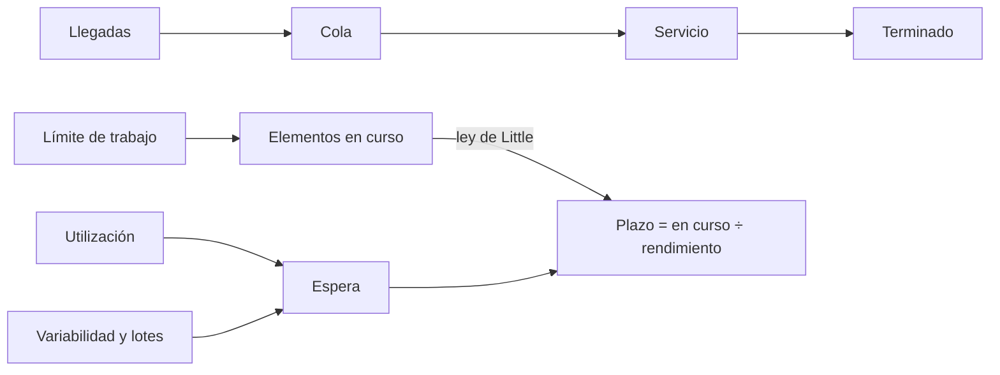
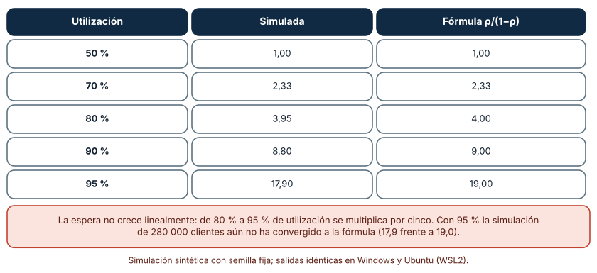
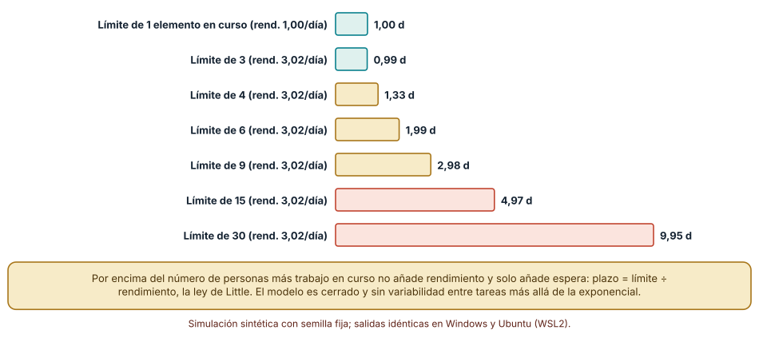
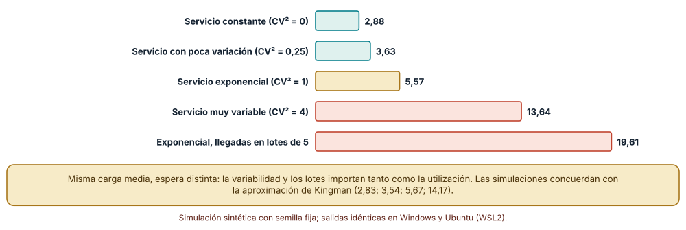

# SE-184 — Lean, teoría de colas y límites de trabajo

[← SE-183 — Scrum, Kanban, XP y Shape Up](https://github.com/vladimiracunadev-create/modern-software-engineering-program/blob/main/classes/part-15-procesos-planificacion-y-estimacion/se-183-scrum-kanban-xp-y-shape-up/README.md) · [↑ Parte 15](https://github.com/vladimiracunadev-create/modern-software-engineering-program/blob/main/classes/part-15-procesos-planificacion-y-estimacion/README.md) · [📚 Índice completo](https://github.com/vladimiracunadev-create/modern-software-engineering-program/blob/main/classes/README.md) · [🌐 Portal](https://vladimiracunadev-create.github.io/modern-software-engineering-program/classes/SE-184.html) · [SE-185 — Estimación por tamaño, rango y evidencia histórica →](https://github.com/vladimiracunadev-create/modern-software-engineering-program/blob/main/classes/part-15-procesos-planificacion-y-estimacion/se-185-estimacion-por-tamano-rango-y-evidencia-historica/README.md)

## Punto profesional y fundamento pedagógico

**Punto profesional.** La clase existe para que expliques con un modelo cuantitativo por qué el trabajo espera, qué palanca reduce esa espera (menos trabajo en curso, menos variabilidad, lotes más pequeños, más capacidad) y por qué una persona o un equipo al 95 % de utilización no es eficiente sino frágil.

**Por qué aparece aquí.** Se sitúa después de **Scrum, Kanban, XP y Shape Up** y antes de **Estimación por tamaño, rango y evidencia histórica**: la clase anterior midió que la extracción acorta la espera de lo urgente; esta explica el mecanismo con la ley de Little y con colas, y deja el vocabulario de flujo que las clases de estimación, planificación y métricas reutilizan.

**Error conceptual que debe corregir.** Creer que mantener a todos ocupados maximiza la entrega, o que la espera crece de forma proporcional a la carga: la espera crece de forma explosiva al acercarse a la capacidad, y trabajar más horas sin cambiar el sistema no la mueve.

**Secuencia de aprendizaje.** Antes de simular, predices cuánto más espera un elemento cuando la utilización pasa de 80 % a 95 %; después simulas una cola y la comparas con su fórmula, verificas la ley de Little en un tablero con límite de trabajo y mides cuánto añaden la variabilidad y los lotes. La secuencia usa predicción, explicación propia, contraste y recuperación. [ICAP](https://icap.education.asu.edu/research) distingue participación de construcción de conocimiento; [How People Learn II](https://nap.nationalacademies.org/catalog/24783/how-people-learn-ii-learners-contexts-and-cultures) exige conectar conocimiento previo, contexto y transferencia; la [práctica de recuperación](https://pubmed.ncbi.nlm.nih.gov/16507066/) respalda producir de nuevo la explicación tras una demora; y [Education for Life and Work](https://nap.nationalacademies.org/resource/13398/dbasse_084153.pdf) exige devolución que explique la causa del error.

**Evidencia de aprendizaje.** `flow-log.md` con la predicción, la tabla de espera por utilización, la comprobación de la ley de Little, la espera según variabilidad y una nota sobre qué límite de trabajo propones para tu tablero y qué observación lo cambiaría.

**Límite de la conclusión.** Los modelos son sistemas simplificados: un único servidor con llegadas aleatorias, o tres personas con tareas independientes. Un equipo real tiene etapas, colas interdependientes, prioridades y cambios de capacidad. Los números muestran el mecanismo, no el valor de un tablero real.

### Trazabilidad fuente → afirmación

| Fuente primaria u oficial | Afirmación que respalda | Lo que no prueba |
|---|---|---|
| [Little, «A proof for the queuing formula: L = λW» (Operations Research, 1961)](https://doi.org/10.1287/opre.9.3.383) | Demuestra que, en régimen estable, el número medio de elementos en un sistema es la tasa de llegada por el tiempo medio en el sistema. | No dice qué valor tendrán esas medias en un equipo ni que el sistema sea estable. |
| [Little, «Little's law as viewed on its 50th anniversary» (Operations Research, 2011)](https://doi.org/10.1287/opre.1110.0940) | Revisa las condiciones y los usos de la ley, incluido que no exige distribuciones concretas. | No es una guía de gestión de software. |
| [Kingman, «The single server queue in heavy traffic» (Mathematical Proceedings of the Cambridge Philosophical Society, 1961)](https://doi.org/10.1017/S0305004100036094) | Obtiene una aproximación de la espera en una cola de un servidor con carga alta, que depende de la utilización y de la variabilidad de llegadas y servicios. | No cubre redes de colas ni prioridades. |

## Antes de empezar

Recupera el resultado de `SE-183`: un urgente espera 7,04 días con alcance cerrado y 2,57 con extracción. Aquí se pregunta por qué la espera tiene esa forma. La pregunta activa es: **¿qué determina cuánto espera un elemento y cuál de esas variables puedo cambiar en mi sistema?**

## Prerrequisitos

- Haber completado `SE-183` o poder explicar la diferencia entre sprint cerrado y extracción.
- Python 3.11 o posterior y un terminal; todo el código usa solo la biblioteca estándar.
- Manejar medias, desviaciones y la idea de distribución exponencial a nivel básico.

## Problema auténtico

La jefatura quiere aprovechar mejor al equipo de la plataforma de entregas: las personas están al 70 % de ocupación y se propone llevarlas al 95 % con más tareas en paralelo. En el tablero se acumulan tarjetas «en revisión» y el plazo medio de un elemento ya creció de 5 a 12 días en un trimestre. Nadie ha relacionado ambas cosas.

## Objetivos observables

Al terminar podrás:

1. enunciar la ley de Little y usarla para pasar de trabajo en curso y rendimiento a plazo medio;
2. simular una cola y comparar su espera con la fórmula, e interpretar por qué crece de forma explosiva cerca del 100 %;
3. verificar con un tablero de límite de trabajo que, superado el número de personas, más trabajo en curso solo añade espera;
4. medir cuánto añaden la variabilidad de los tiempos y los lotes de llegada a la espera con la misma carga;
5. proponer un límite de trabajo y una política de lotes justificados, con la observación que los cambiaría.

## Mapa conceptual



El mapa se lee de izquierda a derecha para el sistema de espera y de arriba abajo para sus palancas: la utilización y la variabilidad determinan la espera; el límite de trabajo determina el número de elementos en curso; la ley de Little une ambos con el plazo.

## Temas y por qué importan

| Tema | Por qué cambia una decisión profesional | Evidencia mínima |
|---|---|---|
| Lean y flujo | Se optimiza el plazo de un elemento por el sistema, no la ocupación de cada persona. | Predicción, traza causal y contraejemplo de **Lean y flujo** en `flow-log.md` |
| Ley de Little | Relaciona elementos en curso, rendimiento y plazo; permite razonar sin conocer las distribuciones. | Predicción, traza causal y contraejemplo de **Ley de Little** en `flow-log.md` |
| Utilización y espera | La espera crece de forma explosiva al acercarse a la capacidad. | Predicción, traza causal y contraejemplo de **Utilización y espera** en `flow-log.md` |
| Variabilidad y lotes | Con la misma carga media, más variabilidad y lotes más grandes multiplican la espera. | Predicción, traza causal y contraejemplo de **Variabilidad y lotes** en `flow-log.md` |
| Límites de trabajo | Limitar lo que está en curso acorta el plazo sin reducir el rendimiento, hasta cierto punto. | Predicción, traza causal y contraejemplo de **Límites de trabajo** en `flow-log.md` |

## Conceptos y decisiones

### 1. Lean y flujo

Lean, en el contexto del software, es una forma de pensar centrada en el valor que llega a quien lo usa y en el tiempo que tarda: se identifica el trabajo que no aporta (esperas, rehacer, trabajo a medias) y se organiza el sistema para que el flujo sea estable. La unidad de análisis es el elemento que atraviesa el sistema y no la persona que lo toca. La pregunta cambia de «¿están todos ocupados?» a «¿cuánto tarda un elemento desde que se pide hasta que se usa y qué parte de ese tiempo es espera?». Los experimentos de esta clase formalizan por qué esas esperas se forman.

### 2. Ley de Little

En un sistema estable, el número medio de elementos dentro es igual a la tasa media de llegadas (o de terminaciones) por el tiempo medio que pasan dentro: L = λW. No necesita suponer distribuciones ni orden de servicio. Para un tablero significa: plazo medio = trabajo en curso ÷ rendimiento. Si el rendimiento no cambia, duplicar el trabajo en curso duplica el plazo. Little advirtió además que la ley exige un sistema en régimen estable y definiciones coherentes de qué es «dentro»: si algunos elementos se abandonan o se miden con otra fecha de inicio, la igualdad se rompe.

### 3. Utilización y espera

En una cola de un servidor con llegadas aleatorias, la espera media en cola es ρ/(1−ρ) veces el tiempo medio de servicio, donde ρ es la utilización. A 50 % la espera es un servicio; a 80 %, cuatro; a 90 %, nueve; a 95 %, diecinueve. La razón es que el servidor pierde capacidad cada vez que está libre y no puede recuperarla, mientras que las llegadas siguen acumulándose cuando está ocupado. La consecuencia de gestión es incómoda: la última fracción de utilización es la más cara, y un equipo sin holgura no puede absorber ninguna variación.

### 4. Variabilidad y lotes

La aproximación de Kingman descompone la espera en tres factores: la utilización, la variabilidad de las llegadas y de los servicios, y el tiempo medio de servicio. Con la misma utilización, duplicar la variabilidad duplica casi la espera. Los lotes cuentan como variabilidad de llegadas: cinco elementos que llegan juntos esperan más que cinco que llegan de uno en uno. En software la variabilidad aparece como tareas de tamaños muy distintos y como la costumbre de entregar a revisión en bloques; reducirla (cortar en piezas de tamaño parecido, revisar de inmediato) cuesta menos que añadir personas.

### 5. Límites de trabajo

Un límite de trabajo en curso impide empezar más elementos de los que el sistema puede terminar. Su efecto se deduce de la ley de Little: si el rendimiento está saturado, cada elemento adicional en curso solo aumenta el plazo de todos. El límite adecuado está cerca del punto en que el rendimiento deja de crecer; por debajo, personas quedan ociosas, y por encima, el plazo crece sin ganancia. Es una política y no una ley física: se revisa con las métricas del flujo, y se acompaña de la regla de qué hacer cuando una persona se queda sin trabajo disponible (ayudar a terminar, no empezar).

### La espera crece de forma explosiva con la utilización

Una cola de un servidor (una persona que revisa) recibe elementos con llegadas exponenciales y tiempos de servicio exponenciales de media 1. Con la recurrencia de Lindley, cada espera es `max(0, espera anterior + servicio − tiempo entre llegadas)`. Se simulan 300 000 elementos por utilización y se descartan los primeros 20 000.

```python
w = 0.0
for i in range(n):
    a = rng.expovariate(rho)        # tiempo hasta la siguiente llegada
    w = max(0.0, w + rng.expovariate(1.0) - a)
```

| Utilización | Espera simulada | Fórmula ρ/(1−ρ) |
|---:|---:|---:|
| 50 % | 1,00 | 1,00 |
| 70 % | 2,33 | 2,33 |
| 80 % | 3,95 | 4,00 |
| 90 % | 8,80 | 9,00 |
| 95 % | 17,90 | 19,00 |

Resultado, idéntico en Windows (CPython 3.12.9) y en Ubuntu bajo WSL2 (3.12.3). La simulación coincide con la fórmula hasta el 90 %; al 95 % queda un 6 % por debajo, porque cerca de la saturación la convergencia es lenta y 280 000 elementos aún no bastan.



**Cómo leer la figura.** Cada fila es una utilización; la espera está medida en múltiplos del tiempo medio de servicio. **Dónde deja de valer:** el modelo supone un solo servidor, llegadas y servicios exponenciales y un régimen estable. Un equipo real tiene prioridades, interrupciones y varias etapas. Y las cifras cercanas al 100 % no se pueden tomar al pie de la letra ni en la simulación ni en la práctica: lo importante es la forma de la curva, que sube cada vez más rápido.

### Más trabajo en curso solo añade espera

Un tablero cerrado con tres personas procesa tareas de un día de media (exponenciales). Cuando una termina, entra otra, de modo que siempre hay exactamente `n` elementos en el sistema (el límite de trabajo). Se simulan 60 000 días para cada `n` y se mide el rendimiento y el plazo medio de las tareas.

```python
# n tareas circulan; 3 personas; al terminar una, entra otra nueva
thr  = done / t                  # rendimiento
lead = total_lead / done         # plazo medio
```

| Límite | Rendimiento (/día) | Plazo medio (días) | n ÷ rendimiento |
|---:|---:|---:|---:|
| 1 | 1,003 | 1,00 | 1,00 |
| 2 | 2,012 | 0,99 | 0,99 |
| 3 | 3,015 | 0,99 | 0,99 |
| 4 | 3,015 | 1,33 | 1,33 |
| 6 | 3,015 | 1,99 | 1,99 |
| 9 | 3,015 | 2,98 | 2,98 |
| 15 | 3,015 | 4,97 | 4,97 |
| 30 | 3,015 | 9,95 | 9,95 |

El rendimiento llega a unos 3 elementos por día en cuanto el límite iguala el número de personas y no crece más; el plazo crece linealmente y coincide con `n ÷ rendimiento`, como dice la ley de Little. Pasar de un límite de 3 a uno de 30 multiplica el plazo por diez sin que se termine una tarea más.



**Cómo leer la figura.** Cada barra es el plazo medio para un límite; la etiqueta de la izquierda incluye el rendimiento. **Dónde deja de valer:** el modelo es cerrado (siempre hay trabajo disponible) y con tareas independientes; un equipo real depende de personas con habilidades distintas y de esperas externas, y un límite demasiado bajo deja a personas ociosas. Lo que muestra es la mitad de la historia: el límite no aumenta el rendimiento, evita que el plazo crezca sin ganancia.

### Variabilidad y lotes con la misma carga

Con 85 % de utilización, se varían los tiempos de servicio: constantes, con poca variación (Erlang de 4 fases), exponenciales y muy variables (lognormales con coeficiente de variación al cuadrado igual a 4). Después, con servicio exponencial, las llegadas se agrupan en lotes de 5 manteniendo la misma carga media. La referencia es la aproximación de Kingman.

```python
kingman = rho / (1 - rho) * (ca2 + cs2) / 2     # ca2 = 1 (llegadas exponenciales)
```

| Servicio | CV² | Espera simulada | Kingman |
|---|---:|---:|---:|
| Constante | 0 | 2,88 | 2,83 |
| Poca variación | 0,25 | 3,63 | 3,54 |
| Exponencial | 1 | 5,57 | 5,67 |
| Muy variable | 4 | 13,64 | 14,17 |
| Exponencial con llegadas en lotes de 5 | 1 | 19,61 | — |

Con la misma utilización, pasar de servicios constantes a muy variables multiplica por 4,7 la espera, y agrupar las llegadas en lotes de 5 la multiplica por 3,5 respecto del caso individual (5,57 → 19,61). La fórmula de Kingman acierta dentro del 4 % y no cubre los lotes.



**Cómo leer la figura.** Cada barra es la espera media en múltiplos del servicio medio; entre más a la derecha, más espera con la misma carga. **Dónde deja de valer:** el coeficiente de variación de 4 es un supuesto de cola larga; en el trabajo de software es plausible (un elemento de una hora y otro de tres semanas), pero no está medido aquí. Los lotes de 5 son un caso extremo de «todo a revisión el viernes». La lección es cualitativa: reducir tamaños y lotes es una palanca barata.

## Definiciones de trabajo

- **utilización:** fracción del tiempo en que un recurso está ocupado; en una cola, la tasa de llegadas dividida por la tasa de servicio.
- **ley de Little:** en régimen estable, el número medio de elementos en un sistema es la tasa media de llegadas por el tiempo medio que pasan dentro.
- **tiempo de ciclo o plazo:** tiempo desde que un elemento entra al sistema hasta que sale terminado.
- **variabilidad:** dispersión de los tiempos entre llegadas o de servicio; se resume con el coeficiente de variación al cuadrado.
- **lote:** grupo de elementos que se mueven juntos por una etapa del flujo.

Las definiciones son operativas para la plataforma de entregas. No convierten términos con una historia más amplia en sinónimos y deben contrastarse con la documentación primaria enlazada al final.

## Ejemplo mínimo

El fragmento aplica la ley de Little a un tablero. Antes de ejecutarlo, predice el plazo medio de un tablero con 12 elementos en curso y un rendimiento de 3 elementos por semana.

```python
en_curso = 12
rendimiento = 3          # elementos por semana
plazo = en_curso / rendimiento
assert plazo == 4        # semanas
```

El plazo medio es de 4 semanas. Si el límite pasa a 6 y el rendimiento sigue en 3, el plazo baja a 2. Registra versión, comando y salida; después busca en tu tablero el trabajo en curso y el rendimiento reales y calcula el plazo que predice la ley.

## Ejemplo profesional

El equipo de la plataforma de entregas mide el tablero durante cuatro semanas: 18 elementos en curso de media y un rendimiento de 3 por semana, que por Little implica un plazo medio de 6 semanas, y es lo que ven. Proponen un límite de 9 (tres por persona) y una regla: si alguien queda sin trabajo disponible, ayuda a terminar el elemento más antiguo antes de empezar otro. Además, la revisión de código deja de hacerse los viernes en bloque y pasa a ser inmediata, para eliminar lotes. Esperan un plazo de 3 semanas con rendimiento igual.

Compara la propuesta con «contratar a dos personas más»: añadir capacidad reduce la utilización, pero deja intactos los lotes y la variabilidad. Una decisión de flujo es adecuada cuando se apoya en la medición del trabajo en curso y del rendimiento; es débil cuando se apoya en la ocupación de las personas.

## Práctica guiada

1. Mide o inventa en tu tablero el trabajo en curso medio y el rendimiento semanal.
2. Predice el plazo medio con la ley de Little y compáralo con el observado.
3. Simula una cola para utilizaciones de 50 % a 95 % y compara con la fórmula.
4. Simula el tablero cerrado con límites de 1 a 30 y encuentra el límite donde el rendimiento satura.
5. Mide la espera con servicios constantes, exponenciales y muy variables al 85 %.
6. Simula lotes de 5 y compara con llegadas individuales.
7. Entrega `flow-log.md` y pide a otra persona que proponga un límite de trabajo con tu registro.

## Ejercicios

1. **Little:** un tablero tiene 20 elementos en curso y termina 4 por semana; calcula el plazo y qué límite lo reduciría a 3 semanas sin bajar el rendimiento.
2. **Utilización:** a partir de la tabla, calcula cuánto más espera un elemento al pasar de 80 % a 90 % y a 95 % y explica la diferencia.
3. **Lotes:** modifica la simulación con lotes de 2 y de 10 y representa la espera frente al tamaño del lote.
4. **Límite:** diseña un tablero de dos etapas con límites distintos y explica qué ocurre cuando una etapa se bloquea.

## Reto verificable

Entrega `flow-log.md` con la predicción, la tabla de espera, la comprobación de la ley de Little, la tabla de variabilidad y el límite propuesto con su observación de cambio. Se aprueba si otra persona ejecuta el código desde un checkout limpio, obtiene los mismos números y puede decir qué ocurriría si el rendimiento cambiara de 3 a 4 por día. No se aprueba por mostrar la fórmula ni por proponer un límite sin medición.

## Caso conductor

La plataforma de entregas de tareas continúa como caso conductor de la Parte 15. Esta clase deja el cuarto artefacto: la medición de trabajo en curso, rendimiento y plazo del equipo, y un límite justificado con la ley de Little. `SE-185` usará esos datos como historia para estimar con rangos. Cambia después una sola variable, el tamaño del lote de revisión, y revisa qué cambia en el plazo.

## Preguntas frecuentes

### ¿La ley de Little sirve si el sistema no es estable?

No directamente: si el trabajo en curso crece sin parar, la igualdad no describe un promedio estable. Sirve, en cambio, para detectar esa situación: si el plazo crece mientras el rendimiento no, el sistema acumula trabajo.

### ¿Cuál es un buen nivel de utilización?

No hay una cifra universal. Si el trabajo es muy variable y se necesita responder rápido (incidentes), conviene bastante holgura; si es predecible y el plazo no importa, puede ser alta. La tabla muestra el coste de cada punto adicional.

### ¿Limitar el trabajo en curso deja gente sin hacer nada?

A veces, y por eso se acompaña de reglas: ayudar a terminar, mejorar herramientas, atender deuda. Lo que se evita es empezar más trabajo, que alarga el plazo de todo lo demás.

### ¿Reducir la variabilidad es lo mismo que estandarizar el trabajo?

No: se trata de reducir la dispersión de tamaños y esperas, por ejemplo cortando los elementos en partes de tamaño parecido. Estandarizar cómo se hace cada tarea es otra cosa y puede ser innecesario o dañino.

## Fallo controlado y diagnóstico

Reproduce el fallo clásico de la clase: **subir la utilización para «aprovechar» al equipo y observar que el plazo se multiplica**. Simula la cola al 70 % y al 95 % y compara la espera.

Registra síntoma, entrada mínima, hipótesis, observación que descarta cada hipótesis, causa, corrección y prueba de regresión. **Síntoma:** al pasar de 70 % a 95 % de ocupación, el plazo medio pasa de 5 a 12 días en un trimestre. **Hipótesis rivales:** (a) las tareas se volvieron más difíciles; (b) el equipo trabaja peor con más carga; (c) la cola crece de forma no lineal con la utilización. **Prueba:** mide el tamaño de las tareas y la espera; en la simulación, la espera pasa de 2,33 a 17,9 con las mismas tareas. **Conclusión:** la causa es la no linealidad de la espera, no un cambio de dificultad. **Regresión:** fija un límite de trabajo y una utilización objetivo, y registra el plazo en cuatro semanas. No cambies a la vez la carga y el tamaño de las tareas.

## Errores comunes y cómo corregirlos

| Síntoma | Causa probable | Corrección |
|---|---|---|
| El plazo crece sin que el rendimiento baje | El trabajo en curso crece | Aplicar la ley de Little y fijar un límite |
| Se pide llegar al 100 % de ocupación | Se confunde ocupación con eficiencia | Mostrar la curva de espera y fijar una utilización objetivo |
| Se contratan personas y el plazo no mejora | La espera venía de lotes y variabilidad | Medir tamaños y lotes antes de añadir capacidad |
| Un límite de trabajo se salta «solo esta vez» | El límite no tiene regla para el ocio | Escribir qué se hace cuando no hay trabajo disponible |
| La ley de Little no cuadra con el tablero | Elementos abandonados o fechas de inicio inconsistentes | Definir qué entra, qué sale y qué fecha cuenta, y recalcular |

## Entorno y archivos clave

```text
work/SE-184/
├── README.md
├── flow/
│   ├── cola.py
│   ├── tablero.py
│   └── variabilidad.py
├── tests/test_flow.py
└── evidence/flow-log.md
```

El `README` declara plataforma, versión de Python, semillas y comandos. Los experimentos usan solo la biblioteca estándar (`random`, `heapq`, `statistics`, `math`) y se ejecutaron con CPython 3.12.9 en Windows 11 y 3.12.3 en Ubuntu bajo WSL2: las salidas fueron idénticas. Si añades una dependencia, fija procedencia y versión.

## Seguridad, ética y accesibilidad

- una utilización objetivo no debe convertirse en una cuota por persona: es una propiedad del sistema;
- la holgura es una decisión de seguridad cuando el trabajo incluye atención a incidentes o a estudiantes con plazos críticos;
- los tableros deben ser legibles con tecnologías de apoyo y no depender solo del color para marcar estados;
- documenta quién fijó cada límite y con qué datos, para que pueda revisarse;
- respeta las licencias de las guías y atribuye lo adaptado.

## Puente hacia el trabajo con agentes

Un agente al que se le pide «optimiza el flujo» puede proponer más paralelismo o más personas, porque ambos suenan a mejora. Pídele en cambio que calcule el plazo con la ley de Little a partir de trabajo en curso y rendimiento medidos, que muestre la utilización y la espera esperada y que separe qué parte de la espera viene de lotes y variabilidad. Revisa especialmente si recomienda subir la ocupación: es la intervención que la curva de espera desaconseja.

## Transferencia

Traslada el análisis a otro sistema de espera (por ejemplo, la cola de revisión de pull requests o de tickets de soporte): cambia las tasas y conserva el procedimiento de calcular la espera, comprobar la ley de Little y medir la variabilidad. La transferencia está lograda cuando puedes explicar qué parte del modelo dependía del sistema y cuál no, no cuando el código se parece.

## Evaluación y evidencia

| Criterio | Evidencia para aprobar |
|---|---|
| comprensión | explicación de por qué la espera crece de forma explosiva con la utilización |
| corrección | tres simulaciones reproducibles con las mismas semillas y la comparación con la fórmula |
| diseño | límite de trabajo propuesto con regla para el ocio y observación de cambio |
| diagnóstico | reproducción del fallo «subir la utilización» con regresión |
| incertidumbre | declaración de los supuestos del modelo y de la convergencia lenta cerca del 100 % |
| reproducibilidad | versiones, comandos, salida y límites declarados |

## Fuentes

- [Little, «A proof for the queuing formula: L = λW» (Operations Research, 1961)](https://doi.org/10.1287/opre.9.3.383) — demostración de la ley; autoridad: Operations Research.
- [Little, «Little's law as viewed on its 50th anniversary» (Operations Research, 2011)](https://doi.org/10.1287/opre.1110.0940) — condiciones y usos de la ley; autoridad: Operations Research.
- [Kingman, «The single server queue in heavy traffic» (Math. Proc. Cambridge Philos. Soc., 1961)](https://doi.org/10.1017/S0305004100036094) — aproximación de la espera con carga alta; autoridad: Cambridge Philosophical Society.
- [The Kanban Guide](https://kanbanguides.org/english/) — límites de trabajo y gestión del flujo; autoridad: Scrum.org (Kanban Guide).
- [SWEBOK Guide v4.0a](https://www.computer.org/education/bodies-of-knowledge/software-engineering) — gestión de ingeniería de software; autoridad: IEEE Computer Society.

Cada fuente respalda el mecanismo indicado; ninguna demuestra que el plazo de 6 semanas, la utilización objetivo o el límite de 9 correspondan a la plataforma de entregas. Esa afirmación depende de la medición del propio tablero.

- [Python: `heapq`](https://docs.python.org/3/library/heapq.html) — cola de eventos del tablero cerrado.
- [Python: `random`](https://docs.python.org/3/library/random.html) — generador con semilla para las simulaciones.

## Límites y siguiente paso

Se ejecutaron tres experimentos con datos sintéticos en Windows y Ubuntu (WSL2) con resultados idénticos. No se observó ningún tablero real: las colas de un servidor, las tareas exponenciales y los lotes de cinco son construcciones del autor, y la simulación cerca del 95 % queda por debajo de la fórmula por convergencia lenta. La siguiente clase usa la historia de flujo para estimar con rangos en lugar de números únicos.

## Glosario

- **utilización:** fracción del tiempo en que un recurso está ocupado; en una cola, la tasa de llegadas dividida por la tasa de servicio.
- **ley de Little:** en régimen estable, el número medio de elementos en un sistema es la tasa media de llegadas por el tiempo medio que pasan dentro.
- **tiempo de ciclo o plazo:** tiempo desde que un elemento entra al sistema hasta que sale terminado.
- **variabilidad:** dispersión de los tiempos entre llegadas o de servicio; se resume con el coeficiente de variación al cuadrado.
- **lote:** grupo de elementos que se mueven juntos por una etapa del flujo.

---

[← SE-183 — Scrum, Kanban, XP y Shape Up](https://github.com/vladimiracunadev-create/modern-software-engineering-program/blob/main/classes/part-15-procesos-planificacion-y-estimacion/se-183-scrum-kanban-xp-y-shape-up/README.md) · [↑ Parte 15](https://github.com/vladimiracunadev-create/modern-software-engineering-program/blob/main/classes/part-15-procesos-planificacion-y-estimacion/README.md) · [📚 Índice completo](https://github.com/vladimiracunadev-create/modern-software-engineering-program/blob/main/classes/README.md) · [🌐 Portal](https://vladimiracunadev-create.github.io/modern-software-engineering-program/classes/SE-184.html) · [SE-185 — Estimación por tamaño, rango y evidencia histórica →](https://github.com/vladimiracunadev-create/modern-software-engineering-program/blob/main/classes/part-15-procesos-planificacion-y-estimacion/se-185-estimacion-por-tamano-rango-y-evidencia-historica/README.md)
