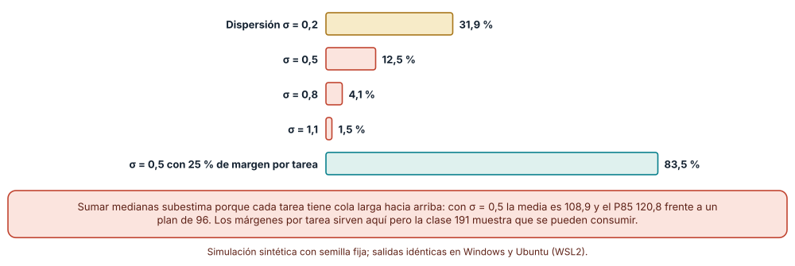
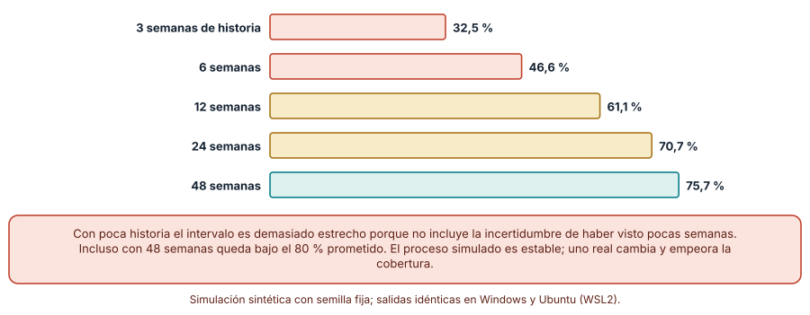
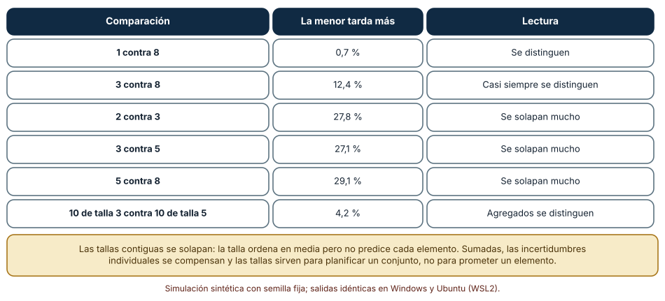

# SE-185 — Estimación por tamaño, rango y evidencia histórica

[← SE-184 — Lean, teoría de colas y límites de trabajo](https://github.com/vladimiracunadev-create/modern-software-engineering-program/blob/main/classes/part-15-procesos-planificacion-y-estimacion/se-184-lean-teoria-de-colas-y-limites-de-trabajo/README.md) · [↑ Parte 15](https://github.com/vladimiracunadev-create/modern-software-engineering-program/blob/main/classes/part-15-procesos-planificacion-y-estimacion/README.md) · [📚 Índice completo](https://github.com/vladimiracunadev-create/modern-software-engineering-program/blob/main/classes/README.md) · [🌐 Portal](https://vladimiracunadev-create.github.io/modern-software-engineering-program/classes/SE-185.html) · [SE-186 — Planificación de entregas y gestión de dependencias →](https://github.com/vladimiracunadev-create/modern-software-engineering-program/blob/main/classes/part-15-procesos-planificacion-y-estimacion/se-186-planificacion-de-entregas-y-gestion-de-dependencias/README.md)

## Punto profesional y fundamento pedagógico

**Punto profesional.** La clase existe para que entregues una estimación como un rango con su evidencia y sus supuestos, y no como un número que alguien convertirá en compromiso; y para que sepas qué puede y qué no puede sostener una estimación por tamaño relativo o por historia.

**Por qué aparece aquí.** Se sitúa después de **Lean, teoría de colas y límites de trabajo** y antes de **Planificación de entregas y gestión de dependencias**: la clase anterior produjo datos de flujo (rendimiento, plazo); esta enseña a usarlos para estimar con rangos, y la siguiente combinará varias estimaciones en un plan con dependencias. La estimación es el eslabón que más a menudo se convierte en promesa.

**Error conceptual que debe corregir.** Creer que sumar las estimaciones típicas de las tareas da la estimación típica del proyecto, o que una talla (3, 5, 8) predice cuánto tarda un elemento concreto: la suma de medianas es optimista y las tallas contiguas se solapan.

**Secuencia de aprendizaje.** Antes de simular, predices con qué probabilidad un proyecto de 30 tareas termina dentro de la suma de sus medianas; después simulas esa probabilidad con distintas dispersiones, mides cuánto cubre realmente un intervalo del 80 % construido con poca historia y calculas cuánto se solapan las tallas. La secuencia usa predicción, explicación propia, contraste y recuperación. [ICAP](https://icap.education.asu.edu/research) distingue participación de construcción de conocimiento; [How People Learn II](https://nap.nationalacademies.org/catalog/24783/how-people-learn-ii-learners-contexts-and-cultures) exige conectar conocimiento previo, contexto y transferencia; la [práctica de recuperación](https://pubmed.ncbi.nlm.nih.gov/16507066/) respalda producir de nuevo la explicación tras una demora; y [Education for Life and Work](https://nap.nationalacademies.org/resource/13398/dbasse_084153.pdf) exige devolución que explique la causa del error.

**Evidencia de aprendizaje.** `estimation-log.md` con la predicción, la probabilidad de cumplir la suma de medianas por dispersión, la cobertura de intervalos según la historia, el solape entre tallas y una nota con la estimación en forma de rango y sus supuestos.

**Límite de la conclusión.** Las duraciones son lognormales y el rendimiento es gamma: elecciones convenientes del autor, no medidas. Los resultados describen cómo se comportan las estimaciones bajo esos modelos, no cuánto se equivocan las personas.

### Trazabilidad fuente → afirmación

| Fuente primaria u oficial | Afirmación que respalda | Lo que no prueba |
|---|---|---|
| [Jørgensen, «A review of studies on expert estimation of software development effort» (Journal of Systems and Software, 2004)](https://doi.org/10.1016/S0164-1212%2802%2900156-5) | Revisa estudios de estimación por expertos y documenta sesgos, dispersión y la mejora al combinar estimaciones y usar historia. | No fija la exactitud de ninguna técnica en un equipo concreto. |
| [Buehler, Griffin y Ross, «Exploring the planning fallacy» (Journal of Personality and Social Psychology, 1994)](https://doi.org/10.1037/0022-3514.67.3.366) | Muestra que las personas subestiman el tiempo de sus propias tareas incluso conociendo experiencias pasadas parecidas. | No cuantifica el sesgo en software ni descarta que se pueda corregir. |
| [Flyvbjerg, «From Nobel Prize to project management: getting risks right» (Project Management Journal, 2006)](https://doi.org/10.1177/875697280603700302) | Propone partir de la distribución de resultados de proyectos parecidos para corregir el optimismo de la visión interna. | No ofrece una clase de referencia para la plataforma de entregas. |

## Antes de empezar

Recupera los datos de flujo de `SE-184`: rendimiento semanal y plazo de los elementos. Aquí se usan como historia. La pregunta activa es: **¿qué rango de resultados es creíble con la evidencia que tengo y cuántas semanas de historia hacen falta para que ese rango merezca confianza?**

## Prerrequisitos

- Haber completado `SE-184` o poder explicar la relación entre rendimiento y plazo.
- Python 3.11 o posterior y un terminal; todo el código usa solo la biblioteca estándar.
- Manejar percentiles y el significado de una distribución con cola larga a nivel básico.

## Problema auténtico

La dirección pregunta cuándo estará lista la recuperación de borradores. El equipo ha desglosado 30 tareas y cada persona estimó una duración típica; la suma da 96 días. Se comunica «estará listo en 96 días» y la fecha pasa a un calendario externo. Seis semanas después el proyecto lleva 110 días de trabajo y falta el 15 %. Nadie se equivocó en una tarea concreta: la suma de números típicos no es un número típico.

## Objetivos observables

Al terminar podrás:

1. explicar por qué la suma de medianas de varias tareas subestima el total y calcular la probabilidad de cumplirla bajo una dispersión dada;
2. construir un rango a partir de la historia de rendimiento y medir su cobertura real según las semanas disponibles;
3. calcular cuánto se solapan las tallas relativas y qué se puede y qué no se puede concluir de ellas;
4. contrastar un margen proporcional por tarea con un rango del total y justificar cuál comunicar;
5. escribir una estimación como rango con supuestos, historia usada y la observación que la revisaría.

## Mapa conceptual


El mapa se lee de izquierda a derecha como el camino de una estimación: lo típico por tarea no es el total; hay que pasar por la dispersión y por la historia para obtener un rango. El retorno indica que cada avance real actualiza la evidencia.

## Temas y por qué importan

| Tema | Por qué cambia una decisión profesional | Evidencia mínima |
|---|---|---|
| Estimación por tamaño relativo | Ordena el trabajo sin pretender medir horas; sirve en agregado, no por elemento. | Predicción, traza causal y contraejemplo de **Estimación por tamaño relativo** en `estimation-log.md` |
| Rangos | Comunican la incertidumbre y evitan que un número se convierta en compromiso. | Predicción, traza causal y contraejemplo de **Rangos** en `estimation-log.md` |
| Suma de estimaciones | El total de varias tareas tiene una distribución propia con cola larga. | Predicción, traza causal y contraejemplo de **Suma de estimaciones** en `estimation-log.md` |
| Evidencia histórica | La historia del equipo corrige el optimismo, pero con pocas observaciones es engañosa. | Predicción, traza causal y contraejemplo de **Evidencia histórica** en `estimation-log.md` |
| Comunicar una estimación | Un rango con supuestos informa; un número aislado se vuelve promesa. | Predicción, traza causal y contraejemplo de **Comunicar una estimación** en `estimation-log.md` |

## Conceptos y decisiones

### 1. Estimación por tamaño relativo

Comparar tareas entre sí («esta es el doble de grande que aquella») es más fiable que predecir horas absolutas, porque la comparación cancela sesgos comunes. Las tallas (1, 2, 3, 5, 8) formalizan esa comparación en categorías. Su límite es que se usan después para predecir duración, y las duraciones de una misma talla varían tanto que las tallas vecinas se solapan: una tarea de talla 3 puede tardar más que una de talla 5 con frecuencia no despreciable. La talla sirve para ordenar y para agregar muchos elementos con la historia del equipo; no para prometer una tarea individual.

### 2. Rangos

Un rango comunica dos cosas: el centro probable y cuánto puede desviarse. Los rangos útiles se acompañan de la confianza («entre 9 y 14 semanas con 85 % de confianza») y de los supuestos de los que depende. Un rango no es un truco para protegerse: se construye con datos y se evalúa después, comprobando si los resultados reales caen dentro con la frecuencia anunciada. Un rango tan ancho que nunca se falla no informa, y uno tan estrecho que se falla casi siempre tampoco.

### 3. Suma de estimaciones

Si cada tarea tiene una distribución sesgada hacia arriba (puede tardar mucho más de lo típico, no mucho menos), la suma tiene una media mayor que la suma de las medianas. Con 30 tareas de mediana 1 a 5 días y una dispersión moderada, la mediana del total ya es 12 % mayor que la suma de las medianas, y completar dentro de esa suma ocurre una de cada ocho veces. Añadir un margen igual a cada tarea corrige el promedio, pero a costa de contar el margen dos veces donde las tareas se compensan; la clase `SE-191` compara esa práctica con un colchón compartido.

### 4. Evidencia histórica

La historia reemplaza la opinión por observaciones: cuántos elementos se terminaron cada semana, cuánto tardaron. A partir de ella se puede remuestrear para obtener la distribución del total futuro. Con pocas semanas, el intervalo es demasiado estrecho porque no refleja la incertidumbre sobre la propia media. Además, la historia supone que el futuro se parece al pasado: un cambio de equipo, de tecnología o de tipo de trabajo invalida parte de ella. Flyvbjerg propone partir de clases de referencia —proyectos parecidos de otras organizaciones— cuando la historia propia es escasa.

### 5. Comunicar una estimación

La forma de comunicar importa tanto como el cálculo. Una buena estimación incluye el rango, la confianza, la historia usada, los supuestos (alcance, equipo, dependencias), qué no incluye y la fecha de su próxima revisión. Un número aislado en un correo se separa de todo eso y se vuelve fecha. Cuando un rango inconveniente se reduce a un número cómodo por presión del calendario, la estimación ya no informa: es una negociación disfrazada. El agradecimiento debe ir al rango que se mantiene.

### La suma de medianas casi nunca se cumple

Treinta tareas con mediana de 1 a 5 días (enteros al azar con semilla fija) y duración lognormal con σ = 0,5. La suma de medianas es 96 días. Se simulan 20 000 proyectos.

```python
meds = [rng.randint(1, 5) for _ in range(30)]
plan = sum(meds)                                   # 96
tot = [sum(rng.lognormvariate(math.log(m), 0.5) for m in meds) for _ in range(20000)]
p_cumplir = sum(t <= plan for t in tot) / len(tot)
```

Resultado, idéntico en Windows (CPython 3.12.9) y en Ubuntu bajo WSL2 (3.12.3): cumplir la suma de medianas ocurre en el **12,4 %** de los proyectos; la media del total es 108,9, la mediana 108,1, el percentil 85 es 120,8 y el 95 es 129,4. Con σ = 0,2 la probabilidad sube a 31,9 %, con σ = 0,8 baja a 4,1 % y con σ = 1,1 a 1,5 %. Un margen de 25 % en cada tarea (plan de 120 días) se cumple en el 83,5 %.



**Cómo leer la figura.** Cada barra es el porcentaje de 20 000 (o 5000) proyectos que terminan dentro del plan; la verde es el plan con margen. **Dónde deja de valer:** las duraciones lognormales e independientes son una elección conveniente; tareas que fallan juntas (la misma dependencia, la misma persona) agrandan la cola del total. Y el margen del 25 % se calibró contra el modelo, no contra datos: con otra dispersión daría otra cobertura.

### Un intervalo del 80 % con poca historia cubre mucho menos

El rendimiento semanal es gamma con media 6 y varianza 9 (enteros). Con una historia de `n` semanas se pronostica la suma de las 12 semanas siguientes con un intervalo central del 80 % (percentiles 10 y 90), por remuestreo de la historia y por aproximación normal. Se comprueba con 1500 repeticiones qué fracción de veces el valor real cae dentro.

```python
hist = [week(rng) for _ in range(n)]
sims = [sum(rng.choice(hist) for _ in range(12)) for _ in range(300)]
lo, hi = q(sims, .10), q(sims, .90)
cubre = lo <= sum(week(rng) for _ in range(12)) <= hi
```

| Semanas de historia | Cobertura con remuestreo | Cobertura normal |
|---:|---:|---:|
| 3 | 32,5 % | 37,1 % |
| 6 | 46,6 % | 48,1 % |
| 12 | 61,1 % | 60,8 % |
| 24 | 70,7 % | 69,9 % |
| 48 | 75,7 % | 75,0 % |

Un intervalo que promete el 80 % cubre el 32,5 % con tres semanas de historia y el 75,7 % con cuarenta y ocho. Con poca historia la media y la dispersión observadas son ellas mismas inciertas, y el intervalo ignora esa incertidumbre. Ambos métodos fallan en la misma dirección.



**Cómo leer la figura.** Cada barra es el porcentaje de 1500 repeticiones en que el valor real cayó dentro del intervalo. **Dónde deja de valer:** el proceso simulado es estacionario (la media no cambia), cosa que ningún equipo real cumple, de modo que la cobertura real sería peor. La figura no dice cuánta historia basta: dice que con menos de unas veinte semanas conviene ensanchar el intervalo o apoyarse en proyectos parecidos.

### Las tallas se solapan: ordenan, no predicen

Cinco tallas (1, 2, 3, 5, 8) con medianas de 1; 1,8; 3; 5 y 8 días y una dispersión lognormal de 0,6. Para cada par de tallas contiguas se calcula la probabilidad de que un elemento de la menor tarde más que uno de la mayor, con 20 000 pares. Después se comparan diez elementos de talla 3 con diez de talla 5.

```python
P = sum(x > y for x, y in zip(D[3], D[5])) / 20000
```

| Comparación | La menor tarda más |
|---|---:|
| 1 contra 8 | 0,7 % |
| 3 contra 8 | 12,4 % |
| 2 contra 3 | 27,8 % |
| 3 contra 5 | 27,1 % |
| 5 contra 8 | 29,1 % |
| 10 de talla 3 contra 10 de talla 5 | 4,2 % |

Una tarea de talla 3 tarda más que una de talla 5 en el 27,1 % de los pares; en diez contra diez, solo en el 4,2 %. Las incertidumbres individuales se compensan en el agregado: las tallas sirven para estimar un conjunto con la historia, no un elemento.



**Cómo leer la figura.** Cada fila compara dos tallas; la columna central es la probabilidad de que el orden de las tallas se invierta. **Dónde deja de valer:** las medianas y la dispersión de cada talla son supuestos; un equipo con tareas homogéneas tendría dispersión menor y menos solape, y uno con tareas muy variadas, más. La tabla no desautoriza la estimación relativa: delimita lo que una talla puede afirmar.

## Definiciones de trabajo

- **estimación puntual:** un único valor para una cantidad incierta, sin rango ni confianza.
- **rango con confianza:** par de valores y la probabilidad declarada de que el resultado caiga entre ellos.
- **percentil:** valor por debajo del cual cae la proporción indicada de los resultados; el percentil 85 deja al 85 % por debajo.
- **cobertura:** fracción de veces que un intervalo contiene el resultado real; un intervalo está calibrado si su cobertura es la anunciada.
- **clase de referencia:** conjunto de proyectos pasados parecidos cuya distribución de resultados se usa para corregir una estimación interna.

Las definiciones son operativas para la plataforma de entregas. No convierten términos con una historia más amplia en sinónimos y deben contrastarse con la documentación primaria enlazada al final.

## Ejemplo mínimo

El fragmento calcula la mediana del total de dos tareas lognormales para mostrar que no es la suma de medianas. Antes de ejecutarlo, predice si la fracción de totales por debajo de 6 será mayor, igual o menor que 0,5.

```python
import math, random
rng = random.Random(7)
tot = [rng.lognormvariate(math.log(3), 0.6) + rng.lognormvariate(math.log(3), 0.6) for _ in range(20000)]
fraccion = sum(t <= 6 for t in tot) / len(tot)
assert fraccion < 0.45
```

La fracción queda por debajo de 0,5: la suma de medianas (6) es un valor que el total supera más de la mitad de las veces. Registra versión, comando y salida; sube a 10 tareas y predice si la fracción aumenta o disminuye.

## Ejemplo profesional

El equipo de la plataforma de entregas comunica la estimación de la recuperación de borradores como: «entre 15 y 19 semanas con 85 % de confianza, basado en 14 semanas de rendimiento propio (media 5,8 elementos) y en el desglose actual de 62 elementos; supone un equipo estable de cuatro personas, que la integración con la secretaría se entrega en la semana 10 y que no se agregan funciones; no incluye vacaciones de fin de año; se revisa cada dos semanas». El extremo bajo corresponde al rendimiento del percentil 85 de la historia; el alto, a una caída del 20 %.

Compara con la versión «16 semanas»: cuando un alcance nuevo aparece, la primera sabe qué supuesto rompió; la segunda parece un incumplimiento. Una estimación es adecuada cuando puede equivocarse de forma informativa; es peligrosa cuando solo puede ser acertada o culpable.

## Práctica guiada

1. Desglosa un trabajo en 20 a 30 tareas y estima una duración típica de cada una.
2. Predice con qué probabilidad el total cabe en la suma de medianas y escribe el número antes de simular.
3. Simula el total con tres dispersiones y compara con el margen proporcional.
4. Toma tu historia de rendimiento (o genérala) y calcula un intervalo del 80 % para las próximas 12 semanas.
5. Comprueba la cobertura con distintas cantidades de historia.
6. Mide el solape entre las tallas que usa tu equipo.
7. Entrega `estimation-log.md` con la estimación como rango y pide a otra persona que identifique su supuesto más frágil.

## Ejercicios

1. **Suma:** calcula la probabilidad de cumplir la suma de medianas con 10 y con 60 tareas y explica cómo cambia con el número de tareas.
2. **Cobertura:** aumenta el intervalo al 90 % y repite la comprobación con 6 y 24 semanas; indica cuánta historia necesitas para cubrir al menos el 85 %.
3. **Tallas:** reduce la dispersión de 0,6 a 0,3 y recalcula el solape entre 3 y 5; interpreta la diferencia.
4. **Comunicación:** reescribe un correo con una fecha como una estimación con rango, confianza, historia y supuestos.

## Reto verificable

Entrega `estimation-log.md` con la predicción, la probabilidad de cumplir la suma de medianas por dispersión, la tabla de cobertura, el solape de tallas y la estimación final como rango. Se aprueba si otra persona ejecuta el código desde un checkout limpio, obtiene los mismos números y puede decir qué supuesto rompería el rango. No se aprueba por la sofisticación del método ni por un rango tan ancho que nunca falle.

## Caso conductor

La plataforma de entregas de tareas continúa como caso conductor de la Parte 15. Esta clase deja el quinto artefacto: la estimación de la recuperación de borradores y de la regla de penalización como rangos con confianza, historia y supuestos. `SE-186` combinará varias de esas estimaciones en un plan con dependencias. Cambia después una sola cosa, una semana más de historia, y observa cuánto se mueve el rango.

## Preguntas frecuentes

### ¿Los puntos de historia sirven para algo?

Sirven para comparar y ordenar el trabajo y, con la historia del equipo, para estimar un conjunto de elementos. No sirven para prometer una tarea individual ni para comparar equipos, porque cada equipo calibra su escala.

### ¿Cómo elijo el percentil que comunico?

Depende de lo que cueste fallar. Si un retraso tiene consecuencias graves (un trámite con fecha legal), comunica un percentil alto; si es barato, uno medio. Lo importante es declararlo, no esconderlo.

### ¿Y si no tengo historia?

Usa una clase de referencia (proyectos parecidos de otros equipos) y declara que la estimación se revisará con los primeros datos propios. Evita fingir precisión: es mejor un rango ancho y honesto.

### ¿Sumar un margen a cada tarea no resuelve esto?

Corrige el promedio, pero oculta el margen, invita a consumirlo y duplica el relleno donde las tareas se compensan. `SE-191` lo compara con un colchón compartido.

## Fallo controlado y diagnóstico

Reproduce el fallo clásico de la clase: **convertir la suma de estimaciones típicas en una fecha comprometida**. Simula 20 000 proyectos de 30 tareas y mide cuántos terminan dentro de la suma de medianas.

Registra síntoma, entrada mínima, hipótesis, observación que descarta cada hipótesis, causa, corrección y prueba de regresión. **Síntoma:** el proyecto prometido para el día 96 lleva 110 días y falta el 15 %. **Hipótesis rivales:** (a) las estimaciones individuales fueron mal hechas; (b) el equipo trabajó por debajo de lo normal; (c) la suma de medianas no es un valor típico del total. **Prueba:** calcula la probabilidad de cumplir la suma con las mismas estimaciones; en la simulación es del 12,4 %. **Conclusión:** la causa es la agregación, no las estimaciones individuales. **Regresión:** reemplaza la fecha por un rango con percentil y registra su cobertura en los siguientes tres proyectos. No cambies a la vez el método y el alcance.

## Errores comunes y cómo corregirlos

| Síntoma | Causa probable | Corrección |
|---|---|---|
| La fecha prometida se cumple una de cada ocho veces | Se sumaron valores típicos | Estimar el total con simulación o con historia y comunicar un rango |
| El intervalo del 80 % falla la mitad de las veces | Se construyó con pocas semanas de historia | Ensanchar el intervalo o usar una clase de referencia |
| Se usa una talla para prometer una tarea concreta | Se ignora el solape entre tallas | Usar las tallas para agregar con historia, no para prometer elementos |
| La estimación cambió de rango a número en el correo | Presión del calendario | Mantener el rango en la comunicación y anotar quién pidió el número |
| La historia dejó de servir tras un cambio de equipo | Se supuso un futuro igual al pasado | Marcar el cambio, descartar o ponderar los datos anteriores y reestimar |

## Entorno y archivos clave

```text
work/SE-185/
├── README.md
├── estimation/
│   ├── suma.py
│   ├── cobertura.py
│   └── tallas.py
├── tests/test_estimation.py
└── evidence/estimation-log.md
```

El `README` declara plataforma, versión de Python, semillas y comandos. Los experimentos usan solo la biblioteca estándar (`random`, `statistics`, `math`) y se ejecutaron con CPython 3.12.9 en Windows 11 y 3.12.3 en Ubuntu bajo WSL2: las salidas fueron idénticas. Si añades una dependencia, fija procedencia y versión.

## Seguridad, ética y accesibilidad

- una estimación no debe usarse para evaluar a las personas que la hicieron: el error de agregación no es un error individual;
- las estimaciones que condicionan plazos de estudiantes o trámites legales deben declarar su confianza y su revisión;
- los rangos y gráficos deben acompañarse de una tabla textual accesible;
- documenta quién aceptó el riesgo del percentil elegido;
- respeta las licencias de las herramientas de estimación y atribuye lo adaptado.

## Puente hacia el trabajo con agentes

Un agente al que se le pide «estima el proyecto» devolverá una cifra con apariencia de cálculo, normalmente la suma de valores típicos. Pídele en cambio que declare la distribución que supone para cada tarea, que entregue el total como rango con percentiles, que indique cuánta historia usó y que liste los supuestos que invalidan el rango. Revisa especialmente si sumó medianas o si ignoró el crecimiento de alcance: es el error que dejó al proyecto en el 12,4 %.

## Transferencia

Traslada el análisis a otra estimación (por ejemplo, el tiempo de migración de una base de datos): cambia el desglose y la historia, y conserva el procedimiento de simular el total, comprobar la cobertura y comunicar el rango. La transferencia está lograda cuando puedes explicar qué parte del método dependía de los datos y cuál no, no cuando el código se parece.

## Evaluación y evidencia

| Criterio | Evidencia para aprobar |
|---|---|
| comprensión | explicación de por qué la suma de medianas no es la mediana del total |
| corrección | probabilidad, cobertura y solape reproducibles con las mismas semillas |
| diseño | estimación escrita como rango con confianza, historia, supuestos y revisión |
| diagnóstico | reproducción del fallo «suma como fecha» con regresión |
| incertidumbre | declaración de los modelos de duración y del supuesto de estacionariedad |
| reproducibilidad | versiones, comandos, salida y límites declarados |

## Fuentes

- [Jørgensen, «A review of studies on expert estimation of software development effort» (Journal of Systems and Software, 2004)](https://doi.org/10.1016/S0164-1212%2802%2900156-5) — revisión de estudios de estimación por expertos; autoridad: Journal of Systems and Software.
- [Buehler, Griffin y Ross, «Exploring the planning fallacy» (Journal of Personality and Social Psychology, 1994)](https://doi.org/10.1037/0022-3514.67.3.366) — subestimación del tiempo propio; autoridad: Journal of Personality and Social Psychology.
- [Flyvbjerg, «From Nobel Prize to project management: getting risks right» (Project Management Journal, 2006)](https://doi.org/10.1177/875697280603700302) — clases de referencia y optimismo en proyectos; autoridad: Project Management Journal.
- [Efron, «Bootstrap methods: another look at the jackknife» (The Annals of Statistics, 1979)](https://doi.org/10.1214/aos/1176344552) — remuestreo para estimar la distribución de un estadístico; autoridad: The Annals of Statistics.
- [SWEBOK Guide v4.0a](https://www.computer.org/education/bodies-of-knowledge/software-engineering) — gestión de ingeniería de software; autoridad: IEEE Computer Society.

Cada fuente respalda el mecanismo indicado; ninguna demuestra que el 12,4 %, la cobertura de 32,5 % o el solape de 27,1 % se cumplan en la plataforma de entregas. Esa afirmación depende de la distribución real de las duraciones y del rendimiento.

- [Python: `random`](https://docs.python.org/3/library/random.html) — generador con semilla y distribuciones lognormal y gamma.
- [Python: `statistics`](https://docs.python.org/3/library/statistics.html) — media y desviación de la historia.

## Límites y siguiente paso

Se ejecutaron tres experimentos con datos sintéticos en Windows y Ubuntu (WSL2) con resultados idénticos. No se midió ninguna estimación de una persona ni de un equipo: las duraciones lognormales, el rendimiento gamma y las medianas por talla son construcciones del autor. La siguiente clase combina estimaciones en un plan con dependencias, donde la suma se convierte en un máximo.

## Glosario

- **estimación puntual:** un único valor para una cantidad incierta, sin rango ni confianza.
- **rango con confianza:** par de valores y la probabilidad declarada de que el resultado caiga entre ellos.
- **percentil:** valor por debajo del cual cae la proporción indicada de los resultados; el percentil 85 deja al 85 % por debajo.
- **cobertura:** fracción de veces que un intervalo contiene el resultado real; un intervalo está calibrado si su cobertura es la anunciada.
- **clase de referencia:** conjunto de proyectos pasados parecidos cuya distribución de resultados se usa para corregir una estimación interna.

---

[← SE-184 — Lean, teoría de colas y límites de trabajo](https://github.com/vladimiracunadev-create/modern-software-engineering-program/blob/main/classes/part-15-procesos-planificacion-y-estimacion/se-184-lean-teoria-de-colas-y-limites-de-trabajo/README.md) · [↑ Parte 15](https://github.com/vladimiracunadev-create/modern-software-engineering-program/blob/main/classes/part-15-procesos-planificacion-y-estimacion/README.md) · [📚 Índice completo](https://github.com/vladimiracunadev-create/modern-software-engineering-program/blob/main/classes/README.md) · [🌐 Portal](https://vladimiracunadev-create.github.io/modern-software-engineering-program/classes/SE-185.html) · [SE-186 — Planificación de entregas y gestión de dependencias →](https://github.com/vladimiracunadev-create/modern-software-engineering-program/blob/main/classes/part-15-procesos-planificacion-y-estimacion/se-186-planificacion-de-entregas-y-gestion-de-dependencias/README.md)
