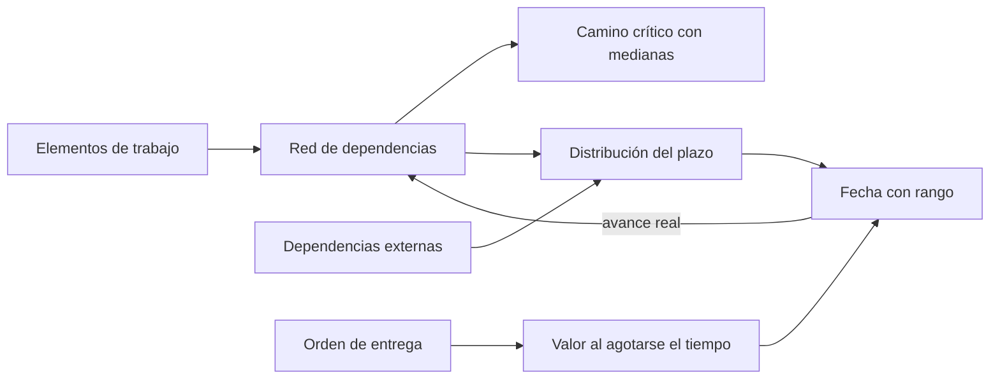
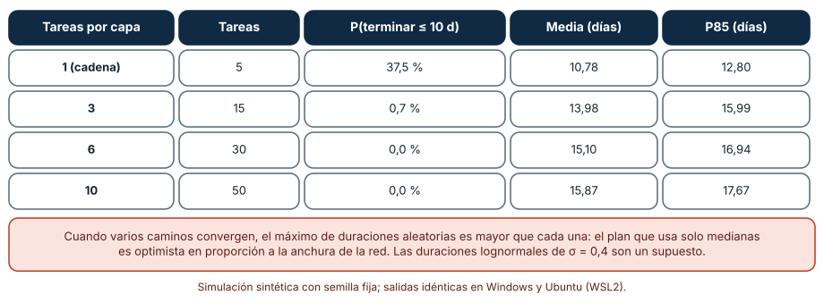
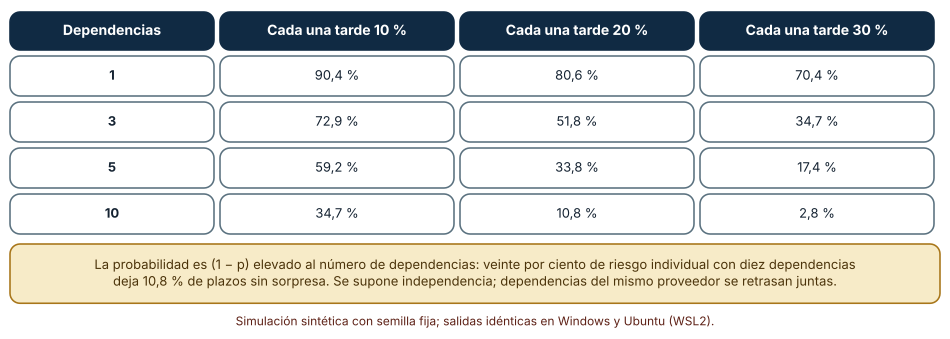
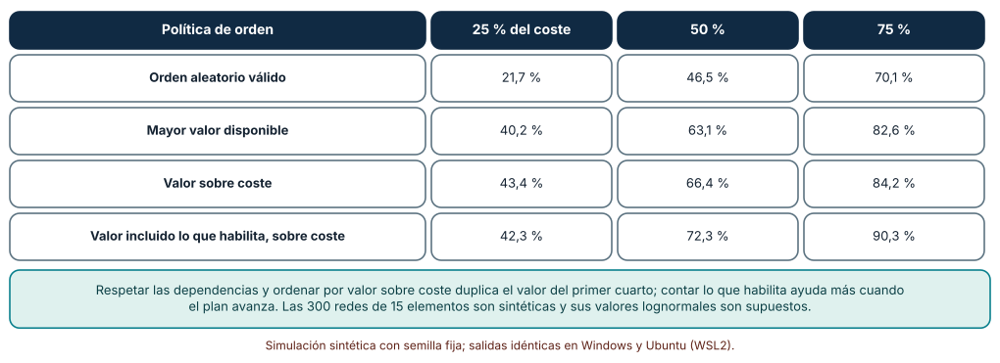

# SE-186 — Planificación de entregas y gestión de dependencias

[← SE-185 — Estimación por tamaño, rango y evidencia histórica](https://github.com/vladimiracunadev-create/modern-software-engineering-program/blob/main/classes/part-15-procesos-planificacion-y-estimacion/se-185-estimacion-por-tamano-rango-y-evidencia-historica/README.md) · [↑ Parte 15](https://github.com/vladimiracunadev-create/modern-software-engineering-program/blob/main/classes/part-15-procesos-planificacion-y-estimacion/README.md) · [📚 Índice completo](https://github.com/vladimiracunadev-create/modern-software-engineering-program/blob/main/classes/README.md) · [🌐 Portal](https://vladimiracunadev-create.github.io/modern-software-engineering-program/classes/SE-186.html) · [SE-187 — Riesgos, supuestos, issues y decisiones →](https://github.com/vladimiracunadev-create/modern-software-engineering-program/blob/main/classes/part-15-procesos-planificacion-y-estimacion/se-187-riesgos-supuestos-issues-y-decisiones/README.md)

## Punto profesional y fundamento pedagógico

**Punto profesional.** La clase existe para que planifiques una entrega sabiendo qué la retrasa de verdad: los caminos que convergen, las dependencias que no controlas y el orden en que se hace el trabajo, y para que sepas qué puedes cambiar de cada una.

**Por qué aparece aquí.** Se sitúa después de **Estimación por tamaño, rango y evidencia histórica** y antes de **Riesgos, supuestos, issues y decisiones**: la clase anterior estimó un conjunto de tareas como una suma; esta muestra que, con dependencias, el total se parece más a un máximo que a una suma y que la fecha depende de cuántas cosas ajenas deben llegar a tiempo. La siguiente clase convierte esas incertidumbres en un registro de riesgos.

**Error conceptual que debe corregir.** Creer que el camino crítico calculado con duraciones típicas es la duración típica del proyecto, o que una dependencia con 80 % de probabilidad de llegar a tiempo es «casi segura»: con varias, el producto de probabilidades cae deprisa.

**Secuencia de aprendizaje.** Antes de simular, predices con qué probabilidad un proyecto en red termina dentro de su camino crítico; después simulas redes de distinta anchura, calculas la probabilidad de que ninguna de varias dependencias externas se retrase y comparas cuatro maneras de ordenar el trabajo cuando el tiempo se agota. La secuencia usa predicción, explicación propia, contraste y recuperación. [ICAP](https://icap.education.asu.edu/research) distingue participación de construcción de conocimiento; [How People Learn II](https://nap.nationalacademies.org/catalog/24783/how-people-learn-ii-learners-contexts-and-cultures) exige conectar conocimiento previo, contexto y transferencia; la [práctica de recuperación](https://pubmed.ncbi.nlm.nih.gov/16507066/) respalda producir de nuevo la explicación tras una demora; y [Education for Life and Work](https://nap.nationalacademies.org/resource/13398/dbasse_084153.pdf) exige devolución que explique la causa del error.

**Evidencia de aprendizaje.** `release-plan-log.md` con la predicción, la probabilidad de cumplir el camino crítico por anchura de red, la tabla de dependencias externas, la comparación de órdenes de entrega y una nota con el plan de la próxima entrega y las dependencias que más lo amenazan.

**Límite de la conclusión.** Las redes son aleatorias de cinco capas, las duraciones lognormales independientes y las dependencias externas se retrasan de forma independiente. Un proyecto real tiene dependencias que fallan juntas (mismo proveedor), duraciones correlacionadas y redes con otra forma.

### Trazabilidad fuente → afirmación

| Fuente primaria u oficial | Afirmación que respalda | Lo que no prueba |
|---|---|---|
| [Malcolm et al., «Application of a technique for research and development program evaluation» (Operations Research, 1959)](https://doi.org/10.1287/opre.7.5.646) | Introduce PERT: duraciones inciertas por actividad, red de dependencias y estimación de la probabilidad de cumplir un plazo. | Su aproximación del camino crítico tiene un sesgo conocido; no sustituye la simulación de la red completa. |
| [Fowler, «Feature toggles»](https://martinfowler.com/articles/feature-toggles.html) | Describe interruptores que permiten integrar y desplegar trabajo incompleto sin exponerlo, desacoplando entrega técnica de lanzamiento. | No cuantifica cuántas dependencias elimina ni su coste de mantenimiento. |
| [The Scrum Guide](https://scrumguides.org/scrum-guide.html) | Atribuye a la planificación la selección de trabajo realista y exige que el equipo resuelva sus dependencias para entregar un incremento utilizable. | No resuelve dependencias entre equipos ni fija cómo hacerlo. |

## Antes de empezar

Recupera el resultado de `SE-185`: la suma de medianas se cumple pocas veces. Aquí el total no es una suma sino el máximo de varios caminos más lo que llega de fuera. La pregunta activa es: **¿qué caminos y qué dependencias determinan la fecha, y cuánto me costaría adelantar cada una?**

## Prerrequisitos

- Haber completado `SE-185` o poder explicar por qué la suma de medianas subestima el total.
- Python 3.11 o posterior y un terminal; todo el código usa solo la biblioteca estándar.
- Manejar grafos dirigidos sin ciclos a nivel básico.

## Problema auténtico

La entrega de la recuperación de borradores depende de 15 elementos de trabajo con dependencias entre sí (el almacenamiento de borradores antes de la interfaz, la interfaz antes de las pruebas con estudiantes), de cuatro entregas de otros equipos (identidad, notificaciones, base de datos de calificaciones, auditoría) y de una fecha comprometida con la secretaría. El camino crítico calculado con medianas da 10 días; el plan comunica «10 días». Cuatro semanas después la entrega no existe, y cada retraso parcial tiene una explicación razonable.

## Objetivos observables

Al terminar podrás:

1. calcular un camino crítico y simular la distribución del plazo de una red de tareas con duraciones inciertas;
2. explicar por qué el plazo de una red con caminos paralelos es mayor que el camino crítico con medianas y medir la diferencia;
3. calcular la probabilidad de que lleguen a tiempo varias dependencias externas y su retraso esperado;
4. comparar órdenes de entrega (aleatorio, por valor, por valor sobre coste, por lo que habilitan) por el valor entregado en distintos momentos;
5. escribir un plan de entrega con dependencias nombradas, responsable, fecha de aviso y alternativa.

## Mapa conceptual



El mapa se lee desde los elementos hacia dos cálculos: el plazo (que depende de la red y de lo externo) y el valor al agotarse el tiempo (que depende del orden). El retorno indica que el avance real corrige la red.

## Temas y por qué importan

| Tema | Por qué cambia una decisión profesional | Evidencia mínima |
|---|---|---|
| Camino crítico | Identifica qué retrasos retrasan la entrega; no cuántas veces ocurrirá. | Predicción, traza causal y contraejemplo de **Camino crítico** en `release-plan-log.md` |
| Convergencia de caminos | Cuando varios caminos convergen, el máximo aleatorio supera a cada uno: el plazo típico es mayor que el crítico. | Predicción, traza causal y contraejemplo de **Convergencia de caminos** en `release-plan-log.md` |
| Dependencias externas | Cada una añade una probabilidad de espera; con varias, esperar es lo normal. | Predicción, traza causal y contraejemplo de **Dependencias externas** en `release-plan-log.md` |
| Orden de entrega | El orden decide cuánto valor existe si el tiempo se agota. | Predicción, traza causal y contraejemplo de **Orden de entrega** en `release-plan-log.md` |
| Reducir dependencias | Cortar, desacoplar y paralelizar suelen aportar más que apretar plazos. | Predicción, traza causal y contraejemplo de **Reducir dependencias** en `release-plan-log.md` |

## Conceptos y decisiones

### 1. Camino crítico

El camino crítico es la secuencia de elementos dependientes más larga: cualquier retraso en uno de ellos retrasa la entrega. Calcularlo con duraciones típicas es útil para saber dónde mirar, y engañoso si se toma como duración esperada. Con duraciones inciertas, otros caminos casi tan largos también pueden convertirse en críticos en una parte de las ejecuciones. La noción útil es la probabilidad de que un elemento sea crítico, y no su etiqueta determinista.

### 2. Convergencia de caminos

Cuando dos o más caminos deben terminar antes de que empiece un elemento, ese elemento empieza cuando termina el último, y el último de varios tiempos aleatorios es mayor, en promedio, que cada uno. Cuantos más caminos paralelos hay, mayor es el efecto. Es el sesgo que advirtió la literatura sobre PERT: calcular con la media de cada actividad subestima la duración esperada del proyecto. En la práctica significa que paralelizar el trabajo reduce la duración pero la hace más incierta, y que un plan con muchas ramas necesita más holgura.

### 3. Dependencias externas

Una dependencia externa es un elemento que no controlas: la entrega de otro equipo, una aprobación, un proveedor. Cada una tiene su propia probabilidad de llegar tarde y un retraso cuando lo hace. La probabilidad de que todas lleguen a tiempo es el producto de las individuales; con diez dependencias de 90 % de fiabilidad, es 35 %. El plan debe tratar la espera como el caso normal: pedir fechas de aviso, tener trabajo útil que hacer mientras se espera y reducir el número de dependencias en el camino crítico.

### 4. Orden de entrega

Con las dependencias fijadas, queda elegir el orden. El valor que existe al agotarse el tiempo depende de él: hacer primero lo que más valor aporta por unidad de coste entrega más, y hacer primero lo que desbloquea a otros puede entregar aún más a medio plazo. El orden aleatorio respetando las dependencias sirve de línea base. Ordenar por valor tiene una trampa: puede dejar para el final elementos baratos que habilitaban mucho valor posterior; por eso el cálculo debe incluir lo que cada elemento desbloquea.

### 5. Reducir dependencias

Las dependencias más baratas de gestionar son las que se eliminan: dividir un elemento para quitar la parte que espera a otro, usar un interruptor para integrar trabajo incompleto sin exponerlo, acordar un contrato de interfaz para que dos equipos construyan en paralelo, o sustituir la integración real por un doble hasta que llegue. Cada técnica reduce el acoplamiento temporal pero añade un coste (mantener el interruptor, verificar el doble contra el real, como en `SE-166`). Se elige por el producto de la reducción de esperas y el coste de mantenimiento.

### Redes anchas llegan tarde aunque cada tarea sea típica

Cinco capas de tareas. Cada tarea de una capa depende de dos de la capa anterior, elegidas al azar. La duración de cada tarea es lognormal con mediana de 2 días y σ = 0,4. El camino crítico con medianas es de 10 días en cualquier red. Se varía el ancho de la red (1, 3, 6, 10 tareas por capa) y se simulan 5000 ejecuciones.

```python
def finish(deps, dur):
    f = {}
    for i in sorted(deps):
        f[i] = dur[i] + max((f[d] for d in deps[i]), default=0)
    return max(f.values())
```

| Tareas por capa | Tareas | P(terminar ≤ 10 d) | Media | P85 |
|---:|---:|---:|---:|---:|
| 1 (cadena) | 5 | 37,5 % | 10,78 | 12,80 |
| 3 | 15 | 0,7 % | 13,98 | 15,99 |
| 6 | 30 | 0,0 % | 15,10 | 16,94 |
| 10 | 50 | 0,0 % | 15,87 | 17,67 |

Resultado, idéntico en Windows (CPython 3.12.9) y en Ubuntu bajo WSL2 (3.12.3): en una cadena de cinco tareas, cumplir el camino crítico ocurre el 37,5 % de las veces; con tres tareas por capa, el 0,7 %; con seis o diez, nunca en 5000 ejecuciones. La media sube de 10,78 a 15,87 días.



**Cómo leer la figura.** Cada fila es una red de ancho distinto con el mismo camino crítico determinista; las columnas siguientes muestran lo que ocurre de verdad. **Dónde deja de valer:** las redes son aleatorias y las duraciones independientes; en un proyecto real, las tareas de una capa comparten personas, entorno y retrasos de causa común. La figura tampoco dice que paralelizar sea malo: dice que el plazo comprometido con el camino crítico determinista es falso para redes anchas.

### Cuántas dependencias externas llegan a tiempo

Una entrega depende de `n` entregas externas. Cada una llega tarde con probabilidad `p` y, si lo hace, con un retraso lognormal de mediana 3 días y σ = 0,5. El retraso de la entrega es el máximo de los retrasos. Se simulan 8000 entregas por cada combinación.

```python
ds = [rng.lognormvariate(math.log(3), 0.5) if rng.random() < p else 0.0 for _ in range(n)]
retraso = max(ds)
```

| Dependencias | Cada una tarde 10 % | 20 % | 30 % |
|---:|---:|---:|---:|
| 1 | 90,4 % | 80,6 % | 70,4 % |
| 3 | 72,9 % | 51,8 % | 34,7 % |
| 5 | 59,2 % | 33,8 % | 17,4 % |
| 10 | 34,7 % | 10,8 % | 2,8 % |

La tabla muestra el porcentaje de entregas sin retraso. Con diez dependencias del 20 % de riesgo, solo una de cada nueve entregas no se retrasa. Con tres dependencias del 30 %, solo una de cada tres. El retraso medio con diez dependencias del 20 % es de 3,87 días, y el percentil 85 es 6,02.



**Cómo leer la figura.** Cada celda es el porcentaje de 8000 entregas en que ninguna dependencia se retrasó. **Dónde deja de valer:** el modelo supone independencia entre dependencias. Las que dependen de un mismo equipo se retrasan juntas, lo que aumenta la probabilidad de que todas lleguen a tiempo y también la de que todas fallen, con colas más pesadas. Y las probabilidades de 10 %, 20 % y 30 % son supuestos; la clase `SE-187` trata cómo estimarlas con historia.

### El orden decide cuánto valor existe si se corta el tiempo

Quince elementos con valor lognormal (σ = 1), coste de 1 a 5 y hasta dos dependencias con elementos anteriores. Se compara el valor entregado al agotar el 25, el 50 y el 75 % del coste total con cuatro órdenes válidos: aleatorio, mayor valor disponible, valor sobre coste y valor (propio más el de lo que habilita) sobre coste. Se usan 300 redes.

```python
k = max(ready, key=lambda i: ((v[i] + sum(v[j] for j in trans(i))) / c[i], -i))
```

| Política | 25 % del coste | 50 % | 75 % |
|---|---:|---:|---:|
| Orden aleatorio válido | 21,7 % | 46,5 % | 70,1 % |
| Mayor valor disponible | 40,2 % | 63,1 % | 82,6 % |
| Valor sobre coste | 43,4 % | 66,4 % | 84,2 % |
| Valor incluido lo que habilita, sobre coste | 42,3 % | 72,3 % | 90,3 % |

Ordenar por valor sobre coste duplica el valor del primer cuarto (21,7 % → 43,4 %). Contar lo que cada elemento habilita rinde menos al principio (42,3 % frente a 43,4 %) y más a medio plazo (72,3 % frente a 66,4 % a mitad del coste y 90,3 % frente a 84,2 % a tres cuartos).



**Cómo leer la figura.** Cada fila es un orden; cada columna, el momento en que se agota el tiempo expresado como fracción del coste total. **Dónde deja de valer:** los valores son conocidos y fijos; en realidad se conocen con error y se aprenden al entregar (`SE-182`). Las redes de 15 elementos con 12 % de probabilidad de dependencia son sintéticas, y con redes densas el orden por valor casi no puede elegir. La tabla compara políticas bajo un mismo modelo, no predice cuánto valor tendrá la plataforma.

## Definiciones de trabajo

- **camino crítico:** secuencia de elementos dependientes de mayor duración; define la duración mínima de la entrega si las duraciones fueran las supuestas.
- **dependencia:** relación por la cual un elemento no puede empezar o terminar hasta que otro llegue a cierto estado.
- **dependencia externa:** dependencia cuya fecha y calidad controla alguien ajeno al equipo.
- **holgura:** tiempo que un elemento puede retrasarse sin retrasar la entrega.
- **interruptor de función:** mecanismo que permite integrar y desplegar trabajo incompleto sin que sea visible o activo para las usuarias.

Las definiciones son operativas para la plataforma de entregas. No convierten términos con una historia más amplia en sinónimos y deben contrastarse con la documentación primaria enlazada al final.

## Ejemplo mínimo

El fragmento calcula la duración de una red pequeña con camino crítico de 6 días. Antes de ejecutarlo, predice cuánto vale la duración si el elemento C tarda 1 día más.

```python
dur = {"A": 2, "B": 3, "C": 2, "D": 1}
deps = {"A": [], "B": [], "C": ["A", "B"], "D": ["C"]}
fin = {}
for t in ["A", "B", "C", "D"]:
    fin[t] = dur[t] + max((fin[d] for d in deps[t]), default=0)
assert fin["D"] == 6
```

El camino crítico es B → C → D (3 + 2 + 1 = 6 días); A tiene 1 día de holgura. Registra versión, comando y salida; después alarga A a 4 días y predice el nuevo camino crítico.

## Ejemplo profesional

El equipo de la plataforma de entregas dibuja la red de la entrega: 15 elementos propios y cuatro dependencias externas. Calcula el camino crítico (10 días con medianas) y lo contrasta con la simulación que, como en la red de ancho 3 de la clase, da una media cercana a 14 y un percentil 85 cercano a 16: comunica «entre 12 y 16 días». De las cuatro dependencias externas, dos están en el camino crítico; para cada una acuerdan una fecha de aviso y una alternativa (un doble para identidad hasta que llegue la real; un interruptor para notificaciones). El orden de entrega pone primero los elementos de mayor valor sobre coste y, entre ellos, los que desbloquean a otros.

Compara con el plan que comunicaba «10 días»: si la identidad llega cinco días tarde, el nuevo plan sabe que tiene un doble y que los elementos de valor siguen avanzando. Una planificación es adecuada cuando separa lo que controla de lo que espera; es débil cuando una columna de fechas esconde que seis de ellas dependen de un tercero.

## Práctica guiada

1. Dibuja la red de dependencias de una entrega con 15 a 20 elementos y marca las externas.
2. Calcula el camino crítico con medianas.
3. Predice con qué probabilidad se cumple y escribe el número antes de simular.
4. Simula la red con duraciones lognormales y compara media y percentil 85 con el camino crítico.
5. Calcula la probabilidad de que ninguna dependencia externa se retrase, con tus valores de fiabilidad.
6. Compara dos órdenes de entrega por el valor al 50 % del coste.
7. Entrega `release-plan-log.md` y pide a otra persona que identifique la dependencia que más amenaza la entrega.

## Ejercicios

1. **Red:** construye una red de cuatro capas con ancho 4 y compara la probabilidad de cumplir el camino crítico con la de ancho 8.
2. **Dependencias:** calcula cuántas dependencias de 5 % de riesgo caben antes de que la probabilidad de entrega sin retraso baje del 70 %.
3. **Orden:** añade a la política por lo que habilita un coeficiente que pondere el valor futuro con un descuento y compara resultados.
4. **Desacoplar:** elige una dependencia externa y propone un doble, un interruptor y un contrato; estima el coste de mantenerlos.

## Reto verificable

Entrega `release-plan-log.md` con la red, el camino crítico, la predicción, la simulación del plazo, la tabla de dependencias externas y la comparación de órdenes. Se aprueba si otra persona ejecuta el código desde un checkout limpio, obtiene los mismos números y puede decir qué dependencia reduciría con más efecto el retraso esperado. No se aprueba por la belleza del diagrama ni por afirmar un camino crítico sin su distribución.

## Caso conductor

La plataforma de entregas de tareas continúa como caso conductor de la Parte 15. Esta clase deja el sexto artefacto: la red de la entrega con su distribución de plazo, sus dependencias externas con fecha de aviso y el orden de entrega justificado. `SE-187` convertirá las incertidumbres de ese plan en un registro de riesgos, supuestos y decisiones. Cambia después una sola dependencia, la identidad, de externa a propia, y observa cuánto cambia el plazo.

## Preguntas frecuentes

### ¿Para qué sirve el camino crítico si el plazo real es mayor?

Para saber dónde mirar y dónde concentrar la atención: es el lugar donde un retraso se traslada completo. Lo que no sirve es tomarlo como duración esperada.

### ¿Debo eliminar todas las dependencias?

No: muchas son legítimas. El objetivo es que estén visibles, que las del camino crítico sean pocas y que cada una tenga fecha de aviso y alternativa.

### ¿Cómo estimo la probabilidad de que una dependencia llegue tarde?

Con historia: cuántas entregas de ese equipo llegaron tarde en el último año y cuánto. Sin historia, usa una cifra pesimista y revísala; una dependencia sin estimación de retraso se trata como una incertidumbre grande, no como cero.

### ¿Ordenar por valor no depende de saber el valor?

Sí, y por eso se revisa en cada ciclo con lo aprendido del uso (`SE-182`). Cuando no se conoce, se ordena por el riesgo que más desconoce: lo que más información daría.

## Fallo controlado y diagnóstico

Reproduce el fallo clásico de la clase: **comprometer el plazo del camino crítico determinista en una red ancha**. Simula la red de 30 tareas con camino crítico de 10 días y mide cuántas ejecuciones terminan en 10.

Registra síntoma, entrada mínima, hipótesis, observación que descarta cada hipótesis, causa, corrección y prueba de regresión. **Síntoma:** la entrega comprometida a 10 días llega a los 15 y cada equipo dice haber cumplido su parte. **Hipótesis rivales:** (a) alguien subestimó una tarea; (b) hubo un retraso externo; (c) la estructura de la red hace que el plazo típico supere al crítico. **Prueba:** calcula la media del plazo con las mismas duraciones medianas; en la simulación es 15,10 días y 0 de 5000 ejecuciones cumplen 10. **Conclusión:** la causa es la convergencia, no ninguna tarea individual. **Regresión:** reemplaza el plazo por un rango con percentil 85 y registra su cumplimiento en las tres entregas siguientes. No cambies a la vez la red y las estimaciones.

## Errores comunes y cómo corregirlos

| Síntoma | Causa probable | Corrección |
|---|---|---|
| El plan cumple todas las fechas parciales y falla la final | Se sumaron fechas de caminos paralelos | Simular la red y comunicar un rango |
| Siempre hay una dependencia «casi lista» que llega tarde | No se pidió fecha de aviso ni alternativa | Acordar con cada proveedor una fecha de aviso y un doble |
| Todo el equipo espera a la misma entrega externa | El camino crítico pasa por una dependencia | Dividir el trabajo para que avance sin ella, con un contrato o un doble |
| Se prioriza lo barato y se retrasa lo que desbloquea | Orden sin contar lo habilitado | Incluir el valor de lo que cada elemento habilita |
| El diagrama de dependencias queda desactualizado | Se dibujó una vez | Revisarlo en cada ciclo con el avance real |

## Entorno y archivos clave

```text
work/SE-186/
├── README.md
├── plan/
│   ├── red.py
│   ├── dependencias.py
│   └── orden.py
├── tests/test_plan.py
└── evidence/release-plan-log.md
```

El `README` declara plataforma, versión de Python, semillas y comandos. Los experimentos usan solo la biblioteca estándar (`random`, `statistics`, `math`) y se ejecutaron con CPython 3.12.9 en Windows 11 y 3.12.3 en Ubuntu bajo WSL2: las salidas fueron idénticas. Si añades una dependencia, fija procedencia y versión.

## Seguridad, ética y accesibilidad

- un doble o un interruptor que sustituye a una integración de seguridad (identidad, autorización) no debe llegar a producción: documenta su alcance y cuándo se retira;
- una dependencia externa con datos de estudiantes debe contar con un acuerdo de tratamiento antes de integrarse;
- los diagramas de red deben tener una versión textual accesible;
- documenta quién aceptó el riesgo de cada dependencia crítica;
- respeta las licencias de las herramientas de planificación y atribuye lo adaptado.

## Puente hacia el trabajo con agentes

Un agente al que se le pide «planifica la entrega» devolverá un calendario con un camino crítico y fechas únicas. Pídele en cambio que dibuje la red, que indique qué elementos son externos, que simule el plazo con rangos de duración y que proponga qué dependencia reducir primero con su coste. Revisa especialmente si trata las dependencias como independientes o si asume duraciones sin dispersión: ambos supuestos producen fechas optimistas.

## Transferencia

Traslada el análisis a otra entrega (por ejemplo, una migración con equipos de infraestructura y seguridad): cambia la red y las dependencias, y conserva el procedimiento de simular el plazo y calcular la probabilidad de espera. La transferencia está lograda cuando puedes explicar qué parte de la red dependía del proyecto y cuál no, no cuando el código se parece.

## Evaluación y evidencia

| Criterio | Evidencia para aprobar |
|---|---|
| comprensión | explicación de por qué el plazo de una red ancha supera a su camino crítico |
| corrección | simulaciones reproducibles con las mismas semillas |
| diseño | red con dependencias externas, fechas de aviso, alternativas y orden justificado |
| diagnóstico | reproducción del fallo «plazo del camino crítico» con regresión |
| incertidumbre | declaración de los supuestos de independencia y de la forma de la red |
| reproducibilidad | versiones, comandos, salida y límites declarados |

## Fuentes

- [Malcolm et al., «Application of a technique for research and development program evaluation» (Operations Research, 1959)](https://doi.org/10.1287/opre.7.5.646) — PERT y la incertidumbre en redes de actividades; autoridad: Operations Research.
- [Fowler, «Feature toggles»](https://martinfowler.com/articles/feature-toggles.html) — integrar trabajo incompleto sin exponerlo; autoridad: martinfowler.com.
- [The Scrum Guide](https://scrumguides.org/scrum-guide.html) — planificación y entrega de incrementos utilizables; autoridad: Scrum.org y Scrum Inc. (autores de la guía).
- [Boehm, «Software risk management: principles and practices» (IEEE Software, 1991)](https://doi.org/10.1109/52.62930) — identificar y priorizar riesgos de proyecto, incluidas las dependencias; autoridad: IEEE Software.
- [SWEBOK Guide v4.0a](https://www.computer.org/education/bodies-of-knowledge/software-engineering) — gestión de ingeniería de software; autoridad: IEEE Computer Society.

Cada fuente respalda el mecanismo indicado; ninguna demuestra que el 0,7 % de cumplimiento, el 10,8 % sin retraso o el 90,3 % del valor se observen en la plataforma de entregas. Esa afirmación depende de la forma de la red, de la historia de los proveedores y de los valores reales.

- [Python: `random`](https://docs.python.org/3/library/random.html) — generador con semilla para las simulaciones.
- [Python: `statistics`](https://docs.python.org/3/library/statistics.html) — media y percentiles.

## Límites y siguiente paso

Se ejecutaron tres experimentos con datos sintéticos en Windows y Ubuntu (WSL2) con resultados idénticos. No se analizó ningún proyecto real: la forma de las redes, las duraciones, los riesgos de las dependencias y los valores son construcciones del autor. La siguiente clase convierte estas incertidumbres en riesgos, supuestos, problemas y decisiones con responsable.

## Glosario

- **camino crítico:** secuencia de elementos dependientes de mayor duración; define la duración mínima de la entrega si las duraciones fueran las supuestas.
- **dependencia:** relación por la cual un elemento no puede empezar o terminar hasta que otro llegue a cierto estado.
- **dependencia externa:** dependencia cuya fecha y calidad controla alguien ajeno al equipo.
- **holgura:** tiempo que un elemento puede retrasarse sin retrasar la entrega.
- **interruptor de función:** mecanismo que permite integrar y desplegar trabajo incompleto sin que sea visible o activo para las usuarias.

---

[← SE-185 — Estimación por tamaño, rango y evidencia histórica](https://github.com/vladimiracunadev-create/modern-software-engineering-program/blob/main/classes/part-15-procesos-planificacion-y-estimacion/se-185-estimacion-por-tamano-rango-y-evidencia-historica/README.md) · [↑ Parte 15](https://github.com/vladimiracunadev-create/modern-software-engineering-program/blob/main/classes/part-15-procesos-planificacion-y-estimacion/README.md) · [📚 Índice completo](https://github.com/vladimiracunadev-create/modern-software-engineering-program/blob/main/classes/README.md) · [🌐 Portal](https://vladimiracunadev-create.github.io/modern-software-engineering-program/classes/SE-186.html) · [SE-187 — Riesgos, supuestos, issues y decisiones →](https://github.com/vladimiracunadev-create/modern-software-engineering-program/blob/main/classes/part-15-procesos-planificacion-y-estimacion/se-187-riesgos-supuestos-issues-y-decisiones/README.md)
