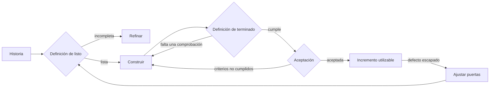
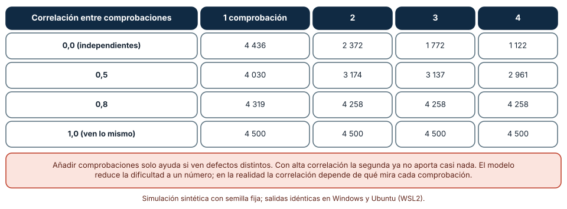
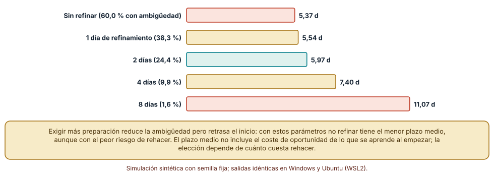
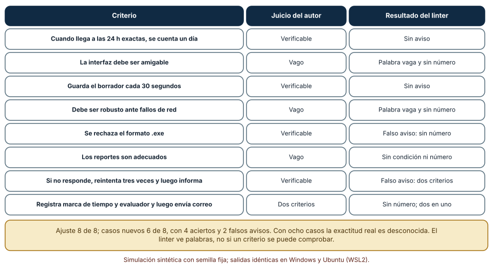

# SE-188 — Definition of Ready, Done y aceptación

[← SE-187 — Riesgos, supuestos, issues y decisiones](https://github.com/vladimiracunadev-create/modern-software-engineering-program/blob/main/classes/part-15-procesos-planificacion-y-estimacion/se-187-riesgos-supuestos-issues-y-decisiones/README.md) · [↑ Parte 15](https://github.com/vladimiracunadev-create/modern-software-engineering-program/blob/main/classes/part-15-procesos-planificacion-y-estimacion/README.md) · [📚 Índice completo](https://github.com/vladimiracunadev-create/modern-software-engineering-program/blob/main/classes/README.md) · [🌐 Portal](https://vladimiracunadev-create.github.io/modern-software-engineering-program/classes/SE-188.html) · [SE-189 — Métricas de flujo, calidad y resultados →](https://github.com/vladimiracunadev-create/modern-software-engineering-program/blob/main/classes/part-15-procesos-planificacion-y-estimacion/se-189-metricas-de-flujo-calidad-y-resultados/README.md)

## Punto profesional y fundamento pedagógico

**Punto profesional.** La clase existe para que definas cuándo un trabajo está listo para empezar, cuándo está terminado y cuándo se acepta, de modo que cada umbral reduzca un riesgo concreto a un coste conocido y no se convierta en una lista de verificación que se cumple por costumbre.

**Por qué aparece aquí.** Se sitúa después de **Riesgos, supuestos, issues y decisiones** y antes de **Métricas de flujo, calidad y resultados**: la clase anterior registró incertidumbres; esta fija las puertas por las que pasa el trabajo (entrada, salida, aceptación) y la siguiente medirá qué ocurre al cruzarlas. Los criterios de aceptación son además el punto donde la Parte 12 (requisitos) y la Parte 13 (ejemplos y contratos) se encuentran con el proceso.

**Error conceptual que debe corregir.** Creer que cuantas más comprobaciones tenga la definición de terminado menos defectos escapan, o que una definición de listo estricta siempre ahorra tiempo: las comprobaciones correlacionadas se solapan, y exigir más preparación retrasa el inicio.

**Secuencia de aprendizaje.** Antes de simular, predices cuántos defectos escaparían con una, dos, tres o cuatro comprobaciones; después simulas cuatro grados de correlación entre comprobaciones, mides el plazo según los días de refinamiento previo y evalúas un verificador de criterios de aceptación con casos nuevos. La secuencia usa predicción, explicación propia, contraste y recuperación. [ICAP](https://icap.education.asu.edu/research) distingue participación de construcción de conocimiento; [How People Learn II](https://nap.nationalacademies.org/catalog/24783/how-people-learn-ii-learners-contexts-and-cultures) exige conectar conocimiento previo, contexto y transferencia; la [práctica de recuperación](https://pubmed.ncbi.nlm.nih.gov/16507066/) respalda producir de nuevo la explicación tras una demora; y [Education for Life and Work](https://nap.nationalacademies.org/resource/13398/dbasse_084153.pdf) exige devolución que explique la causa del error.

**Evidencia de aprendizaje.** `gates-log.md` con la definición de listo, la de terminado y los criterios de aceptación de una historia de la plataforma, la predicción, las tres tablas y una nota sobre qué comprobación retirarías de la definición de terminado y por qué.

**Límite de la conclusión.** La «dificultad» de un defecto como número entre 0 y 1, la ambigüedad que desaparece con el refinamiento a una tasa constante y el verificador de palabras vagas son modelos del autor. Muestran mecanismos; no miden la eficacia de una revisión ni de un equipo.

### Trazabilidad fuente → afirmación

| Fuente primaria u oficial | Afirmación que respalda | Lo que no prueba |
|---|---|---|
| [The Scrum Guide](https://scrumguides.org/scrum-guide.html) | Define el incremento como un paso concreto hacia el objetivo y exige una definición de terminado compartida que lo haga utilizable y verificable. | No dice qué comprobaciones debe contener ni cuántas. |
| [Jones, «Software defect-removal efficiency» (IEEE Computer, 1996)](https://doi.org/10.1109/2.488361) | Reúne datos de la eficiencia con que distintas técnicas de eliminación de defectos los detectan y observa que ninguna los atrapa todos. | No da cifras aplicables a la plataforma de entregas. |
| [Fagan, «Design and code inspections to reduce errors in program development» (IBM Systems Journal, 1976)](https://doi.org/10.1147/sj.153.0182) | Describe un procedimiento formal de inspección y datos de defectos hallados antes de las pruebas. | No compara con técnicas modernas ni fija el coste de una inspección hoy. |
| [North, «Introducing BDD»](https://dannorth.net/introducing-bdd/) | Plantea expresar criterios de aceptación como escenarios con el vocabulario del dominio. | Es una propuesta de práctica; no mide cuántos malentendidos evita. |

## Antes de empezar

Recupera lo que dejó la Parte 13: ejemplos que separan lecturas y contratos comprobables. Aquí se convierten en criterios de aceptación y en puertas del proceso. La pregunta activa es: **¿qué riesgo evita cada puerta, qué cuesta y cuándo deja de aportar?**

## Prerrequisitos

- Haber completado `SE-187` o poder explicar la diferencia entre riesgo y supuesto.
- Python 3.11 o posterior y un terminal; todo el código usa solo la biblioteca estándar.
- Haber visto criterios de aceptación escritos como ejemplos o escenarios.

## Problema auténtico

La definición de terminado de la plataforma de entregas tiene catorce casillas: pruebas unitarias, revisión de código, análisis estático, prueba de aceptación, documentación, accesibilidad, rendimiento y otras. Se marcan todas antes de cerrar una historia, aunque la historia sea un cambio de texto. La definición de listo exige estimación, diseño aprobado y criterios completos; las historias esperan dos semanas en la cola de refinamiento antes de empezar. En el trimestre siguiente se escapan defectos de los mismos tipos y el plazo de cada historia ha crecido.

## Objetivos observables

Al terminar podrás:

1. distinguir definición de listo, definición de terminado y criterios de aceptación con un ejemplo y un contraejemplo de la plataforma;
2. medir con una simulación cuántos defectos escapan según el número y la correlación de las comprobaciones de la definición de terminado;
3. calcular el plazo medio de una historia según los días de refinamiento previo y localizar el punto en que más preparación retrasa más de lo que ahorra;
4. escribir criterios de aceptación verificables y evaluar un verificador de forma con casos nuevos, declarando qué no ve;
5. proponer una definición de terminado y otra de listo por tipo de trabajo, con la observación que las cambiaría.

## Mapa conceptual



El mapa se lee como una secuencia de tres puertas con retorno: cada una devuelve el trabajo si no se cumple. El retorno final indica que un defecto escapado enseña qué puerta fue insuficiente.

## Temas y por qué importan

| Tema | Por qué cambia una decisión profesional | Evidencia mínima |
|---|---|---|
| Definición de listo | Reduce el riesgo de empezar sin entender, a cambio de retrasar el inicio. | Predicción, traza causal y contraejemplo de **Definición de listo** en `gates-log.md` |
| Definición de terminado | Compromete qué comprobaciones pasan antes de llamar terminado a un incremento. | Predicción, traza causal y contraejemplo de **Definición de terminado** en `gates-log.md` |
| Criterios de aceptación | Convierten la intención en condiciones verificables que la usuaria o quien lleva el producto reconoce. | Predicción, traza causal y contraejemplo de **Criterios de aceptación** en `gates-log.md` |
| Correlación entre comprobaciones | Añadir una comprobación que ve lo mismo que otra casi no reduce los escapes. | Predicción, traza causal y contraejemplo de **Correlación entre comprobaciones** en `gates-log.md` |
| Calibrar las puertas | Se ajustan por tipo de trabajo y con los defectos que se escapan, no por exhaustividad. | Predicción, traza causal y contraejemplo de **Calibrar las puertas** en `gates-log.md` |

## Conceptos y decisiones

### 1. Definición de listo

La definición de listo es un acuerdo sobre qué debe saberse de un elemento de trabajo antes de empezar: qué problema resuelve, para quién, qué ejemplos lo describen, qué dependencias tiene. No es un requisito de la guía de Scrum; es una práctica de equipos que sufrieron empezar con información incompleta. Su coste es el tiempo de espera y de preparación; su beneficio, que menos historias se rehacen. Las dos fuerzas se oponen, y el mínimo depende de qué fracción de las historias esconde una ambigüedad y de cuánto cuesta descubrirla durante la construcción.

### 2. Definición de terminado

La definición de terminado es el conjunto de comprobaciones que un incremento debe pasar para considerarse utilizable y liberable: pruebas, revisión, análisis, documentación mínima, criterios de aceptación. Es una promesa compartida de calidad, y la guía de Scrum la hace obligatoria. Un incremento que no la cumple no es parcialmente terminado: no lo es. Una definición se mantiene viva: se revisa con los defectos que se escaparon y se calibra por tipo de trabajo, porque un cambio de texto y un cambio de la regla de penalización no necesitan las mismas puertas.

### 3. Criterios de aceptación

Los criterios de aceptación son las condiciones concretas que debe cumplir una historia para que quien lleva el producto la acepte. Se escriben como ejemplos o escenarios en el lenguaje del dominio («cuando la entrega llega a las 24 horas exactas, entonces se cuenta un día de retraso»), tal como proponen las prácticas de especificación por ejemplo vistas en `SE-158`. Un criterio verificable tiene una condición y un resultado observable; uno vago («la pantalla debe ser intuitiva») invita a discutir al final. La aceptación no es lo mismo que el terminado: lo segundo es calidad técnica; lo primero, el reconocimiento de que resuelve el problema.

### 4. Correlación entre comprobaciones

Si cada comprobación detectara defectos al azar con su propia probabilidad, añadir otra siempre reduciría los escapes de forma multiplicativa. Pero las comprobaciones miran cosas parecidas: los defectos «fáciles» los ve cualquiera y los «difíciles» se escapan a todas. Esa correlación hace que la segunda y la tercera comprobación aporten mucho menos de lo esperado, y que a partir de cierto punto no aporten nada. Jones observó que ninguna técnica los elimina todos y que las combinaciones de técnicas distintas rinden más que repetir la misma. La consecuencia de diseño es elegir comprobaciones que vean defectos distintos, no más comprobaciones.

### 5. Calibrar las puertas

Las puertas se calibran con datos: qué defectos se escaparon, en qué puerta debieron detenerse, qué comprobación los habría visto y cuánto cuesta añadirla. Una puerta que nunca detiene nada es candidata a retirarse o a cambiarse por otra; una que detiene todo es candidata a hacerse más barata (automatizarla). Y las puertas varían por tipo de trabajo: un cambio de bajo riesgo puede tener una puerta ligera; uno que afecta a notas o a datos de estudiantes, una más exigente. La calibración es una decisión que se registra, como las de `SE-187`.

### Más comprobaciones solo ayudan si ven cosas distintas

Cuatro comprobaciones con «potencia» 0,55 (pruebas unitarias), 0,45 (revisión), 0,25 (análisis estático) y 0,35 (prueba de aceptación). Cada defecto tiene una dificultad `d` entre 0 y 1; una comprobación lo detecta si su visión del defecto es menor que su potencia. La visión es `w·d + (1−w)·u`, con `u` aleatoria propia de cada comprobación: `w = 0` significa que cada una ve de forma independiente y `w = 1` que todas ven exactamente lo mismo. Se pasan 10 000 defectos por cada valor de `w`.

```python
for c in comprobaciones:
    visto = w * d + (1 - w) * rng.random()
    detecta.append(visto < potencia[c])
```

| Correlación `w` | 1 comprobación | 2 | 3 | 4 |
|---|---:|---:|---:|---:|
| 0,0 (independientes) | 4 436 | 2 372 | 1 772 | 1 122 |
| 0,5 | 4 030 | 3 174 | 3 137 | 2 961 |
| 0,8 | 4 319 | 4 258 | 4 258 | 4 258 |
| 1,0 (ven lo mismo) | 4 500 | 4 500 | 4 500 | 4 500 |

Resultado, idéntico en Windows (CPython 3.12.9) y en Ubuntu bajo WSL2 (3.12.3): con comprobaciones independientes, pasar de una a cuatro reduce los escapes de 4436 a 1122 (un 75 %). Con correlación 0,8, la segunda reduce 61 más y la tercera y la cuarta no reducen nada. Con correlación 1, ninguna adicional aporta.



**Cómo leer la figura.** Cada fila es un grado de correlación; cada columna, cuántas comprobaciones forman la definición. **Dónde deja de valer:** reducir la dificultad de un defecto a un número entre 0 y 1 es una simplificación fuerte; en la práctica, una revisión de código y una prueba unitaria no fallan por la misma razón, y su correlación depende de qué mira cada una. Los valores de `w` no se midieron: muestran cómo se comporta la suma de comprobaciones a medida que se solapan.

### Más preparación retrasa el inicio

Una historia tiene una probabilidad de ambigüedad oculta que baja con los días de refinamiento previo: 60 % sin refinar y 60 % por e⁻⁰·⁴⁵ᵈ con `d` días. Si hay ambigüedad, descubrirla durante la construcción cuesta entre 2 y 6 días de rehacer. La construcción tarda 3 días. Se simulan 20 000 historias por cada nivel de refinamiento.

```python
amb = rng.random() < 0.6 * math.exp(-0.45 * dias)
plazo = dias + 3 + (rng.uniform(2, 6) if amb else 0)
```

| Días de refinamiento | Con ambigüedad | Plazo medio |
|---:|---:|---:|
| 0 | 60,0 % | 5,37 |
| 1 | 38,3 % | 5,54 |
| 2 | 24,4 % | 5,97 |
| 4 | 9,9 % | 7,40 |
| 8 | 1,6 % | 11,07 |

Con estos parámetros, no refinar tiene el menor plazo medio (5,37 días), porque rehacer cuesta 2 a 6 días y refinar cuesta días enteros de espera. La ambigüedad baja de 60 % a 1,6 %, pero el plazo se duplica.



**Cómo leer la figura.** Cada barra es el plazo medio hasta terminar, incluida la espera de refinamiento; la etiqueta indica el porcentaje que aún tiene ambigüedad. **Dónde deja de valer:** el modelo trata el refinamiento como espera pura. En la práctica, refinar también es trabajo útil (se pueden refinar varias historias a la vez, y lo aprendido evita más que un rehacer). Y el coste de rehacer depende de dónde se descubre: si es durante la construcción, 2 a 6 días; si es en producción, mucho más. Con otros costes el óptimo cambia: la conclusión no es «no refines», sino que la puerta de listo tiene un coste que debe compararse con el de rehacer.

### Un verificador de criterios de aceptación y sus falsos avisos

Un verificador de forma marca un criterio si contiene palabras vagas (rápido, fácil, intuitivo, adecuado, correctamente, amigable, robusto, bueno, mejor), si no tiene condición ni número, o si junta dos criterios. Se ajustó con 8 criterios y se evaluó con 8 casos nuevos escritos por el autor.

```python
def lint(c):
    if VAGUE.search(c): errs.append("palabra vaga")
    if not re.search(r"\b(dado|cuando|entonces)\b", c, re.I) and not re.search(r"\d", c):
        errs.append("sin condicion ni numero")
    if re.search(r"\b(y tambien|ademas|y luego)\b", c, re.I): errs.append("dos criterios en uno")
```

| Conjunto | Aciertos | Falsos avisos | Fallos |
|---|---:|---:|---:|
| Ajuste (8 criterios) | 8 | 0 | 0 |
| Casos nuevos (8 criterios) | 6 | 2 | 0 |

Con los criterios con que se ajustó acierta 8 de 8; con los nuevos, 6 de 8: marca como defectuoso «Se rechaza el formato .exe» (verificable, sin número) y «Si no responde, reintenta tres veces y luego informa» (una conjunción legítima). No dejó pasar ningún criterio vago de los ocho, pero con ocho casos la exactitud real es desconocida.



**Cómo leer la figura.** Cada fila es un criterio; la segunda columna es el juicio del autor y la tercera, lo que dijo el verificador. **Dónde deja de valer:** ocho casos escritos por quien afinó las reglas no representan los criterios que escribirán otras personas. El verificador ve palabras y números, no si el criterio se puede comprobar: «Los reportes son adecuados» lo atrapa por una palabra, y «Los reportes son útiles» no. Es una ayuda para la revisión, no un sustituto.

## Definiciones de trabajo

- **definición de listo:** acuerdo sobre la información que un elemento debe tener antes de comenzar a construirse.
- **definición de terminado:** conjunto de comprobaciones que un incremento debe pasar para considerarse utilizable y liberable.
- **criterio de aceptación:** condición concreta, con un resultado observable, que debe cumplirse para que una historia se acepte.
- **escape:** defecto que supera las puertas del proceso y se descubre después de dar el trabajo por terminado.
- **correlación entre comprobaciones:** grado en que dos comprobaciones fallan o aciertan sobre los mismos defectos.

Las definiciones son operativas para la plataforma de entregas. No convierten términos con una historia más amplia en sinónimos y deben contrastarse con la documentación primaria enlazada al final.

## Ejemplo mínimo

El fragmento calcula los escapes esperados de dos comprobaciones independientes y de dos que ven lo mismo. Antes de ejecutarlo, predice cuál deja pasar menos defectos.

```python
a, b = 0.55, 0.45
independientes = (1 - a) * (1 - b)      # escapan los que ninguna detecta
iguales = 1 - max(a, b)                  # la segunda no añade nada
assert round(independientes, 3) == 0.247
assert round(iguales, 2) == 0.45
```

Con comprobaciones independientes escapa el 24,7 % de los defectos; si la segunda solo ve lo que ya veía la primera, escapa el 45 %. Registra versión, comando y salida; cambia 0,45 por 0,25 y predice cuánto aporta la segunda en cada caso.

## Ejemplo profesional

El equipo de la plataforma de entregas reduce su definición de terminado de catorce casillas a tres niveles. Para cambios de texto: revisión y prueba de aceptación automática. Para cambios de interfaz: además, comprobación de accesibilidad con una herramienta y una lectora de pantalla. Para cambios en la regla de penalización o en notas: además, comparación contra la función de referencia de `SE-157` y una segunda persona que lee el sentido. Cada casilla tiene una razón registrada (qué escape evitó la última vez) y una fecha de revisión. La definición de listo se reduce a tres preguntas (qué problema resuelve, qué ejemplo lo ilustra, qué dependencia tiene) y se aplica en menos de un día.

Compara lo que el equipo esperaría ver (es una hipótesis de diseño, no una medición): las historias de texto tardarían menos al pasar menos puertas; las de nota tardarían más, a cambio de que los escapes de ese tipo cuenten como señal para volver a ajustar. Una definición es adecuada cuando cada puerta tiene un escape que la justifica; es un ritual cuando todas las casillas se marcan igual para todo.

## Práctica guiada

1. Lista las casillas de la definición de terminado de un equipo y, para cada una, el defecto que evitó la última vez.
2. Marca las que ven defectos parecidos a los de otra y estima la correlación.
3. Predice cuántos escapes se reducen al quitar la comprobación más correlacionada y escribe el número antes de simular.
4. Simula cuatro grados de correlación con la semilla fija.
5. Estima la probabilidad de ambigüedad de tus historias y el coste de rehacer; calcula el plazo según los días de refinamiento.
6. Reescribe cinco criterios vagos como ejemplos verificables y pásalos por el verificador.
7. Entrega `gates-log.md` y pide a otra persona que proponga qué puerta retiraría con tu registro.

## Ejercicios

1. **Correlación:** con `w = 0,5`, calcula cuántas comprobaciones se necesitan para llegar a menos de 3000 escapes y explica por qué no basta con añadir más.
2. **Refinamiento:** con un coste de rehacer de 4 a 10 días, recalcula la tabla y localiza el nuevo mínimo.
3. **Criterios:** escribe tres criterios vagos que el verificador no atrape y tres verificables que marque; propón dos reglas nuevas.
4. **Niveles:** diseña la definición de terminado para tres tipos de trabajo de tu equipo y justifica cada casilla con un escape.

## Reto verificable

Entrega `gates-log.md` con las dos definiciones, los criterios de una historia, la predicción, las tres tablas y los niveles de puerta propuestos con sus escapes de referencia. Se aprueba si otra persona ejecuta el código desde un checkout limpio, obtiene los mismos números y puede decir qué comprobación retiraría primero. No se aprueba por una definición larga ni por afirmar que un verificador valida los criterios.

## Caso conductor

La plataforma de entregas de tareas continúa como caso conductor de la Parte 15. Esta clase deja el octavo artefacto: las puertas de listo, terminado y aceptación por tipo de trabajo, con el escape que justifica cada casilla. `SE-189` medirá qué ocurre cuando el trabajo cruza esas puertas. Cambia después una sola casilla, el análisis estático, y observa qué escape reaparece.

## Preguntas frecuentes

### ¿La definición de listo es obligatoria en Scrum?

No: la guía no la menciona. Es una práctica local. Si la usas, trátala como cualquier otra puerta: con su coste y su justificación.

### ¿Cuántas comprobaciones debe tener la definición de terminado?

Las que ven defectos distintos y cuyo coste esté justificado por los escapes que evitan. Más casillas no equivalen a más calidad, como muestra la correlación.

### ¿Quién acepta una historia?

Quien lleva el producto o la usuaria que representa, no el equipo que la construyó. Si el equipo acepta su propio trabajo, la aceptación pierde su función.

### ¿Los criterios deben ser automatizables?

Los que lo sean, conviene automatizarlos (`SE-158`, `SE-166`); los demás se acuerdan como ejemplos revisables. Lo esencial es que alguien pueda decidir, sin discutir, si se cumplen.

## Fallo controlado y diagnóstico

Reproduce el fallo clásico de la clase: **añadir comprobaciones correlacionadas y esperar menos escapes**. Simula la definición con cuatro comprobaciones y correlación 0,8, y compara los escapes con los de una sola.

Registra síntoma, entrada mínima, hipótesis, observación que descarta cada hipótesis, causa, corrección y prueba de regresión. **Síntoma:** tras añadir dos casillas a la definición de terminado, los escapes del trimestre no bajan. **Hipótesis rivales:** (a) las nuevas casillas no se aplican; (b) los defectos escapados son de otra naturaleza; (c) las nuevas comprobaciones ven lo mismo que las anteriores. **Prueba:** clasifica los últimos diez escapes por qué comprobación debió verlos y si las casillas nuevas habrían visto algo que las viejas no; en la simulación, de 4258 escapes con dos comprobaciones se pasa a 4258 con cuatro. **Conclusión:** la causa es la correlación, no el incumplimiento. **Regresión:** sustituye una casilla correlacionada por una que mira otra cosa (por ejemplo, un ejemplo de frontera de `SE-157`) y mide los escapes del trimestre siguiente. No cambies a la vez el número de casillas y su contenido.

## Errores comunes y cómo corregirlos

| Síntoma | Causa probable | Corrección |
|---|---|---|
| La definición de terminado tiene catorce casillas y los escapes no bajan | Comprobaciones correlacionadas | Medir qué ve cada una y retirar las que ven lo mismo |
| Las historias esperan dos semanas para estar «listas» | Definición de listo demasiado exigente | Reducir a las preguntas que evitan los rehacer y medir el plazo |
| Los criterios de aceptación se discuten al final | Criterios vagos | Reescribir como ejemplos con condición y resultado observable |
| El equipo acepta su propio trabajo | Aceptación sin la persona que usa el producto | Asignar la aceptación a quien lleva el producto o a una usuaria |
| El verificador de criterios aprueba criterios engañosos | Se confunde forma con contenido | Revisar el sentido y mantener el verificador como ayuda |

## Entorno y archivos clave

```text
work/SE-188/
├── README.md
├── gates/
│   ├── comprobaciones.py
│   ├── refinamiento.py
│   └── criterios.py
├── tests/test_gates.py
└── evidence/gates-log.md
```

El `README` declara plataforma, versión de Python, semillas y comandos. Los experimentos usan solo la biblioteca estándar (`random`, `math`, `re`, `statistics`) y se ejecutaron con CPython 3.12.9 en Windows 11 y 3.12.3 en Ubuntu bajo WSL2: las salidas fueron idénticas. Si añades una dependencia, fija procedencia y versión.

## Seguridad, ética y accesibilidad

- la accesibilidad debe ser una casilla de terminado desde el primer incremento, no una mejora posterior;
- una puerta ligera para cambios «de bajo riesgo» no debe aplicarse a código que toca notas, datos personales o autorización;
- los criterios de aceptación deben ser comprensibles para quien los acepta y no depender de vocabulario técnico;
- documenta quién aceptó cada incremento y con qué evidencia;
- respeta las licencias de las herramientas de comprobación y atribuye lo adaptado.

## Puente hacia el trabajo con agentes

Un agente al que se le pide «define cuándo está terminado» generará una lista larga y equilibrada de casillas sin un solo escape que las justifique. Pídele en cambio que parta de los defectos que se escaparon, que proponga la comprobación que los habría visto, que estime qué ven de común las comprobaciones existentes y que escriba criterios de aceptación como ejemplos con condición y resultado. Revisa especialmente si propone añadir comprobaciones del mismo tipo: es el patrón que la correlación vuelve inútil.

## Transferencia

Traslada el análisis a otro proceso con puertas (por ejemplo, la revisión de cambios de infraestructura): cambia las comprobaciones y los defectos, y conserva el procedimiento de medir la correlación, el coste de la puerta de entrada y la forma de los criterios. La transferencia está lograda cuando puedes explicar qué parte del método dependía de las puertas concretas y cuál no, no cuando el código se parece.

## Evaluación y evidencia

| Criterio | Evidencia para aprobar |
|---|---|
| comprensión | explicación de la diferencia entre listo, terminado y aceptación con ejemplos |
| corrección | simulaciones y evaluación del verificador reproducibles con las mismas semillas |
| diseño | puertas por tipo de trabajo con el escape que justifica cada casilla |
| diagnóstico | reproducción del fallo «comprobaciones correlacionadas» con regresión |
| incertidumbre | declaración de la correlación supuesta y del tamaño de la muestra del verificador |
| reproducibilidad | versiones, comandos, salida y límites declarados |

## Fuentes

- [The Scrum Guide](https://scrumguides.org/scrum-guide.html) — definición de terminado e incremento; autoridad: Scrum.org y Scrum Inc. (autores de la guía).
- [Jones, «Software defect-removal efficiency» (IEEE Computer, 1996)](https://doi.org/10.1109/2.488361) — eficiencia de eliminación de defectos por técnica; autoridad: IEEE Computer.
- [Fagan, «Design and code inspections to reduce errors in program development» (IBM Systems Journal, 1976)](https://doi.org/10.1147/sj.153.0182) — inspecciones formales de diseño y código; autoridad: IBM Systems Journal.
- [North, «Introducing BDD»](https://dannorth.net/introducing-bdd/) — criterios de aceptación como escenarios; autoridad: autor de la práctica.
- [Agile Alliance: definition of done](https://www.agilealliance.org/glossary/definition-of-done/) — glosario de la práctica; autoridad: Agile Alliance.
- [Agile Alliance: definition of ready](https://www.agilealliance.org/glossary/definition-of-ready/) — glosario de la práctica; autoridad: Agile Alliance.

Cada fuente respalda el mecanismo indicado; ninguna demuestra que la correlación de 0,8, el óptimo de cero días de refinamiento o el 6 de 8 del verificador correspondan a la plataforma de entregas. Esa afirmación depende de los defectos reales, del coste de rehacer y de cómo se redactan los criterios.

- [Python: `random`](https://docs.python.org/3/library/random.html) — generador con semilla para las simulaciones.
- [Python: `re`](https://docs.python.org/3/library/re.html) — expresiones regulares del verificador de criterios.

## Límites y siguiente paso

Se ejecutaron tres experimentos con datos sintéticos en Windows y Ubuntu (WSL2) con resultados idénticos. No se midió ninguna definición de terminado de un equipo ni se revisaron criterios reales: la dificultad de los defectos, la ambigüedad que decae con el refinamiento y los dieciséis criterios del verificador son construcciones del autor. La siguiente clase mide el flujo, la calidad y los resultados que producen esas puertas.

## Glosario

- **definición de listo:** acuerdo sobre la información que un elemento debe tener antes de comenzar a construirse.
- **definición de terminado:** conjunto de comprobaciones que un incremento debe pasar para considerarse utilizable y liberable.
- **criterio de aceptación:** condición concreta, con un resultado observable, que debe cumplirse para que una historia se acepte.
- **escape:** defecto que supera las puertas del proceso y se descubre después de dar el trabajo por terminado.
- **correlación entre comprobaciones:** grado en que dos comprobaciones fallan o aciertan sobre los mismos defectos.

---

[← SE-187 — Riesgos, supuestos, issues y decisiones](https://github.com/vladimiracunadev-create/modern-software-engineering-program/blob/main/classes/part-15-procesos-planificacion-y-estimacion/se-187-riesgos-supuestos-issues-y-decisiones/README.md) · [↑ Parte 15](https://github.com/vladimiracunadev-create/modern-software-engineering-program/blob/main/classes/part-15-procesos-planificacion-y-estimacion/README.md) · [📚 Índice completo](https://github.com/vladimiracunadev-create/modern-software-engineering-program/blob/main/classes/README.md) · [🌐 Portal](https://vladimiracunadev-create.github.io/modern-software-engineering-program/classes/SE-188.html) · [SE-189 — Métricas de flujo, calidad y resultados →](https://github.com/vladimiracunadev-create/modern-software-engineering-program/blob/main/classes/part-15-procesos-planificacion-y-estimacion/se-189-metricas-de-flujo-calidad-y-resultados/README.md)
