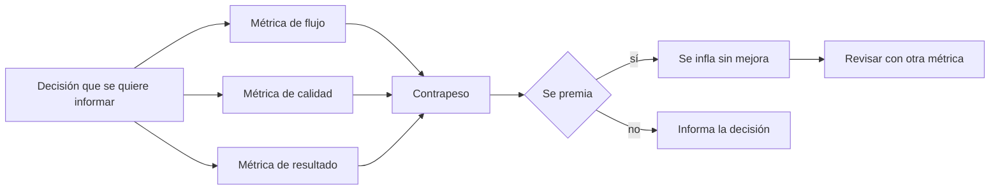
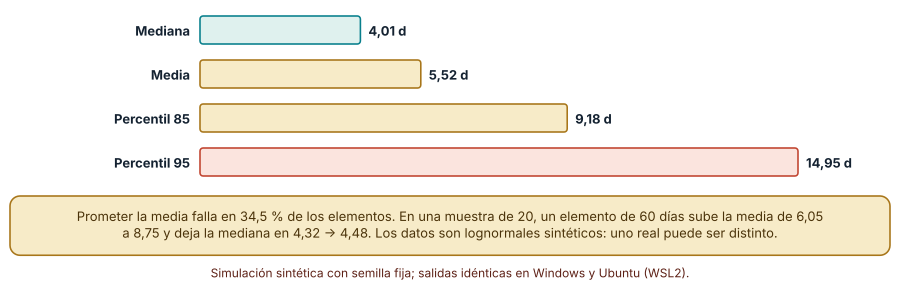
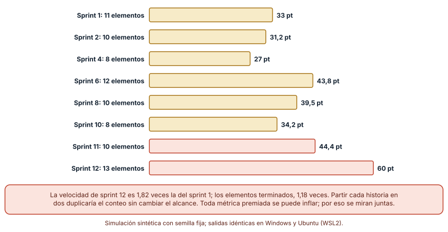
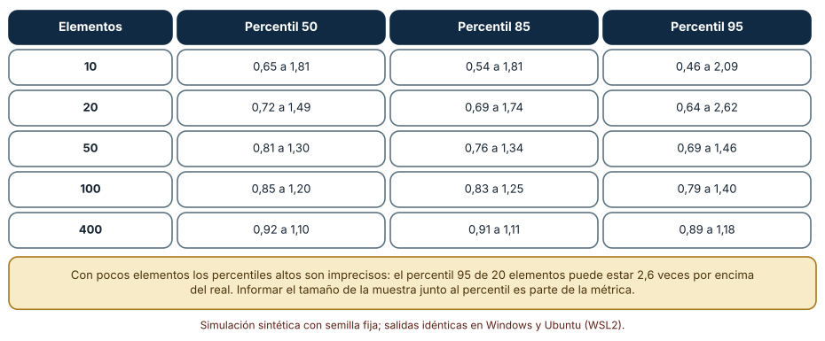

# SE-189 — Métricas de flujo, calidad y resultados

[← SE-188 — Definition of Ready, Done y aceptación](https://github.com/vladimiracunadev-create/modern-software-engineering-program/blob/main/classes/part-15-procesos-planificacion-y-estimacion/se-188-definition-of-ready-done-y-aceptacion/README.md) · [↑ Parte 15](https://github.com/vladimiracunadev-create/modern-software-engineering-program/blob/main/classes/part-15-procesos-planificacion-y-estimacion/README.md) · [📚 Índice completo](https://github.com/vladimiracunadev-create/modern-software-engineering-program/blob/main/classes/README.md) · [🌐 Portal](https://vladimiracunadev-create.github.io/modern-software-engineering-program/classes/SE-189.html) · [SE-190 — Retrospectivas y mejora del sistema de trabajo →](https://github.com/vladimiracunadev-create/modern-software-engineering-program/blob/main/classes/part-15-procesos-planificacion-y-estimacion/se-190-retrospectivas-y-mejora-del-sistema-de-trabajo/README.md)

## Punto profesional y fundamento pedagógico

**Punto profesional.** La clase existe para que elijas métricas que informen decisiones y no que premien actividad: sabrás resumir tiempos con cola larga, detectar cuándo una métrica premiada se infla sin que mejore nada, y declarar cuántos datos hacen falta antes de creer un percentil.

**Por qué aparece aquí.** Se sitúa después de **Definition of Ready, Done y aceptación** y antes de **Retrospectivas y mejora del sistema de trabajo**: la clase anterior fijó las puertas del proceso; esta mide lo que ocurre al cruzarlas, y la siguiente usa esas mediciones para decidir qué mejorar. Reutiliza los datos de flujo de `SE-184` y la historia de `SE-185`.

**Error conceptual que debe corregir.** Creer que el promedio resume un tiempo de ciclo, que una métrica de equipo sirve para compararlo con otro o evaluar a personas, o que un percentil calculado con veinte datos es fiable: el promedio promete menos de lo que se cumple, las métricas premiadas se inflan, y los percentiles altos necesitan mucha muestra.

**Secuencia de aprendizaje.** Antes de simular, predices cuántos elementos superan el promedio de un tiempo de ciclo con cola larga; después comparas mediana, media y percentiles, simulas doce sprints en que se premia la velocidad en puntos y mides cuánto varía un percentil estimado según el tamaño de la muestra. La secuencia usa predicción, explicación propia, contraste y recuperación. [ICAP](https://icap.education.asu.edu/research) distingue participación de construcción de conocimiento; [How People Learn II](https://nap.nationalacademies.org/catalog/24783/how-people-learn-ii-learners-contexts-and-cultures) exige conectar conocimiento previo, contexto y transferencia; la [práctica de recuperación](https://pubmed.ncbi.nlm.nih.gov/16507066/) respalda producir de nuevo la explicación tras una demora; y [Education for Life and Work](https://nap.nationalacademies.org/resource/13398/dbasse_084153.pdf) exige devolución que explique la causa del error.

**Evidencia de aprendizaje.** `metrics-log.md` con la predicción, el resumen de un tiempo de ciclo por cuatro medidas, la serie de velocidad frente a elementos terminados, la tabla de error de percentiles según la muestra y una nota que diga qué métrica retirarías y cuál agregarías como contrapeso.

**Límite de la conclusión.** Los tiempos son lognormales sintéticos, la inflación del 4 % por sprint es un supuesto y el rendimiento constante es una simplificación. Las simulaciones muestran mecanismos; no se midió ningún equipo ni se observó una métrica manipulada.

### Trazabilidad fuente → afirmación

| Fuente primaria u oficial | Afirmación que respalda | Lo que no prueba |
|---|---|---|
| [Forsgren et al., «The SPACE of developer productivity» (ACM Queue, 2021)](https://doi.org/10.1145/3454122.3454124) | Argumenta que la productividad tiene varias dimensiones (satisfacción, desempeño, actividad, comunicación, eficiencia) y que una sola métrica de actividad la describe mal. | No fija qué métricas usar ni sus valores. |
| [DORA: investigación](https://dora.dev/research/) | Reúne la investigación sobre métricas de entrega (frecuencia, plazo de cambios, fallos, recuperación) y su asociación con resultados de organizaciones. | La asociación observada no implica que mejorar la métrica cause el resultado en un equipo concreto. |
| [Manheim y Garrabrant, «Categorizing variants of Goodhart's law» (2018)](https://arxiv.org/abs/1803.04585) | Clasifica las formas en que optimizar un indicador lo desvincula del objetivo que representaba. | No mide la frecuencia del fenómeno en equipos de software. |

## Antes de empezar

Recupera lo que midió `SE-184` (rendimiento, plazo, trabajo en curso) y las puertas de `SE-188`. La pregunta activa es: **¿qué decisión tomaría de manera distinta con este número y qué tengo que mirar al lado para que no me engañe?**

## Prerrequisitos

- Haber completado `SE-188` o poder explicar la diferencia entre terminado y aceptado.
- Python 3.11 o posterior y un terminal; todo el código usa solo la biblioteca estándar.
- Manejar media, mediana y percentil a nivel básico.

## Problema auténtico

La jefatura pide un tablero con tres números por equipo: velocidad en puntos, promedio de días por tarjeta y número de defectos. El equipo de la plataforma de entregas lo entrega. Tres meses después, la velocidad subió 80 %, el promedio de días por tarjeta casi no cambió y los defectos no bajaron. La jefatura concluye que el equipo mejoró; el equipo sabe que no hizo más trabajo.

## Objetivos observables

Al terminar podrás:

1. resumir un tiempo de ciclo con cola larga con mediana y percentiles, y calcular qué fracción de los elementos supera el promedio;
2. distinguir métricas de flujo, de calidad y de resultados, y la decisión que cada una informa;
3. simular el efecto de premiar una métrica y comparar su evolución con la de un indicador menos manipulable;
4. calcular cuánto varía un percentil estimado según el tamaño de la muestra y qué tamaño pedir antes de actuar;
5. diseñar un tablero mínimo con contrapesos y declarar qué decisión informa cada número.

## Mapa conceptual



El mapa se lee desde la decisión hacia las métricas: se elige primero qué decisión informar. Cada métrica necesita un contrapeso, y premiarla la convierte en objetivo y rompe la relación con lo que medía.

## Temas y por qué importan

| Tema | Por qué cambia una decisión profesional | Evidencia mínima |
|---|---|---|
| Resumir tiempos | Con cola larga, la media promete lo que muchos elementos no cumplen; los percentiles dicen qué esperar. | Predicción, traza causal y contraejemplo de **Resumir tiempos** en `metrics-log.md` |
| Métricas de flujo | Rendimiento, plazo y trabajo en curso informan la capacidad y la previsión del sistema. | Predicción, traza causal y contraejemplo de **Métricas de flujo** en `metrics-log.md` |
| Métricas de calidad | Escapes, fallos de cambios y tiempo de recuperación informan el coste de las puertas. | Predicción, traza causal y contraejemplo de **Métricas de calidad** en `metrics-log.md` |
| Métricas de resultados | Uso, retención y problemas resueltos informan si lo construido sirvió. | Predicción, traza causal y contraejemplo de **Métricas de resultados** en `metrics-log.md` |
| Manipulación y muestra | Toda métrica premiada se infla y todo percentil depende del tamaño de la muestra. | Predicción, traza causal y contraejemplo de **Manipulación y muestra** en `metrics-log.md` |

## Conceptos y decisiones

### 1. Resumir tiempos

El tiempo que tarda un elemento en atravesar el sistema tiene una distribución con cola larga: la mayoría termina pronto y unos pocos tardan mucho. En esa forma la media queda por encima de la mediana, y una fracción importante de los elementos supera la media. Prometer «cinco días de promedio» incumple la promesa en un tercio de los casos. Los percentiles resuelven esto: «el 85 % de los elementos termina en nueve días o menos» es una afirmación que se puede comprobar y que se parece a lo que alguien necesita saber para planificar.

### 2. Métricas de flujo

Las métricas de flujo describen cómo avanza el trabajo: rendimiento (elementos terminados por unidad de tiempo), plazo o tiempo de ciclo, trabajo en curso y antigüedad de lo que está en curso. Por la ley de Little (`SE-184`) las tres primeras se relacionan, de modo que una de ellas se puede verificar con las otras. Informan previsión y cuellos de botella. No informan si el trabajo era el correcto: se puede fluir muy bien en dirección equivocada.

### 3. Métricas de calidad

La calidad se mide por lo que se escapa y por lo que cuesta recuperarse: defectos en producción, proporción de cambios que fallan, tiempo para restaurar el servicio. La investigación de DORA reúne cuatro métricas de entrega que combinan velocidad y estabilidad —frecuencia de despliegue, plazo de cambios, tasa de fallos y tiempo de recuperación— precisamente porque medir solo velocidad invita a sacrificar estabilidad. Un conteo de defectos aislado depende de cuánto se busca; sirve mejor como tendencia junto con el esfuerzo de pruebas.

### 4. Métricas de resultados

Los resultados son lo que cambió para las personas: cuántas estudiantes recuperan un borrador tras una caída, cuánto tarda una profesora en calificar, cuántas apelaciones se resuelven. Son las más cercanas al propósito y las más difíciles de atribuir a un cambio concreto, porque dependen de muchos factores y llegan tarde. Se combinan con las de flujo y calidad: las de resultados dicen si la dirección es correcta, las demás si el sistema es capaz de seguirla.

### 5. Manipulación y muestra

Cuando una métrica se convierte en objetivo, deja de ser una buena métrica: las personas ajustan lo que se mide y no lo que importa. Manheim y Garrabrant distinguen varias formas del fenómeno (extremos que rompen la correlación, causas que no se mantienen, adversarios que explotan la medida). Contra ello ayudan tres hábitos: no premiar una métrica individual, mirar métricas que se compensen (velocidad y escapes) y revisar cualquier cambio brusco. Aparte, toda métrica estadística tiene incertidumbre: con pocas observaciones un percentil alto puede estar muy lejos del valor real, y el tablero debe mostrar el tamaño de la muestra.

### La media promete lo que un tercio de los elementos incumple

Un tiempo de ciclo lognormal con mediana de 4 días y σ = 0,8, sobre 100 000 elementos con semilla fija. Se comparan cuatro resúmenes y se mide qué fracción supera la media.

```python
ct = [rng.lognormvariate(math.log(4), 0.8) for _ in range(100000)]
media = st.mean(ct)
sobre_media = sum(c > media for c in ct) / len(ct)
```

Resultado, idéntico en Windows (CPython 3.12.9) y en Ubuntu bajo WSL2 (3.12.3): la mediana es **4,01** días, la media **5,52**, el percentil 85 **9,18** y el 95 **14,95**. El **34,5 %** de los elementos supera la media. Con una muestra de 19 elementos, la media es 6,05 y la mediana 4,32; al añadir un solo elemento de 60 días, la media sube a 8,75 y la mediana a 4,48.



**Cómo leer la figura.** Cada barra es un resumen del mismo conjunto de tiempos; la mediana describe el elemento típico y los percentiles, la cola. **Dónde deja de valer:** los tiempos son lognormales sintéticos; uno real puede tener varias modas (tareas pequeñas y grandes mezcladas) y entonces ni la mediana describe un elemento típico. La figura no dice que la media sea inútil: sirve para la capacidad total (por la ley de Little). Dice que no sirve como promesa a una persona.

### La velocidad premiada se infla sin que haya más trabajo

Doce sprints. El rendimiento real es de unos 10 elementos por sprint (normal de media 10 y desviación 1,5, redondeado). El tamaño medio en puntos por elemento empieza en 3 y crece un 4 % por sprint, un supuesto que modela el desplazamiento de las estimaciones cuando la velocidad se premia.

```python
items = max(1, round(rng.gauss(10, 1.5)))
pts   = 3 * (1.04 ** (s - 1))
velocidad = items * pts
```

| Sprint | Elementos terminados | Velocidad en puntos |
|---:|---:|---:|
| 1 | 11 | 33,0 |
| 4 | 8 | 27,0 |
| 8 | 10 | 39,5 |
| 11 | 10 | 44,4 |
| 12 | 13 | 60,0 |

La velocidad del sprint 12 es **1,82** veces la del primero; los elementos terminados, **1,18** veces. Si además cada historia se divide en dos sin cambiar el alcance, el conteo de elementos se duplica (de 11 a 22) sin producir más valor.



**Cómo leer la figura.** Cada barra es la velocidad de un sprint y su etiqueta indica los elementos terminados; las barras coral son los dos últimos sprints mostrados. **Dónde deja de valer:** la inflación de 4 % es un supuesto y la serie solo ilustra la forma del fenómeno. También los elementos terminados se pueden inflar (partiendo historias), de modo que ninguna métrica es inmune. La salvaguarda es mirar varias a la vez y revisar los cambios bruscos con una pregunta de fondo: ¿cambió el trabajo o cambió la medida?

### Cuántos datos hacen falta antes de creer un percentil

Con el mismo tiempo de ciclo lognormal, se toman 1000 muestras de `n` elementos (10, 20, 50, 100, 400), se estima cada percentil y se divide por su valor verdadero. La tabla muestra el intervalo que contiene el 90 % de las razones.

```python
for p in (50, 85, 95):
    razon = percentil(muestra, p) / verdadero[p]
```

| Elementos | Percentil 50 | Percentil 85 | Percentil 95 |
|---:|---|---|---|
| 10 | 0,65 a 1,81 | 0,54 a 1,81 | 0,46 a 2,09 |
| 20 | 0,72 a 1,49 | 0,69 a 1,74 | 0,64 a 2,62 |
| 50 | 0,81 a 1,30 | 0,76 a 1,34 | 0,69 a 1,46 |
| 100 | 0,85 a 1,20 | 0,83 a 1,25 | 0,79 a 1,40 |
| 400 | 0,92 a 1,10 | 0,91 a 1,11 | 0,89 a 1,18 |

Con 10 elementos, el percentil 85 estimado puede quedar entre la mitad y casi el doble del verdadero. Con 100 elementos se acota a una banda de −17 % a +25 %. El percentil 95 es el más sensible: con 20 elementos puede estar a 2,6 veces el real.



**Cómo leer la figura.** Cada celda es el rango que cubre el 90 % de las estimaciones; 1,00 sería exacto. **Dónde deja de valer:** el proceso es estacionario y los elementos independientes; los equipos reales cambian con el tiempo, y datos antiguos pueden dejar de ser representativos. La tabla fija una regla práctica: un percentil alto con menos de unos cincuenta elementos se presenta como indicio, con el tamaño de la muestra al lado.

## Definiciones de trabajo

- **tiempo de ciclo o plazo:** tiempo desde que un elemento empieza a trabajarse hasta que se termina.
- **rendimiento:** número de elementos terminados por unidad de tiempo.
- **antigüedad del trabajo en curso:** tiempo que lleva en curso cada elemento no terminado; anticipa los plazos largos antes de que ocurran.
- **escape:** defecto descubierto después de dar un incremento por terminado.
- **ley de Goodhart:** cuando una medida se convierte en objetivo, deja de ser una buena medida.

Las definiciones son operativas para la plataforma de entregas. No convierten términos con una historia más amplia en sinónimos y deben contrastarse con la documentación primaria enlazada al final.

## Ejemplo mínimo

El fragmento compara media y mediana de un conjunto pequeño con una tarea muy larga. Antes de ejecutarlo, predice qué medida cambia más al añadir la tarea de 60 días.

```python
import statistics as st
dias = [2, 3, 3, 4, 4, 5, 6, 8]
con_larga = dias + [60]
assert st.median(dias) == 4 and st.median(con_larga) == 4
assert round(st.mean(dias), 2) == 4.38 and round(st.mean(con_larga), 2) == 10.56
```

La mediana no cambia; la media pasa de 4,38 a 10,56. Registra versión, comando y salida; calcula el percentil 85 de ambos conjuntos con `statistics.quantiles` y compáralo con lo que cada resumen dice al jefe de producto.

## Ejemplo profesional

El equipo de la plataforma de entregas rediseña su tablero con cinco números que informan cinco decisiones. Plazo de los elementos (percentiles 50, 85 y 95 con el tamaño de la muestra) para prometer fechas. Rendimiento semanal y trabajo en curso para vigilar el límite de `SE-184`. Antigüedad del trabajo en curso para detectar lo que se atasca. Escapes por cada 100 elementos terminados, para vigilar las puertas de `SE-188`. Y un resultado: porcentaje de entregas recuperadas tras una caída de sesión, medido con datos sintéticos de pruebas y, en producción, con registros agregados sin datos personales. Se retira la velocidad en puntos del tablero visible a la jefatura y se conserva solo dentro del equipo para planificar.

Compara con el tablero anterior: los cinco números se pueden contradecir entre sí (más rendimiento con más escapes), y esa contradicción es la información. Un tablero es adecuado cuando cada número tiene una decisión y un contrapeso; es peligroso cuando uno solo se premia.

## Práctica guiada

1. Lista las métricas que se presentan sobre tu equipo y, para cada una, escribe la decisión que informa.
2. Predice qué fracción de los elementos supera el promedio de plazo y escribe el número antes de calcular.
3. Calcula mediana, media y percentiles 85 y 95 de tus plazos (o de los sintéticos).
4. Simula doce sprints con inflación de la velocidad y compara con los elementos terminados.
5. Estima el error de tu percentil 85 con el tamaño de tu muestra.
6. Diseña un tablero de cinco números con su contrapeso.
7. Entrega `metrics-log.md` y pide a otra persona que identifique la métrica más expuesta a manipulación.

## Ejercicios

1. **Resumen:** genera tiempos con σ = 0,4 y con σ = 1,2 y compara la fracción por encima de la media; explica el cambio.
2. **Inflación:** modifica la simulación para que la inflación sea de 2 % y de 8 % por sprint y calcula la razón de velocidad del sprint 12 con el 1.
3. **Muestra:** estima cuántos elementos necesitas para que el percentil 85 quede dentro de ±15 % en el 90 % de los casos.
4. **Contrapeso:** para cada una de tres métricas de tu equipo, escribe la métrica que le serviría de contrapeso y el fallo que atrapa.

## Reto verificable

Entrega `metrics-log.md` con la predicción, el resumen de plazos, la serie de velocidad, la tabla de error de percentiles y el tablero propuesto con decisiones y contrapesos. Se aprueba si otra persona ejecuta el código desde un checkout limpio, obtiene los mismos números y puede decir qué métrica retiraría de la vista de la jefatura. No se aprueba por el número de métricas ni por un tablero sin decisiones asociadas.

## Caso conductor

La plataforma de entregas de tareas continúa como caso conductor de la Parte 15. Esta clase deja el noveno artefacto: un tablero de cinco números con su decisión y su contrapeso, con el tamaño de muestra visible. `SE-190` usará esas mediciones para decidir qué mejora del sistema de trabajo probar y cómo saber si funcionó. Cambia después una sola métrica, la velocidad en puntos, de visible a interna, y observa qué decisiones dependían de ella.

## Preguntas frecuentes

### ¿Debo dejar de medir la velocidad?

No necesariamente: sirve dentro del equipo para planificar con su propia escala. Lo que no sirve es compararla entre equipos, premiarla o usarla como indicador de productividad.

### ¿Qué percentil comunico?

El que corresponda a la confianza que necesita quien decide: el 85 es habitual para fechas razonables, el 95 para compromisos críticos. Siempre con el tamaño de la muestra.

### ¿Cómo evito que una métrica se manipule?

No hay garantía. Se reduce el riesgo no premiándola, combinándola con otras que se compensen y revisando cambios bruscos. Si la métrica influye en la evaluación de personas, esperar manipulación es racional.

### ¿Las métricas de resultados no son demasiado lentas?

Sí, llegan tarde y son difíciles de atribuir. Por eso se complementan con señales tempranas (uso de una función en la primera semana) y se declara el retraso con que informan.

## Fallo controlado y diagnóstico

Reproduce el fallo clásico de la clase: **premiar la velocidad y creer que el equipo mejoró**. Simula doce sprints con inflación del 4 % y compara la velocidad con los elementos terminados.

Registra síntoma, entrada mínima, hipótesis, observación que descarta cada hipótesis, causa, corrección y prueba de regresión. **Síntoma:** la velocidad en puntos sube 80 % en un trimestre y el plazo de los elementos no cambia. **Hipótesis rivales:** (a) el equipo trabaja más rápido; (b) los elementos son de mayor tamaño; (c) la escala de estimación se desplazó. **Prueba:** compara elementos terminados y plazos con la velocidad; en la simulación, la velocidad sube 1,82 veces y los elementos terminados 1,18. **Conclusión:** la causa es el desplazamiento de la escala, no un aumento del trabajo. **Regresión:** retira la velocidad como indicador externo y sigue el rendimiento en elementos junto con los escapes por cada 100 elementos durante dos trimestres. No cambies a la vez la métrica y el modo de partir las historias.

## Errores comunes y cómo corregirlos

| Síntoma | Causa probable | Corrección |
|---|---|---|
| La fecha prometida con el promedio se incumple en un tercio de los casos | Promedio sobre una distribución con cola larga | Prometer con un percentil y mostrar la muestra |
| La velocidad sube y el plazo no cambia | Métrica premiada que se infla | Retirarla de la vista externa y seguir rendimiento y escapes |
| Un percentil alto cambia mucho de un mes a otro | Muestra pequeña | Mostrar el tamaño de la muestra y esperar más datos |
| Se comparan equipos por su velocidad | Escalas de puntos distintas | Comparar solo flujo en elementos y resultados, con contexto |
| Todas las métricas mejoran y la usuaria no nota diferencia | Faltan métricas de resultados | Añadir una medida de uso o problema resuelto |

## Entorno y archivos clave

```text
work/SE-189/
├── README.md
├── metrics/
│   ├── resumen.py
│   ├── velocidad.py
│   └── muestra.py
├── tests/test_metrics.py
└── evidence/metrics-log.md
```

El `README` declara plataforma, versión de Python, semillas y comandos. Los experimentos usan solo la biblioteca estándar (`random`, `statistics`, `math`) y se ejecutaron con CPython 3.12.9 en Windows 11 y 3.12.3 en Ubuntu bajo WSL2: las salidas fueron idénticas. Si añades una dependencia, fija procedencia y versión.

## Seguridad, ética y accesibilidad

- las métricas de equipo no deben usarse para evaluar a personas ni para clasificarlas;
- las métricas de resultados deben calcularse con datos agregados y sin identificar a estudiantes;
- los tableros deben tener una versión textual accesible y no depender solo del color;
- documenta quién decide qué métrica se muestra y con qué contrapeso;
- respeta las licencias de las herramientas de medición y atribuye lo adaptado.

## Puente hacia el trabajo con agentes

Un agente al que se le pide «crea un tablero de métricas» producirá muchos números con gráficos agradables y sin decisión asociada. Pídele en cambio que, para cada métrica, escriba la decisión que informa, el contrapeso, el tamaño de muestra mínimo y cómo se podría manipular. Revisa especialmente si propone medir velocidad en puntos o promedios de plazo: son los dos números que esta clase mostró engañosos.

## Transferencia

Traslada el análisis a otro proceso (por ejemplo, la atención de incidentes): cambia las métricas y conserva el procedimiento de elegir primero la decisión, buscar el contrapeso y declarar el tamaño de la muestra. La transferencia está lograda cuando puedes explicar qué parte del tablero dependía del proceso y cuál no, no cuando las columnas se parecen.

## Evaluación y evidencia

| Criterio | Evidencia para aprobar |
|---|---|
| comprensión | explicación de por qué la media no sirve como promesa y de cómo se infla una métrica premiada |
| corrección | tres simulaciones reproducibles con las mismas semillas |
| diseño | tablero de cinco números con decisión, contrapeso y tamaño de muestra |
| diagnóstico | reproducción del fallo «velocidad premiada» con regresión |
| incertidumbre | declaración del supuesto de inflación y del error de los percentiles |
| reproducibilidad | versiones, comandos, salida y límites declarados |

## Fuentes

- [Forsgren et al., «The SPACE of developer productivity» (ACM Queue, 2021)](https://doi.org/10.1145/3454122.3454124) — dimensiones de la productividad; autoridad: ACM Queue.
- [DORA: investigación](https://dora.dev/research/) — métricas de entrega y estabilidad; autoridad: DORA (Google Cloud).
- [Manheim y Garrabrant, «Categorizing variants of Goodhart's law» (2018)](https://arxiv.org/abs/1803.04585) — formas de la ley de Goodhart; autoridad: arXiv.
- [Efron, «Bootstrap methods: another look at the jackknife» (The Annals of Statistics, 1979)](https://doi.org/10.1214/aos/1176344552) — remuestreo para estimar la incertidumbre de un estadístico; autoridad: The Annals of Statistics.
- [The Kanban Guide](https://kanbanguides.org/english/) — métricas de flujo; autoridad: Scrum.org (Kanban Guide).

Cada fuente respalda el mecanismo indicado; ninguna demuestra que el 34,5 %, el factor 1,82 o el error de ±25 % se observen en la plataforma de entregas. Esa afirmación depende de la distribución real de los plazos y de cómo se use cada métrica.

- [Python: `statistics`](https://docs.python.org/3/library/statistics.html) — media, mediana y cuantiles.
- [Python: `random`](https://docs.python.org/3/library/random.html) — generador con semilla para las simulaciones.

## Límites y siguiente paso

Se ejecutaron tres experimentos con datos sintéticos en Windows y Ubuntu (WSL2) con resultados idénticos. No se midió ningún equipo ni se observó manipulación real: la distribución de los plazos, la inflación del 4 % por sprint y la estacionariedad son construcciones del autor. La siguiente clase usa estas mediciones para decidir qué mejorar en el sistema de trabajo y cómo saber si funcionó.

## Glosario

- **tiempo de ciclo o plazo:** tiempo desde que un elemento empieza a trabajarse hasta que se termina.
- **rendimiento:** número de elementos terminados por unidad de tiempo.
- **antigüedad del trabajo en curso:** tiempo que lleva en curso cada elemento no terminado; anticipa los plazos largos antes de que ocurran.
- **escape:** defecto descubierto después de dar un incremento por terminado.
- **ley de Goodhart:** cuando una medida se convierte en objetivo, deja de ser una buena medida.

---

[← SE-188 — Definition of Ready, Done y aceptación](https://github.com/vladimiracunadev-create/modern-software-engineering-program/blob/main/classes/part-15-procesos-planificacion-y-estimacion/se-188-definition-of-ready-done-y-aceptacion/README.md) · [↑ Parte 15](https://github.com/vladimiracunadev-create/modern-software-engineering-program/blob/main/classes/part-15-procesos-planificacion-y-estimacion/README.md) · [📚 Índice completo](https://github.com/vladimiracunadev-create/modern-software-engineering-program/blob/main/classes/README.md) · [🌐 Portal](https://vladimiracunadev-create.github.io/modern-software-engineering-program/classes/SE-189.html) · [SE-190 — Retrospectivas y mejora del sistema de trabajo →](https://github.com/vladimiracunadev-create/modern-software-engineering-program/blob/main/classes/part-15-procesos-planificacion-y-estimacion/se-190-retrospectivas-y-mejora-del-sistema-de-trabajo/README.md)
