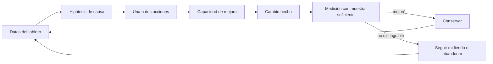
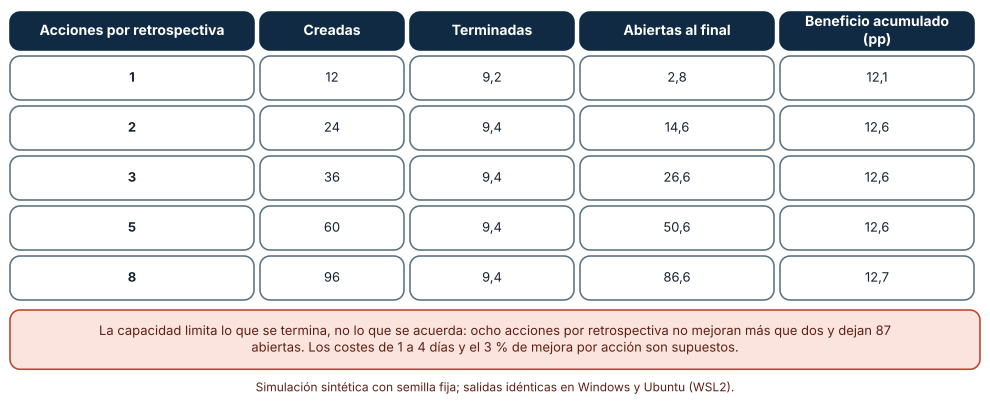
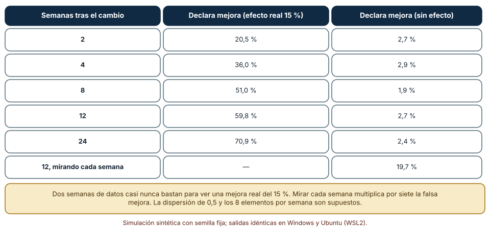
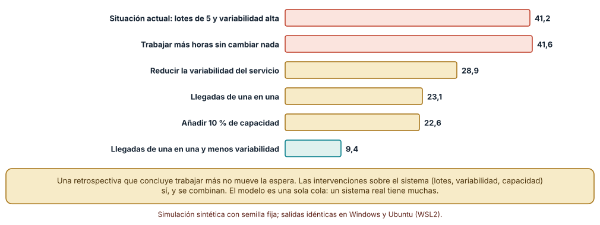

# SE-190 — Retrospectivas y mejora del sistema de trabajo

[← SE-189 — Métricas de flujo, calidad y resultados](https://github.com/vladimiracunadev-create/modern-software-engineering-program/blob/main/classes/part-15-procesos-planificacion-y-estimacion/se-189-metricas-de-flujo-calidad-y-resultados/README.md) · [↑ Parte 15](https://github.com/vladimiracunadev-create/modern-software-engineering-program/blob/main/classes/part-15-procesos-planificacion-y-estimacion/README.md) · [📚 Índice completo](https://github.com/vladimiracunadev-create/modern-software-engineering-program/blob/main/classes/README.md) · [🌐 Portal](https://vladimiracunadev-create.github.io/modern-software-engineering-program/classes/SE-190.html) · [SE-191 — Taller: planificar bajo incertidumbre explícita →](https://github.com/vladimiracunadev-create/modern-software-engineering-program/blob/main/classes/part-15-procesos-planificacion-y-estimacion/se-191-taller-planificar-bajo-incertidumbre-explicita/README.md)

## Punto profesional y fundamento pedagógico

**Punto profesional.** La clase existe para que una retrospectiva produzca cambios que se terminan y se pueden evaluar, y no una lista de buenos propósitos: sabrás elegir cuántas acciones acordar según tu capacidad de mejora, cuántos datos necesitas para saber si una mejora funcionó y qué intervenciones mueven el sistema y cuáles solo piden más esfuerzo.

**Por qué aparece aquí.** Se sitúa después de **Métricas de flujo, calidad y resultados** y antes del **Taller: planificar bajo incertidumbre explícita**: la clase anterior produjo un tablero con contrapesos; esta lo usa para decidir qué mejorar, y recupera el modelo de colas de `SE-184` para comparar intervenciones. Es el cierre del ciclo de aprendizaje de la parte: el proceso se mejora con el mismo método con que se mide el producto.

**Error conceptual que debe corregir.** Creer que cuantas más acciones se acuerdan más se mejora, que dos semanas de datos confirman o refutan un cambio, o que la respuesta a un plazo largo es trabajar más: la capacidad de mejora limita lo que se termina, los datos de pocas semanas casi no distinguen una mejora real del ruido, y trabajar más horas no mueve una cola.

**Secuencia de aprendizaje.** Antes de simular, predices cuántas acciones se terminan si se acuerdan una o ocho por retrospectiva; después simulas doce sprints con capacidad limitada de mejora, mides con qué frecuencia una prueba estadística detecta una mejora real del 15 % y con qué frecuencia declara una falsa si se mira cada semana, y comparas cinco intervenciones sobre una cola. La secuencia usa predicción, explicación propia, contraste y recuperación. [ICAP](https://icap.education.asu.edu/research) distingue participación de construcción de conocimiento; [How People Learn II](https://nap.nationalacademies.org/catalog/24783/how-people-learn-ii-learners-contexts-and-cultures) exige conectar conocimiento previo, contexto y transferencia; la [práctica de recuperación](https://pubmed.ncbi.nlm.nih.gov/16507066/) respalda producir de nuevo la explicación tras una demora; y [Education for Life and Work](https://nap.nationalacademies.org/resource/13398/dbasse_084153.pdf) exige devolución que explique la causa del error.

**Evidencia de aprendizaje.** `retro-log.md` con la predicción, las acciones acordadas con responsable, señal y fecha, la tabla de acciones terminadas por número acordado, la potencia y la tasa de falsas mejoras de la prueba, la comparación de intervenciones y una nota que diga qué cambio probarías primero y cuándo lo evaluarías.

**Límite de la conclusión.** La capacidad de mejora de 2 días por sprint, el 3 % de mejora por acción, el efecto de 15 % con dispersión 0,5 y la cola de un solo servidor son supuestos del autor. Los resultados muestran mecanismos; no miden retrospectivas ni equipos reales.

### Trazabilidad fuente → afirmación

| Fuente primaria u oficial | Afirmación que respalda | Lo que no prueba |
|---|---|---|
| [The Scrum Guide](https://scrumguides.org/scrum-guide.html) | Define la retrospectiva como el evento en que el equipo inspecciona cómo trabajó y acuerda mejoras que pueden incorporarse al siguiente ciclo. | No fija cuántas acciones acordar ni cómo comprobar que funcionaron. |
| [Edmondson, «Psychological safety and learning behavior in work teams» (Administrative Science Quarterly, 1999)](https://doi.org/10.2307/2666999) | Encuentra que la seguridad psicológica del equipo se asocia con conductas de aprendizaje como hablar de errores y pedir ayuda. | No prueba que una retrospectiva produzca esa seguridad ni lo contrario. |
| [Mann y Whitney, «On a test of whether one of two random variables is stochastically larger than the other» (Annals of Mathematical Statistics, 1947)](https://doi.org/10.1214/aoms/1177730491) | Define una prueba no paramétrica de rangos para comparar dos muestras sin suponer una distribución concreta. | No dice cuántos datos exige un equipo concreto ni resuelve las miradas repetidas. |

## Antes de empezar

Recupera el tablero de `SE-189`: plazos con percentiles, rendimiento, trabajo en curso y escapes. Aquí se usa para elegir una mejora. La pregunta activa es: **¿qué cambio probaré, cuánto trabajo cabe de verdad en mi capacidad de mejora y cómo sabré, y cuándo, si funcionó?**

## Prerrequisitos

- Haber completado `SE-189` o poder explicar por qué un percentil necesita una muestra suficiente.
- Python 3.11 o posterior y un terminal; todo el código usa solo la biblioteca estándar.
- Haber participado en una retrospectiva o leído una guía de retrospectivas.

## Problema auténtico

El equipo de la plataforma de entregas celebra una retrospectiva cada dos semanas. En el último año acordó 96 acciones; la hoja de acciones muestra 14 terminadas. Cada reunión empieza leyendo las acciones pendientes y termina agregando nuevas. Cuando el plazo de los elementos subió de 5 a 12 días, la conclusión fue «necesitamos comprometernos más». Tres sprints después el plazo seguía igual.

## Objetivos observables

Al terminar podrás:

1. relacionar el número de acciones acordadas con las que se terminan, dada una capacidad de mejora limitada;
2. calcular con una simulación la probabilidad de detectar una mejora real según las semanas de datos y la de declarar una falsa al mirar cada semana;
3. comparar intervenciones sobre un modelo de cola (más horas, más capacidad, lotes pequeños, menos variabilidad) y explicar por qué unas mueven el plazo y otras no;
4. escribir una acción de mejora con hipótesis, responsable, señal, fecha de evaluación y criterio de abandono;
5. diseñar una retrospectiva con límites de acciones, evaluación de las anteriores y separación entre síntomas y causas.

## Mapa conceptual



El mapa se lee como un ciclo de hipótesis: una causa supuesta, pocas acciones que caben en la capacidad, una medición con datos suficientes y una decisión. El retorno hacia los datos recuerda que mejorar es una práctica continua, no un evento.

## Temas y por qué importan

| Tema | Por qué cambia una decisión profesional | Evidencia mínima |
|---|---|---|
| Retrospectivas | Son el lugar donde el equipo inspecciona su método y decide qué probar. | Predicción, traza causal y contraejemplo de **Retrospectivas** en `retro-log.md` |
| Capacidad de mejora | Limita cuántas acciones se terminan; acordar más solo acumula pendientes. | Predicción, traza causal y contraejemplo de **Capacidad de mejora** en `retro-log.md` |
| Evaluar un cambio | Distinguir una mejora real del ruido exige suficientes datos y no mirar a cada rato. | Predicción, traza causal y contraejemplo de **Evaluar un cambio** en `retro-log.md` |
| Intervenir en el sistema | Las palancas del sistema (lotes, variabilidad, capacidad) mueven el plazo; el esfuerzo no. | Predicción, traza causal y contraejemplo de **Intervenir en el sistema** en `retro-log.md` |
| Seguridad para hablar | Sin seguridad para nombrar errores, la retrospectiva produce solo lo que ya era seguro decir. | Predicción, traza causal y contraejemplo de **Seguridad para hablar** en `retro-log.md` |

## Conceptos y decisiones

### 1. Retrospectivas

Una retrospectiva es una pausa periódica para examinar cómo trabaja el equipo y acordar cambios. Su valor no está en el formato (hay muchos) sino en tres propiedades: parte de datos y hechos, no de impresiones; termina con pocos cambios concretos; y revisa los cambios anteriores antes de proponer otros. El duodécimo principio del manifiesto pide reflexionar a intervalos regulares sobre cómo ser más efectivos y ajustar el comportamiento. Lo que una retrospectiva produce se mide por los cambios que ocurren después, no por la calidad de la conversación.

### 2. Capacidad de mejora

Mejorar el proceso compite con entregar producto. Un equipo con dos días de capacidad de mejora por sprint termina como máximo unas ocho o nueve acciones de costo medio de dos días y medio en un trimestre, sin importar cuántas acuerde. Acordar más no acelera: crea un inventario de pendientes que erosiona la credibilidad de la retrospectiva («para qué proponer si no se hace»). La política sana es acordar tan pocas acciones como la capacidad permita terminar, y declarar el trabajo de mejora en el tablero, con el mismo límite de trabajo en curso que lo demás.

### 3. Evaluar un cambio

Un cambio de proceso se evalúa comparando datos antes y después. El problema es que el tiempo de ciclo es ruidoso: con una dispersión moderada, una mejora real del 15 % queda escondida durante varias semanas. Dos errores acechan. Concluir demasiado pronto («en dos semanas no mejoró») descarta cambios útiles. Mirar cada semana y declarar éxito la primera vez que el resultado parece bueno infla las falsas mejoras: es el problema de las múltiples miradas. La prueba de rangos de Mann y Whitney evita suponer una distribución, pero no corrige ninguno de estos dos errores: eso lo hace fijar de antemano cuánto tiempo se espera y qué se decidirá.

### 4. Intervenir en el sistema

Cuando el plazo es largo, la tentación es pedir más esfuerzo. El modelo de colas de `SE-184` muestra por qué no funciona: la espera depende de la utilización, la variabilidad y los lotes, no de cuánto se esfuerza cada persona. Las intervenciones que cambian esas variables —añadir capacidad, enviar trabajo de uno en uno, reducir la dispersión de tamaños— mueven la espera; trabajar más horas con el mismo sistema no la mueve. La retrospectiva debería preguntar «¿qué parte del sistema produce esta espera?» antes de «¿quién debe hacer más?».

### 5. Seguridad para hablar

Edmondson encontró que los equipos en que sus integrantes creen que pueden hablar de errores sin ser castigados aprenden más. Una retrospectiva donde solo se dicen cosas inocuas no puede mejorar un sistema cuyo problema es incómodo (una dependencia con una persona, una decisión de quien lleva el producto). La seguridad no se declara: se construye con conductas repetidas de quien tiene poder, como agradecer un reporte de error y no buscar culpables. Y se puede observar: si las causas que salen siempre son externas, quizá no se está hablando de las internas.

### Acordar muchas acciones no termina más

El equipo tiene 2 días de capacidad de mejora por sprint durante 12 sprints. Cada acción cuesta de 1 a 4 días y se trabaja por orden de llegada; al terminar una, su beneficio es un 3 % de rendimiento durante lo que queda del periodo. Se simulan 2000 equipos por cada número de acciones acordadas por retrospectiva.

```python
cap = 2.0
while backlog and cap > 0:
    uso = min(cap, backlog[0]); backlog[0] -= uso; cap -= uso
    if backlog[0] <= 0:
        backlog.pop(0); hechas += 1
        beneficio += 3.0 * (12 - s - 1) / 12
```

| Acciones por retrospectiva | Creadas | Terminadas | Abiertas al final | Beneficio acumulado (pp) |
|---:|---:|---:|---:|---:|
| 1 | 12 | 9,2 | 2,8 | 12,1 |
| 2 | 24 | 9,4 | 14,6 | 12,6 |
| 3 | 36 | 9,4 | 26,6 | 12,6 |
| 5 | 60 | 9,4 | 50,6 | 12,6 |
| 8 | 96 | 9,4 | 86,6 | 12,7 |

Resultado, idéntico en Windows (CPython 3.12.9) y en Ubuntu bajo WSL2 (3.12.3): se terminan unas 9,4 acciones sin importar cuántas se acuerden; con 8 por retrospectiva quedan 86,6 abiertas (el 90 %). El beneficio acumulado es prácticamente el mismo (12,1 a 12,7 puntos porcentuales).



**Cómo leer la figura.** Cada fila es una política de acuerdos; las columnas centrales muestran que lo terminado no cambia y lo abierto crece. **Dónde deja de valer:** el trabajo es por orden de llegada; priorizar por beneficio sobre coste elevaría lo terminado. El 3 % de mejora por acción, los costos de 1 a 4 días y los 2 días de capacidad son supuestos. Y el modelo ignora el efecto de las acciones pendientes sobre la credibilidad del ritual, que probablemente agrave el problema.

### Cuántas semanas hacen falta para ver una mejora de 15 %

El tiempo de ciclo es lognormal con mediana de 5 días y dispersión 0,5; el equipo termina 8 elementos por semana. Se tiene una línea base de 12 semanas (96 elementos). Después del cambio, el nuevo tiempo es 15 % menor, o igual en el caso de control. Se compara con una prueba de Mann y Whitney al nivel de 0,05, con 1500 repeticiones por combinación. Después se repite el escenario sin efecto mirando la prueba cada semana durante 12 semanas y declarando mejora la primera vez que sale significativa.

```python
z = u_test_z(despues, antes)
mejora = z < -1.96          # una sola mirada, al nivel de 0,05
```

| Semanas tras el cambio | Declara mejora (efecto real 15 %) | Declara mejora (sin efecto) |
|---:|---:|---:|
| 2 | 20,5 % | 2,7 % |
| 4 | 36,0 % | 2,9 % |
| 8 | 51,0 % | 1,9 % |
| 12 | 59,8 % | 2,7 % |
| 24 | 70,9 % | 2,4 % |
| 12, mirando cada semana | — | 19,7 % |

Una mejora real del 15 % se detecta en 1 de cada 5 casos a las 2 semanas y en 7 de cada 10 a las 24. Sin efecto real, una sola mirada produce falsas mejoras del 2 a 3 %; mirar cada semana durante 12 las sube a 19,7 %, siete veces más.



**Cómo leer la figura.** Cada fila es un tiempo de observación; las columnas son la potencia (con efecto real) y la tasa de falsas mejoras (sin efecto). **Dónde deja de valer:** el proceso es estacionario, la dispersión de 0,5 es un supuesto, y los 8 elementos por semana fijan la cantidad de datos; un equipo más lento tarda más. La figura tampoco dice que 15 % sea una mejora típica: con un efecto de 40 % la detección sería más rápida. Lo que enseña es que el plazo de evaluación y la regla de decisión se fijan antes de mirar los datos.

### Qué interviene sobre una cola y qué no

Una cola de un servidor al 90 % de utilización, con llegadas en lotes de 5 y servicio muy variable (coeficiente de variación al cuadrado igual a 4). Se mide la espera media en múltiplos del servicio. Se compara con trabajar más horas sin cambiar nada (misma cola con otra semilla), añadir 10 % de capacidad, enviar de uno en uno, reducir la variabilidad del servicio a 1 y combinar ambas.

```python
base = lindley(0.90, cs2=4, batch=5)
mas_capacidad = lindley(0.90 / 1.10, cs2=4, batch=5)
combinada = lindley(0.90, cs2=1, batch=1)
```

| Intervención | Espera media |
|---|---:|
| Situación actual: lotes de 5, variabilidad alta | 41,2 |
| Trabajar más horas sin cambiar nada | 41,6 |
| Reducir la variabilidad del servicio (4 → 1) | 28,9 |
| Llegadas de una en una | 23,1 |
| Añadir 10 % de capacidad | 22,6 |
| Llegadas de una en una y menos variabilidad | 9,4 |

Trabajar más horas sin cambiar el sistema deja la espera igual (41,2 frente a 41,6, diferencia de semilla). Cada una de las otras tres palancas la reduce entre 30 % y 45 %, y combinar dos la reduce un 77 %.



**Cómo leer la figura.** Cada barra es la espera media con una intervención; menor es mejor. **Dónde deja de valer:** el modelo es una sola cola con llegadas y servicios aleatorios; un equipo real tiene varias etapas interdependientes, personas con habilidades distintas y trabajo de mejora que compite con el producto. «Trabajar más horas» se modela como no cambiar el sistema, lo que es cierto para esta cola y no necesariamente para una en que haya colas ocultas de espera por una persona. Lo que muestra es qué variables tiene la cola y cuáles se pueden cambiar.

## Definiciones de trabajo

- **retrospectiva:** reunión periódica para examinar cómo trabajó el equipo y acordar cambios que puedan evaluarse.
- **capacidad de mejora:** tiempo que el equipo dedica en cada ciclo a cambiar su propio sistema de trabajo.
- **potencia:** probabilidad de detectar un efecto real con un procedimiento y un tamaño de muestra dados.
- **mirada repetida:** comprobación de un resultado varias veces antes de decidir, que aumenta la probabilidad de declarar un efecto que no existe.
- **intervención sobre el sistema:** cambio en una variable que determina el comportamiento del flujo (capacidad, lotes, variabilidad, límite de trabajo), no en el esfuerzo individual.

Las definiciones son operativas para la plataforma de entregas. No convierten términos con una historia más amplia en sinónimos y deben contrastarse con la documentación primaria enlazada al final.

## Ejemplo mínimo

El fragmento calcula cuántas acciones caben en la capacidad de mejora. Antes de ejecutarlo, predice cuántas acciones de 2,5 días de costo medio se terminan en 12 sprints con 2 días por sprint.

```python
capacidad_total = 2 * 12
costo_medio = 2.5
cabe = capacidad_total / costo_medio
assert round(cabe, 1) == 9.6
```

Caben unas 9,6 acciones en un trimestre, coherente con las 9,4 de la simulación (el trabajo en curso al cierre del periodo no se completa). Acordar 96 no cambia ese número. Registra versión, comando y salida; cambia la capacidad a 4 días por sprint y predice cuántas acciones más se terminan.

## Ejemplo profesional

El equipo de la plataforma de entregas cambia su retrospectiva. Antes de la reunión, quien facilita prepara el tablero de `SE-189` y la hoja de acciones previas con su estado. La reunión dedica diez minutos a evaluar el cambio anterior con su señal, 20 a identificar qué parte del sistema produce el plazo largo (con la cola y la ley de Little como lentes), y 15 a elegir una acción, máximo dos. La acción elegida es enviar los cambios a revisión de uno en uno en lugar de en bloque el viernes, con una hipótesis (el plazo de revisión bajará), una señal (percentil 85 del plazo de los elementos), una duración (ocho semanas) y un criterio de abandono (si en ocho semanas el percentil 85 no baja más de lo que explica el ruido, se revierte).

Compara con la retrospectiva anterior: de 96 acciones en un año se pasa a 6, con una evaluación cada ocho semanas. Una retrospectiva es adecuada cuando se puede decir qué cambió gracias a ella; es un ritual cuando su producto es el acta.

## Práctica guiada

1. Cuenta las acciones acordadas y terminadas del último año de un equipo (o genera una serie).
2. Predice cuántas se pueden terminar con tu capacidad de mejora y escribe el número antes de simular.
3. Simula doce sprints con 1, 2, 3, 5 y 8 acciones acordadas.
4. Calcula la potencia de tu evaluación (cuántas semanas, cuántos elementos) para un efecto de 15 %.
5. Simula la tasa de falsas mejoras al mirar cada semana.
6. Compara tres intervenciones sobre una cola con tus parámetros.
7. Entrega `retro-log.md` y pide a otra persona que proponga la acción a probar con tu registro.

## Ejercicios

1. **Acciones:** modifica la política para trabajar por beneficio sobre coste y compara lo terminado y el beneficio con el orden de llegada.
2. **Evaluación:** calcula cuántas semanas se necesitan para detectar una mejora de 30 % con potencia mayor al 80 %.
3. **Miradas:** propón una regla de parada fijada de antemano y simula su tasa de falsas mejoras.
4. **Cola:** busca la combinación de dos intervenciones que reduzca la espera a menos de 15 y estima su coste de implementación.

## Reto verificable

Entrega `retro-log.md` con la predicción, las acciones acordadas con hipótesis, señal, duración y criterio de abandono, las tres tablas y la intervención elegida. Se aprueba si otra persona ejecuta el código desde un checkout limpio, obtiene los mismos números y puede decir cuándo evaluaría el cambio y qué resultado lo haría abandonar. No se aprueba por la cantidad de acciones acordadas ni por una conclusión sin criterio de abandono.

## Caso conductor

La plataforma de entregas de tareas continúa como caso conductor de la Parte 15. Esta clase deja el décimo artefacto: una acción de mejora con hipótesis, señal, duración y criterio de abandono, elegida con la capacidad real del equipo. `SE-191` combinará todo lo anterior en un taller de planificación bajo incertidumbre. Cambia después una sola cosa, el tamaño del lote de revisión, y observa cuánto tarda en notarse en el tablero.

## Preguntas frecuentes

### ¿Cuántas acciones debo acordar por retrospectiva?

Las que quepan en tu capacidad de mejora: normalmente una o dos. Si tu capacidad real es nula, el primer cambio es crear esa capacidad.

### ¿Cómo sé si una mejora funcionó?

Fija antes de empezar la señal, el tiempo que esperarás y la decisión que tomarás. Compara con la línea base usando una prueba robusta (como la de rangos) y reconoce que con pocas semanas el resultado suele ser «no distinguible».

### ¿Puedo evaluar cada semana?

Puedes mirar, pero no decidir cada semana sin corregir por las miradas repetidas. La simulación mostró 19,7 % de falsas mejoras con doce miradas; fija una fecha o usa un método diseñado para evaluar de forma secuencial.

### ¿Y si el problema es una persona?

Una retrospectiva no es para juzgar personas; examina el sistema. Si un problema depende de una persona concreta, se aborda en otro marco (conversación individual, reasignación), con los mecanismos de apoyo de la organización.

## Fallo controlado y diagnóstico

Reproduce el fallo clásico de la clase: **acordar muchas acciones y terminar casi las mismas**. Simula 12 sprints con 8 acciones por retrospectiva y compara con 2.

Registra síntoma, entrada mínima, hipótesis, observación que descarta cada hipótesis, causa, corrección y prueba de regresión. **Síntoma:** tras un año, 96 acciones acordadas y 14 terminadas, y la retrospectiva ya no genera ideas nuevas. **Hipótesis rivales:** (a) el equipo no se compromete; (b) las acciones son demasiado grandes; (c) se acuerdan más de las que caben. **Prueba:** calcula la capacidad total de mejora y divide por el costo medio de una acción; en la simulación, 9,4 terminadas con cualquier número acordado. **Conclusión:** la causa es el exceso de acuerdos sobre la capacidad. **Regresión:** limita a dos acciones por retrospectiva, evalúa las anteriores antes de acordar nuevas y mide las terminadas en el trimestre siguiente. No cambies a la vez el número de acciones y el formato de la reunión.

## Errores comunes y cómo corregirlos

| Síntoma | Causa probable | Corrección |
|---|---|---|
| Las acciones pendientes crecen cada sprint | Se acuerdan más de las que caben | Limitar a la capacidad y evaluar antes de agregar |
| Se declara fracaso a las dos semanas | Muestra insuficiente para detectar la mejora | Fijar de antemano el plazo de evaluación según el tamaño del efecto |
| Se declara éxito la primera vez que el gráfico baja | Miradas repetidas sin corrección | Fijar la fecha de decisión o usar un procedimiento secuencial |
| La respuesta al plazo largo es «trabajar más» | Se ignora la estructura del sistema | Identificar utilización, variabilidad y lotes antes de pedir esfuerzo |
| En la retrospectiva solo salen causas externas | Falta de seguridad para hablar de las internas | Reconocer los reportes de error y facilitar de forma que no se busque culpables |

## Entorno y archivos clave

```text
work/SE-190/
├── README.md
├── mejora/
│   ├── acciones.py
│   ├── evaluacion.py
│   └── intervenciones.py
├── tests/test_mejora.py
└── evidence/retro-log.md
```

El `README` declara plataforma, versión de Python, semillas y comandos. Los experimentos usan solo la biblioteca estándar (`random`, `statistics`, `math`) y se ejecutaron con CPython 3.12.9 en Windows 11 y 3.12.3 en Ubuntu bajo WSL2: las salidas fueron idénticas. Si añades una dependencia, fija procedencia y versión.

## Seguridad, ética y accesibilidad

- las retrospectivas no deben convertirse en una evaluación del desempeño individual ni registrar atribuciones personales;
- los datos del tablero usados en la reunión deben estar agregados y sin información de estudiantes;
- las dinámicas deben admitir participación escrita y asíncrona para que no dependa de quien habla más fuerte;
- documenta quién decidió abandonar o conservar un cambio y con qué evidencia;
- respeta las licencias de los formatos de retrospectiva y atribuye lo adaptado.

## Puente hacia el trabajo con agentes

Un agente al que se le pide «resume la retrospectiva y propone acciones» generará una lista larga de acciones razonables sin comprobar la capacidad ni el modo de evaluarlas. Pídele en cambio que parta de las métricas del tablero, que proponga como máximo dos acciones con hipótesis, señal, duración y criterio de abandono, y que calcule cuántas semanas harían falta para detectar el efecto esperado. Revisa especialmente si recomienda «mayor compromiso» o «trabajar más»: es la intervención que la cola mostró inútil.

## Transferencia

Traslada el análisis a otra práctica de mejora (por ejemplo, la revisión posterior a un incidente): cambia la capacidad, el efecto esperado y la señal, y conserva el procedimiento de limitar acciones, fijar el plazo de evaluación y comparar intervenciones sobre el sistema. La transferencia está lograda cuando puedes explicar qué parte del método dependía del tipo de mejora y cuál no, no cuando el código se parece.

## Evaluación y evidencia

| Criterio | Evidencia para aprobar |
|---|---|
| comprensión | explicación de por qué acordar más acciones no termina más |
| corrección | simulaciones reproducibles con las mismas semillas |
| diseño | acción con hipótesis, señal, duración y criterio de abandono |
| diagnóstico | reproducción del fallo «muchas acciones, pocas terminadas» con regresión |
| incertidumbre | declaración de la potencia y de la tasa de falsas mejoras |
| reproducibilidad | versiones, comandos, salida y límites declarados |

## Fuentes

- [The Scrum Guide](https://scrumguides.org/scrum-guide.html) — la retrospectiva como evento de inspección y adaptación; autoridad: Scrum.org y Scrum Inc. (autores de la guía).
- [Principios del Manifiesto Ágil](https://agilemanifesto.org/principles.html) — reflexión periódica sobre cómo ser más efectivos; autoridad: autores del manifiesto.
- [Edmondson, «Psychological safety and learning behavior in work teams» (Administrative Science Quarterly, 1999)](https://doi.org/10.2307/2666999) — seguridad psicológica y aprendizaje; autoridad: Administrative Science Quarterly.
- [Mann y Whitney, «On a test of whether one of two random variables is stochastically larger than the other» (Annals of Mathematical Statistics, 1947)](https://doi.org/10.1214/aoms/1177730491) — prueba de rangos; autoridad: Annals of Mathematical Statistics.
- [Little, «A proof for the queuing formula: L = λW» (Operations Research, 1961)](https://doi.org/10.1287/opre.9.3.383) — base de las intervenciones sobre el flujo; autoridad: Operations Research.

Cada fuente respalda el mecanismo indicado; ninguna demuestra que las 9,4 acciones, el 20,5 % de detección o la espera de 9,4 se observen en la plataforma de entregas. Esa afirmación depende de la capacidad real, del ruido de los datos y de la estructura del flujo.

- [Python: `random`](https://docs.python.org/3/library/random.html) — generador con semilla para las simulaciones.
- [Python: `statistics`](https://docs.python.org/3/library/statistics.html) — medias y resúmenes.

## Límites y siguiente paso

Se ejecutaron tres experimentos con datos sintéticos en Windows y Ubuntu (WSL2) con resultados idénticos. No se observó ninguna retrospectiva ni se evaluó un cambio real: la capacidad de mejora, el beneficio por acción, el efecto del 15 %, la dispersión y la cola de un servidor son construcciones del autor, y la prueba de rangos se implementó con aproximación normal. La siguiente clase aplica todo lo anterior a un taller de planificación con la incertidumbre explícita.

## Glosario

- **retrospectiva:** reunión periódica para examinar cómo trabajó el equipo y acordar cambios que puedan evaluarse.
- **capacidad de mejora:** tiempo que el equipo dedica en cada ciclo a cambiar su propio sistema de trabajo.
- **potencia:** probabilidad de detectar un efecto real con un procedimiento y un tamaño de muestra dados.
- **mirada repetida:** comprobación de un resultado varias veces antes de decidir, que aumenta la probabilidad de declarar un efecto que no existe.
- **intervención sobre el sistema:** cambio en una variable que determina el comportamiento del flujo (capacidad, lotes, variabilidad, límite de trabajo), no en el esfuerzo individual.

---

[← SE-189 — Métricas de flujo, calidad y resultados](https://github.com/vladimiracunadev-create/modern-software-engineering-program/blob/main/classes/part-15-procesos-planificacion-y-estimacion/se-189-metricas-de-flujo-calidad-y-resultados/README.md) · [↑ Parte 15](https://github.com/vladimiracunadev-create/modern-software-engineering-program/blob/main/classes/part-15-procesos-planificacion-y-estimacion/README.md) · [📚 Índice completo](https://github.com/vladimiracunadev-create/modern-software-engineering-program/blob/main/classes/README.md) · [🌐 Portal](https://vladimiracunadev-create.github.io/modern-software-engineering-program/classes/SE-190.html) · [SE-191 — Taller: planificar bajo incertidumbre explícita →](https://github.com/vladimiracunadev-create/modern-software-engineering-program/blob/main/classes/part-15-procesos-planificacion-y-estimacion/se-191-taller-planificar-bajo-incertidumbre-explicita/README.md)
