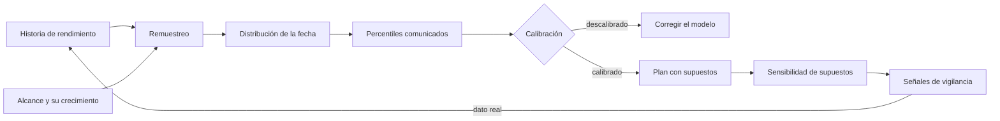
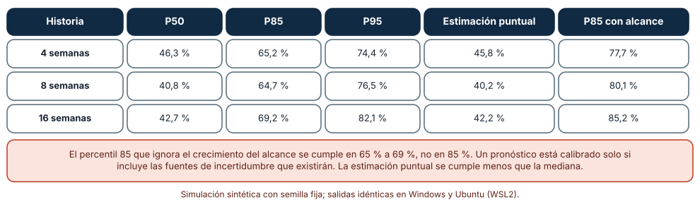
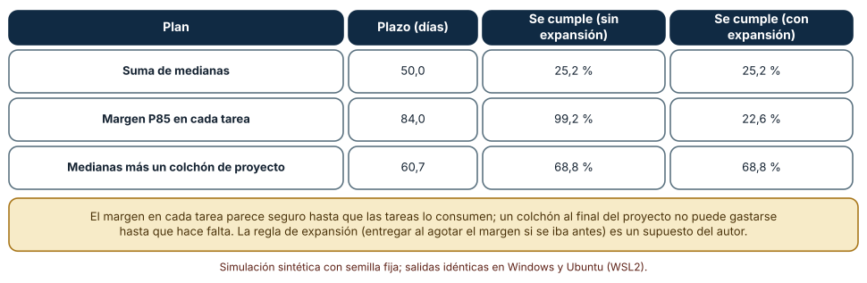
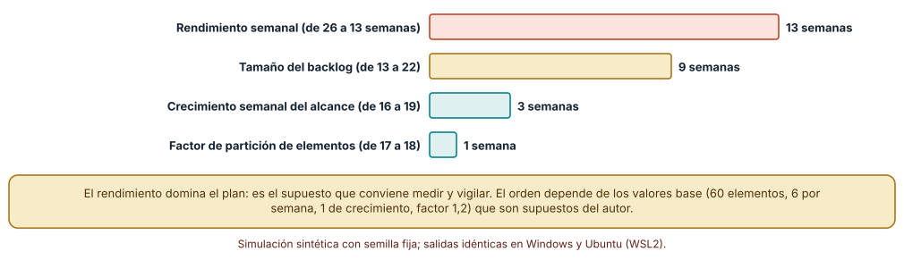

# SE-191 — Taller: planificar bajo incertidumbre explícita

[← SE-190 — Retrospectivas y mejora del sistema de trabajo](https://github.com/vladimiracunadev-create/modern-software-engineering-program/blob/main/classes/part-15-procesos-planificacion-y-estimacion/se-190-retrospectivas-y-mejora-del-sistema-de-trabajo/README.md) · [↑ Parte 15](https://github.com/vladimiracunadev-create/modern-software-engineering-program/blob/main/classes/part-15-procesos-planificacion-y-estimacion/README.md) · [📚 Índice completo](https://github.com/vladimiracunadev-create/modern-software-engineering-program/blob/main/classes/README.md) · [🌐 Portal](https://vladimiracunadev-create.github.io/modern-software-engineering-program/classes/SE-191.html) · [SE-192 — Proyecto: plan adaptativo con evidencia y guardrails →](https://github.com/vladimiracunadev-create/modern-software-engineering-program/blob/main/classes/part-15-procesos-planificacion-y-estimacion/se-192-proyecto-plan-adaptativo-con-evidencia-y-guardrails/README.md)

## Punto profesional y fundamento pedagógico

**Punto profesional.** El taller integra lo que la parte midió por separado —rangos, dependencias, riesgos, métricas— en una forma de planificar que dice «cuándo» como una distribución con sus supuestos, comprueba si esa distribución estaba calibrada y señala qué supuesto vale más la pena vigilar.

**Por qué aparece aquí.** Se sitúa después de **Retrospectivas y mejora del sistema de trabajo** y antes del **Proyecto: plan adaptativo con evidencia y guardrails**: las clases anteriores aportaron cada pieza; el taller las ensambla en un procedimiento que el proyecto final reutiliza con reglas de replanificación.

**Error conceptual que debe corregir.** Creer que un pronóstico probabilístico es fiable por ser probabilístico, o que un margen en cada tarea protege el plazo: un percentil que ignora el crecimiento del alcance o que usa poca historia está descalibrado, y el margen por tarea se gasta (la expansión del trabajo hasta ocupar el tiempo disponible, que aquí es un supuesto del autor).

**Secuencia de aprendizaje.** El taller se hace en tres pasos con predicción previa: comprobar la calibración de pronósticos de «cuándo termina» con tres cantidades de historia, comparar tres maneras de proteger una cadena de tareas y ordenar los supuestos de un plan por su efecto en el plazo. La secuencia usa predicción, explicación propia, contraste y recuperación. [ICAP](https://icap.education.asu.edu/research) distingue participación de construcción de conocimiento; [How People Learn II](https://nap.nationalacademies.org/catalog/24783/how-people-learn-ii-learners-contexts-and-cultures) exige conectar conocimiento previo, contexto y transferencia; la [práctica de recuperación](https://pubmed.ncbi.nlm.nih.gov/16507066/) respalda producir de nuevo la explicación tras una demora; y [Education for Life and Work](https://nap.nationalacademies.org/resource/13398/dbasse_084153.pdf) exige devolución que explique la causa del error.

**Evidencia de aprendizaje.** `workshop-log.md` con la predicción, la tabla de calibración, la comparación de colchones, el ranking de supuestos y un plan en forma de distribución con sus tres supuestos más sensibles, su señal de vigilancia y una nota con lo que el taller no pudo comprobar.

**Límite de la conclusión.** El rendimiento gamma, las tareas lognormales, la regla de expansión del trabajo y los parámetros del plan son supuestos del autor. El taller no demuestra que el pronóstico probabilístico supere a otro método en un proyecto real; muestra cómo comprobar la calibración y qué errores de modelado la rompen.

### Trazabilidad fuente → afirmación

| Fuente primaria u oficial | Afirmación que respalda | Lo que no prueba |
|---|---|---|
| [Efron, «Bootstrap methods: another look at the jackknife» (The Annals of Statistics, 1979)](https://doi.org/10.1214/aos/1176344552) | Describe el remuestreo con reemplazo de los datos observados para aproximar la distribución de un estadístico sin suponer una forma paramétrica. | No garantiza cobertura con pocos datos ni con procesos que cambian. |
| [Malcolm et al., «Application of a technique for research and development program evaluation» (Operations Research, 1959)](https://doi.org/10.1287/opre.7.5.646) | Modela duraciones inciertas por actividad con tres estimaciones y combina varianzas para estimar la probabilidad de cumplir un plazo. | Su aproximación asume independencia y no capta el crecimiento de alcance. |
| [Flyvbjerg, «From Nobel Prize to project management: getting risks right» (Project Management Journal, 2006)](https://doi.org/10.1177/875697280603700302) | Recomienda corregir las estimaciones internas con la distribución de resultados de proyectos similares, porque la visión interna es optimista. | No aporta una clase de referencia para la plataforma de entregas. |

## Antes de empezar

El taller reúne los artefactos de la parte: estimaciones con rango (`SE-185`), red de dependencias (`SE-186`), registro de riesgos (`SE-187`), tablero de métricas (`SE-189`) y acciones de mejora (`SE-190`). La pregunta activa es: **si el plan dice «entre X e Y semanas con 85 % de confianza», ¿cómo compruebo que esa frase es cierta y qué supuesto, si falla, la rompe?**

## Prerrequisitos

- Haber completado `SE-190` o poder explicar por qué una mejora necesita muestra para evaluarse.
- Python 3.11 o posterior y un terminal; todo el código usa solo la biblioteca estándar.
- Disponer de los artefactos de las clases anteriores o de datos sintéticos equivalentes.

## Problema auténtico

La dirección pide una fecha de lanzamiento para la plataforma de entregas con 62 elementos pendientes, un rendimiento histórico de 8 semanas (media de 5,8) y una dependencia externa por resolver. El equipo produce tres planes: uno con la fecha puntual de la media («11 semanas»), otro con un margen del 25 % a cada tarea, y un tercero con un pronóstico por simulación. Nadie sabe cuál es mejor porque nadie ha comprobado cuántas veces un pronóstico así habría acertado en proyectos pasados.

## Objetivos observables

Al terminar podrás:

1. construir un pronóstico de fecha por remuestreo de la historia de rendimiento e incorporar el crecimiento esperado del alcance;
2. comprobar la calibración de un pronóstico contra proyectos simulados y medir cuánto se desvía con poca historia;
3. comparar un margen por tarea con un colchón compartido y mostrar qué supuesto cambia el resultado;
4. ordenar los supuestos de un plan por su efecto en el plazo con una variación de ±30 % y decidir cuáles vigilar;
5. entregar un plan como distribución con sus supuestos, su señal de vigilancia y las condiciones que lo invalidan.

## Mapa conceptual



El mapa se lee de izquierda a derecha como el procedimiento del taller: del dato a la distribución, de la distribución a la comprobación y de la comprobación a la vigilancia. El retorno recuerda que cada semana de datos reales vuelve a alimentar la historia.

## Temas y por qué importan

| Tema | Por qué cambia una decisión profesional | Evidencia mínima |
|---|---|---|
| Pronóstico por simulación | Convierte la historia en una distribución de fechas sin suponer una fórmula. | Predicción, traza causal y contraejemplo de **Pronóstico por simulación** en `workshop-log.md` |
| Calibración | Un percentil solo vale si se cumple con la frecuencia anunciada. | Predicción, traza causal y contraejemplo de **Calibración** en `workshop-log.md` |
| Colchones y márgenes | Dónde se coloca la protección decide si se consume o se comparte. | Predicción, traza causal y contraejemplo de **Colchones y márgenes** en `workshop-log.md` |
| Sensibilidad | Indica qué supuesto mueve más el plazo y merece vigilancia. | Predicción, traza causal y contraejemplo de **Sensibilidad** en `workshop-log.md` |
| Comunicar el plan | La distribución, los supuestos y las señales hacen el plan revisable. | Predicción, traza causal y contraejemplo de **Comunicar el plan** en `workshop-log.md` |

## Conceptos y decisiones

### 1. Pronóstico por simulación

Para «cuándo termina» se toma la historia de rendimiento semanal, se simula el futuro eligiendo al azar semanas de esa historia hasta completar el trabajo pendiente y se repite muchas veces. El resultado es una distribución de semanas hasta terminar de la que se leen percentiles. Es la aplicación directa del remuestreo de Efron: no supone una forma para el rendimiento, solo que el futuro se parece al pasado observado. Esas dos suposiciones —que el pasado representa el futuro y que las semanas son intercambiables— son las que hay que declarar y vigilar.

### 2. Calibración

Un pronóstico está calibrado si el resultado real cae por debajo de su percentil 85 el 85 % de las veces. Se comprueba con retrospectiva: se simulan muchos proyectos con un proceso conocido, se pronostica cada uno con su historia y se cuenta el cumplimiento. Es la única manera de saber si «85 %» significa 85 %. Dos fuentes de descalibración dominan: la historia corta, que subestima la incertidumbre sobre la propia media, y los efectos que el modelo no incluye, como el crecimiento del alcance. Un pronóstico con solo la historia de rendimiento supone que el trabajo pendiente no cambia.

### 3. Colchones y márgenes

Hay dos maneras de proteger una cadena de tareas. Un margen en cada tarea (por ejemplo, el percentil 85 de cada una) suma colchones que el trabajo tiende a consumir: si una tarea termina antes, nadie entrega antes de que acabe el plazo asignado. Un colchón compartido al final de la cadena suma las medianas y reserva un solo margen, calculado con la raíz de la suma de los cuadrados de las diferencias entre el percentil 85 y la mediana de cada tarea (la combinación de varianzas de PERT). El colchón compartido no se gasta hasta que alguien lo necesita, pero exige gestionarlo: cada tarea que se atrasa lo consume y su ritmo de consumo es una señal.

### 4. Sensibilidad

La sensibilidad ordena los supuestos por cuánto mueve el resultado una variación razonable de cada uno. Se varía un supuesto cada vez, manteniendo los demás, y se compara el cambio del plazo. El resultado no dice cuál es más probable que falle, sino cuál duele más si falla. Se vigilan primero los supuestos de alta sensibilidad y baja credibilidad: los que mueven mucho el plazo y de los que menos se sabe. La vigilancia se concreta en señales: «si el rendimiento de las últimas cuatro semanas baja de cuatro, se replanifica».

### 5. Comunicar el plan

Un plan que sobrevive al contacto con la realidad dice cuatro cosas: la distribución («entre 15 y 19 semanas con 85 % de confianza»), los supuestos de los que depende, las señales que se vigilan y el momento en que se vuelve a calcular. También dice lo que no incluye. La confianza no es un adorno: si el plan no puede equivocarse de forma informativa, nadie puede aprender de él. En el proyecto final (`SE-192`), esas señales se convierten en reglas de replanificación.

### Un pronóstico del 85 % que se cumple el 65 %

Se simulan proyectos de 60 elementos cuyo alcance crece entre 0 y 20 % durante el trabajo. El rendimiento semanal es gamma con media 6 (enteros). Para cada proyecto se toma una historia de 4, 8 o 16 semanas, se pronostica el fin por remuestreo (250 simulaciones) y se comprueba, en 1200 proyectos por caso, si el fin real cae por debajo de los percentiles 50, 85 y 95. Se añade un pronóstico que incluye el mismo crecimiento de alcance esperado.

```python
sims  = [weeks_to_finish(rng, 60, lambda: rng.choice(hist)) for _ in range(250)]
sims2 = [weeks_to_finish(rng, 60 * (1 + rng.uniform(0, 0.2)), lambda: rng.choice(hist)) for _ in range(250)]
```

| Historia | P50 | P85 | P95 | Estimación puntual | P85 con alcance |
|---|---:|---:|---:|---:|---:|
| 4 semanas | 46,3 % | 65,2 % | 74,4 % | 45,8 % | 77,7 % |
| 8 semanas | 40,8 % | 64,7 % | 76,5 % | 40,2 % | 80,1 % |
| 16 semanas | 42,7 % | 69,2 % | 82,1 % | 42,2 % | 85,2 % |

Resultado, idéntico en Windows (CPython 3.12.9) y en Ubuntu bajo WSL2 (3.12.3): el percentil 85 construido solo con la historia se cumple entre el 65 y el 69 % de las veces; la estimación puntual con el rendimiento medio se cumple en el 40 al 46 %; el percentil 85 que añade el crecimiento esperado del alcance sube a 78, 80 y 85 % con 4, 8 y 16 semanas.



**Cómo leer la figura.** Cada celda es el porcentaje de 1200 proyectos en que el final real cayó dentro de lo pronosticado; un pronóstico calibrado tendría 50, 85 y 95. **Dónde deja de valer:** el crecimiento del alcance (uniforme entre 0 y 20 %) es conocido en el segundo pronóstico, algo que en la práctica se estima con historia; si se subestima, la calibración se pierde. La comprobación se hace sobre un proceso estacionario sintético; uno real cambia y empeora la cobertura. La estimación puntual, la media, se cumple menos que la mediana de la distribución.

### Margen en cada tarea o colchón de proyecto

Una cadena de diez tareas, cada una lognormal con mediana de 5 días y σ = 0,5. El percentil 85 de una tarea es 8,4 días. Tres planes: sumar medianas (50 días), añadir el percentil 85 a cada tarea (84,0 días) y sumar medianas más un colchón de proyecto de 10,74 días (la raíz de la suma de cuadrados de las diferencias entre percentil 85 y mediana), para 60,7 días. Se evalúan 20 000 ejecuciones en dos mundos: uno donde cada tarea termina cuando acaba su trabajo, y otro donde, si una tarea termina antes del 90 % de su margen, se entrega al agotarse el margen (el trabajo se expande para ocuparlo, supuesto del autor).

```python
fin_con_expansion = sum(max(a, p85) if a < 0.9 * p85 else a for a in acts)
```

| Plan | Plazo (días) | Se cumple, sin expansión | Se cumple, con expansión |
|---|---:|---:|---:|
| Suma de medianas | 50,0 | 25,2 % | 25,2 % |
| Margen P85 en cada tarea | 84,0 | 99,2 % | 22,6 % |
| Medianas más colchón de proyecto | 60,7 | 68,8 % | 68,8 % |

El margen en cada tarea parece protegerse al 99,2 % y, si el trabajo se expande, cumple apenas el 22,6 % del plazo de 84 días: peor que sumar medianas. El colchón compartido llega al 68,8 % con 23 días menos y no depende de la regla de expansión.



**Cómo leer la figura.** Cada fila es un plan; las dos últimas columnas son el cumplimiento sin y con expansión del trabajo. **Dónde deja de valer:** la expansión es el supuesto central y no se midió; si las personas entregan en cuanto terminan, el margen por tarea es seguro, aunque caro. El colchón compartido supone independencia de las tareas y una gestión disciplinada del consumo. La conclusión no es «los colchones por tarea son malos»: es que su efecto depende de una conducta que se puede observar y que el plan debe declarar.

### Qué supuesto del plan duele más

Un plan tiene cuatro supuestos: tamaño del trabajo pendiente (60 elementos), rendimiento semanal (6), crecimiento del alcance (1 elemento por semana) y factor de partición de los elementos (1,2 veces más piezas al desglosarlos). Se calcula el percentil 85 del plazo con el valor base (17 semanas) y variando cada supuesto un 30 % hacia abajo y hacia arriba, con los mismos números aleatorios.

```python
for k in base:
    lo, hi = dict(base), dict(base)
    lo[k] = base[k] * 0.7; hi[k] = base[k] * 1.3
```

| Supuesto | −30 % | +30 % | Amplitud (semanas) |
|---|---:|---:|---:|
| Rendimiento semanal | 26 | 13 | 13 |
| Tamaño del backlog | 13 | 22 | 9 |
| Crecimiento del alcance | 16 | 19 | 3 |
| Factor de partición | 17 | 18 | 1 |

El rendimiento mueve el plazo 13 semanas, más que el tamaño del trabajo (9), y el crecimiento del alcance solo 3. Un rendimiento 30 % menor lleva el plazo de 17 a 26 semanas, mientras que un 30 % más lo baja a 13.



**Cómo leer la figura.** Cada barra es la diferencia entre el plazo con el supuesto 30 % más alto y con el 30 % más bajo; el orden indica qué supuesto vigilar primero. **Dónde deja de valer:** el orden depende de los valores base (60, 6, 1, 1,2) y de que cada supuesto se mueva solo; en un proyecto real, el rendimiento y el crecimiento del alcance se correlacionan. Y un 30 % no es igual de creíble para todos: el rendimiento observado en ocho semanas puede variar más que el tamaño del trabajo desglosado. La figura dice dónde mirar; la credibilidad decide cuánto.

## Definiciones de trabajo

- **pronóstico por simulación:** distribución del resultado obtenida repitiendo muchas veces un modelo del proceso con datos extraídos de la historia.
- **calibración:** correspondencia entre la confianza anunciada de un pronóstico y la frecuencia con que se cumple.
- **colchón de proyecto:** margen único reservado al final de una cadena de tareas y consumido cuando alguna se atrasa.
- **expansión del trabajo:** tendencia a ocupar el tiempo disponible cuando una tarea termina antes de lo asignado.
- **sensibilidad:** cambio del resultado al variar un supuesto mientras los demás se mantienen.

Las definiciones son operativas para la plataforma de entregas. No convierten términos con una historia más amplia en sinónimos y deben contrastarse con la documentación primaria enlazada al final.

## Ejemplo mínimo

El fragmento calcula el colchón compartido de diez tareas idénticas. Antes de ejecutarlo, predice si el colchón es mayor o menor que la suma de los diez márgenes individuales.

```python
import math
p85_menos_mediana = 8.4 - 5.0
colchon = math.sqrt(10 * p85_menos_mediana ** 2)
suma_de_margenes = 10 * p85_menos_mediana
assert round(colchon, 2) == 10.75 and round(suma_de_margenes, 1) == 34.0
```

El colchón es de 10,75 días (con el 8,4 redondeado) frente a 34 de la suma de márgenes: la raíz de la suma de cuadrados crece como √n y la suma como n. Registra versión, comando y salida; cambia a 25 tareas y predice cuánto crece cada una.

## Ejemplo profesional

El equipo de la plataforma de entregas arma su plan con el procedimiento del taller. Toma ocho semanas de rendimiento (media 5,8), un desglose de 62 elementos y un crecimiento de alcance estimado en 0 a 15 % con las últimas dos entregas. Simula 1000 veces el futuro y obtiene un percentil 50, 85 y 95; antes de comunicarlo, calibra el procedimiento con proyectos sintéticos de su misma forma y descubre que con ocho semanas el percentil 85 se cumple alrededor de dos de cada tres veces, por lo que incorpora el crecimiento esperado del alcance, recalibra y solo entonces comunica el percentil. Vigila tres señales: rendimiento de las últimas cuatro semanas, tamaño del backlog y fecha de la dependencia externa. El colchón del proyecto se muestra en el tablero y su consumo se revisa cada dos semanas.

Compara con el plan de «11 semanas»: cuando el rendimiento baja, el nuevo plan dice qué señal se cruzó y qué se revisa; el anterior solo muestra una fecha incumplida. Un plan es adecuado cuando puede equivocarse de forma informativa; es frágil cuando solo puede ser cierto o culpable.

## Práctica guiada

1. Reúne la historia de rendimiento de ocho a dieciséis semanas y el backlog pendiente.
2. Predice con qué frecuencia se cumple un percentil 85 construido con esa historia y escribe el número antes de simular.
3. Simula proyectos con un proceso conocido y comprueba la calibración con y sin crecimiento del alcance.
4. Compara el margen por tarea con el colchón compartido en una cadena de diez tareas, con y sin expansión.
5. Haz la tabla de sensibilidad de tu plan y subraya los dos supuestos a vigilar.
6. Escribe el plan como distribución con supuestos, señales y fecha de recálculo.
7. Entrega `workshop-log.md` y pide a otra persona que identifique la señal que obligaría a replanificar.

## Ejercicios

1. **Calibración:** calibra un percentil 70 y otro 95 con 8 semanas de historia y compara con lo anunciado.
2. **Colchón:** calcula el colchón compartido para cadenas de 5, 10 y 20 tareas y estima cuánto ahorra frente a márgenes por tarea.
3. **Sensibilidad:** repite el análisis variando cada supuesto un 15 % y un 50 % y comprueba si el orden cambia.
4. **Señal:** define una señal numérica y una regla de acción para el rendimiento, y simula su tasa de falsas alarmas.

## Reto verificable

Entrega `workshop-log.md` con la predicción, la tabla de calibración, la comparación de colchones, el ranking de supuestos y el plan comunicado como distribución. Se aprueba si otra persona ejecuta el código desde un checkout limpio, obtiene los mismos números y puede decir qué señal obligaría a replanificar. No se aprueba por un pronóstico sin comprobación de calibración ni por un plan sin supuestos.

## Caso conductor

La plataforma de entregas de tareas continúa como caso conductor de la Parte 15. El taller deja el undécimo artefacto: un plan de lanzamiento comunicado como distribución, calibrado con retrospectiva, con tres supuestos vigilados. `SE-192` lo convertirá en un plan adaptativo con reglas de replanificación y barreras. Cambia después una sola cosa, el rendimiento de las últimas cuatro semanas, y observa qué parte del plan debe recalcularse.

## Preguntas frecuentes

### ¿Cuánta historia necesito para pronosticar?

Cuanta más mejor, pero con menos de unas doce semanas conviene ensanchar el intervalo o corregirlo con una clase de referencia. La calibración con tu propio proceso muestra cuánto.

### ¿El colchón compartido sirve si las tareas no son independientes?

Menos: si las tareas se retrasan juntas, el colchón se consume de golpe. Conviene un colchón mayor o dividir las causas comunes en el registro de riesgos (`SE-187`).

### ¿Por qué no usar siempre el percentil 95?

Porque comprometer capacidad para cubrir el caso extremo tiene un coste. La confianza se elige según lo que cuesta fallar y se declara.

### ¿Qué hago si el pronóstico no está calibrado?

Corrige el modelo: añade el crecimiento del alcance, amplía el intervalo con poca historia o usa una clase de referencia. Y reevalúa con nuevos proyectos, no con los mismos con que se ajustó.

## Fallo controlado y diagnóstico

Reproduce el fallo clásico de la clase: **comunicar el percentil 85 de la historia como si cubriera el 85 %**. Compara su cumplimiento real con el anunciado en 1200 proyectos con crecimiento de alcance.

Registra síntoma, entrada mínima, hipótesis, observación que descarta cada hipótesis, causa, corrección y prueba de regresión. **Síntoma:** de cada tres proyectos pronosticados «con 85 % de confianza», uno se pasa del plazo. **Hipótesis rivales:** (a) el equipo trabajó peor que su historia; (b) el modelo ignora fuentes de incertidumbre; (c) la historia era demasiado corta. **Prueba:** simula el procedimiento con un proceso conocido y mide el cumplimiento; con 8 semanas y sin crecimiento de alcance en el modelo es 64,7 %, con crecimiento 80,1 %. **Conclusión:** la causa es el alcance omitido y la historia corta, no el desempeño. **Regresión:** añade el crecimiento esperado del alcance, recalibra y registra el cumplimiento en los tres proyectos siguientes. No cambies a la vez el modelo y el percentil comunicado.

## Errores comunes y cómo corregirlos

| Síntoma | Causa probable | Corrección |
|---|---|---|
| El percentil 85 se cumple dos de cada tres veces | Alcance fijo en el modelo y poca historia | Incluir el crecimiento esperado y ensanchar el intervalo |
| El margen de cada tarea se consume y el plazo igual se pierde | Expansión del trabajo | Compartir el colchón y vigilar su consumo |
| Se vigilan todos los supuestos y ninguno | Sin ranking de sensibilidad | Vigilar los de alto efecto y baja credibilidad |
| El plan se recalcula con datos de otro equipo o de otra época | Historia no representativa | Marcar los cambios de equipo y descartar o ponderar datos antiguos |
| Se comunica una distribución sin supuestos | El plan no puede equivocarse de forma informativa | Escribir supuestos, señales y fecha de recálculo |

## Entorno y archivos clave

```text
work/SE-191/
├── README.md
├── taller/
│   ├── pronostico.py
│   ├── colchon.py
│   └── sensibilidad.py
├── tests/test_taller.py
└── evidence/workshop-log.md
```

El `README` declara plataforma, versión de Python, semillas y comandos. Los experimentos usan solo la biblioteca estándar (`random`, `statistics`, `math`) y se ejecutaron con CPython 3.12.9 en Windows 11 y 3.12.3 en Ubuntu bajo WSL2: las salidas fueron idénticas. Si añades una dependencia, fija procedencia y versión.

## Seguridad, ética y accesibilidad

- un plan probabilístico no debe usarse para presionar al equipo hacia el percentil bajo: la distribución describe incertidumbre, no objetivos;
- los planes que afectan plazos de estudiantes o trámites deben declarar su confianza y la fecha de recálculo;
- las tablas y gráficos de percentiles deben tener una versión textual accesible;
- documenta quién aceptó el nivel de confianza y el consumo del colchón;
- respeta las licencias de las herramientas de simulación y atribuye lo adaptado.

## Puente hacia el trabajo con agentes

Un agente al que se le pide «pronostica la fecha» ejecutará una simulación y presentará percentiles con aire de rigor. Pídele en cambio que compruebe la calibración del procedimiento con proyectos sintéticos, que incluya el crecimiento del alcance, que ordene los supuestos por sensibilidad y que liste las señales para replanificar. Revisa especialmente si trata las semanas de la historia como intercambiables y el alcance como fijo: son los dos supuestos que descalibraron el 85 %.

## Transferencia

Traslada el taller a otro plan (por ejemplo, una migración con un equipo distinto): cambia la historia, el alcance y los supuestos, y conserva el procedimiento de simular, calibrar, comparar colchones y ordenar por sensibilidad. La transferencia está lograda cuando puedes explicar qué parte del procedimiento dependía de los datos y cuál no, no cuando el código se parece.

## Evaluación y evidencia

| Criterio | Evidencia para aprobar |
|---|---|
| comprensión | explicación de por qué un percentil necesita calibración y de qué rompe el colchón por tarea |
| corrección | calibración, colchones y sensibilidad reproducibles con las mismas semillas |
| diseño | plan comunicado como distribución con supuestos, señales y fecha de recálculo |
| diagnóstico | reproducción del fallo «percentil sin calibrar» con regresión |
| incertidumbre | declaración de los supuestos de estacionariedad, alcance y expansión del trabajo |
| reproducibilidad | versiones, comandos, salida y límites declarados |

## Fuentes

- [Efron, «Bootstrap methods: another look at the jackknife» (The Annals of Statistics, 1979)](https://doi.org/10.1214/aos/1176344552) — remuestreo; autoridad: The Annals of Statistics.
- [Malcolm et al., «Application of a technique for research and development program evaluation» (Operations Research, 1959)](https://doi.org/10.1287/opre.7.5.646) — PERT y combinación de varianzas; autoridad: Operations Research.
- [Flyvbjerg, «From Nobel Prize to project management: getting risks right» (Project Management Journal, 2006)](https://doi.org/10.1177/875697280603700302) — clases de referencia y optimismo; autoridad: Project Management Journal.
- [Buehler, Griffin y Ross, «Exploring the planning fallacy» (Journal of Personality and Social Psychology, 1994)](https://doi.org/10.1037/0022-3514.67.3.366) — subestimación del tiempo propio; autoridad: Journal of Personality and Social Psychology.
- [SWEBOK Guide v4.0a](https://www.computer.org/education/bodies-of-knowledge/software-engineering) — gestión de ingeniería de software; autoridad: IEEE Computer Society.

Cada fuente respalda el mecanismo indicado; ninguna demuestra que el 64,7 %, el 22,6 % o el orden de sensibilidad se observen en la plataforma de entregas. Esa afirmación depende de su historia, de su alcance y de la conducta real del equipo.

- [Python: `random`](https://docs.python.org/3/library/random.html) — generador con semilla y distribuciones lognormal y gamma.
- [Python: `statistics`](https://docs.python.org/3/library/statistics.html) — medias y resúmenes.

## Límites y siguiente paso

Se ejecutaron tres experimentos con datos sintéticos en Windows y Ubuntu (WSL2) con resultados idénticos. No se pronosticó ningún proyecto real ni se observó expansión del trabajo: el rendimiento gamma, las tareas lognormales, la regla de expansión del 90 % y los valores base del plan son construcciones del autor. La siguiente clase convierte este plan en un proyecto adaptativo con reglas de replanificación y barreras.

## Glosario

- **pronóstico por simulación:** distribución del resultado obtenida repitiendo muchas veces un modelo del proceso con datos extraídos de la historia.
- **calibración:** correspondencia entre la confianza anunciada de un pronóstico y la frecuencia con que se cumple.
- **colchón de proyecto:** margen único reservado al final de una cadena de tareas y consumido cuando alguna se atrasa.
- **expansión del trabajo:** tendencia a ocupar el tiempo disponible cuando una tarea termina antes de lo asignado.
- **sensibilidad:** cambio del resultado al variar un supuesto mientras los demás se mantienen.

---

[← SE-190 — Retrospectivas y mejora del sistema de trabajo](https://github.com/vladimiracunadev-create/modern-software-engineering-program/blob/main/classes/part-15-procesos-planificacion-y-estimacion/se-190-retrospectivas-y-mejora-del-sistema-de-trabajo/README.md) · [↑ Parte 15](https://github.com/vladimiracunadev-create/modern-software-engineering-program/blob/main/classes/part-15-procesos-planificacion-y-estimacion/README.md) · [📚 Índice completo](https://github.com/vladimiracunadev-create/modern-software-engineering-program/blob/main/classes/README.md) · [🌐 Portal](https://vladimiracunadev-create.github.io/modern-software-engineering-program/classes/SE-191.html) · [SE-192 — Proyecto: plan adaptativo con evidencia y guardrails →](https://github.com/vladimiracunadev-create/modern-software-engineering-program/blob/main/classes/part-15-procesos-planificacion-y-estimacion/se-192-proyecto-plan-adaptativo-con-evidencia-y-guardrails/README.md)
