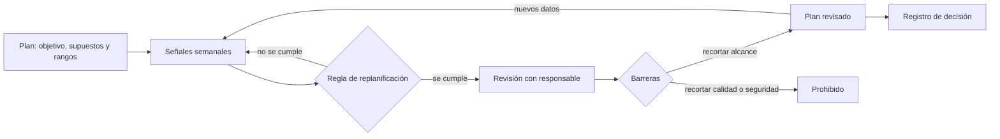
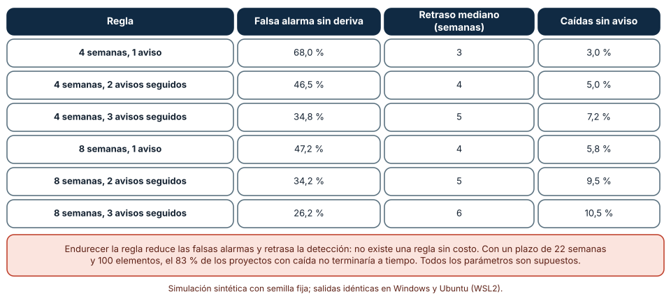
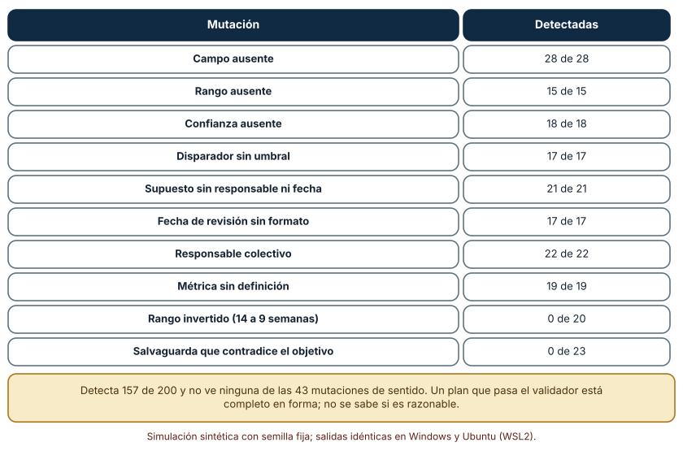
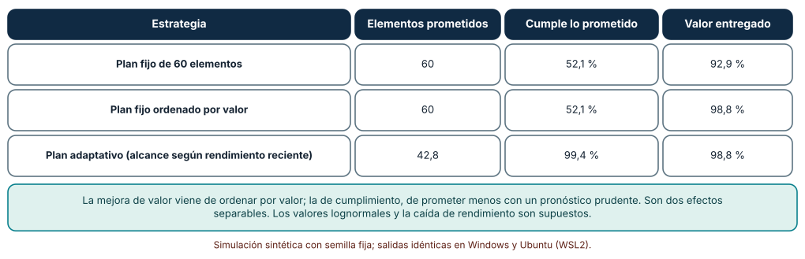

# SE-192 — Proyecto: plan adaptativo con evidencia y guardrails

[← SE-191 — Taller: planificar bajo incertidumbre explícita](https://github.com/vladimiracunadev-create/modern-software-engineering-program/blob/main/classes/part-15-procesos-planificacion-y-estimacion/se-191-taller-planificar-bajo-incertidumbre-explicita/README.md) · [↑ Parte 15](https://github.com/vladimiracunadev-create/modern-software-engineering-program/blob/main/classes/part-15-procesos-planificacion-y-estimacion/README.md) · [📚 Índice completo](https://github.com/vladimiracunadev-create/modern-software-engineering-program/blob/main/classes/README.md) · [🌐 Portal](https://vladimiracunadev-create.github.io/modern-software-engineering-program/classes/SE-192.html) · [SE-193 — Modelo de objetos y áreas de Git →](https://github.com/vladimiracunadev-create/modern-software-engineering-program/blob/main/classes/part-16-git-colaboracion-y-codigo-abierto/se-193-modelo-de-objetos-y-areas-de-git/README.md)

## Punto profesional y fundamento pedagógico

**Punto profesional.** El proyecto entrega un plan que cambia con la evidencia sin cambiar por capricho: dice qué se prometió, bajo qué supuestos, qué señales vigila, qué regla dispara la replanificación y qué barreras no se negocian, y demuestra con una simulación qué ganan y qué cuestan esas reglas.

**Por qué aparece aquí.** Cierra la **Parte 15**: reúne el modelo de proceso (`SE-181`), las políticas y el flujo (`SE-182` a `SE-184`), las estimaciones y dependencias (`SE-185` y `SE-186`), los registros (`SE-187`), las puertas (`SE-188`), las métricas (`SE-189`), la mejora (`SE-190`) y el pronóstico calibrado (`SE-191`). La Parte 16 pasará a cómo se colabora sobre el código con Git.

**Error conceptual que debe corregir.** Creer que un plan adaptativo es un plan sin compromisos, o que una regla de replanificación sensible detecta los problemas a tiempo sin costo: toda regla intercambia falsas alarmas por retraso de detección, y un plan que se rehace ante cada oscilación pierde credibilidad.

**Secuencia de aprendizaje.** Antes de simular, predices cuántas falsas alarmas produce un disparador basado en el percentil 85; después simulas seis reglas con sus falsas alarmas y su retraso, pasas un plan por un validador con doscientas mutaciones y repites mil proyectos con tres estrategias de plan. La secuencia usa predicción, explicación propia, contraste y recuperación. [ICAP](https://icap.education.asu.edu/research) distingue participación de construcción de conocimiento; [How People Learn II](https://nap.nationalacademies.org/catalog/24783/how-people-learn-ii-learners-contexts-and-cultures) exige conectar conocimiento previo, contexto y transferencia; la [práctica de recuperación](https://pubmed.ncbi.nlm.nih.gov/16507066/) respalda producir de nuevo la explicación tras una demora; y [Education for Life and Work](https://nap.nationalacademies.org/resource/13398/dbasse_084153.pdf) exige devolución que explique la causa del error.

**Evidencia de aprendizaje.** `plan-log.md` con el plan completo (objetivo, supuestos, rangos, disparadores, barreras, responsables, métricas y revisión), la predicción, las tres tablas, la regla de replanificación elegida con su costo y una lista de lo que el validador no ve.

**Límite de la conclusión.** El rendimiento gamma, la caída de rendimiento en la mitad de los proyectos, las reglas de recorte y los valores lognormales son supuestos del autor. El proyecto no demuestra que un plan adaptativo supere a uno fijo en una organización; muestra qué efectos son atribuibles a cada decisión y cuáles dependen del modelo.

### Trazabilidad fuente → afirmación

| Fuente primaria u oficial | Afirmación que respalda | Lo que no prueba |
|---|---|---|
| [Principios del Manifiesto Ágil](https://agilemanifesto.org/principles.html) | Pide dar la bienvenida a los cambios incluso tarde en el desarrollo y reflexionar a intervalos regulares sobre cómo ajustar el comportamiento. | No dice cuándo replanificar ni cómo distinguir una oscilación de un cambio real. |
| [Flyvbjerg, «From Nobel Prize to project management: getting risks right» (Project Management Journal, 2006)](https://doi.org/10.1177/875697280603700302) | Documenta el optimismo sistemático de las estimaciones de proyectos y recomienda contrastar con la distribución de proyectos similares. | No ofrece una regla de replanificación. |
| [DORA: investigación](https://dora.dev/research/) | Reúne evidencia de que equipos con ciclos cortos y estabilidad miden mejor su entrega; sirve para elegir las métricas del plan. | La asociación observada no garantiza que un plan concreto produzca esos resultados. |

## Antes de empezar

El proyecto usa como insumos los artefactos de la parte: modelo de proceso por bloque, políticas, mediciones de flujo, estimación como rango, red de dependencias, registros, puertas, métricas, acción de mejora y plan como distribución. La pregunta activa es: **¿qué regla me avisa a tiempo de que el plan dejó de valer, sin cambiarlo por ruido, y qué no se puede recortar nunca?**

## Prerrequisitos

- Haber completado `SE-191` o poder explicar la calibración de un pronóstico.
- Python 3.11 o posterior y un terminal; todo el código usa solo la biblioteca estándar.
- Disponer de los artefactos de las clases anteriores o de datos sintéticos equivalentes.

## Problema auténtico

La plataforma de entregas debe lanzar la recuperación de borradores y la regla de penalización en 22 semanas con 100 elementos. El equipo tiene un plan con distribución, supuestos y señales. En la semana 9 el rendimiento cae a la mitad por un cambio de equipo. El plan tiene un disparador («replanificar si el percentil 85 supera el plazo»), pero se ha disparado en cuatro ocasiones anteriores sin que pasara nada y ya nadie le hace caso. Esta vez es real.

## Objetivos observables

Al terminar podrás:

1. definir un disparador de replanificación y medir su tasa de falsas alarmas, su retraso de detección y sus caídas sin aviso;
2. validar la forma de un plan adaptativo con un verificador y medirlo con mutaciones, declarando lo que no ve;
3. separar, con una simulación de mil proyectos, el efecto de ordenar por valor del efecto de prometer según el pronóstico;
4. definir barreras (qué no se recorta nunca) y responsables de cada decisión de replanificar;
5. entregar un plan adaptativo con evidencia, señales, barreras y límites que otra persona pueda revisar y reproducir.

## Mapa conceptual



El mapa se lee desde el plan hacia las señales y, si una regla se cumple, hacia una revisión con barreras. El recorte de alcance está permitido; el de calidad, accesibilidad o seguridad, no. Cada replanificación queda registrada como decisión.

## Temas y por qué importan

| Tema | Por qué cambia una decisión profesional | Evidencia mínima |
|---|---|---|
| Disparadores | Convierten una señal en una acción con responsable; sin umbral no son reglas. | Predicción, traza causal y contraejemplo de **Disparadores** en `plan-log.md` |
| Guardrails | Fijan qué no se negocia al replanificar, para que la presión de plazos no recorte lo esencial. | Predicción, traza causal y contraejemplo de **Guardrails** en `plan-log.md` |
| Falsas alarmas y retraso | Toda regla intercambia sensibilidad por tiempo de detección. | Predicción, traza causal y contraejemplo de **Falsas alarmas y retraso** en `plan-log.md` |
| Validación del plan | Una verificación de forma libera revisión humana para el sentido. | Predicción, traza causal y contraejemplo de **Validación del plan** en `plan-log.md` |
| Prometer menos y ordenar por valor | Son dos decisiones distintas con efectos separables. | Predicción, traza causal y contraejemplo de **Prometer menos y ordenar por valor** en `plan-log.md` |

## Conceptos y decisiones

### 1. Disparadores

Un disparador es una condición medible sobre una señal que obliga a revisar el plan: «el percentil 85 del pronóstico supera la fecha comprometida dos semanas seguidas». Tiene cuatro partes: la señal, el umbral, la ventana (cuántas observaciones o cuánto tiempo) y la acción con su responsable. Sin ventana, cualquier oscilación lo activa; sin responsable, nadie lo atiende; sin acción, es una alarma sin protocolo. Los disparadores se acuerdan al planificar, no cuando ya hay presión, y se revisan con las falsas alarmas que produjeron.

### 2. Guardrails

Una barrera (guardrail) declara lo que no se recorta al replanificar. En la plataforma de entregas: la accesibilidad de la interfaz, el cálculo correcto de las notas, la protección de los datos de estudiantes y la capacidad de recuperar un borrador. Se pueden recortar funciones, no esas garantías. La barrera existe porque, bajo presión de plazo, lo que no tiene dueño ni umbral se recorta primero, y recortarlo cuesta más tarde. Cada barrera tiene una comprobación (una prueba, una revisión) y un responsable de hacerla cumplir; si no hay comprobación, no es una barrera, es una intención.

### 3. Falsas alarmas y retraso de detección

Una regla sensible detecta rápido y se equivoca a menudo; una regla estricta se equivoca poco y avisa tarde. La relación es estructural: con datos ruidosos, pedir más confirmación (más observaciones, más avisos seguidos) reduce las falsas alarmas y aumenta el retraso. La elección depende del coste de cada error: una falsa alarma cuesta una reunión; un aviso tardío cuesta semanas de trabajo sobre un plan inviable. El resultado más importante es que no existe una regla sin costo: hay que escoger y declarar cuál.

### 4. Validación del plan

El plan es un documento con campos: objetivo, supuestos con responsable y fecha, rangos con confianza, disparadores con umbral, barreras, responsable, fecha de revisión y métricas con definición. Un verificador comprueba la forma de esos campos, igual que el de `SE-187` comprobó los registros de decisión. No puede comprobar que el rango tenga sentido, que las barreras no se contradigan con el objetivo o que los supuestos sean los correctos. Su aprobación indica que el plan es revisable, no que es bueno.

### 5. Prometer menos y ordenar por valor

Un plan adaptativo hace dos cosas distintas. Una es ordenar el trabajo por valor para que, si el tiempo se agota, lo entregado sea lo más valioso (`SE-186`). Otra es prometer según el pronóstico: comprometer solo el alcance que el rendimiento reciente respalda, de modo que lo prometido se cumpla. Combinarlas es lo habitual, pero conviene medirlas por separado, porque cada una resuelve un problema distinto —el valor entregado y la fiabilidad de lo prometido— y confundirlas lleva a atribuir a una lo que hizo la otra.

### Reglas de replanificación: falsas alarmas frente a retraso

Un proyecto de 100 elementos con plazo de 22 semanas y rendimiento de 6 por semana; en la mitad de los proyectos el rendimiento baja a 3 por semana desde la semana 9. Cada semana se pronostica el fin por remuestreo de las últimas 4 u 8 semanas y se activa el disparador si el percentil 85 supera el plazo `m` semanas seguidas. Se simulan 400 proyectos sin caída y 400 con caída por cada regla.

```python
f = semana + forecast_p85(historia[-ventana:], pendientes, rng)
avisos = avisos + 1 if f > PLAZO else 0
if avisos >= m:
    disparado = semana
```

| Regla | Falsa alarma sin caída | Retraso mediano de detección (semanas) | Caídas sin aviso |
|---|---:|---:|---:|
| 4 semanas, 1 aviso | 68,0 % | 3 | 3,0 % |
| 4 semanas, 2 avisos seguidos | 46,5 % | 4 | 5,0 % |
| 4 semanas, 3 avisos seguidos | 34,8 % | 5 | 7,2 % |
| 8 semanas, 1 aviso | 47,2 % | 4 | 5,8 % |
| 8 semanas, 2 avisos seguidos | 34,2 % | 5 | 9,5 % |
| 8 semanas, 3 avisos seguidos | 26,2 % | 6 | 10,5 % |

Resultado, idéntico en Windows (CPython 3.12.9) y en Ubuntu bajo WSL2 (3.12.3): con una ventana de 4 semanas y un solo aviso, 68 de cada 100 proyectos sanos activan el disparador; con 8 semanas y tres avisos, 26. A cambio, el retraso mediano pasa de 3 a 6 semanas y las caídas sin aviso de 3 a 10,5 %. Sin acción, el 83 % de los proyectos con caída no termina a tiempo.



**Cómo leer la figura.** Cada fila es una regla; las columnas muestran lo que cuesta y lo que ahorra. **Dónde deja de valer:** el plazo de 22 semanas con 100 elementos deja poco margen, lo que encarece las falsas alarmas: un plazo más holgado las reduciría. La caída a la mitad desde la semana 9 es un solo tipo de cambio; una degradación gradual sería más difícil de detectar. Todas las cifras son de este montaje y no recomiendan una regla.

### Un validador de planes y las 43 mutaciones que no ve

Se construye un plan correcto con ocho campos (objetivo, supuestos, rangos, disparadores, salvaguardas, responsable, revisión, métricas) y un verificador de forma. Se generan 200 mutaciones con semilla fija de diez tipos.

```python
if not re.search(r"\d+\s*(y|a|-)\s*\d+", p["Rangos"]): errs.add("sin rango")
if not re.search(r"\d+\s*%", p["Rangos"]): errs.add("sin confianza")
if not re.search(r"\d", p["Disparadores"]): errs.add("disparador sin umbral")
```

| Mutación | Detectadas |
|---|---:|
| Campo ausente | 28 de 28 |
| Rango ausente | 15 de 15 |
| Confianza ausente | 18 de 18 |
| Disparador sin umbral | 17 de 17 |
| Supuesto sin responsable ni fecha | 21 de 21 |
| Fecha de revisión sin formato | 17 de 17 |
| Responsable colectivo | 22 de 22 |
| Métrica sin definición | 19 de 19 |
| Rango invertido (14 a 9 semanas) | 0 de 20 |
| Salvaguarda que contradice el objetivo | 0 de 23 |

El verificador detecta 157 de las 200 mutaciones y ninguna de las 43 que cambian el sentido: un rango invertido («entre 14 y 9 semanas») tiene la forma de un rango, y una salvaguarda que dice «se recorta calidad si hace falta para llegar» tiene la forma de una salvaguarda. Las reglas se escribieron conociendo las mutaciones, así que la detección por tipo es optimista.



**Cómo leer la figura.** Cada fila es un tipo de mutación y cuántas de sus apariciones detectó el verificador. **Dónde deja de valer:** las 200 mutaciones son sintéticas; un plan real falla de maneras que nadie previó. El 78,5 % de detección describe este montaje, y las dos categorías no detectadas son justo las que exigen leer el plan. El verificador es una ayuda para que la revisión humana se dedique a ellas.

### Mil proyectos: ordenar por valor y prometer menos son efectos distintos

Mil proyectos de 60 elementos con valor lognormal (σ = 1), plazo de 11 semanas y rendimiento de 6 por semana; en el 40 % de los proyectos el rendimiento cae un 30 % desde la semana 5. Tres estrategias: un plan fijo que promete los 60 elementos y los trabaja en el orden recibido; el mismo plan fijo ordenado por valor; y un plan adaptativo que cada dos semanas ajusta el alcance prometido al percentil 25 del rendimiento reciente y trabaja por valor.

```python
cap = hechos + int(semanas_restantes * q(rendimiento_reciente, .25))
comprometido = min(comprometido, max(hechos, cap))
```

| Estrategia | Elementos prometidos | Cumple lo prometido | Valor entregado |
|---|---:|---:|---:|
| Plan fijo de 60 elementos | 60 | 52,1 % | 92,9 % |
| Plan fijo ordenado por valor | 60 | 52,1 % | 98,8 % |
| Plan adaptativo (alcance según rendimiento reciente) | 42,8 | 99,4 % | 98,8 % |

Ordenar por valor eleva el valor entregado de 92,9 % a 98,8 % sin cambiar el cumplimiento (52,1 %). Prometer según el rendimiento reciente eleva el cumplimiento a 99,4 %, sin cambiar el valor (98,8 %). El precio del cumplimiento es prometer 42,8 elementos en lugar de 60, un 29 % menos de lo que se pidió.



**Cómo leer la figura.** Cada fila es una estrategia; la comparación entre las dos primeras aísla el efecto del orden y entre las dos últimas, el de prometer menos. **Dónde deja de valer:** el valor de cada elemento se conoce de antemano y es independiente de los demás, cosa que `SE-182` y `SE-186` cuestionaron; la caída de 30 % en el 40 % de los proyectos es un supuesto, y el percentil 25 como regla de alcance es una elección del autor. El 99,4 % de cumplimiento mide prudencia, no acierto: prometer menos siempre cumple más.

## Definiciones de trabajo

- **plan adaptativo:** plan que declara sus supuestos, sus señales y las reglas con que se revisa, y que cambia por evidencia y no por presión.
- **disparador:** condición medible sobre una señal, con umbral, ventana y responsable, que obliga a revisar el plan.
- **guardrail o barrera:** garantía que no se recorta al replanificar, con una comprobación y un responsable.
- **falsa alarma:** activación de un disparador sin que el plan haya dejado de valer.
- **retraso de detección:** tiempo entre el cambio real y la activación del disparador.

Las definiciones son operativas para la plataforma de entregas. No convierten términos con una historia más amplia en sinónimos y deben contrastarse con la documentación primaria enlazada al final.

## Ejemplo mínimo

El fragmento calcula la probabilidad de al menos una falsa alarma en un proyecto si cada semana hay una probabilidad independiente de 5 %. Antes de ejecutarlo, predice si la probabilidad en 20 semanas es mayor o menor que 50 %.

```python
p_semana = 0.05
semanas = 20
al_menos_una = 1 - (1 - p_semana) ** semanas
assert round(al_menos_una, 3) == 0.642
```

Con un 5 % por semana, la probabilidad de una falsa alarma en 20 semanas es 64,2 %: una regla que mira cada semana alarma casi siempre. Exigir dos avisos seguidos lo reduce (la probabilidad de dos seguidos es 0,25 % por par de semanas). Registra versión, comando y salida; cambia a 2 % y calcula cuántas semanas hacen falta para superar el 50 %.

## Ejemplo profesional

El equipo de la plataforma de entregas entrega el plan con ocho secciones. El objetivo es «lanzar la recuperación de borradores con la regla de penalización verificada en 22 semanas». Los supuestos son cuatro, con responsable y fecha. El rango comunicado es «entre 18 y 23 semanas con 85 % de confianza», calculado con 12 semanas de historia y calibrado como en `SE-191`. El disparador es «percentil 85 del pronóstico sobre el plazo durante dos semanas seguidas, con ventana de ocho semanas», elegido por tener unas 34 % de falsas alarmas y cinco semanas de retraso, que el equipo acepta con eso a la vista. Las barreras son cuatro (accesibilidad, exactitud de notas, protección de datos de estudiantes, recuperación de borradores), cada una con una prueba y una persona responsable. La métrica de resultado es el porcentaje de borradores recuperados tras una caída de sesión.

Compara con el plan de la semana 9: el rendimiento se reduce a la mitad, el disparador se activa en la semana 13 y el equipo, en vez de discutir si «es real», ejecuta el protocolo: recorta funciones de menor valor, conserva las cuatro barreras y registra la decisión. Un plan adaptativo es adecuado cuando el cambio de plan ya estaba previsto en sus reglas; es una excusa cuando se cambia sin regla, o una promesa vacía cuando nadie la activa.

## Práctica guiada

1. Toma los artefactos de las clases anteriores (o sintéticos) y reúne el plan en ocho secciones.
2. Escribe un disparador con señal, umbral, ventana, responsable y acción.
3. Predice la tasa de falsas alarmas de tu disparador y escribe el número antes de simular.
4. Simula seis reglas y elige una justificando falsas alarmas y retraso.
5. Pasa el plan por el validador y escribe tres mutaciones de sentido que no detecte.
6. Simula mil proyectos con las tres estrategias y separa el efecto del orden del de prometer menos.
7. Define las barreras con su comprobación y responsable; entrega `plan-log.md` y pide a otra persona que encuentre una barrera sin comprobación.

## Ejercicios

1. **Disparador:** diseña una segunda señal (por ejemplo, antigüedad del trabajo en curso) y compara su tasa de falsas alarmas con la del pronóstico.
2. **Validador:** añade dos reglas al verificador (rango no invertido y barreras sin la palabra «recorta» asociada a calidad) y mide qué mutaciones detecta ahora.
3. **Alcance:** cambia el percentil de prometer de 25 a 50 y a 10 y describe el cambio en cumplimiento y valor.
4. **Barreras:** para cada barrera, escribe la prueba que la comprueba y qué ocurre si falla en la semana 20.

## Reto verificable

Entrega `plan-log.md` con el plan en ocho secciones, la predicción, las tres tablas, la regla elegida con su costo y las barreras con su comprobación. Se aprueba si otra persona ejecuta el código desde un checkout limpio, obtiene los mismos números y puede decir qué regla elegiría con otro plazo y qué barrera es la más difícil de comprobar. No se aprueba por un plan largo ni por un disparador sin umbral ni ventana.

## Caso conductor

La plataforma de entregas de tareas cierra aquí su caso conductor de la Parte 15. El proyecto deja el duodécimo artefacto: el plan adaptativo con evidencia, señales, regla de replanificación, barreras y límites, que reúne los once anteriores. La Parte 16 deja el plan y pasa a cómo se colabora sobre el código con Git. Cambia después una sola decisión, el plazo de 22 a 26 semanas, y observa cuánto cambian las falsas alarmas del disparador.

## Preguntas frecuentes

### ¿Un plan adaptativo es lo mismo que no tener plan?

No: tiene objetivo, supuestos, rangos y reglas explícitas. Lo que cambia es que el contenido se revisa con evidencia y por reglas conocidas de antemano, no por cada oscilación ni por presión.

### ¿Cómo elijo entre una regla sensible y una estricta?

Por el coste de cada error. Si una falsa alarma cuesta una reunión, la regla sensible es razonable; si cada replanificación desestabiliza al equipo, conviene la estricta. Se declara la elección y se revisa con las alarmas pasadas.

### ¿Qué es una barrera y qué no lo es?

Una garantía que no se recorta y que tiene una comprobación y un responsable. «Calidad» sin prueba no es una barrera; «las notas coinciden con la función de referencia en todo el dominio acotado» sí.

### ¿Prometer menos no es esconder capacidad?

Es prometer según el rendimiento reciente y trabajar más allá de lo prometido si es posible. El plan debe decir qué percentil usa y por qué, y el valor extra se comunica como tal.

## Fallo controlado y diagnóstico

Reproduce el fallo clásico de la clase: **un disparador sin ventana que alarma casi siempre y termina ignorado**. Simula la regla de 4 semanas y un aviso, y cuenta las alarmas en proyectos sanos.

Registra síntoma, entrada mínima, hipótesis, observación que descarta cada hipótesis, causa, corrección y prueba de regresión. **Síntoma:** el disparador se activó cuatro veces sin consecuencias y, la quinta, con una caída real, nadie reaccionó. **Hipótesis rivales:** (a) el equipo es negligente; (b) las alarmas previas eran reales y se resolvieron solas; (c) la regla alarma de forma crónica. **Prueba:** simula proyectos sanos con la regla; el 68 % la activa al menos una vez. **Conclusión:** la causa es la regla sin ventana, que entrena a ignorarla. **Regresión:** cambia a 8 semanas y tres avisos seguidos, mide falsas alarmas y retraso en los siguientes proyectos y registra la decisión. No cambies a la vez la regla y el plazo.

## Errores comunes y cómo corregirlos

| Síntoma | Causa probable | Corrección |
|---|---|---|
| Nadie reacciona a la alarma de replanificación | Regla sin ventana que alarma casi siempre | Exigir avisos seguidos, ampliar la ventana y medir las falsas alarmas |
| El plan se rehace cada semana | Se replanifica por cada oscilación | Replanificar solo cuando se cumple una regla fijada de antemano |
| Al recortar, desaparece la accesibilidad | No hay barreras con responsable | Escribir barreras con comprobación y dueño |
| El plan pasa el validador y es incoherente | Se confundió forma con sentido | Leer el plan: rangos, salvaguardas y objetivo |
| El cumplimiento mejora y el cliente protesta | Se promete menos sin explicarlo | Comunicar el percentil usado y el valor extra como tal |

## Entorno y archivos clave

```text
work/SE-192/
├── README.md
├── plan/
│   ├── disparadores.py
│   ├── validador.py
│   └── reproduccion.py
├── plan.md
├── tests/test_plan.py
└── evidence/plan-log.md
```

El `README` declara plataforma, versión de Python, semillas y comandos. Los experimentos usan solo la biblioteca estándar (`random`, `statistics`, `math`, `re`, `collections`) y se ejecutaron con CPython 3.12.9 en Windows 11 y 3.12.3 en Ubuntu bajo WSL2: las salidas fueron idénticas. Si añades una dependencia, fija procedencia y versión.

## Seguridad, ética y accesibilidad

- las barreras de accesibilidad, exactitud de notas y protección de datos de estudiantes no se recortan para cumplir un plazo;
- los datos usados para pronosticar deben estar agregados y sin identificar a personas del equipo ni a estudiantes;
- el plan y sus gráficos deben tener una versión textual accesible;
- documenta quién activa y quién aprueba cada replanificación;
- respeta las licencias de las herramientas de simulación y atribuye lo adaptado.

## Puente hacia el trabajo con agentes

Un agente al que se le pide «ajusta el plan cuando cambie el rendimiento» tenderá a recalcular y reordenar tras cada dato, sin regla ni barreras. Pídele en cambio que aplique el disparador acordado (señal, umbral y ventana), que proponga recortes solo dentro del alcance respetando las barreras y que registre la decisión con su evidencia. Revisa especialmente si recorta calidad, accesibilidad o pruebas «para llegar»: es el recorte que las barreras prohíben.

## Transferencia

Traslada el proyecto a otro contexto (por ejemplo, la migración de un sistema de reservas): cambia el plazo, las señales y las barreras, y conserva el procedimiento de elegir una regla con su coste, validar la forma del plan y separar el efecto del orden del de prometer menos. La transferencia está lograda cuando puedes explicar qué parte del plan dependía del contexto y cuál no, no cuando las secciones se parecen.

## Evaluación y evidencia

| Criterio | Evidencia para aprobar |
|---|---|
| comprensión | explicación del intercambio entre falsas alarmas y retraso de detección |
| corrección | tablas y mutaciones reproducibles con las mismas semillas |
| diseño | plan en ocho secciones con disparador, barreras, responsables y revisión |
| diagnóstico | reproducción del fallo «alarma crónica» con regresión |
| incertidumbre | declaración de los supuestos de caída, de valor y de la regla de alcance |
| reproducibilidad | versiones, comandos, salida y límites declarados |

## Fuentes

- [Principios del Manifiesto Ágil](https://agilemanifesto.org/principles.html) — aceptar cambios y reflexionar a intervalos regulares; autoridad: autores del manifiesto.
- [Flyvbjerg, «From Nobel Prize to project management: getting risks right» (Project Management Journal, 2006)](https://doi.org/10.1177/875697280603700302) — optimismo en la planificación y clases de referencia; autoridad: Project Management Journal.
- [DORA: investigación](https://dora.dev/research/) — métricas de entrega y estabilidad; autoridad: DORA (Google Cloud).
- [Efron, «Bootstrap methods: another look at the jackknife» (The Annals of Statistics, 1979)](https://doi.org/10.1214/aos/1176344552) — remuestreo usado para el pronóstico; autoridad: The Annals of Statistics.
- [Nygard, «Documenting architecture decisions» (2011)](https://cognitect.com/blog/2011/11/15/documenting-architecture-decisions) — registro de las decisiones de replanificación; autoridad: autor de la práctica.
- [SWEBOK Guide v4.0a](https://www.computer.org/education/bodies-of-knowledge/software-engineering) — gestión de ingeniería de software; autoridad: IEEE Computer Society.

Cada fuente respalda el mecanismo indicado; ninguna demuestra que el 68 % de falsas alarmas, el 78,5 % de detección del validador o el 99,4 % de cumplimiento se observen en la plataforma de entregas. Esa afirmación depende del plazo, del ruido del rendimiento y de las decisiones de quien planifica.

- [Python: `random`](https://docs.python.org/3/library/random.html) — generador con semilla para las simulaciones.
- [Python: `re`](https://docs.python.org/3/library/re.html) — expresiones regulares del validador de planes.
- [Python: `statistics`](https://docs.python.org/3/library/statistics.html) — medias y medianas.

## Límites y siguiente paso

Se ejecutaron tres experimentos con datos sintéticos en Windows y Ubuntu (WSL2) con resultados idénticos. No se planificó ningún proyecto real ni se observó una replanificación: el rendimiento gamma, la caída del rendimiento, el valor lognormal, las reglas de alcance y las doscientas mutaciones son construcciones del autor, y el validador se afinó con los mismos casos que lo evalúan. La Parte 16 pasa de planificar el trabajo a colaborar sobre el código con Git.

## Glosario

- **plan adaptativo:** plan que declara sus supuestos, sus señales y las reglas con que se revisa, y que cambia por evidencia y no por presión.
- **disparador:** condición medible sobre una señal, con umbral, ventana y responsable, que obliga a revisar el plan.
- **guardrail o barrera:** garantía que no se recorta al replanificar, con una comprobación y un responsable.
- **falsa alarma:** activación de un disparador sin que el plan haya dejado de valer.
- **retraso de detección:** tiempo entre el cambio real y la activación del disparador.

---

[← SE-191 — Taller: planificar bajo incertidumbre explícita](https://github.com/vladimiracunadev-create/modern-software-engineering-program/blob/main/classes/part-15-procesos-planificacion-y-estimacion/se-191-taller-planificar-bajo-incertidumbre-explicita/README.md) · [↑ Parte 15](https://github.com/vladimiracunadev-create/modern-software-engineering-program/blob/main/classes/part-15-procesos-planificacion-y-estimacion/README.md) · [📚 Índice completo](https://github.com/vladimiracunadev-create/modern-software-engineering-program/blob/main/classes/README.md) · [🌐 Portal](https://vladimiracunadev-create.github.io/modern-software-engineering-program/classes/SE-192.html) · [SE-193 — Modelo de objetos y áreas de Git →](https://github.com/vladimiracunadev-create/modern-software-engineering-program/blob/main/classes/part-16-git-colaboracion-y-codigo-abierto/se-193-modelo-de-objetos-y-areas-de-git/README.md)
