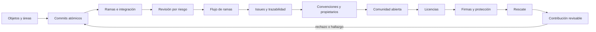

# Parte 16 — Git, colaboración y código abierto

La Parte 15 terminó con un plan que cambia con la evidencia. La pregunta cambia de «qué se hará» a «cómo se cambia el código entre muchas personas sin perder lo que importa». Esta parte trabaja sobre el **repositorio de la plataforma de entregas**, un caso sintético cuya regla de penalización recorre las doce clases: qué guarda Git cuando se hace un commit, qué tamaño debe tener un cambio para poder localizarlo, qué historia deja cada forma de integrar, dónde mirar primero en una revisión, cuánto debe vivir una rama, cómo se ata un cambio a su motivo, quién responde por cada ruta, cómo se acepta a una persona de fuera, bajo qué licencia llega cada pieza, qué prueba una firma y cómo se rescata una integración que salió mal.

## Pregunta rectora

> ¿Cómo cambian muchas personas el mismo código sin perder el motivo, la autoría ni la capacidad de volver atrás?

## Antes del recorrido clase por clase

Esta parte no enseña una lista de comandos. Enseña un modelo (objetos, áreas y referencias) con el que se predice qué hará un comando, a medir qué recupera cada error, a elegir una estrategia de integración sabiendo qué historia conserva, a ordenar una revisión por riesgo, a decidir cuánto debe vivir una rama, a atar cada cambio a su motivo, a escribir reglas que una máquina pueda comprobar, a decidir con reglas visibles cómo se acepta un cambio de fuera, a inventariar licencias sin confundir una herramienta con una opinión legal, a distinguir lo que prueba una firma de lo que no, y a rescatar una fusión mal resuelta según lo que ya se publicó. Cada clase ejecuta experimentos, con Git real en repositorios temporales o con datos sintéticos de semilla fija, que muestran el límite de lo que una comprobación ve.

El diagrama se lee de izquierda a derecha y no es un proceso obligatorio. El retorno indica que una contribución rechazada o un hallazgo en la revisión reabre el tamaño y la forma de los commits; una contribución aceptada no cierra el repositorio, lo fecha.

## Resultados acumulativos

Podrás reconstruir a mano el identificador de un objeto y predecir en qué área está un cambio; localizar un defecto con una bisección y saber qué se recupera tras un error; integrar con fusión, rebase o squash sabiendo qué historia queda y estimar cuándo habrá conflicto; ordenar una revisión por riesgo y mostrar qué cambió tras una corrección; decidir cuánto debe vivir una rama y reconocer un conflicto semántico; escribir referencias que una regla estricta reconozca y construir una matriz de trazabilidad; evaluar un archivo de propietarios y una convención de mensajes; comparar reglas de decisión según la disponibilidad de quienes deciden; evaluar una expresión de licencia y un inventario transitivo; verificar firmas y comparar políticas de protección; y rescatar una integración según esté o no publicada.

Al finalizar podrás entregar una contribución con commits atómicos y firmados, motivo enlazado, licencia y origen declarados, propietarios avisados y un validador con la matriz de sus defectos, y podrás indicar qué parte de tu conclusión es observación, cuál es inferencia y cuál queda para una persona.

## Prerrequisitos enlazados

- [Parte 4 — Pensamiento computacional](https://github.com/vladimiracunadev-create/modern-software-engineering-program/blob/main/classes/part-04-pensamiento-computacional-y-resolucion-de-problemas/): modelado y razonamiento sobre evidencia.
- [Parte 8 — Entornos, herramientas y depuración](https://github.com/vladimiracunadev-create/modern-software-engineering-program/blob/main/classes/part-08-entornos-herramientas-y-depuracion/): repositorios y entornos reproducibles.
- [Parte 9 — Bibliotecas, paquetes, SDK y automatización](https://github.com/vladimiracunadev-create/modern-software-engineering-program/blob/main/classes/part-09-bibliotecas-paquetes-sdk-y-automatizacion/): dependencias y sus licencias.
- [Parte 15 — Procesos, planificación y estimación](https://github.com/vladimiracunadev-create/modern-software-engineering-program/blob/main/classes/part-15-procesos-planificacion-y-estimacion/): planes que cambian con evidencia.
- Python 3.11+, Git 2.40+ y terminal; los experimentos usan la biblioteca estándar, `ssh-keygen` y repositorios temporales.

## Bloques y progresión

1. **Entender y cuidar el historial:** las clases 193–194 construyen el modelo de objetos y áreas y deciden el tamaño de un commit y lo que se recupera.
2. **Integrar y revisar:** las clases 195–197 comparan estrategias de integración, ordenan la revisión por riesgo y deciden cuánto vive una rama.
3. **Atar el cambio a su motivo y a su dueño:** las clases 198–199 construyen la trazabilidad y las reglas de convención y propiedad.
4. **Abrir el proyecto y proteger lo que se publica:** las clases 200–202 tratan la contribución externa, las licencias y las firmas.
5. **Aplicar e integrar:** las clases 203–204 rescatan una integración conflictiva y entregan una contribución revisable.

## Evidencia medida y límites

Las figuras y los ejemplos de esta parte usan experimentos ejecutados con CPython 3.12.9 y Git 2.55 en Windows 11 y repetidos con CPython 3.12.3 y Git 2.43 en Ubuntu bajo WSL2. Los repositorios son **temporales**, con identidad y fechas fijas, y los datos son **sintéticos** con semilla fija: las salidas fueron idénticas en ambos sistemas salvo los tiempos de firma y de verificación de commits (medidos en un equipo: 178 y 86 ms por commit con y sin firma en Windows frente a 14 y 7 ms en Ubuntu).

Los experimentos son: reconstrucción a mano de un blob, un árbol y un commit, seis estados de un archivo entre las tres áreas y el espacio de 301 versiones sueltas y empaquetadas (`SE-193`); cuatro historias con el mismo defecto y la bisección, seis errores y qué sobrevive, y reiniciar frente a revertir con un segundo clon (`SE-194`); fusión, rebase y squash de la misma rama, la probabilidad de conflicto según la distancia y el número de ediciones y `rerere` (`SE-195`); `range-diff` tras reordenar una rama, cuatro órdenes de lectura sobre 300 pull requests sintéticos y una pila de cuatro (`SE-196`); conflictos según la vida de la rama, un conflicto semántico con Git real y backports con `cherry-pick` (`SE-197`); extracción de cierres con dos reglas, reproducción según el detalle del informe y una matriz de trazabilidad con ramas y squash (`SE-198`); un archivo de propietarios de 24 reglas sobre 600 rutas, un validador de 400 mensajes y la autoría tras un reformateo (`SE-199`); concentración de commits, tres reglas de decisión y un fork desfasado (`SE-200`); un analizador de expresiones de licencia, un inventario transitivo y la huella de un texto de licencia (`SE-201`); firmas SSH con una clave desechable, la reescritura de una cadena de 50 commits y seis políticas de protección (`SE-202`); seis órdenes de fusión de tres ramas con cuatro estrategias, tres rescates y estilos de marcas (`SE-203`); y un validador de doce comprobaciones sobre catorce contribuciones (`SE-204`).

Los parámetros (los 64 cambios con un defecto en el 41, la zona caliente del 70 % de las ediciones en el 20 % de las líneas, las densidades de defectos por tipo de archivo, el 20 % de propuestas dañinas, las proporciones de mensajes y licencias, la mezcla de licencias del grafo, los 500 eventos y los trece defectos plantados) son supuestos del autor, no datos de un producto, una organización ni de personas reales. La regla estricta de cierres modela la sintaxis documentada por una plataforma y no su analizador; el modelo de CODEOWNERS simplifica el motor de una plataforma; el analizador de licencias cubre una parte de la gramática y no interpreta ninguna licencia; la clave de firma es desechable. No se usó ningún alojamiento, servicio de firma, herramienta de producción de inventario de licencias ni se auditó ningún proyecto, y no se entrevistó ni se midió a ninguna persona. Las decisiones sobre licencias con consecuencias jurídicas requieren asesoría de una persona competente. Esta parte no tiene laboratorio propio en `labs/`; el proyecto integrador `SE-204` define el paquete y la evidencia. Cada clase termina con un puente hacia el trabajo con agentes.

## Guía razonada clase por clase

El repositorio de la plataforma de entregas mantiene una regla, un conjunto de pruebas y una política estables mientras cambian las decisiones. Cada clase explica qué decisión de colaboración mejora, qué experimento la muestra, qué no demuestra y qué evidencia permite abandonar la conclusión.

### Bloque 1 — Entender y cuidar el historial

#### SE-193 — Modelo de objetos y áreas de Git

Git no guarda diferencias: guarda objetos direccionados por contenido, y un cambio puede estar en tres áreas con consecuencias distintas. La clase reconstruye a mano un blob, un árbol y un commit y los compara con Git, recorre seis estados de un archivo y mide el espacio de 301 versiones sueltas y empaquetadas.

El estudiante predice identificadores y códigos de estado antes de verlos. `SE-194` usa ese modelo para decidir el tamaño de un commit y lo que se recupera tras un error.

#### SE-194 — Commits atómicos, historial y recuperación

El valor de un commit se mide por lo que permite hacer después. La clase compara cuatro historias con el mismo defecto con `git bisect run`, simula seis errores de uso para ver qué sigue en la base de objetos y compara reiniciar y forzar con revertir cuando otro clon ya tiene los commits.

El estudiante redacta una política de commits con evidencia. `SE-195` abre la bifurcación y pregunta qué historia conserva cada forma de integrar.

### Bloque 2 — Integrar y revisar

#### SE-195 — Ramas, integración, rebase y conflictos

Fusionar, rebasar y aplastar producen el mismo árbol y historias distintas. La clase integra la misma rama con las tres estrategias, mide la probabilidad de conflicto según la distancia y el número de ediciones y repite una fusión con y sin reutilización de resoluciones.

El estudiante escribe una regla de integración con excepciones. `SE-196` pregunta cómo se revisa lo que llega por esa integración.

#### SE-196 — Pull requests y revisión basada en riesgo

La atención de quien revisa es finita y los defectos no se reparten por igual. La clase compara `diff` y `range-diff` tras reordenar una rama, mide cuántos defectos plantados alcanza una lectura parcial con cinco criterios de orden y corrige el primer PR de una pila de cuatro.

El estudiante escribe una plantilla de PR y un criterio de triaje con sus supuestos. `SE-197` pregunta cuánto debe vivir la rama de ese PR.

#### SE-197 — Trunk-based, GitFlow y estrategias híbridas

Un flujo de ramas es una combinación de decisiones, no un nombre. La clase mide los conflictos según los días que vive una rama, reproduce un conflicto semántico con Git real y mide los conflictos al portar correcciones a una rama de versión.

El estudiante escribe una decisión de flujo con sus condiciones de revisión. `SE-198` ata cada cambio de ese flujo a su motivo.

### Bloque 3 — Atar el cambio a su motivo y a su dueño

#### SE-198 — Issues, discusiones y trazabilidad del cambio

La trazabilidad depende de la sintaxis y de cómo se integra, no solo de lo que se escribe. La clase compara dos reglas de extracción de cierres, mide qué informes se reproducen según su detalle y construye una matriz de trazabilidad sobre un repositorio con ramas y squash.

El estudiante escribe una plantilla de issue y una regla de referencias. `SE-199` fija las convenciones y los propietarios sobre las que descansa.

#### SE-199 — Convenciones, ownership y CODEOWNERS

Una regla de colaboración sirve si una máquina puede comprobarla. La clase evalúa un archivo de propietarios de 24 reglas sobre 600 rutas, valida 400 mensajes con una convención y recupera la autoría tras un reformateo con `git blame`.

El estudiante escribe propietarios con motivos y una convención con su validador. `SE-200` abre el proyecto a quien no pertenece al equipo.

### Bloque 4 — Abrir el proyecto y proteger lo que se publica

#### SE-200 — Contribución, gobernanza y comunidades abiertas

Las reglas de decisión existen siempre, escritas o no. La clase mide la concentración de commits con cuatro exponentes, compara tres reglas de decisión según la disponibilidad de quienes deciden y cuantifica el conflicto de una copia que se queda atrás.

El estudiante escribe una guía de contribución y una regla de decisión con relevo. `SE-201` pregunta bajo qué licencia llega cada contribución.

#### SE-201 — Licencias de software y obligaciones básicas

Una licencia es el permiso que hace legal copiar y redistribuir, y revisarlas es un inventario, no una opinión legal. La clase evalúa 300 expresiones con un analizador y con una comparación literal, estima las licencias fuera de política en un grafo transitivo y compara la huella de un texto de licencia con una razón de similitud.

El estudiante escribe una política con tres estados y una lista de decisiones para asesoría. `SE-202` pregunta cómo se prueba la procedencia de lo que se publica.

#### SE-202 — Firmas, procedencia y protección del repositorio

Una firma atribuye un contenido exacto a una clave; no aprueba ni prueba confianza. La clase firma y verifica 60 commits con una clave desechable, reescribe un commit de una cadena de 50 y evalúa seis políticas de protección sobre 500 eventos sintéticos.

El estudiante escribe una política de protección con su procedimiento de clave comprometida. `SE-203` aplica todo a un rescate.

### Bloque 5 — Aplicar e integrar

#### SE-203 — Taller: rescatar una integración conflictiva

Una integración mal resuelta se rescata según lo que ya se publicó. El taller ejecuta las seis órdenes de fusión de tres ramas con cuatro estrategias, rescata una fusión mala por tres caminos y compara los estilos de marcas de conflicto.

El estudiante escribe un procedimiento de rescate cuya primera pregunta es si ya se publicó. `SE-204` entrega una contribución que no necesita rescate.

#### SE-204 — Proyecto: contribución revisable de extremo a extremo

Una contribución es revisable cuando otra persona puede probarla, atribuirla y fusionarla sin preguntar. El proyecto construye un validador de doce comprobaciones, lo ejecuta sobre catorce contribuciones con defectos plantados y analiza los dos defectos que dejan las pruebas en verde.

El estudiante entrega la rama, la descripción, el validador y la lista de lo que el validador no ve. La Parte 17 documenta lo que aquí se declaró.

## Resumen operativo del recorrido

| Clase | Capacidad que construye | Pregunta que resuelve | Evidencia acumulativa |
|---|---|---|---|
| [SE-193](https://github.com/vladimiracunadev-create/modern-software-engineering-program/blob/main/classes/part-16-git-colaboracion-y-codigo-abierto/se-193-modelo-de-objetos-y-areas-de-git/) | Modelo de objetos y áreas de Git | ¿Qué guarda un commit y dónde puede estar un cambio? | `objects-log.md` con identificadores y estados |
| [SE-194](https://github.com/vladimiracunadev-create/modern-software-engineering-program/blob/main/classes/part-16-git-colaboracion-y-codigo-abierto/se-194-commits-atomicos-historial-y-recuperacion/) | Commits atómicos, historial y recuperación | ¿Qué tamaño debe tener un commit y qué se recupera? | `history-log.md` con bisección y recuperación |
| [SE-195](https://github.com/vladimiracunadev-create/modern-software-engineering-program/blob/main/classes/part-16-git-colaboracion-y-codigo-abierto/se-195-ramas-integracion-rebase-y-conflictos/) | Ramas, integración, rebase y conflictos | ¿Qué historia deja cada estrategia y cuándo habrá conflicto? | `integration-log.md` con estrategias y conflictos |
| [SE-196](https://github.com/vladimiracunadev-create/modern-software-engineering-program/blob/main/classes/part-16-git-colaboracion-y-codigo-abierto/se-196-pull-requests-y-revision-basada-en-riesgo/) | Pull requests y revisión basada en riesgo | ¿Qué debo mirar primero y qué cambió tras mi comentario? | `review-log.md` con triaje y range-diff |
| [SE-197](https://github.com/vladimiracunadev-create/modern-software-engineering-program/blob/main/classes/part-16-git-colaboracion-y-codigo-abierto/se-197-trunk-based-gitflow-y-estrategias-hibridas/) | Trunk-based, GitFlow y estrategias híbridas | ¿Cuánto debe vivir una rama y qué protege cada flujo? | `flow-log.md` con conflictos y backports |
| [SE-198](https://github.com/vladimiracunadev-create/modern-software-engineering-program/blob/main/classes/part-16-git-colaboracion-y-codigo-abierto/se-198-issues-discusiones-y-trazabilidad-del-cambio/) | Issues, discusiones y trazabilidad | ¿Por qué existe este cambio y qué falta de lo pedido? | `trace-log.md` con cierres y matriz |
| [SE-199](https://github.com/vladimiracunadev-create/modern-software-engineering-program/blob/main/classes/part-16-git-colaboracion-y-codigo-abierto/se-199-convenciones-ownership-y-codeowners/) | Convenciones, ownership y CODEOWNERS | ¿Quién responde por cada ruta y qué regla comprueba una máquina? | `rules-log.md` con propietarios y mensajes |
| [SE-200](https://github.com/vladimiracunadev-create/modern-software-engineering-program/blob/main/classes/part-16-git-colaboracion-y-codigo-abierto/se-200-contribucion-gobernanza-y-comunidades-abiertas/) | Contribución, gobernanza y comunidades | ¿Cómo se decide cuando no todos están y qué pasa si se va quien más sabe? | `community-log.md` con decisión y relevo |
| [SE-201](https://github.com/vladimiracunadev-create/modern-software-engineering-program/blob/main/classes/part-16-git-colaboracion-y-codigo-abierto/se-201-licencias-de-software-y-obligaciones-basicas/) | Licencias de software y obligaciones básicas | ¿Bajo qué licencia llega cada pieza y qué exige asesoría? | `license-log.md` con inventario y política |
| [SE-202](https://github.com/vladimiracunadev-create/modern-software-engineering-program/blob/main/classes/part-16-git-colaboracion-y-codigo-abierto/se-202-firmas-procedencia-y-proteccion-del-repositorio/) | Firmas, procedencia y protección | ¿Qué prueba una firma y qué cierra cada regla de protección? | `provenance-log.md` con firmas y políticas |
| [SE-203](https://github.com/vladimiracunadev-create/modern-software-engineering-program/blob/main/classes/part-16-git-colaboracion-y-codigo-abierto/se-203-taller-rescatar-una-integracion-conflictiva/) | Taller: rescatar una integración conflictiva | ¿Qué rescate recupera la intención sin reescribir lo publicado? | `rescue-log.md` con rescates y estilos |
| [SE-204](https://github.com/vladimiracunadev-create/modern-software-engineering-program/blob/main/classes/part-16-git-colaboracion-y-codigo-abierto/se-204-proyecto-contribucion-revisable-de-extremo-a-extremo/) | Proyecto: contribución revisable | ¿Puede otra persona revisar, probar y fusionar sin preguntar? | `contribution-log.md`, validador y paquete |

## Proyecto integrador

El proyecto **SE-204** entrega una rama de contribución con commits atómicos y firmados, una descripción con el motivo enlazado y los riesgos, la declaración de licencia y de origen, la petición a los propietarios afectados, un validador de doce comprobaciones con la matriz de sus catorce contribuciones y la lista de lo que el validador no ve. Se acompaña de los límites declarados: qué defectos escapan a una comprobación de forma y qué parte del paquete debe leer una persona.

## Criterios de salida

- las doce clases explican todos sus temas mediante mecanismos, ejemplos y límites;
- cada afirmación sobre el historial se apoya en un comando que otra persona puede ejecutar y en una versión de Git declarada;
- los porcentajes, las densidades de defectos, las proporciones de mensajes y licencias y las probabilidades de decisión se declaran como supuestos y nunca como mediciones de un proyecto o de personas;
- la estrategia de integración y el rescate se eligen por lo que ya se publicó y por la historia que conservan;
- las decisiones sobre licencias con consecuencias jurídicas tienen responsable competente y fecha;
- otra persona reproduce comandos y resultados desde un checkout limpio;
- el informe declara lo observado, lo inferido y lo no ejecutado.

## Preguntas de control por bloque

- ¿En qué área está este cambio y qué comando lo perdería?
- ¿Qué historia deja esta estrategia y quién ya tiene esos commits?
- ¿Qué leería primero en este PR y qué parte dejo a una comprobación automática?
- ¿Cuánto vive esta rama y qué costaría integrarla hoy?
- ¿Qué prueba esta firma y qué regla de protección impide empujar sin revisión?

## Fuentes de la parte

- [Pro Git](https://git-scm.com/book/en/v2) — referencia del modelo de objetos, ramas y flujos; autoridad: proyecto Git.
- [Documentación de Git](https://git-scm.com/docs) — comandos y formatos usados en los experimentos; autoridad: proyecto Git.
- [Sadowski et al., «Modern code review: a case study at Google» (ICSE-SEIP, 2018)](https://doi.org/10.1145/3183519.3183525) — práctica de revisión de código; autoridad: ACM/IEEE ICSE-SEIP.
- [Bacchelli y Bird, «Expectations, outcomes, and challenges of modern code review» (ICSE, 2013)](https://doi.org/10.1109/ICSE.2013.6606617) — expectativas y dificultades de la revisión; autoridad: IEEE ICSE.
- [Gotel y Finkelstein, «An analysis of the requirements traceability problem» (ICRE, 1994)](https://doi.org/10.1109/ICRE.1994.292398) — definición y problemas de la trazabilidad; autoridad: IEEE ICRE.
- [SPDX License List](https://spdx.org/licenses/) — identificadores de licencia; autoridad: proyecto SPDX.
- [SLSA v1.0](https://slsa.dev/spec/v1.0/) — procedencia de artefactos; autoridad: OpenSSF.
- [SWEBOK Guide v4.0a](https://www.computer.org/education/bodies-of-knowledge/software-engineering) — gestión de la configuración como área de conocimiento; autoridad: IEEE Computer Society.

Las fuentes se vinculan también dentro de cada clase. Definen vocabulario y mecanismos; la adecuación de las decisiones de la plataforma de entregas se demuestra con el caso, la evidencia trazable y la revisión de otra persona, no con la autoridad de la fuente.
