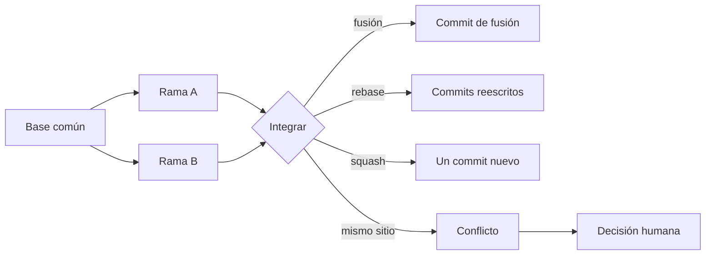
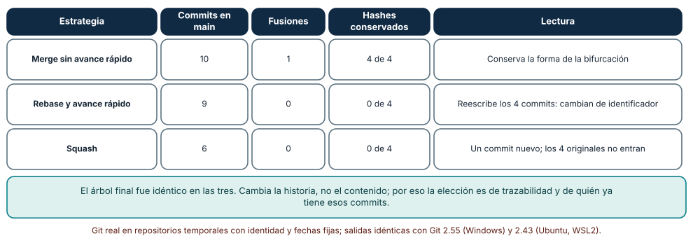
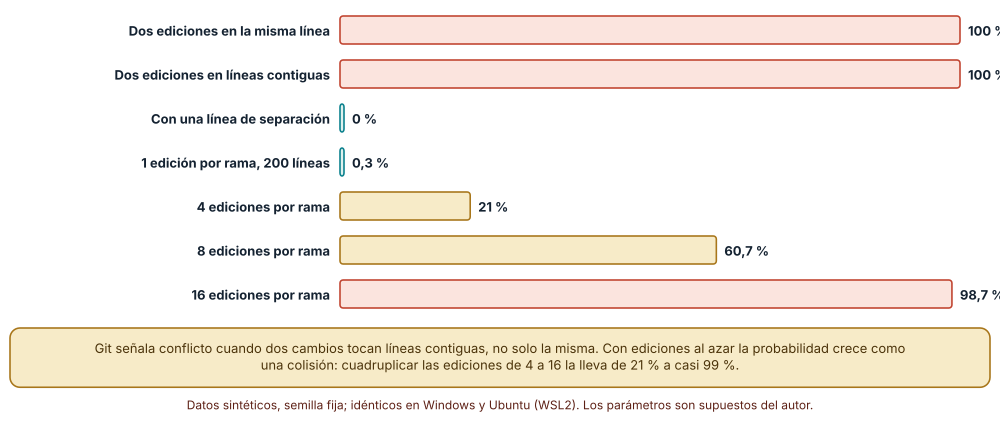
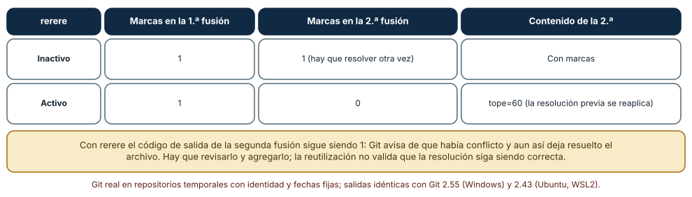

# SE-195 — Ramas, integración, rebase y conflictos

[← SE-194 — Commits atómicos, historial y recuperación](https://github.com/vladimiracunadev-create/modern-software-engineering-program/blob/main/classes/part-16-git-colaboracion-y-codigo-abierto/se-194-commits-atomicos-historial-y-recuperacion/README.md) · [↑ Parte 16](https://github.com/vladimiracunadev-create/modern-software-engineering-program/blob/main/classes/part-16-git-colaboracion-y-codigo-abierto/README.md) · [📚 Índice completo](https://github.com/vladimiracunadev-create/modern-software-engineering-program/blob/main/classes/README.md) · [🌐 Portal](https://vladimiracunadev-create.github.io/modern-software-engineering-program/classes/SE-195.html) · [SE-196 — Pull requests y revisión basada en riesgo →](https://github.com/vladimiracunadev-create/modern-software-engineering-program/blob/main/classes/part-16-git-colaboracion-y-codigo-abierto/se-196-pull-requests-y-revision-basada-en-riesgo/README.md)

## Punto profesional y fundamento pedagógico

**Punto profesional.** La clase existe para que integrar el trabajo de varias personas sea una decisión con consecuencias conocidas y no un ritual: elegir entre fusionar, rebasar o aplastar sabiendo qué historia queda, y resolver un conflicto sabiendo qué se decidió y qué se perdió.

**Por qué aparece aquí.** Se sitúa después de **Commits atómicos, historial y recuperación** y antes de **Pull requests y revisión basada en riesgo**. `SE-194` dejó una política de commits y la distinción entre revertir y reescribir; esta clase añade la bifurcación: qué ocurre cuando dos personas parten del mismo punto, cuándo Git no puede combinar sus cambios y qué estrategia de integración conserva qué información. Deja las ramas integradas que `SE-196` pone en revisión.

**Error conceptual que debe corregir.** Creer que un conflicto es un fallo de Git o de la persona y que rebasar «limpia» el historial sin costo. Un conflicto es la señal de que dos cambios tocan el mismo sitio y alguien debe decidir; y un rebase reescribe los commits de la rama, de modo que cambian de identificador y solo es seguro sobre ramas que nadie más ha tomado.

**Secuencia de aprendizaje.** Antes de leer la solución, predices qué historia deja cada estrategia y cuándo habrá conflicto; después integras la misma rama con tres estrategias, mides la probabilidad de conflicto frente a la distancia y al número de ediciones y repites una fusión con y sin reutilización de resoluciones. La secuencia usa predicción, explicación propia, contraste y recuperación. [ICAP](https://icap.education.asu.edu/research) distingue participación de construcción de conocimiento; [How People Learn II](https://nap.nationalacademies.org/catalog/24783/how-people-learn-ii-learners-contexts-and-cultures) exige conectar conocimiento previo, contexto y transferencia; la [práctica de recuperación](https://pubmed.ncbi.nlm.nih.gov/16507066/) respalda producir de nuevo la explicación tras una demora; y [Education for Life and Work](https://nap.nationalacademies.org/resource/13398/dbasse_084153.pdf) exige devolución que explique la causa del error.

**Evidencia de aprendizaje.** `integration-log.md` con la historia que deja cada estrategia, la probabilidad de conflicto medida, el resultado con y sin `rerere` y una regla de equipo para elegir estrategia. Debe contener predicción previa, observación, explicación causal, contraejemplo y qué hallazgo haría cambiar la regla.

**Límite de la conclusión.** Los archivos son de 50 a 200 líneas de texto con ediciones de una línea al azar; el conflicto se mide con `git merge-file` sobre texto, no con código que pueda además romperse sin conflicto; se usaron 300 corridas por celda con una semilla fija y no se midió a ningún equipo ni la frecuencia de conflictos de un proyecto real.

### Trazabilidad fuente → afirmación

| Fuente primaria u oficial | Afirmación que respalda | Lo que no prueba |
|---|---|---|
| [git-merge](https://git-scm.com/docs/git-merge) | Describe la fusión de tres vías, el avance rápido, `--squash` y la detección de conflictos. | No dice qué estrategia conviene a un equipo. |
| [Pro Git: Rebasing](https://git-scm.com/book/en/v2/Git-Branching-Rebasing) | Explica que el rebase reaplica commits sobre otra base creando commits nuevos y advierte de no rebasar commits publicados. | No mide los efectos en una historia grande. |
| [git-rerere](https://git-scm.com/docs/git-rerere) | Documenta la reutilización de resoluciones registradas de conflictos. | No garantiza que la resolución reaplicada siga siendo correcta. |

## Antes de empezar

Recupera lo aprendido en `SE-194`: un commit atómico se puede revertir y reescribir historia compartida impone trabajo a otras personas. La pregunta activa es: **¿qué historia conservo al integrar, cuándo me va a salir un conflicto y qué estoy decidiendo cuando lo resuelvo?**

## Prerrequisitos

- Haber completado `SE-194` o poder explicar qué hace `git revert` y por qué reescribir lo publicado es costoso.
- Python 3.11 o posterior, Git 2.40 o posterior y un terminal.
- Trabajar en repositorios temporales; el rebase de la clase no debe ejecutarse sobre una rama con otras personas.

## Problema auténtico

En la plataforma de entregas, una persona cambia el tope de prórroga en `config.py` y otra, desde la misma versión, cambia el cálculo en `penal.py` y toca la misma región de `config.py`. Al integrar, una prefiere fusionar «para no perder nada», otra rebasar «para una historia lineal» y una tercera aplastar «para un solo commit». Las tres historias resultantes tienen el mismo contenido y muy distinta información.

## Objetivos observables

Al terminar podrás:

1. predecir la forma de la historia (commits, fusiones, identificadores conservados) tras fusionar, rebasar y aplastar;
2. estimar cuándo dos ramas entrarán en conflicto de texto y cómo crece la probabilidad con el número de ediciones;
3. resolver un conflicto leyendo las tres versiones y decidiendo, no eligiendo un lado al azar;
4. decidir cuándo reutilizar resoluciones con `rerere` y cómo comprobarlas;
5. escribir una regla de integración del equipo con sus excepciones.

## Mapa conceptual



El mapa se lee de izquierda a derecha: dos ramas parten de una base común y se integran por una de tres estrategias; si tocan el mismo sitio aparece un conflicto que exige una decisión. No describe cuál estrategia es mejor, porque eso depende de quién más tiene los commits.

## Temas y por qué importan

| Tema | Por qué cambia una decisión profesional | Evidencia mínima |
|---|---|---|
| Fusión de tres vías | Combina dos cambios respecto de una base común y conserva la forma de la bifurcación. | Predicción, traza causal y contraejemplo de **Fusión de tres vías** en `integration-log.md` |
| Rebase | Reaplica commits sobre otra base y los reescribe: cambia identificadores. | Predicción, traza causal y contraejemplo de **Rebase** en `integration-log.md` |
| Squash | Reduce una rama a un commit y descarta su historia interna. | Predicción, traza causal y contraejemplo de **Squash** en `integration-log.md` |
| Conflictos | Son la señal de que se necesita una decisión; no un error. | Predicción, traza causal y contraejemplo de **Conflictos** en `integration-log.md` |
| Reutilizar resoluciones | Evita repetir la misma decisión, a costa de poder arrastrar una decisión obsoleta. | Predicción, traza causal y contraejemplo de **Reutilizar resoluciones** en `integration-log.md` |

## Conceptos y decisiones

### 1. Fusión de tres vías

Una fusión compara dos puntas con su ancestro común: lo que cambió solo en un lado se toma, y lo que cambió en ambos lados en sitios distintos se combina. Si el cambio toca el mismo lugar, Git no decide: deja marcas. El commit de fusión tiene dos padres, de modo que la historia conserva que hubo dos líneas de trabajo y permite ver quién hizo qué y cuándo.

### 2. Rebase

Un rebase toma los commits de una rama y los reaplica uno por uno sobre otra base. Cada commit reaplicado es un objeto nuevo, con otro identificador, aunque diga lo mismo. La historia resultante es lineal. El costo es que cualquier persona que tenga los commits originales tiene ahora commits «duplicados» con otro nombre; por eso la regla es rebasar solo ramas propias no publicadas, o ramas acordadas.

### 3. Squash

Un squash junta todos los cambios de una rama en un solo commit nuevo en la rama de destino; los commits originales no entran en esa historia. Da una historia lineal con una entrada por cambio y pierde los pasos intermedios, que son útiles para una bisección fina. Conviene cuando los pasos intermedios son ruido y no cuando cada uno es atómico y comprobable.

### 4. Conflictos

Un conflicto de texto aparece cuando dos cambios afectan líneas contiguas respecto de la base. Git marca ambas versiones; el estilo `diff3` añade la base. Resolver es decidir cuál es el estado correcto, que puede ser uno de los lados, una combinación o algo nuevo. Un conflicto que no aparece no significa que la combinación sea correcta: dos cambios pueden fusionarse sin marcas y romper el programa (`SE-197` lo mide).

### 5. Reutilizar resoluciones

`git rerere` guarda cómo se resolvió un conflicto y, si vuelve a aparecer el mismo, lo resuelve igual. Es útil cuando una rama larga se rebasa varias veces o cuando se prueba una fusión y se descarta. Reduce el trabajo pero también la atención: una resolución reutilizada se aplica sin que nadie la lea, así que hay que revisarla y volver a ejecutar las pruebas.

### La misma bifurcación, tres historias

Una rama de 4 commits partió de dos commits de base mientras `main` avanzaba 3. Con una **fusión sin avance rápido**, `main` quedó con 10 commits, una fusión, 6 commits en el primer padre y los 4 commits de la rama conservaron su identificador. Con **rebase y avance rápido**, `main` quedó con 9 commits, ninguna fusión y los 4 commits de la rama fueron reescritos (0 de 4 conservaron su identificador). Con **squash**, `main` quedó con 6 commits: el commit nuevo reemplaza a los cuatro, que no entran. El árbol final fue idéntico en las tres, así que el contenido es el mismo y solo cambia la información de la historia. Los resultados fueron idénticos con Git 2.55 en Windows y 2.43 en Ubuntu.



**Cómo leer la figura.** Cada fila es una estrategia aplicada a la misma bifurcación; las columnas cuentan lo que queda en `main` y cuántos commits de la rama siguen teniendo su identificador. **Dónde deja de valer:** la rama no tuvo conflictos ni firmas; con commits firmados, el rebase invalida las firmas de los reescritos, y con conflictos el rebase los resuelve commit a commit, no una vez.

### Cuándo hay conflicto

Dos ramas editaron una línea cada una de un archivo de 200 líneas. Con **ambas ediciones en la misma línea**, hubo conflicto en el 100 % de 300 pares; con ediciones en **líneas contiguas**, también el 100 %; con **una línea de separación**, 0 %. Con ediciones al azar en 200 líneas, la probabilidad de conflicto creció con el número de ediciones por rama: 0,3 % con 1, 5,0 % con 2, 21,0 % con 4, 60,7 % con 8 y 98,7 % con 16 (300 corridas por celda). La regla de Git es de contigüidad, no de coincidencia exacta; por eso un cambio de formato que mueve líneas vecinas multiplica los conflictos.



**Cómo leer la figura.** Las tres primeras barras dependen de la distancia entre dos ediciones; las siguientes, del número de ediciones al azar por rama en 200 líneas. **Dónde deja de valer:** las ediciones al azar están distribuidas de forma uniforme; en un código real se concentran en archivos y regiones calientes, lo que sube la probabilidad, y las ediciones reales tienen forma de bloque, no de línea suelta.

### Repetir una fusión con rerere

Se creó un conflicto entre dos ramas que cambiaban `tope=72` a 48 y a 96. Con `rerere` **inactivo**, la primera fusión dejó 1 marca de conflicto; tras resolver (a 60), deshacer la fusión y repetirla, volvió a aparecer 1 marca. Con `rerere` **activo**, la segunda fusión dejó 0 marcas y el archivo contenía `tope=60` ya resuelto, aunque el código de salida de la fusión siguió siendo 1 (Git informa del conflicto y deja el archivo para que se revise y se agregue).



**Cómo leer la figura.** Cada fila es una configuración de `rerere` aplicada a las mismas dos ramas; las columnas cuentan las marcas de la primera y de la segunda fusión. **Dónde deja de valer:** se repitió exactamente la misma fusión; si la base o alguno de los lados cambió ligeramente, `rerere` no reconoce el conflicto y vuelve a pedir una decisión, y una resolución reaplicada puede ser obsoleta aunque no haya marcas.

## Definiciones de trabajo

- **fusión de tres vías:** combinación de dos puntas respecto de su ancestro común que crea un commit con dos padres.
- **rebase:** reaplicación de commits sobre otra base que crea commits nuevos con otros identificadores.
- **squash:** integración que reduce los cambios de una rama a un solo commit nuevo.
- **conflicto de texto:** región donde dos cambios afectan líneas contiguas respecto de la base y Git no puede decidir.
- **rerere:** mecanismo que guarda resoluciones de conflictos y las reaplica cuando el mismo conflicto reaparece.

Las definiciones son operativas para la plataforma de entregas. No convierten términos con historia más amplia en sinónimos y deben contrastarse con la documentación primaria enlazada al final.

## Ejemplo mínimo

El fragmento integra una rama con las tres estrategias en repositorios temporales distintos. Antes de ejecutarlo, predice cuántos commits tendrá `main` en cada caso.

```bash
git merge --no-ff feature            # historia con dos padres
git rebase main && git merge --ff-only feature   # lineal, commits reescritos
git merge --squash feature && git commit -m "feature"   # un commit nuevo
```

Registra versión de Git, comparte la salida de `git log --oneline --graph` de cada caso y compara los árboles con `git rev-parse main^{tree}`.

## Ejemplo profesional

En la plataforma, las ramas de funcionalidad viven pocos días y se integran con squash porque cada una es un cambio de intención única; las ramas de varias personas se integran con fusión para conservar quién hizo qué; las correcciones urgentes se rebasan sobre `main` antes de la revisión. La regla está escrita en `CONTRIBUTING.md`, con una excepción: una rama con commits atómicos y comprobables que alguien podría querer bisecar se integra sin squash.

Compara el caso normal con una rama de dos semanas que se rebasa sobre `main` tres veces: cada rebase repite los mismos conflictos y `rerere` ahorra la decisión, pero la rama larga es el problema de fondo (`SE-197`). La práctica es apropiada cuando se elige estrategia por la rama y se documenta; es peligrosa cuando se aplica una sola a todo, porque se pierde la información que la rama sí necesitaba.

## Práctica guiada

1. Crea una bifurcación de 4 commits de rama y 3 de `main` y predice la forma de la historia con cada estrategia.
2. Integra con fusión, rebase y squash en tres copias y registra commits, fusiones e identificadores conservados.
3. Compara los árboles finales y explica qué se perdió con cada estrategia.
4. Mide la probabilidad de conflicto con `git merge-file` para ediciones a distancias de 0, 1, 2, 3 y 4 líneas.
5. Mide la probabilidad con 1, 2, 4, 8 y 16 ediciones al azar por rama y compara con tu predicción.
6. Resuelve un conflicto con `merge.conflictStyle=diff3` y registra qué decisión tomaste y por qué.
7. Repite la fusión con `rerere` activo y escribe cómo comprobarías que la resolución sigue siendo válida.

## Ejercicios

1. **Rebase interactivo:** reordena y fusiona dos commits de una rama propia con `git rebase -i` y explica por qué sus identificadores cambian.
2. **Conflicto lógico:** construye dos ramas que fusionan sin marcas y rompen una prueba; explica por qué Git no pudo avisar.
3. **Distribución concentrada:** repite la medición con el 70 % de las ediciones en el 20 % de las líneas y explica cómo cambian las probabilidades.
4. **Regla de equipo:** escribe cuándo se permite squash, cuándo rebase y cuándo fusión y qué evidencia te haría cambiarla.

## Reto verificable

Entrega `integration-log.md` con la historia que deja cada estrategia, la probabilidad de conflicto medida, la comparación de `rerere` y una regla de equipo de una página. Se aprueba si otra persona ejecuta el código desde un directorio vacío, obtiene las mismas cifras y puede decir qué estrategia usaría para una rama de commits atómicos con firmas. No se aprueba por una preferencia sin evidencia.

## Caso conductor

El repositorio de la plataforma de entregas es el caso conductor de la Parte 16. Esta clase deja la regla de integración y la medición de conflictos. `SE-196` revisa los cambios que llegan por estas integraciones y `SE-197` pregunta cuánto debe vivir una rama. Cambia después un solo dato, el número de ediciones por rama de 4 a 8, y revisa cómo cambia la probabilidad de conflicto y la regla de equipo.

## Preguntas frecuentes

### ¿Es mejor una historia lineal?

Es más fácil de leer y de recorrer con `git log`; pierde la forma de la bifurcación y, con squash, los pasos intermedios. Una historia con fusiones conserva esa información a cambio de un grafo más ancho. Ninguna es mejor en general.

### ¿Se puede rebasar una rama ya publicada?

Solo si todas las personas que la tienen lo saben y están de acuerdo, porque sus copias tendrán commits con otros identificadores. Sobre una rama propia que nadie ha tomado es seguro.

### ¿Por qué Git marca conflicto si cambiamos líneas distintas?

Porque son contiguas: sin una línea intermedia sin cambios, Git no puede asegurar el orden. Separar cambios en commits y archivos reduce los conflictos más que cualquier herramienta.

### ¿Un conflicto resuelto significa que el código es correcto?

No: significa que alguien eligió un texto. La corrección se comprueba con las pruebas de después de la integración, y por eso la resolución debe revisarse como cualquier otro cambio.

## Fallo controlado y diagnóstico

Reproduce el fallo clásico de la clase: **resolver un conflicto eligiendo un lado sin leer el otro**. Usa el conflicto del tope de prórroga.

Registra síntoma, entrada mínima, hipótesis, observación que descarta cada hipótesis, causa, corrección y prueba de regresión. **Síntoma:** tras integrar, el tope de prórroga es 96 en producción aunque la decisión acordada era 48. **Hipótesis rivales:** (a) el cambio a 48 no se integró; (b) el conflicto se resolvió eligiendo el lado con 96. **Prueba:** `git log -p -- config.py` muestra el commit de fusión con `tope=96` y `git show --remerge-diff` lo compara con las dos puntas. **Conclusión:** la causa es (b): se tomó un lado sin leer el otro. **Regresión:** añade una prueba que compruebe el valor del tope y una comprobación de revisión que exija ver la resolución de cada conflicto. No cambies a la vez el valor y la regla de integración.

## Errores comunes y cómo corregirlos

| Síntoma | Causa probable | Corrección |
|---|---|---|
| Aparecen commits duplicados tras un rebase | Se rebasó una rama que otra persona ya tenía | Rebasar solo ramas propias no publicadas o acordadas |
| Un conflicto reaparece una y otra vez | La rama vive mucho tiempo y se repite el mismo rebase | Acortar la rama o activar `rerere` y revisar las resoluciones |
| La fusión no tuvo marcas y la prueba falla | Los cambios tocan sitios distintos pero son incompatibles | Ejecutar las pruebas sobre el resultado de la fusión |
| Se pierde la historia de una rama | Squash de una rama de commits atómicos | Elegir estrategia por rama y documentar la excepción |
| Se resolvió eligiendo un lado | No se leyó la versión base ni el otro lado | Usar `diff3` y revisar con `--remerge-diff` |

## Entorno y archivos clave

```text
work/SE-195/
├── README.md
├── integracion/
│   ├── estrategias.py
│   ├── conflictos.py
│   └── rerere.py
└── evidence/integration-log.md
```

El `README` declara sistema operativo, versión de Git y de Python, semillas y comandos. Los experimentos usan `subprocess`, `git merge-file` y repositorios temporales con identidad y fechas fijas y se ejecutaron con CPython 3.12.9 y Git 2.55 en Windows 11 y con CPython 3.12.3 y Git 2.43 en Ubuntu bajo WSL2: las salidas fueron idénticas. Si automatizas con otra biblioteca, fija procedencia y versión.

## Seguridad, ética y accesibilidad

- una resolución de conflicto es un cambio de código: debe revisarse y no puede aceptarse a ciegas, sobre todo si toca autenticación o datos personales;
- un rebase puede descartar commits sin avisar: comprueba el resultado con `git range-diff` antes de publicar;
- no resuelvas conflictos de archivos con secretos copiando valores a mensajes o registros;
- ofrece una alternativa textual a las tablas y describe las marcas de conflicto en palabras;
- atribuye los cambios que integras: un squash debe conservar los coautores.

## Puente hacia el trabajo con agentes

Un agente al que se le pide «resuelve estos conflictos» suele elegir un lado con `--ours` o `--theirs` o fusionar ambos textos y ejecutar las pruebas hasta que pasan. Pídele que muestre las tres versiones de cada región, que explique la intención de cada lado, que proponga una resolución y que ejecute las pruebas sobre el resultado sin tocar las pruebas. Revisa especialmente si cambió una prueba para que pasara: es el mismo defecto de elegir un lado sin leer el otro, con apariencia de verificación.

## Transferencia

Traslada el análisis a otro escenario de combinación de cambios concurrentes (por ejemplo, ediciones simultáneas de un documento o de un archivo de configuración compartido): decide qué sería una base común, qué es un conflicto y cuándo una combinación sin conflicto puede ser incorrecta. La transferencia está lograda cuando puedes explicar qué parte de la regla de contigüidad dependía de Git, no cuando el procedimiento se parece.

## Evaluación y evidencia

| Criterio | Evidencia para aprobar |
|---|---|
| comprensión | explicación de qué conserva y qué pierde cada estrategia |
| corrección | historias y probabilidades reproducibles con las mismas semillas |
| diseño | regla de integración con excepciones y evidencia |
| diagnóstico | reproducción del fallo «elegir un lado» con regresión |
| incertidumbre | declaración de qué parte depende de la distribución uniforme de ediciones |
| reproducibilidad | versiones, comandos, salida y límites declarados |

## Fuentes

- [git-merge](https://git-scm.com/docs/git-merge) — fusión, avance rápido y squash; autoridad: documentación de Git.
- [git-rebase](https://git-scm.com/docs/git-rebase) — reaplicación de commits y modo interactivo; autoridad: documentación de Git.
- [Pro Git: Rebasing](https://git-scm.com/book/en/v2/Git-Branching-Rebasing) — peligros de rebasar commits publicados; autoridad: Pro Git.
- [git-merge-file](https://git-scm.com/docs/git-merge-file) — fusión de tres versiones de un archivo; autoridad: documentación de Git.
- [git-rerere](https://git-scm.com/docs/git-rerere) — reutilización de resoluciones; autoridad: documentación de Git.
- [GitHub: acerca de rebase](https://docs.github.com/en/get-started/using-git/about-git-rebase) — explicación de rebase por el alojamiento; autoridad: GitHub Docs.

Cada fuente respalda el mecanismo indicado; ninguna demuestra qué estrategia conviene a la plataforma de entregas. Esa afirmación depende de cuánto viven las ramas y de quién tiene los commits.

- [GitHub: fusiones de pull requests](https://docs.github.com/en/pull-requests/collaborating-with-pull-requests/incorporating-changes-from-a-pull-request/about-pull-request-merges) — opciones de fusión del alojamiento.
- [git-merge-file](https://git-scm.com/docs/git-merge-file) — herramienta usada para medir conflictos.

## Límites y siguiente paso

Se ejecutaron tres experimentos con repositorios temporales y datos sintéticos en Windows y Ubuntu (WSL2) con resultados idénticos. No se usó ningún repositorio real, las ediciones al azar son uniformes, el conflicto se midió solo sobre texto y no se midió a ningún equipo. La siguiente clase pregunta cómo se revisan los cambios que llegan por estas integraciones.

## Glosario

- **fusión de tres vías:** combinación de dos puntas respecto de su ancestro común que crea un commit con dos padres.
- **rebase:** reaplicación de commits sobre otra base que crea commits nuevos con otros identificadores.
- **squash:** integración que reduce los cambios de una rama a un solo commit nuevo.
- **conflicto de texto:** región donde dos cambios afectan líneas contiguas respecto de la base y Git no puede decidir.
- **rerere:** mecanismo que guarda resoluciones de conflictos y las reaplica cuando el mismo conflicto reaparece.

---

[← SE-194 — Commits atómicos, historial y recuperación](https://github.com/vladimiracunadev-create/modern-software-engineering-program/blob/main/classes/part-16-git-colaboracion-y-codigo-abierto/se-194-commits-atomicos-historial-y-recuperacion/README.md) · [↑ Parte 16](https://github.com/vladimiracunadev-create/modern-software-engineering-program/blob/main/classes/part-16-git-colaboracion-y-codigo-abierto/README.md) · [📚 Índice completo](https://github.com/vladimiracunadev-create/modern-software-engineering-program/blob/main/classes/README.md) · [🌐 Portal](https://vladimiracunadev-create.github.io/modern-software-engineering-program/classes/SE-195.html) · [SE-196 — Pull requests y revisión basada en riesgo →](https://github.com/vladimiracunadev-create/modern-software-engineering-program/blob/main/classes/part-16-git-colaboracion-y-codigo-abierto/se-196-pull-requests-y-revision-basada-en-riesgo/README.md)
