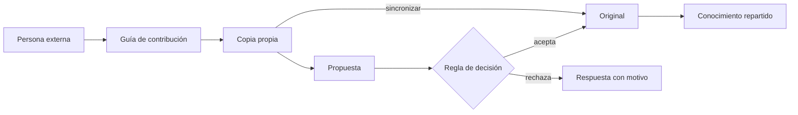
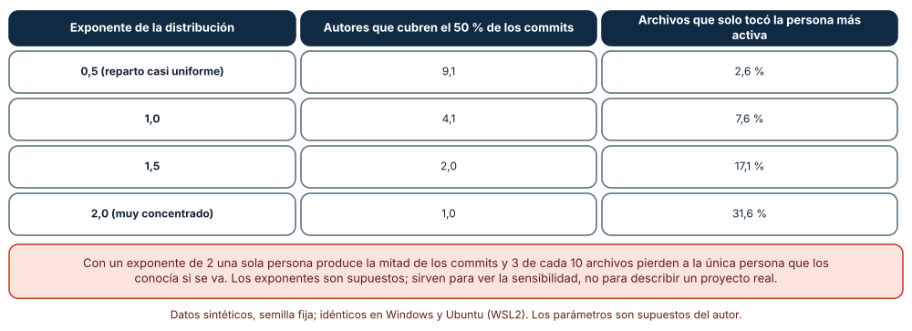
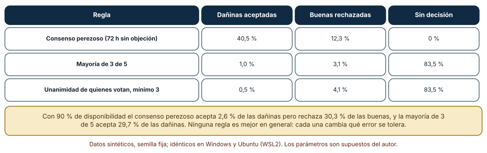
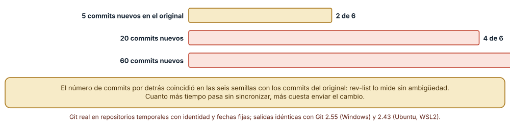

# SE-200 — Contribución, gobernanza y comunidades abiertas

[← SE-199 — Convenciones, ownership y CODEOWNERS](https://github.com/vladimiracunadev-create/modern-software-engineering-program/blob/main/classes/part-16-git-colaboracion-y-codigo-abierto/se-199-convenciones-ownership-y-codeowners/README.md) · [↑ Parte 16](https://github.com/vladimiracunadev-create/modern-software-engineering-program/blob/main/classes/part-16-git-colaboracion-y-codigo-abierto/README.md) · [📚 Índice completo](https://github.com/vladimiracunadev-create/modern-software-engineering-program/blob/main/classes/README.md) · [🌐 Portal](https://vladimiracunadev-create.github.io/modern-software-engineering-program/classes/SE-200.html) · [SE-201 — Licencias de software y obligaciones básicas →](https://github.com/vladimiracunadev-create/modern-software-engineering-program/blob/main/classes/part-16-git-colaboracion-y-codigo-abierto/se-201-licencias-de-software-y-obligaciones-basicas/README.md)

## Punto profesional y fundamento pedagógico

**Punto profesional.** La clase existe para que abrir un proyecto a personas que no pertenecen al equipo sea una decisión con reglas visibles: cómo se contribuye, quién decide, qué pasa cuando alguien se va y cómo se mantiene al día una copia propia. Un proyecto abierto no es solo un repositorio público: es un acuerdo sobre cómo se toman las decisiones cuando no todo el mundo se conoce.

**Por qué aparece aquí.** Se sitúa después de **Convenciones, ownership y CODEOWNERS** y antes de **Licencias de software y obligaciones básicas**. `SE-199` dejó reglas de forma y de propiedad; esta clase pregunta qué cambia cuando quien contribuye es externa: necesita una guía para entrar, una regla de decisión que no dependa de que todos estén disponibles y una forma de sincronizar su copia. Deja el proyecto listo para recibir contribuciones, cuya licencia trata `SE-201`.

**Error conceptual que debe corregir.** Creer que la gobernanza es una burocracia que se añade cuando el proyecto «crece» y que publicar el código basta para tener una comunidad. Las reglas de decisión existen siempre, escritas o no; cuando no están escritas, las aplica quien más tiempo tiene o más grita. Y la concentración del conocimiento en pocas personas es un riesgo del proyecto, no una virtud de ellas.

**Secuencia de aprendizaje.** Antes de leer la solución, predices cuántas personas cubren la mitad de los commits de un proyecto y qué regla de decisión aceptaría una propuesta dañina; después simulas la concentración de commits con cuatro exponentes, comparas tres reglas de decisión con tres niveles de disponibilidad y mides el conflicto de una contribución que se queda atrás respecto del original. La secuencia usa predicción, explicación propia, contraste y recuperación. [ICAP](https://icap.education.asu.edu/research) distingue participación de construcción de conocimiento; [How People Learn II](https://nap.nationalacademies.org/catalog/24783/how-people-learn-ii-learners-contexts-and-cultures) exige conectar conocimiento previo, contexto y transferencia; la [práctica de recuperación](https://pubmed.ncbi.nlm.nih.gov/16507066/) respalda producir de nuevo la explicación tras una demora; y [Education for Life and Work](https://nap.nationalacademies.org/resource/13398/dbasse_084153.pdf) exige devolución que explique la causa del error.

**Evidencia de aprendizaje.** `community-log.md` con la tabla de concentración, la comparación de reglas de decisión con sus errores, la medición del desfase de una copia y una guía de contribución con una regla de decisión y una de relevo. Debe contener predicción previa, observación, explicación causal, contraejemplo y qué hallazgo haría cambiar la regla de decisión.

**Límite de la conclusión.** Los contribuyentes, los commits y las decisiones son sintéticos; los exponentes de concentración, la disponibilidad, la probabilidad de ver un daño (0,6) y de objetar sin motivo (0,08) son supuestos del autor; no se midió ningún proyecto, comunidad ni persona real, y el modelo no cubre conflictos entre personas, motivaciones ni financiación.

### Trazabilidad fuente → afirmación

| Fuente primaria u oficial | Afirmación que respalda | Lo que no prueba |
|---|---|---|
| [Open Source Guides: liderazgo y gobernanza](https://opensource.guide/leadership-and-governance/) | Describe estructuras de gobierno habituales (BDFL, meritocracia, contribución liberal) y que las decisiones se toman por votación o consenso. | No dice cuál conviene a un proyecto concreto. |
| [Apache: proceso de votación](https://www.apache.org/foundation/voting.html) | Establece tipos de voto, que los votos sobre código siguen aprobación por consenso con veto y que los periodos de votación deberían durar al menos 72 horas. | No afirma que ese proceso sirva a un proyecto pequeño o sin foro establecido. |
| [PEP 13: modelo de gobierno de Python](https://peps.python.org/pep-0013/) | Documenta cómo un proyecto pasó de un líder benevolente a un consejo elegido y que el consejo busca consenso antes de actuar. | No prueba que ese modelo escale a otro proyecto. |

## Antes de empezar

Recupera lo aprendido en `SE-199`: una regla comprobable es mejor que una costumbre. La pregunta activa es: **¿qué debe saber alguien de fuera para contribuir, cómo se decide cuando no todo el mundo está y qué pasa si se va la persona que más sabe?**

## Prerrequisitos

- Haber completado `SE-199` o poder explicar cómo se asignan propietarios a rutas.
- Python 3.11 o posterior, Git 2.40 o posterior y un terminal.
- Trabajar con proyectos, personas y votaciones ficticios; no se estudia ninguna comunidad real.

## Problema auténtico

La plataforma de entregas se publica con la intención de recibir contribuciones. Una persona externa quiere corregir el cálculo de la penalización; no sabe a quién pedir revisión, su copia lleva dos meses sin sincronizar y el PR choca. Dentro del proyecto, dos mantenedores discuten si una propuesta se acepta por silencio o por votación, y se descubre que la mitad de los archivos solo los ha tocado una persona.

## Objetivos observables

Al terminar podrás:

1. escribir una guía de contribución con lo mínimo que alguien de fuera necesita para proponer un cambio;
2. medir la concentración de conocimiento de un historial y estimar qué se pierde si se va la persona más activa;
3. comparar reglas de decisión por los errores que cometen según la disponibilidad de quienes deciden;
4. sincronizar una copia propia con el original y estimar cuándo un desfase vuelve costoso un cambio;
5. decidir qué reglas de gobierno se escriben desde el principio y cuáles cuando haya evidencia.

## Mapa conceptual



El mapa se lee de izquierda a derecha: una persona externa lee la guía, trabaja en su copia, la mantiene sincronizada y propone un cambio que una regla de decisión acepta o rechaza con un motivo; el conocimiento repartido es la condición de que el proyecto sobreviva. No describe el tiempo de respuesta ni la relación entre las personas.

## Temas y por qué importan

| Tema | Por qué cambia una decisión profesional | Evidencia mínima |
|---|---|---|
| Guía de contribución | Reduce la fricción de entrar y la carga de quien revisa. | Predicción, traza causal y contraejemplo de **Guía de contribución** en `community-log.md` |
| Copias propias y sincronización | Un desfase largo convierte un cambio pequeño en uno conflictivo. | Predicción, traza causal y contraejemplo de **Copias propias y sincronización** en `community-log.md` |
| Reglas de decisión | Cada regla tolera un tipo de error distinto y depende de quién está disponible. | Predicción, traza causal y contraejemplo de **Reglas de decisión** en `community-log.md` |
| Concentración y relevo | Si pocas personas lo saben todo, el proyecto depende de que no se vayan. | Predicción, traza causal y contraejemplo de **Concentración y relevo** en `community-log.md` |
| Código de conducta | Fija qué comportamientos no se aceptan y cómo se resuelven. | Predicción, traza causal y contraejemplo de **Código de conducta** en `community-log.md` |

## Conceptos y decisiones

### 1. Guía de contribución

Una guía de contribución responde a las preguntas de quien llega: cómo preparar el entorno, cómo proponer un cambio, qué convenciones se siguen, cuánto tardarán en responder y qué no se aceptará. Existe para que la revisión trate el cambio y no el procedimiento. Una guía que nadie actualiza es peor que ninguna porque engaña; lo que debe ser comprobable (formato, pruebas) conviene que lo compruebe una máquina y que la guía lo enlace.

### 2. Copias propias y sincronización

Quien no tiene permiso de escritura trabaja en una copia propia (fork) y propone cambios desde ella. La copia no se actualiza sola: cuando el original avanza, la rama de la persona queda por detrás y, cuanto más se aleja, más probable es que su cambio choque con lo nuevo. Sincronizar es traer los commits del original y rebasar o fusionar. Un proyecto acogedor responde a contribuciones rápido; uno realista asume que algunas necesitarán una actualización.

### 3. Reglas de decisión

Un proyecto decide cómo acepta cambios o propuestas: un líder con la última palabra, votación por mayoría, aprobación por consenso con veto, o consenso por falta de objeción en un plazo (consenso perezoso). Cada regla tolera errores distintos: la que acepta por silencio es rápida y deja pasar lo que nadie leyó; la que exige votos mínimos se bloquea si faltan votantes. La disponibilidad de las personas decide cuál es adecuada.

### 4. Concentración y relevo

La concentración de commits indica cuánto del conocimiento depende de pocas personas. Un indicador sencillo es cuántas personas cubren la mitad de los commits; otro, qué parte de los archivos solo ha tocado la persona más activa. Ninguno mide el valor de nadie. Sirven para planificar relevo: pares en la revisión, rotación de propietarios y documentación de las zonas que solo alguien conoce.

### 5. Código de conducta

Un código de conducta fija qué comportamientos no se aceptan y a quién se reporta. Sin él, las normas de convivencia se aplican según quién se queja y a quién. Debe tener un canal de reporte, un proceso de respuesta y una persona o grupo que lo cumpla; un texto sin quien lo aplique es decoración.

### Cuánto se concentra el conocimiento

Se simularon 30 contribuyentes y 400 commits, cada uno tocando de 1 a 3 de 300 archivos, con los autores repartidos según una ley de potencia de exponente 0,5, 1,0, 1,5 y 2,0 (20 semillas por exponente). Con **0,5** (reparto casi uniforme), **9,1 personas** cubren la mitad de los commits y **2,6 %** de los archivos solo los tocó la persona más activa; con **1,0**, 4,1 personas y 7,6 %; con **1,5**, 2,0 personas y 17,1 %; con **2,0**, 1,0 persona y **31,6 %** de los archivos.



**Cómo leer la figura.** Cada fila es un exponente del mismo modelo; la segunda columna es la media de personas necesarias para cubrir la mitad de los commits y la tercera, el porcentaje de archivos que solo tocó la más activa. **Dónde deja de valer:** los exponentes son supuestos y los archivos se reparten al azar entre commits, sin la estructura de módulos de un proyecto real; los commits no miden conocimiento (un commit de formato no enseña nada) y el modelo no distingue las personas que revisan sin hacer commits.

### Tres reglas de decisión y quién está disponible

Se simularon 2 000 propuestas, el 20 % dañinas, con 5 mantenedoras. Cada una lee la propuesta con probabilidad igual a la disponibilidad; si es dañina, ve el daño con probabilidad 0,6 y objeta; si es buena, objeta sin motivo con probabilidad 0,08. Con **30 % de disponibilidad**, el **consenso perezoso** (acepta si nadie objeta) aceptó el **40,5 %** de las dañinas y rechazó el 12,3 % de las buenas, sin dejar propuestas sin decidir; la **mayoría de 3 de 5** y la **unanimidad de quienes votan (mínimo 3)** aceptaron el 1,0 % y el 0,5 % de las dañinas pero **dejaron sin decisión el 83,5 %**. Con 90 % de disponibilidad, el consenso perezoso aceptó el 2,6 % de las dañinas pero rechazó el 30,3 % de las buenas, y la mayoría de 3 de 5 aceptó el 29,7 % de las dañinas.



**Cómo leer la figura.** Cada fila es una regla aplicada a las mismas 2 000 propuestas con 30 % de disponibilidad; las columnas son porcentajes de las dañinas, de las buenas y del total. **Dónde deja de valer:** las probabilidades de ver el daño y de objetar sin motivo son supuestos, y las personas reales dan razones, se influyen entre sí y no son independientes; la figura muestra el efecto de la disponibilidad sobre cada regla, no cuál es mejor.

### Una copia que se queda atrás

Una contribución de 3 líneas contiguas a un archivo de 50 líneas se preparó en una copia local y el original avanzó 5, 20 y 60 commits que editaban una línea al azar. Al rebasar, hubo conflicto en **2 de 6** semillas con 5 commits de desfase (33 %), **4 de 6** con 20 (67 %) y **6 de 6** con 60 (100 %). El número de commits por detrás medido con `rev-list --left-right --count` coincidió con los commits del original en las seis semillas.



**Cómo leer la figura.** Cada barra es un desfase del original con seis semillas; la etiqueta indica cuántas dieron conflicto. **Dónde deja de valer:** con seis semillas por celda los porcentajes tienen mucha incertidumbre; el archivo de 50 líneas concentra las ediciones y exagera el conflicto frente a un repositorio con muchos archivos, y la figura no mide cuánto tarda en resolverse.

## Definiciones de trabajo

- **fork:** copia propia de un repositorio desde la que una persona sin permiso de escritura propone cambios.
- **regla de decisión:** procedimiento por el que un proyecto acepta o rechaza una propuesta.
- **consenso perezoso:** regla por la que una propuesta se acepta si nadie objeta en un plazo.
- **concentración de conocimiento:** grado en que pocas personas concentran los commits o el conocimiento de un proyecto.
- **código de conducta:** documento que fija comportamientos aceptables y el proceso para reportar y resolver incumplimientos.

Las definiciones son operativas para la plataforma de entregas. No convierten términos con historia más amplia en sinónimos y deben contrastarse con la documentación primaria enlazada al final.

## Ejemplo mínimo

El fragmento cuenta cuánto se ha alejado una copia del original. Antes de ejecutarlo, predice los números.

```bash
git fetch upstream
git rev-list --left-right --count mi-rama...upstream/main    # "por delante  por detrás"
git rebase upstream/main
```

Registra versión de Git y salida, y repite tras añadir 20 commits al original para ver cómo cambia la columna de «por detrás».

## Ejemplo profesional

La plataforma publica `CONTRIBUTING.md` con el entorno, el formato de ramas, la plantilla de PR, el tiempo objetivo de primera respuesta y lo que no se acepta. Una regla de decisión escrita: los cambios pequeños los aprueba una mantenedora; los que modifican una regla de negocio exigen dos aprobaciones y un plazo de 72 horas; los cambios de gobierno exigen consenso. Un indicador mensual muestra cuántas personas cubren la mitad de los commits y qué rutas solo conoce una, para planificar relevos.

Compara el caso normal con un proyecto que acepta por silencio cualquier cambio de más de una semana: la práctica es apropiada para cambios de bajo riesgo con muchas personas disponibles; es peligrosa para cambios de reglas de negocio cuando la disponibilidad es baja, como muestra la figura.

## Práctica guiada

1. Escribe un `CONTRIBUTING.md` de una página para la plataforma y predice qué pregunta de una persona nueva queda sin responder.
2. Simula la concentración de commits con los cuatro exponentes y registra las personas que cubren la mitad.
3. Predice qué regla de decisión aceptaría más propuestas dañinas con baja disponibilidad y comprueba.
4. Simula las tres reglas con disponibilidades de 0,3, 0,6 y 0,9 y registra errores y propuestas sin decisión.
5. Prepara un fork con una contribución de 3 líneas, avanza el original 5, 20 y 60 commits y registra los conflictos.
6. Decide qué reglas de gobierno escribirías ahora y cuáles esperarías a tener evidencia.
7. Pide a otra persona que reconstruya tu regla de decisión solo desde `community-log.md` y registra qué ambigüedad encontró.

## Ejercicios

1. **Más disponibilidad:** busca la disponibilidad a partir de la cual la mayoría de 3 de 5 deja de dejar propuestas sin decisión.
2. **Relevo:** diseña una rotación que baje el 31,6 % de archivos de una sola persona a menos del 10 % y estima su costo en tiempo.
3. **Primera respuesta:** define un tiempo objetivo de primera respuesta, qué medirías y qué harías si no se cumple.
4. **Gobernanza mínima:** escribe qué decisiones del proyecto exigen más de una persona y por qué.

## Reto verificable

Entrega `community-log.md` con la guía de contribución, la tabla de concentración, la comparación de reglas con sus errores, la medición del desfase y una regla de decisión y de relevo de una página. Se aprueba si otra persona ejecuta el código desde un directorio vacío, obtiene las mismas cifras y puede decir qué error tolera la regla de decisión elegida. No se aprueba por la extensión de la guía.

## Caso conductor

El repositorio de la plataforma de entregas es el caso conductor de la Parte 16. Esta clase deja la guía de contribución, la regla de decisión y el indicador de concentración. `SE-201` pregunta bajo qué licencia se reciben y se redistribuyen las contribuciones y `SE-202` protege la rama que las integra. Cambia después un solo dato, la disponibilidad del 30 % al 60 %, y revisa qué regla de decisión conviene.

## Preguntas frecuentes

### ¿Hace falta gobernanza en un proyecto pequeño?

Hace falta saber cómo se decide aunque haya una sola persona: es lo que otras necesitan para contribuir. Puede ser una frase («la última palabra la tiene la autora») y es una regla de decisión.

### ¿El consenso perezoso es siempre malo?

No: es rápido y adecuado para cambios de bajo riesgo con muchas personas atentas. Con poca disponibilidad deja pasar lo que nadie leyó, por lo que conviene reservarlo.

### ¿Un código de conducta es solo para proyectos grandes?

No: cualquier proyecto con personas ajenas lo necesita. Lo difícil no es el texto sino el proceso y quién lo aplica.

### ¿Cómo se mide si una comunidad está sana?

Con indicadores (tiempo de primera respuesta, personas que cubren los commits, contribuciones aceptadas) y con conversaciones. Ninguno mide valor personal y todos pueden manipularse si se usan para evaluar.

## Fallo controlado y diagnóstico

Reproduce el fallo clásico de la clase: **aceptar por silencio una propuesta que nadie leyó**. Usa el consenso perezoso con 30 % de disponibilidad.

Registra síntoma, entrada mínima, hipótesis, observación que descarta cada hipótesis, causa, corrección y prueba de regresión. **Síntoma:** una propuesta que cambia el tope de prórroga se acepta tras 72 horas sin objeciones y rompe una regla acordada. **Hipótesis rivales:** (a) las mantenedoras la leyeron y la aprobaron; (b) casi nadie la leyó. **Prueba:** cuenta quién abrió la propuesta durante el plazo: una de cinco. **Conclusión:** la causa es (b): el silencio se interpretó como acuerdo. **Regresión:** exige un número mínimo de lecturas o aprobaciones explícitas para cambios de reglas de negocio y deja el consenso perezoso para cambios de bajo riesgo. No cambies a la vez la regla de decisión y el plazo.

## Errores comunes y cómo corregirlos

| Síntoma | Causa probable | Corrección |
|---|---|---|
| Las contribuciones externas se quedan sin respuesta | No hay tiempo objetivo ni responsable | Fijar un tiempo de primera respuesta y rotar quien lo cumple |
| Los PR externos chocan al revisarse | La copia se quedó atrás | Pedir sincronización y ofrecer una guía para hacerla |
| Se aceptan cambios de reglas que nadie leyó | Consenso perezoso con poca disponibilidad | Exigir aprobación explícita para cambios de riesgo |
| Un archivo solo lo conoce una persona | Concentración sin relevo | Revisar en pareja y rotar propietarios |
| El código de conducta no se aplica | No hay canal ni responsable | Definir quién recibe reportes y cómo se resuelven |

## Entorno y archivos clave

```text
work/SE-200/
├── README.md
├── comunidad/
│   ├── concentracion.py
│   ├── decision.py
│   └── fork.py
├── CONTRIBUTING.md
├── CODE_OF_CONDUCT.md
└── evidence/community-log.md
```

El `README` declara sistema operativo, versión de Git y de Python, semillas y comandos. Los experimentos usan `random`, `subprocess` y repositorios temporales con un remoto `--bare` local, identidad y fechas fijas y se ejecutaron con CPython 3.12.9 y Git 2.55 en Windows 11 y con CPython 3.12.3 y Git 2.43 en Ubuntu bajo WSL2: las salidas fueron idénticas. Si automatizas con otra biblioteca, fija procedencia y versión.

## Seguridad, ética y accesibilidad

- las contribuciones externas son entrada no confiable: se revisan antes de ejecutarse en integración continua con secretos;
- un código de conducta necesita una vía de reporte confidencial y quien la recibe no debe tener conflicto de interés;
- los indicadores de concentración no deben usarse para evaluar o despedir a personas: son una señal del proyecto;
- escribe la guía en lenguaje claro, ofrece alternativas textuales a tablas y considera zonas horarias y idiomas al fijar plazos;
- respeta que las contribuciones tienen una licencia y una autoría que debes conservar.

## Puente hacia el trabajo con agentes

Un agente que contribuye a un proyecto abierto suele abrir un PR grande sin leer la guía ni sincronizar su copia. Pídele que lea `CONTRIBUTING.md`, que sincronice con el original antes de proponer, que respete las convenciones y que declare qué partes escribió él y qué probó. Revisa especialmente si propone cambios de reglas de negocio sin una discusión previa: es el mismo defecto de aceptar por silencio, ahora con un autor que nunca se queja.

## Transferencia

Traslada el análisis a otra comunidad de práctica (por ejemplo, un grupo que mantiene un documento de estándares): decide qué sería la guía de entrada, cómo se decide y qué pasa si se va quien más sabe. La transferencia está lograda cuando puedes explicar qué parte de la regla dependía de la disponibilidad de las personas, no cuando los documentos se parecen.

## Evaluación y evidencia

| Criterio | Evidencia para aprobar |
|---|---|
| comprensión | explicación de qué error tolera cada regla de decisión |
| corrección | cifras reproducibles de concentración, decisión y desfase con las mismas semillas |
| diseño | guía de contribución y regla de decisión con relevo |
| diagnóstico | reproducción del fallo «aceptar por silencio» con regresión |
| incertidumbre | declaración de qué parte depende de las probabilidades supuestas |
| reproducibilidad | versiones, comandos, salida y límites declarados |

## Fuentes

- [Open Source Guides: liderazgo y gobernanza](https://opensource.guide/leadership-and-governance/) — estructuras de gobierno habituales; autoridad: Open Source Guides.
- [Apache: proceso de votación](https://www.apache.org/foundation/voting.html) — tipos de voto, consenso y periodos mínimos; autoridad: Apache Software Foundation.
- [PEP 13: modelo de gobierno de Python](https://peps.python.org/pep-0013/) — transición de un líder benevolente a un consejo; autoridad: Python Software Foundation.
- [Contributor Covenant](https://www.contributor-covenant.org/) — código de conducta para comunidades digitales; autoridad: Contributor Covenant.
- [GitHub: sincronizar un fork](https://docs.github.com/en/pull-requests/collaborating-with-pull-requests/working-with-forks/syncing-a-fork) — actualizar una copia con el original; autoridad: GitHub Docs.
- [GitHub: pautas para contribuir](https://docs.github.com/en/communities/setting-up-your-project-for-healthy-contributions/setting-guidelines-for-repository-contributors) — dónde y cómo publicar una guía; autoridad: GitHub Docs.

Cada fuente respalda el mecanismo indicado; ninguna demuestra que la regla de decisión de la plataforma de entregas sea la adecuada para otro proyecto. Esa afirmación depende de la disponibilidad real de sus mantenedoras y del riesgo de sus decisiones.

- [GitHub: código de conducta](https://docs.github.com/en/communities/setting-up-your-project-for-healthy-contributions/adding-a-code-of-conduct-to-your-project) — cómo añadirlo a un repositorio.
- [git-rev-list](https://git-scm.com/docs/git-rev-list) — recuento de commits por delante y por detrás.

## Límites y siguiente paso

Se ejecutaron tres experimentos con datos sintéticos y repositorios temporales en Windows y Ubuntu (WSL2) con resultados idénticos. Los contribuyentes, las probabilidades y los desfases son supuestos del autor, con seis semillas en el experimento de Git, y no se midió ninguna comunidad real. La siguiente clase pregunta bajo qué licencia se reciben y se redistribuyen las contribuciones.

## Glosario

- **fork:** copia propia de un repositorio desde la que una persona sin permiso de escritura propone cambios.
- **regla de decisión:** procedimiento por el que un proyecto acepta o rechaza una propuesta.
- **consenso perezoso:** regla por la que una propuesta se acepta si nadie objeta en un plazo.
- **concentración de conocimiento:** grado en que pocas personas concentran los commits o el conocimiento de un proyecto.
- **código de conducta:** documento que fija comportamientos aceptables y el proceso para reportar y resolver incumplimientos.

---

[← SE-199 — Convenciones, ownership y CODEOWNERS](https://github.com/vladimiracunadev-create/modern-software-engineering-program/blob/main/classes/part-16-git-colaboracion-y-codigo-abierto/se-199-convenciones-ownership-y-codeowners/README.md) · [↑ Parte 16](https://github.com/vladimiracunadev-create/modern-software-engineering-program/blob/main/classes/part-16-git-colaboracion-y-codigo-abierto/README.md) · [📚 Índice completo](https://github.com/vladimiracunadev-create/modern-software-engineering-program/blob/main/classes/README.md) · [🌐 Portal](https://vladimiracunadev-create.github.io/modern-software-engineering-program/classes/SE-200.html) · [SE-201 — Licencias de software y obligaciones básicas →](https://github.com/vladimiracunadev-create/modern-software-engineering-program/blob/main/classes/part-16-git-colaboracion-y-codigo-abierto/se-201-licencias-de-software-y-obligaciones-basicas/README.md)
