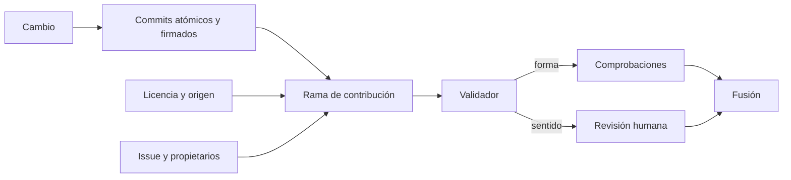
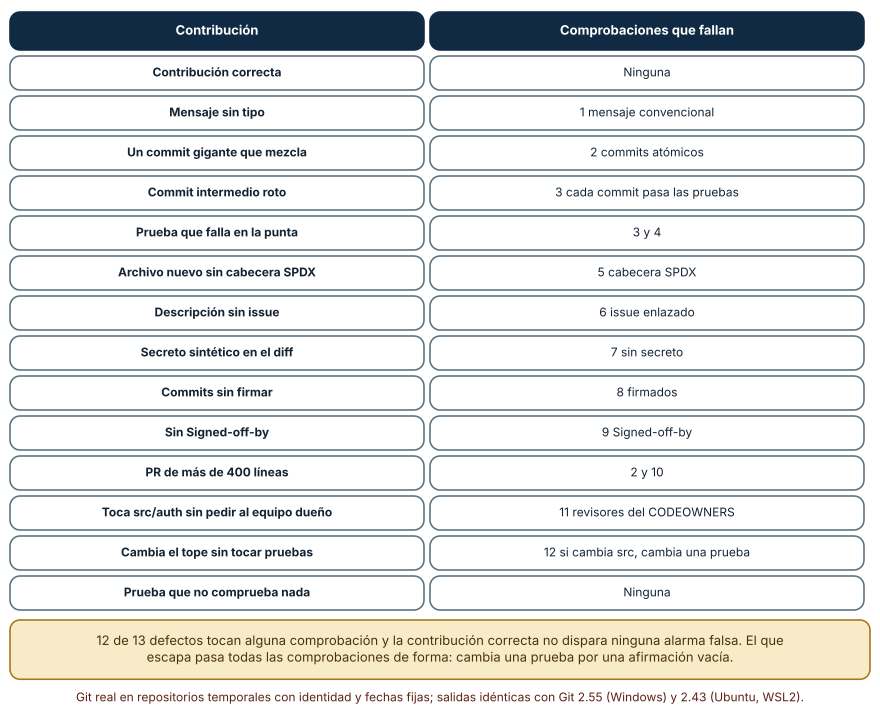
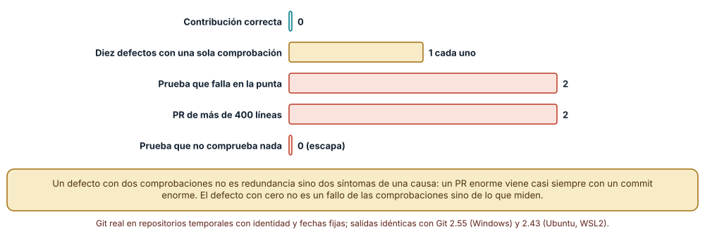
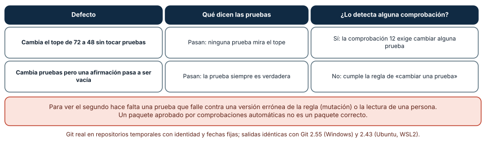

# SE-204 — Proyecto: contribución revisable de extremo a extremo

[← SE-203 — Taller: rescatar una integración conflictiva](https://github.com/vladimiracunadev-create/modern-software-engineering-program/blob/main/classes/part-16-git-colaboracion-y-codigo-abierto/se-203-taller-rescatar-una-integracion-conflictiva/README.md) · [↑ Parte 16](https://github.com/vladimiracunadev-create/modern-software-engineering-program/blob/main/classes/part-16-git-colaboracion-y-codigo-abierto/README.md) · [📚 Índice completo](https://github.com/vladimiracunadev-create/modern-software-engineering-program/blob/main/classes/README.md) · [🌐 Portal](https://vladimiracunadev-create.github.io/modern-software-engineering-program/classes/SE-204.html) · [SE-205 — Documentación orientada a tareas y audiencias →](https://github.com/vladimiracunadev-create/modern-software-engineering-program/blob/main/classes/part-17-documentacion-y-conocimiento-tecnico/se-205-documentacion-orientada-a-tareas-y-audiencias/README.md)

## Punto profesional y fundamento pedagógico

**Punto profesional.** El proyecto existe para entregar una contribución que otra persona pueda revisar, probar, atribuir, licenciar y fusionar siguiendo enlaces y comandos, sin preguntar nada a quien la escribió. El criterio profesional no es que el cambio sea inteligente sino que sea verificable: cada afirmación del paquete tiene detrás un comando que se ejecuta y un límite declarado.

**Por qué aparece aquí.** Cierra la Parte 16 y reúne todas sus clases: el modelo de objetos (`SE-193`), los commits atómicos (`SE-194`), la integración (`SE-195`), la revisión (`SE-196`), el flujo (`SE-197`), la trazabilidad (`SE-198`), las convenciones y propietarios (`SE-199`), la contribución externa (`SE-200`), las licencias (`SE-201`), las firmas y la protección (`SE-202`) y el rescate (`SE-203`). Deja un paquete de contribución que la Parte 17 documenta y que las partes siguientes dan por revisable.

**Error conceptual que debe corregir.** Creer que una contribución está lista cuando las pruebas pasan. Las pruebas comprueban lo que alguien escribió; un paquete revisable además tiene historia atómica, motivo enlazado, licencia, firma, propietarios y tamaño razonables, y declara lo que ninguna comprobación ve. Una afirmación vacía pasa todas las comprobaciones de forma.

**Secuencia de aprendizaje.** Antes de leer la solución, predices qué comprobaciones dispararía cada uno de trece defectos plantados y cuáles escaparían; después construyes un validador de doce comprobaciones sobre repositorios reales, lo ejecutas sobre una contribución correcta y trece con un defecto cada una, analizas los solapes y estudias los dos defectos que dejan las pruebas en verde. La secuencia usa predicción, explicación propia, contraste y recuperación. [ICAP](https://icap.education.asu.edu/research) distingue participación de construcción de conocimiento; [How People Learn II](https://nap.nationalacademies.org/catalog/24783/how-people-learn-ii-learners-contexts-and-cultures) exige conectar conocimiento previo, contexto y transferencia; la [práctica de recuperación](https://pubmed.ncbi.nlm.nih.gov/16507066/) respalda producir de nuevo la explicación tras una demora; y [Education for Life and Work](https://nap.nationalacademies.org/resource/13398/dbasse_084153.pdf) exige devolución que explique la causa del error.

**Evidencia de aprendizaje.** `contribution-log.md` y el paquete de contribución: rama con commits atómicos y firmados, descripción del PR con motivo y riesgos, validador con su matriz de defectos, declaración de licencia y propietarios, y la lista de lo que ninguna comprobación ve. Debe contener predicción previa, observación, explicación causal, contraejemplo y qué hallazgo haría rechazar la contribución.

**Límite de la conclusión.** El repositorio es temporal y pequeño; los trece defectos son variaciones escritas por el autor, una por comprobación, y no una muestra de contribuciones reales; las doce comprobaciones se ajustaron a esos defectos y su exactitud real es desconocida; no se probó ningún alojamiento, protección de rama ni revisor humano.

### Trazabilidad fuente → afirmación

| Fuente primaria u oficial | Afirmación que respalda | Lo que no prueba |
|---|---|---|
| [Pro Git: Contributing to a Project](https://git-scm.com/book/en/v2/Distributed-Git-Contributing-to-a-Project) | Describe cómo preparar una contribución: commits pequeños con mensajes claros, comprobar espacios y sincronizar con el original. | No fija un formato obligatorio para un proyecto. |
| [Developer Certificate of Origin](https://developercertificate.org/) | Define la declaración de origen que una persona afirma con una línea `Signed-off-by` en un commit. | No es una licencia ni garantiza que el origen sea verdadero. |
| [REUSE specification](https://reuse.software/spec/) | Propone declarar licencia y titularidad por archivo de forma legible por máquinas. | No sustituye la interpretación de la licencia. |

## Antes de empezar

Recupera lo aprendido en `SE-203`: un rescate depende de lo ya publicado y de la prueba de la intención. La pregunta activa es: **¿qué debe tener esta contribución para que otra persona la revise, la pruebe, sepa de quién es y bajo qué licencia llega, y pueda fusionarla sin rescate?**

## Prerrequisitos

- Haber completado `SE-193` a `SE-203` o poder explicar las decisiones de cada una.
- Python 3.11 o posterior, Git 2.40 o posterior con firmas SSH y OpenSSH.
- Trabajar en un repositorio temporal propio; las claves se crean para el proyecto y se borran al terminar.

## Problema auténtico

Una persona externa quiere añadir el periodo de gracia a la regla de penalización de la plataforma de entregas. Su primer intento tenía un commit con mezcla de cambios, un archivo nuevo sin licencia, una descripción sin issue y una clave de prueba pegada. Otro intento tenía todo en orden salvo que una prueba afirmaba `True`. La mantenedora quiere un conjunto de comprobaciones que la libere de lo mecánico y una descripción clara de lo que sí debe leer.

## Objetivos observables

Al terminar podrás:

1. preparar una contribución con commits atómicos, firmados, con motivo enlazado y con las declaraciones de licencia y origen;
2. construir un validador con comprobaciones independientes y medir qué defectos detecta cada una;
3. identificar los defectos que ninguna comprobación de forma detecta y asignarlos a revisión humana;
4. escribir la descripción del PR con los riesgos y las zonas que merecen más atención;
5. entregar el paquete de forma que otra persona lo reproduzca desde un checkout limpio.

## Mapa conceptual



El mapa se lee de izquierda a derecha: el cambio se prepara con las reglas de la parte, el validador comprueba la forma y deja el sentido a una persona; ambas condiciones deben cumplirse antes de la fusión. No describe el orden en que se hacen las comprobaciones.

## Temas y por qué importan

| Tema | Por qué cambia una decisión profesional | Evidencia mínima |
|---|---|---|
| Paquete de contribución | Es lo que otra persona ve: si falta algo, no puede revisar. | Predicción, traza causal y contraejemplo de **Paquete de contribución** en `contribution-log.md` |
| Comprobaciones de forma | Liberan a la revisora de lo mecánico y deben ser independientes. | Predicción, traza causal y contraejemplo de **Comprobaciones de forma** en `contribution-log.md` |
| Solapes entre comprobaciones | Dos alarmas por una causa no son redundancia sino dos síntomas. | Predicción, traza causal y contraejemplo de **Solapes entre comprobaciones** en `contribution-log.md` |
| Defectos que no ve la forma | Una prueba vacía pasa todo: se necesita lectura o mutación. | Predicción, traza causal y contraejemplo de **Defectos que no ve la forma** en `contribution-log.md` |
| Descripción del PR | Declara lo que el diff no muestra: motivo, riesgos y límites. | Predicción, traza causal y contraejemplo de **Descripción del PR** en `contribution-log.md` |

## Conceptos y decisiones

### 1. Paquete de contribución

Un paquete revisable contiene una rama con commits atómicos y firmados, una descripción con el motivo (el issue), los riesgos y cómo se probó, la declaración de licencia y de origen (`Signed-off-by`), pruebas que fallan sin el cambio y la petición a los propietarios afectados. Es lo que se entrega, no solo el código. Cada elemento responde a una clase de la parte y a una pregunta que alguien haría al revisar.

### 2. Comprobaciones de forma

Doce comprobaciones cubren la forma: mensajes convencionales, commits atómicos (≤ 6 archivos y ≤ 120 líneas), cada commit pasa las pruebas, pasan en la punta, cabecera de licencia en archivos nuevos, issue enlazado, sin secretos, commits firmados, `Signed-off-by`, tamaño del PR (≤ 400 líneas), revisores de los propietarios pedidos y «si cambia el código cambia una prueba». Los umbrales son una decisión del equipo y deben revisarse con los casos que se escapan.

### 3. Solapes entre comprobaciones

Un defecto puede disparar varias comprobaciones porque tiene varios síntomas: una prueba que falla en la punta rompe también el commit que la introdujo, y un PR de más de 400 líneas suele traer un commit demasiado grande. Los solapes no son una falla del validador; informan de que dos comprobaciones miran causas relacionadas. Lo preocupante son los defectos con cero alarmas.

### 4. Defectos que no ve la forma

La forma no ve el sentido: un test que afirma `True` pasa todas las comprobaciones de forma, y un cambio de una regla de negocio sin prueba que la ejercite solo se ve si una regla exige tocar una prueba. Para ver lo primero hace falta una mutación (comprobar que la prueba falla contra una versión errónea) o la lectura de una persona. El paquete debe declarar qué cosas deja a la revisión humana.

### 5. Descripción del PR

La descripción dice qué cambia, por qué, cómo se probó y dónde mirar con más atención (por ejemplo, la prueba nueva y la regla de gracia). Referencia el issue en la forma documentada (`SE-198`), nombra a los propietarios afectados (`SE-199`), declara la licencia y el origen (`SE-201`) y lista lo que el validador no puede comprobar. Es el único lugar donde se puede ser honesto sobre las dudas del autor.

### Un validador de doce comprobaciones sobre catorce contribuciones

Se construyó un repositorio temporal con una regla de penalización y se generó una contribución correcta y trece con un defecto plantado cada una. El validador ejecuta las doce comprobaciones sobre repositorios reales: verifica firmas SSH con una clave desechable, ejecuta las pruebas en cada commit y en la punta y analiza el diff. La contribución **correcta no disparó ninguna** comprobación. De los trece defectos, **12 dispararon al menos una**: mensaje sin tipo (1), commit gigante (2), commit intermedio roto (3), prueba que falla en la punta (3 y 4), archivo nuevo sin cabecera (5), descripción sin issue (6), secreto sintético (7), commits sin firmar (8), sin `Signed-off-by` (9), PR de más de 400 líneas (2 y 10), cambio en `src/auth` sin pedir al equipo dueño (11) y cambio del tope sin tocar pruebas (12). Los resultados fueron idénticos con Git 2.55 en Windows y 2.43 en Ubuntu.



**Cómo leer la figura.** Cada fila es una contribución y la segunda columna lista las comprobaciones que fallan, con el número y el nombre de la primera; la última fila es el defecto que no dispara ninguna. **Dónde deja de valer:** los trece defectos son uno por comprobación y escritos por el autor, de modo que el 12 de 13 mide cuánto cubre el validador de lo que se imaginó, no de lo que llega en realidad; las doce comprobaciones se ajustaron a estos defectos.

### Cuántas alarmas dispara cada defecto

Entre los trece defectos, **diez dispararon una sola comprobación**, **dos dispararon dos** (la prueba que falla en la punta, que también rompe el commit que la introduce, y el PR de más de 400 líneas, que también es un commit demasiado grande) y **uno no disparó ninguna** (la prueba que no comprueba nada). La contribución correcta no disparó ninguna.



**Cómo leer la figura.** Cada barra agrupa contribuciones por el número de comprobaciones que dispararon; la verde es la correcta, la dorada tiene una alarma, las coral dos y una más sin ninguna. **Dónde deja de valer:** una alarma por defecto es consecuencia de haber escrito un defecto por comprobación; en contribuciones reales los defectos se combinan y los solapes son más frecuentes, y los umbrales (6 archivos, 120 líneas, 400 líneas) son arbitrarios.

### Dos defectos con las pruebas en verde

Dos contribuciones dejaron las pruebas en verde. En la primera, el tope pasó de 72 a 48 sin tocar ninguna prueba: ninguna prueba ejercitaba el tope, y la comprobación «si cambia el código cambia una prueba» (12) la **detectó**. En la segunda, la prueba del periodo de gracia se sustituyó por `assertTrue(True)`: pasó todas las comprobaciones, incluida la 12, porque sí cambió una prueba. Ninguna de las doce comprobaciones la ve.



**Cómo leer la figura.** Cada fila es un defecto que no hace fallar las pruebas; la última columna dice si alguna de las doce comprobaciones lo detecta. **Dónde deja de valer:** son dos defectos escritos por el autor; hay clases enteras no representadas, como un cambio correcto en una zona sin pruebas que cambia otro comportamiento. Ver el segundo exige una mutación de la regla o una persona que lea la prueba.

## Definiciones de trabajo

- **contribución revisable:** conjunto de cambios, descripción, pruebas y declaraciones que otra persona puede revisar y fusionar sin preguntar al autor.
- **comprobación de forma:** verificación mecánica de una propiedad del paquete que no depende del sentido del cambio.
- **solape:** situación en que un defecto dispara varias comprobaciones porque tiene varios síntomas.
- **`Signed-off-by`:** línea de un commit con la que su autora afirma el origen del cambio según el Developer Certificate of Origin.
- **mutación:** versión deliberadamente errónea del código usada para comprobar que una prueba falla.

Las definiciones son operativas para la plataforma de entregas. No convierten términos con historia más amplia en sinónimos y deben contrastarse con la documentación primaria enlazada al final.

## Ejemplo mínimo

El fragmento comprueba tres propiedades de una rama de contribución. Antes de ejecutarlo, predice qué dirá de una rama sin firmar.

```bash
git log --format='%h %G? %s' main..contribucion     # G? = estado de la firma de cada commit
git log --format=%B main..contribucion | grep -c 'Signed-off-by:'
git diff --numstat main...contribucion | awk '{s+=$1+$2} END {print s " líneas"}'
```

Registra versión de Git y salida, y repite con un commit sin firmar y otro sin `Signed-off-by`.

## Ejemplo profesional

La plataforma publica una guía de contribución con la lista de comprobaciones, el significado de cada umbral y quién decide si un umbral se relaja. Una contribución llega con una descripción que sigue la plantilla, commits atómicos y firmados, `Signed-off-by`, una referencia al issue y la petición de revisión al equipo dueño de `src/auth`. El validador se ejecuta en integración continua y comenta las alarmas; la mantenedora lee primero la prueba nueva y la regla de gracia, que la descripción marca como zona de atención.

Compara el caso normal con una contribución donde todas las comprobaciones pasan y la prueba principal afirma `True`: la práctica es apropiada cuando la revisión humana se dirige a lo que el validador no ve (y se declara); es peligrosa cuando «verde» se interpreta como «correcto».

## Práctica guiada

1. Elige un cambio pequeño de la regla de penalización y escribe el issue con la entrada exacta que lo motiva.
2. Prepara la rama con commits atómicos, mensajes convencionales, firmas y `Signed-off-by`.
3. Escribe la prueba que falla sin el cambio y comprueba que falla contra la versión anterior.
4. Escribe el validador con las doce comprobaciones y predice cuáles dispararán en una contribución con tres defectos.
5. Planta un defecto por comprobación y registra la matriz de alarmas.
6. Añade una mutación de la regla y comprueba que la prueba falla; registra qué cambió.
7. Pide a otra persona que revise el paquete solo con la descripción y `contribution-log.md` y registra qué dato le faltó.

## Ejercicios

1. **Umbral:** cambia el límite de líneas por commit de 120 a 60 y explica qué contribuciones nuevas fallan y si son defectos reales.
2. **Mutación:** añade la comprobación «las pruebas nuevas fallan contra la versión anterior» y explica qué defecto de la matriz cubre.
3. **Origen:** decide qué haría el validador con una contribución sin `Signed-off-by` de una persona externa y quién decide si se acepta.
4. **Falsa seguridad:** escribe un tercer defecto que pase las doce comprobaciones y propón cómo lo detectaría una persona.

## Reto verificable

Entrega la rama de contribución, la descripción del PR, el validador con su matriz y `contribution-log.md` con las doce comprobaciones, los trece defectos, los solapes y la lista de lo que el validador no ve. Se aprueba si otra persona ejecuta el validador desde un checkout limpio, obtiene la misma matriz, puede fusionar la rama sin preguntas y señala qué parte del paquete leería con más cuidado. No se aprueba por «todas las comprobaciones en verde».

## Caso conductor

El repositorio de la plataforma de entregas es el caso conductor de la Parte 16. Este proyecto deja el paquete de contribución y el validador. La Parte 17 documenta lo que aquí se declaró (guía de contribución, descripción, límites) y las partes de construcción que siguen la heredan como convención de trabajo. Cambia después un solo dato, el umbral de líneas por commit, y revisa qué contribuciones de la matriz cambian de resultado.

## Preguntas frecuentes

### ¿Cuántas comprobaciones automáticas son demasiadas?

Las que nadie lee o que se ignoran por frecuentes falsos positivos. Cada comprobación debe tener un motivo, un dueño y una forma de relajarse.

### ¿El validador sustituye la revisión?

No: libera la revisión de lo mecánico y la dirige a lo que no ve. Un paquete aprobado por el validador no es un paquete correcto.

### ¿Hace falta firmar y `Signed-off-by`?

Son declaraciones distintas: la firma atribuye el contenido a una clave y `Signed-off-by` afirma el origen. Un proyecto puede exigir una, otra o ninguna; lo importante es que la regla esté escrita.

### ¿Cómo se mide si las comprobaciones sirven?

Con los defectos que se escapan: cada vez que una revisión descubre algo que el validador no vio, se añade la comprobación o se documenta el límite.

## Fallo controlado y diagnóstico

Reproduce el fallo clásico de la clase: **dar por correcta una contribución porque las comprobaciones pasan**. Usa la contribución con la prueba `assertTrue(True)`.

Registra síntoma, entrada mínima, hipótesis, observación que descarta cada hipótesis, causa, corrección y prueba de regresión. **Síntoma:** el periodo de gracia no funciona en producción y la contribución pasó todas las comprobaciones. **Hipótesis rivales:** (a) alguna comprobación falló en silencio; (b) la prueba del periodo de gracia no comprueba nada. **Prueba:** ejecuta el validador: cero alarmas; sustituye la regla por una versión errónea (una mutación): la prueba sigue pasando. **Conclusión:** la causa es (b): la comprobación 12 exige tocar una prueba, no que la prueba pueda fallar. **Regresión:** añade la comprobación «las pruebas nuevas fallan contra la versión anterior del código» y exige que la descripción nombre qué prueba protege qué regla. No cambies a la vez la prueba y las comprobaciones.

## Errores comunes y cómo corregirlos

| Síntoma | Causa probable | Corrección |
|---|---|---|
| El validador pasa y el comportamiento es erróneo | Una prueba vacía o débil | Añadir una mutación o una lectura humana de las pruebas |
| Una rama tiene un commit que no compila | Se empujó un intermedio roto | Reordenar la rama para que cada commit pase las pruebas |
| La descripción no permite revisar | Falta el motivo, los riesgos o las zonas de atención | Usar la plantilla y nombrar qué leer primero |
| Se rechazan contribuciones válidas | Umbrales arbitrarios sin revisión | Revisar los umbrales con los casos rechazados |
| Falta la licencia o el origen de un archivo | No se comprobó al añadirlo | Añadir la etiqueta y la comprobación en integración continua |

## Entorno y archivos clave

```text
work/SE-204/
├── README.md
├── contribucion/
│   ├── validador.py
│   ├── defectos.py
│   └── matriz.py
├── .github/pull_request_template.md
├── CONTRIBUTING.md
├── firmantes
└── evidence/contribution-log.md
```

El `README` declara sistema operativo, versiones de Git, OpenSSH y Python, semillas y comandos. Los experimentos usan `subprocess`, una clave Ed25519 desechable creada y borrada por el script y repositorios temporales con identidad y fechas fijas y se ejecutaron con CPython 3.12.9 y Git 2.55 en Windows 11 y con CPython 3.12.3 y Git 2.43 en Ubuntu bajo WSL2: las salidas fueron idénticas. Si adoptas un validador externo, fija procedencia y versión.

## Seguridad, ética y accesibilidad

- una contribución que toca autenticación, permisos, secretos o infraestructura requiere revisión del equipo dueño aunque el validador pase;
- el validador de secretos busca patrones sintéticos del autor y no es un análisis de secretos de producción: no confíes en él para eso;
- registra la procedencia y la licencia de todo lo que se incorpora y atribuye a quien lo escribió;
- las claves del proyecto se borran al terminar y no se reutilizan;
- redacta la descripción con lenguaje claro y ofrece una alternativa textual a las tablas de la matriz.

## Puente hacia el trabajo con agentes

Un agente al que se le pide «prepara esta contribución» suele producir un solo commit grande, una descripción que repite el diff y pruebas que pasan porque las escribió él. Pídele que divida el cambio en commits atómicos que compilen, que escriba una prueba que falle contra la versión anterior, que declare qué escribió él y qué verificó, que ejecute el validador y que enumere lo que el validador no ve. Revisa especialmente las pruebas: un agente optimiza que pasen, y una prueba que no puede fallar es el defecto que ninguna comprobación de forma detecta.

## Transferencia

Traslada el paquete a otra contribución de naturaleza distinta (por ejemplo, un cambio de infraestructura como código o una modificación de un conjunto de datos): decide qué comprobaciones de forma seguirían valiendo, cuáles no y qué quedaría para una persona. La transferencia está lograda cuando puedes explicar qué parte del validador dependía de ser código con pruebas, no cuando los nombres se parecen.

## Evaluación y evidencia

| Criterio | Evidencia para aprobar |
|---|---|
| comprensión | explicación de qué comprueba cada comprobación y qué no |
| corrección | matriz de defectos reproducible con los mismos comandos |
| diseño | paquete con commits atómicos, firmas, licencia, origen y propietarios |
| diagnóstico | reproducción del fallo «verde no es correcto» con regresión |
| incertidumbre | lista de lo que el validador no ve y de los umbrales arbitrarios |
| reproducibilidad | versiones, comandos, salida y límites declarados |

## Fuentes

- [Pro Git: Contributing to a Project](https://git-scm.com/book/en/v2/Distributed-Git-Contributing-to-a-Project) — preparación de contribuciones; autoridad: Pro Git.
- [Developer Certificate of Origin](https://developercertificate.org/) — declaración de origen de un cambio; autoridad: Linux Foundation.
- [REUSE specification](https://reuse.software/spec/) — licencia y titularidad por archivo; autoridad: REUSE.
- [Conventional Commits 1.0.0](https://www.conventionalcommits.org/en/v1.0.0/) — formato de mensajes; autoridad: especificación de la convención.
- [git-commit](https://git-scm.com/docs/git-commit) — firma y `--signoff`; autoridad: documentación de Git.
- [GitHub: CODEOWNERS](https://docs.github.com/en/repositories/managing-your-repositorys-settings-and-features/customizing-your-repository/about-code-owners) — propietarios de código y revisión; autoridad: GitHub Docs.

Cada fuente respalda el mecanismo indicado; ninguna demuestra que el validador de la plataforma de entregas detecte los defectos que llegarán en la práctica. Esa afirmación depende de las contribuciones reales y de lo que se aprenda de las que se escapen.

- [Sadowski et al., «Modern code review: a case study at Google» (ICSE-SEIP, 2018)](https://doi.org/10.1145/3183519.3183525) — revisión de código como práctica con cambios pequeños.
- [GitHub: plantillas de issues y PR](https://docs.github.com/en/communities/using-templates-to-encourage-useful-issues-and-pull-requests/about-issue-and-pull-request-templates) — plantillas para pedir contexto.

## Límites y siguiente paso

Se ejecutó un experimento con repositorios temporales, claves desechables y defectos plantados por el autor en Windows y Ubuntu (WSL2) con resultados idénticos. Las doce comprobaciones se ajustaron a los trece defectos, los umbrales son arbitrarios y no se probó ningún alojamiento, protección de rama ni revisor humano. La Parte 17 pregunta cómo se documenta lo que esta contribución declara.

## Glosario

- **contribución revisable:** conjunto de cambios, descripción, pruebas y declaraciones que otra persona puede revisar y fusionar sin preguntar al autor.
- **comprobación de forma:** verificación mecánica de una propiedad del paquete que no depende del sentido del cambio.
- **solape:** situación en que un defecto dispara varias comprobaciones porque tiene varios síntomas.
- **`Signed-off-by`:** línea de un commit con la que su autora afirma el origen del cambio según el Developer Certificate of Origin.
- **mutación:** versión deliberadamente errónea del código usada para comprobar que una prueba falla.

---

[← SE-203 — Taller: rescatar una integración conflictiva](https://github.com/vladimiracunadev-create/modern-software-engineering-program/blob/main/classes/part-16-git-colaboracion-y-codigo-abierto/se-203-taller-rescatar-una-integracion-conflictiva/README.md) · [↑ Parte 16](https://github.com/vladimiracunadev-create/modern-software-engineering-program/blob/main/classes/part-16-git-colaboracion-y-codigo-abierto/README.md) · [📚 Índice completo](https://github.com/vladimiracunadev-create/modern-software-engineering-program/blob/main/classes/README.md) · [🌐 Portal](https://vladimiracunadev-create.github.io/modern-software-engineering-program/classes/SE-204.html) · [SE-205 — Documentación orientada a tareas y audiencias →](https://github.com/vladimiracunadev-create/modern-software-engineering-program/blob/main/classes/part-17-documentacion-y-conocimiento-tecnico/se-205-documentacion-orientada-a-tareas-y-audiencias/README.md)
