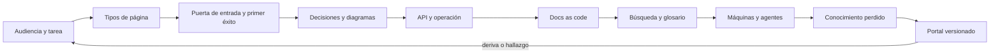

# Parte 17 — Documentación y conocimiento técnico

La Parte 16 terminó con cambios que otra persona puede revisar. La pregunta cambia de «cómo se propone un cambio» a «cómo sabe alguien qué hay, por qué es así y qué hacer cuando falla». Esta parte trabaja sobre el **portal documental de la plataforma de entregas de tareas**, un caso sintético que retoma la regla de penalización por entrega tardía de la Parte 13 y la documenta para estudiantes, docentes, secretaría, mantenimiento y agentes sin que cuatro textos digan cuatro cosas.

## Pregunta rectora

> ¿Quién necesita qué información, en qué forma, y cómo sé que sigue siendo verdad y que se puede encontrar?

## Antes del recorrido clase por clase

Esta parte no enseña una herramienta de documentación. Enseña a describir una página por su audiencia y su tarea, a separar los cuatro tipos de página y ejecutar los pasos de un tutorial, a escribir un README que lleve a un primer éxito comprobable, a registrar decisiones con sus suposiciones y su caducidad, a dibujar diagramas que se generan y se comparan con el código, a documentar una API con ejemplos que se ejecutan, a escribir procedimientos operativos seguros de repetir, a tratar la documentación como código con comprobaciones que no cansen, a hacerla encontrable, a prepararla para lectores que no son personas, a reconstruir lo que se perdió y a entregar todo como un portal versionado, auditado y reproducible.

El diagrama se lee de izquierda a derecha y no es un proceso obligatorio. El retorno indica que una deriva detectada por una comprobación, una consulta sin resultado o un hallazgo del taller reabre la pregunta de quién necesita qué; un portal aprobado no cierra la documentación, la fecha.

## Resultados acumulativos

Podrás describir una página por su audiencia y su tarea y calcular lo que cuesta repetir un dato; clasificar páginas en tutorial, guía, referencia y explicación y ejecutar los pasos de un tutorial para detectar su deriva; escribir un README con primer éxito y medir cuánta gente llega según el número de pasos; registrar decisiones con suposiciones y comprobar la integridad de su grafo de sustituciones; generar diagramas estables y compararlos con las importaciones del código; documentar una API con ejemplos ejecutables y contrastar los códigos observados con los documentados; clasificar los pasos de un runbook por idempotencia; construir un comprobador de enlaces, un linter con contexto y una construcción reproducible; medir la recuperabilidad con un glosario; fragmentar y validar documentación para máquinas con permisos mínimos; reconstruir un cambio con Git y clasificar cada afirmación; y entregar un portal versionado con una auditoría que declara sus límites.

Al finalizar podrás defender un portal con dueños, tipos, decisiones, comprobaciones con sus límites medidos, versiones coherentes, un paquete cuya huella se reproduce en dos sistemas y una lista de lo que ninguna comprobación ve, y podrás indicar qué parte de tu conclusión es observación, cuál es inferencia y cuál es hipótesis.

## Prerrequisitos enlazados

- [Parte 8 — Entornos, herramientas y depuración](https://github.com/vladimiracunadev-create/modern-software-engineering-program/blob/main/classes/part-08-entornos-herramientas-y-depuracion/): terminal, entornos aislados y diagnóstico con evidencia.
- [Parte 9 — Bibliotecas, paquetes, SDK y automatización](https://github.com/vladimiracunadev-create/modern-software-engineering-program/blob/main/classes/part-09-bibliotecas-paquetes-sdk-y-automatizacion/): paquetes, interfaces y automatización que la documentación describe.
- [Parte 12 — Ingeniería de requisitos](https://github.com/vladimiracunadev-create/modern-software-engineering-program/blob/main/classes/part-12-ingenieria-de-requisitos/): audiencias, tareas y requisitos revisables.
- [Parte 13 — Especificaciones, contratos y modelos](https://github.com/vladimiracunadev-create/modern-software-engineering-program/blob/main/classes/part-13-especificaciones-contratos-y-modelos/): la regla de penalización del caso, los contratos de interfaz y su compatibilidad.
- [Parte 16 — Git, colaboración y código abierto](https://github.com/vladimiracunadev-create/modern-software-engineering-program/blob/main/classes/part-16-git-colaboracion-y-codigo-abierto/): control de versiones, revisión y contribución que esta parte aplica a la documentación.
- Python 3.11+, Git y un terminal; los experimentos usan la biblioteca estándar, Git y datos sintéticos.

## Bloques y progresión

1. **Orientar:** las clases 205–207 deciden para quién se escribe, de qué tipo es cada página y cómo se llega al primer éxito, midiendo el coste de no decidirlo.
2. **Registrar y mostrar:** las clases 208–209 dejan por escrito por qué el sistema es como es y lo dibujan de forma que el dibujo se pueda comparar con el código.
3. **Documentar lo que otros usan y operan:** las clases 210–211 documentan la API con ejemplos que se ejecutan y los procedimientos operativos que se repiten sin empeorar el incidente.
4. **Mantener y encontrar:** las clases 212–214 tratan la documentación como código, la hacen encontrable y la preparan para lectores que no son personas.
5. **Recuperar e integrar:** las clases 215–216 reconstruyen lo que se perdió y entregan un portal versionado, auditado y reproducible.

## Evidencia medida y límites

Las figuras y los ejemplos de esta parte usan experimentos ejecutados con CPython 3.12.9 en Windows 11 y repetidos con CPython 3.12.3 en Ubuntu bajo WSL2; los que usan Git se ejecutaron con la versión 2.55 en Windows y 2.43 en Ubuntu. Los datos son **sintéticos** y las semillas están fijadas: las salidas fueron idénticas en ambos sistemas. Hubo dos hallazgos que dependieron del sistema y se corrigieron durante el trabajo: un servidor HTTP local que responde 413 sin leer el cuerpo de la petición provocó una conexión abortada en Windows y no en Ubuntu, y un archivo zip construido con orden, fecha y permisos fijos tuvo huellas distintas en cada sistema hasta fijar también el campo de sistema de origen, cuyo valor por defecto es 0 en Windows y 3 en Linux.

Los experimentos son: clics esperados en un árbol por componente frente a un índice de tareas, coherencia de un dato repetido en k páginas y legibilidad de Fernández Huerta de cuatro textos (`SE-205`); un clasificador léxico de los cuatro tipos de Diátaxis sobre párrafos puros y mezclados, palabras leídas antes de los pasos y un tutorial ejecutado contra tres versiones de una biblioteca (`SE-206`); un embudo de pasos de instalación, un detector de deriva entre el README y un analizador de argumentos y la omisión de cada paso de un README (`SE-207`); un linter de 300 ADR, la integridad de un grafo de sustituciones y la caducidad de las suposiciones (`SE-208`); cruces de aristas con y sin ordenación por baricentro, un generador de Mermaid estable y la comparación de un diagrama con las importaciones de un paquete (`SE-209`); diez ejemplos de una API frente a cinco cambios, la documentación de diez módulos de la biblioteca estándar y 600 peticiones a un servidor local (`SE-210`); ocho pasos de un runbook ejecutados dos veces, la cobertura de incidentes con un reparto de Zipf y un linter de runbooks (`SE-211`); un comprobador de enlaces y anclas, un linter con y sin contexto y una página construida con ocho semillas de hash (`SE-212`); una búsqueda BM25 con sinónimos, conflictos de definiciones por similitud léxica y las páginas huérfanas de un sitio (`SE-213`); fragmentación de documentos, validación de metadatos con antigüedad y un filtro de instrucciones ocultas (`SE-214`); el factor de camión de un repositorio, la arqueología de un cambio con `git log -S` y fuentes que se copian (`SE-215`); versiones de un portal desde etiquetas de Git, un paquete zip reproducible y una auditoría con 12 defectos sembrados (`SE-216`).

Los parámetros (los árboles de cinco hijos, el 0,85 de actualización de una copia, los cuatro textos, las probabilidades de fallo por paso, los 300 registros de ADR, las tasas de cambio de suposiciones, el reparto de incidentes de Zipf con 8 % de tipos nuevos, el vocabulario cerrado de 40 conceptos, los 140 registros de metadatos, los 22 textos del filtro, la autoría concentrada de cinco personas y la fiabilidad de 0,8 de las fuentes) son supuestos del autor, no datos de un producto, una institución ni de personas reales. Las reglas léxicas se afinaron con pocos ejemplos y se probaron con casos que el autor construyó para evadirlas, de modo que su exactitud real es desconocida. No se usó ningún modelo de lenguaje ni agente, ninguna herramienta de documentación de producción (Sphinx, MkDocs, Docusaurus, un buscador, un asistente), no se auditó ningún portal ni API reales y no se observó a nadie leyendo. Esta parte no tiene laboratorio propio en `labs/`; el proyecto integrador `SE-216` define el portal y la evidencia. Cada clase termina con un puente hacia el trabajo con agentes.

## Guía razonada clase por clase

El portal de la plataforma de entregas mantiene una regla, un conjunto de páginas y una auditoría estables mientras cambian las decisiones. Cada clase explica qué desorden reduce, qué experimento lo muestra, qué no demuestra y qué evidencia permite abandonar la conclusión.

### Bloque 1 — Orientar

#### SE-205 — Documentación orientada a tareas y audiencias

Una página sirve a una audiencia y a una tarea, y un dato repetido en varias páginas termina contradiciéndose. La clase estima los clics hasta una página en un árbol por componente frente a un índice de tareas, calcula cuántos datos siguen coherentes con k copias y mide la legibilidad de cuatro textos sobre la misma regla.

El estudiante entrega un inventario de tareas por audiencia, una fuente única y cuatro vistas que la enlazan. `SE-206` pregunta de qué tipo es cada página.

#### SE-206 — Tutoriales, how-to, referencia y explicación

Mezclar tipos de página obliga a leer lo que no se busca y esconde lo que se puede ejecutar. La clase muestra que un clasificador léxico no reconoce las dos mitades de una página mixta, mide cuántas palabras atraviesa quien busca los pasos y ejecuta un tutorial contra versiones modificadas de una biblioteca.

El estudiante entrega cuatro páginas por tipo y un tutorial que se ejecuta. `SE-207` aplica la distinción a la portada del proyecto.

#### SE-207 — README, instalación y primer éxito

El README es el camino más corto hasta ver algo funcionar. La clase calcula qué fracción de personas llega al primer éxito según los pasos, compara las opciones citadas con las de un analizador de argumentos y omite cada paso de la instalación para ver dónde aparece el fallo.

El estudiante entrega un README con primer éxito comprobable y un comparador de opciones. `SE-208` pasa de cómo usar el sistema a por qué es así.

### Bloque 2 — Registrar y mostrar

#### SE-208 — ADRs, RFCs y registro de decisiones

Una decisión vale mientras valgan sus suposiciones. La clase mide qué ve y qué no ve un linter de 300 ADR, comprueba la integridad de un grafo de sustituciones y calcula la probabilidad de que una suposición haya cambiado con el tiempo.

El estudiante entrega tres ADR con suposiciones y fecha de revisión, y un RFC. `SE-209` pasa del texto al dibujo.

#### SE-209 — Diagramas, modelos y documentación visual

Un diagrama es una afirmación que debe poder contrastarse. La clase mide los cruces de aristas al crecer el grafo, compara un generador que reordena con uno estable y contrasta un diagrama de dependencias con las importaciones de un paquete.

El estudiante entrega un modelo en texto, un generador estable y diagramas con pregunta y alternativa textual. `SE-210` documenta lo que otros consumen.

### Bloque 3 — Documentar lo que otros usan y operan

#### SE-210 — API docs, ejemplos y contratos publicados

Una API documentada es una promesa a terceros, y quien la usa pasa más tiempo equivocándose que acertando. La clase ejecuta diez ejemplos contra cinco cambios, mide la documentación de diez módulos de la biblioteca estándar y compara los códigos de 600 peticiones con los documentados.

El estudiante entrega ejemplos ejecutables, una página de errores y una declaración de estabilidad. `SE-211` documenta lo que hace quien opera el servicio.

#### SE-211 — Runbooks, playbooks y documentación operacional

Un procedimiento se juzga por lo que ocurre cuando se repite o se interrumpe. La clase clasifica los pasos de un runbook por idempotencia, estima la cobertura de incidentes con un reparto de cola larga y prueba un linter de riesgos.

El estudiante entrega un runbook con precondición, verificación y reversión por paso, y un playbook. `SE-212` pone todo esto en un proceso.

### Bloque 4 — Mantener y encontrar

#### SE-212 — Docs as code, revisión y publicación

Versionar Markdown no es mantener documentación. La clase mide los enlaces que rompe un renombrado, el ruido de un linter que ignora los bloques de código y las huellas de una página construida con ocho semillas de hash.

El estudiante entrega un comprobador de enlaces, un linter con contexto y una construcción reproducible. `SE-213` pregunta si alguien llega a lo publicado.

#### SE-213 — Búsqueda, glosarios y arquitectura de conocimiento

Una página que no se encuentra no existe para quien la busca. La clase mide los aciertos de una búsqueda BM25 con y sin sinónimos, muestra que la similitud léxica no separa conflictos de paráfrasis y recorre un sitio en anchura para hallar huérfanas.

El estudiante entrega un glosario con alternativas y un comprobador de alcance. `SE-214` añade a las máquinas como lectoras.

#### SE-214 — Documentación para humanos, máquinas y LLM

El texto que lee un agente es dato, no instrucción. La clase mide cuántos pares regla-excepción conservan tres estrategias de fragmentación, valida metadatos con una regla de antigüedad y prueba un filtro léxico contra instrucciones ocultas.

El estudiante entrega un esquema de metadatos, una fragmentación por estructura y una política de permisos mínimos. `SE-215` ensaya el caso en que nada de esto existía.

### Bloque 5 — Recuperar e integrar

#### SE-215 — Taller: reconstruir conocimiento perdido

El historial dice cuándo y quién, casi nunca por qué. El taller calcula cuántos archivos quedan sin responsable al irse personas, localiza un cambio con `git log -S` donde la búsqueda por mensaje no encuentra nada y mide cuánto suman varias fuentes según cuánto se copian.

El estudiante entrega una tabla de afirmaciones clasificadas y un ADR retrospectivo. `SE-216` lo reúne todo.

#### SE-216 — Proyecto: portal documental versionado

Una auditoría en verde no es un portal correcto. El proyecto construye tres versiones desde etiquetas de Git y cuenta sus enlaces rotos, empaqueta de forma reproducible con la misma huella en dos sistemas y audita un portal de 40 páginas con 12 defectos sembrados.

El estudiante entrega el portal, la política de retirada, el paquete con su huella y un informe de entrega con lo comprobado, lo inferido y lo no ejecutado.

## Resumen operativo del recorrido

| Clase | Capacidad que construye | Pregunta que resuelve | Evidencia acumulativa |
|---|---|---|---|
| [SE-205](https://github.com/vladimiracunadev-create/modern-software-engineering-program/blob/main/classes/part-17-documentacion-y-conocimiento-tecnico/se-205-documentacion-orientada-a-tareas-y-audiencias/) | Documentación orientada a tareas y audiencias | ¿Quién lee esto y qué quiere conseguir? | `recorrido.md` con tareas, fuente única y vistas |
| [SE-206](https://github.com/vladimiracunadev-create/modern-software-engineering-program/blob/main/classes/part-17-documentacion-y-conocimiento-tecnico/se-206-tutoriales-how-to-referencia-y-explicacion/) | Tutoriales, how-to, referencia y explicación | ¿De qué tipo es esta página y qué se rompe si mezcla? | `tipos.md` con palabras por tipo y tutorial ejecutable |
| [SE-207](https://github.com/vladimiracunadev-create/modern-software-engineering-program/blob/main/classes/part-17-documentacion-y-conocimiento-tecnico/se-207-readme-instalacion-y-primer-exito/) | README, instalación y primer éxito | ¿Cuántos llegan a ver funcionar algo y dónde se pierden? | `recorrido.md` con embudo, comparador y omisiones |
| [SE-208](https://github.com/vladimiracunadev-create/modern-software-engineering-program/blob/main/classes/part-17-documentacion-y-conocimiento-tecnico/se-208-adrs-rfcs-y-registro-de-decisiones/) | ADR, RFC y registro de decisiones | ¿Por qué es así y cuándo dejará de valer? | `registro.md` con ADR, grafo y caducidad |
| [SE-209](https://github.com/vladimiracunadev-create/modern-software-engineering-program/blob/main/classes/part-17-documentacion-y-conocimiento-tecnico/se-209-diagramas-modelos-y-documentacion-visual/) | Diagramas, modelos y documentación visual | ¿Qué pregunta responde este dibujo y sigue siendo cierto? | `diagramas.md` con modelo, generador y comparador |
| [SE-210](https://github.com/vladimiracunadev-create/modern-software-engineering-program/blob/main/classes/part-17-documentacion-y-conocimiento-tecnico/se-210-api-docs-ejemplos-y-contratos-publicados/) | API docs, ejemplos y contratos publicados | ¿Qué ve el cliente cuando se equivoca y se ejecutan los ejemplos? | `api-docs.md` con ejemplos, cobertura y códigos |
| [SE-211](https://github.com/vladimiracunadev-create/modern-software-engineering-program/blob/main/classes/part-17-documentacion-y-conocimiento-tecnico/se-211-runbooks-playbooks-y-documentacion-operacional/) | Runbooks, playbooks y documentación operacional | ¿Qué pasa si se repite o se interrumpe un paso? | `operacion.md` con idempotencia, reanudación y linter |
| [SE-212](https://github.com/vladimiracunadev-create/modern-software-engineering-program/blob/main/classes/part-17-documentacion-y-conocimiento-tecnico/se-212-docs-as-code-revision-y-publicacion/) | Docs as code, revisión y publicación | ¿Lo publicado es lo revisado y las comprobaciones no cansan? | `canalizacion.md` con enlaces, linter y huellas |
| [SE-213](https://github.com/vladimiracunadev-create/modern-software-engineering-program/blob/main/classes/part-17-documentacion-y-conocimiento-tecnico/se-213-busqueda-glosarios-y-arquitectura-de-conocimiento/) | Búsqueda, glosarios y arquitectura de conocimiento | ¿Se encuentra con las palabras de quien busca? | `recuperabilidad.md` con aciertos, conflictos y alcance |
| [SE-214](https://github.com/vladimiracunadev-create/modern-software-engineering-program/blob/main/classes/part-17-documentacion-y-conocimiento-tecnico/se-214-documentacion-para-humanos-maquinas-y-llm/) | Documentación para humanos, máquinas y LLM | ¿Qué estructura necesita una máquina y qué no debe obedecer? | `maquinas.md` con metadatos, fragmentos y permisos |
| [SE-215](https://github.com/vladimiracunadev-create/modern-software-engineering-program/blob/main/classes/part-17-documentacion-y-conocimiento-tecnico/se-215-taller-reconstruir-conocimiento-perdido/) | Taller: reconstruir conocimiento perdido | ¿Qué es observado, qué inferido y qué hipótesis? | `reconstruccion.md` con afirmaciones y ADR retrospectivo |
| [SE-216](https://github.com/vladimiracunadev-create/modern-software-engineering-program/blob/main/classes/part-17-documentacion-y-conocimiento-tecnico/se-216-proyecto-portal-documental-versionado/) | Proyecto: portal documental versionado | ¿Puede otra persona mantener y verificar este portal? | `informe-de-entrega.md`, versiones, paquete y auditoría |

## Proyecto integrador

El proyecto **SE-216** entrega un portal documental con páginas por tipo, dueños y fechas, decisiones registradas con suposiciones, una API con ejemplos ejecutados, runbooks con pasos clasificados, un glosario, metadatos validados, una política para las páginas retiradas, tres versiones etiquetadas, una auditoría que reúne los comprobadores de la parte, un paquete con huella reproducible en dos sistemas y un informe que separa lo comprobado, lo inferido y lo no ejecutado. Se acompaña de los límites declarados y de la lista de defectos que ninguna comprobación ve.

## Criterios de salida

- las doce clases explican todos sus temas mediante mecanismos, ejemplos y límites;
- cada página del portal tiene audiencia, tarea, tipo, responsable y fecha, y cada dato vive en una fuente única;
- los ejemplos de la documentación se ejecutan y su fallo identifica el cambio que lo causó;
- los registros de decisiones declaran sus suposiciones y su grafo no tiene enlaces rotos, ciclos ni dobles sustituciones;
- las comprobaciones (enlaces, linter con contexto, metadatos, alcance) tienen sus falsas alarmas y sus límites medidos;
- el texto que leerá un agente se trata como dato y los permisos del agente son los mínimos;
- las versiones son coherentes consigo mismas y la política de retirada dice qué ocurre con los enlaces entre ellas;
- otra persona reproduce comandos, recuentos y huella desde un checkout limpio, en dos sistemas;
- el informe declara lo observado, lo inferido y lo no ejecutado.

## Preguntas de control por bloque

- ¿Quién lee esta página, qué quiere conseguir y qué otro lugar dice lo mismo?
- ¿De qué tipo es esta página y qué contenido debería ser un enlace en lugar de estar aquí?
- ¿Qué suposiciones sostiene esta decisión y cuánto tardaría alguna en dejar de cumplirse?
- ¿Qué pasa si se repite este paso o si el procedimiento se interrumpe a la mitad?
- ¿Qué defecto de este portal no detectaría ninguna de sus comprobaciones?

## Fuentes de la parte

- [Diátaxis](https://diataxis.fr/) — cuatro necesidades de documentación y sus formas; autoridad: proyecto Diátaxis.
- [Write the Docs: Docs as Code](https://www.writethedocs.org/guide/docs-as-code/) — documentación con las herramientas del código; autoridad: Write the Docs.
- [Nygard, «Documenting Architecture Decisions»](https://cognitect.com/blog/2011/11/15/documenting-architecture-decisions) — registros de decisiones de arquitectura; autoridad: autor del formato.
- [Moody, «The Physics of Notations» (IEEE TSE, 2009)](https://doi.org/10.1109/TSE.2009.67) — diseño de notaciones visuales; autoridad: IEEE Transactions on Software Engineering.
- [OpenAPI Specification](https://spec.openapis.org/oas/latest.html) — descripción de interfaces HTTP; autoridad: OpenAPI Initiative.
- [Reproducible Builds](https://reproducible-builds.org/docs/) — construcciones reproducibles; autoridad: proyecto Reproducible Builds.
- [Robertson y Zaragoza, «The Probabilistic Relevance Framework: BM25 and Beyond»](https://doi.org/10.1561/1500000019) — recuperación de información léxica; autoridad: Foundations and Trends in Information Retrieval.
- [Greshake et al., «Not what you've signed up for»](https://arxiv.org/abs/2302.12173) — inyección indirecta de instrucciones; autoridad: arXiv.
- [Avelino et al., «A novel approach for estimating Truck Factors»](https://doi.org/10.1109/ICPC.2016.7503718) — concentración de conocimiento en repositorios; autoridad: IEEE/ACM ICPC.
- [Semantic Versioning 2.0.0](https://semver.org/) — convención de versiones; autoridad: especificación SemVer.

Las fuentes se vinculan también dentro de cada clase. Definen vocabulario y mecanismos; la adecuación de las decisiones del portal de la plataforma de entregas se demuestra con el caso, la evidencia trazable y la revisión de otra persona, no con la autoridad de la fuente.
