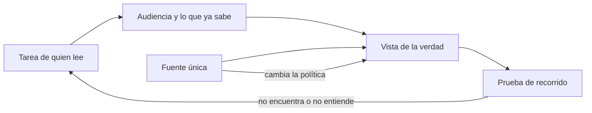
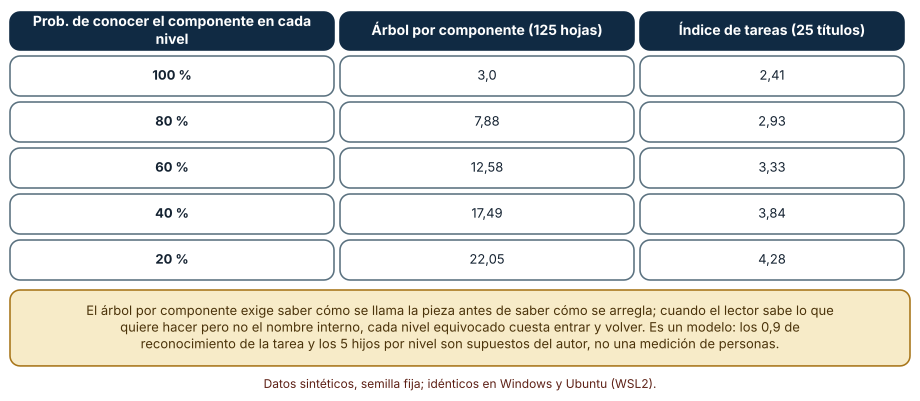
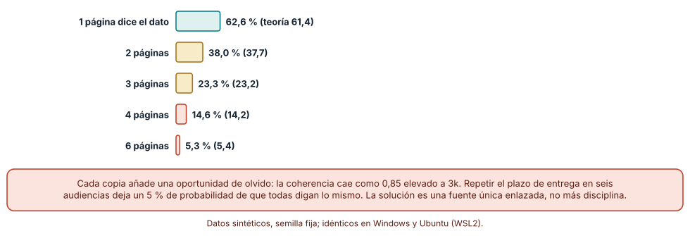
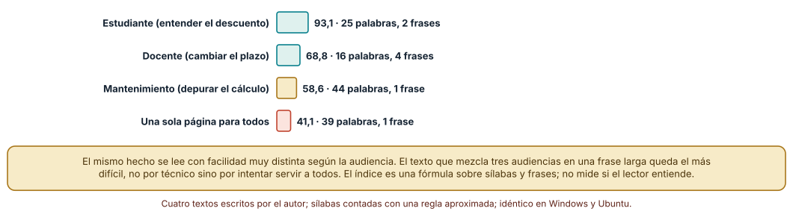

# SE-205 — Documentación orientada a tareas y audiencias

[← SE-204 — Proyecto: contribución revisable de extremo a extremo](https://github.com/vladimiracunadev-create/modern-software-engineering-program/blob/main/classes/part-16-git-colaboracion-y-codigo-abierto/se-204-proyecto-contribucion-revisable-de-extremo-a-extremo/README.md) · [↑ Parte 17](https://github.com/vladimiracunadev-create/modern-software-engineering-program/blob/main/classes/part-17-documentacion-y-conocimiento-tecnico/README.md) · [📚 Índice completo](https://github.com/vladimiracunadev-create/modern-software-engineering-program/blob/main/classes/README.md) · [🌐 Portal](https://vladimiracunadev-create.github.io/modern-software-engineering-program/classes/SE-205.html) · [SE-206 — Tutoriales, how-to, referencia y explicación →](https://github.com/vladimiracunadev-create/modern-software-engineering-program/blob/main/classes/part-17-documentacion-y-conocimiento-tecnico/se-206-tutoriales-how-to-referencia-y-explicacion/README.md)

## Punto profesional y fundamento pedagógico

**Punto profesional.** La clase existe para que decidas, antes de escribir una línea, quién va a leer cada página y qué va a hacer con ella, y para que puedas medir lo que cuesta no decidirlo: lectores que no encuentran lo que necesitan, datos repetidos que se contradicen y textos que sirven a todos y no ayudan a nadie.

**Por qué aparece aquí.** Se sitúa después de **Proyecto: contribución revisable de extremo a extremo** y abre la **Parte 17**: la Parte 16 terminó con cambios que otra persona puede revisar, pero un cambio revisable no basta si quien llega al proyecto no sabe cómo proponerlo, cómo ejecutarlo ni por qué es como es. Esta clase fija el vocabulario de la parte (audiencia, tarea, vista, fuente única) y presenta el caso que la recorre: el **portal documental de la plataforma de entregas**, donde la regla de penalización por entrega tardía que la Parte 13 especificó debe explicarse a estudiantes, docentes, secretaría y mantenimiento sin que cuatro textos digan cuatro cosas.

**Error conceptual que debe corregir.** Creer que documentar es volcar lo que se sabe del sistema ordenado por componente, y que más documentación es siempre mejor. Quien lee llega con una tarea, no con una curiosidad por la arquitectura; una página correcta que está en el lugar equivocado, o que repite un dato que ya vive en otra, es un coste para el lector y una deuda para quien la mantiene.

**Límite de la conclusión.** Los tres experimentos son modelos con datos sintéticos y parámetros del autor: cuántos hijos tiene un árbol, con qué probabilidad se olvida actualizar una copia, cuatro textos escritos por el autor. No se midió a ningún lector real ni se evaluó una documentación existente. Muestran la forma de un coste, no su tamaño en un proyecto concreto.

### Trazabilidad fuente → afirmación

| Fuente primaria u oficial | Afirmación que respalda | Lo que no prueba |
|---|---|---|
| [Diátaxis, un enfoque sistemático de la documentación técnica](https://diataxis.fr/) | Identifica cuatro necesidades de quien usa documentación y propone organizar los contenidos alrededor de ellas, no alrededor de la estructura del producto. | No mide si organizar por necesidades mejora el resultado en un proyecto concreto; es una propuesta de método. |
| [Google, Technical Writing One](https://developers.google.com/tech-writing/one) | Su curso incluye una unidad sobre audiencia y presenta la conciencia de la audiencia como parte de la escritura técnica clara. | No fija cuántas audiencias debe tener un proyecto ni cómo se segmentan. |
| [Digital.gov, guías de lenguaje claro](https://www.plainlanguage.gov/) | Sostiene que el contenido debe escribirse para su audiencia específica y que debe probarse con ella. | Es una guía de una administración pública; no cubre documentación de ingeniería. |

## Antes de empezar

Esta clase abre la **Parte 17 sobre documentación y conocimiento técnico** con un caso que no cambia entre clases: el portal documental de la plataforma de entregas de tareas. Recupera lo aprendido en la Parte 16: una contribución revisable necesita contexto que el diff no trae. La pregunta activa es: **¿quién va a leer esta página, qué quiere conseguir con ella y qué pasa si no la encuentra o si dice algo distinto de otra?**

## Prerrequisitos

- Haber completado `SE-204` o poder explicar qué debe saber una persona nueva para proponer un cambio sin pedir ayuda.
- Python 3.11 o posterior y un terminal; todo el código usa solo la biblioteca estándar.
- Trabajar con la regla de penalización por entrega tardía de la plataforma de entregas y textos sintéticos: ningún experimento necesita documentos ni datos reales.

## Problema auténtico

La regla «cada día completo de retraso resta un 10 % hasta un tope del 50 %» aparece en cuatro sitios: el manual de estudiantes, la guía del docente, el instructivo de la secretaría para el acta y el README del repositorio. Un cambio de política baja el tope al 30 %. Se actualizan dos páginas. Tres meses después, una estudiante reclama porque el manual dice 50 % y su nota usó 30 %. Nadie falló en la parte que le tocaba: nadie era dueño de la regla, solo de sus copias. Y cuando el docente busca «cómo cambio el plazo» no encuentra nada, porque la guía se titula «Módulo de calendario».

## Objetivos observables

Al terminar podrás:

1. describir una página de documentación por su audiencia y su tarea, y rechazar una página que no pueda describirse así;
2. estimar, con un modelo ejecutable, cuántos clics cuesta encontrar una página según la organización del sitio y qué supone sobre el lector;
3. calcular cuántos datos siguen coherentes cuando se repiten en k páginas y justificar una fuente única enlazada;
4. medir la legibilidad de un texto con un índice declarado y explicar por qué un valor alto no equivale a que se entienda;
5. decidir qué vistas de la misma verdad merecen existir y quién es responsable de cada una.

## Mapa conceptual



El diagrama se lee de izquierda a derecha: una tarea concreta define a la audiencia; la audiencia determina qué vista se escribe; la vista se alimenta de una fuente única; una persona de esa audiencia la recorre para comprobar que sirve. Hay dos retornos: si no encuentra o no entiende, se vuelve a la tarea; si cambia la política, solo cambia la fuente y las vistas se regeneran o se revisan. La figura no dice cuántas vistas hacen falta; esa decisión es de cada proyecto.

## Temas y por qué importan

| Tema | Por qué cambia una decisión profesional | Evidencia mínima |
|---|---|---|
| Audiencia | Define el vocabulario, el nivel de detalle y lo que se puede dar por sabido; un mismo hecho se escribe distinto para cada una. | Descripción de la audiencia y de su tarea en `audiencias.md` |
| Tarea | Es la unidad por la que alguien busca; si la página no responde a un verbo, no se encuentra. | Lista de tareas con la página que las resuelve |
| Vistas de una misma verdad | Permite que estudiante, docente y mantenimiento lean cosas distintas sin contradecirse. | Tabla de vistas que apuntan a la misma fuente |
| Fuente única | Cada copia añade una oportunidad de olvido; el coste crece con el número de copias. | Cálculo de coherencia según copias |
| Prueba de recorrido | Comprueba la página con una persona de su audiencia, no con quien la escribió. | Registro de un recorrido con tarea, tiempo y obstáculos |

## Conceptos y decisiones

### 1. Audiencia

Una audiencia no es un cargo, es una combinación de lo que la persona ya sabe, lo que quiere conseguir y cuánto tiempo tiene. «Docente» es un cargo; «docente que debe mover un plazo antes de que termine el día, sin haber leído nunca el manual» es una audiencia. La diferencia importa porque determina decisiones concretas: si puedes usar el término «prórroga» sin definirlo, si el primer párrafo da la respuesta o el contexto, si hay capturas o comandos. La audiencia se descubre preguntando a personas reales; cuando no es posible, se escribe como hipótesis y se marca como tal. Los textos del experimento de legibilidad lo muestran: la frase que una estudiante necesita es distinta de la que necesita quien depura el cálculo, y ninguna de las dos mejora si se mezclan.

### 2. Tarea

Una tarea tiene un verbo y un resultado observable: «cambiar el plazo de una tarea y avisar a la clase». Es la unidad por la que la gente busca, aunque no la formule como título. Una página que responde a una tarea puede reconocerse porque termina cuando el resultado existe; una página que describe «el módulo de calendario» no termina nunca. Las tareas también delimitan lo que no hay que escribir: si ninguna audiencia necesita saber cómo se implementa el redondeo para hacer su tarea, esa explicación pertenece a otra página, y quien la necesita la encontrará por su propia tarea (depurar, auditar). Un inventario de tareas por audiencia, aunque sea de quince filas, expone dos defectos que el índice de componentes oculta: tareas sin página y páginas sin tarea.

### 3. Vistas de una misma verdad

La regla de penalización es una sola; sus vistas son varias. La estudiante necesita saber cuánto pierde y cómo evitarlo; el docente, cómo conceder una prórroga; la secretaría, cómo se registra en el acta; mantenimiento, qué función la calcula y qué contrato tiene. Cada vista selecciona y reformula, pero ninguna debe inventar. La forma barata de mantener la coherencia es que cada vista cite o incluya el dato desde un único lugar; la forma cara es copiarlo y confiar en la disciplina. El experimento de coherencia calcula qué pasa en la segunda: la probabilidad de que todas las copias coincidan tras tres cambios cae del 62,6 % con una copia al 5,3 % con seis.

### 4. Fuente única

Una fuente única no obliga a que exista un solo documento; obliga a que cada dato tenga un solo lugar donde se escribe y a que los demás lo enlacen, lo incluyan o se generen desde él. En la plataforma, el tope del 50 % vive en la política académica versionada, y las demás páginas lo citan con enlace. Hay dos excepciones razonables: una página que debe leerse sin conexión (un PDF para el acta) puede copiar el dato si indica de dónde y en qué fecha se copió, y un tutorial puede fijar un valor de ejemplo si lo declara como ejemplo. Lo que no es razonable es copiar sin rastro: una copia sin procedencia no puede revisarse.

### 5. Prueba de recorrido y vigencia

Una página se prueba pidiendo a una persona de su audiencia que cumpla la tarea usándola, sin ayuda, mientras alguien observa dónde se detiene. Es la prueba más barata y la que más información da, y casi ninguna documentación la hace. La vigencia es la otra mitad: cada página debe poder responder a «¿quién la mantiene, cuándo se revisó y contra qué?». Una fecha sin responsable no resuelve nada, y un responsable sin fecha tampoco. Ambos datos se guardan en la propia página (como metadatos) para que una comprobación automática pueda señalar las que han caducado, tema que la clase de búsqueda y metadatos retoma.

### Dos formas de organizar un sitio: por componente y por tarea

Se simulan 20 000 lectores que buscan una página en un sitio de 125 hojas organizado como árbol de tres niveles con cinco hijos cada uno. El lector sabe qué quiere hacer, pero solo conoce el nombre del componente correcto en cada nivel con probabilidad `p`. Si falla, prueba hijos al azar y cada fallo cuesta dos clics (entrar y volver). La alternativa es un índice de 25 tareas: el lector reconoce su tarea con probabilidad 0,9 y, si no la reconoce, recurre al árbol.

```python
for nivel in range(3):
    if rng.random() < p:
        clics += 1                      # sabe cómo se llama el componente
    else:
        fallos = 0
        while rng.randrange(5) != 0:    # prueba hijos al azar hasta acertar
            fallos += 1
        clics += 1 + 2 * fallos         # entrar y volver cuesta dos clics
```

El resultado, idéntico en Windows (CPython 3.12.9) y en Ubuntu bajo WSL2 (3.12.3): si el lector conoce siempre el nombre del componente, el árbol cuesta 3 clics y el índice 2,41. Con `p` = 0,8 el árbol sube a 7,88 clics y el índice a 2,93; con 0,6, a 12,58 frente a 3,33; con 0,2, a 22,05 frente a 4,28. El árbol se degrada rápido porque cada nivel equivocado cuesta en media 9 clics; el índice se degrada despacio porque solo fracasa cuando el lector no reconoce su tarea.



**Cómo leer la figura.** Cada fila es una probabilidad de que el lector conozca el nombre interno del componente; las dos columnas son los clics esperados con cada organización. **Dónde deja de valer:** el modelo supone que el lector reconoce su tarea con 0,9 y que equivocarse cuesta dos clics, parámetros del autor; con un sitio de 20 páginas o con un buscador excelente, la diferencia desaparece. Tampoco mide si la página encontrada se entiende: solo la distancia hasta ella.

### Cuántas copias de un dato sobreviven al cambio

Se simulan 20 000 hechos (por ejemplo, el tope de penalización). Cada hecho cambia tres veces durante el año y, en cada cambio, cada copia se actualiza con probabilidad 0,85; el hecho sigue coherente solo si todas las copias se actualizaron en los tres cambios.

```python
for cambio in range(3):
    for copia in range(k):
        if rng.random() > 0.85:         # la copia no se actualiza
            coherente = False
```

Con una sola página el hecho queda coherente el 62,6 % de las veces (teoría: 0,85³ = 61,4 %); con dos, el 38,0 % (37,7); con tres, el 23,3 % (23,2); con cuatro, el 14,6 % (14,2); con seis, el 5,3 % (5,4). Los valores simulados coinciden con la fórmula 0,85 elevado a 3k, de modo que la figura describe una ley, no un azar de la semilla.



**Cómo leer la figura.** Cada barra es el porcentaje de hechos que siguen coherentes en todas sus copias; entre paréntesis, el valor teórico. **Dónde deja de valer:** el 0,85 es un supuesto; un equipo con una comprobación automática de enlaces y una política de cambios con lista de verificación tendría una probabilidad mayor, y entonces la caída sería más lenta, no inexistente. Además, hasta con una sola página hay un 37 % de hechos que dejan de ser verdad por no haberse actualizado nunca: la fuente única reduce las contradicciones, no los olvidos.

### El mismo hecho, cuatro textos, cuatro legibilidades

Se escriben cuatro textos sobre la penalización para tres audiencias y uno que intenta servir a todos, y se calcula el índice de Fernández Huerta, 206,84 − 0,60·P − 1,02·F, donde P son las sílabas por cada cien palabras y F las frases por cada cien palabras; a valores más altos, más fácil. La cuenta de sílabas usa una regla aproximada para el español (grupos vocálicos con diptongos), suficiente para comparar textos entre sí y no para certificar uno.

```python
def fernandez_huerta(texto):
    frases = [f for f in re.split(r"[.!?]+", texto) if f.strip()]
    palabras = re.findall(r"[A-Za-záéíóúüñ]+", texto)
    silabas = sum(contar_silabas(p) for p in palabras)
    P, F = 100 * silabas / len(palabras), 100 * len(frases) / len(palabras)
    return 206.84 - 0.60 * P - 1.02 * F
```

El texto para estudiantes (25 palabras, 2 frases) da 93,1; el del docente (16 palabras, 4 frases), 68,8; el de mantenimiento (44 palabras, 1 frase), 58,6; y el que mezcla las tres audiencias en una sola frase de 39 palabras, 41,1. El texto de mantenimiento es técnico y se lee con esfuerzo porque la tarea lo exige; el mezclado es igual de difícil sin ser más preciso, y esa es la diferencia que importa.



**Cómo leer la figura.** Cada barra es el índice de un texto; más larga significa más fácil de leer. **Dónde deja de valer:** son cuatro textos escritos por el autor, sin muestra de lectores; el índice mide longitud de palabras y de frases, no vocabulario conocido ni estructura, y un texto corto con una palabra desconocida puede ser ilegible para la audiencia equivocada. Sirve para detectar la frase kilométrica, no para aprobar un texto.

## Definiciones de trabajo

- **audiencia:** grupo de personas descrito por lo que sabe, lo que quiere conseguir y el tiempo del que dispone al leer; no es un cargo ni una etiqueta de rol.
- **tarea:** acción con verbo y resultado observable que una audiencia quiere completar usando la documentación.
- **vista:** presentación de un hecho o de un procedimiento adaptada a una audiencia, que cita su fuente y no la contradice.
- **fuente única:** lugar donde un dato se escribe una vez; las demás menciones lo enlazan, lo incluyen o se generan desde él.
- **prueba de recorrido:** observación de una persona de la audiencia cumpliendo una tarea con la página, sin ayuda de quien la escribió.

Las definiciones son operativas para el portal de la plataforma de entregas; no sustituyen las de la bibliografía enlazada al final.

## Ejemplo mínimo

El fragmento mide cuántas copias de un dato quedan coherentes tras un cambio cuando una de ellas se olvida. Antes de ejecutarlo, predice qué porcentaje de 10 000 hechos con dos copias sigue coherente si cada copia se actualiza con probabilidad 0,9.

```python
import random
rng = random.Random(205)
n = 10_000
coherentes = sum(all(rng.random() < 0.9 for _ in range(2)) for _ in range(n))
print(round(100 * coherentes / n, 1))   # esperado cercano a 81,0
```

La predicción correcta es 0,9² = 81 %. Registra la versión del intérprete y la semilla; si subes a tres copias, predice antes el nuevo valor (72,9 %).

## Ejemplo profesional

El portal documental de la plataforma de entregas tiene un inventario de tareas por audiencia en `audiencias.md`: estudiante (entender el descuento, pedir prórroga), docente (cambiar plazo, conceder prórroga, corregir una nota), secretaría (exportar el acta con la nota final), mantenimiento (depurar el cálculo, cambiar el tope). La regla vive en `politica/penalizacion.md`, versionada, con responsable y fecha de revisión. Las cuatro vistas enlazan esa fuente con una frase de contexto cada una. Cuando la política cambia el tope al 30 %, el cambio es un único commit en la fuente y una lista de verificación señala las cuatro vistas para revisar.

Compara el caso normal con tres casos límite: la nueva docente que llega a mitad de semestre y debe conceder una prórroga sin haber leído la guía, la estudiante que busca «por qué me quitaron puntos» sin conocer la palabra «penalización», y un agente de código al que se pide cambiar el tope y debe encontrar todas las menciones. Una documentación orientada a tareas resuelve los tres sin ayuda; una organizada por componente solo resuelve el último, y mal.

## Práctica guiada

1. Crea `work/SE-205/` y escribe en `audiencias.md` cuatro audiencias de la plataforma con lo que saben, lo que quieren conseguir y su tiempo disponible.
2. Lista diez tareas, una frase con verbo y resultado cada una, y asigna la audiencia que la hace.
3. Escribe la regla de penalización en `fuente.md` con responsable y fecha.
4. Redacta una vista de tres frases para cada audiencia que enlace la fuente.
5. Ejecuta el modelo de navegación con tus parámetros y anota cuántos clics esperados cuesta tu estructura.
6. Calcula la coherencia con cuatro copias si olvidar cuesta 0,9 en lugar de 0,85.
7. Pide a una persona ajena a la clase que cumpla una de las tareas usando solo tus vistas y anota dónde se detuvo.
8. Entrega `recorrido.md` con lo observado y qué cambiarías.

## Ejercicios

1. **Audiencia:** redacta una audiencia para «quien contribuye por primera vez al portal» con lo que sabe y lo que quiere, y marca qué suposiciones tuyas no están verificadas.
2. **Modelo:** cambia el árbol a cuatro niveles de cuatro hijos y calcula los clics esperados con `p` = 0,6; explica qué parámetro del modelo cambió más el resultado.
3. **Coherencia:** deduce la fórmula del porcentaje de hechos coherentes si cada copia se actualiza con probabilidad `u` y el hecho cambia `c` veces, y verifícala con 20 000 simulaciones.
4. **Legibilidad:** reescribe el texto mezclado en dos textos de dos audiencias y calcula el índice de cada uno; explica un caso en que el índice subiría y el texto seguiría sin entenderse.

## Reto verificable

Entrega `audiencias.md`, `fuente.md`, las cuatro vistas, el modelo de navegación con tus parámetros y el registro de un recorrido real. Se aprueba si otra persona puede localizar cada una de tus diez tareas en no más de tres clics en tu estructura, reproducir tus conteos de coherencia con la misma semilla y señalar qué observación de recorrido le haría cambiar una página.

## Caso conductor

El portal documental de la plataforma de entregas de tareas es el caso conductor de la Parte 17. Esta clase deja el primer artefacto: un inventario de tareas por audiencia y una fuente única para la regla de penalización. Las clases siguientes lo tipifican (`SE-206`), lo convierten en una puerta de entrada (`SE-207`), registran las decisiones que lo moldearon (`SE-208`), lo dibujan (`SE-209`), lo exponen como API (`SE-210`), lo hacen operable (`SE-211`), lo construyen como código (`SE-212`), lo hacen buscable (`SE-213`), lo preparan para máquinas (`SE-214`), recuperan lo que se perdió (`SE-215`) y lo versionan (`SE-216`).

## Preguntas frecuentes

### ¿Una sola página no es más simple que cuatro vistas?

Es más simple de mantener y más difícil de leer. Una página que sirve a todos obliga a cada lector a saltarse lo que no es suyo, y por eso el texto mezclado del experimento queda el menos legible. Si el proyecto es pequeño y tiene una audiencia, una página es lo correcto; si tiene cuatro, una página con secciones por audiencia puede bastar mientras la fuente del dato siga siendo única.

### ¿Cómo descubro las audiencias si no puedo entrevistar a nadie?

Escríbelas como hipótesis, basadas en los correos y preguntas que ya recibes, y márcalas como no verificadas. Después, la primera prueba de recorrido con una persona real corrige la hipótesis. Documentar para una audiencia imaginaria no es un fallo si lo declaras; lo es si lo presentas como conocimiento.

### ¿La fuente única no complica el trabajo de quien escribe?

Le añade un paso (enlazar o incluir en lugar de copiar) y le quita otro (acordarse de todas las copias). El coste neto depende de las herramientas: con enlaces relativos y una comprobación de enlaces es pequeño; con PDF copiados a mano es grande, y por eso se declara el origen.

### ¿El índice de legibilidad sirve en español técnico?

Sirve para comparar versiones de un mismo texto y detectar frases kilométricas; no está calibrado para textos técnicos ni mide el vocabulario conocido por una audiencia. Úsalo como alarma, no como criterio de aprobación.

## Fallo controlado y diagnóstico

Reproduce el fallo clásico de la clase: **dejar que un mismo dato viva en cuatro páginas sin fuente**. Crea cuatro vistas que repitan el tope de penalización, cambia la política y actualiza solo dos.

Registra síntoma, entrada mínima, hipótesis, observación que descarta cada hipótesis, causa, corrección y prueba de regresión. **Síntoma:** una estudiante reclama porque el manual dice 50 % y su nota usó 30 %. **Hipótesis rivales:** (a) el cálculo está mal; (b) el manual está desactualizado; (c) hubo un cambio de política que no se difundió. **Observación que discrimina:** ejecuta la función de cálculo con las horas de la estudiante; si da la nota registrada, descarta (a); compara la fecha del manual con la de la política; si el manual es anterior, confirma (b) y (c). **Causa:** cuatro copias sin procedencia ni dueño. **Corrección:** una fuente con responsable, vistas que la enlazan y una lista de verificación de vistas por cada cambio de política. **Prueba de regresión:** un comprobador que falla si una vista no contiene el enlace a la fuente o si la fecha de la fuente es posterior a la de la vista. **Recuperación:** corrige el manual, avisa a las personas afectadas y revisa las notas calculadas bajo el texto equivocado.

## Errores comunes y cómo corregirlos

| Síntoma | Causa probable | Corrección |
|---|---|---|
| Nadie encuentra «cómo cambiar el plazo» aunque existe la página | El título usa el nombre del componente («Módulo de calendario») y no la tarea | Reescribir el título con verbo y resultado y añadirla al índice de tareas |
| Dos páginas dan topes de penalización distintos | El dato se copió en lugar de enlazarse | Elegir una fuente, enlazar desde las demás y añadir un comprobador de enlaces |
| Una página explica todo y nadie la termina | Mezcla audiencias y tareas en un solo texto | Separar por audiencia o por tarea y enlazar lo común |
| La documentación «está completa» pero las preguntas siguen llegando por mensaje | Se documentó lo que se sabía y no lo que se pregunta | Registrar las preguntas recibidas y convertir las repetidas en páginas por tarea |
| Una página lleva meses sin cambios y nadie sabe si sigue vigente | No tiene responsable ni fecha de revisión | Añadir ambos como metadatos y listar las vencidas |

## Entorno y archivos clave

```text
work/SE-205/
├── README.md
├── audiencias.md
├── tareas.md
├── fuente.md
├── vistas/
│   ├── estudiante.md
│   ├── docente.md
│   ├── secretaria.md
│   └── mantenimiento.md
├── experimentos/
│   ├── navegacion.py
│   ├── copias.py
│   └── legibilidad.py
└── evidencia/recorrido.md
```

El `README` declara plataforma, versión de Python, semillas y comandos. Los experimentos usan solo la biblioteca estándar (`random`, `re`, `statistics`) y se ejecutaron con CPython 3.12.9 en Windows 11 y 3.12.3 en Ubuntu bajo WSL2 con salidas idénticas.

## Seguridad, ética y accesibilidad

- una página sobre una regla que afecta notas decide cosas de personas: la audiencia «estudiante» merece la versión más clara, no la más breve;
- no incluyas nombres, correos ni datos de estudiantes reales en los ejemplos; usa identificadores sintéticos;
- las vistas deben tener estructura de encabezados, texto alternativo en las figuras y no depender del color para marcar advertencias;
- escribe pensando en quien lee con lector de pantalla: frases cortas, listas reales y tablas con encabezados;
- evita jerga sin definir cuando la audiencia incluye personas que no son ingenieras;
- documenta quién aprobó cada vista y cuándo, para que la responsabilidad no se disuelva en «lo dice el manual».

## Puente hacia el trabajo con agentes

Un agente al que se pide «documenta la regla de penalización» producirá un texto correcto y sin audiencia, es decir, una cuarta copia del dato. Pídele en cambio la audiencia y la tarea antes de escribir, que cite la fuente única en lugar de repetir el valor y que liste qué otras páginas mencionan la regla y deberían revisarse. Un agente también es una audiencia: lee la documentación para saber qué hacer, y le sirven las mismas propiedades (una tarea clara, un dato en un solo lugar, una fecha de revisión). Quien revisa su trabajo comprueba que ninguna página nueva introduce un valor que ya vivía en otro sitio.

## Transferencia

Traslada el inventario a otro de los dominios persistentes (por ejemplo, una app de reparto con una tarifa de espera): cambian las audiencias y las tareas, se conserva el procedimiento de describir audiencia y tarea, enlazar una fuente y observar un recorrido. La transferencia está lograda cuando puedes explicar qué parte del método depende del dominio y cuál no.

## Evaluación y evidencia

| Criterio | Evidencia para aprobar |
|---|---|
| comprensión | explicación de la diferencia entre cargo y audiencia, y entre tema y tarea, con un ejemplo de la plataforma |
| corrección | conteos reproducibles de clics esperados y de coherencia con la misma semilla |
| diseño | inventario de tareas por audiencia y fuente única con vistas que la enlazan |
| diagnóstico | reproducción del fallo «un dato, cuatro páginas» con regresión |
| incertidumbre | declaración de los parámetros supuestos del modelo y del hecho de que no se midieron lectores |
| reproducibilidad | versiones, comandos, salida y límites declarados |

## Fuentes

- [Diátaxis](https://diataxis.fr/) — cuatro necesidades de quien usa documentación y las formas que les corresponden; autoridad: proyecto Diátaxis.
- [Diátaxis: guías prácticas](https://diataxis.fr/how-to-guides/) — define una guía por su orientación a un objetivo y no a un componente; autoridad: proyecto Diátaxis.
- [Google, Technical Writing One](https://developers.google.com/tech-writing/one) — curso con una unidad sobre audiencia; autoridad: Google for Developers.
- [Digital.gov, guías de lenguaje claro](https://www.plainlanguage.gov/) — escribir y probar el contenido para su audiencia; autoridad: Digital.gov.
- [Barrio-Cantalejo et al., «Validación de la Escala INFLESZ» (Anales del Sistema Sanitario de Navarra, 2008)](https://doi.org/10.4321/S1137-66272008000300004) — interpretación de un índice de legibilidad para español en textos para pacientes; autoridad: Anales del Sistema Sanitario de Navarra.

Cada fuente respalda el mecanismo indicado; ninguna demuestra que la organización por tareas sea superior en un proyecto concreto ni que los parámetros del modelo de navegación coincidan con los de ningún lector real. Esa afirmación depende del proyecto y se comprueba con recorridos.

- [Python: `random`](https://docs.python.org/3/library/random.html) — generador con semilla para las simulaciones.
- [Python: `re`](https://docs.python.org/3/library/re.html) — expresiones regulares usadas para separar frases y palabras.

## Límites y siguiente paso

Se ejecutaron tres experimentos con datos sintéticos en Windows y Ubuntu (WSL2) con resultados idénticos. No se midió a ningún lector ni se evaluó una documentación existente: el árbol de cinco hijos, el 0,9 de reconocimiento de tareas, el 0,85 de actualización y los cuatro textos son construcciones del autor, y el índice de legibilidad se calculó con una cuenta aproximada de sílabas. La siguiente clase pregunta qué tipo de página sirve a cada tarea y por qué mezclarlos cuesta.

## Glosario

- **audiencia:** grupo de personas descrito por lo que sabe, lo que quiere conseguir y el tiempo del que dispone al leer.
- **tarea:** acción con verbo y resultado observable que una audiencia quiere completar con la documentación.
- **vista:** presentación de un hecho adaptada a una audiencia que cita su fuente y no la contradice.
- **fuente única:** lugar donde un dato se escribe una sola vez; las demás menciones lo enlazan o se generan desde él.
- **prueba de recorrido:** observación de una persona de la audiencia cumpliendo una tarea con la página sin ayuda.

---

[← SE-204 — Proyecto: contribución revisable de extremo a extremo](https://github.com/vladimiracunadev-create/modern-software-engineering-program/blob/main/classes/part-16-git-colaboracion-y-codigo-abierto/se-204-proyecto-contribucion-revisable-de-extremo-a-extremo/README.md) · [↑ Parte 17](https://github.com/vladimiracunadev-create/modern-software-engineering-program/blob/main/classes/part-17-documentacion-y-conocimiento-tecnico/README.md) · [📚 Índice completo](https://github.com/vladimiracunadev-create/modern-software-engineering-program/blob/main/classes/README.md) · [🌐 Portal](https://vladimiracunadev-create.github.io/modern-software-engineering-program/classes/SE-205.html) · [SE-206 — Tutoriales, how-to, referencia y explicación →](https://github.com/vladimiracunadev-create/modern-software-engineering-program/blob/main/classes/part-17-documentacion-y-conocimiento-tecnico/se-206-tutoriales-how-to-referencia-y-explicacion/README.md)
