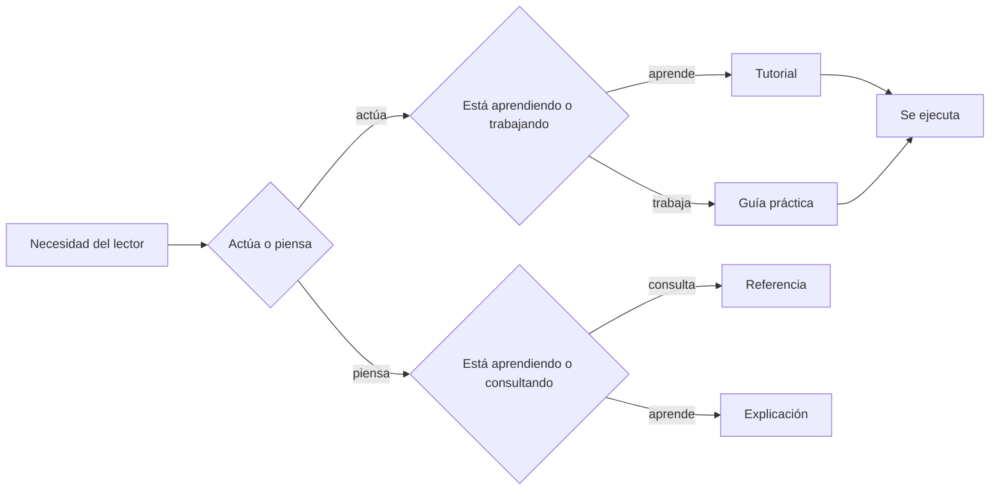
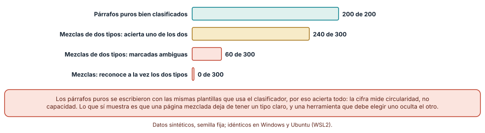
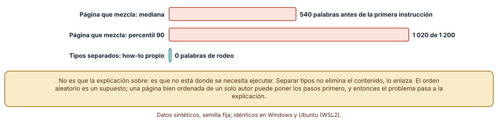
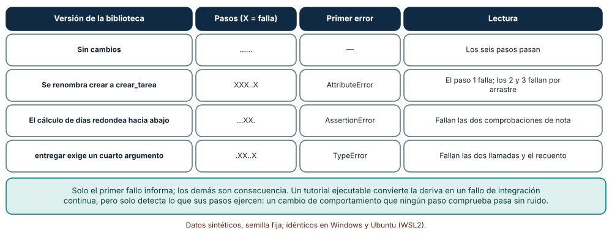

# SE-206 — Tutoriales, how-to, referencia y explicación

[← SE-205 — Documentación orientada a tareas y audiencias](https://github.com/vladimiracunadev-create/modern-software-engineering-program/blob/main/classes/part-17-documentacion-y-conocimiento-tecnico/se-205-documentacion-orientada-a-tareas-y-audiencias/README.md) · [↑ Parte 17](https://github.com/vladimiracunadev-create/modern-software-engineering-program/blob/main/classes/part-17-documentacion-y-conocimiento-tecnico/README.md) · [📚 Índice completo](https://github.com/vladimiracunadev-create/modern-software-engineering-program/blob/main/classes/README.md) · [🌐 Portal](https://vladimiracunadev-create.github.io/modern-software-engineering-program/classes/SE-206.html) · [SE-207 — README, instalación y primer éxito →](https://github.com/vladimiracunadev-create/modern-software-engineering-program/blob/main/classes/part-17-documentacion-y-conocimiento-tecnico/se-207-readme-instalacion-y-primer-exito/README.md)

## Punto profesional y fundamento pedagógico

**Punto profesional.** La clase existe para que puedas decir de una página si es un tutorial, una guía práctica, una referencia o una explicación, y para que sepas qué se rompe cuando una misma página intenta ser dos cosas a la vez. El tipo de página decide su tono, su orden y lo que se puede comprobar de ella.

**Por qué aparece aquí.** Se sitúa después de **Documentación orientada a tareas y audiencias** y antes de **README, instalación y primer éxito**: la clase anterior fijó para quién y para qué se escribe; esta fija qué forma toma cada página según la necesidad del lector, y la siguiente aplica esa forma a la página más leída de cualquier proyecto. Además, deja una técnica verificable: un tutorial cuyos pasos se ejecutan es una prueba de integración de la documentación.

**Error conceptual que debe corregir.** Creer que una buena página es una página completa: la que explica el porqué, enseña el procedimiento y lista todos los parámetros. Esa página sirve mal a las tres necesidades, porque quien tiene prisa por ejecutar atraviesa la teoría y quien quiere entender atraviesa los pasos.

**Límite de la conclusión.** Los párrafos de la clasificación se escribieron con plantillas del propio autor, la página mixta es un modelo con secciones aleatorias y el tutorial es una biblioteca de juguete. Los experimentos muestran qué ocurre al mezclar tipos, no cuánto cuesta en una documentación real ni que cuatro tipos sean la única taxonomía posible.

### Trazabilidad fuente → afirmación

| Fuente primaria u oficial | Afirmación que respalda | Lo que no prueba |
|---|---|---|
| [Diátaxis: tutoriales](https://diataxis.fr/tutorials/) | Describe el tutorial como una experiencia de aprendizaje guiada por quien enseña, orientada a que quien aprende logre algo y gane confianza. | No mide si los tutoriales así escritos enseñan más que otros. |
| [Diátaxis: guías prácticas](https://diataxis.fr/how-to-guides/) | Define la guía práctica como instrucciones para resolver un problema o alcanzar un resultado concreto, orientada al objetivo. | No fija cuántas guías necesita un producto. |
| [Python: `doctest`](https://docs.python.org/3/library/doctest.html) | Documenta un mecanismo que ejecuta los ejemplos escritos en texto y compara su salida con la declarada. | No garantiza que los ejemplos cubran el comportamiento importante. |

## Antes de empezar

Retoma el inventario de tareas de `SE-205`. Cada tarea necesita una página; ahora importa de qué tipo. La pregunta activa es: **¿esta página enseña, guía a un resultado, describe o explica, y qué le pasa al lector cuando hace dos cosas a la vez?**

## Prerrequisitos

- Haber completado `SE-205` o poder explicar la diferencia entre audiencia y tarea.
- Python 3.11 o posterior y un terminal; los experimentos usan solo la biblioteca estándar.
- Trabajar con la plataforma de entregas y textos sintéticos escritos para la clase.

## Problema auténtico

La página «Penalización por retraso» de la plataforma abre con tres párrafos sobre por qué la institución eligió un 10 % diario, sigue con una lista de seis parámetros configurables, intercala cinco pasos para cambiar el tope, vuelve a la historia de la política y termina con un ejemplo de cálculo. Una docente que debe mover el tope esta tarde lee ochocientas palabras antes de llegar a los pasos y, al ejecutarlos, descubre que el cuarto depende de un parámetro explicado dos secciones antes. Nadie escribió nada falso. La página sirve a cuatro necesidades distintas y por eso no cumple ninguna del todo.

## Objetivos observables

Al terminar podrás:

1. clasificar una página en tutorial, guía práctica, referencia o explicación con dos preguntas, y reconocer cuándo una página no admite una sola clasificación;
2. medir cuánto contenido de rodeo atraviesa quien busca los pasos en una página mezclada frente a una separada;
3. convertir los pasos de un tutorial en una comprobación que se ejecuta y leer sus fallos para localizar el cambio que los provocó;
4. decidir en qué orden escribir los cuatro tipos para un componente nuevo y cuál omitir justificadamente;
5. declarar qué contenido de una página sustituiría por un enlace a otro tipo de página.

## Mapa conceptual



El diagrama se lee de arriba abajo con dos preguntas: si la persona necesita actuar o comprender, y si está estudiando o resolviendo algo de su trabajo. De la combinación salen cuatro tipos, y los dos que piden acción comparten una propiedad que los otros dos no tienen: pueden ejecutarse. Las flechas son una guía de decisión, no una jerarquía; la clase no afirma que cuatro cajas sean la única clasificación posible.

## Temas y por qué importan

| Tema | Por qué cambia una decisión profesional | Evidencia mínima |
|---|---|---|
| Tutorial | Lleva a quien aprende a un éxito garantizado; no debe explicar ni ramificar. | Tutorial cuyos pasos se ejecutan en `tutorial.md` |
| Guía práctica | Resuelve un objetivo de trabajo y supone competencia previa; no enseña desde cero. | Guía con objetivo, precondiciones y verificación |
| Referencia | Describe la máquina con completitud y sin opinión; se consulta, no se lee. | Tabla de parámetros comprobada contra el código |
| Explicación | Aporta contexto, alternativas y porqués; es la única donde caben las tensiones. | Página con decisiones y alternativas descartadas |
| Mezcla de tipos | Obliga a leer lo que no se busca y a ejecutar lo que se creía explicado. | Medición de palabras hasta los pasos |

## Conceptos y decisiones

### 1. Tutorial

Un tutorial es una lección: quien la escribe asume la responsabilidad de que quien la sigue llegue a un resultado y gane confianza. Por eso los pasos son pocos, concretos y verificables, cada uno muestra lo que se debe ver, y nada ramifica: «si usas otra versión, haz esto» pertenece a otra página. No explica por qué las cosas son así; a lo sumo dice «ahora verás» y da una frase de contexto que lo enlaza a la explicación. Un tutorial se rompe en silencio cuando el entorno cambia y deja a quien aprende creyendo que el error es suyo, de modo que el tutorial es el tipo que más gana si se ejecuta en cada cambio. En la plataforma, el tutorial crea una tarea de prueba, entrega dos veces y comprueba la nota con una penalización.

### 2. Guía práctica

Una guía práctica responde a un objetivo concreto del trabajo («cambiar el tope de penalización»), da por sentado que quien la lee sabe lo básico y evita enseñar. Es una receta con precondiciones, pasos y una forma de comprobar que funcionó. Se distingue del tutorial porque admite bifurcaciones («si el curso tiene prórrogas activas, antes haz esto») y porque no garantiza que sea la primera vez de nadie. Su error típico es crecer: se le añaden definiciones, el porqué del tope, una tabla de parámetros, y deja de ser una guía. Lo que sobra se enlaza.

### 3. Referencia

La referencia describe la máquina: los parámetros, sus tipos, sus valores por defecto, los errores que puede devolver. Se consulta de forma puntual y por eso importa más que sea completa, uniforme y exacta que agradable; su estructura imita la del producto, no la de las tareas. Es el único tipo cuya exactitud puede comprobarse por completo con herramientas, porque sus afirmaciones tienen una contraparte en el código: nombres, firmas, límites. Una referencia con opiniones («recomendamos un tope del 50 %») mezcla tipos; la opinión va a una explicación o a una guía.

### 4. Explicación

La explicación responde a «¿por qué?» y «¿qué alternativas había?». Es la única donde caben el contexto histórico, las tensiones entre dos buenas razones y las decisiones que podrían cambiar. No se lee con prisa y no se ejecuta; se mide en lo que permite entender. Es también el tipo que más se omite, porque no tiene una tarea inmediata, y por eso la gente reinventa decisiones ya tomadas. En la plataforma, la explicación dice por qué la penalización es diaria y con tope, qué se probó antes y qué se rechazó, y enlaza al registro de decisiones.

### 5. La brújula y el coste de mezclar

Dos preguntas bastan para clasificar: ¿el contenido guía una acción o informa al pensamiento? y ¿sirve a quien estudia o a quien trabaja? Las cuatro combinaciones dan los cuatro tipos. Mezclar tipos no es un pecado, es un coste: cada tipo exige un tono distinto (imperativo y alentador, imperativo y seco, neutral y completo, reflexivo) y un orden distinto. Una página mixta obliga a cambiar de registro sin aviso, esconde los pasos entre párrafos de contexto y complica las pruebas, porque lo que se puede ejecutar queda enterrado. La solución no es borrar lo que sobra, es enlazarlo: una frase y un enlace conservan el vínculo sin interrumpir.

### Clasificar páginas puras y mezcladas

Se generan con plantillas del autor 50 párrafos de cada tipo (200 en total) y 300 mezclas de dos tipos (50 por cada una de las seis parejas). Un clasificador léxico cuenta marcas: imperativos y «ahora verás» para el tutorial, pasos numerados para la guía, «devuelve», «obligatorio» y «parámetro» para la referencia, «porque», «ya que» y «tensión» para la explicación, y devuelve el tipo con más marcas, o «ambiguo» si hay empate.

```python
def clasificar(texto):
    t = texto.lower()
    puntaje = {"tutorial": t.count("vamos a") * 2 + t.count("veras") * 2,
               "howto": len(re.findall(r"\b\d\. ", t)) * 2 + t.count("para "),
               "referencia": t.count("devuelve") * 2 + t.count("parametro"),
               "explicacion": t.count("porque") * 2 + t.count("tension") * 3}
    mejor = max(puntaje.values())
    ganadores = [k for k, v in puntaje.items() if v == mejor]
    return ganadores[0] if mejor > 0 and len(ganadores) == 1 else "ambiguo"
```

Resultado, idéntico en Windows (CPython 3.12.9) y Ubuntu (3.12.3): los 200 párrafos puros se clasifican bien. De las 300 mezclas, 240 se clasifican como uno de los dos tipos (el otro se pierde), 60 como ambiguas y ninguna como la pareja. Es decir, el clasificador nunca ve las dos cosas a la vez: una herramienta que debe elegir una etiqueta oculta la otra mitad de la página.



**Cómo leer la figura.** Cada barra es un porcentaje de los casos de su grupo: la verde son los párrafos puros acertados, las doradas y coral las mezclas. **Dónde deja de valer:** los párrafos puros usan las mismas palabras que el clasificador espera, así que el 100 % mide circularidad y no capacidad; con textos reales de varios autores acertaría menos. Lo que sí es robusto es la conclusión sobre las mezclas: añadir un segundo tipo no hace más difícil la clasificación, la hace imposible de expresar con una sola etiqueta.

### Cuánto se lee antes de llegar a los pasos

Se simulan 200 páginas de 1 200 palabras con ocho secciones: tres de explicación (220, 220 y 180 palabras), una de explicación breve (160), dos de referencia (140 y 100), una de advertencias (60) y una de pasos (120). En la página mezclada el orden es aleatorio; en la separada, los pasos están en su propia página.

```python
sec = [("exp", 220), ("exp", 220), ("exp", 180), ("ref", 140),
       ("ref", 100), ("steps", 120), ("warn", 60), ("exp", 160)]
rng.shuffle(sec)
antes = 0
for tipo, n in sec:
    if tipo == "steps":
        break
    antes += n
```

Quien busca los pasos lee, en la página mezclada, una mediana de 540 palabras antes de llegar a ellos y 1 020 en el percentil 90 (de 1 200 en total). En una página how-to separada, cero. No es que la explicación sobre; es que está entre quien llega y lo que busca.



**Cómo leer la figura.** Cada barra es el número de palabras leídas antes del primer paso: la mediana, el percentil 90 y el caso de la página separada. **Dónde deja de valer:** el orden aleatorio es un supuesto; un autor cuidadoso puede poner los pasos al inicio de la página mixta, y entonces el coste se desplaza a quien busca la explicación. Tampoco mide si el lector lee de corrido o salta con la búsqueda del navegador.

### Un tutorial que se ejecuta

El tutorial de la plataforma tiene seis pasos de código sobre una biblioteca de juguete (`crear`, `entregar`, `penalizar`). Se ejecutan en orden con `exec` y se registra cuáles pasan; luego se ejecutan contra tres versiones modificadas de la biblioteca: una renombra `crear` a `crear_tarea`, otra calcula los días redondeando hacia abajo y otra exige un cuarto argumento obligatorio en `entregar`.

```python
TUTORIAL = ["t = api.crear('Ensayo', 48)",
            "n = api.entregar(t, 'ana', 0)",
            "m = api.entregar(t, 'luis', 30)",
            "assert api.penalizar(80, 30) == 64",
            "assert api.penalizar(75, 24) == 68",
            "assert len(t['entregas']) == 2"]
```

Sin cambios pasan los seis pasos. Renombrar `crear` hace fallar los pasos 1, 2, 3 y 6 con `AttributeError`: el primero es la causa y los demás, consecuencia, porque `t` no existe. Redondear los días hacia abajo hace fallar los pasos 4 y 5 con `AssertionError`: el cálculo cambió de comportamiento sin cambiar de firma. Añadir el argumento obligatorio hace fallar las dos llamadas a `entregar` y el recuento, con `TypeError`. Cada cambio deja un patrón distinto, lo que ayuda a diagnosticar.



**Cómo leer la figura.** Cada fila es una versión de la biblioteca; la segunda columna dibuja los seis pasos con un punto si pasan y una X si fallan; el primer error es el que informa. **Dónde deja de valer:** el tutorial solo detecta lo que ejercita; si ningún paso llama a `penalizar` con una nota decimal, un cambio en ese caso pasa sin ruido. Y un tutorial que se ejecuta no prueba que se entienda: puede pasar la comprobación y seguir confundiendo a quien lo lee.

## Definiciones de trabajo

- **tutorial:** página que guía a quien aprende por pasos hacia un resultado seguro, sin ramificar ni explicar.
- **guía práctica:** página orientada a un objetivo de trabajo concreto que supone competencia previa y admite bifurcaciones.
- **referencia:** descripción completa y neutral de los elementos de un producto, estructurada como el producto.
- **explicación:** página que aporta contexto, causas y alternativas para comprender, sin pasos ni listados.
- **página mixta:** página cuyo contenido pertenece a más de un tipo sin separación ni enlaces entre ellos.

Las definiciones son operativas para el portal; no reemplazan la formulación de Diátaxis, que se enlaza abajo.

## Ejemplo mínimo

El fragmento ejecuta los pasos de un tutorial contra una biblioteca y reporta cuáles pasan. Antes de ejecutarlo, predice qué pasos fallan si renombras `entregar` a `enviar`.

```python
class Api:
    @staticmethod
    def crear(nombre): return {"nombre": nombre, "entregas": []}
    @staticmethod
    def entregar(t, quien): t["entregas"].append(quien)

pasos = ["t = api.crear('Ensayo')", "api.entregar(t, 'ana')", "assert len(t['entregas']) == 1"]
ns = {"api": Api}
for i, p in enumerate(pasos, 1):
    try:
        exec(p, ns); print(i, "ok")
    except Exception as e:
        print(i, type(e).__name__)
```

La predicción correcta es que fallan el paso 2 (`AttributeError`) y el 3 (`AssertionError`, porque la lista sigue vacía). Registra versión del intérprete y salida.

## Ejemplo profesional

La plataforma separa la penalización en cuatro páginas con nombres propios: un tutorial («Tu primera entrega con retraso»), una guía («Cambiar el tope de penalización de un curso»), una referencia («Parámetros de penalización») y una explicación («Por qué la penalización es diaria y con tope»). Cada una enlaza a las otras tres en una línea al comienzo o al final. El tutorial y la guía se ejecutan en la integración continua; la referencia se genera de la configuración; la explicación se revisa cuando cambia la política. Una persona nueva empieza por el tutorial, una docente va directo a la guía y una auditora lee la explicación.

Compara el caso normal con tres casos límite: la docente que necesita cambiar el tope pero no sabe qué es una prórroga (la guía enlaza a la referencia, no la define), el parámetro nuevo que aparece en el código y no en la referencia (una comprobación lo detecta), y la decisión de eliminar el tope (cambia la explicación y la guía, no el tutorial).

## Práctica guiada

1. Crea `work/SE-206/` y escribe el contenido de «Penalización por retraso» en una sola página mixta.
2. Marca cada párrafo con su tipo (T, G, R o E) y cuenta las palabras de cada tipo.
3. Separa la página en cuatro, con enlaces cruzados de una línea.
4. Convierte el tutorial en un script de pasos ejecutables sobre una biblioteca pequeña.
5. Ejecútalo y anota qué pasos fallan si cambias el nombre de una función, el redondeo o una firma.
6. Mide las palabras que lee quien busca los pasos en tu página mixta y en tu guía.
7. Pide a otra persona que clasifique tus cuatro páginas sin ver tu marcado y compara.
8. Entrega `tipos.md` con las diferencias y qué cambiaste.

## Ejercicios

1. **Clasificar:** toma cinco páginas de una documentación pública que conozcas y clasifícalas con las dos preguntas; indica cuál no admite una sola etiqueta y qué separarías.
2. **Tutorial:** añade un séptimo paso que ejerza una nota decimal y calcula qué cambio del experimento deja de pasar inadvertido.
3. **Coste:** reorganiza las secciones de la página simulada con los pasos al principio y calcula la nueva mediana de palabras hasta la explicación; interpreta el resultado.
4. **Referencia:** compara una tabla de parámetros con la firma real de una función usando `inspect.signature` y lista las discrepancias.

## Reto verificable

Entrega las cuatro páginas, el script del tutorial ejecutable y `tipos.md` con las palabras por tipo antes y después. Se aprueba si otra persona ejecuta el tutorial desde un checkout limpio, obtiene los mismos pasos que pasan y que fallan con las tres mutaciones, y clasifica tus cuatro páginas igual que tú en al menos tres de ellas.

## Caso conductor

La penalización de la plataforma de entregas pasa de una página mixta a cuatro páginas por tipo. Esta clase deja el tutorial ejecutable, que se reutilizará como prueba en `SE-212` (documentación como código) y `SE-216` (portal versionado), y la distinción entre referencia y explicación, que `SE-210` aplica a la API y `SE-208` a las decisiones.

## Preguntas frecuentes

### ¿Hay que escribir siempre los cuatro tipos?

No. Hay componentes que solo necesitan referencia (una opción de configuración) y otros que piden explicación (una decisión de diseño). Lo que se evita es que una página cumpla dos funciones sin avisarlo. Omitir un tipo es legítimo si se decide, no si se olvida.

### ¿Un README es un tutorial o una guía?

Suele ser una mezcla de portada, guía de instalación y enlaces. `SE-207` trata el caso: el README debe llevar al primer éxito y derivar el resto; si crece, se parte.

### ¿La referencia no puede incluir un ejemplo?

Sí, y debe: un ejemplo mínimo de uso es parte de describir un elemento. Lo que no debe incluir es un recorrido de aprendizaje ni una opinión sobre cuándo usarlo; eso va en otra página.

### ¿Cómo evito que los enlaces cruzados sean un laberinto?

Con una regla: un enlace por salto de tipo y solo al inicio o al final. Si necesitas más, probablemente la página mezcla.

## Fallo controlado y diagnóstico

Reproduce el fallo clásico de la clase: **un tutorial que deja de funcionar sin que nadie lo sepa**. Ejecuta los seis pasos contra la versión que renombra `crear` y observa cuántos fallos aparecen.

Registra síntoma, entrada mínima, hipótesis, observación que descarta cada hipótesis, causa, corrección y prueba de regresión. **Síntoma:** una persona nueva sigue el tutorial y obtiene `AttributeError` en el primer paso. **Hipótesis rivales:** (a) la persona escribió mal el comando; (b) su entorno es distinto; (c) el tutorial describe una versión anterior. **Observación que discrimina:** ejecuta el paso desde un entorno limpio con la versión publicada; si falla igual, descarta (a) y (b). **Causa:** la función se renombró y el tutorial no se tocó. **Corrección:** actualizar el nombre y añadir la ejecución del tutorial a la integración continua. **Prueba de regresión:** el script de pasos como parte de la suite. **Recuperación:** publicar una nota en el changelog y revisar si otras páginas citan el nombre antiguo.

## Errores comunes y cómo corregirlos

| Síntoma | Causa probable | Corrección |
|---|---|---|
| El tutorial tiene una sección «Notas avanzadas» a mitad de los pasos | Se mezcló explicación con guía de aprendizaje | Mover las notas a una explicación y dejar un enlace de una línea |
| La guía práctica empieza con la historia de la política | Se mezcló contexto con procedimiento | Mover la historia a la explicación y enlazarla desde el primer párrafo |
| La referencia dice «se recomienda» en varios parámetros | Se mezcló opinión con descripción | Trasladar las recomendaciones a una guía o una explicación |
| El tutorial funciona en la máquina de quien lo escribió y no en otra | Depende de un estado previo no declarado | Ejecutarlo desde un entorno limpio en la integración continua |
| Hay explicación pero nadie la encuentra | No está enlazada desde ninguna página de acción | Enlazar la explicación desde el tutorial, la guía y la referencia |

## Entorno y archivos clave

```text
work/SE-206/
├── README.md
├── paginas/
│   ├── mixta.md
│   ├── tutorial.md
│   ├── guia.md
│   ├── referencia.md
│   └── explicacion.md
├── experimentos/
│   ├── clasificar.py
│   ├── palabras.py
│   └── tutorial_ejecutable.py
└── evidencia/tipos.md
```

El `README` declara plataforma, versión de Python y comandos. Los experimentos usan solo la biblioteca estándar (`re`, `random`, `statistics`) y se ejecutaron con CPython 3.12.9 en Windows 11 y 3.12.3 en Ubuntu bajo WSL2 con resultados idénticos. El tutorial se ejecuta con `exec` sobre código escrito por quien lo ejecuta; no ejecutes pasos de un tutorial que no hayas leído.

## Seguridad, ética y accesibilidad

- ejecutar con `exec` el código de un tutorial equivale a ejecutar código ajeno: léelo antes y hazlo en un entorno aislado;
- un tutorial no debe pedir credenciales reales ni datos de estudiantes; usa identificadores sintéticos;
- las guías que cambian configuración que afecta notas deben indicar cómo deshacer el cambio;
- los cuatro tipos deben tener encabezados jerárquicos y listas reales para lectores de pantalla;
- evita instrucciones que dependan solo de color o de posición en pantalla («el botón verde»);
- cita la fuente de cada afirmación de la explicación para que pueda revisarse.

## Puente hacia el trabajo con agentes

Un agente al que se pide «mejora esta página» tiende a añadir: más contexto, más ejemplos, más advertencias, y convierte una guía en una página mixta. Pídele primero el tipo de la página y la tarea que sirve, que enlace en lugar de añadir cuando el contenido pertenezca a otro tipo y que no toque los pasos de un tutorial sin ejecutarlos. Un tutorial ejecutable es la mejor red para trabajo delegado: si el agente edita el texto o el código, el script dice si los pasos siguen funcionando. Quien revisa comprueba que ningún cambio mezcla tipos y que las comprobaciones se ejecutaron realmente.

## Transferencia

Traslada la separación a otro dominio (por ejemplo, una app de reparto con una regla de recargo): cambian los parámetros, se conserva la brújula de dos preguntas y la ejecución de los pasos. La transferencia está lograda cuando puedes explicar qué parte del método depende del producto y cuál no.

## Evaluación y evidencia

| Criterio | Evidencia para aprobar |
|---|---|
| comprensión | explicación de las dos preguntas de la brújula con un ejemplo de la plataforma |
| corrección | conteo reproducible de palabras hasta los pasos y de pasos que fallan por mutación |
| diseño | cuatro páginas separadas con enlaces de una línea |
| diagnóstico | reproducción del fallo «tutorial roto sin aviso» con regresión |
| incertidumbre | declaración de que la clasificación usa plantillas del autor y de que el orden de secciones es un supuesto |
| reproducibilidad | versiones, comandos, salida y límites declarados |

## Fuentes

- [Diátaxis](https://diataxis.fr/) — los cuatro tipos y la relación entre ellos; autoridad: proyecto Diátaxis.
- [Diátaxis: tutoriales](https://diataxis.fr/tutorials/) — qué es y qué no es un tutorial; autoridad: proyecto Diátaxis.
- [Diátaxis: guías prácticas](https://diataxis.fr/how-to-guides/) — guías orientadas a un objetivo; autoridad: proyecto Diátaxis.
- [Diátaxis: referencia](https://diataxis.fr/reference/) — descripción neutral y completa; autoridad: proyecto Diátaxis.
- [Diátaxis: explicación](https://diataxis.fr/explanation/) — contexto y alternativas; autoridad: proyecto Diátaxis.
- [Python: `doctest`](https://docs.python.org/3/library/doctest.html) — ejecución de ejemplos escritos en el texto; autoridad: documentación de Python.

Cada fuente respalda el mecanismo indicado; ninguna demuestra que cuatro tipos sean suficientes ni que separarlos mejore la comprensión en tu proyecto. Esa afirmación depende del producto y se comprueba observando a quien lee.

- [Python: `inspect`](https://docs.python.org/3/library/inspect.html) — firmas de funciones para comparar con una referencia.

## Límites y siguiente paso

Se ejecutaron tres experimentos con datos sintéticos en Windows y Ubuntu (WSL2) con resultados idénticos. No se midió a ningún lector ni se evaluó una documentación existente: el clasificador usa las palabras con que se escribieron los párrafos, el orden aleatorio de secciones es un supuesto y el tutorial es una biblioteca de juguete. La siguiente clase aplica la distinción a la página más leída de cualquier proyecto: el README y el camino hasta el primer éxito.

## Glosario

- **tutorial:** página que guía a quien aprende por pasos hacia un resultado seguro, sin ramificar ni explicar.
- **guía práctica:** página orientada a un objetivo de trabajo concreto que supone competencia previa.
- **referencia:** descripción completa y neutral de los elementos de un producto.
- **explicación:** página que aporta contexto, causas y alternativas para comprender.
- **página mixta:** página cuyo contenido pertenece a más de un tipo sin separación ni enlaces entre ellos.

---

[← SE-205 — Documentación orientada a tareas y audiencias](https://github.com/vladimiracunadev-create/modern-software-engineering-program/blob/main/classes/part-17-documentacion-y-conocimiento-tecnico/se-205-documentacion-orientada-a-tareas-y-audiencias/README.md) · [↑ Parte 17](https://github.com/vladimiracunadev-create/modern-software-engineering-program/blob/main/classes/part-17-documentacion-y-conocimiento-tecnico/README.md) · [📚 Índice completo](https://github.com/vladimiracunadev-create/modern-software-engineering-program/blob/main/classes/README.md) · [🌐 Portal](https://vladimiracunadev-create.github.io/modern-software-engineering-program/classes/SE-206.html) · [SE-207 — README, instalación y primer éxito →](https://github.com/vladimiracunadev-create/modern-software-engineering-program/blob/main/classes/part-17-documentacion-y-conocimiento-tecnico/se-207-readme-instalacion-y-primer-exito/README.md)
