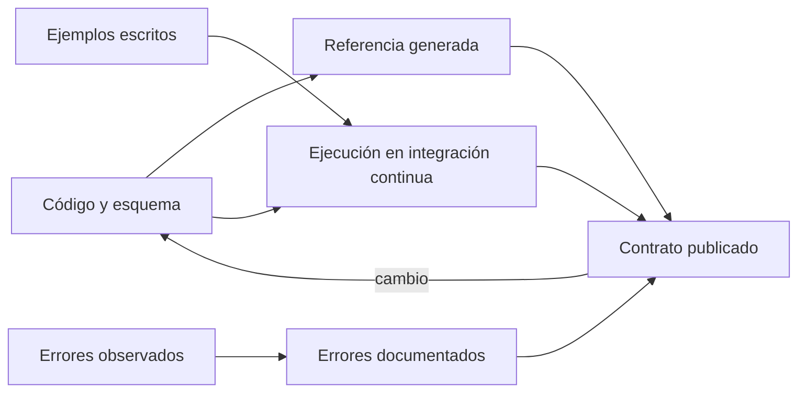
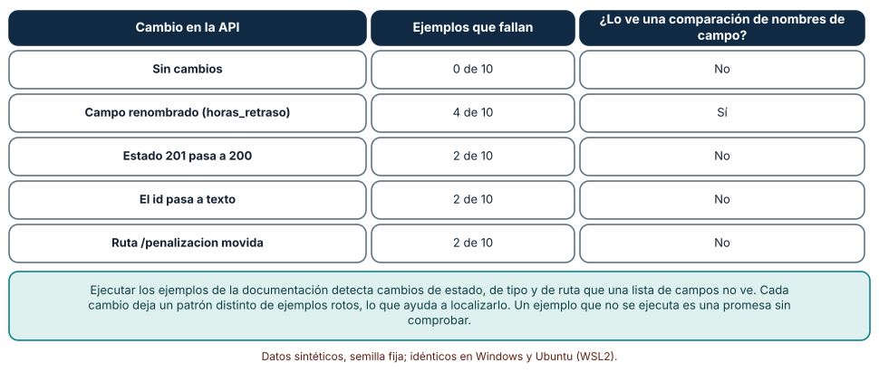
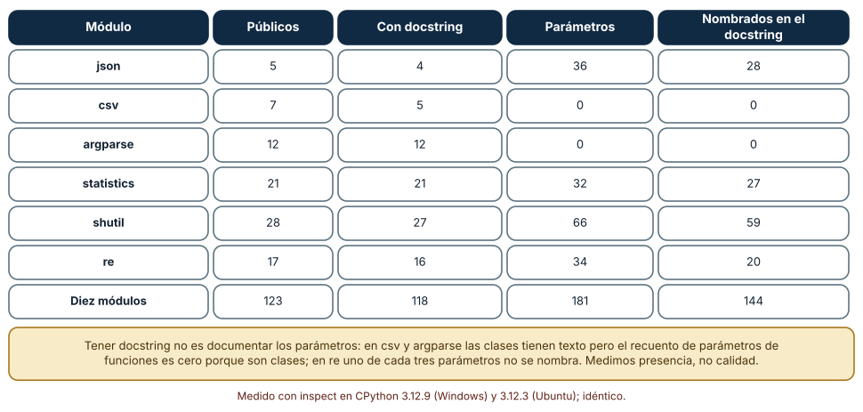
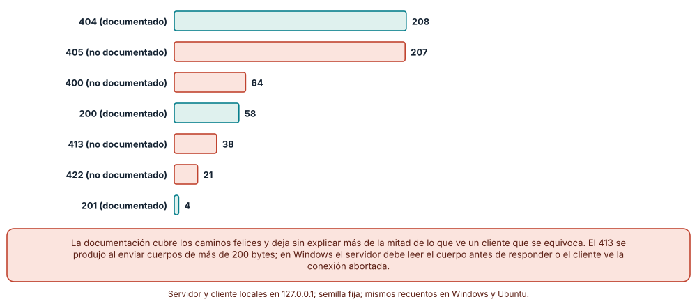

# SE-210 — API docs, ejemplos y contratos publicados

[← SE-209 — Diagramas, modelos y documentación visual](https://github.com/vladimiracunadev-create/modern-software-engineering-program/blob/main/classes/part-17-documentacion-y-conocimiento-tecnico/se-209-diagramas-modelos-y-documentacion-visual/README.md) · [↑ Parte 17](https://github.com/vladimiracunadev-create/modern-software-engineering-program/blob/main/classes/part-17-documentacion-y-conocimiento-tecnico/README.md) · [📚 Índice completo](https://github.com/vladimiracunadev-create/modern-software-engineering-program/blob/main/classes/README.md) · [🌐 Portal](https://vladimiracunadev-create.github.io/modern-software-engineering-program/classes/SE-210.html) · [SE-211 — Runbooks, playbooks y documentación operacional →](https://github.com/vladimiracunadev-create/modern-software-engineering-program/blob/main/classes/part-17-documentacion-y-conocimiento-tecnico/se-211-runbooks-playbooks-y-documentacion-operacional/README.md)

## Punto profesional y fundamento pedagógico

**Punto profesional.** La clase existe para que documentes una API de modo que quien la consume pueda usarla sin leer el código, y para que sepas qué parte de esa documentación se comprueba sola (ejemplos ejecutables, firmas, códigos de respuesta) y qué parte depende de que alguien la escriba y la mantenga. Una API publicada es una promesa a terceros, y su documentación es donde la promesa se escribe.

**Por qué aparece aquí.** Se sitúa después de **Diagramas, modelos y documentación visual** y antes de **Runbooks, playbooks y documentación operacional**: los diagramas mostraron estructura; esta clase documenta la frontera que otros cruzan, la que la Parte 13 describió como contrato (OpenAPI, compatibilidad y versionado) y que aquí se estudia desde el lado de quien lee y se equivoca. Deja la técnica de ejecutar los ejemplos que `SE-212` integrará en la publicación.

**Error conceptual que debe corregir.** Creer que una API documentada es una API con una especificación completa de campos. Un cliente que se equivoca recibe códigos de respuesta, mensajes y estados que la documentación casi nunca cubre, y un ejemplo que no se ejecuta es una promesa sin comprobar.

**Límite de la conclusión.** La API de los ejemplos es una función en proceso, el servidor es un `http.server` local de juguete y las bibliotecas de Python se miden por presencia de texto, no por calidad. No se auditó ninguna API real ni se midió la experiencia de nadie que la use.

### Trazabilidad fuente → afirmación

| Fuente primaria u oficial | Afirmación que respalda | Lo que no prueba |
|---|---|---|
| [OpenAPI Specification](https://spec.openapis.org/oas/latest.html) | Define un formato para describir interfaces HTTP, incluidas operaciones, parámetros, ejemplos y respuestas. | No garantiza que la descripción coincida con el servicio. |
| [RFC 9110, semántica de HTTP](https://www.rfc-editor.org/rfc/rfc9110) | Define el significado de los métodos y los códigos de estado, como 404, 405 o 422, que una API debe usar con coherencia. | No dice qué códigos debe documentar cada API. |
| [RFC 9457, detalles de problema para APIs HTTP](https://www.rfc-editor.org/rfc/rfc9457) | Propone un formato común para describir errores en las respuestas HTTP. | No obliga a adoptarlo ni cubre errores de red. |

## Antes de empezar

Retoma los modelos y el diagrama de `SE-209`. Un diagrama muestra qué módulos hablan; la API es lo que alguien de fuera puede llamar. La pregunta activa es: **¿qué debe saber quien consume esta API para usarla bien y para entender qué hacer cuando algo sale mal?**

## Prerrequisitos

- Haber completado `SE-209` o poder explicar qué relación muestra un diagrama de dependencias.
- Python 3.11 o posterior y un terminal; los experimentos usan solo la biblioteca estándar.
- Trabajar con la API sintética de la plataforma de entregas y con la biblioteca estándar de Python como corpus de lectura.

## Problema auténtico

La API de entregas de la plataforma documenta tres operaciones con un ejemplo cada una: crear, consultar y listar. Una cliente integra la importación de notas y envía un cuerpo vacío al crear una entrega: recibe un 400 con un mensaje que la documentación no menciona. Prueba con un identificador de texto en la consulta y recibe un 404 donde esperaba un 400. Envía un archivo grande y recibe un 413. En la documentación hay tres códigos; la cliente vio siete. Y cuando el equipo renombra un campo de `horas_retraso` a `horasRetraso`, el ejemplo de la documentación sigue usando el nombre antiguo, que sigue «funcionando» en la página porque nadie lo ejecutó.

## Objetivos observables

Al terminar podrás:

1. distinguir qué partes de la documentación de una API se generan del código, cuáles se escriben y cuáles deben ejecutarse;
2. ejecutar los ejemplos documentados contra una API y leer el patrón de ejemplos que fallan para localizar el cambio que los rompió;
3. medir qué fracción de las funciones públicas de un módulo tiene documentación y qué fracción de sus parámetros se nombra, y decir qué no mide;
4. comparar los códigos de respuesta observados con los documentados y explicar por qué la diferencia es la parte más cara de la documentación;
5. decidir qué errores documentar, con qué formato y con qué compromiso de estabilidad.

## Mapa conceptual



El diagrama se lee de izquierda a derecha: la referencia se genera del código y del esquema; los ejemplos se escriben, pero se ejecutan contra el código; los errores observados alimentan los errores documentados; las tres vías forman el contrato publicado. El retorno indica que un cambio en el código reabre las tres. No se dibuja el caso en que la documentación guía el diseño; ese camino existe (diseñar la API primero), pero esta clase estudia la documentación de una API que ya se puede llamar.

## Temas y por qué importan

| Tema | Por qué cambia una decisión profesional | Evidencia mínima |
|---|---|---|
| Referencia generada | Lo que se genera del código no puede contradecirlo; lo que se escribe aparte, sí. | Cobertura de documentación por función y por parámetro |
| Ejemplos ejecutables | Un ejemplo que se ejecuta es una prueba; uno que no, una promesa. | Ejemplos corridos en integración continua |
| Errores y códigos | El cliente se equivoca más que acierta; lo que ve entonces decide si puede corregirse solo. | Tabla de códigos observados frente a documentados |
| Contrato publicado | La documentación fija lo que no puede cambiarse sin aviso. | Declaración de lo estable y de lo experimental |
| Cobertura frente a calidad | Tener texto no es tener la explicación que el consumidor necesita. | Revisión humana de una muestra |

## Conceptos y decisiones

### 1. Referencia generada y referencia escrita

La referencia describe cada operación, parámetro, tipo y respuesta. Cuando se genera del código o de un esquema (por ejemplo, de las anotaciones y los docstrings de un módulo, o de una descripción OpenAPI), no puede contradecir lo que genera, pero hereda sus huecos: si el docstring de una función está vacío, la referencia también. Cuando se escribe aparte, puede ser más clara y puede mentir. La decisión relevante es qué parte generar (firmas, tipos, valores por defecto) y qué parte escribir (el propósito, las advertencias, los casos), y comprobar la coincidencia entre ambas.

### 2. Ejemplos que se ejecutan

Un ejemplo es el primer sitio al que va quien consume una API. Es también el primero que envejece: un campo renombrado, un estado cambiado o una ruta movida lo vuelven falso sin que el texto lo delate. La defensa es ejecutarlos: el mecanismo `doctest` de Python o un script de peticiones comprueban que la salida declarada es la real. Cada cambio de la API deja un patrón distinto de ejemplos rotos, lo que ayuda a localizar la causa, y un ejemplo que falla en la integración continua es un aviso temprano de que se rompió la promesa.

### 3. Errores: la parte que casi nadie documenta

La documentación suele cubrir el camino feliz. Pero quien integra una API pasa la mayor parte del tiempo equivocándose, y la respuesta a un error decide si puede corregirse sola o debe abrir una incidencia. La semántica de los códigos de estado HTTP está definida (404 no encontrado, 405 método no permitido, 422 entidad no procesable) y un formato común para el cuerpo del error, como el de «detalles de problema», permite que los clientes traten los fallos de forma uniforme. Documentar errores significa listar los códigos que la API puede devolver, qué los provoca y qué debe hacer el cliente, no solo cuáles existen.

### 4. Qué se promete: estabilidad y versionado

Una API publicada es una promesa a terceros. Documentarla incluye declarar qué es estable (no cambiará sin aviso y ventana), qué es experimental (puede cambiar) y qué es interno (no debe usarse). Sin esa declaración, cada cliente decide por su cuenta qué tomar como contrato, y el proveedor descubre cuáles eran al romperlos. La Parte 13 midió el efecto de esta ambigüedad en la compatibilidad; aquí interesa que el contrato escrito sea lo que el consumidor ve.

### 5. Cobertura no es calidad

Es fácil medir que una función tiene docstring; es difícil medir que el docstring sirve. Una métrica de presencia detecta lo que falta del todo, y es útil como alarma; no dice nada sobre si el texto explica los parámetros, los errores o los casos límite. Por eso la medición de cobertura se combina con una revisión humana de una muestra y con los ejemplos ejecutables. Una documentación puede tener cobertura del 100 % y ser inútil, o del 60 % y bastar si cubre lo que se usa.

### Diez ejemplos ejecutables frente a cinco cambios

Se define una API en proceso con cuatro operaciones y diez ejemplos de uso con su estado y campos esperados (crear dos entregas, consultarlas, listar, un 404, un 400, calcular una penalización dos veces y un método no permitido). Se ejecutan contra la versión original y contra cuatro versiones: una renombra el campo `horas_retraso`, otra devuelve 200 en lugar de 201 al crear, otra convierte el `id` en texto y otra mueve la ruta de penalización. También se aplica una comprobación estática ingenua que solo compara los nombres de campo documentados con los devueltos.

```python
for i, (metodo, ruta, cuerpo, estado, claves) in enumerate(EJEMPLOS, 1):
    s, r = api(metodo, ruta, cuerpo, version)
    ok = s == estado and all(k in r for k in claves)
    if ok and "id" in r and not isinstance(r["id"], int):
        ok = False
```

Resultado, idéntico en Windows (CPython 3.12.9) y Ubuntu (3.12.3): sin cambios fallan 0 ejemplos de 10; con el campo renombrado fallan 4; con el estado 201 cambiado a 200 fallan 2; con el `id` en texto fallan 2; con la ruta movida fallan 2. La comparación de nombres de campo solo detecta el renombrado; los otros tres cambios pasan inadvertidos para ella. Cada cambio deja un patrón distinto de ejemplos rotos, de modo que el patrón orienta sobre la causa: el que afecta a todos los ejemplos que leen un campo suele ser un nombre; el que afecta solo a los que crean, un estado.



**Cómo leer la figura.** Cada fila es un cambio de la API; las columnas dan los ejemplos que fallan de diez y si una comparación de nombres de campo lo habría visto. **Dónde deja de valer:** los diez ejemplos se escribieron conociendo los cambios, así que cubren justo lo que cambia; un cambio que ningún ejemplo ejerce pasaría sin ruido. Tampoco prueba que los ejemplos sean comprensibles: un ejemplo puede pasar y no enseñar nada.

### Qué dice la documentación de la biblioteca estándar

Se recorren diez módulos de la biblioteca estándar de Python 3.12 (`json`, `csv`, `argparse`, `statistics`, `textwrap`, `random`, `itertools`, `re`, `shutil`, `pathlib`) y se cuentan las funciones y clases públicas definidas en cada módulo, cuántas tienen docstring y, para las funciones, cuántos parámetros se nombran en su docstring.

```python
for nombre, obj in vars(modulo).items():
    if nombre.startswith("_") or not (inspect.isfunction(obj) or inspect.isclass(obj)):
        continue
    doc = inspect.getdoc(obj) or ""
    params = [p for p in inspect.signature(obj).parameters if p not in ("self", "cls")]
    nombrados += sum(bool(re.search(r"\b" + re.escape(p) + r"\b", doc)) for p in params)
```

De 123 funciones y clases públicas, 118 tienen docstring (96 %). De 181 parámetros de funciones, 144 se nombran en el docstring (80 %). Por módulo: `shutil` 27 de 28 con docstring y 59 de 66 parámetros nombrados; `statistics` 21 de 21 y 27 de 32; `re` 16 de 17 y 20 de 34; `json` 4 de 5 y 28 de 36. En `csv` y `argparse` el recuento de parámetros de funciones es cero porque lo público son sobre todo clases. Los resultados fueron idénticos en Windows y Ubuntu.



**Cómo leer la figura.** Cada fila es un módulo; las columnas son los elementos públicos, cuántos tienen docstring, los parámetros de funciones y cuántos se nombran en el docstring. **Dónde deja de valer:** la búsqueda de un nombre de parámetro en el texto es una aproximación (un parámetro puede nombrarse sin explicarse, o explicarse con otra palabra) y no mide métodos de clases. Mide presencia, no calidad: con 80 % de parámetros nombrados no se sabe si los nombrados están bien explicados.

### Códigos devueltos frente a códigos documentados

Se levanta un servidor HTTP local con `http.server` en una dirección de bucle y un puerto efímero. Su documentación declara tres códigos: 200, 201 y 404. Un cliente envía 600 peticiones aleatorias con semilla fija: GET y POST, DELETE y PUT, rutas válidas e inválidas, cuerpos correctos, vacíos, mal formados y demasiado grandes.

```python
srv = http.server.ThreadingHTTPServer(("127.0.0.1", 0), H)
...
for _ in range(600):
    metodo = rng.choice(["GET", "GET", "POST", "POST", "PUT", "DELETE"])
    req = urllib.request.Request(url, data=cuerpo, method=metodo)
```

De las 600 peticiones, 330 (55 %) devuelven códigos que la documentación no menciona. Distribución: 404 en 208, 405 en 207, 400 en 64, 200 en 58, 413 en 38, 422 en 21 y 201 en 4. Los códigos no documentados son 405 (método no permitido), 400 (petición mal formada), 413 (cuerpo demasiado grande) y 422 (falta un campo). Los recuentos fueron idénticos en ambos sistemas. En una primera ejecución en Windows, el servidor respondía 413 sin leer el cuerpo y el cliente vio la conexión abortada (`WinError 10053`); en Ubuntu la misma ejecución no falló. La corrección fue leer el cuerpo antes de responder: un detalle de comportamiento entre sistemas que ninguna documentación de la API mencionaría.



**Cómo leer la figura.** Cada barra es el número de respuestas con un código; las verdes están documentadas y las coral no. **Dónde deja de valer:** las peticiones son aleatorias y sesgadas hacia el error; un cliente real comete algunos errores con mucha más frecuencia que otros, y la distribución cambia. El 55 % depende de la mezcla de peticiones elegida; lo que se sostiene es que el camino feliz es una fracción pequeña de lo que el servidor devuelve.

## Definiciones de trabajo

- **referencia de API:** descripción de cada operación, parámetro y respuesta de una API, preferiblemente generada del código o de un esquema.
- **ejemplo ejecutable:** ejemplo de uso cuya salida declarada se compara con la real de forma automática.
- **código de estado:** número de tres cifras que indica el resultado de una petición HTTP según la semántica de HTTP.
- **cobertura de documentación:** fracción de elementos públicos de un módulo que tiene texto de documentación.
- **contrato publicado:** conjunto de comportamientos que el proveedor declara estables y que los clientes pueden asumir.

Las definiciones son operativas para el portal; no reemplazan las de las especificaciones enlazadas abajo.

## Ejemplo mínimo

El fragmento ejecuta los ejemplos documentados de una función con `doctest`. Antes de ejecutarlo, predice cuántos fallan.

```python
import doctest

def penalizar(nota, horas):
    """Resta un 10 % por día completo hasta un 50 %.

    >>> penalizar(80, 30)
    64
    >>> penalizar(80, 0)
    80
    >>> penalizar(80, 300)
    40
    """
    return nota if horas <= 0 else round(nota * (1 - min(0.1 * -(-horas // 24), 0.5)))

print(doctest.testmod())
```

La predicción correcta es `TestResults(failed=0, attempted=3)`. Registra versión del intérprete y salida; si cambias el tope a 0,4, predice antes qué ejemplo falla.

## Ejemplo profesional

La plataforma de entregas publica su API con una descripción OpenAPI mantenida junto al código, una referencia generada de ella y una página de errores con los siete códigos que el servidor puede devolver, cada uno con su causa y su remedio. Los diez ejemplos de la documentación se ejecutan en la integración continua contra el servicio de pruebas. La página declara qué rutas son estables (las de entregas), cuáles experimentales (las de importación) y cuáles internas. Cuando el equipo renombra un campo, cuatro ejemplos fallan y el pull request no se fusiona hasta actualizar la descripción, los ejemplos y el aviso de cambio.

Compara el caso normal con tres casos límite: el cliente que envía un cuerpo vacío (la página de errores le dice que falta `alumno` y cómo repararlo), el cambio que mantiene el nombre y cambia el significado (no lo ve la comparación de campos; lo ve un ejemplo con salida declarada) y el código de error nuevo (se añade a la página y al esquema antes de desplegarse).

## Práctica guiada

1. Crea `work/SE-210/` y escribe una API en proceso con cuatro operaciones y diez ejemplos con estado y campos esperados.
2. Ejecútalos contra la versión original y registra el resultado.
3. Aplica los cuatro cambios y anota el patrón de ejemplos rotos de cada uno.
4. Escribe la comparación de nombres de campo y comprueba qué cambios no ve.
5. Mide la cobertura de docstrings de dos módulos de la biblioteca estándar y de uno propio.
6. Levanta un servidor local, envía 600 peticiones con semilla fija y tabula los códigos observados.
7. Escribe la página de errores con causa y remedio para cada código observado.
8. Entrega `api-docs.md` con las cifras, los patrones y los cambios.

## Ejercicios

1. **Ejemplos:** añade tres ejemplos que ejerzan nota decimal, retraso negativo y alumno vacío, y predice qué cambio del experimento pasaría ahora inadvertido.
2. **Cobertura:** mide la cobertura de docstrings de un módulo propio y de uno de terceros y explica qué decisión cambiarías.
3. **Errores:** diseña la respuesta de error con los campos del formato de detalles de problema para el 422 de la plataforma y compárala con el mensaje actual.
4. **Contrato:** redacta la declaración de estabilidad de tres rutas (estable, experimental, interna) y la ventana de aviso antes de cambiar una estable.

## Reto verificable

Entrega la API de ejemplo, los diez ejemplos, el ejecutor, la tabla de códigos observados frente a documentados y la página de errores. Se aprueba si otra persona ejecuta los ejemplos desde un checkout limpio, obtiene los mismos fallos con los cuatro cambios y puede nombrar un cambio de la API que sus ejemplos no detectarían.

## Caso conductor

La API de la plataforma de entregas, cuyo contrato describió la Parte 13, queda documentada con ejemplos que se ejecutan y una página de errores. Esta clase deja el ejecutor de ejemplos, que `SE-212` integra en la publicación, y la tabla de códigos observados, que `SE-211` reutiliza al documentar qué hacer cuando un código inesperado aparece en producción.

## Preguntas frecuentes

### ¿Generar la referencia del código la hace buena?

La hace coherente con el código, no buena. Si los docstrings están vacíos, la referencia generada también. La generación elimina una clase de error (la contradicción) y deja intacta otra (la omisión).

### ¿Cuántos ejemplos debe tener una API?

Los suficientes para cubrir cada operación, un error común por operación y los casos límite que confunden. Más ejemplos cuestan mantenimiento; los que no se ejecutan, además, mienten.

### ¿Hay que documentar cada código de error?

Los que el cliente puede provocar y puede corregir, sí. Los que indican un fallo del servidor (500) se documentan como tales, con la recomendación de reintentar o avisar, no con una explicación interna.

### ¿Un esquema OpenAPI sustituye a la documentación?

Es la mitad mecánica. Describe campos, tipos y respuestas; no dice cuándo usar cada operación, qué errores son comunes ni qué es estable. Se completa con guías y explicaciones.

## Fallo controlado y diagnóstico

Reproduce el fallo clásico de la clase: **un ejemplo de la documentación que ya no funciona**. Renombra `horas_retraso` a `horasRetraso` en la API y ejecuta los diez ejemplos.

Registra síntoma, entrada mínima, hipótesis, observación que discrimina, causa, corrección y prueba de regresión. **Síntoma:** una cliente copia el ejemplo y recibe una respuesta sin el campo que esperaba. **Hipótesis rivales:** (a) la cliente escribió mal el campo; (b) el servidor tiene un error; (c) el ejemplo describe una versión anterior. **Observación que discrimina:** ejecuta los diez ejemplos; si fallan cuatro y todos leen ese campo, el cambio es de nombre y no un error aleatorio. **Causa:** el campo se renombró sin actualizar ejemplos ni descripción. **Corrección:** actualizar ejemplos y esquema, y mantener el nombre antiguo como alias durante una versión. **Prueba de regresión:** los ejemplos ejecutados en la integración continua. **Recuperación:** publicar el cambio en el registro de cambios y avisar a clientes conocidos.

## Errores comunes y cómo corregirlos

| Síntoma | Causa probable | Corrección |
|---|---|---|
| El ejemplo de la documentación devuelve algo distinto | Se escribió a mano y no se ejecuta | Ejecutarlo en la integración continua contra el servicio de pruebas |
| Los clientes reciben un código que la página no menciona | Solo se documentó el camino feliz | Registrar los códigos observados y documentar causa y remedio |
| La referencia generada tiene huecos | Los docstrings están vacíos | Medir la cobertura, exigir docstring en lo público y revisar una muestra |
| Un campo renombrado rompe a clientes sin aviso | No hay declaración de estabilidad ni ventana | Declarar qué es estable, avisar con antelación y mantener un alias |
| La respuesta de error es un texto distinto en cada ruta | No hay formato común | Adoptar un formato de errores uniforme y documentarlo una vez |

## Entorno y archivos clave

```text
work/SE-210/
├── README.md
├── api/entregas.py
├── ejemplos/ejemplos.json
├── experimentos/
│   ├── ejemplos_ejecutables.py
│   ├── cobertura_docstrings.py
│   └── codigos_observados.py
├── docs/errores.md
└── evidencia/api-docs.md
```

El `README` declara plataforma, versión de Python, semillas y comandos. Los experimentos usan solo la biblioteca estándar (`http.server`, `inspect`, `urllib`, `doctest`, `random`) y se ejecutaron con CPython 3.12.9 en Windows 11 y 3.12.3 en Ubuntu bajo WSL2 con resultados idénticos. El servidor escucha solo en la dirección de bucle local y se detiene al terminar; no lo expongas a una red.

## Seguridad, ética y accesibilidad

- los ejemplos no deben contener tokens, claves ni datos de personas reales: usa identificadores sintéticos y valores marcados como ejemplo;
- documentar errores no debe revelar detalles internos (rutas de archivos, consultas, versiones) que ayuden a un atacante;
- los límites de tamaño y de frecuencia son parte del contrato: documentarlos evita que se descubran por prueba y error;
- las páginas de referencia deben tener tablas con encabezados y ejemplos en bloques copiables con alternativa textual;
- redacta los mensajes de error en lenguaje claro y estable, pensando en quien los lee sin contexto;
- no ejecutes ejemplos de documentación ajena contra sistemas de producción de otros.

## Puente hacia el trabajo con agentes

Un agente al que se pide «documenta esta API» producirá una referencia limpia y ejemplos plausibles que nunca ejecutó, y no mencionará los códigos de error que no observó. Pídele que ejecute cada ejemplo contra un servicio de pruebas y adjunte la salida real, que liste los códigos observados con peticiones erróneas y que marque como no verificado lo que no pueda comprobar. Un agente que integra una API lee exactamente estas páginas: si los errores y los ejemplos son comprobables, puede corregirse solo. Quien revisa comprueba que los ejemplos se ejecutaron y no solo que el texto parece correcto.

## Transferencia

Traslada la técnica a otro dominio (por ejemplo, la API de un servicio de reparto con una operación de cálculo de tarifa): cambian las operaciones y los errores, se conservan la ejecución de ejemplos, la tabla de códigos observados y la declaración de estabilidad. La transferencia está lograda cuando puedes explicar qué parte del método depende del protocolo y cuál no.

## Evaluación y evidencia

| Criterio | Evidencia para aprobar |
|---|---|
| comprensión | explicación de qué partes de la documentación se generan, se escriben o se ejecutan, con un ejemplo de la plataforma |
| corrección | conteos reproducibles de ejemplos rotos por cambio y de códigos observados con las mismas semillas |
| diseño | diez ejemplos ejecutables, página de errores y declaración de estabilidad |
| diagnóstico | reproducción del fallo «ejemplo que ya no funciona» con regresión |
| incertidumbre | declaración de que la cobertura mide presencia, de que los ejemplos cubren lo que cambia y de que el servidor es local |
| reproducibilidad | versiones, comandos, salida y límites declarados |

## Fuentes

- [OpenAPI Specification](https://spec.openapis.org/oas/latest.html) — descripción formal de interfaces HTTP; autoridad: OpenAPI Initiative.
- [RFC 9110, semántica de HTTP](https://www.rfc-editor.org/rfc/rfc9110) — métodos y códigos de estado; autoridad: IETF.
- [RFC 9457, detalles de problema para APIs HTTP](https://www.rfc-editor.org/rfc/rfc9457) — formato común de errores; autoridad: IETF.
- [PEP 257, convenciones de docstrings](https://peps.python.org/pep-0257/) — qué debe contener un docstring; autoridad: Python Software Foundation.
- [Python: `doctest`](https://docs.python.org/3/library/doctest.html) — ejecución de ejemplos en la documentación; autoridad: documentación de Python.
- [Python: `inspect`](https://docs.python.org/3/library/inspect.html) — acceso a docstrings y firmas; autoridad: documentación de Python.
- [Sphinx: autodoc](https://www.sphinx-doc.org/en/master/usage/extensions/autodoc.html) — generación de referencia desde docstrings; autoridad: proyecto Sphinx.
- [Google Cloud: diseño de errores en APIs](https://cloud.google.com/apis/design/errors) — modelo de errores de una API a gran escala; autoridad: Google Cloud.
- [Robillard, «What Makes APIs Hard to Learn?» (IEEE Software, 2009)](https://doi.org/10.1109/MS.2009.193) — obstáculos de aprendizaje de APIs según desarrolladores; autoridad: IEEE Software.
- [Myers y Stylos, «Improving API Usability» (CACM, 2016)](https://doi.org/10.1145/2896587) — usabilidad de APIs y su evaluación; autoridad: Communications of the ACM.

Cada fuente respalda el mecanismo indicado; ninguna demuestra que ejecutar los ejemplos reduzca los errores de los clientes de una API concreta ni que el 55 % de códigos no documentados sea representativo. Esa afirmación depende del servicio y de sus clientes.

- [Python: `http.server`](https://docs.python.org/3/library/http.server.html) — servidor HTTP básico usado para el experimento local; autoridad: documentación de Python.

## Límites y siguiente paso

Se ejecutaron tres experimentos con datos sintéticos en Windows y Ubuntu (WSL2) con resultados idénticos tras corregir la lectura del cuerpo en el servidor. No se auditó ninguna API real ni se midió a ningún consumidor: la API es una función en proceso, el servidor es de juguete, las peticiones aleatorias exageran los errores y la cobertura de docstrings mide presencia. La siguiente clase documenta para quien opera el sistema cuando algo sale mal: runbooks y playbooks.

## Glosario

- **referencia de API:** descripción de cada operación, parámetro y respuesta de una API.
- **ejemplo ejecutable:** ejemplo cuya salida declarada se compara con la real de forma automática.
- **código de estado:** número que indica el resultado de una petición HTTP según su semántica.
- **cobertura de documentación:** fracción de elementos públicos con texto de documentación.
- **contrato publicado:** conjunto de comportamientos que el proveedor declara estables.

---

[← SE-209 — Diagramas, modelos y documentación visual](https://github.com/vladimiracunadev-create/modern-software-engineering-program/blob/main/classes/part-17-documentacion-y-conocimiento-tecnico/se-209-diagramas-modelos-y-documentacion-visual/README.md) · [↑ Parte 17](https://github.com/vladimiracunadev-create/modern-software-engineering-program/blob/main/classes/part-17-documentacion-y-conocimiento-tecnico/README.md) · [📚 Índice completo](https://github.com/vladimiracunadev-create/modern-software-engineering-program/blob/main/classes/README.md) · [🌐 Portal](https://vladimiracunadev-create.github.io/modern-software-engineering-program/classes/SE-210.html) · [SE-211 — Runbooks, playbooks y documentación operacional →](https://github.com/vladimiracunadev-create/modern-software-engineering-program/blob/main/classes/part-17-documentacion-y-conocimiento-tecnico/se-211-runbooks-playbooks-y-documentacion-operacional/README.md)
