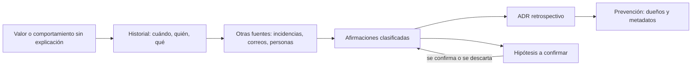
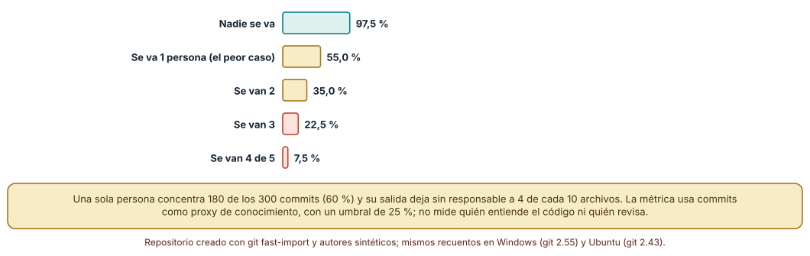
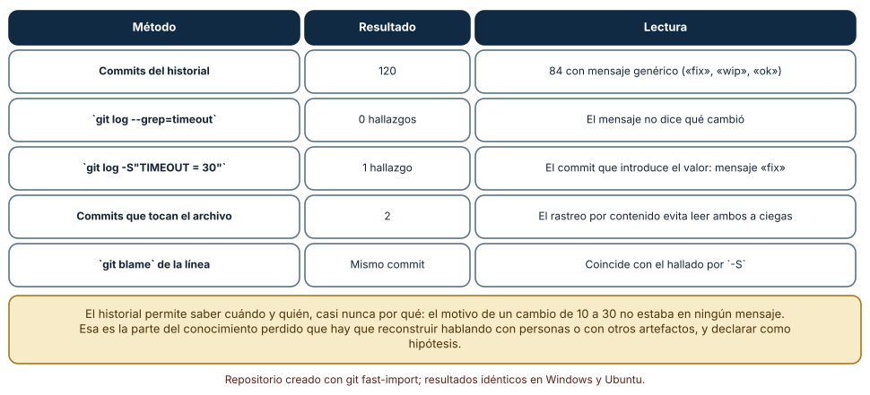
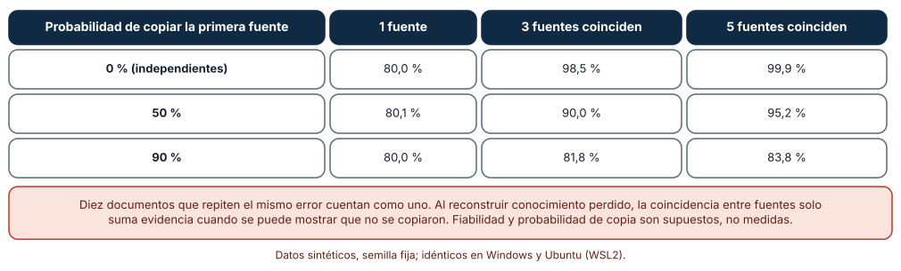

# SE-215 — Taller: reconstruir conocimiento perdido

[← SE-214 — Documentación para humanos, máquinas y LLM](https://github.com/vladimiracunadev-create/modern-software-engineering-program/blob/main/classes/part-17-documentacion-y-conocimiento-tecnico/se-214-documentacion-para-humanos-maquinas-y-llm/README.md) · [↑ Parte 17](https://github.com/vladimiracunadev-create/modern-software-engineering-program/blob/main/classes/part-17-documentacion-y-conocimiento-tecnico/README.md) · [📚 Índice completo](https://github.com/vladimiracunadev-create/modern-software-engineering-program/blob/main/classes/README.md) · [🌐 Portal](https://vladimiracunadev-create.github.io/modern-software-engineering-program/classes/SE-215.html) · [SE-216 — Proyecto: portal documental versionado →](https://github.com/vladimiracunadev-create/modern-software-engineering-program/blob/main/classes/part-17-documentacion-y-conocimiento-tecnico/se-216-proyecto-portal-documental-versionado/README.md)

## Punto profesional y fundamento pedagógico

**Punto profesional.** El taller existe para que practiques lo que ocurre cuando la documentación no se escribió o ya no se encuentra: recuperar qué hizo el sistema, cuándo cambió y por qué, a partir de lo que sobrevive en el historial y en las personas, y declarar con honestidad qué es evidencia, qué es inferencia y qué es hipótesis. Es el ensayo del trabajo más caro de la documentación: el que se hace tarde.

**Por qué aparece aquí.** Se sitúa después de **Documentación para humanos, máquinas y LLM** y antes del proyecto **Portal documental versionado**: las diez clases anteriores construyeron la documentación que debería haber; esta trabaja con su ausencia. Retoma los ADR retrospectivos de `SE-208`, los metadatos de `SE-214` y los comprobadores de `SE-212`, y entrega al proyecto final una lista de lo que un portal debe capturar antes de que se pierda.

**Error conceptual que debe corregir.** Creer que el historial de control de versiones responde a «¿por qué?». Responde bien a «¿cuándo?» y «¿quién?» y casi nunca a «¿por qué?»; y creer que varias fuentes que coinciden prueban un hecho, cuando pueden venir de la misma copia.

**Límite de la conclusión.** El repositorio es sintético, creado con `git fast-import` y autores inventados, y la concentración de autoría y la tasa de mensajes genéricos son supuestos del autor. No se analizó ningún repositorio real ni se entrevistó a nadie.

### Trazabilidad fuente → afirmación

| Fuente primaria u oficial | Afirmación que respalda | Lo que no prueba |
|---|---|---|
| [Avelino et al., «A novel approach for estimating Truck Factors» (ICPC, 2016)](https://doi.org/10.1109/ICPC.2016.7503718) | Propone estimar el factor de camión de un proyecto a partir de la autoría de archivos y lo aplica a repositorios de código abierto. | No valida la medida como predictor del riesgo en un proyecto concreto. |
| [Rigby et al., «Quantifying and mitigating turnover-induced knowledge loss» (ICSE, 2016)](https://doi.org/10.1145/2884781.2884851) | Estudia la pérdida de conocimiento que causa la salida de personas en un proyecto y propone medidas para mitigarla. | No generaliza a cualquier equipo. |
| [Git: `git log` (opción `-S`)](https://git-scm.com/docs/git-log) | Documenta la búsqueda de commits que cambian el número de apariciones de una cadena. | No dice por qué se hizo el cambio. |

## Antes de empezar

Retoma el registro de decisiones de `SE-208` y el esquema de metadatos de `SE-214`. Ahora se supone que nada de eso existía. La pregunta activa es: **si la persona que lo sabía ya no está, ¿qué queda, qué puedo deducir, qué debo dejar como hipótesis y cómo evito que vuelva a pasar?**

## Prerrequisitos

- Haber completado `SE-214` o poder explicar qué metadatos valida un esquema y qué no ve.
- Python 3.11 o posterior, Git instalado y un terminal.
- Trabajar con repositorios sintéticos creados por los experimentos; no se analiza ningún repositorio real.

## Problema auténtico

La plataforma de entregas tiene un valor de configuración, `TIMEOUT = 30`, que alguien cambió de 10 hace dos años. Una exportación a la secretaría falla desde que se despliega en un entorno nuevo, y nadie sabe si 30 es deliberado. La persona que lo cambió dejó el proyecto. El historial tiene 120 commits, de los cuales 84 dicen «fix», «wip» u «ok». El README no lo menciona y no hay ADR. Al mismo tiempo, el equipo descubre que casi toda la autoría del módulo de cálculo corresponde a una sola persona, que está a punto de irse.

## Objetivos observables

Al terminar podrás:

1. localizar con herramientas de Git el commit que introdujo un valor y distinguir lo que el historial responde (cuándo, quién, qué) de lo que no (por qué);
2. estimar el riesgo de concentración de conocimiento de un repositorio y calcular cuántos archivos quedan sin responsable al irse k personas;
3. clasificar cada afirmación de una reconstrucción como observada, inferida o hipótesis y justificar la clasificación;
4. calcular cuánto aporta la coincidencia de varias fuentes según su independencia;
5. convertir una reconstrucción en un ADR retrospectivo, un runbook o un cambio de proceso que reduzca la pérdida futura.

## Mapa conceptual



El diagrama se lee de izquierda a derecha: un comportamiento sin explicación lleva al historial, que responde cuándo, quién y qué; otras fuentes aportan el porqué; cada afirmación se clasifica y se convierte en un ADR retrospectivo o en una hipótesis por confirmar; la prevención (dueños, metadatos) cierra el ciclo. Las hipótesis vuelven al conjunto de afirmaciones cuando se confirman o se descartan. No hay un orden obligatorio: a veces el correo aparece antes del commit.

## Temas y por qué importan

| Tema | Por qué cambia una decisión profesional | Evidencia mínima |
|---|---|---|
| Qué se pierde y cómo | El conocimiento explícito sobrevive en artefactos; el tácito, solo en personas. | Inventario de artefactos supervivientes |
| Concentración de autoría | Si pocas personas lo saben, su salida deja archivos sin responsable. | Curva de archivos con responsable al irse k personas |
| Arqueología del historial | Las herramientas de Git localizan el cuándo; el porqué requiere otras fuentes. | Commit localizado y lo que no responde |
| Evidencia y clasificación | Mezclar lo observado con lo supuesto convierte una reconstrucción en un relato. | Tabla de afirmaciones con su clase |
| Fuentes independientes | Varias fuentes que se copiaron cuentan como una. | Análisis de independencia de las fuentes |

## Conceptos y decisiones

### 1. Qué conocimiento se pierde

El conocimiento explícito (código, documentos, mensajes, incidencias) sobrevive en artefactos, aunque pueda ser difícil de encontrar. El tácito (por qué se descartó una opción, qué se probó antes, qué pasó la última vez) vive en las personas y se pierde cuando se van, cambian de equipo o simplemente olvidan. Rigby y colegas estudian cuánto de ese conocimiento se pierde con la rotación y qué medidas lo reducen. Para la documentación, la implicación es práctica: lo que no se escribió no se puede recuperar, solo reconstruir; y la reconstrucción siempre es parcial.

### 2. Concentración de autoría y factor de camión

El factor de camión (o de autobús) es el número de personas que tendrían que desaparecer para que el proyecto se quedara sin conocimiento suficiente. Se estima a partir de la autoría: quién escribe qué archivos y con qué proporción. Un archivo tiene responsable si alguien concentra al menos una proporción mínima de sus cambios (aquí, el 25 %); la métrica es proxy, no certeza: quien más commits tiene no es necesariamente quien mejor lo entiende, y quien revisa no aparece. Aun así, calcular cuántos archivos quedan sin responsable al irse k personas convierte una intuición en un riesgo medible.

### 3. Arqueología: lo que el historial responde y lo que no

Git guarda cada cambio con autor, fecha y mensaje. La búsqueda por contenido (`git log -S"TIMEOUT = 30"`) encuentra el commit que cambió el número de apariciones de esa cadena, y `git blame` atribuye cada línea actual a su último cambio. Con ellas se responde cuándo y quién. El porqué solo está si el mensaje o una incidencia lo dicen, y en un historial donde la mayoría de mensajes es «fix», casi nunca lo dice. Buscar por mensaje falla por la misma razón: el motivo no está en el texto que se busca. La reconstrucción debe declarar esto como límite.

### 4. Evidencia: observado, inferido, hipótesis

Una reconstrucción honesta clasifica cada afirmación. Observado: «el commit X cambió `TIMEOUT` de 10 a 30 el día D» (verificable en el historial). Inferido: «el cambio coincidió con la incorporación de la exportación a la secretaría» (deducido de fechas y archivos tocados). Hipótesis: «se aumentó porque la exportación tardaba más de 10 segundos» (plausible, no comprobado). Mezclar las tres clases en un párrafo fluido convierte un relato verosímil en un hecho. La tabla de afirmaciones con su clase, su fuente y lo que la confirmaría es el entregable.

### 5. Independencia de las fuentes

Dos documentos que dicen lo mismo no prueban el hecho si uno copió del otro. La coincidencia suma evidencia en la medida en que las fuentes son independientes: un correo, un commit y una incidencia escritos por personas distintas en momentos distintos valen más que tres páginas derivadas de una misma. Por eso, al reconstruir, se pregunta de cada fuente de dónde obtuvo la información, y se cuenta como una las que comparten origen. La coincidencia de copias da una sensación de certeza que la evidencia no respalda.

### Quién sabe qué: concentración de autoría en un repositorio sintético

Se crea con `git fast-import` un repositorio de 300 commits sobre 40 archivos, con cinco autores sintéticos cuya productividad decrece (peso 1 sobre el rango elevado a 1,3). Cada autor tiene afinidad por 14 archivos y en el 80 % de sus commits toca uno de ellos. Se lee el historial con `git log --name-only` y se cuenta, por archivo, la proporción de commits de cada autor. Un archivo tiene responsable si alguien concentra al menos el 25 % de sus cambios. Después se calcula, para cada k, el peor subconjunto de k personas que se van: el que deja menos archivos con responsable.

```python
cubierto = {f: {a for a, c in owner[f].items() if c / sum(owner[f].values()) >= 0.25}
            for f in files if owner[f]}
for gone in itertools.combinations(autores, k):
    vivos = sum(1 for f, s in cubierto.items() if s - set(gone))
    peor = min(peor, 100 * vivos / len(files))
```

Resultado, idéntico en Windows (git 2.55, CPython 3.12.9) y Ubuntu (git 2.43, CPython 3.12.3): los commits por autor son 180, 59, 31, 21 y 9. El 97,5 % de los archivos tiene responsable (uno nunca se tocó). Si se va la persona de mayor impacto, queda el 55,0 %; con dos, el 35,0 %; con tres, el 22,5 %; con cuatro de las cinco, el 7,5 %.



**Cómo leer la figura.** Cada barra es el porcentaje de archivos con algún responsable que supera el umbral de 25 % en el peor caso para ese número de bajas. **Dónde deja de valer:** los commits son un proxy del conocimiento; la persona que revisa, diseña o decide sin tocar archivos no aparece, y la que hizo un cambio masivo de formato parece dueña de todo. El umbral de 25 % y la distribución de afinidades son supuestos del autor; con otro umbral, las cifras cambian, y la forma (caída fuerte con la primera baja) es la que se sostiene.

### Arqueología con y sin mensajes útiles

Se crea otro repositorio sintético con 120 commits. En el commit 71 el valor `TIMEOUT` pasa de 10 a 30 con el mensaje «fix». De los 120 mensajes, 84 son genéricos («fix», «update», «wip», «cambios», «ajustes», «ok») y el resto describe el cambio. Se busca el cambio de tres maneras.

```bash
git log --oneline --grep=timeout -i
git log --oneline -S "TIMEOUT = 30" -- servicio/config.py
git blame -L1,1 --porcelain servicio/config.py
```

Buscar «timeout» en los mensajes no encuentra ningún commit. La búsqueda por contenido encuentra exactamente uno, el que introduce el valor, cuyo mensaje es «fix». `git blame` apunta a ese mismo commit. Solo dos commits tocaron el archivo de configuración (la creación y el cambio). Los resultados fueron idénticos en Windows y Ubuntu.



**Cómo leer la figura.** Cada fila es un método o una medida del historial; las columnas dan el resultado y su lectura. **Dónde deja de valer:** el cambio es una sola línea en un archivo que casi nunca se toca, el caso favorable a la búsqueda por contenido; si el valor se hubiera movido de archivo, formateado o dividido, la búsqueda necesitaría seguir los renombrados (`--follow` o `-M`) y podría fallar. El hallazgo central es el límite: el historial dice cuándo y quién, y el motivo no estaba en ningún mensaje.

### Cuánto suman varias fuentes que coinciden

Se simulan 100 000 casos por celda. Un hecho es verdadero o falso con igual probabilidad. La primera fuente acierta con probabilidad 0,8. Cada fuente adicional, con probabilidad `c`, copia a la primera; con probabilidad `1 − c`, es independiente y acierta con 0,8. Se cuenta la exactitud solo en los casos en que todas las fuentes coinciden.

```python
primera = verdad if rng.random() < 0.8 else not verdad
votos = [primera] + [primera if rng.random() < c
                     else (verdad if rng.random() < 0.8 else not verdad)
                     for _ in range(k - 1)]
```

Con fuentes independientes (c = 0), una fuente da 80,0 % de exactitud; si tres coinciden, 98,5 %; si cinco coinciden, 99,9 %. Con copia del 50 %: 80,1 %, 90,0 % y 95,2 %. Con copia del 90 %: 80,0 %, 81,8 % y 83,8 %. Cuando casi todo se copia, que cinco fuentes coincidan apenas mejora una sola.



**Cómo leer la figura.** Cada fila es una probabilidad de copia y las columnas son el número de fuentes que coinciden; cada celda es la exactitud entre los casos de coincidencia total. **Dónde deja de valer:** la fiabilidad de 0,8, la copia directa de la primera fuente y la simetría entre verdadero y falso son supuestos; las fuentes reales se copian parcialmente, entre sí y con distintos sesgos. La enseñanza es de forma: la coincidencia sin independencia casi no suma.

## Definiciones de trabajo

- **conocimiento perdido:** información sobre un sistema que ya no está documentada ni disponible en las personas que lo conocieron.
- **factor de camión:** número de personas cuya salida dejaría al proyecto sin conocimiento suficiente de una parte esencial.
- **búsqueda por contenido:** consulta al historial de Git que encuentra los commits que cambian el número de apariciones de una cadena.
- **ADR retrospectivo:** registro de una decisión escrito después de tomarla, que declara su fecha de escritura y distingue lo observado de lo inferido.
- **independencia de fuentes:** propiedad de dos fuentes cuyo contenido no procede de un origen común.

Las definiciones son operativas para el portal; no reemplazan las de las fuentes enlazadas abajo.

## Ejemplo mínimo

El fragmento crea un historial de tres commits y localiza el que cambió un valor. Antes de ejecutarlo, predice cuántos commits devuelve la búsqueda por contenido.

```bash
git init -q -b main demo && cd demo
printf 'TIMEOUT = 10\n' > c.py && git add c.py && git -c user.name=a -c user.email=a@example.invalid commit -qm "inicio"
printf 'TIMEOUT = 30\n' > c.py && git -c user.name=a -c user.email=a@example.invalid commit -qam "fix"
printf 'X = 1\n' > d.py && git add d.py && git -c user.name=a -c user.email=a@example.invalid commit -qm "otro"
git log --oneline -S "TIMEOUT = 30" -- c.py
```

La predicción correcta es un commit, el segundo, con el mensaje «fix». Registra la versión de Git; si buscas `TIMEOUT = 10`, predice antes cuántos commits aparecen (los dos que cambian su número de apariciones: el que lo introduce y el que lo elimina).

## Ejemplo profesional

El equipo de la plataforma aplica el taller al valor `TIMEOUT = 30`. Localiza el commit con `git log -S`, observa que su mensaje es «fix» y que cambió también un archivo de exportación, deduce que el cambio coincidió con la incorporación de la exportación a la secretaría y formula la hipótesis de que se amplió porque tardaba más de 10 segundos. Busca una incidencia de esa fecha, encuentra una conversación en la que la persona que lo cambió menciona un cierre de semestre, y la cita como segunda fuente, independiente del commit. Escribe un ADR retrospectivo que separa «observado», «inferido» e «hipótesis», fija una condición de revisión y se lo muestra a quien opera la exportación.

Compara el caso normal con tres casos límite: el commit con un mensaje útil (la reconstrucción es corta), el valor movido de archivo (hay que seguir los renombrados) y el relato que coincide en tres documentos copiados de uno solo (se cuenta como una fuente).

## Práctica guiada

1. Crea `work/SE-215/` y genera el repositorio de 120 commits con `git fast-import` y semilla fija.
2. Localiza el cambio de `TIMEOUT` con búsqueda por mensaje, búsqueda por contenido y `git blame`.
3. Escribe qué respondió cada método y qué no.
4. Genera el repositorio de 300 commits y calcula los archivos con responsable al irse 1, 2 y 3 personas.
5. Redacta la tabla de afirmaciones con su clase (observada, inferida, hipótesis), su fuente y lo que la confirmaría.
6. Para cada fuente, anota su origen y marca cuáles comparten origen.
7. Escribe el ADR retrospectivo con fecha de escritura y condición de revisión.
8. Propón tres cambios de proceso que habrían evitado la pérdida y entrégalos en `reconstruccion.md`.

## Ejercicios

1. **Búsqueda:** mueve la configuración a otro archivo en el commit 90 y comprueba qué ocurre con `-S` con y sin `--follow`.
2. **Autoría:** cambia el umbral de responsable del 25 % al 40 % y calcula cómo cambia la curva; explica qué decisión cambiarías.
3. **Clasificación:** reescribe cinco frases de un relato de incidente como observadas, inferidas o hipótesis.
4. **Independencia:** diseña una forma de comprobar si dos documentos comparten origen y aplícala a dos páginas de un proyecto.

## Reto verificable

Entrega los dos repositorios sintéticos (scripts para crearlos), las búsquedas y sus resultados, la curva de responsables, la tabla de afirmaciones y el ADR retrospectivo. Se aprueba si otra persona ejecuta los scripts desde un checkout limpio, obtiene los mismos hallazgos, y puede señalar qué afirmación de tu ADR es hipótesis y qué la confirmaría.

## Caso conductor

El taller somete al portal de la plataforma de entregas a su peor día: sin ADR, sin README del valor y con la persona clave ausente. Deja la tabla de afirmaciones, el ADR retrospectivo y la lista de cambios de proceso (dueños por archivo, mensajes con porqué, ADR para decisiones difíciles de revertir), que `SE-216` incorpora como requisitos del portal versionado.

## Preguntas frecuentes

### ¿Puedo confiar en `git blame` para saber quién decidió algo?

Para saber quién modificó la línea por última vez, sí; para saber quién decidió o por qué, no. Un cambio de formato posterior puede ocultar al autor original, y quien commitea no siempre es quien decidió.

### ¿Cuántos autores hacen falta para tener un factor de camión sano?

No hay un número universal: depende del tamaño y la criticidad de cada parte. Lo que conviene vigilar es que ninguna parte esencial dependa de una sola persona, y compartir la autoría con revisiones y rotación.

### ¿Cómo evito que mi reconstrucción parezca una certeza?

Clasificando cada afirmación, citando su fuente y escribiendo qué la confirmaría o la descartaría. Un ADR retrospectivo debe poder leerse sin confundir lo que se vio con lo que se supone.

### ¿Y si la persona que lo sabía sigue disponible?

Habla con ella antes de reconstruir: es la fuente más barata. Pero trátala como una fuente más, con fecha y límites de memoria, y registra su respuesta como afirmación atribuida.

## Fallo controlado y diagnóstico

Reproduce el fallo clásico de la clase: **dar por cierto un porqué que nadie escribió**. Con el historial sintético, busca la razón del cambio de `TIMEOUT` en los mensajes y escribe la que parezca más plausible.

Registra síntoma, entrada mínima, hipótesis, observación que discrimina, causa, corrección y prueba de regresión. **Síntoma:** un ADR afirma que el tiempo se amplió «por la lentitud de la exportación», y al probarlo en un entorno nuevo la exportación tarda 2 segundos. **Hipótesis rivales:** (a) la exportación era lenta entonces y ya no lo es; (b) el valor se amplió por otra razón; (c) la afirmación se infirió sin evidencia. **Observación que discrimina:** revisa el commit y las incidencias de la fecha; si no hay mención de la exportación como causa, la afirmación es una hipótesis presentada como hecho. **Causa:** se confundió un relato plausible con una fuente. **Corrección:** reescribir el ADR con la hipótesis marcada, la fuente que falta y la prueba que la confirmaría. **Prueba de regresión:** una revisión que rechaza ADR retrospectivos sin la clasificación de cada afirmación. **Recuperación:** avisar a quien tomó una decisión con ese ADR y revisarla.

## Errores comunes y cómo corregirlos

| Síntoma | Causa probable | Corrección |
|---|---|---|
| La reconstrucción cuenta una historia coherente y nadie puede comprobarla | Mezcla observación, inferencia e hipótesis | Clasificar cada afirmación y citar su fuente |
| La búsqueda por mensaje no encuentra el cambio | El mensaje no dice qué cambió | Buscar por contenido y por archivo, y seguir los renombrados |
| Se cree que hay muchas fuentes y son una | Las fuentes comparten origen | Preguntar de dónde obtuvo cada fuente su información |
| Se atribuye la decisión a quien hizo el commit | Se confunde autoría de la línea con decisión | Contrastar con incidencias y conversaciones, y atribuir con cautela |
| El conocimiento vuelve a perderse | No se cambió el proceso | Dueños por área, ADR para decisiones difíciles de revertir y mensajes con el porqué |

## Entorno y archivos clave

```text
work/SE-215/
├── README.md
├── repos/
│   ├── crear_historial.py
│   └── crear_autoria.py
├── experimentos/
│   ├── factor_bus.py
│   ├── arqueologia.sh
│   └── fuentes.py
├── adr/adr-retrospectivo-timeout.md
└── evidencia/reconstruccion.md
```

El `README` declara plataforma, versión de Python y de Git, semillas y comandos. Los experimentos usan la biblioteca estándar y Git (`git fast-import`, `git log`, `git blame`) y se ejecutaron con CPython 3.12.9 y Git 2.55 en Windows 11, y con CPython 3.12.3 y Git 2.43 en Ubuntu bajo WSL2, con resultados idénticos. Los repositorios se crean en directorios temporales con autores inventados y direcciones reservadas, y se eliminan al terminar.

## Seguridad, ética y accesibilidad

- una reconstrucción sobre personas puede convertirse en una acusación: describe cambios y condiciones, no culpas, y evita nombres cuando basta un rol;
- el historial puede contener secretos, datos personales y direcciones: revísalo antes de compartir fragmentos y no lo copies a documentos públicos;
- no uses el factor de camión para evaluar el desempeño de las personas; es un indicador de riesgo del sistema;
- al entrevistar a quien conoce el tema, pide su consentimiento para registrar lo que diga y atribúyelo con fecha;
- redacta el ADR retrospectivo con encabezados claros y lenguaje llano para que otra persona pueda revisarlo con un lector de pantalla;
- respeta las licencias y los acuerdos de confidencialidad de los materiales que consultes.

## Puente hacia el trabajo con agentes

Un agente al que se pide «averigua por qué se cambió este valor» redactará un porqué convincente a partir de nombres de archivos y mensajes vagos, y lo presentará como un hecho. Pídele que use las herramientas de Git para localizar el commit y que clasifique cada afirmación como observada, inferida o hipótesis, citando la salida del comando; que marque lo que no pueda comprobar y que no atribuya decisiones a personas sin una fuente. Un agente también ayuda a rastrear: puede ejecutar `git log -S` en cientos de valores. Quien revisa comprueba cada afirmación observada contra el historial y cada hipótesis contra lo que la confirmaría.

## Transferencia

Traslada el taller a otro dominio (por ejemplo, un valor de tarifa de espera en un servicio de reparto): cambian el repositorio y las fuentes, se conservan la búsqueda por contenido, la clasificación de afirmaciones, el análisis de independencia y el ADR retrospectivo. La transferencia está lograda cuando puedes explicar qué parte de la reconstrucción depende de Git y cuál sigue valiendo sin él.

## Evaluación y evidencia

| Criterio | Evidencia para aprobar |
|---|---|
| comprensión | explicación de qué responde y qué no responde el historial, y de la diferencia entre factor de camión y rendimiento |
| corrección | hallazgos reproducibles de la búsqueda, de la curva de responsables y de las fuentes con las mismas semillas |
| diseño | tabla de afirmaciones clasificadas, ADR retrospectivo y cambios de proceso propuestos |
| diagnóstico | reproducción del fallo «porqué presentado como hecho» con regresión |
| incertidumbre | declaración de que los repositorios son sintéticos y de qué afirmaciones son hipótesis |
| reproducibilidad | versiones de Python y de Git, comandos, salida y límites declarados |

## Fuentes

- [Avelino et al., «A novel approach for estimating Truck Factors» (ICPC, 2016)](https://doi.org/10.1109/ICPC.2016.7503718) — estimación del factor de camión a partir de la autoría; autoridad: IEEE/ACM ICPC.
- [Rigby et al., «Quantifying and mitigating turnover-induced knowledge loss» (ICSE, 2016)](https://doi.org/10.1145/2884781.2884851) — pérdida de conocimiento por rotación; autoridad: ACM/IEEE ICSE.
- [Git: `git log`](https://git-scm.com/docs/git-log) — opciones `-S` y `--grep`; autoridad: documentación de Git.
- [Git: `git blame`](https://git-scm.com/docs/git-blame) — atribución de líneas al último cambio; autoridad: documentación de Git.
- [Git: `git fast-import`](https://git-scm.com/docs/git-fast-import) — creación de historiales sintéticos; autoridad: documentación de Git.
- [Parnas y Clements, «A Rational Design Process: How and Why to Fake It» (IEEE TSE, 1986)](https://doi.org/10.1109/TSE.1986.6312940) — documentar el razonamiento después de los hechos con honestidad sobre su origen; autoridad: IEEE Transactions on Software Engineering.

Cada fuente respalda el mecanismo indicado; ninguna demuestra que el factor de camión estimado por commits prediga la pérdida real de conocimiento de tu proyecto ni que la búsqueda por contenido siempre localice un cambio. Esa afirmación depende del repositorio y de las personas.

## Límites y siguiente paso

Se ejecutaron tres experimentos con datos sintéticos en Windows y Ubuntu (WSL2) con resultados idénticos. No se analizó ningún repositorio real ni se entrevistó a nadie: la autoría concentrada, la proporción de mensajes genéricos y la fiabilidad de las fuentes son supuestos del autor, y la búsqueda por contenido se probó con un cambio de una línea. La siguiente clase reúne todo en un proyecto: un portal documental versionado, con las comprobaciones y las lecciones de este taller.

## Glosario

- **conocimiento perdido:** información sobre un sistema que ya no está documentada ni disponible en las personas que lo conocieron.
- **factor de camión:** número de personas cuya salida dejaría al proyecto sin conocimiento suficiente de una parte esencial.
- **búsqueda por contenido:** consulta al historial que encuentra los commits que cambian el número de apariciones de una cadena.
- **ADR retrospectivo:** registro de una decisión escrito después de tomarla, que distingue lo observado de lo inferido.
- **independencia de fuentes:** propiedad de dos fuentes cuyo contenido no procede de un origen común.

---

[← SE-214 — Documentación para humanos, máquinas y LLM](https://github.com/vladimiracunadev-create/modern-software-engineering-program/blob/main/classes/part-17-documentacion-y-conocimiento-tecnico/se-214-documentacion-para-humanos-maquinas-y-llm/README.md) · [↑ Parte 17](https://github.com/vladimiracunadev-create/modern-software-engineering-program/blob/main/classes/part-17-documentacion-y-conocimiento-tecnico/README.md) · [📚 Índice completo](https://github.com/vladimiracunadev-create/modern-software-engineering-program/blob/main/classes/README.md) · [🌐 Portal](https://vladimiracunadev-create.github.io/modern-software-engineering-program/classes/SE-215.html) · [SE-216 — Proyecto: portal documental versionado →](https://github.com/vladimiracunadev-create/modern-software-engineering-program/blob/main/classes/part-17-documentacion-y-conocimiento-tecnico/se-216-proyecto-portal-documental-versionado/README.md)
