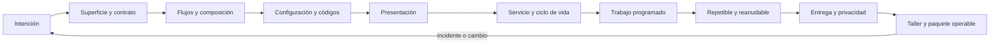

# Parte 18 — CLI, TUI, servicios y automatización

La Parte 17 terminó con una documentación que otra persona puede seguir. La pregunta cambia de «cómo se explica» a «qué ocurre cuando alguien, o algo, ejecuta la herramienta». Esta parte trabaja sobre `notas`, una **herramienta de línea de comandos sintética** de la plataforma de entregas de tareas que recorre las doce clases: una gramática con dos lectores, un flujo de datos por tuberías, una configuración con fuentes en conflicto, códigos de salida que habilitan decisiones, una presentación que sobrevive a un registro y a un lector de pantalla, un servicio con ciclo de vida, trabajos programados, una publicación que se puede repetir, una entrega con integridad y escalones, una telemetría que pide permiso, un taller que rompe una copia de seguridad diez veces y un paquete que otra persona revisa sin ejecutar nada.

## Pregunta rectora

> ¿Qué contrato observa una persona o un proceso consumidor y cómo termina la herramienta de forma segura?

## Antes del recorrido clase por clase

Esta parte no enseña una biblioteca ni un lenguaje. Enseña a decidir qué promete la superficie de una herramienta, a medir cuántas promesas implícitas rompe un cambio, a componerla con otras sin trazas ni retrasos, a ordenar sus fuentes de configuración con los bordes (vacío, cero, «false») resueltos, a elegir códigos que habiliten decisiones y a no depender del texto de un mensaje, a presentar sin romper la salida que otro programa lee, a darle a un servicio estados, preparación y un cierre ordenado, a repartir trabajo sin solapes ni bloqueos, a hacer cada operación repetible y reanudable, a entregarla con integridad y reversión, a medir sin vigilar y a probar todo eso en dos sistemas. Cada clase ejecuta experimentos con datos sintéticos o procesos locales que muestran un mecanismo (una abreviatura que deja de valer, un código 256 que se lee como éxito, un color que parte una búsqueda, un terminate que no limpia, un hilo que ralentiza un cálculo, un reemplazo que falla en Windows) y declara lo que ese experimento no demuestra.

El diagrama se lee de izquierda a derecha y no es un proceso obligatorio. El retorno indica que un incidente, un cambio de plataforma o una discrepancia entre el manifiesto y la herramienta reabre la intención; un paquete aprobado no cierra la operación, la fecha.

## Resultados acumulativos

Podrás escribir el contrato de una herramienta y medir qué abreviaturas rompe un flag nuevo; verificar qué código, qué flujo y cuántos bytes produce cada invocación; manejar el cierre de una tubería en Windows y en Linux; decidir entre cargar un archivo e iterarlo con la memoria medida; enumerar la precedencia de la configuración y sus bordes; interpretar booleanos del entorno sin invertir su sentido; elegir cómo recibe la herramienta un secreto; diseñar una tabla de códigos, propagar los fallos de una tubería y limitar los reintentos; condicionar el color al destino, truncar sin perder la diferencia y alinear texto Unicode; dar a un servicio estados, sondas, drenado y reinicio con espera; escoger una política de solape, hilos o procesos y una cola con trabajos apartados; clasificar operaciones por idempotencia, publicar con reemplazo atómico y reanudar sin duplicar; verificar un artefacto, ordenar versiones y desplegar por escalones; decidir qué telemetría recoger y cuánta aprende de quienes aceptan; inyectar fallos a una automatización y endurecerla; y entregar un paquete operable con manifiesto, suite de contrato, evidencia en dos plataformas y decisiones humanas abiertas.

Al finalizar podrás defender una herramienta con un contrato probado, una política de configuración, de errores, de ciclo de vida, de reanudación, de entrega y de privacidad, un responsable y una lista de lo que ninguna prueba ve, y podrás indicar qué parte de tu conclusión es observación, cuál es inferencia y cuál es suposición.

## Prerrequisitos enlazados

- [Parte 5 — Fundamentos de programación](https://github.com/vladimiracunadev-create/modern-software-engineering-program/blob/main/classes/part-05-fundamentos-de-programacion/): funciones, archivos, excepciones y pruebas con la biblioteca estándar.
- [Parte 8 — Entornos, herramientas y depuración](https://github.com/vladimiracunadev-create/modern-software-engineering-program/blob/main/classes/part-08-entornos-herramientas-y-depuracion/): terminal, procesos, variables de entorno y diferencias entre Windows y Linux.
- [Parte 9 — Bibliotecas, paquetes, SDK y automatización](https://github.com/vladimiracunadev-create/modern-software-engineering-program/blob/main/classes/part-09-bibliotecas-paquetes-sdk-y-automatizacion/): paquetes, versiones y automatización básica.
- [Parte 13 — Especificaciones, contratos y modelos](https://github.com/vladimiracunadev-create/modern-software-engineering-program/blob/main/classes/part-13-especificaciones-contratos-y-modelos/): contratos, mutantes y compatibilidad que esta parte aplica a una herramienta.
- [Parte 17 — Documentación y conocimiento técnico](https://github.com/vladimiracunadev-create/modern-software-engineering-program/blob/main/classes/part-17-documentacion-y-conocimiento-tecnico/): documentación orientada a tareas que el paquete final necesita.
- Python 3.11+ y terminal; para la comparación de sistemas, Windows y WSL2 con Ubuntu. Los experimentos usan solo la biblioteca estándar.

## Bloques y progresión

1. **Superficie y flujos:** las clases 217–218 definen qué promete la herramienta y cómo se compone con otras por entrada y salida estándar.
2. **Configuración, códigos y presentación:** las clases 219–221 deciden de dónde sale cada valor, qué dice la herramienta al terminar y cómo se presenta a personas y a registros.
3. **Procesos de larga vida y trabajo programado:** las clases 222–224 dan ciclo de vida a un servicio, reparten trabajo y hacen cada operación repetible y reanudable.
4. **Entrega y privacidad:** las clases 225–226 distribuyen y actualizan la herramienta y deciden qué se mide de ella.
5. **Aplicar e integrar:** las clases 227–228 endurecen una automatización con fallos inyectados y reúnen todo en un paquete operable.

## Evidencia medida y límites

Las figuras y los ejemplos de esta parte usan experimentos ejecutados con CPython 3.12.9 en Windows 11 y repetidos con CPython 3.12.3 en Ubuntu 24.04 bajo WSL2. Los datos son **sintéticos** o proceden de **procesos locales** creados por los propios experimentos, y las semillas están fijadas (217, 218, 220, 221, 223, 225, 226, 227 y 228, además de las de simulaciones auxiliares). Las salidas fueron idénticas en ambos sistemas salvo las diferencias que se informan como resultados: el tamaño de un mensaje de `argparse` (139 y 143 bytes), la excepción de una tubería cerrada (`OSError` con `errno` 22 en Windows y `BrokenPipeError` con `errno` 32 en Ubuntu), los códigos de salida fuera de 0–255 y los de procesos terminados por señal, la terminación de un hijo (`terminate()` forzado en Windows, `SIGTERM` capturable en Ubuntu), el reemplazo de un archivo abierto (rechazado en Windows, permitido en Ubuntu), el citado de nombres de archivo con `shell=True`, el hash de un archivo escrito con el modo de texto por defecto (`a5b38bad23415ba9` en Windows y `9105e05b084e0394` en Ubuntu, iguales con el salto de línea fijado) y todos los tiempos (arranque de Python, velocidad de resumen, hilos y procesos, falsos fallos de pruebas con espera fija), que son medidas de un equipo con 8 procesadores lógicos y variaron entre ejecuciones.

Los experimentos son: 15 prefijos de flags antes y después de añadir tres opciones, el contrato observable de cinco invocaciones y la sugerencia de comandos ante 294 erratas (`SE-217`); la latencia de la primera línea por una tubería, el cierre anticipado del consumidor y el pico de memoria al leer 400 000 líneas (`SE-218`); seis resolvedores de precedencia frente a 64 combinaciones, catorce cadenas booleanas y la visibilidad de un secreto sintético (`SE-219`); trece formas de terminar un proceso, seis guiones de bash y tres políticas de reintento sobre 10 000 trabajos (`SE-220`); el coste del color en una tubería, 500 identificadores truncados y 1 000 nombres alineados (`SE-221`); la terminación de un hijo, la ventana entre «vivo» y «preparado» y 600 s de reinicios (`SE-222`); un trabajo cada 60 s con tres políticas de solape, hilos y procesos, y 1 000 trabajos con 35 venenosos (`SE-223`); siete operaciones repetidas, seis estrategias frente a 40 escenarios de caída y el reemplazo con el destino abierto (`SE-224`); las alteraciones de un archivo de 20 MB, 10 000 clientes con lanzamientos escalonados y el arranque y el orden de versiones (`SE-225`); la unicidad de 5 000 instalaciones, una compuerta de consentimiento con seis defectos y el sesgo de quien acepta telemetría (`SE-226`); diez fallos inyectados en una copia de seguridad, un contador compartido por tres procesos y el citado de doce nombres (`SE-227`); y trece pruebas de contrato con seis defectos, 102 mutantes de un manifiesto y las esperas fijas frente a las esperas por evento (`SE-228`).

Los parámetros (los nombres de flags, las duraciones lognormales con sigma 0,35, los porcentajes de trabajos venenosos y transitorios, la mezcla de fallos y la probabilidad de recuperación del 70 %, los retardos de arranque de 0,5 y 0,8 s, los atributos y las probabilidades de las 5 000 instalaciones, las tasas de aceptación de telemetría y de adopción, el umbral del 1 % de los escalones y las diez fallas del taller) son supuestos del autor, no datos de un producto, una organización ni de personas reales. Los defectos inyectados son variaciones escritas por el autor sobre herramientas de juguete: que una suite los detecte no prueba que no existan otros. La herramienta `notas.py` es sintética y de cien líneas. No se midió ningún terminal interactivo, lector de pantalla, servicio de Windows, unidad de systemd, orquestador, cron, cola real, firma digital, marco de actualización (TUF) ni telemetría de personas; no se usó macOS; no se auditó ningún producto ni se entrevistó a nadie; y no se evaluó el cumplimiento de ninguna norma de protección de datos. Esta parte no tiene laboratorio propio en `labs/`; el proyecto integrador `SE-228` define el paquete y la evidencia. Cada clase termina con un puente hacia el trabajo con agentes.

## Guía razonada clase por clase

La herramienta `notas` mantiene una gramática, una tabla de códigos y un paquete estables mientras cambian las decisiones. Cada clase explica qué promesa implícita hace explícita, qué experimento la muestra, qué no demuestra y qué evidencia permite abandonar la conclusión.

### Bloque 1 — Superficie y flujos

#### SE-217 — Diseño de interfaces de línea de comandos

Una CLI es una API con dos lectores y cada flag aceptado es una promesa. La clase mide cuántas abreviaturas de flags dejan de valer al pasar de cinco a ocho opciones, verifica el código, el flujo y el tamaño de cada tipo de invocación y compara tres umbrales de sugerencia ante errores de tecleo, declarando que una sugerencia no debe ejecutarse sola.

El estudiante escribe el contrato de la herramienta y su política de compatibilidad. `SE-218` pregunta cómo fluye la información por esa superficie.

#### SE-218 — Entrada estándar, salida y composición por pipes

Una herramienta bien compuesta lee de un flujo, separa datos y diagnóstico, entrega a tiempo y calla cuando el consumidor se va. La clase mide cuándo llega la primera línea por una tubería con cuatro formas de vaciar el búfer, qué excepción recibe el productor en cada sistema cuando el consumidor cierra y cuánta memoria cuesta cargar un archivo frente a iterarlo.

El estudiante entrega la tabla de flujos de `notas` y el manejo de la tubería rota. `SE-219` pregunta de dónde sale cada valor de configuración.

### Bloque 2 — Configuración, códigos y presentación

#### SE-219 — Configuración, flags, archivos y precedencia

La precedencia se rompe en los bordes: vacío, cero, «false». La clase enumera 64 combinaciones para seis resolvedores defectuosos, interpreta catorce cadenas booleanas con `bool()` y con un analizador estricto y comprueba dónde es visible un secreto sintético según se pase por flag, entorno o archivo.

El estudiante entrega la tabla de precedencia con sus casos de borde y la regla del secreto. `SE-220` pregunta qué dice la herramienta al terminar.

#### SE-220 — Códigos de salida, errores y diagnóstico

Un código habilita una decisión solo si es portable y distingue lo temporal de lo permanente. La clase mide trece formas de terminar un proceso en Windows y en Ubuntu, seis guiones de bash que pierden o propagan fallos en una tubería y el coste de tres políticas de reintento sobre 10 000 trabajos.

El estudiante entrega la tabla de códigos con la decisión de cada uno. `SE-221` pasa a la presentación para una persona.

#### SE-221 — TUI, terminales y accesibilidad

La presentación no debe romper la salida que otro programa lee ni depender del color. La clase mide el coste de bytes y de búsqueda de un informe con color en una tubería, cuántos de 500 identificadores siguen siendo distintos al truncarlos y cuántas de 1 000 filas con nombres Unicode se desalinean si se rellena con `len()`.

El estudiante entrega la política de presentación de `notas` con modo plano. `SE-222` pasa de procesos que terminan a procesos de larga vida.

### Bloque 3 — Procesos de larga vida y trabajo programado

#### SE-222 — Daemons, servicios y ciclo de vida

Vivo no es preparado, y pedir terminar no es obligar. La clase compara `terminate()` con `CTRL_BREAK_EVENT` en Windows y con `SIGTERM` en Ubuntu, mide la ventana de peticiones que fallan según cuándo se declara preparado un servicio y cuenta los arranques de un servicio que siempre falla con cuatro políticas de reinicio.

El estudiante entrega el ciclo de vida de `notas servir` con sondas, plazo de drenado y reinicio con espera. `SE-223` pregunta qué hace el servicio por dentro.

#### SE-223 — Schedulers, workers y trabajos por lotes

Un planificador promete arrancar, no terminar. La clase simula 1 440 ejecuciones con tres políticas de solape, mide cuándo ayudan los hilos y cuándo los procesos y sigue 1 000 trabajos con 35 venenosos bajo tres políticas de reintento, mostrando cómo un solo trabajo imposible puede dejar a 994 sin procesar.

El estudiante entrega la política de solape, de concurrencia y de fallos de `notas`. `SE-224` hace cada operación repetible.

#### SE-224 — Automatización idempotente y reanudable

Reanudar sin una clave duplica o pierde, según el orden de escribir y marcar. La clase clasifica siete operaciones repetidas, evalúa seis estrategias de escritura frente a 40 escenarios de caída y compara el reemplazo de un archivo abierto en Windows y en Ubuntu.

El estudiante entrega la clasificación de las operaciones y la publicación con claves y reemplazo atómico. `SE-225` aplica la técnica a la actualización de un binario.

### Bloque 4 — Entrega y privacidad

#### SE-225 — Distribución de binarios y actualizaciones

Integridad no es origen, y un lanzamiento a todos a la vez convierte un defecto en una incidencia total. La clase mide qué alteraciones de un archivo de 20 MB detectan la longitud, un CRC32 y SHA-256, simula lanzamientos defectuosos con y sin escalones sobre 10 000 clientes y compara el orden de diez versiones como texto y como tuplas.

El estudiante entrega el contrato de entrega con verificación, escalones y reversión. `SE-226` pregunta cómo obtener la señal de salud sin vigilar.

#### SE-226 — Telemetría opt-in y privacidad en herramientas

Atributos inocuos identifican en conjunto, y quien acepta no representa a quien usa. La clase mide cuántas de 5 000 instalaciones quedan únicas al combinar uno a seis atributos, prueba una compuerta de consentimiento con seis defectos y cuantifica el sesgo de estimar solo con quienes aceptan.

El estudiante entrega el inventario de eventos y la política de consentimiento. `SE-227` integra todo en un taller.

### Bloque 5 — Aplicar e integrar

#### SE-227 — Taller: endurecer una automatización frágil

Los fallos de una automatización son un conjunto finito y se inyectan. El taller clasifica diez escenarios de una copia de seguridad en dos versiones, mide la actualización perdida de un contador compartido con y sin bloqueo y compara el citado de doce nombres de archivo con `shell=True` y con una lista de argumentos.

El estudiante deja la matriz antes y después y una lista de fallos que el taller no cubrió. `SE-228` los empaqueta.

#### SE-228 — Proyecto: herramienta operable multiplataforma

Un manifiesto declara; las pruebas de contrato comprueban; y lo que ninguno ve exige a una persona. El proyecto ejecuta trece pruebas de contrato en dos sistemas, las prueba con seis defectos inyectados, valida un manifiesto con 102 mutantes y compara esperas fijas con esperas por evento.

El estudiante entrega el paquete operable con la tabla de diferencias entre plataformas y las decisiones humanas abiertas. La Parte 19 pasa de las herramientas de terminal a la plataforma web y las aplicaciones progresivas.

## Proyecto integrador

`SE-228` pide un paquete `operable-package/` con la herramienta, un manifiesto de 17 campos, una suite de contrato, la salida de esa suite en Windows y en Ubuntu, una tabla de diferencias entre plataformas, el registro de defectos inyectados y una lista de decisiones humanas abiertas. Quien lo revisa debe poder entender en diez minutos qué promete la herramienta y qué se comprobó, sin ejecutar nada, y decidir qué queda sin comprobar.

## Criterios de salida

- cada promesa observable del manifiesto remite a una prueba que se ejecuta, y lo que no tiene prueba se declara;
- la suite pasa en dos sistemas y las diferencias están explicadas, no escondidas;
- la suite se probó con defectos inyectados y cada uno cayó en al menos una prueba;
- ninguna prueba depende de una espera fija de tiempo;
- hay una lista de decisiones humanas abiertas con responsable y fecha;
- cada afirmación de seguridad, de plataforma o de privacidad tiene evidencia o está marcada como no comprobada;
- las fuentes enlazadas se verificaron y ninguna se presenta como prueba de que la herramienta sea adecuada.

## Preguntas de control por bloque

1. **Superficie y flujos:** ¿qué flag, qué código y qué flujo de tu herramienta son contrato y cuáles son presentación? ¿Qué ocurre cuando el consumidor cierra la tubería?
2. **Configuración, códigos y presentación:** ¿qué cuenta como «definido» en cada fuente de configuración? ¿Qué decisión habilita cada código? ¿Qué pierde una búsqueda si el color se fuerza en un archivo?
3. **Procesos de larga vida y trabajo programado:** ¿qué significa «preparado» para tu servicio? ¿Qué pasa si una ejecución dura más que su periodo? ¿Qué impide que un trabajo imposible bloquee a los demás?
4. **Entrega y privacidad:** ¿qué prueba el resumen que publicas y qué no? ¿Qué señal detiene un escalón? ¿Quién no aparece en tu telemetría?
5. **Aplicar e integrar:** ¿qué fallo de tu automatización termina con éxito aparente? ¿Qué afirmación de tu manifiesto no puede comprobar ninguna máquina?

## Fuentes de la parte

- [Command Line Interface Guidelines](https://clig.dev/) — principios de diseño de interfaces de línea de comandos; autoridad: guía de autores, de uso extendido.
- [POSIX: Utility Conventions](https://pubs.opengroup.org/onlinepubs/9699919799/basedefs/V1_chap12.html) — sintaxis de opciones y argumentos; autoridad: The Open Group.
- [POSIX: Shell Command Language](https://pubs.opengroup.org/onlinepubs/9699919799/utilities/V3_chap02.html) — tuberías, redirecciones y estado de salida; autoridad: The Open Group.
- [sysexits(3)](https://man.freebsd.org/cgi/man.cgi?query=sysexits) — vocabulario de códigos de salida; autoridad: proyecto FreeBSD.
- [The Twelve-Factor App](https://12factor.net/config) — configuración, procesos desechables y registros; autoridad: guía de autores, de uso extendido.
- [systemd.service](https://www.freedesktop.org/software/systemd/man/latest/systemd.service.html) — ciclo de vida y reinicio de servicios; autoridad: proyecto systemd.
- [Kubernetes: sondas de actividad, preparación e inicio](https://kubernetes.io/docs/tasks/configure-pod-container/configure-liveness-readiness-startup-probes/) — vivo frente a preparado; autoridad: documentación de Kubernetes.
- [RFC 9110: Idempotent Methods](https://www.rfc-editor.org/rfc/rfc9110.html#name-idempotent-methods) — definición de idempotencia; autoridad: IETF.
- [NIST FIPS 180-4: Secure Hash Standard](https://csrc.nist.gov/pubs/fips/180-4/upd1/final) — funciones hash aprobadas; autoridad: NIST.
- [Sweeney, «k-anonymity» (2002)](https://doi.org/10.1142/S0218488502001648) — modelo de anonimato por grupos; autoridad: International Journal of Uncertainty, Fuzziness and Knowledge-Based Systems.
- [Python: `subprocess` y consideraciones de seguridad](https://docs.python.org/3/library/subprocess.html#security-considerations) — ejecución de procesos sin shell; autoridad: documentación de Python.

Las fuentes se vinculan también dentro de cada clase. Definen vocabulario y mecanismos; la adecuación de las decisiones de la herramienta `notas` se demuestra con el caso, la evidencia trazable y la revisión de otra persona, no con la autoridad de la fuente.
